# Claude Code 모델 선택

[Claude 문서](../Claude/Claude.md)에서 API 관점의 모델 비교를, [Claude Code 실전 팁](Claude_Code_Tips.md)에서 모델 선택을 간단히 다뤘다. 이 문서는 **Claude Code 에이전틱 실행 환경에서** 각 모델이 어떻게 다르게 동작하는지, 그리고 어떤 작업에 어떤 모델을 골라야 하는지에 집중한다.

현재 Claude Code에서 고르는 라인업은 Opus 4.8, Opus 4.7, Sonnet 4.6, Haiku 4.5다. 표에서 Opus는 4.8을 기준으로 쓰고, 4.7과 갈리는 곳에만 버전을 따로 적는다. 4.7에서 4.8로 바뀐 내용은 [Claude Opus 4.8](../Claude/Claude_Opus_4_8.md)에 정리돼 있다. Claude Code에서는 모델 이름 뒤에 `[1m]`을 붙여야 1M 창으로 잡히고(§3), Fast 모드가 되는 모델은 CLI 버전마다 다르다(§2).

별칭, 환경변수, 설정 파일 우선순위처럼 직접 돌려서 확인한 항목은 Claude Code 2.1.111에서 2026-10-16에 `claude --model X -p ... --output-format json`으로 찍은 결과다. 응답 JSON의 `modelUsage`에 실제로 호출된 모델 ID와 `contextWindow`가 나온다. `/model`과 `/fast`는 헤드리스 `-p`에서 `isn't available in this environment`로 거절돼 실행하지 못했다. 이 둘은 설치된 CLI 소스의 문자열과 키바인딩 표를 읽어서 확인했고, 본문에서 그렇게 구분해 적었다.

---

## 1. 에이전틱 실행에서 모델별 도구 사용 패턴

API에서 Claude를 호출하면 한 번의 요청-응답이다. Claude Code는 다르다. 모델이 스스로 도구를 골라서 호출하고, 결과를 보고, 다음 도구를 고르는 과정을 반복한다. 이 자율적인 판단 과정에서 모델 간 차이가 확연하게 드러난다.

아래 도식은 Claude Code가 한 요청을 처리하는 반복 구조다. 모델별 차이는 `loop` 안에서 몇 번 도는지, 그리고 처음에 어떤 도구를 고르는지에서 나온다.

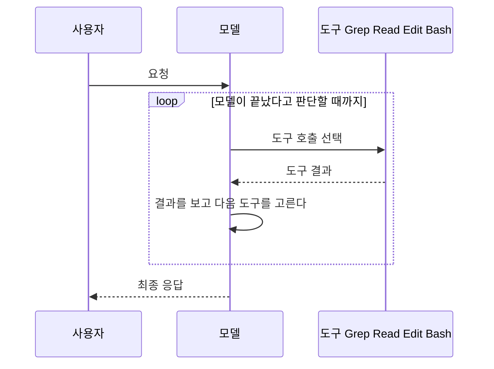

### Opus 4.7 — 넓게 탐색하고, 확인 후 작업한다

Opus 4.7은 Sonnet과 비교하면 코드를 수정하기 전에 주변 맥락을 먼저 파악하려 한다. "이 함수를 고쳐줘"라고 시키면, 해당 함수만 보는 게 아니라 호출하는 쪽, 테스트 코드, 관련 타입 정의까지 Grep과 Glob으로 먼저 훑는다.

```
사용자: "UserService.updateProfile에서 이메일 중복 체크 빠져있어. 추가해줘."

Opus 4.7의 도구 호출 순서:
1. Grep: "updateProfile" → 호출부 확인
2. Read: UserService.ts → 메서드 전체 코드 확인
3. Grep: "email" + "duplicate" → 기존 중복 체크 패턴 탐색
4. Read: UserRepository.ts → DB 접근 계층 확인
5. Read: user.service.spec.ts → 기존 테스트 패턴 확인
6. Edit: UserService.ts → 중복 체크 로직 추가
7. Edit: user.service.spec.ts → 테스트 추가
8. Bash: npm test → 검증
```

도구 호출이 많아서 비용과 시간이 든다. 하지만 "기존 패턴을 따라서" 수정하기 때문에, 코드 스타일이 튀지 않고 엣지 케이스를 놓치는 일이 적다. 4.6 대비 4.7은 사전 탐색 단계에서 중복 Read를 덜 하는 편이다. 같은 파일을 3번씩 읽어들이는 일이 줄었다.

다만 4.7은 탐색을 일찍 끊는 편이라 리플렉션이나 문자열로 부르는 호출 같은 동적 참조는 놓치는 경우가 있다. 위 순서는 정적으로 따라갈 수 있는 코드일 때의 전형이다. 동적 참조가 얽힌 코드면 요청에 그 사실을 적어주는 편이 낫다.

### Opus 4.8 — 4.7보다 덜 서두른다

Opus 4.8은 4.7과 같은 자리의 모델이고 단가도 같다. 바뀐 건 도구를 부르는 판단과 추론 길이다. 아래 표는 [Claude Opus 4.8](../Claude/Claude_Opus_4_8.md)에 적힌 변화 중 Claude Code 세션에 걸리는 것만 옮겼다. 이 문서에서 4.7과 4.8을 같은 작업으로 맞비교해 재지는 않았다. 그래서 호출 횟수 차이 같은 수치는 4.8 문서에도 없는 만큼 적지 않는다.

| | Opus 4.7 | Opus 4.8 |
|---|---|---|
| 탐색 | 일찍 끊고 실행으로 넘어간다. 동적 참조를 놓치는 경우가 있다 | 단순한 수정은 4.7처럼 바로 처리한다. 파급이 큰 변경은 호출부를 한 번 더 확인하고 들어간다 |
| 도구 호출 횟수 | 기준 | 비슷하거나 약간 많다 |
| 같은 에러가 반복될 때 | 같은 방법을 되풀이하는 경우가 있다 | 접근 자체를 바꾸는 판단이 빠르다 |
| 어려운 문제의 추론 | 중간 가정을 건너뛰는 경우가 있다 | 중간 단계를 더 붙잡는다. 내부 추론이 길어져 느리게 느껴질 수 있다 |
| 서로 충돌하는 지시 | 뒤에 나온 것을 따르는 쪽 | 우선순위를 잡고, 모호하면 어느 쪽을 따랐는지 밝힌다 |

느려졌다고 느끼는 원인이 대개 마지막 두 행에 있다. 모델이 일을 더 하는 쪽에서 오는 지연이라 Fast로 풀 일인지 effort를 낮출 일인지부터 따진다(§2, §12).

4.7 시절 CLAUDE.md에 "동적 참조도 확인해라", "호출부를 빠짐없이 찾아라" 같은 보완 문장을 넣어뒀다면 손봐야 한다. 4.8 문서에는 이런 지시가 남아 있으면 4.8이 과하게 탐색해서 도구 호출만 늘어난다고 적혀 있다. 모델을 올린 첫 주에는 이런 문장을 하나씩 빼면서 결과가 유지되는지 본다.

### Sonnet 4.6 — 직선적으로 해결한다

Sonnet은 목표 지점으로 바로 간다. 같은 요청을 받으면 해당 파일을 읽고, 수정하고, 테스트를 돌린다. 중간에 주변 코드를 넓게 탐색하는 단계가 짧다.

```
Sonnet 4.6의 도구 호출 순서:
1. Read: UserService.ts
2. Edit: UserService.ts → 중복 체크 로직 추가
3. Bash: npm test → 검증
```

대부분의 일반적인 작업에서는 이 정도면 충분하다. 문제가 생기는 건 수정 범위가 여러 파일에 걸치거나, 기존 패턴과 다른 방식으로 구현해버릴 때다. Sonnet이 Repository에서 `findByEmail`이 이미 있는데도 직접 쿼리를 작성하는 식이다.

### Haiku 4.5 — 단순 작업에서만 쓴다

Haiku는 변수명 변경, 주석 추가, import 정리 같은 단순 작업에 적합하다. 멀티스텝 도구 호출이 필요한 작업에서는 중간에 맥락을 잃는 경우가 잦다. 앞에서 읽은 파일 내용을 다음 도구 호출에서 제대로 반영하지 못하거나, 도구 호출 자체를 잘못 구성하는 경우가 있다.

"파일 3개를 읽고, 공통 인터페이스를 추출해줘" 같은 작업을 Haiku에게 시키면, 첫 번째 파일의 구조를 세 번째 파일을 처리할 때 이미 잊어버리는 식이다.

---

## 2. Fast 모드의 정체

Claude Code에서 `/fast`로 토글하거나 설정에서 Fast 모드를 켤 수 있다. 이걸 켜면 "Sonnet으로 바뀌는 건가?" 하고 착각하기 쉽다. Sonnet으로 바뀌지는 않는다. Fast는 같은 Opus를 더 빠른 출력 속도로 돌리는 설정이다.

문제는 어느 Opus에서 되느냐다. 이 지점에서 기록이 셋으로 갈린다.

| 출처 | Fast가 되는 모델 | 켤 때 동작 |
|---|---|---|
| 설치된 Claude Code 2.1.111 | Opus 4.6 | `/fast` 설명문이 `Toggle fast mode (Opus 4.6 only)`다. 모델 이름에 `opus-4-6`이 들어 있어야 켜진다. 다른 모델로 바꾸면 꺼진다는 안내문이 있다 |
| [Claude Opus 4.7](../Claude/Claude_Opus_4_7.md) 문서 | Opus 4.6 | 4.7 세션에서 `/fast`를 누르면 모델이 4.6으로 바뀌면서 Fast가 켜진다 |
| [Claude Opus 4.8](../Claude/Claude_Opus_4_8.md) 문서 | Opus 4.8 | 모델이 내려가지 않고 4.8 그대로 출력 속도만 빨라진다 |

2.1.111에서 4.8은 `--model claude-opus-4-8`로 호출은 되지만 Fast 대상이 아니다. 4.8 문서의 서술은 이보다 새로운 CLI 기준으로 읽어야 하고, 새 CLI로는 돌려보지 못했다. 내 환경에서 확인하는 방법은 `/fast`를 입력할 때 나오는 설명문의 괄호 안 모델명을 읽는 것이다. 이 문서의 이전 판은 "Opus 4.6·4.7에서 지원"이라고 적었는데, 4.7은 틀린 서술이었다.

속도 말고 품질이 어떻게 달라지는지도 기록이 갈린다. 이전 판은 Fast가 추론 깊이를 일부 줄인다고 적었고, 4.8 문서는 모델이 같으니 품질 특성이 일반 모드와 같다고 적는다. 어느 쪽도 이 문서에서 재보지 않았다. 그래서 "탐색 깊이가 줄어든다"는 서술은 뺐다. 4.6으로 내려가는 환경에서 Fast를 켜면 속도 변화에 모델 세대 변화가 섞이므로, 비교할 때 둘을 분리해서 본다.

Fast를 켜려다 막히는 경우도 있다. CLI 소스에 `Fast mode requires extra usage billing · /extra-usage to enable`, `Fast mode has been disabled by your organization` 같은 거절 문구가 있다. 구독 계정이 추가 사용량 과금을 켜지 않았거나 조직 정책이 꺼둔 경우다.

Fast가 실제로 켜지려면 세 조건이 모두 맞아야 한다. 아래 도식은 `/fast` 하나가 어디서 막힐 수 있는지를 보여주며, 위 두 거절 문구와 모델 조건을 한 장에 모은 것이다.

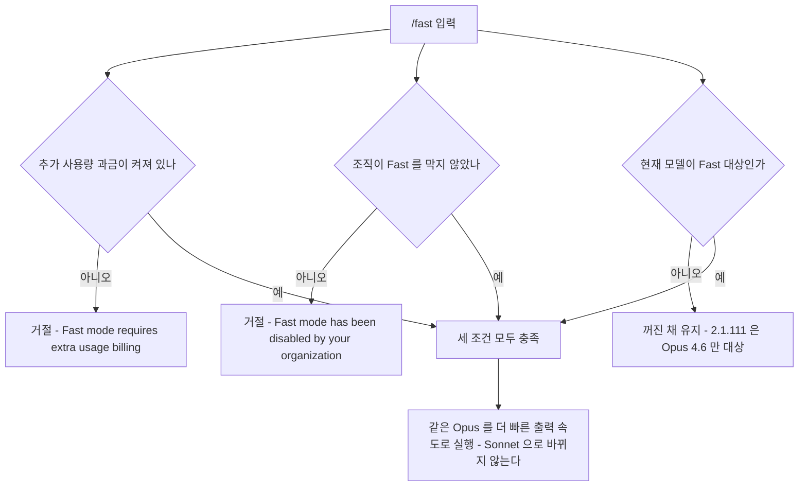

### 켜는 게 나을 때

- 단순한 파일 수정, 포맷팅, import 정리
- 명확한 지시가 있는 단일 파일 작업
- 대화형으로 빠르게 주고받아야 할 때

### 끄는 게 나을 때

- 여러 파일에 걸친 리팩토링
- 버그 원인 추적 (탐색 범위가 넓은 작업)
- 아키텍처 설계나 의사결정이 필요한 작업

위 세 가지는 Fast가 4.6으로 내려가는 환경에서는 최신 Opus를 쓰려고 끄는 것이다. 체감 속도는 개인차가 커서 이 문서에서 재지 않았다.

---

## 3. 컨텍스트 윈도우와 1M 확장

Claude Code는 대화가 이어질수록 도구 호출 결과, 파일 내용, 명령 출력이 컨텍스트에 쌓인다. 모델별 컨텍스트 윈도우 크기가 세션의 수명을 결정한다.

| 모델 | 기본 윈도우 | 확장 | Claude Code 세션에서의 의미 |
|------|------------|------|---------------------------|
| Opus 4.8 | 200K (`claude-opus-4-8`) | `claude-opus-4-8[1m]` 1M | 대규모 코드베이스 탐색은 `[1m]`을 붙여야 한다 |
| Opus 4.7 | 200K (`opus` 별칭) | `opus[1m]` 1M | 파일 수십 개를 읽는 세션은 `[1m]` 쪽이 여유 있다 |
| Sonnet 4.6 | 200K | `sonnet[1m]` (구독 계정에서 거절됐다, 아래 참조) | 일반 작업에는 충분. 파일 20~30개 넘으면 자동 압축 시작 |
| Haiku 4.5 | 200K | — | 동일한 200K지만, 긴 컨텍스트에서 정보 활용 능력이 떨어짐 |

창 크기는 응답 JSON의 `modelUsage.<모델>.contextWindow`로 읽었다. 접미사 없이 부른 `opus`, `claude-opus-4-8`, `sonnet`, `haiku`는 전부 200000이었고, `opus[1m]`과 `claude-opus-4-8[1m]`은 1000000이었다. Opus 4.8 문서는 API에서 1M이 기본이라고 적는다. API 문서의 서술이 틀렸다는 게 아니라, Claude Code가 접미사 없는 호출을 200K로 잡는다는 뜻이다. CLI 소스에 1M 베타 헤더(`context-1m-2025-08-07`)가 따로 있는 걸 보면 `[1m]`일 때 그 헤더를 붙이는 구조로 보인다.

### 1M 컨텍스트가 실제로 필요한 시점

Opus는 `[1m]`을 붙이면 1M 토큰까지 컨텍스트를 확장할 수 있다. 4.7과 4.8 문서 모두 200K를 넘겨도 단가는 같다고 적는다. 그래도 켜놓는 게 득이 되는 경우는 많지 않다. 창이 커지면 자동 압축이 늦게 걸려서 컨텍스트가 계속 부풀고, 매 요청마다 누적된 입력이 다시 전송되기 때문이다. 캐시가 안 먹는 구간에서는 입력 비용이 세션 길이에 비례해 오른다.

구독 계정은 플랜 조건이 하나 더 있다. 같은 계정에서 `--model "sonnet[1m]"`은 `Usage credits are required for long context requests`로 거절됐고, `opus[1m]`은 짧은 프롬프트로 통과했다. 어느 모델이 어느 플랜에서 되는지는 직접 한 번 불러보는 수밖에 없다.

1M이 실제로 효과를 보는 경우는 다음과 같다.

- **모노레포 전체 흐름 추적**: 컨트롤러 → 서비스 → 리포지토리 → 미들웨어 → 설정까지 파일 30~50개를 읽으면서도 앞 내용을 유지해야 할 때. 200K로는 중간에 자동 압축이 발생하면서 앞부분 맥락이 날아간다.
- **장시간 디버깅 세션**: 같은 세션에서 가설 검증을 반복하는데, 앞쪽에서 본 로그·스택트레이스·코드를 계속 참조해야 할 때.
- **여러 파일에 걸친 리팩토링**: 30개 이상의 파일을 동시에 일관된 패턴으로 바꿔야 할 때. 압축이 발생하면 앞에서 정한 네이밍 규칙을 잊는다.

반대로 1M이 의미 없는 경우도 명확하다.

- **단일 파일 작업**: 파일 하나만 보면 끝나는 일에 1M을 켜놓을 이유가 없다.
- **세션을 짧게 끊어 쓰는 패턴**: `/clear`로 자주 초기화하는 사용자에게 1M은 의미가 없다.
- **명확한 지시 + 좁은 범위**: 컨텍스트가 200K를 넘을 일이 없는 작업.

`/cost`로 현재 세션 입력 토큰을 보고, 평소 100K 안팎이면 1M은 꺼두는 게 낫다. 200K를 자주 넘기는 패턴이라면 그때 1M을 고려한다.

이 판단을 순서대로 그리면 아래와 같다. 먼저 입력 규모를 보고, 1M이 필요할 때만 모델별로 `[1m]` 가능 여부를 가른다.

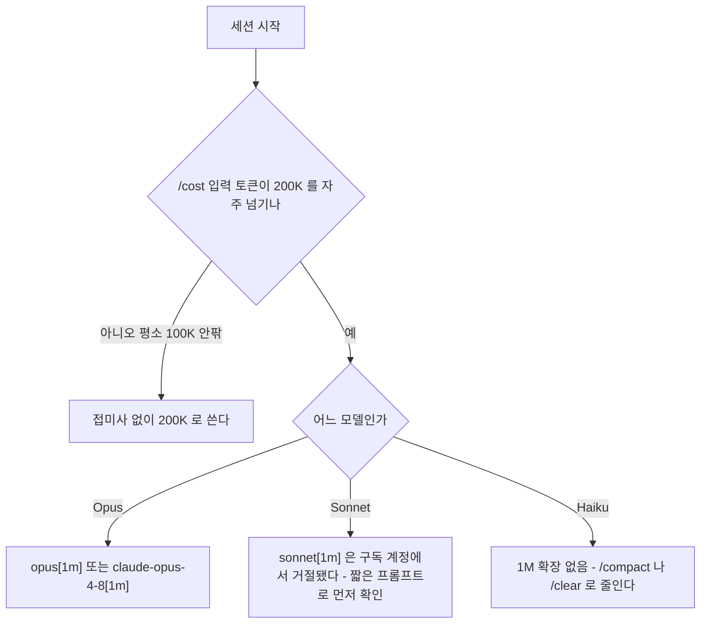

### 컨텍스트 절약 습관

모델과 상관없이 세션을 오래 쓰면 컨텍스트가 차는 건 같다.

- 작업이 바뀌면 `/clear`로 초기화
- 탐색이 길어졌으면 `/compact`로 압축 후 계속
- "전체 프로젝트 분석" 같은 넓은 범위 요청은 피하고, 디렉토리나 모듈 단위로 쪼개서 요청

---

## 4. 작업 유형별 모델 선택

같은 코드베이스에서도 작업 성격에 따라 적정 모델이 다르다. 이 절의 분류는 5년차 백엔드 개발자가 일주일치 실무에서 마주치는 작업 유형을 기준으로 한다. 표에서 Opus는 4.8이다. 4.7로 돌리는 환경이면 같은 판단에 4.7을 넣으면 되는데, 4.8 문서 기준으로 둘의 차이가 가장 큰 곳은 넓은 탐색과 파급 분석이다.

표를 하나씩 읽기 전에 분기 구조부터 본다. 아래 도식은 에러 원인이 명확한지, 여러 파일에 걸치는지, 설계 판단이 필요한지를 순서대로 물어서 모델과 Fast 여부로 끝난다.

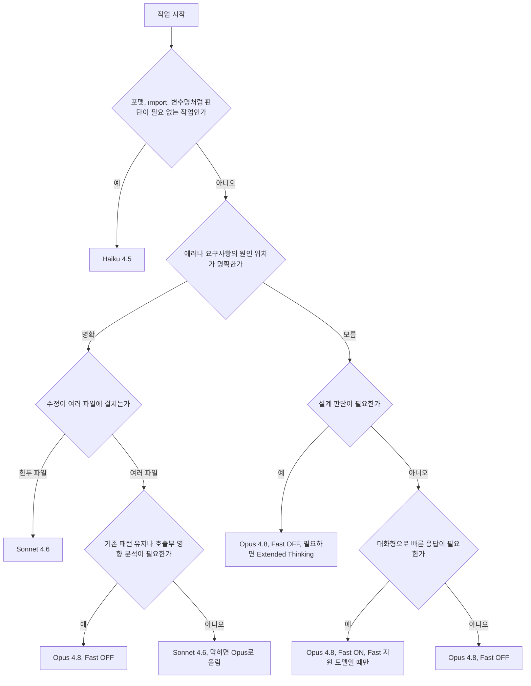

Fast ON으로 끝나는 가지는 하나뿐이다. 나머지는 Fast를 켜도 얻는 게 없거나 모델이 내려갈 수 있다(§2). 아래 표는 이 분기를 작업 유형별로 풀어 쓴 것이다.

### 버그 수정

| 상황 | 권장 모델 | 이유 |
|------|----------|------|
| 에러 메시지 명확, 원인 위치 짐작됨 | Sonnet 4.6 | 직선적 수정이 빠름 |
| 재현 가능하지만 원인 모름 | Opus 4.8 (Fast off) | 호출 경로 추적이 필요 |
| 간헐적·재현 어려운 버그 | Opus 4.8 + Extended Thinking | 가설 수립과 검증 반복이 필요 |
| 타입 에러, lint 위반 | Haiku 4.5 또는 Sonnet 4.6 (Fast 없음) | 단순 수정 |

### 리팩토링

| 상황 | 권장 모델 | 이유 |
|------|----------|------|
| 단일 파일 내 메서드 추출·변수명 변경 | Sonnet 4.6 | 범위가 좁음 |
| 여러 파일에 걸친 패턴 변경 | Opus 4.8 | 호출부 일관성 유지가 핵심 |
| 인터페이스·시그니처 변경 | Opus 4.8 | 영향 범위 분석이 우선 |
| 단순 포맷팅·import 정리 | Haiku 4.5 | 판단 필요 없음 |

### 신규 기능 개발

| 상황 | 권장 모델 | 이유 |
|------|----------|------|
| 기존 패턴이 명확한 CRUD 추가 | Sonnet 4.6 | 패턴 복제로 충분 |
| 새 도메인·새 아키텍처 결정 필요 | Opus 4.8 (설계) → Sonnet 4.6 (구현) | 설계와 구현 분리 |
| 외부 API 연동, 인증 흐름 | Opus 4.8 | 엣지 케이스가 많음 |
| 마이그레이션 스크립트 | Opus 4.8 | 데이터 손실 위험 |

### 문서화

| 상황 | 권장 모델 | 이유 |
|------|----------|------|
| README·주석 추가 | Sonnet 4.6 | 빠른 처리 |
| 아키텍처 문서, ADR | Opus 4.8 | 의사결정 근거 정리 |
| 변경 로그·릴리스 노트 | Haiku 4.5 또는 Sonnet 4.6 | 단순 정리 |

### 대규모 탐색

| 상황 | 권장 모델 | 이유 |
|------|----------|------|
| "이 API의 요청 흐름 알려줘" | Opus 4.8 | 다단계 탐색 |
| "이 모듈에서 deprecated된 함수 다 찾아줘" | Sonnet 4.6 | 단일 패턴 검색 |
| 모노레포 전체 의존성 분석 | Opus 4.8 + 1M 컨텍스트 | 파일 수가 많음 |
| 특정 파일에서 패턴 검색 | Haiku 4.5 | Grep 호출 위주 |

---

## 5. Fast 모드 + 모델 의사결정 매트릭스

Fast는 Opus 4.6 전용인 CLI(2.1.111)와 4.8을 지원한다고 적은 문서가 갈린다(§2). Sonnet·Haiku에는 어느 쪽이든 Fast가 없다. 그래서 이 매트릭스의 Fast 열은 Opus를 골랐을 때만 의미가 있는 보조 결정이다.

| 작업 성격 | 1차 선택 | Fast 모드 | 비고 |
|----------|---------|-----------|------|
| 단순 수정 (1~2 파일) | Sonnet 4.6 | — | Opus까지 갈 필요 없음 |
| 일반 기능 개발 | Sonnet 4.6 | — | 막히면 Opus로 전환 |
| 패턴 복제형 작업 | Sonnet 4.6 | — | 기존 코드 따라가기 |
| 넓은 탐색 필요 | Opus 4.8 | OFF | Fast가 4.6으로 내려가는 CLI에서는 Fast를 켜는 게 곧 모델 하향 |
| 빠른 응답 + 정확도 둘 다 | Opus 4.8 | ON | Fast 지원 모델일 때만. 아니면 Sonnet 4.6 |
| 설계·아키텍처 결정 | Opus 4.8 | OFF | 최신 Opus 유지 |
| 디버깅 (원인 추적) | Opus 4.8 | OFF | 최신 Opus 유지 |
| 대량 단순 작업 | Haiku 4.5 | — | 판단 필요 없는 일 |
| 검증·실행 | Haiku 4.5 | — | 테스트 돌리고 결과 정리 |

판단 기준을 한 줄로 쓰면 속도가 답답한데 작업이 간단하면 Fast ON, 작업이 복잡하면 Fast OFF다. 비용은 따로 본다. Fast는 구독에서 추가 사용량 과금을 요구하는 경우가 있어서(§2) 단가 배수는 확인하지 못했다. 켜기 전후로 `/cost`를 한 번씩 찍어서 직접 비교한다.

---

## 6. 모델 전환 트리거

전환을 판단할 때 추상적인 신호("복잡해 보인다")보다 관찰 가능한 수치로 결정한다. 아래 기준은 Claude Code 세션을 수백 번 돌리면서 정착한 것들이다.

세 모델 사이의 이동을 한 장으로 보면 이렇다. 위쪽 화살표(승격)는 모델이 맥락을 못 잡는다는 신호이고, 아래쪽 화살표(다운그레이드)는 판단이 끝나서 탐색 능력이 필요 없어졌다는 신호다. 시작 상태는 작업 성격에 따라 세 곳 중 하나다.

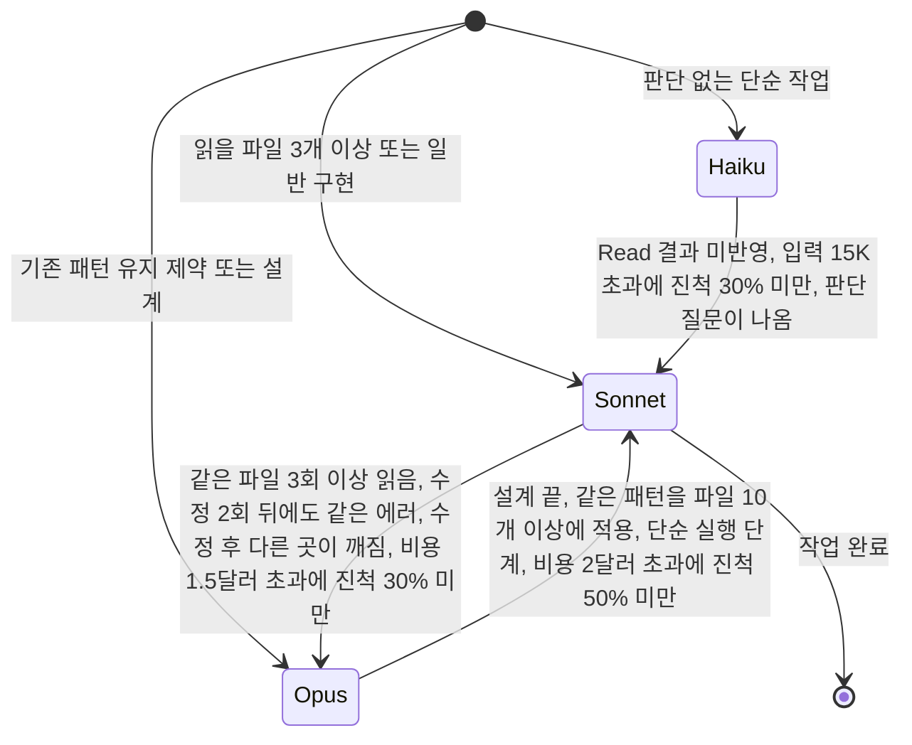

### Haiku → Sonnet 전환 신호

Haiku는 도구 호출 자체는 문제없는데, 앞 호출 결과를 다음 호출에 제대로 반영하지 못하는 순간이 온다. 아래 중 하나라도 나오면 Haiku로 계속 해봤자 시간 낭비다.

- **처음부터 읽을 파일이 3개 이상이면 Sonnet으로 시작한다**: 파일 3개를 순서대로 읽고 공통 구조를 파악해야 한다면 Haiku는 첫 파일 내용을 세 번째 파일 처리 시점에 이미 잊는다.
- **Read 결과가 다음 Edit에 반영이 안 된다**: 읽은 파일의 내용을 무시하고 엉뚱한 라인을 수정하거나, Grep 결과를 못 활용하면 그게 한계를 넘은 신호다.
- **입력 토큰 누적이 15K를 넘었는데 진척률이 30% 미만이다**: `/cost`로 확인해서 15K 넘겼으면 남은 작업에서 맥락 손실이 난다. 여기서 끊고 Sonnet으로 새 세션을 연다.
- **"어떻게 할까요?" 같은 판단 질문이 나온다**: Haiku 적정선을 넘었다. 판단이 필요한 작업은 처음부터 Sonnet 이상을 써야 한다.

### Sonnet → Opus 전환 신호

- **같은 파일을 3번 이상 읽는다**: 첫 읽기에서 맥락을 못 잡았다는 뜻이다. Sonnet의 한계.
- **테스트 실패 후 수정을 2회 시도했는데도 같은 에러가 난다**: 첫 시도가 빗나갔으면 두 번째도 Sonnet으로 하지 말고 Opus로 올린다. 영향 범위 탐색이 부족한 거다.
- **수정 후 다른 곳이 깨진다**: 호출부를 보지 않고 수정했다. Opus는 같은 요청을 받으면 호출하는 쪽을 먼저 탐색한다.
- **`/cost`가 $1.5를 넘었는데 작업 진척률이 30% 미만이다**: 탐색을 많이 하는데 진전이 없으면 Sonnet이 방향을 못 잡고 있는 거다. 이 시점에서 Opus로 올리면 남은 작업에서 훨씬 직선적으로 처리한다.
- **요구사항에 "기존 패턴 유지" 같은 제약이 명시되어 있다**: Sonnet은 기존 패턴을 무시하고 새로 짜는 경향이 있다. 처음부터 Opus로 시작하는 게 낫다.

모델을 올릴지 effort를 올릴지 애매한 경우는 §12에서 따로 다룬다. 위 신호는 전부 "맥락을 못 잡는" 쪽이라 모델을 올리는 신호다.

### Opus → Sonnet 다운그레이드 신호

- **설계가 끝났고, 구현만 남았다**: 설계 결과를 CLAUDE.md나 별도 파일에 저장하고 새 세션을 Sonnet으로 연다. 이 흐름을 내장한 기능이 §11의 `opusplan`이다.
- **파일 10개 이상에 동일한 패턴을 적용하는 단계다**: 같은 패턴의 반복이면 Sonnet이 더 빠르고 저렴하다. Opus의 탐색 능력이 필요 없다.
- **단순 명령 실행·결과 보고 단계**: 테스트 돌리고 결과 정리하는 일은 Sonnet으로 충분하다.
- **`/cost`가 $2를 넘었는데 작업이 50%도 안 끝났다**: 비용 통제가 필요한 시점. 남은 작업의 성격을 보고, 탐색이 끝났으면 Sonnet으로 전환한다. 이 선은 예전에 $5로 잡았던 값이다. Opus 단가가 내려간 것(§7)에 맞춰 내렸다.

### 세션 중 전환 방법

```bash
# 방법 1: 슬래시 명령 (대화형 전용)
/model opus
/model claude-opus-4-8

# 방법 2: 단축키. Alt+P 가 모델 선택창, Alt+O 가 Fast 토글
# Shift+Tab 은 모델이 아니라 권한 모드(Normal, Auto-Accept, Plan) 순환이다

# 방법 3: 시작 시 지정
claude --model opus
claude --model claude-opus-4-8
```

이 문서의 이전 판은 Shift+Tab을 모델 전환 키로 적었다. 2.1.111의 키바인딩 표에서 Shift+Tab은 `chat:cycleMode`, 모델 선택창은 `chat:modelPicker`(Alt+P)다. [플랜모드 문서](Claude_Code_Plan_Mode.md)가 Shift+Tab을 모드 순환으로 적은 것과 맞다. 별칭과 환경변수까지 포함한 지정 방법은 §10에 있다.

세션 중에 모델을 바꾸면 컨텍스트는 유지된다. Sonnet으로 작업하다가 "이 부분은 복잡하니까 Opus로 바꿔야겠다" 싶으면 바로 전환하면 된다. 다만 그 시점부터 대화 이력 전체가 새 모델에게는 처음 보내는 입력이라 캐시 없이 처리된다. Sonnet이 200K 가까이 컨텍스트를 채운 상태에서 Opus로 전환하면 비용 점프가 크다. CLI도 전환할 때 `Switch model? Your next response will be slower and use more tokens`라는 확인창을 띄운다. 실제 숫자는 §14에 있다.

전환 한 번에 일어나는 일을 순서로 보면 아래와 같다. 확인창 뒤에 대화 이력 전체가 새 모델에게 캐시 없이 한 번 더 들어가는 지점을 보면 된다.

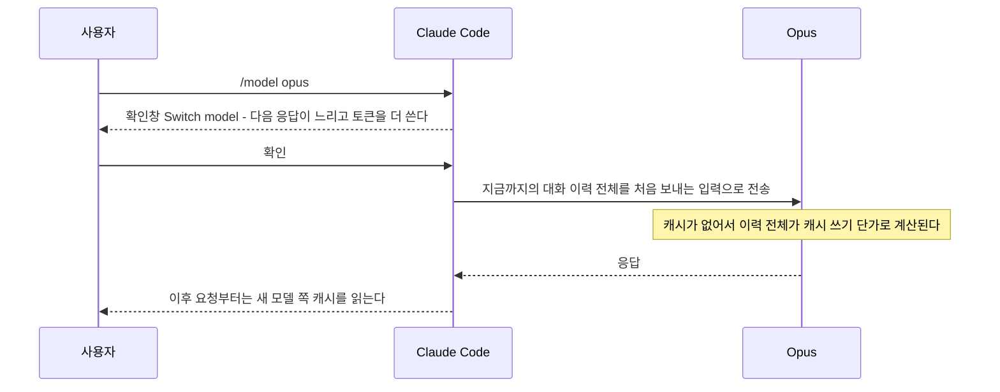

---

## 7. 세션 기준 비용 비교

API 토큰 단가표만 보면 "Opus가 Sonnet보다 비싸네"로 끝나는데, Claude Code 세션에서의 실제 비용은 단가 비율보다 도구 호출 횟수와 탐색 범위에서 더 크게 갈린다. 같은 작업을 시켜도 모델마다 이 둘이 다르기 때문이다.

### 모델별 토큰 단가 (Claude 4.x 계열)

단가는 [Anthropic 요금 페이지](https://platform.claude.com/docs/en/about-claude/pricing) 기준이고, 2026-10-16에 Claude Code 2.1.111에서 Opus 4.7 호출 비용을 맞춰서 확인했다. Claude 5 계열은 [Claude 문서](../Claude/Claude.md)에 이름이 있지만 Claude Code에서 별칭이 어디로 가는지는 이 문서에서 확인하지 못했다.

| 모델 | 입력 ($/1M) | 출력 ($/1M) | 캐시 읽기 ($/1M) | 캐시 쓰기 ($/1M) |
|------|------------|------------|----------------|----------------|
| Opus 4.8, Opus 4.7 | 5 | 25 | 0.5 | 6.25 |
| Sonnet 4.6 | 3 | 15 | 0.3 | 3.75 |
| Haiku 4.5 | 1 | 5 | 0.1 | 1.25 |

이 문서의 이전 판은 Opus 단가를 입력 15, 출력 75로 적고, 입력이 200K를 넘으면 두 배라는 행까지 두었다. 그 값은 Opus 초기 세대의 단가이고 4.7과 4.8에는 맞지 않는다. 확인은 이렇게 했다. 24.5KB짜리 무작위 텍스트를 시스템 프롬프트에 붙여 Opus 4.7을 처음 부르자 `cache_creation_input_tokens`가 40,235였고 `total_cost_usd`가 0.252였다. 40,235 × 6.25 / 1,000,000이 0.2515다. 입력 15달러 단가였다면 캐시 쓰기가 18.75달러라 0.754가 나왔을 것이다. 4.7과 4.8 문서도 200K 초과 추가 과금이 없다고 적는다.

그래서 Opus의 입출력 단가는 Sonnet의 약 1.7배다. 아래 계산과 표는 전부 이 단가로 다시 냈다.

### 토큰 비용 계산 예시

세션 누적 입력 300K, 출력 30K로 끝난 작업을 가정한다.

**Sonnet 4.6:** 300K × $3 + 30K × $15 = $0.9 + $0.45 = **$1.35**

**Opus (캐시 없이):** 300K × $5 + 30K × $25 = $1.5 + $0.75 = **$2.25**

**Opus (캐시 70% 활용, 캐시 쓰기 할증 제외):** (90K × $5 + 210K × $0.5) + 30K × $25 = $0.45 + $0.105 + $0.75 = **$1.31**

**Opus (1M, 입력 500K, 출력 50K):** 500K × $5 + 50K × $25 = $2.5 + $1.25 = **$3.75**

### 작업 유형별 토큰 비용 실측치

NestJS 중간 규모 코드베이스(파일 200여 개)에서 에이전틱 작업 유형별로 쟀던 수치다. 이 표는 2026-10-02 커밋으로 들어왔고 측정 날짜와 당시 CLI 버전은 기록이 남아 있지 않다. 도구 호출 횟수와 토큰 수는 그때 값을 그대로 두었다. 비용 열은 위 단가로 계산한 값이다. Opus 열은 이번에 다시 계산했고, 단가가 그대로인 Sonnet·Haiku 열은 이전 값을 유지했다. 캐시 60% 열은 입력 중 60%가 읽기 단가로 처리된 경우이고, 캐시 쓰기 할증은 넣지 않았다.

**탐색형 — "인증 흐름 전체를 파악해줘"** (파일 8~12개 추적, Grep + Read 위주)

| 항목 | Opus | Sonnet 4.6 | Haiku 4.5 |
|------|---------|-----------|-----------|
| 도구 호출 | 35~55회 | 12~22회 | — |
| 입력 토큰 (누적) | 180K~320K | 60K~130K | — |
| 출력 토큰 | 12K~20K | 8K~15K | — |
| 비용 (캐시 없음) | $1.2~2.1 | $0.3~0.6 | 신뢰 불가 |
| 비용 (캐시 60%) | $0.7~1.2 | $0.2~0.4 | — |

Haiku는 탐색형에서 파일 간 맥락을 유지하지 못한다. 도구 호출 횟수는 적지만 추적이 중간에 끊기는 경우가 잦아서 결과를 신뢰할 수 없다.

**구현형 — "refresh token rotation 기능 추가"** (파일 수정 6~10개, Read + Edit + Bash 혼합)

| 항목 | Opus | Sonnet 4.6 | Haiku 4.5 |
|------|---------|-----------|-----------|
| 도구 호출 | 25~40회 | 10~20회 | 8~15회 |
| 입력 토큰 (누적) | 300K~500K | 100K~200K | 50K~100K |
| 출력 토큰 | 30K~50K | 15K~30K | 10K~20K |
| 비용 (캐시 없음) | $2.3~3.8 | $0.6~1.5 | $0.1~0.3 |
| 비용 (캐시 60%) | $1.4~2.4 | $0.4~1.0 | $0.07~0.2 |

Opus는 구현 전에 탐색을 더 하기 때문에 입력 토큰이 Sonnet 대비 3배 가까이 나온다. 결과 품질 차이가 있는지는 작업 복잡도에 달려있다. 패턴이 명확한 CRUD 추가라면 Sonnet으로 충분하다.

**리뷰형 — "이 PR 코드 리뷰해줘"** (변경 파일 5~15개 + 연관 코드 추가 탐색, Read 위주)

| 항목 | Opus | Sonnet 4.6 | Haiku 4.5 |
|------|---------|-----------|-----------|
| 도구 호출 | 20~35회 | 10~18회 | 6~12회 |
| 입력 토큰 (누적) | 150K~280K | 60K~130K | 30K~70K |
| 출력 토큰 | 25K~45K | 15K~30K | 8K~15K |
| 비용 (캐시 없음) | $1.4~2.5 | $0.5~1.3 | $0.07~0.2 |
| 비용 (캐시 60%) | $1.0~1.8 | $0.3~0.8 | $0.05~0.1 |

Haiku 리뷰는 숫자상으로는 완주한다. 하지만 타입 불일치나 변수명 같은 표면적 지적에 머물고 설계 결함이나 엣지 케이스는 놓친다. Haiku 대비 Sonnet 비용이 3~5배 차이인데, 리뷰 깊이 차이가 그보다 크다.

### 비용 감각 요약

Opus는 도구 호출이 많고 매 호출마다 누적 컨텍스트가 재전송되니까 비용이 빠르게 늘어난다. 단가는 Sonnet의 1.7배인데 같은 작업에서 입력 토큰을 2~3배 쓰니, 위 세 표의 캐시 없음 행을 나누면 총비용은 **2~4배** 차이가 난다. 이전 판은 5~10배라고 적었는데, 그 숫자는 Opus 단가를 3배로 잘못 잡은 데서 나왔다.

총비용 차이가 어디서 만들어지는지 곱셈 구조로 그리면 아래와 같다. 단가와 입력 토큰이 곱해져 2~4배가 되고, 캐시는 입력 쪽 비용을 깎는 별도의 축이다.

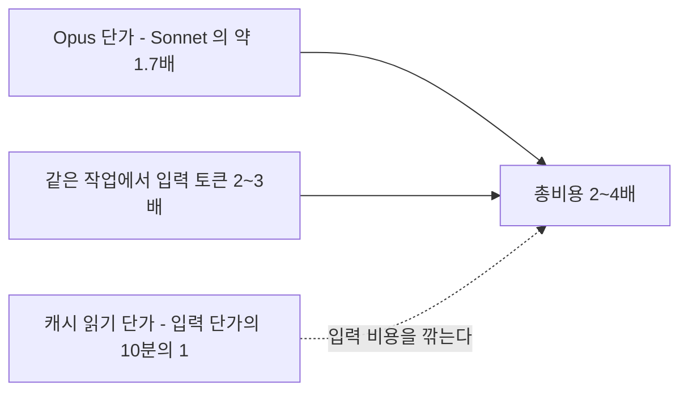

캐시는 단가표보다 크게 체감된다. 같은 40,235 토큰짜리 프롬프트를 Opus 4.7로 두 번 연속 불렀을 때 첫 호출이 $0.252, 두 번째 호출이 $0.0207이었다(2026-10-16, Claude Code 2.1.111, 호출 간격 수 초). 같은 세션에서 같은 파일을 반복 참조하는 패턴이라면 캐시 효과가 크다. `/clear`를 너무 자주 누르면 캐시가 날아간다는 점은 주의한다.

### Max 플랜 vs API 직접 과금

Claude Code의 과금 방식은 두 가지다.

**API 키 방식 (종량제)**

- Anthropic Console에서 API 키 발급 후 사용
- 토큰 단위 정확한 과금
- Opus를 많이 쓰면 비용이 사용량에 비례해 올라감
- `/cost`로 실시간 비용 확인 가능

**Max 플랜 (월 구독)**

- Pro ($20/월), Max ($100/월, $200/월) 등 구독 플랜
- 사용량 제한이 있지만 구간 내에서는 추가 비용 없음
- 무거운 작업을 하다 보면 하루 만에 사용량 제한에 걸리는 경우가 있음

**선택 기준:**

API 직접 과금이 맞는 경우:

- CI/CD 파이프라인에서 Claude Code를 돌릴 때
- 사용량 예측이 가능하고, 월 비용이 $100 이하일 때
- Haiku나 Sonnet 위주로 쓸 때 (단가가 낮아서 월 구독 대비 저렴)

Max 플랜이 맞는 경우:

- Opus를 주력으로 쓸 때 (하루 종일 에이전트를 돌리면 API 과금은 하루 단위로 계산해도 부담이 크다)
- 비용 예측 없이 자유롭게 쓰고 싶을 때
- 팀원이 여럿이고 각자 API 키 관리가 번거로울 때

Max $200 플랜에서 Opus를 하루 종일 쓰면 보통 2~3일 안에 사용량 제한에 걸린다. 그 시점에서 Sonnet으로 전환하거나 다음 리셋까지 기다려야 한다. 작업 패턴에 따라 API 과금이 더 자유로울 수 있다.

---

## 8. 오케스트레이션에서 모델 조합

[Claude Code 오케스트레이션 문서](Claude_Code_Orchestration.md)에서 다단계 워크플로우를 다뤘다. 여기서는 각 단계에 어떤 모델을 배치하는지, 그 근거가 뭔지를 다룬다.

### 기본 조합: 설계 Opus, 구현 Sonnet, 검증 Haiku

```typescript
// 1단계: Opus가 설계한다
const planner = new ClaudeCode({ model: "claude-opus-4-8", maxTurns: 5 });
const plan = await planner.run({
  prompt: "auth 모듈을 리팩토링할 계획을 JSON으로 출력해.",
});

// 2단계: Sonnet 4.6이 구현한다
const builder = new ClaudeCode({ model: "claude-sonnet-4-6", maxTurns: 30 });
await builder.run({
  prompt: `다음 계획대로 코드를 수정해:\n${plan.output}`,
});

// 3단계: Haiku 4.5가 검증한다
const checker = new ClaudeCode({ model: "claude-haiku-4-5", maxTurns: 10 });
const review = await checker.run({
  prompt: "npm test를 실행하고, 실패한 테스트가 있으면 원인을 보고해.",
});
```

`ClaudeCode` 클래스는 흐름을 보이려고 쓴 의사 코드다. 모델 ID 문자열(`claude-opus-4-8`, `claude-sonnet-4-6`, `claude-haiku-4-5`)은 `--model`에 그대로 넘겨서 동작하는 것을 확인했다.

같은 일을 메인 세션 하나가 서브 에이전트 둘을 부르는 형태로 그리면 아래와 같다. 메인 세션과 서브 에이전트 사이에서 넘어가는 것은 두 가지뿐이다. 내려가는 건 `prompt`에 담은 계획이고, 올라오는 건 서브 에이전트의 최종 응답이다. 서브 에이전트가 읽은 파일과 중간 도구 호출은 메인 컨텍스트에 쌓이지 않는다.

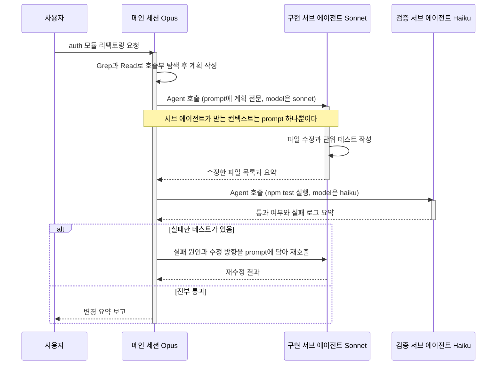

도식에서 실패 분기의 원인 판단은 메인 세션(Opus)이 한다. 검증 단계의 Haiku에게 원인 분석까지 맡기지 않는다는 뜻이다. 구현과 검증 에이전트에 `model`을 지정하는 방법과, 지정하지 않으면 무슨 일이 생기는지는 §13에 있다.

**왜 이렇게 나누는가:**

- **설계에 Opus를 쓰는 이유**: 리팩토링 범위를 잡을 때 "이 파일만 고치면 되나, 아니면 호출하는 쪽도 바꿔야 하나"를 판단하는 능력이 Sonnet보다 확실히 낫다. 넓게 탐색하는 Opus의 특성이 설계 단계에서 빛난다.
- **구현에 Sonnet 4.6을 쓰는 이유**: 계획이 구체적으로 나와 있으면 직선적으로 처리하는 Sonnet이 더 빠르고 저렴하다. 설계를 Opus가 해줬으니 Sonnet이 주변을 넓게 탐색할 필요가 없다.
- **검증에 Haiku 4.5를 쓰는 이유**: "테스트 돌리고 결과 보고"는 판단이 필요한 작업이 아니다. 명령 실행하고 출력 정리만 하면 되니까 가장 저렴한 모델이면 된다.

이 수동 조합을 한 세션 안에서 자동으로 해주는 것이 §11의 `opusplan`이다. 다만 `opusplan`에는 검증용 Haiku 단계가 없다.

### 이 조합이 안 맞는 경우

**작업이 작을 때**: "함수 하나 수정하고 테스트 돌려줘" 같은 작업을 3단계로 나누면 오버헤드만 늘어난다. Sonnet 하나로 한 번에 처리하는 게 낫다.

**Haiku 검증이 실패하는 경우**: 테스트가 실패했을 때 "왜 실패했고 어떻게 고쳐야 하는지"까지 판단하게 하면 Haiku가 엉뚱한 수정을 시도하는 경우가 있다. 검증 단계에서 수정까지 해야 한다면 Sonnet 이상을 써야 한다.

**설계가 불필요한 경우**: 명확한 지시가 있는 작업("이 API에 페이지네이션 파라미터 추가해줘")은 설계 단계를 건너뛰고 바로 Sonnet으로 구현해도 된다.

세 경우를 하나의 판단 순서로 합치면 아래와 같다. 3단계 조합은 작업이 크고 지시가 모호할 때만 마지막 가지에 도달한다.

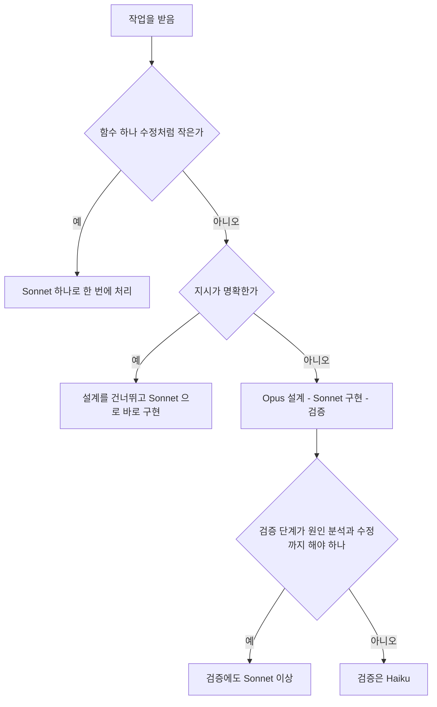

### 비용 관점에서의 조합 효과

3단계에 들어가는 토큰을 같게 놓고 모델만 바꿔서 계산했다. 가정은 설계 단계 입력 150K·출력 20K, 구현 단계 입력 200K·출력 25K, 검증 단계 입력 60K·출력 10K이고 캐시는 넣지 않았다. 단가는 §7 표를 쓴다.

| 방식 | 계산 | 비용 |
|------|------|------|
| 전부 Opus | 입력 410K × $5 + 출력 55K × $25 | $3.4 |
| Opus + Sonnet + Haiku 조합 | $1.25 + $0.98 + $0.11 | $2.3 |
| 전부 Sonnet | 입력 410K × $3 + 출력 55K × $15 | $2.1 |

토큰이 같다고 놓으면 조합은 전부 Opus의 3분의 2 정도다. 실제로는 §7 표에서 Opus가 같은 작업에 입력을 2~3배 쓰므로 전부 Opus 쪽은 이 숫자보다 더 올라간다. 품질은 이 계산에 들어 있지 않다. 전부 Sonnet은 설계 단계에서 호출부를 놓치는 경우가 있었고, 이전 판에 적은 "조합과 전부 Opus의 품질이 거의 같다"는 서술은 재본 적이 없어 뺐다.

---

## 9. 실전 모델 선택 체감

마지막으로 일주일치 실무에서 모델을 어떻게 섞어 썼는지 정리한다.

- **월요일 아침 코드리뷰**: Sonnet 4.6으로 시작. PR 5개를 가볍게 훑고 의견 정리.
- **화요일 신규 기능 설계**: Opus (Fast OFF)로 도메인 모델 설계, 인터페이스 정의. 결과를 CLAUDE.md에 저장.
- **수요일 구현**: 새 세션을 Sonnet 4.6으로 열어 화요일 설계대로 구현. 막힌 부분 한 번은 Opus로 전환.
- **목요일 버그 트래킹**: 간헐적 버그. Opus + Extended Thinking. 1M 컨텍스트는 켜지 않음 (입력 100K 이내).
- **금요일 정리**: Haiku 4.5로 변수명 통일, import 정렬, 주석 추가. Sonnet으로 릴리스 노트 초안 작성.

이 정도 패턴이면 한 주에 API 과금으로 $30~50 선이었다. 이 금액은 Opus 단가가 지금보다 높게 잡혀 있던 때 적은 값이라, 같은 주를 지금 단가로 다시 계산하면 Opus 비중만큼 내려간다. 같은 작업을 전부 Opus로 했을 때의 금액은 이전 판에 $200이라고 적었지만 재본 적이 없어서 뺐다.

---

## 10. 모델을 지정하는 방법과 우선순위

모델을 정하는 자리는 다섯 곳이다. `--model` 플래그, `ANTHROPIC_MODEL` 환경변수, `--settings`로 넘기는 파일, 프로젝트 안의 `.claude/settings.local.json`과 `.claude/settings.json`, 홈의 `~/.claude/settings.json`. 값으로는 별칭이나 고정 ID를 쓴다. 아래는 전부 `-p --output-format json`으로 돌려서 `modelUsage`에 찍힌 모델로 확인한 결과다. `/model`은 대화형 전용이라 이 절의 실행 확인에는 들어 있지 않다.

### 별칭이 가리키는 모델

| `--model` 값 | 실제로 호출된 모델 | 창 |
|---|---|---|
| `opus` | claude-opus-4-7 | 200K |
| `sonnet` | claude-sonnet-4-6 | 200K |
| `haiku` | claude-haiku-4-5-20251001 | 200K |
| `best` | claude-opus-4-7 | 200K |
| `default` | claude-sonnet-4-6 (이 계정 기준, 계정과 플랜에 따라 다르다) | 200K |
| `opusplan` | 일반 모드는 claude-sonnet-4-6, plan 모드는 claude-opus-4-7 | 200K |
| `opus[1m]` | claude-opus-4-7 | 1M |
| `sonnet[1m]` | 호출 거절 (`Usage credits are required for long context requests`) | — |
| `claude-opus-4-8` | claude-opus-4-8 | 200K |
| `claude-opus-4-8[1m]` | claude-opus-4-8 | 1M |
| `claude-sonnet-4-6`, `claude-haiku-4-5` | 그대로. Haiku는 날짜 접미사 없이도 통한다 | 200K |

CLI 소스에는 별칭 목록이 `sonnet`, `opus`, `haiku`, `best`, `sonnet[1m]`, `opus[1m]`, `opusplan`으로 박혀 있다. 이 표에서 눈여겨볼 곳은 `opus`다. 4.8이 나온 뒤에도 2.1.111의 `opus`는 4.7을 가리킨다. 별칭은 Anthropic이 아니라 설치된 CLI 버전이 정한다. 4.8을 쓰려고 `opus`를 적어뒀는데 4.7이 돌고 있는 일이 여기서 생긴다.

모든 실행의 `modelUsage`에는 비용이 0.0004달러쯤 되는 `claude-haiku-4-5-20251001` 항목이 따로 붙는다. 내부 보조 호출로 보이고, `--model sonnet`처럼 다른 모델을 골라도 나온다. 어떤 모델이 돌았는지 볼 때는 이 항목을 빼고 읽는다. Haiku를 골랐는지는 이 항목의 비용이 0.002 이상으로 커졌는지로 본다.

### 환경변수

`ANTHROPIC_MODEL=haiku claude -p ...`는 Haiku로 돌았다. `--model sonnet`을 같이 주면 Sonnet이 이겼다. `ANTHROPIC_DEFAULT_OPUS_MODEL`, `ANTHROPIC_DEFAULT_SONNET_MODEL`, `ANTHROPIC_DEFAULT_HAIKU_MODEL`은 별칭이 가리키는 대상을 바꾼다. 아래는 실제로 돌린 세 가지다.

| 환경변수 | 실행 | 결과 |
|---|---|---|
| `ANTHROPIC_DEFAULT_OPUS_MODEL=claude-opus-4-8` | `--model opus` | claude-opus-4-8 |
| 위와 같음 | `--model best` | claude-opus-4-8 |
| 위와 같음 | `--model opusplan --permission-mode plan` | claude-opus-4-8 |
| `ANTHROPIC_DEFAULT_SONNET_MODEL=claude-haiku-4-5` | `--model sonnet` | claude-haiku-4-5 |

그래서 팀이 `opus`라는 별칭을 CLAUDE.md나 스크립트에 흩어 써두었더라도 환경변수 한 줄로 4.8로 올릴 수 있다. 서브 에이전트만 따로 바꾸는 `CLAUDE_CODE_SUBAGENT_MODEL`은 §13에 있다. CLI 소스에는 `ANTHROPIC_SMALL_FAST_MODEL`과 `ANTHROPIC_DEFAULT_*_MODEL_NAME`, `_DESCRIPTION`, `_SUPPORTED_CAPABILITIES`도 보이는데, 이 문서에서는 돌려보지 않았다.

### settings.json의 model 키

설정 파일에는 `{"model": "haiku"}`처럼 최상위 키로 쓴다. 프로젝트 `.claude/settings.json`에 이 값만 두고 돌리면 Haiku가 호출됐다. `.claude/settings.local.json`에 `{"model": "opus"}`를 더하면 Opus로 바뀌었다. 같은 `model` 키는 단일 값이라 local > project > user 순으로 이긴다는 규칙이 [설정과 권한 문서](Claude_Code_Settings_Permissions.md)에 이미 있고, 위 결과는 그 규칙과 같다. user 계층(`~/.claude/settings.json`)은 이 문서에서 돌려보지 않았고 그 문서의 확인 결과를 따른다.

### 우선순위

local > project > user 위로 세 단계가 더 있다. 아래 순서는 설정 파일 두 개와 환경변수, 플래그를 번갈아 겹쳐 놓고 이긴 쪽을 확인해서 정했다.

| 겹친 조건 | 이긴 값 |
|---|---|
| project `haiku` + local `opus` | `opus` (local) |
| project `haiku` + local `opus` + `ANTHROPIC_MODEL=sonnet` | `sonnet` (환경변수) |
| project `haiku` + local `opus` + `--settings` 파일 `sonnet` | `sonnet` (`--settings` 파일) |
| 위 셋 + `ANTHROPIC_MODEL=haiku` | `haiku` (환경변수가 `--settings` 파일을 이김) |
| `ANTHROPIC_MODEL=haiku` + `--model sonnet` | `sonnet` (플래그) |

이 결과를 하나로 합치면 아래 도식이다. 위에서 아래로 내려가며 처음 값이 있는 곳에서 멈춘다. 마지막 단계에서 별칭이면 `ANTHROPIC_DEFAULT_*_MODEL`로 치환한 뒤 고정 ID로 호출한다.

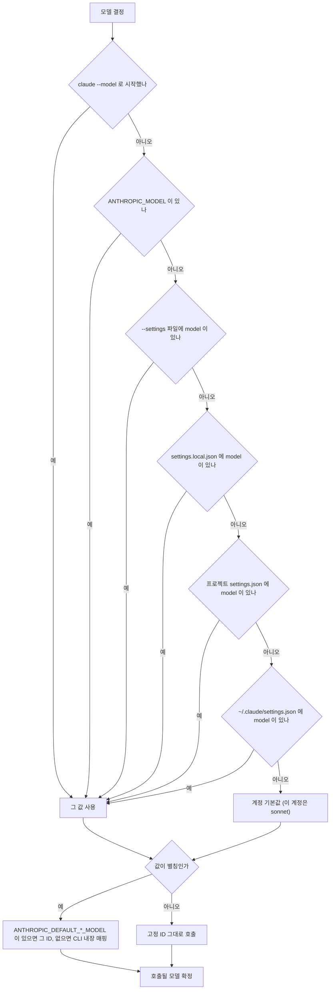

세션 안에서 `/model`로 바꾼 값이 이 순서 어디에 끼는지는 대화형이라 확인하지 못했다. 세션이 시작된 뒤의 선택이라 이 도식의 모든 단계보다 나중에 적용된다고 보는 게 자연스럽지만, 직접 돌려본 결과는 아니다. 환경변수는 셸에 `export`해둔 채 잊히기 쉽다. settings 파일을 아무리 고쳐도 안 먹는 증상의 다수가 여기서 나온다(§14).

### 고정 ID와 별칭 중 무엇을 쓰나

별칭은 CLI를 올리면 가리키는 대상이 바뀐다. 고정 ID는 안 바뀐다. 이 둘을 가르는 기준은 재현성과 자동 승급이다.

| 상황 | 고르는 쪽 | 이유 |
|---|---|---|
| 평가 스크립트, 회귀 비교, CI에서 결과를 비교해야 하는 작업 | 고정 ID | CLI 업데이트로 모델이 바뀌면 지난주 결과와 비교가 안 된다 |
| 개인 로컬 작업 | 별칭 | 새 CLI에서 알아서 올라가고, 어긋나도 눈으로 바로 안다 |
| 팀 공유 설정 | 지정하지 않거나 별칭 | 고정 ID는 퇴역하면 전원이 같은 날 막힌다 |
| 4.8이 나왔는데 별칭이 아직 4.7인 경우 | `ANTHROPIC_DEFAULT_OPUS_MODEL`로 별칭 대상만 교체 | 별칭 이름을 쓰는 스크립트는 그대로 둔다 |

고정 ID를 CI에 박았다면 모델 교체를 일정에 올려둔다. 별칭은 자동으로 올라가는 대신 비용과 동작이 어느 날 달라질 수 있다. 4.7에서 4.8로 올릴 때도 [Opus 4.8 문서](../Claude/Claude_Opus_4_8.md)가 말하듯 프롬프트와 thinking 설정을 같이 손봐야 해서, 자동 승급은 돌아가는 파이프라인에는 오히려 부담이다.

---

## 11. opusplan으로 설계와 구현을 한 세션에서

§8의 설계 Opus, 구현 Sonnet 조합을 수동으로 하려면 모델을 직접 바꾸거나 세션을 둘로 나눠야 한다. `opusplan`은 이 흐름을 내장한 별칭이다. `/model` 선택창의 설명문은 `Opus in plan mode, else Sonnet`이다. 플랜모드에 있는 동안은 Opus, 그 밖에는 Sonnet이다.

돌려서 확인한 것은 두 가지다.

| 실행 | 호출된 모델 |
|---|---|
| `--model opusplan` | claude-sonnet-4-6 |
| `--model opusplan --permission-mode plan` | claude-opus-4-7 |
| `ANTHROPIC_DEFAULT_OPUS_MODEL=claude-opus-4-8`과 함께 `--permission-mode plan` | claude-opus-4-8 |

플랜 승인 후 일반 모드로 넘어가는 순간 Sonnet으로 바뀌는지는 이 문서에서 직접 보지 못했다. 헤드리스에서는 플랜 승인 단계를 밟을 수 없다. 이름이 그렇게 약속하고 소스의 설명문도 같지만, 승인 직후 한 턴이 어느 모델로 처리되는지는 대화형으로 확인해야 한다. 플랜모드 자체의 진입과 승인 흐름은 [플랜모드 문서](Claude_Code_Plan_Mode.md)에 있다.

`opusplan`의 모델 전환을 상태로 그리면 아래와 같다. 플랜모드 진입 쪽 화살표는 위 표로 확인한 것이고, 승인 뒤 Sonnet으로 돌아오는 화살표는 이름과 소스 설명문에 근거한 것이라 직접 보지 못했다.

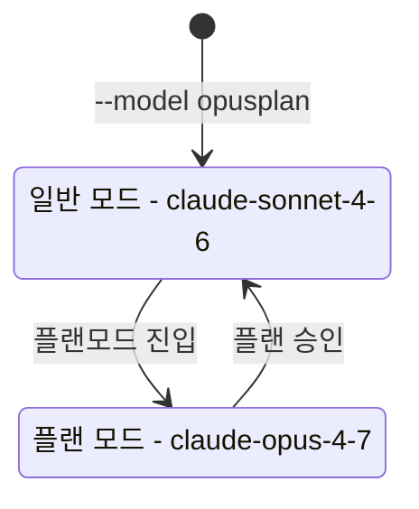

수동 조합과 비교하면 이렇다.

| | `opusplan` | 수동 조합 (§8) |
|---|---|---|
| 전환 시점 | 플랜모드 진입과 종료가 곧 전환 | 사람이 `/model`을 치거나 세션을 새로 연다 |
| 설계 결과 전달 | 같은 세션의 대화 이력으로 넘어간다 | 새 세션이면 CLAUDE.md나 파일로 넘긴다 |
| 모델이 바뀔 때의 캐시 | 새 모델 쪽 캐시가 처음부터 만들어진다 (§14) | 새 세션이면 어차피 처음부터다 |
| 검증용 Haiku 단계 | 없다 | 있다 |
| 설계에 쓰는 Opus 버전 | `opus` 별칭이 가리키는 버전 (4.8을 쓰려면 `ANTHROPIC_DEFAULT_OPUS_MODEL`) | `--model`로 정확히 지정 |
| 구현 모델 고정 | Sonnet (바꿀 수 없다) | 마음대로 |

`opusplan`이 잘 맞는 경우는 설계 결과를 문서로 만들 필요 없이 같은 대화로 곧장 구현에 들어가도 되는 작업이다. 설계가 길어서 세션 컨텍스트를 이미 많이 쓴 경우는 수동 조합이 낫다. 설계 대화 전체를 Sonnet이 이어받으면 그만큼 입력이 따라오고, 새 세션이면 설계 결과만 넘기면 된다. 구현 모델을 Opus로 유지하고 싶거나 검증을 Haiku에 넘기고 싶은 경우도 수동 쪽이다.

---

## 12. effort와 thinking 수준

모델 말고도 같은 모델의 깊이를 조절하는 손잡이가 둘 있다. effort와 Extended Thinking이다. 모델을 올리면 단가와 지연이 같이 오르는데, 이 둘은 같은 모델 안에서 올릴 수 있다.

### 지정하는 곳

- 플래그는 `--effort <level>`이고 값은 `low`, `medium`, `high`, `xhigh`, `max`다. 다른 값을 주면 `It must be one of: low, medium, high, xhigh, max`로 거절된다.
- 설정 파일 키는 `effortLevel`이고 값은 `low`, `medium`, `high`, `xhigh`다. `max`는 설정에 영속 저장하는 값에 없고 세션 단위로만 받는다.
- 환경변수는 `CLAUDE_CODE_EFFORT_LEVEL`이다. `unset`이나 `auto`를 주면 지정을 풀어준다.
- `/model` 선택창에서 모델을 고른 채 좌우 키로 effort를 조절한다. 모델이 effort를 지원하지 않으면 `Effort not supported`라고 표시된다.
- Extended Thinking 토글은 Alt+T다. 켜는 기준과 프롬프트 요령은 [실전 팁 문서](Claude_Code_Tips.md)의 Extended Thinking 절에 있다.

`--model sonnet --effort low`, `--model sonnet --effort max`, `--model opus --effort xhigh`는 모두 오류 없이 실행됐다. `--model haiku --effort high`도 오류 없이 돌았지만 Haiku에 effort가 실제로 적용됐는지는 이 문서에서 알 수 없다. 효과가 어느 정도인지도 재지 않았다. 한 번 호출한 비용은 첫 호출의 캐시 생성이 섞여 있어서 비교 근거가 못 된다.

### Ultra 리뷰의 effort와 같은 것인가

[Ultra Review 문서](Claude_Code_Ultra.md)의 `/code-review`는 effort 인자로 `low`, `medium`, `high`, `max`, `ultra`를 받는다. 이름이 겹치지만 목록이 다르다. 세션 `--effort`에는 `ultra`가 없고 `xhigh`가 있다. `ultra`는 로컬 세션 모델과 상관없이 서버에서 멀티 에이전트 워크플로를 돌리는 모드라서, 이 절의 모델 선택과는 무관하게 동작한다. 나머지 네 단계가 세션의 `--effort` 설정을 그대로 따르는지, 리뷰 전용 단계인지는 이 문서에서 확인하지 못했다.

Extended Thinking과도 겹친다. 둘 다 "답하기 전에 더 오래 생각하는" 쪽이고, 어디까지가 effort 몫이고 어디까지가 thinking 몫인지는 모델 세대마다 다르다. Opus 4.8 문서는 지연을 줄이려면 `output_config.effort`를 먼저 낮추라고 적고, 4.8이 같은 thinking 예산을 더 압축해서 쓴다고 적는다. thinking 토큰은 출력 단가로 과금되므로 Opus에서는 100만 토큰당 25달러다.

### 모델을 올릴지 effort를 올릴지

아래 기준은 직접 겪은 경험칙이고, 두 쪽을 같은 작업으로 맞대고 잰 결과는 아니다.

| 증상 | 먼저 올릴 것 | 이유 |
|---|---|---|
| 같은 파일을 반복해서 읽는다, 호출부를 안 보고 고친다, 기존 패턴을 무시한다 | 모델 | 탐색 범위와 맥락 유지의 문제라 같은 모델에서 더 생각해도 읽지 않은 파일은 읽히지 않는다 |
| 필요한 파일은 다 읽었는데 결론이 틀린다, 중간 가정을 건너뛴다 | effort 또는 thinking | 입력은 충분하고 추론 단계가 짧은 경우다 |
| 응답이 느려서 답답한데 작업은 단순하다 | effort를 낮춘다 | 4.8처럼 추론이 길어지는 모델에서 특히 먼저 본다 |
| 간헐적 버그의 원인 가설이 계속 빗나간다 | Opus + thinking | §4 표의 마지막 행과 같다 |
| 비용이 빠르게 오른다 | thinking 사용 여부를 먼저 본다 | 출력 단가가 입력의 5배라 thinking이 길어지면 여기서 샌다 |

같은 증상에 둘 다 올리면 어느 쪽이 효과를 냈는지 모르게 된다. 한 번에 하나만 올리고, 올린 뒤에 같은 작업을 다시 시켜서 달라졌는지 확인한다.

---

## 13. 서브 에이전트의 모델 상속과 지정

서브 에이전트의 모델을 정하는 자리는 넷이다. [Agent 문서](Claude_Code_Agent.md)가 설명하는 Agent 도구의 `model` 파라미터와 에이전트 정의 파일의 `model` frontmatter, 그리고 둘이 모두 비었을 때의 상속, 마지막으로 환경변수 `CLAUDE_CODE_SUBAGENT_MODEL`이다. Agent 문서는 `model`에 `sonnet`, `opus`, `haiku`를 적는다고 되어 있는데, CLI 소스를 보면 frontmatter에 `inherit`도 받는다. 생략한 경우의 기본값이 `inherit`다.

우선순위는 소스의 모델 결정 함수를 읽어서 정리했고, 아래 네 가지를 `--agents`로 에이전트를 직접 정의해서 돌려 확인했다. 정의한 에이전트는 둘이다. `opus-agent`는 `model: opus`, `plain-agent`는 `model` 생략이다.

| 순위 | 자리 | 실행 | 호출된 모델 |
|---|---|---|---|
| 1 | 환경변수 `CLAUDE_CODE_SUBAGENT_MODEL` | 메인 `sonnet`, `opus-agent` 호출, 환경변수 `haiku` | 서브 에이전트도 Haiku. `opus-agent`의 `opus`가 무시됨 |
| 2 | Agent 도구 `model` 파라미터 | 메인 `sonnet`, `opus-agent` 호출 시 파라미터 `haiku` 지정 | Opus가 호출되지 않음. Haiku 쪽 비용만 늘어남 |
| 3 | 에이전트 정의 frontmatter | 메인 `sonnet`, `opus-agent` 호출 | claude-opus-4-7이 호출됨 |
| 4 | 둘 다 비었을 때 | 메인 `sonnet`, `plain-agent` 호출 | 메인과 같은 claude-sonnet-4-6만 호출됨 |

2번 실행은 메인 모델에게 파라미터를 `haiku`로 지정해서 부르라고 프롬프트로 시킨 것이다. 파라미터가 frontmatter를 덮는다는 결론은 소스의 결정 순서와 맞고, 호출된 모델 목록에서 Opus가 없는 것으로 뒷받침했다. 에이전트 정의 파일은 아래 형태다.

네 줄의 순위를 위에서 아래로 따라가는 판정으로 그리면 아래와 같다. 어느 단계든 값이 있으면 거기서 멈추고, 맨 아래까지 내려왔을 때만 메인 모델을 상속한다.

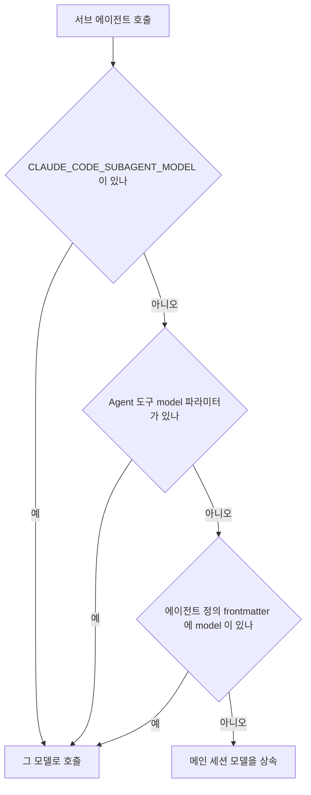

정의 파일 자체는 이렇게 쓴다.

```markdown
---
name: test-runner
description: npm test를 실행하고 실패한 테스트의 로그를 요약한다. 구현이 끝난 직후에 사용한다.
tools: Bash, Read
model: haiku
---

테스트를 실행하고 통과 여부와 실패 로그만 보고한다. 코드는 수정하지 않는다.
```

생략하면 메인 모델을 따른다는 점이 실무에서 걸린다. 메인을 Opus로 띄운 세션에서 `model`을 안 적은 에이전트를 열 개 띄우면 열 개가 전부 Opus 단가로 돈다. 탐색용 에이전트에 Haiku나 Sonnet을 박아두지 않으면 비용이 메인의 몇 배로 늘어나는 경우가 있다. 반대로 `CLAUDE_CODE_SUBAGENT_MODEL`을 셸에 걸어둔 채 잊으면 에이전트 파일에 `model: opus`를 적어도 무시된다. 설계 에이전트가 갑자기 얕게 답한다면 이 변수부터 의심한다.

---

## 14. 모델 선택 때문에 실제로 터지는 문제

### 모델을 바꿨더니 입력 비용이 다시 붙는다

프롬프트 캐시는 모델별로 따로 쌓인다. 같은 프롬프트로 모델을 바꿔 가며 4번 불러서 확인했다. 조건은 Claude Code 2.1.111, 2026-10-16, `--append-system-prompt`로 24.5KB 무작위 단어를 붙이고 `-p`로 4번 연속 호출, 호출 간격은 수 초다.

| 호출 | 모델 | cache read | cache create | 비용 |
|---|---|---|---|---|
| 1 | opus | 0 | 40,235 | $0.252 |
| 2 | opus | 40,235 | 0 | $0.0207 |
| 3 | sonnet | 11,564 | 18,836 | $0.0746 |
| 4 | opus | 40,235 | 0 | $0.0207 |

네 번의 호출이 어느 모델의 캐시를 읽고 썼는지 순서대로 그리면 아래와 같다. 캐시가 모델별로 따로 쌓이므로 3번에서만 쓰기가 생기고, 4번은 1번 캐시로 돌아간다.

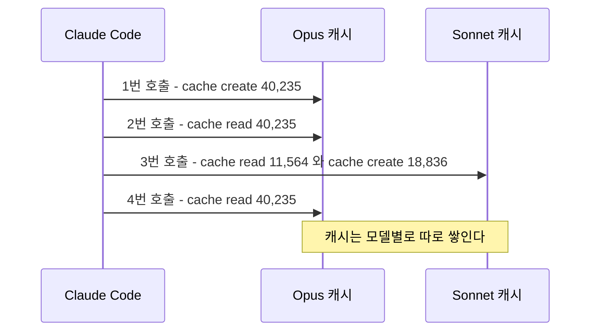

3번에서 Sonnet이 읽은 11,564 토큰은 이전에 돌린 Sonnet 실행이 남긴 기본 시스템 프롬프트 캐시다. 내가 붙인 18,836 토큰은 Sonnet 쪽에 캐시가 없어서 새로 썼다. 4번에서 Opus로 돌아오니 1번 캐시가 살아 있어서 읽기 단가로 처리됐다. 세션 중간에 모델을 바꾸는 상황도 같다. 지금까지 쌓인 대화 이력 전체가 새 모델에게는 처음 보는 입력이라 캐시 쓰기 단가로 한 번 계산된다.

Opus에서 시작한 세션을 Haiku로 바꾸는 경우를 150K 이력으로 계산하면 150K × $1.25 / 1M이 약 $0.19다. Sonnet이면 $0.56, Opus 4.8이면 $0.94다. 쓰기 단가가 새 모델 기준이라 Haiku로 내려가는 쪽이 가장 싸다. 문제는 금액보다 흐름이다. 전환한 뒤 첫 응답이 느려지고(CLI의 확인창 문구가 그렇게 경고한다), 전환을 몇 번 반복하는 세션에서는 이 비용이 모델 수만큼 쌓인다. 작업 단위가 끝나는 지점에서 한 번만 바꾸는 편이 낫고, 왕복해야 한다면 TTL 안에서 돌아올 때 이전 쪽 캐시가 아직 살아 있는지에 기댄다.

### 긴 세션 중간에 모델을 바꿨더니 못 들어간다

`opus[1m]`은 창이 1M이고 `sonnet`, `haiku`, 접미사 없는 `opus`는 200K다(§3, §10). 1M 세션에서 컨텍스트가 200K를 넘은 상태로 200K 창 모델로 내려가면 이력이 들어가지 않는다. CLI 소스에 `Prompt is too long` 에러 문구가 있다. 이 문서에서 300K짜리 세션을 만들어 실제로 터뜨리지는 않았고, 창 크기 값만 위 표대로 측정했다. 대처는 단순하다. 내려가기 전에 `/compact`로 줄이거나, 새 세션을 열고 필요한 결과만 파일로 옮긴다.

### 팀 project 설정에 model을 고정했더니 개인 설정이 덮인다

project 파일의 `model`은 user 파일의 `model`보다 우선한다(§10). 팀 저장소에 `.claude/settings.json`으로 `{"model": "haiku"}`를 커밋하면 각자 user 설정에 골라둔 모델이 전부 무시된다. 돌려서 확인한 범위는 project 한 곳에 값이 있을 때 그 값이 쓰인다는 것까지이고, user 위를 덮는 동작은 [설정과 권한 문서](Claude_Code_Settings_Permissions.md)의 확인 결과를 따른다. 정말 고정해야 하는 프로젝트가 아니면 `model`을 두지 않는다. 고정해야 한다면 CI 워크플로의 `claude --model ...` 쪽에 둔다. 개인이 덮어쓸 때는 `.claude/settings.local.json`이나 `ANTHROPIC_MODEL`, `--model`이 먹는다.

### settings를 고쳐도 모델이 안 바뀐다

셸에 `ANTHROPIC_MODEL`이 남아 있으면 `settings.json`의 `model`은 전부 진다. 플래그와 환경변수가 파일보다 위에 있다(§10). 모델이 이상할 때는 `env | grep -i anthropic`을 먼저 친다. `CLAUDE_CODE_SUBAGENT_MODEL`이 남은 경우의 증상은 서브 에이전트만 이상해진다는 것이다(§13).

### Fast 모드가 지원되지 않는 모델에서 조용히 무시되는가

헤드리스에서는 조용히 꺼진다. 설정 파일에 `{"fastMode": true}`를 넣고 `--model opus`(4.7), `--model sonnet`, `--model claude-opus-4-8`로 각각 돌렸는데 세 번 다 오류 없이 끝났고 응답 JSON의 `fast_mode_state`가 `off`였다. `claude-opus-4-6`으로도 `off`가 나왔다. 이 계정에서는 Fast를 켠 상태를 한 번도 보지 못했다. 구독의 추가 사용량 설정 때문이거나 조직 설정 때문으로 추정하지만 원인은 확인하지 못했다. 그래서 4.6에서 `on`이 나오는 모습은 이 문서에 없다.

대화형에서는 사정이 다르다. `/model` 선택창에 `Fast mode is ON and available with Opus 4.6 only (/fast). Switching to other models turn off fast mode.`라는 안내가 뜨는 것으로 소스에 나온다. 켜졌다고 믿고 쓰는 쪽이 문제다. 스크립트에서 Fast가 켜졌는지는 응답 JSON의 `fast_mode_state`로, 대화형에서는 `/fast`의 상태 표시로 확인한다.

### 별칭이 예상과 다른 버전을 가리킨다

`opus`가 4.8이 아니라 4.7로 돌고 있는데 4.8의 동작을 기대하고 프롬프트를 고치는 경우다. 4.8에서 일부러 뺀 보완 지시가 4.7에서 빠져 있으면 4.7이 탐색을 일찍 끊는 문제가 되살아난다(§1). `claude --model opus -p "ok" --output-format json`을 돌려서 `modelUsage`의 키를 보면 어떤 버전인지 바로 나온다. 4.8로 고정하려면 `--model claude-opus-4-8`을 쓰거나 `ANTHROPIC_DEFAULT_OPUS_MODEL`로 별칭 대상을 바꾼다.

### sonnet[1m]이 거절된다

구독 계정에서 `sonnet[1m]`은 `Usage credits are required for long context requests` 오류로 끝났다. 같은 계정의 `opus[1m]`은 짧은 프롬프트로 통과했다. 이 오류는 모델 이름이 틀린 게 아니라 플랜의 사용량 크레딧 문제다. `[1m]`이 필요한 작업이라면 쓰기 전에 짧은 프롬프트로 한 번 불러서 되는지 본다.

---

## 참고

- [Claude Code 문서](Claude_Code.md) — 기본 기능과 설정
- [Claude Code 실전 팁](Claude_Code_Tips.md) — 사용 노하우, Extended Thinking
- [Claude Code 오케스트레이션](Claude_Code_Orchestration.md) — 다단계 자동화
- [Claude Code 플랜모드](Claude_Code_Plan_Mode.md) — `opusplan`이 모델을 바꾸는 기준이 되는 모드
- [Claude Code 설정과 권한](Claude_Code_Settings_Permissions.md) — local > project > user 병합 규칙
- [Claude Code Agent 시스템](Claude_Code_Agent.md) — 서브 에이전트 정의와 `model` 파라미터
- [Claude Code Ultra Review](Claude_Code_Ultra.md) — `/code-review` effort 단계
- [Claude Opus 4.8](../Claude/Claude_Opus_4_8.md) — 4.7에서 4.8로 바뀐 동작과 Fast 지원
- [Claude Opus 4.7](../Claude/Claude_Opus_4_7.md) — 4.7 기준 동작
- [Claude 문서](../Claude/Claude.md) — API 관점의 모델 비교와 가격
- [Anthropic 요금 페이지](https://platform.claude.com/docs/en/about-claude/pricing) — 토큰 단가와 캐시 배수
