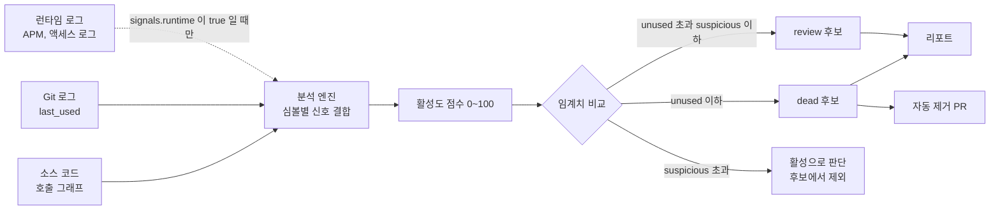
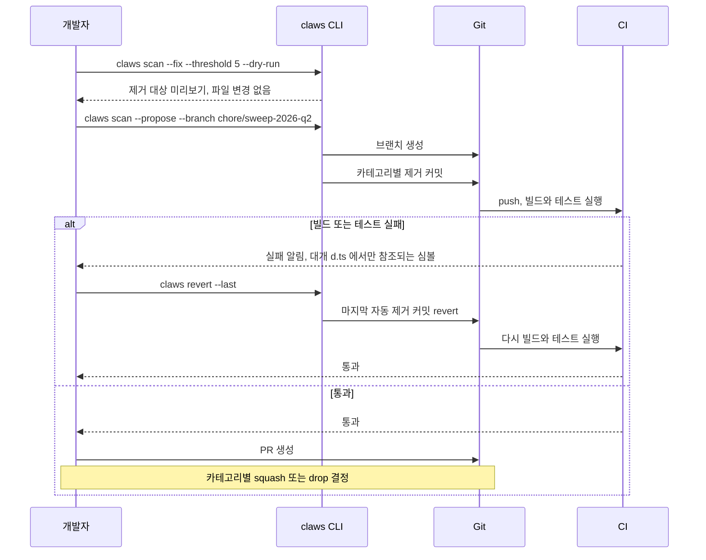
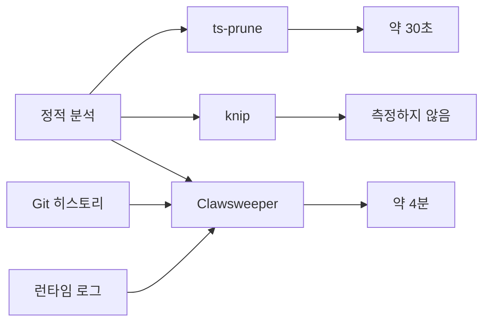
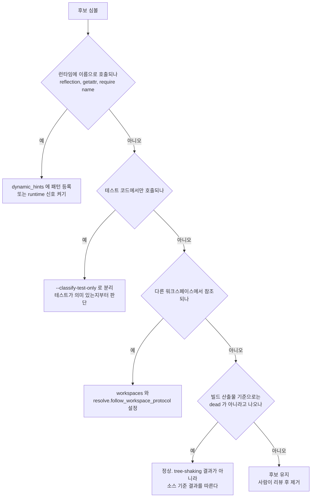
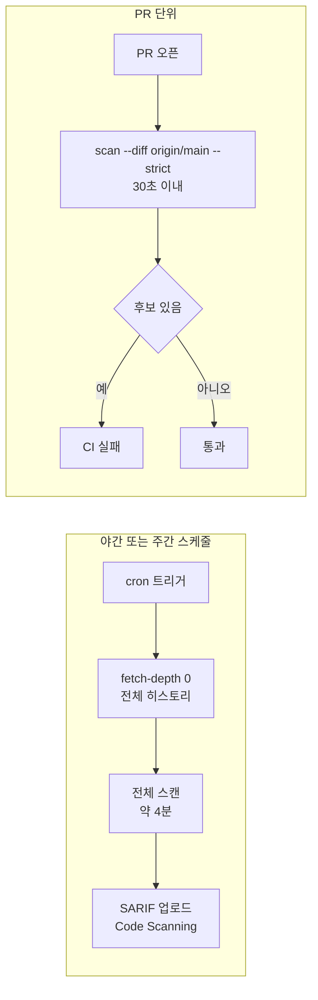

# Clawsweeper

## 1. Clawsweeper란

Clawsweeper는 코드베이스에서 사용하지 않는 코드, 불필요한 의존성, 잠자고 있는 피처 플래그, 죽은 라우트 같은 "쓸려나가야 할 잔해"를 찾아서 정리하는 CLI 도구다. 이름 그대로 발톱(claw)으로 긁어내듯 코드베이스를 훑는다.

처음 봤을 때는 그냥 또 하나의 dead code detector인 줄 알았는데, 실제로 써보면 다르다. 단순히 "이 함수는 호출되지 않습니다"를 알려주는 게 아니라, **호출 그래프, Git 히스토리, 런타임 로그까지 결합해서** 진짜 안 쓰는 코드인지 판단한다. 5년차로 일하면서 가장 짜증났던 게 "이거 진짜 지워도 되나?" 판단하는 일이었는데, Clawsweeper는 그 판단의 근거를 제공한다.

!!! warning "명령어 확인 범위"
    이 문서의 명령어와 옵션은 공식 문서와 대조하지 못했다. 2026-10-24에 npm 레지스트리에서 `clawsweeper` 패키지를 조회했을 때 404가 나왔다. 설치 경로가 다를 수 있으니 실제로 쓰기 전에 `claws --help`와 `claws scan --help` 출력으로 옵션 이름을 확인한다. 이 도구는 버전마다 옵션이 바뀌는 편이라 `--propose`, `--classify-test-only`, `--follow-renames`, `--diff` 같은 옵션은 특히 그렇다.

### 1.1 어떤 문제를 푸는가

레거시 프로젝트를 인수받았을 때 마주치는 전형적인 상황이 있다.

- 3년 전 만든 피처 플래그가 지금도 코드에 살아있는데, 운영에선 항상 false로 고정돼 있음
- `utils.js`에 함수 80개가 있는데 그중 12개만 실제로 import됨
- `package.json`에 의존성 60개 중 절반은 어디서도 require 되지 않음
- `routes/admin/*` 안의 절반은 이전 어드민 시스템 잔재
- 테스트는 통과하는데 실제 호출은 한 번도 안 일어남

이런 잔해는 정적 분석만으로는 잘 안 잡힌다. ESLint의 `no-unused-vars`나 `ts-prune`은 import 레벨에서만 동작하기 때문에, "import은 되지만 실제론 호출되지 않는 함수"는 잡지 못한다. Clawsweeper는 정적 분석 + 런타임 트레이싱 + Git 데이터를 합쳐서 이 빈틈을 메운다.

### 1.2 작동 원리



세 신호는 분석 엔진에서 한 번에 합쳐진다. 신호별로 따로 점수를 내서 나중에 합치는 구조가 아니라, 심볼 하나당 점수 하나가 나온다. 런타임 신호는 기본 설정에서 꺼져 있어서 처음 돌리면 정적 분석과 Git 신호만으로 점수가 나온다. 임계치 아래로 떨어진 심볼만 후보가 되고, 자동 제거 PR로 가는 쪽은 dead 후보뿐이다. review 후보는 리포트에만 남는다.

점수 산식 자체는 문서화된 설정 키가 없다. 이 문서에서 확인되는 값은 아래가 전부다.

| 설정 키 | 값 | 효과 |
|---|---|---|
| `threshold.unused` | 20 (`init` 기본 생성값) | 이 점수 이하면 dead 후보 |
| `threshold.suspicious` | 50 (`init` 기본 생성값) | 이 점수 이하면 review 후보 |
| `signals.static` / `signals.git` / `signals.runtime` | true / true / false | 신호별 on/off. CLI에서는 `--no-git`, `--no-runtime` |
| `dynamic_hints` 매칭 | +50 | 매칭된 파일의 점수에 가산 (6.1 참조) |

신호별 가중치를 바꾸는 키는 찾지 못했다. 점수를 해석할 때는 숫자 하나보다 `last_used` 같은 근거 필드를 같이 보는 편이 낫다.

---

## 2. 설치

### 2.1 시스템 요구사항

- Node.js 20 이상 (이전 버전은 ESM 동적 import 처리에서 문제가 생긴다)
- Python 3.10 이상 (Python 프로젝트 분석 시)
- Git 2.30 이상 (히스토리 기반 점수 계산 시)

### 2.2 설치 방법

```bash
# npm 글로벌 설치
npm install -g clawsweeper

# 또는 프로젝트 의존성으로
npm install -D clawsweeper

# Homebrew (macOS)
brew install clawsweeper

# 설치 확인
claws --version
```

CLI 진입점은 `claws`다. `clawsweeper`로도 호출되지만 매번 풀네임 치기 귀찮아서 alias가 기본 제공된다.

### 2.3 초기 설정

```bash
# 프로젝트 루트에서 실행
claws init
```

`init`을 돌리면 `.clawsweeper.yml` 파일이 생성된다. 처음에는 기본 설정으로 두고, 한 번 스캔 돌려본 다음 false positive가 너무 많으면 그때 조정하는 게 낫다. 처음부터 너무 타이트하게 설정하면 분석 결과를 신뢰하기 어렵다.

```yaml
# .clawsweeper.yml
version: 1
roots:
  - src
  - lib
exclude:
  - "**/*.test.ts"
  - "**/__fixtures__/**"
  - "**/migrations/**"
threshold:
  unused: 20      # 점수 20 이하면 dead 후보
  suspicious: 50  # 점수 50 이하면 review 후보
signals:
  static: true
  git: true
  runtime: false  # 런타임 로그 연동은 별도 설정 필요
```

---

## 3. 주요 기능

### 3.1 Dead Code 탐지

가장 많이 쓰는 기능이다. 호출되지 않는 함수, 참조되지 않는 클래스, import만 되고 실제 사용은 없는 모듈을 찾는다.

```bash
claws scan
```

스캔 출력은 이런 모양이다.

```
src/utils/format.ts
  · formatCurrencyLegacy   score=12  last_used=2023-08
  · padZero                score=18  last_used=2024-02

src/services/billing.ts
  · calculateTaxOldRule    score=8   last_used=never (since 2025-01-12)

3 unused symbols, 2 files affected
```

`last_used`는 Git 로그에서 마지막으로 호출 부위가 수정된 날짜를 추적한 것이다. 단순히 "사용 안 됨"이 아니라 "언제부터 안 쓰였는지"를 보여주기 때문에 실제 제거 결정에 큰 도움이 된다.

### 3.2 의존성 정리

```bash
claws deps
```

`package.json`, `requirements.txt`, `go.mod` 같은 파일을 읽고 실제로 쓰이는지 확인한다. 단순히 import 문만 보는 게 아니라 동적 require, 설정 파일 참조, 빌드 스크립트 참조까지 따라간다.

```
unused dependencies (3):
  · moment           last_imported=2024-11
  · lodash.debounce  never imported (added 2025-03)
  · sharp            referenced only in scripts/legacy-thumbnail.sh

suspicious (1):
  · request          imported only in test fixtures
```

`lodash.debounce` 같은 건 `npm install` 후 까먹고 안 쓴 케이스다. 이런 거 6개월 쌓이면 `node_modules`만 200MB 늘어난다.

### 3.3 피처 플래그 잔해 탐지

```bash
claws flags
```

LaunchDarkly, Unleash, ConfigCat 같은 피처 플래그 시스템과 연동된다. API 키를 설정하면 원격에서 플래그 상태를 읽어와서 "100% on/off로 고정된 지 N일 지난 플래그"를 찾는다.

```yaml
# .clawsweeper.yml
flags:
  provider: launchdarkly
  api_key_env: LAUNCHDARKLY_API_KEY
  stale_after: 60d
```

```
stale flags (2):
  · enable_new_checkout    100% rollout for 142 days
                           used in: src/checkout/CheckoutFlow.tsx (3 places)
  · legacy_search_disabled 0% rollout for 89 days
                           used in: src/search/SearchService.ts (1 place)
```

피처 플래그는 한번 도입하면 정리가 거의 안 된다. 새 기능 출시 후 안정화되면 플래그를 걷어내야 하는데, 이게 별도 티켓 없이 그냥 잊혀진다. Clawsweeper로 분기마다 한 번씩 돌리면 5~10개씩 걸린다.

### 3.4 라우트 분석

```bash
claws routes --framework express
```

Express, Fastify, NestJS, Django, Spring Boot 같은 프레임워크의 라우트 정의를 읽는다. 액세스 로그를 함께 주면 실제 호출되지 않은 엔드포인트를 식별한다.

```bash
claws routes --framework express --access-log /var/log/nginx/access.log --since 90d
```

```
unused routes (last 90d):
  · GET  /api/v1/legacy/users        0 hits
  · POST /api/internal/debug/reset   0 hits (last seen 2024-09)
  · GET  /admin/old-dashboard        0 hits
```

처음 이 기능을 봤을 때 "이거 위험한데?"라고 생각했다. 1년에 한 번 호출되는 배치성 엔드포인트가 90일 윈도우엔 안 잡힐 수 있다. 그래서 결과를 그대로 믿지 말고, `--annotate` 옵션으로 코드에 코멘트만 달고 사람이 검토하는 흐름이 안전하다.

---

## 4. CLI 옵션

### 4.1 자주 쓰는 옵션

```bash
claws scan [options]

Options:
  -p, --path <dir>           스캔 대상 경로 (기본: 현재 디렉토리)
  -c, --config <file>        설정 파일 경로 (기본: .clawsweeper.yml)
  -o, --output <format>      출력 형식: text, json, sarif, html
  -t, --threshold <n>        활성도 점수 임계치 (기본: 20)
  --since <date>             특정 날짜 이후 데이터만 사용
  --include <pattern>        포함 패턴 (glob)
  --exclude <pattern>        제외 패턴 (glob)
  --no-git                   Git 신호 비활성화
  --no-runtime               런타임 로그 신호 비활성화
  --strict                   suspicious까지 모두 실패로 처리 (CI용)
  --fix                      안전하다고 판단되는 항목 자동 제거
  --dry-run                  변경 사항 적용 없이 미리보기
```

### 4.2 출력 형식

JSON 출력은 다른 도구와 연동할 때 유용하다.

```bash
claws scan --output json > clawsweeper-report.json
```

SARIF 형식은 GitHub의 Code Scanning과 연동된다.

```bash
claws scan --output sarif > clawsweeper.sarif
```

GitHub Actions에서 SARIF를 업로드하면 PR에 인라인으로 dead code 경고가 뜬다.

### 4.3 자동 제거 모드

```bash
claws scan --fix --threshold 5
```

`--fix`는 점수 5 이하 항목을 자동으로 제거하고 커밋한다. 처음 쓸 때는 무조건 `--dry-run`을 함께 줘야 한다. 자동 제거가 안전한 케이스는 다음 정도다.

- `export` 됐지만 어디서도 import 안 되는 함수
- `package.json`의 `dependencies`에 있지만 코드 어디서도 require 없음
- 100% on 상태 60일 지난 피처 플래그의 false 분기

자동 제거가 위험한 케이스는 건드리지 않는다. 동적 import, 리플렉션 호출, 외부 시스템(웹훅, 크론)이 호출하는 라우트 같은 건 자동 제거 대상에서 제외된다고 되어 있지만, 제외 판단도 정적으로 보이는 범위에서만 동작한다. `dynamic_hints`에 등록하지 않은 동적 호출은 제외 목록에 안 들어갈 수 있다.

아래 시퀀스는 자동 제거를 CI와 묶어서 돌릴 때의 순서다. 8.4의 빌드 실패 복구까지 한 흐름으로 그렸다. `--fix`는 현재 브랜치에 바로 커밋하고, `--propose`는 브랜치를 새로 만들어 카테고리별로 커밋한다.



다이어그램에서 봐야 할 곳은 `alt` 의 실패 분기다. 복구는 revert 한 번이지만, `--propose`로 만든 브랜치는 커밋이 카테고리별로 여러 개라서 `--last`는 마지막 하나만 되돌린다. 실패 원인 커밋이 마지막이 아니면 `git revert <sha>`로 직접 골라야 한다.

---

## 5. 다른 도구와의 비교

| 도구 | 대상 | 신호 | 자동 제거 | 비고 |
|------|------|------|----------|------|
| **Clawsweeper** | 함수/클래스/라우트/의존성/플래그 | 정적 + Git + 런타임 | 지원 | 다신호 결합이 강점 |
| **ts-prune** | TypeScript export | 정적 (import 레벨) | 미지원 | 빠르지만 신호 단순 |
| **knip** | TS/JS 전반 | 정적 | 부분 지원 | TypeScript 생태계에선 가장 무난 |
| **depcheck** | npm 의존성 | 정적 | 미지원 | 의존성 전용 |
| **vulture** | Python | 정적 | 미지원 | Python 한정 |
| **deadcode (Go)** | Go | 정적 + 호출그래프 | 미지원 | Go 한정 |

단일 신호로 판단하면 "이거 동적으로 호출되는데?" 케이스를 놓치기 쉽다. Clawsweeper는 Git 히스토리상 호출 부위가 최근에 수정됐으면 점수를 올려준다. 그 대신 신호가 늘어난 만큼 시간이 든다. 아래는 세 도구가 쓰는 신호와 50만 라인 프로젝트 기준 분석 시간이다. 시간은 이 문서를 쓴 쪽에서 겪은 값이고 공식 벤치마크가 아니다.



Git과 런타임 신호를 붙이는 비용이 30초와 4분의 차이다. CI에서 매 PR마다 전체 스캔을 돌리기엔 무리고, 주간/야간 작업으로 돌리는 게 현실적이다. PR에는 7.2의 diff 스캔을 따로 건다.

---

## 6. 실무에서 겪는 문제

스캔 결과에서 후보를 지우기 전에 걸러야 하는 경우는 네 가지다. 아래 흐름은 후보 하나를 놓고 위에서부터 차례로 확인하는 순서다. 어느 쪽에도 안 걸린 후보만 사람이 리뷰할 대상이 된다.



동적 호출과 워크스페이스는 설정을 고치면 후보가 사라진다. 테스트 전용은 후보가 그대로 남고 분류만 달라진다. 빌드 산출물 불일치는 고칠 게 없다. 이 넷째에 걸렸는데 설정을 만지고 있다면 방향이 틀린 것이다.

### 6.1 동적 호출이 많은 코드베이스

Java reflection, Python `getattr`, JS `require(name)` 처럼 런타임에 결정되는 호출은 정적 분석으로 못 잡는다. 이걸 dead code로 오판하면 운영에서 사고난다.

해결 방법은 두 가지다. 첫째, `.clawsweeper.yml`의 `dynamic_hints`에 패턴을 등록한다.

```yaml
dynamic_hints:
  - pattern: "src/handlers/*.ts"
    reason: "라우터에서 동적 require"
  - pattern: "src/jobs/**/*.ts"
    reason: "스케줄러가 클래스명으로 로드"
```

이 패턴에 매칭되는 파일은 활성도 점수에 +50 보정이 들어간다.

둘째, 런타임 신호를 켠다. APM이나 로그에서 실제 호출 데이터를 가져오면 동적 호출도 잡힌다. Datadog APM 연동 예시는 이렇다.

```yaml
runtime:
  provider: datadog
  api_key_env: DD_API_KEY
  app_key_env: DD_APP_KEY
  service: my-api
  window: 30d
```

### 6.2 모노레포에서 워크스페이스 간 참조

pnpm workspace나 yarn workspace로 묶인 모노레포에서 `packages/foo`의 함수가 `packages/bar`에서 호출되는 경우가 흔하다. 1.x에서는 이걸 dead code로 오판했고 2.0부터 고쳐졌다고 알려져 있지만, `workspace:` 프로토콜 인식은 아직 빈틈이 있을 수 있다. 쓰는 버전의 릴리스 노트를 확인한다.

```yaml
workspaces:
  - packages/*
  - apps/*
resolve:
  follow_workspace_protocol: true
```

이 옵션을 명시하지 않으면 워크스페이스 간 참조를 추적 못 할 수 있다. 모노레포라면 켜 두고 시작한다.

### 6.3 테스트 코드만 호출하는 함수

운영 코드에선 안 쓰는데 테스트에서만 쓰는 함수가 종종 있다. dead code가 맞지만, 지우면 테스트도 같이 지워야 해서 함부로 못 지운다.

```bash
claws scan --classify-test-only
```

`--classify-test-only`를 주면 별도 카테고리로 분리해서 보여준다.

```
test-only symbols (5):
  · createMockOrder    used only in src/__tests__/order.spec.ts
  · stubPaymentClient  used only in tests/integration/payment.test.ts
```

이런 건 보통 "테스트가 진짜 의미 있는 테스트인가?"부터 의심해야 한다. 운영에서 쓰지 않는 함수에 테스트만 붙어있다는 건 테스트가 이미 죽은 거다.

### 6.4 빌드 결과물 분석과 소스 분석의 불일치

Webpack tree-shaking이 적용된 빌드 결과물 기준으로는 dead code가 없어 보이는데 소스 기준으로는 있는 경우가 있다. 정상이다. tree-shaking은 빌드 시점에 번들에서 빼는 것이고, Clawsweeper는 소스에서 지우는 것이 목적이다.

---

## 7. CI 통합

### 7.1 GitHub Actions 예시

```yaml
name: Code Sweep

on:
  schedule:
    - cron: '0 3 * * 1'  # 월요일 새벽 3시
  workflow_dispatch:

jobs:
  sweep:
    runs-on: ubuntu-latest
    steps:
      - uses: actions/checkout@v4
        with:
          fetch-depth: 0  # Git 히스토리 전체 필요

      - uses: actions/setup-node@v4
        with:
          node-version: 20

      - run: npm install -g clawsweeper

      - run: claws scan --output sarif > clawsweeper.sarif
        env:
          DD_API_KEY: ${{ secrets.DD_API_KEY }}
          DD_APP_KEY: ${{ secrets.DD_APP_KEY }}

      - uses: github/codeql-action/upload-sarif@v3
        with:
          sarif_file: clawsweeper.sarif
```

`fetch-depth: 0`을 빠뜨리면 Git 히스토리 신호가 동작하지 않는다. 처음 셋업할 때 가장 흔히 빼먹는 부분이다.

### 7.2 PR 단위 검사

매 PR에서 새로 추가된 코드만 검사하고 싶다면 `--diff` 옵션을 쓴다.

```bash
claws scan --diff origin/main --strict
```

PR에서 추가/수정된 부분만 보고 dead code 후보가 있으면 CI가 실패한다. 전체 스캔 대신 diff 기반으로 돌리면 50만 라인 프로젝트도 30초 안에 끝난다.

### 7.3 야간 전체 스캔과 PR 스캔을 나누는 이유

둘을 분리한 이유는 시간 차이다. 전체 스캔은 4분 걸려서 PR 체크로 걸면 리뷰어가 매번 4분을 기다린다. PR 스캔은 30초 이내라 머지 조건으로 걸 수 있다. 반대로 PR 스캔만 돌리면 빈틈이 생긴다. PR에서 호출부를 지우면 다른 파일에 있는 함수가 dead가 되는데, diff 모드가 변경 범위 밖의 이런 후보까지 잡는지는 확인하지 못했다. 그래서 야간 전체 스캔이 안전망 역할을 한다고 보고 운영한다.



왼쪽은 실패해도 아무도 막지 않는 리포트용이고, 오른쪽은 머지를 막는 게이트다. 두 경로의 `--strict` 사용 여부가 다른 이유도 여기서 나온다. 전체 스캔에 `--strict`를 걸면 기존 빚 때문에 첫 실행부터 계속 실패한다.

---

## 8. 트러블슈팅

### 8.1 "Git history not available" 에러

```
Error: Git history not available for src/foo.ts (only 1 commit found)
```

원인은 보통 두 가지다. 첫째, CI에서 `fetch-depth: 0` 안 줬을 때. 둘째, 파일이 진짜로 한 번만 커밋됐을 때(rename 되면서 히스토리 끊김 포함).

후자라면 `--follow-renames` 플래그를 추가한다. `claws scan --help`에 없으면 쓰는 버전에서는 지원하지 않는 것이다.

```bash
claws scan --follow-renames
```

내부적으로 `git log --follow`를 사용하기 때문에 분석 속도가 30~40% 느려진다. 필요할 때만 켠다.

### 8.2 메모리 초과

대형 모노레포에서 OOM이 나는 경우가 있다. Clawsweeper는 호출 그래프를 메모리에 다 올리는데, 100만 노드 넘어가면 8GB로도 부족하다.

```bash
NODE_OPTIONS="--max-old-space-size=16384" claws scan
```

또는 분할 스캔으로 우회한다.

```bash
claws scan --path packages/api
claws scan --path packages/web
```

분할 스캔의 단점은 패키지 간 참조 추적이 끊긴다는 점이다. `claws merge`로 결과를 합치는 서브커맨드가 있다고 알려져 있는데, 확인하지 못했다. 있더라도 정확도는 통합 스캔보다 떨어진다.

### 8.3 false positive가 너무 많을 때

스캔 결과의 절반 이상이 false positive면 임계치 조정으로는 해결이 안 된다. 보통 다음 중 하나다.

- 동적 호출 패턴이 `dynamic_hints`에 등록 안 됨
- 런타임 신호가 꺼져있는데 정적 분석만으로 판단 중
- 모노레포 워크스페이스 설정 누락
- 외부 라이브러리가 데코레이터/리플렉션으로 호출 (NestJS, Spring 등)

NestJS의 경우 `@Controller`, `@Injectable` 데코레이터로 등록된 클래스는 정적 분석상 import 흔적이 없을 수 있다. NestJS 플러그인이 있는 버전이면 켜는 것으로 해결된다. 플러그인 패키지명은 아래 예시처럼 `@clawsweeper/` 접두사를 쓰는 것으로 알고 있지만 레지스트리에서 확인하지 못했다.

```yaml
plugins:
  - "@clawsweeper/plugin-nestjs"
  - "@clawsweeper/plugin-spring"
```

### 8.4 자동 제거 후 빌드 실패

`claws scan --fix` 후에 빌드가 깨지는 경우가 있다. 가장 흔한 원인은 타입 정의 파일(`.d.ts`)에서만 참조되는 심볼이다. 런타임 코드에선 안 쓰지만 타입 시그니처에 남아있는 경우다. 전체 순서는 4.3의 시퀀스 다이어그램에서 실패 분기를 보면 된다.

복구는 `claws revert`로 한다.

```bash
claws revert --last
```

마지막 자동 제거 커밋을 revert한다. 자동 제거는 별도 커밋으로 분리되기 때문에 revert가 깔끔하다. 커밋이 여러 개인 브랜치에서 원인 커밋이 마지막이 아니면 `--last`로는 안 되고 `git revert`로 직접 고른다.

`--fix`는 현재 브랜치에 바로 커밋하므로 `--propose`로 별도 브랜치에 커밋을 만들고 사람이 검토하는 방식이 안전하다. 이 옵션이 쓰는 버전에 없으면 새 브랜치를 먼저 만들고 그 위에서 `--fix`를 돌린다.

```bash
claws scan --propose --branch chore/sweep-2026-q2
```

`chore/sweep-2026-q2` 브랜치에 dead code 후보가 카테고리별로 커밋된다. PR을 열고 카테고리별로 squash나 drop을 결정한다. 분기마다 한 번 이런 PR을 만드는 정도가 부담 없는 주기다.

---

## 9. 정리

Clawsweeper는 "지워도 되는지 판단"을 도와주는 도구지, "지워야 하는 것을 결정"해주는 도구가 아니다. 자동 제거는 `dynamic_hints`를 채우지 않은 코드베이스에서 돌리면 런타임에만 호출되는 코드를 지운다. 8.4처럼 `.d.ts`에서만 참조되는 심볼을 지워 빌드가 깨지는 일도 있다.

5년차쯤 되면 레거시 정리 PR을 한 번씩 맡게 되는데, 그때 Clawsweeper의 리포트가 있으면 "근거 있는 제거"가 가능해진다. 단순히 "안 쓰는 것 같아서 지웠다"가 아니라 "활성도 점수 8점, 마지막 호출 14개월 전, 런타임 호출 0건, Git blame상 작성자 퇴사"라는 근거가 PR 설명에 들어가면 리뷰어도 동의하기 쉽다. 이게 이 도구가 진짜 가치 있는 지점이다.
