# LLM 분산 학습

70B 모델을 학습시키려면 GPU가 몇 장 필요한지, FSDP로 충분한지 Tensor Parallel까지 가야 하는지, 학습이 멈췄을 때 어디부터 봐야 하는지를 다룬다. 메모리 표와 MFU 수치는 [LLM 사전학습 파이프라인](LLM_Pretraining.md)의 8장과 9장에도 있다. 이 문서는 그 표를 어떻게 계산했는지, 각 병렬화가 정확히 무엇을 쪼개는지, 조합을 어떤 순서로 고르는지, 실제 운영에서 무엇이 깨지는지를 다룬다. 학습 예산을 정하는 쪽은 [스케일링 법칙](LLM_Scaling_Laws.md)이 맡는다. 거기서 정한 N(파라미터)과 D(토큰)가 이 문서의 입력이다.

실행 환경에 관한 전제를 먼저 적는다. 이 문서의 코드는 GPU가 없는 서버(CPU 4코어, RAM 2GB)에서 `torchrun`과 `gloo` 백엔드로 돌렸고 PyTorch 2.14.1을 썼다. FSDP 샤딩, 분산 체크포인트 저장과 재샤딩, rank 하나가 죽거나 멈췄을 때의 동작은 실제로 실행해서 출력을 붙였다. 메모리 계산, 통신량, bubble 비율은 스크립트로 계산하거나 시뮬레이션한 값이다. CUDA OOM 메시지와 NCCL 동작은 이 환경에서 재현하지 못했다. 해당 부분은 "실행 못 함"이라고 따로 표시했고, PyTorch 문서에 적힌 동작을 근거로 썼다.

---

## 1. 70B가 GPU 한 장에 안 들어가는 이유

학습 중 GPU 메모리에 올라가 있는 것은 네 종류다. 파라미터, gradient, optimizer 상태, 활성값(activation)이다. 앞의 셋은 모델 크기에 비례하고 활성값은 배치와 시퀀스 길이에 비례한다.

### 1.1 파라미터당 16바이트

AdamW와 혼합 정밀도 조합에서 파라미터 하나가 차지하는 바이트는 구성에 따라 이렇게 나뉜다.

| 구성 | 파라미터 | gradient | master 가중치 | Adam m, v | 합 |
|---|---|---|---|---|---|
| BF16 가중치 + FP32 master | 2 | 2 | 4 | 8 | 16 |
| FP32 가중치 + autocast | 4 | 4 | 없음 | 8 | 16 |

두 구성이 같은 16이 되는 것을 작은 모델로 확인했다. 파라미터 210만 개짜리 MLP를 `torch.autocast`로 한 스텝 돌리고 각 텐서의 `numel() * element_size()`를 합했다.

```text
params=2,101,248  weight=4.0  grad=4.0  adam=8.0  total=16.0 bytes/param
```

이 숫자에서 놓치기 쉬운 부분이 optimizer 상태다. Adam의 `exp_avg`와 `exp_avg_sq`는 `optimizer.step()`을 처음 부르는 순간에 만들어진다. 같은 Linear 모델에서 확인했다.

```text
optimizer.step() 전 state: 0 항목 0 bytes
backward 후, step 전  grad 보유: 4198400 bytes / state: 0
step() 후 state: 8396808 bytes = 8.00000762195122 bytes/param
```

첫 forward와 backward가 멀쩡히 지나가고 `optimizer.step()`에서 처음 OOM이 나는 이유가 여기 있다. 파라미터 1B당 8GB가 그 한 줄에서 한꺼번에 생긴다. 메모리 사용량을 모니터링할 때 1스텝만 돌려 보고 안심하면 안 되고 최소 2스텝은 돌려야 한다.

아래 도식은 한 스텝 안에서 메모리가 생기는 순서다. 상태 8바이트가 마지막 단계에서야 생긴다는 점을 보면 된다.


### 1.2 70B와 7B에 적용

"70B"는 반올림한 이름이다. Llama 계열 구성(레이어 80, hidden 8192, FFN 28672, 헤드 64, KV 헤드 8, 어휘 128,256)으로 파라미터 수를 직접 세면 70.55B가 나온다. 7B 구성(레이어 32, hidden 4096, FFN 11008)은 6.74B다. 16바이트를 곱한 결과다.

| 모델 | 파라미터 | BF16 가중치 | gradient | FP32 master | Adam m, v | 합 | 80GB 장수 |
|---|---|---|---|---|---|---|---|
| 7B | 6.74B | 13GB | 13GB | 27GB | 54GB | 108GB | 1.3 |
| 70B | 70.55B | 141GB | 141GB | 282GB | 564GB | 1,129GB | 14.1 |

7B에서 112GB가 아니라 108GB인 것은 7.00B가 아니라 6.74B로 계산했기 때문이다. 70B는 가중치만 BF16으로 141GB라 80GB GPU 한 장에 가중치조차 안 올라간다. 상태만 14장 분량이고 활성값은 따로 더해진다. 이 숫자가 "FSDP부터 시작한다"는 말의 근거다.

표는 아래 스크립트가 낸다. 파라미터 수를 구성값에서 직접 세고 16을 곱할 뿐이라 CPU만으로 돈다.

```python
def llama_params(L, h, ffn, heads, kv, vocab, tie=False):
    hd = h // heads
    attn = h * h + 2 * h * kv * hd + h * h      # q, k+v, o
    mlp = 3 * h * ffn                            # gate, up, down
    emb = vocab * h * (1 if tie else 2)
    return L * (attn + mlp + 2 * h) + emb + h

def act_per_layer(s, b, h):                      # flash attention 기준
    return 34 * s * b * h

c = dict(L=80, h=8192, ffn=28672, heads=64, kv=8, vocab=128256)
P = llama_params(**c)
print(f"{P/1e9:.2f}B  상태 합 {16*P/1e9:,.0f}GB  80GB {16*P/80e9:.1f}장")
for s in (4096, 8192, 32768):
    full = c["L"] * act_per_layer(s, 1, c["h"]) / 1e9
    ck = (c["L"] * 2 * s * c["h"] + act_per_layer(s, 1, c["h"])) / 1e9
    print(f"s={s:>6}: 활성값 {full:.1f}GB  checkpoint {ck:.1f}GB")
```

checkpoint 열은 레이어 입력 `2 * s * b * h`만 저장하고 한 레이어 분량을 재계산용으로 더한 값이다.

### 1.3 활성값

활성값은 역전파가 쓰려고 순전파에서 남겨 두는 중간 텐서다. [Korthikanti et al.](https://arxiv.org/abs/2205.05198)의 근사로 레이어 하나가 보관하는 바이트는 flash attention 기준 `34 * s * b * h`다(s는 시퀀스 길이, b는 micro-batch, h는 hidden). 70B 구성에 b=1을 넣은 값이다.

| 시퀀스 길이 | 80층 전체 활성값 | activation checkpointing 적용 |
|---|---|---|
| 4,096 | 91.3GB | 6.5GB |
| 8,192 | 182.5GB | 13.0GB |
| 32,768 | 730.1GB | 52.1GB |

시퀀스가 길어지면 활성값이 선형으로 늘고 상태 메모리는 그대로다. 70B를 64장에 FSDP로 나누면 상태는 장당 17.6GB로 내려가지만 4K 시퀀스의 활성값 91.3GB는 줄지 않는다. 활성값은 데이터 병렬 rank마다 자기 micro-batch 몫으로 따로 갖기 때문이다. 이 근사식은 TP와 sequence parallel이 없는 경우의 값이고, Llama의 SwiGLU는 FFN 비율이 달라 상수 34가 정확히 맞지는 않는다. 실제 값은 프로파일러로 한 번 재야 한다.

---

## 2. 데이터 병렬에서 샤딩으로

### 2.1 무엇을 어디에 복제하고 무엇을 나누나

DDP는 모델 전체를 GPU마다 복제하고 배치만 나눈다. 역전파 중에 gradient를 bucket 단위(기본 25MB)로 all-reduce해서 계산과 통신을 겹친다. 메모리는 전혀 줄지 않는다. ZeRO는 이 복제를 단계적으로 걷어 낸다.

아래 도식은 DP=2일 때 각 방식에서 GPU가 들고 있는 것을 나눠 그렸다. P는 파라미터, G는 gradient, O는 optimizer 상태다. ZeRO-1에서 O만 반으로 줄고, ZeRO-2에서 G가 줄고, ZeRO-3에서 P까지 줄어드는 것을 보면 된다.

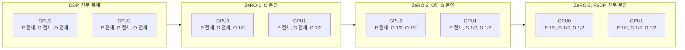

70.55B, DP=64에서 GPU당 상태 메모리를 계산하면 DDP 1,128.8GB, ZeRO-1 295.4GB, ZeRO-2 156.5GB, ZeRO-3 17.6GB다. LLM_Pretraining.md의 표(293.1, 155.3, 17.5GB)와 약간 다른 것은 거기가 70.00B로 계산했기 때문이다. ZeRO-1과 ZeRO-2는 80GB에 못 들어가고 ZeRO-3만 들어간다. 파라미터를 나누느냐가 70B에서는 결정적이다.

### 2.2 ZeRO-3, FSDP, DeepSpeed가 같은 것인지

ZeRO-3와 FSDP는 같은 아이디어다. 이름이 다른 이유는 구현이 다른 프로젝트에 있기 때문이다([ZeRO 논문](https://arxiv.org/abs/1910.02054), [PyTorch FSDP 논문](https://arxiv.org/abs/2304.11277)). 설정 이름이 갈리는 부분을 표로 정리했다. FSDP 쪽은 PyTorch 2.14.1에서 `ShardingStrategy`와 `fully_shard`의 시그니처를 열어 확인한 이름이다.

| 개념 | FSDP1 (`FullyShardedDataParallel`) | FSDP2 (`fully_shard`) | DeepSpeed |
|---|---|---|---|
| DDP와 같음 | `NO_SHARD` | 샤딩 안 함 | `stage: 0` |
| ZeRO-2 | `SHARD_GRAD_OP` | `reshard_after_forward=False` | `stage: 2` |
| ZeRO-3 | `FULL_SHARD` | `reshard_after_forward=True` (기본) | `stage: 3` |
| 노드 안만 샤딩, 노드 간 복제 | `HYBRID_SHARD` | 2차원 mesh를 넘긴다 | MiCS, ZeRO++ hpZ (동작이 같지 않아 문서 확인) |

FSDP2에서 `reshard_after_forward=False`가 ZeRO-2와 같은 이유는 순전파 뒤에 모은 파라미터를 버리지 않아서다. 역전파 때 all-gather를 다시 안 하니 통신이 3번에서 2번으로 줄고, 대신 순전파 직후부터 레이어의 full 파라미터가 계속 메모리에 있다. 메모리가 남으면 이 쪽이 낫다.

내부 표현도 다르다. FSDP1은 한 wrap 단위의 파라미터를 평평한 1차원 텐서 하나(`FlatParameter`)로 합쳐서 나눈다. FSDP2는 파라미터마다 `DTensor`를 따로 만든다. FSDP2 쪽이 일부 파라미터만 동결하거나 파라미터별로 dtype을 다르게 줄 때 다루기 쉽고, 분산 체크포인트와 이어 붙이기도 쉽다. 새로 시작하는 코드라면 FSDP2를 쓴다.

### 2.3 wrap 단위가 메모리를 정한다

ZeRO-3는 레이어를 쓰는 순간에 그 레이어의 파라미터를 all-gather로 전부 모았다가 쓰고 버린다. 한 번에 full로 올라오는 크기가 wrap 단위다. 70B 구성에서 트랜스포머 블록 하나의 BF16 파라미터는 1.76GB이고 모델 전체는 141GB다. 블록마다 wrap하면 순간 임시 메모리가 1.76GB 두 개 정도(현재 블록과 prefetch 중인 블록)로 끝난다. 모델 전체를 한 단위로 감싸면 all-gather 순간에 141GB가 필요해서, 샤딩해 놓고도 첫 forward에서 OOM이 난다. 상태가 17.6GB로 줄었는데 OOM이 난다면 wrap 정책부터 의심한다.

아래 도식은 wrap 단위(블록 하나) 안에서 파라미터가 모였다 흩어지는 순서다. full 파라미터가 존재하는 구간은 각 계산 직전부터 직후까지뿐이다.

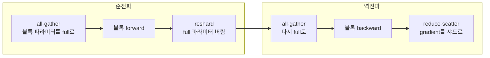

### 2.4 torchrun과 FSDP 최소 예제

블록 4개짜리 작은 모델을 FSDP2로 감싸고 3스텝 학습한 뒤 샤드 체크포인트를 저장하는 예제다. 핵심은 블록마다 `fully_shard`를 부르고 마지막에 루트 모듈을 한 번 더 부르는 두 줄이다.

```python
# fsdp_min.py — torchrun --nproc_per_node=N fsdp_min.py save|load
import sys, torch, torch.nn as nn, torch.distributed as dist
import torch.distributed.checkpoint as dcp
from torch.distributed.checkpoint.state_dict import get_state_dict, set_state_dict
from torch.distributed.fsdp import fully_shard

mode, ckdir = sys.argv[1], sys.argv[2]
dist.init_process_group("gloo")             # GPU 서버에서는 "nccl"
rank, world = dist.get_rank(), dist.get_world_size()
torch.manual_seed(0)                        # 가중치 초기화는 모든 rank가 같아야 한다

class Block(nn.Module):
    def __init__(s, h=256):
        super().__init__(); s.fc1 = nn.Linear(h, 4*h); s.fc2 = nn.Linear(4*h, h)
    def forward(s, x): return x + s.fc2(torch.relu(s.fc1(x)))

model = nn.Sequential(*[Block() for _ in range(4)])
total = sum(p.numel() for p in model.parameters())
for b in model: fully_shard(b)              # 블록 하나가 all-gather 단위
fully_shard(model)                          # 남은 파라미터는 루트가 묶는다
opt = torch.optim.AdamW(model.parameters(), lr=1e-3)

local = sum(p.to_local().numel() for p in model.parameters())
print(f"[rank {rank}/{world}] 전체 {total:,}  로컬 샤드 {local:,}  ({local/total:.3f})", flush=True)

torch.manual_seed(100 + rank)               # 데이터는 rank마다 달라야 한다
def step():
    loss = model(torch.randn(8, 256)).pow(2).mean()
    loss.backward(); opt.step(); opt.zero_grad(); return loss.item()

if mode == "save":
    for _ in range(3): step()
    msd, osd = get_state_dict(model, opt)
    dcp.save({"model": msd, "optim": osd}, checkpoint_id=ckdir)
```

`torch.manual_seed`를 두 번 쓰는 데는 이유가 있다. 첫 번째는 실행마다 같은 초기 가중치를 만들어 재현이 되게 한다. 두 번째는 rank마다 다른 시드로 다른 배치를 받게 한다. 두 번째를 빼면 모든 rank가 같은 배치로 학습해서 데이터 병렬이 의미 없어진다.

2 rank로 실행한 출력이다. 샤드가 정확히 절반씩이다.

```text
$ torchrun --nproc_per_node=2 fsdp_min.py save /tmp/dt/ckpt2
[rank 0/2] 전체 2,102,272  로컬 샤드 1,051,136  (0.500)
[rank 1/2] 전체 2,102,272  로컬 샤드 1,051,136  (0.500)
```

3 rank로 읽을 때는 `704,176`, `704,176`, `693,920`으로 나뉜다. 파라미터의 첫 번째 차원이 3으로 나눠떨어지지 않아 rank마다 크기가 다르다. 샤드가 균등하지 않다는 걸 알고 있어야 rank별 메모리 편차를 봤을 때 놀라지 않는다.

---

## 3. 모델을 쪼개는 병렬화

FSDP는 파라미터를 나눠 저장하지만 계산은 GPU마다 모델 전체에 대해 한다. 계산 자체를 쪼개는 방식이 세 가지 있다. 레이어 안의 행렬을 쪼개는 tensor parallel, 레이어를 구간으로 쪼개는 pipeline parallel, 시퀀스를 쪼개는 context parallel이다. 아래 도식은 4개 GPU에서 이 세 방식이 각각 무엇을 어디에 두는지 보여준다.

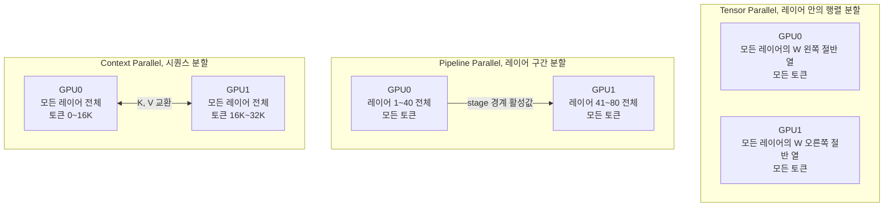

TP는 모든 레이어를 쪼개고 모든 토큰을 본다. PP는 레이어를 나눠 갖고 한 레이어는 통째로 한 GPU에 있다. CP는 모델을 통째로 갖고 토큰을 나눈다. 세 방식이 쪼개는 축이 달라서 서로 겹치지 않고 곱해진다.

### 3.1 Tensor parallel

Megatron-LM 방식은 MLP의 첫 행렬을 열 방향(column parallel), 두 번째 행렬을 행 방향(row parallel)으로 쪼갠다([Megatron-LM 논문](https://arxiv.org/abs/1909.08053)). 이렇게 하면 두 행렬 사이의 활성 함수를 GPU마다 독립적으로 계산할 수 있고 레이어의 마지막에 합을 한 번만 하면 된다.

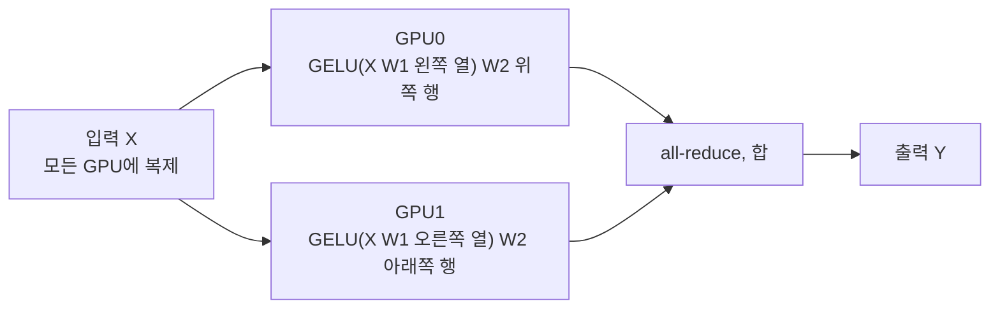

이 방식이 수학적으로 맞는지 float64 행렬로 확인했다. h=64, FFN=256, TP=4로 쪼갠 결과를 쪼개지 않은 결과와 비교한다.

```text
column->row 결과 일치: True
row->column 도 일치하지만 GELU 앞 합산이 필요: True
합산 없이 GELU 를 먼저 적용하면: False
```

세 번째 줄이 핵심이다. 첫 행렬을 행 방향으로 쪼개면 부분합을 GELU 앞에서 먼저 더해야 한다. GELU는 비선형이라 부분합마다 적용하면 결과가 달라진다. 그래서 첫 행렬은 열 방향으로 쪼개서 GELU 앞의 합산을 없앤다. 트랜스포머 레이어는 attention과 MLP 각각에 순전파 all-reduce 1번, 역전파 1번이 필요해서 레이어당 4번이다.

TP의 통신은 연산 중간에 끼어서 다음 계산이 이 합을 기다린다. 가릴 수 있는 여지가 작아서 TP는 NVLink 안에서만 쓴다. TP 크기는 어텐션 헤드 수와 KV 헤드 수의 약수여야 한다. KV 헤드가 8개인 모델에 TP=16을 걸면 KV 헤드를 복제해야 해서 메모리와 통신이 낭비된다.

TP 그룹 안에서 LayerNorm과 dropout은 각 GPU가 같은 입력으로 중복 계산한다. 이 구간의 활성값까지 시퀀스 방향으로 쪼개는 것이 sequence parallel이다(Megatron의 SP, [Korthikanti et al.](https://arxiv.org/abs/2205.05198)). TP의 all-reduce를 reduce-scatter와 all-gather로 바꿔 통신량은 그대로 두고 활성값을 TP 크기만큼 줄인다. 이름이 비슷한 context parallel과는 쪼개는 범위가 다르다. SP는 LayerNorm류 구간만, CP는 attention까지 포함한 전 구간을 쪼갠다.

### 3.2 Pipeline parallel과 bubble

PP는 레이어를 연속 구간(stage)으로 잘라 GPU 그룹에 배치한다. 통신은 stage 경계의 활성값 하나뿐이라 TP보다 훨씬 적다. 대신 앞 stage가 끝나야 다음 stage가 시작해서 GPU가 노는 구간(bubble)이 생긴다.

stage 4개, micro-batch 4개를 1F1B로 돌릴 때 시간표를 시뮬레이션했다. forward 1칸, backward 2칸으로 두었다. 각 줄이 한 stage이고 막대가 없는 칸이 bubble이다.

```mermaid
gantt
    title 1F1B, stage 4개, micro-batch 4개
    dateFormat X
    axisFormat %s
    section stage0
    F0 :0, 1
    F1 :1, 2
    F2 :2, 3
    F3 :3, 4
    B0 :10, 12
    B1 :13, 15
    B2 :16, 18
    B3 :19, 21
    section stage1
    F0 :1, 2
    F1 :2, 3
    F2 :3, 4
    B0 :8, 10
    F3 :10, 11
    B1 :11, 13
    B2 :14, 16
    B3 :17, 19
    section stage2
    F0 :2, 3
    F1 :3, 4
    B0 :6, 8
    F2 :8, 9
    B1 :9, 11
    F3 :11, 12
    B2 :12, 14
    B3 :15, 17
    section stage3
    F0 :3, 4
    B0 :4, 6
    F1 :6, 7
    B1 :7, 9
    F2 :9, 10
    B2 :10, 12
    F3 :12, 13
    B3 :13, 15
```

총 21칸 중 stage마다 12칸만 일한다. 놀고 있는 시간이 9칸이니 전체의 42.9%다. 마지막 stage는 첫 forward가 도착할 때까지 3칸을 기다리고, 첫 stage는 마지막 backward가 돌아올 때까지 6칸을 기다린다.

bubble 비율을 시뮬레이션으로 여러 (p, m) 조합에서 셌다. p는 stage 수, m은 micro-batch 수다.

| p | m | 전체 시간 대비 유휴 | (p-1)/m |
|---|---|---|---|
| 4 | 4 | 42.9% | 75.0% |
| 4 | 8 | 27.3% | 37.5% |
| 4 | 16 | 15.8% | 18.8% |
| 4 | 64 | 4.5% | 4.7% |
| 8 | 16 | 30.4% | 43.8% |

전체 시간 대비 유휴 비율은 `(p-1)/(m+p-1)`이고 시뮬레이션 값과 정확히 일치한다. 많이 인용되는 `(p-1)/m`은 유휴 시간을 순수 연산 시간으로 나눈 값이다. 분모가 다르니 어느 쪽인지 확인하고 읽어야 한다. m이 p보다 한참 커야 줄어든다는 결론은 두 식이 같다. LLM_Pretraining.md 8.4의 표는 `(p-1)/m` 쪽이다.

GPipe 방식(모든 forward를 먼저 하고 backward를 한다)과 1F1B는 bubble이 같다. 시뮬레이션에서 두 스케줄의 총 시간이 모든 조합에서 같게 나왔다. 둘의 차이는 메모리다. p=4, m=16에서 stage별로 동시에 보관하는 micro-batch 활성값의 최대 개수를 셌다.

```text
gpipe p=4 m=16 stage별 동시 보관 micro-batch 최대치: [16, 16, 16, 16]
1f1b  p=4 m=16 stage별 동시 보관 micro-batch 최대치: [4, 3, 2, 1]
```

GPipe는 m개, 1F1B는 최대 p개를 쥔다. m을 키워 bubble을 줄이려 할 때 GPipe는 활성값이 같이 늘어나고 1F1B는 늘지 않는다. 그래서 PP를 쓰면 1F1B를 기본으로 한다. 각 stage가 레이어를 여러 구간으로 나눠 번갈아 맡는 interleaved 방식은 bubble을 구간 수 v로 나눈다. 대신 stage 경계가 v배로 늘어 통신이 v배가 된다([Megatron-LM 논문](https://arxiv.org/abs/2104.04473)).

stage 나누기에서 자주 놓치는 것이 첫 stage와 마지막 stage의 쏠림이다. 첫 stage에는 임베딩이, 마지막 stage에는 LM head와 loss 계산이 붙는다. 어휘가 128K인 모델에서 임베딩과 LM head는 각각 `128,256 * 8192 = 1.05B` 파라미터다. 70B 구성에서 레이어 하나가 0.86B이니 둘 다 레이어 하나보다 크다. 모든 stage에 레이어를 균등하게 80/p개씩 주면 마지막 stage는 LM head와 loss까지 더 해서 느리고, 그 stage가 전체 속도를 정한다. 양 끝 stage의 레이어를 한두 개 덜어서 맞춘다.

### 3.3 Context parallel

시퀀스가 길어지면 활성값이 선형으로 커진다(1.3의 표). 32K 시퀀스에서 70B 활성값은 checkpointing을 켜도 52.1GB라서 FSDP만으로는 80GB 근처에 닿는다. TP=8로 나누면 6.5GB지만 128K가 되면 208GB, TP=8로 나눠도 26GB다. 시퀀스가 더 길어지면 TP는 노드 안 8장에서 막힌다. 이때 시퀀스 방향으로 모델 전체를 쪼개는 것이 context parallel이다.

CP의 어려움은 attention이다. 한 토큰의 attention은 앞쪽 모든 토큰의 K와 V를 봐야 해서, 시퀀스를 쪼개면 GPU끼리 K, V를 주고받아야 한다. ring attention([논문](https://arxiv.org/abs/2310.01889))은 K, V 블록을 GPU들 사이에서 돌리며 부분 attention을 이어 계산한다. 이 교환량을 70B 구성(KV 헤드 8개, head 차원 128)에서 계산했다.

| 시퀀스 | CP | 레이어당 K, V 전체 | rank가 받는 양 | 80층 합 |
|---|---|---|---|---|
| 32,768 | 4 | 134MB | 101MB | 8.1GB |
| 131,072 | 8 | 537MB | 470MB | 37.6GB |

GQA가 KV 헤드를 8개로 줄여 둔 덕에 이 정도다. KV 헤드가 64개인 MHA 모델이었다면 8배다. ring attention은 K, V 교환을 attention 연산과 겹쳐서 돌리는 방식이라 TP보다 느린 링크에서도 버티는 편이다. 다만 시퀀스가 짧아 활성값이 문제가 아니면 CP는 통신만 늘린다.

---

## 4. 조합을 고르는 순서

### 4.1 제약 조건

축을 곱한 것이 전체 GPU 수다. 세 가지 제약이 조합을 먼저 걸러 낸다.

```text
world = TP x PP x CP x DP
global batch(sequence 수) = micro-batch x m x DP     (CP는 곱하지 않는다. 같은 시퀀스를 나눠 갖는다)
조건: 어텐션 헤드 % TP == 0,  KV 헤드와 TP가 나눠떨어지거나 복제 가능,  레이어 수 ≈ PP x (구간당 레이어 수)
```

70B(레이어 80)에서 PP=3은 80이 3으로 안 나눠져서 stage가 불균등해진다. PP=2, 4, 5, 8처럼 나눠떨어지는 값을 쓴다. 헤드가 64개이고 KV 헤드가 8개라서 TP는 8까지는 자연스럽다.

### 4.2 H100 64장에서 70B를 비교한 계산

네 조합의 장당 메모리를 공식으로 계산했다. 상태는 FSDP로 DP 그룹에 나누고, 활성값은 activation checkpointing 후 1F1B의 stage 0 기준이다. 측정값이 아니라 1.3의 근사식에서 나온 값이다.

| 구성 (시퀀스 4,096) | 상태 | 임시 버퍼 | 활성값 | 합 | bubble |
|---|---|---|---|---|---|
| FSDP만 (DP=64), checkpointing 켬 | 17.6GB | 3.5GB | 6.5GB | 27.7GB | 0% |
| FSDP만 (DP=64), checkpointing 없음 | 17.6GB | 3.5GB | 91.3GB | 112.4GB | 0% |
| TP8 x FSDP(DP=8) | 17.6GB | 0.4GB | 0.8GB | 18.9GB | 0% |
| TP8 x PP2 x DP4, m=16 | 17.6GB | 0.4GB | 1.0GB | 19.0GB | 5.9% |
| TP8 x PP4 x DP2, m=16 | 17.6GB | 0.4GB | 1.2GB | 19.3GB | 15.8% |

다섯 구성 모두 상태 메모리는 17.6GB로 같다. `16 x 70.55B / 64장`은 어떻게 나눠도 같아서다. 조합을 바꿔서 달라지는 것은 활성값, 임시 버퍼, 그리고 통신이다. 4K 시퀀스에서는 FSDP만으로 checkpointing을 켜면 27.7GB라 80GB에 충분히 들어간다. 메모리만 보면 TP도 PP도 필요가 없다. PP를 얹으면 bubble 5.9~15.8%를 내는 대가로 얻는 게 거의 없다.

시퀀스를 32,768로 늘리면 판이 바뀐다.

| 구성 (시퀀스 32,768) | 상태 | 임시 버퍼 | 활성값 | 합 |
|---|---|---|---|---|
| FSDP만 (DP=64), checkpointing 켬 | 17.6GB | 3.5GB | 52.1GB | 73.2GB |
| TP8 x FSDP(DP=8), checkpointing 켬 | 17.6GB | 0.4GB | 6.5GB | 24.6GB |

73.2GB는 80GB에 간신히 들어가고 CUDA 컨텍스트와 단편화를 감안하면 사실상 OOM이다. 이 구간에서 TP나 CP가 필요해진다. 그러니 "70B니까 3D 병렬화"가 아니라 "시퀀스 길이와 GPU 한 장 메모리에서 필요한 만큼"으로 정해야 한다. 노드 안에 TP를, 노드 사이에 PP를 두는 랭크 배치는 LLM_Pretraining.md의 8.5에 그림이 있다.

### 4.3 선택 순서

아래 도식은 위의 계산을 순서로 옮긴 것이다. 위에서 아래로 내려가며 처음 "예"가 나오는 지점에서 멈춘다. 메모리가 부족한 이유가 상태인지 활성값인지를 먼저 가르는 것이 핵심이다.

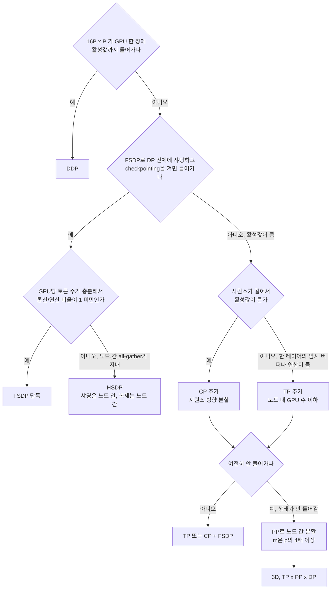

"m은 p의 4배 이상"은 3.2의 표에서 나온 기준이다. p=4에서 m=16이면 bubble이 15.8%, m=64면 4.5%다. 이 기준은 global batch를 고정한 상태에서 micro-batch를 쪼개는 것이라, m을 늘리면 micro-batch가 작아져 GPU가 덜 찬다. 그 반대 압력 때문에 bubble 10% 안쪽에서 타협하는 경우가 많다.

---

## 5. activation checkpointing

역전파는 순전파의 중간 값이 필요하다. 이를 전부 저장하는 대신 일부만 저장하고 나머지는 역전파 때 순전파를 다시 돌려 복구하는 것이 activation checkpointing(재계산)이다. 메모리를 주고 연산을 낸다.

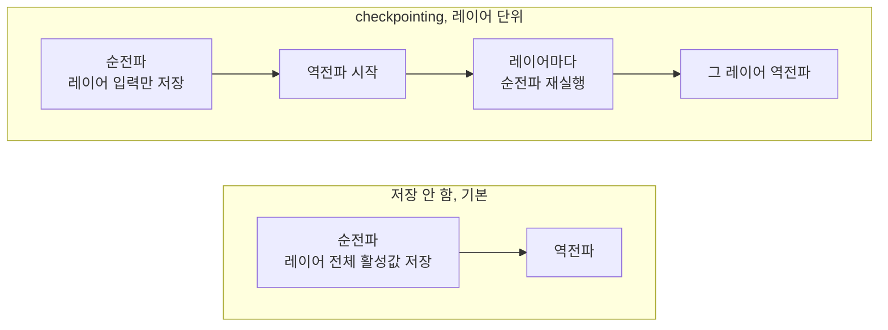

### 5.1 메모리는 얼마나 줄고 연산은 얼마나 느나

CPU에서 작은 트랜스포머(레이어 8개, hidden 128, 시퀀스 256, 배치 2)로 `torch.utils.checkpoint`를 켜고 끄며 `saved_tensors_hooks`로 역전파가 보관하는 텐서 크기를 합했다. checkpoint가 직접 쥐는 블록 입력은 hook에 안 잡혀서 별도로 더했다. attention은 행렬 s x s를 저장하는 일반 구현이다.

| 구성 | 보관 활성값 | 비율 |
|---|---|---|
| checkpointing 없음 | 44.1MB | 1.00 |
| 2개 레이어마다 | 24.2MB | 0.55 |
| 매 레이어 | 4.2MB | 0.10 |

메모리는 측정으로 확인했다. 시간은 재현이 불안정했다. 같은 스크립트를 벽시계로 재면 1.00배, 1.07배, 1.64배가 나왔고 CPU 시간으로 재면 1.00배, 1.39배, 1.28배가 나왔다. 서버에 다른 프로세스가 CPU를 쓰고 있어서 숫자가 흔들린 것이고 두 번의 측정이 서로 어긋난다. 이 값은 인용하지 않는다. 대신 연산량으로 계산하면 순전파 1, 역전파 2이니 재계산 한 번이 순전파 1을 더해서 `(1+1+2)/(1+2) = 4/3`, 즉 연산이 약 33% 늘어난다. 매 레이어를 재계산하든 2개 레이어마다 하든 재계산량은 같고(모든 순전파를 한 번 더), 줄어드는 메모리만 다르다.

70B 구성에서 이 비율을 적용하면 4K 시퀀스의 활성값이 91.3GB에서 6.5GB로 내려간다. 레이어 입력은 `2 * s * h` 바이트로 레이어 활성값 `34 * s * h`의 1/17이다. 80개를 저장해도 5.4GB이고, 역전파가 처리 중인 레이어 하나의 활성값 1.1GB가 더해져 6.5GB가 된다.

### 5.2 켜지 말아야 할 때

메모리가 남는데 켜면 연산이 33% 늘어서 처리량이 약 25% 줄어든다(1 / (4/3)). 4.2의 표에서 FSDP만 쓰는 4K 시퀀스는 checkpointing 없이 112.4GB라 켜야 했다. TP8 x FSDP 조합은 같은 계산에서 활성값이 11.4GB(91.3GB를 TP로 8등분, sequence parallel 가정)이고 합이 29.4GB라 끄고도 들어간다. 이런 구성에서는 끄고 OOM이 나는지 먼저 본다. 모두 끄거나 모두 켜는 이분법도 필요 없다. 레이어 일부에만 적용하거나 attention 부분만 재계산하는 selective recomputation([Korthikanti et al.](https://arxiv.org/abs/2205.05198))이 있다. attention 행렬은 메모리를 많이 쓰는 데 비해 재계산 비용이 작아서 일반 attention을 쓸 때 효과가 크다. flash attention은 애초에 이 행렬을 저장하지 않는다.

켜기 전에 아래 순서로 판단한다. 메모리가 남으면 끄는 것이 처음 질문이다.

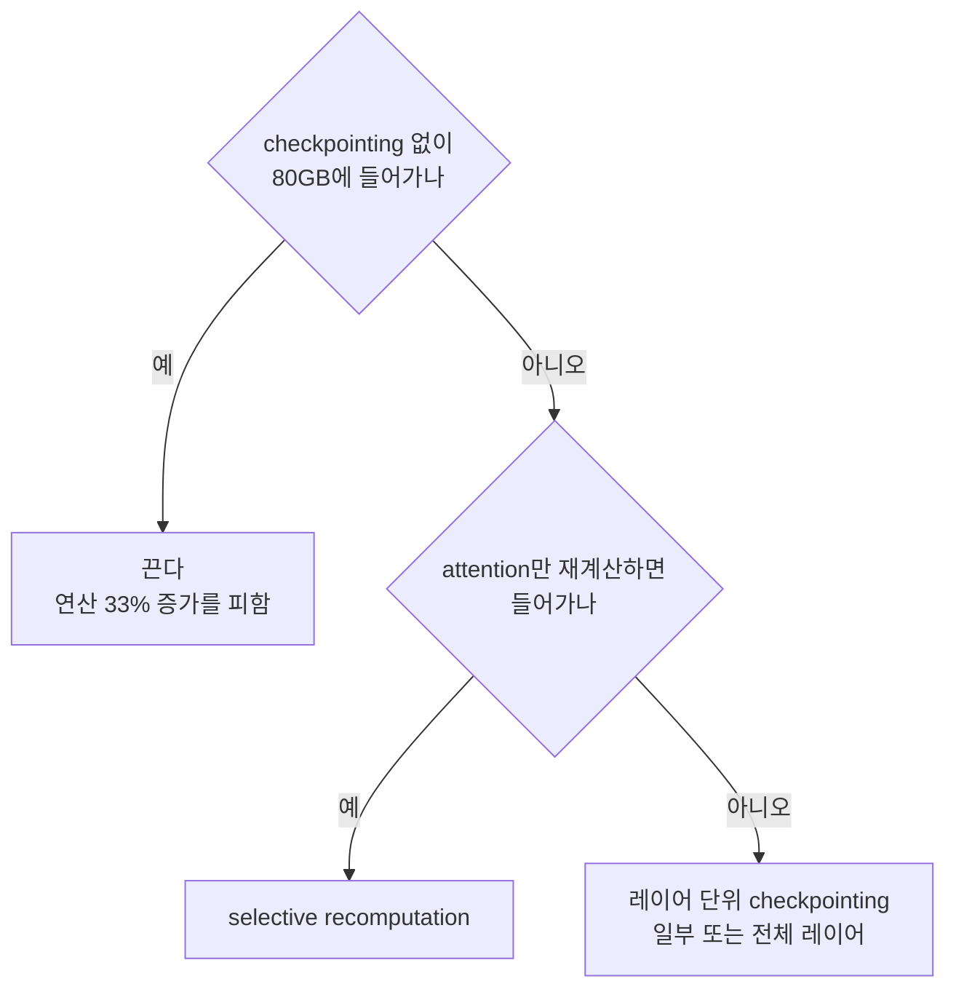

MFU를 계산할 때 재계산을 센다면 HFU다. 모델이 필요로 하는 연산만 세는 MFU는 checkpointing을 켜도 분자가 변하지 않아서, 켜면 MFU가 내려가는 것이 정상이다. 로그에 "HFU 55%"가 찍혔는데 checkpointing이 켜져 있다면 MFU는 그보다 4분의 3 수준이다.

PyTorch에서는 `torch.utils.checkpoint.checkpoint(..., use_reentrant=False)`를 쓴다. 위 측정도 이 모드로 했다. FSDP와 함께 쓸 때는 checkpoint로 감싸는 단위와 FSDP wrap 단위를 같은 블록으로 맞춘다.

---

## 6. 통신량과 병목

### 6.1 collective가 보내는 바이트

N개 rank가 크기 S의 텐서를 처리할 때 ring 방식의 rank당 송신량은 all-gather와 reduce-scatter가 `(N-1)/N x S`, all-reduce는 그 둘의 합인 `2(N-1)/N x S`다. 공식을 믿기 전에 numpy로 ring all-reduce를 직접 구현해서 rank당 송신 바이트를 세고 결과가 합과 일치하는지 확인했다.

```text
N= 2 결과일치=True  rank당 송신 1.0000 x S   2(N-1)/N=1.0000
N= 8 결과일치=True  rank당 송신 1.7500 x S   2(N-1)/N=1.7500
N=64 결과일치=True  rank당 송신 1.9688 x S   2(N-1)/N=1.9688
```

N이 커져도 rank당 송신량은 2S로 수렴한다. 그래서 ring 방식 통신은 GPU를 늘려도 rank당 바이트가 늘지 않는다. 대신 N이 커질수록 지연이 쌓이고 느린 링크 하나가 전체 ring을 끌어내린다.

### 6.2 축마다 타는 링크가 다르다

[NVIDIA 사양표](https://www.nvidia.com/en-us/data-center/h100/)에서 H100 SXM의 NVLink는 GPU당 총 900GB/s이고 단방향으로 450GB/s다. 노드 사이 InfiniBand NDR은 포트 하나가 400Gb/s로 단방향 50GB/s다. 두 값을 나눈 비율이 9배다. 이 격차 때문에 통신량이 큰 축일수록 NVLink 안에 둔다.

70B(시퀀스 4,096, micro-batch 1, BF16)에서 축별로 오가는 양을 계산했다.

| 축 | 통신 | 크기 | NVLink 450GB/s | IB 50GB/s |
|---|---|---|---|---|
| TP=8 | 레이어당 all-reduce 4번, 80층 | micro-batch당 37.6GB | 84ms | 752ms |
| FSDP | 스텝당 all-gather 2번 + reduce-scatter 1번 | DP=64일 때 rank당 52.1GB | 해당 없음, DP 그룹이 노드를 넘는다 | 1.04초 |
| PP | stage 경계 활성값 | micro-batch당 67MB, 역전파 gradient 동일 | 0.15ms | 1.3ms |
| CP (s=32K, 4) | 레이어마다 K, V | 80층 8.1GB | 18ms | 162ms |

TP 행이 핵심이다. 같은 micro-batch의 순수 연산은 H100(989 TFLOPs, MFU 40%) 기준 TP=8 그룹에서 548ms다. TP all-reduce가 NVLink를 타면 84ms로 연산의 15% 수준이고, 노드를 넘어서 IB를 타면 752ms로 연산보다 길다. TP 그룹이 노드 경계를 넘는 순간 GPU가 연산보다 통신을 더 오래 한다. TP=16을 쓰는 설정을 보면 16장이 두 노드에 걸쳐 있는지부터 확인한다. 표의 FSDP 행은 TP 샤드(17.6GB)를 DP 그룹에서 모으는 양이며, 같은 DP=64에서 통신/연산 비율은 LLM_Pretraining.md 8.2의 표를 본다. 그쪽 표가 말하는 대로 gradient accumulation을 올리면 micro-batch마다 all-gather가 반복돼서 통신이 accum 배수로 늘어난다.

아래 도식은 위 표의 결과를 링크 위치로 정리한 것이다. 통신량이 큰 축일수록 안쪽(NVLink)에 놓인다.

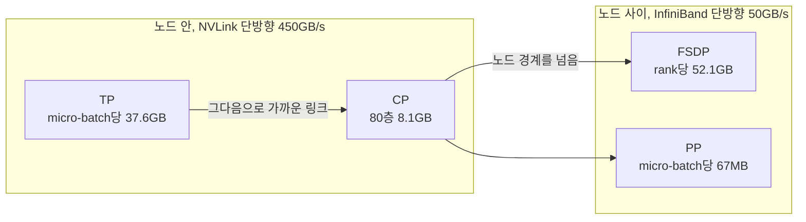

PP는 통신이 작아서 노드 사이에 둘 수 있다. 같은 이유로 그래서 가장 가까운 링크는 TP가 쓰고 CP가 그다음이며, FSDP와 PP는 노드 사이로 나간다.

### 6.3 MFU 계산

MFU는 모델이 필요로 하는 FLOP를 하드웨어 이론 피크로 나눈 값이다. 토큰당 FLOP를 `6N`으로 근사하는 경우가 많은데 attention 항이 빠져 있다. [PaLM 논문](https://arxiv.org/abs/2204.02311)의 식은 `6N + 12 L h s`다(L 레이어, h hidden, s 시퀀스).

```python
def flops_per_token(N, L, h, s):
    return 6 * N + 12 * L * h * s

def mfu(N, L, h, s, tok_per_s_per_gpu, peak_tflops):
    return flops_per_token(N, L, h, s) * tok_per_s_per_gpu / (peak_tflops * 1e12)
```

70B 구성에서 attention 항이 얼마나 되는지 계산했다.

| 시퀀스 | 토큰당 FLOP | `6N` 대비 |
|---|---|---|
| 4,096 | 456 GFLOP | +7.6% |
| 32,768 | 681 GFLOP | +60.9% |

4K에서는 6N으로 계산해도 오차가 7.6%지만 32K에서는 61%가 빠진다. 장문 학습의 MFU를 6N으로 계산해서 "MFU가 낮다"고 판단하면 실제보다 낮게 읽힌다. GPU당 700 tok/s를 내는 70B 학습(H100 989 TFLOPs)은 6N 기준 30.0%, attention을 포함하면 32.2%다. 공개된 대규모 학습의 MFU(30~50%대)는 LLM_Pretraining.md 8.7에 표로 있다.

MFU가 기대보다 낮을 때 원인을 가르는 순서는 거기에 있다. 데이터 로더, micro-batch 크기, 노출된 통신, straggler를 차례로 본다. 이 문서에서 더할 것은 노출된 통신의 위치를 아는 것이다. 위 6.2의 표에서 어떤 축이 어떤 링크를 타고 있는지 확인하는 일이 첫 단계다.

---

## 7. 실제로 겪는 문제

### 7.1 OOM, 언제 났는지로 구분

OOM 로그만 보면 모두 같아 보이지만 어느 시점에 났는지가 원인을 가른다. 아래 표에서 "측정"이라고 쓴 것만 이 환경에서 직접 확인했고, GPU가 필요한 것은 "문서 근거"로 표시했다.

| 시점 | 의심 | 근거 |
|---|---|---|
| 모델 생성 직후 | full 모델을 GPU(또는 rank마다 CPU)에 먼저 만든 뒤 샤딩한다. meta device로 만들고 샤딩 후 실체화한다 | 측정. meta 장치로 537M 파라미터 모델이 메모리 없이 만들어졌다 |
| 첫 forward | 활성값. 시퀀스가 길거나 micro-batch가 크다. wrap 단위가 너무 커서 all-gather 임시 버퍼가 크다 | 계산(1.3, 2.3) |
| 첫 `optimizer.step()` | Adam 상태가 이때 처음 생성된다. 파라미터당 8바이트 | 측정(1.1) |
| 몇백 스텝 뒤 | 가변 길이 시퀀스로 단편화. loss 텐서를 그래프째 리스트에 쌓는 누수 | 문서 근거, 실행 못 함 |
| 체크포인트 저장 시점 | full state dict를 rank 0에 모으는 경우. 7.4 참조 | 계산(70B 가중치만 BF16 141GB) |
| 특정 rank만 | PP의 첫·마지막 stage 쏠림(3.2), 데이터가 긴 배치를 받은 rank | 계산 |

위 표를 OOM이 난 시점에서 원인으로 내려가는 순서로 다시 그리면 이렇다. 가장 먼저 "언제 났는가"를 가르는 것이 핵심이다.

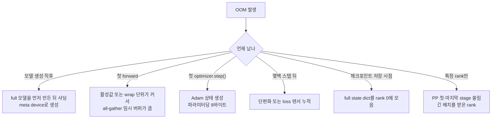

PyTorch의 CUDA OOM 메시지에는 allocated와 reserved가 같이 찍힌다. reserved는 크고 allocated는 작은 경우가 단편화다. 메시지가 안내하는 `PYTORCH_CUDA_ALLOC_CONF=expandable_segments:True`가 해결책이 되는 경우가 있다. 이 환경에는 GPU가 없어서 직접 재현하지 못했다.

stage 0이 OOM인데 다른 stage는 여유가 있는 경우는 1F1B의 특성이다. 시뮬레이션에서 stage 0은 4개, stage 3은 1개의 micro-batch 활성값을 쥔다. 첫 stage에 레이어를 덜 주는 식으로 맞춘다.

### 7.2 NCCL timeout, 그 전에 collective 개수부터

collective는 모든 rank가 같은 순서로 같은 개수만큼 불러야 한다. 한 rank가 하나 덜 부르면 나머지는 그 collective에서 영원히 기다린다. 가장 흔한 형태는 rank마다 배치 수가 달라서 마지막 스텝에서 한 rank만 더 도는 경우다. 두 rank로 재현했다. rank 0은 4개, rank 1은 3개 배치를 돌고, timeout은 8초다.

```text
[rank 0] attempt=0 step=2 all_reduce 완료
[rank 1] attempt=0 step=2 all_reduce 완료
[rank 1] 정상 종료
[rank0]: RuntimeError: [.../gloo/transport/tcp/pair.cc:561] Connection closed by peer [127.0.0.1]:40125.
         This is typically caused by a remote worker crashing. Check the logs of the remote worker ...
E1019 22:35:09.894000 ... failed (exitcode: 1) local_rank: 0 (pid: 2820409) of binary: /usr/bin/python3
```

아래 도식은 위 출력을 순서대로 푼 것이다. 에러가 rank 0에만 찍히고 rank 1은 정상 종료로 남는 점을 보면 된다.

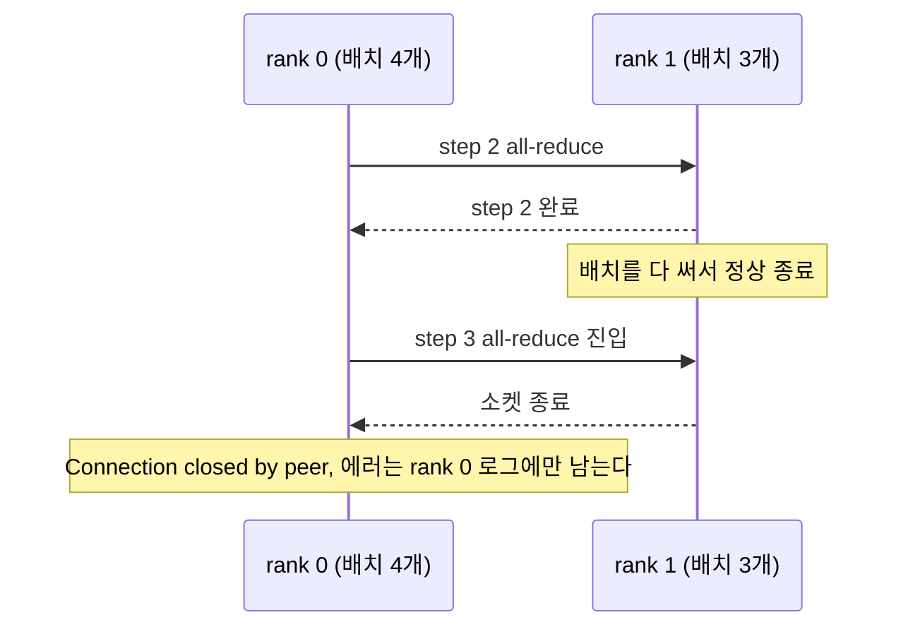

gloo에서는 8초 timeout이 나지 않았다. rank 1이 정상 종료하면서 소켓이 닫혔고 rank 0이 즉시 `Connection closed by peer`로 죽었다. 메시지는 "원격 worker가 crash했을 가능성"이라고 안내하지만 rank 1은 에러 없이 끝났다. 에러가 난 rank의 로그에는 원인이 없고, 원인은 에러 없이 먼저 끝난 rank 쪽 코드(여기서는 배치 수)에 있다. 로그에서 에러가 찍힌 rank만 보고 그 rank의 코드를 고치기 시작하면 헛수고가 된다.

timeout 에러는 상대가 살아 있는데 오지 않을 때 난다. rank 1이 step 2에서 30초 자는 상황으로 재현했다.

```text
[rank 0] attempt=0 step=1 all_reduce 완료 t=0.0s
[rank0]: RuntimeError: [.../gloo/transport/tcp/unbound_buffer.cc:78] Timed out waiting 8000ms for recv operation to complete
W1019 22:35:32.097000 ... Sending process 2820443 closing signal SIGTERM
E1019 22:35:32.113000 ... failed (exitcode: 1) local_rank: 0 (pid: 2820442) of binary: /usr/bin/python3
```

timeout도 에러는 기다리고 있던 rank 0에서 나고, 멈춰 있던 rank 1은 에러 없이 있다가 agent의 SIGTERM으로 끝난다. 느린 rank가 원인이고 로그는 빠른 rank에 쌓인다. 느린 이유(디스크, 열 스로틀링, 불량 NIC, 데이터 로더)를 찾으려면 timeout 직전에 각 rank가 어느 코드 줄에 있었는지를 비교해야 한다.

NCCL에서의 동작은 이 환경에서 못 돌렸다. PyTorch 문서에 따르면 NCCL의 기본 timeout은 10분이고 초기화 시 `timeout` 인자로 바꾼다. peer가 정상 종료했을 때 NCCL이 gloo처럼 즉시 실패하는지, timeout까지 기다리는지는 확인하지 못했다. 이 값이 짧으면 첫 컴파일이나 체크포인트 저장 시간을 장애로 오인하고, 길면 hang이 오래 방치된다. NCCL 로그 설정과 flight recorder 환경변수는 버전마다 이름이 달라서 쓰는 버전의 문서에서 확인한다. LLM_Pretraining.md 9.2에 hang 진단 순서가 있다.

collective 개수가 어긋나는 흔한 원인은 이렇다. 데이터셋 샤딩이 나눠떨어지지 않아 마지막 배치 수가 다른 경우. 한 rank에서만 loss가 NaN이라 `if` 분기로 스텝을 건너뛰는 경우. 체크포인트나 로그 출력을 `if rank == 0:` 안에서 하는데 그 안에 collective가 들어 있는 경우(`full_tensor()`, `state_dict()`를 rank 0만 부르는 경우가 대표적이다). 마지막 경우는 FSDP에서 특히 잦다. `state_dict()`는 내부에서 all-gather를 한다.

### 7.3 rank 하나가 죽으면 전체가 선다

분산 학습은 모든 rank가 서로를 기다리는 구조라 rank 하나의 실패는 전체의 정지다. 어떻게 멈추고 어떻게 복구하는지 순서가 있다.

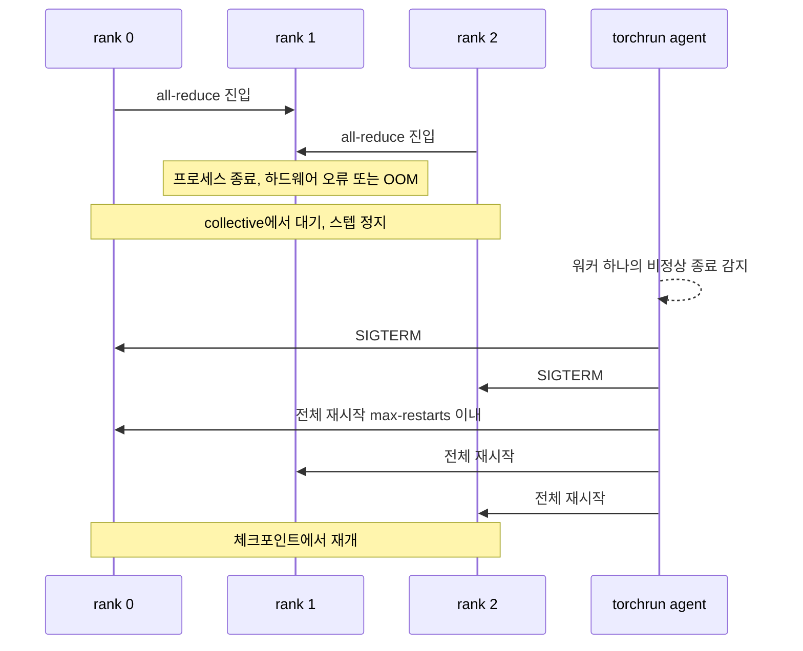

rank 하나만 다시 띄우는 방법은 없다. NCCL 통신 그룹이 이미 깨져 있어서 모든 rank가 새로 시작해야 한다. `torchrun --max-restarts=N`이 이 재시작을 맡는다. 재시작이 일어나는지 두 rank로 재현했다. 재시작 횟수는 환경변수 `TORCHELASTIC_RESTART_COUNT`로 읽을 수 있고, 스크립트가 첫 시도의 step 2에서 rank 1을 죽이도록 했다.

```text
$ torchrun --nproc_per_node=2 --max-restarts=1 hang_test.py restart
[rank 1] attempt=0 step=1 all_reduce 완료 t=0.0s
[rank 0] attempt=0 step=1 all_reduce 완료 t=0.0s
W1019 22:35:53.024000 ... Sending process 2820513 closing signal SIGTERM
E1019 22:35:53.238000 ... failed (exitcode: 1) local_rank: 1 (pid: 2820514) of binary: /usr/bin/python3
[rank 0] attempt=1 step=0 all_reduce 완료 t=0.0s
[rank 1] attempt=1 step=0 all_reduce 완료 t=0.0s
...
[rank 0] attempt=1 step=3 all_reduce 완료 t=0.0s
[rank 0] 정상 종료
```

rank 1이 step 2에서 종료 코드 1로 죽자 agent는 살아 있던 rank 0에 SIGTERM을 보내고 두 프로세스를 새로 띄웠다. 로그 시각으로 22:35:53에 죽어서 22:36:02 이후에 재기동 메시지가 찍혔으니 재기동에 약 10초가 걸렸다. rank 0은 attempt 0에서 step 2의 all-reduce를 끝내지 못했다. 상대를 기다리다가 SIGTERM을 받았다.

attempt 1이 step 0부터 다시 시작하는 것도 보아야 한다. torchrun은 프로세스를 다시 띄울 뿐 어디서 이어갈지는 모른다. 이 예제 스크립트에는 체크포인트 로드가 없어서 처음부터 돌았다. 학습 스크립트가 시작할 때 최신 체크포인트를 찾아 불러오는 코드를 가져야 재시작이 재개가 된다. `--max-restarts`를 소진하면 agent도 실패로 끝난다.

복구 시간은 마지막 체크포인트 이후 날아간 스텝과 재시작 오버헤드(프로세스 기동, 모델 로드, 컴파일)의 합이다. 저장 주기를 정하는 계산은 LLM_Pretraining.md 4.4에, 장애 빈도의 규모별 환산은 9.1에 있다. gloo는 상대가 죽으면 소켓 종료로 바로 알지만 NCCL이 같은 상황에서 어떻게 보이는지는 이 환경에서 확인하지 못했다. GPU 서버에서 한 번 일부러 rank 하나를 죽여 보고 에러가 나오기까지 얼마나 걸리는지 재 두는 편이 낫다.

### 7.4 체크포인트 shard 저장과 재샤딩

FSDP 모델을 저장하는 방법은 두 가지다. 하나는 모든 샤드를 rank 0으로 모아 한 파일로 쓰는 full state dict이고, 하나는 rank마다 자기 샤드를 쓰는 분산 체크포인트(`torch.distributed.checkpoint`, DCP)다. 70B에서 full state dict는 BF16 가중치만 141GB이고 FP32 master와 Adam 상태까지 합치면 1TB가 넘는다. 이걸 rank 0 한 곳에 모으면 저장 시점에 OOM이 나고, 모으는 동안 나머지 rank는 놀고 있다. 큰 모델은 DCP를 쓴다.

2.4의 예제를 2 rank로 돌려 저장하고 생성된 파일을 봤다. 샤드 파일은 rank마다 하나, 메타데이터는 하나다.

```text
$ ls -l ckpt2
-rw-r--r-- 1 root root 12689328 __0_0.distcp
-rw-r--r-- 1 root root 12729948 __1_0.distcp
-rw-r--r-- 1 root root    27542 .metadata
```

파일 두 개가 합쳐 25.4MB이고 파라미터는 2,102,272개다. 파라미터당 약 12바이트가 저장됐다. FP32 가중치 4바이트와 Adam의 m, v 8바이트다. gradient는 저장하지 않는다. 70B에 이 비율을 적용하면 FP32 master와 Adam 상태만 847GB(70.55B x 12)라서, 체크포인트 하나가 1TB에 가깝다. 저장 주기를 짧게 잡을 때 디스크 용량과 쓰기 대역폭부터 계산해야 하는 이유다.

DCP의 강점은 저장할 때와 불러올 때의 rank 수가 달라도 된다는 점이다. 2 rank로 저장한 체크포인트를 3 rank로 읽는 경우를 그렸다. 3으로 나누면 새 샤드 경계가 기존 경계와 어긋나는 것이 보인다.

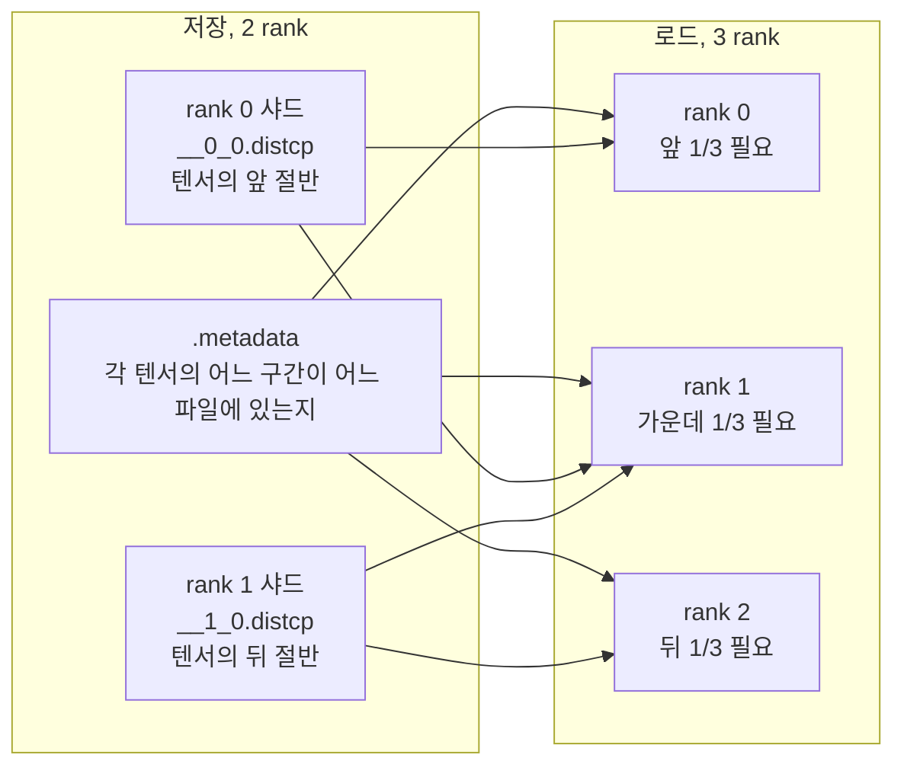

각 rank가 `.metadata`를 읽고 자기가 새로 맡을 구간을 계산한 뒤 그 구간이 들어 있는 파일의 해당 바이트만 읽는다. 위 그림에서 rank 1은 기존 샤드 두 개에 걸친 구간이라 두 파일에서 조각을 읽는다. 1 rank와 3 rank로 읽어 보고 가중치와 optimizer 상태의 합계를 저장 때 값과 비교했다. 합계는 모든 샤드를 `full_tensor()`로 모아 float64로 더한 값이다.

```text
saved  world=2  weight_sum=7.666890   optim_sum=-8.223196
loaded world=1  weight_sum=7.666890   optim_sum=-8.223196
loaded world=3  weight_sum=7.666890   optim_sum=-8.223196
```

두 합계가 소수 여섯째 자리까지 같다. optim_sum은 `exp_avg`와 `exp_avg_sq`의 합이다. 재개 후 첫 스텝의 loss가 1 rank와 3 rank 모두 0.3989로 나오는 것도 같은 가중치에서 출발했다는 확인이다. 이 loss는 `optimizer.step()` 전 forward 값이라 가중치만 반영하고, optimizer 상태의 복원 여부는 위 optim_sum이 보여준다. 합계가 같다는 것은 값이 보존됐다는 확인이고 샤드가 올바른 위치에 들어갔는지까지 증명하지는 않는다. 위치까지 확인하려면 텐서 이름별로 합계를 따로 비교한다.

재샤딩이 되는 것과 재개한 학습이 이어지는 것은 다른 문제다. rank 수가 바뀌면 DP가 바뀌고 global batch도 바뀐다. 장수를 줄여서 재개한다면 `micro-batch x accum x DP`가 이전과 같아지도록 accum을 올린다. 안 맞추면 lr 스케줄은 이어지는데 배치 크기가 달라서 loss가 이전 곡선과 어긋난다. 데이터 로더 위치와 난수 상태는 DCP가 모델과 optimizer만 저장하므로 별도로 저장하고 복원해야 한다. optimizer 상태를 빼먹고 재개하면 Adam의 m, v가 0에서 다시 시작해서 첫 수십 스텝 동안 업데이트가 거칠어져 loss가 튄다(LLM_Pretraining.md 4.3).
