# LLM 파인튜닝 실무
## 파인튜닝을 하기 전에 먼저 묻는 질문

처음 파인튜닝을 시도하는 팀에서 가장 흔히 보는 패턴이 있다. 모델 성능이 부족하다고 느끼면 일단 파인튜닝부터 돌리고 본다. 8장짜리 H100 노드를 며칠 점유하고, 결과 모델이 원본보다 못한 경우가 적지 않다.

파인튜닝은 모델의 가중치를 바꾸는 작업이다. 가중치가 바뀌면 원래 알던 것 일부가 사라진다. 이걸 Catastrophic Forgetting이라고 부른다. 추론 비용도 따로 든다. base 모델을 그대로 쓰면 vLLM, TGI 같은 서빙 인프라가 그대로 호환되지만, 파인튜닝한 모델은 별도 배포 라인을 가져가야 한다.

그래서 파인튜닝에 들어가기 전에 다음 질문에 답해야 한다.

- **지식이 부족한가, 행동이 부족한가**: 최신 사내 문서 검색이 안 되는 거라면 RAG 문제다. 응답 포맷이 일관되지 않거나 특정 도구 호출을 못 하는 거라면 행동 문제고, 이건 파인튜닝이 더 맞는다.
- **프롬프트 엔지니어링으로 안 되는가**: System prompt에 5~10개 예시(few-shot)를 넣어보고도 안 되면 그때 파인튜닝을 검토한다. few-shot 1~2개로 되는 일을 파인튜닝하려는 경우가 가장 흔하다.
- **데이터가 1000건 이상 확보 가능한가**: LoRA는 500건으로도 가능하다고 알려져 있지만, 실무에서 의미 있는 변화를 보려면 보통 도메인당 3,000~10,000건이 있어야 한다. 더 적으면 도메인 적응이라기보다 노이즈 학습이 된다.

지식 주입 목적의 파인튜닝은 거의 항상 RAG보다 떨어진다. 모델이 학습한 내용은 검색 결과로 확인할 수 없고, 업데이트하려면 재학습해야 하며, 환각이 늘어난다. 반대로 응답 스타일, JSON 출력 강제, 특정 도구 호출 패턴 같은 행동 학습은 파인튜닝이 RAG보다 깔끔하게 풀린다.

## base 모델 이후의 단계와 파인튜닝의 위치

사전학습을 마친 base 모델은 다음 토큰을 이어 쓰는 모델이다. 질문을 던지면 답 대신 질문을 더 길게 이어 쓴다. 이 상태에서 대화 모델이 되기까지 거치는 단계와, 이 문서가 다루는 파인튜닝이 어디에 들어가는지를 먼저 잡아둔다. 사전학습 자체(데이터 정제, 학습 안정성, 체크포인트)는 [LLM 사전학습 파이프라인](LLM_Pretraining.md)에서 다룬다.

아래 흐름에서 점선 박스인 continued pretraining은 선택 단계다. 도메인 지식이 모자란 경우에만 들어가고, 대부분의 팀은 base에서 곧바로 SFT로 간다. 선호 학습 단계의 분기 조건은 사전학습 문서의 [SFT와 RLHF 전환점](LLM_Pretraining.md#6-sft와-rlhf-전환점)에 정리돼 있다.

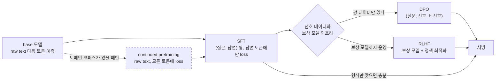

CPT를 거치면 산출물이 새로운 base가 된다. 이 모델도 대화는 못 하므로 SFT를 다시 해야 한다. 이미 SFT까지 끝난 instruct 모델에 도메인 문서를 raw text로 이어 학습시키면 채팅 템플릿에 반응하는 능력이 먼저 무너지는 경우가 있다. CPT는 instruct 모델이 아니라 base 모델 위에서 한다.

### continued pretraining과 SFT는 무엇이 다른가

두 단계 모두 같은 cross entropy를 쓰고 같은 코드로 돌릴 수도 있어서 구분이 흐려지기 쉽다. 차이는 데이터와 loss가 걸리는 범위, 그리고 학습으로 얻으려는 것에 있다.

| 항목 | continued pretraining | SFT |
|---|---|---|
| 입력 데이터 | 도메인 문서 원문 (논문, 사내 위키, 코드베이스) | (질문, 답변) 쌍, chat template 적용 |
| loss 범위 | 모든 토큰 | assistant 응답 토큰만 |
| 데이터 규모 | 수억~수백억 토큰 | 수천~수십만 건 |
| 얻는 것 | 어휘, 사실, 도메인 문서의 문체 | 응답 형식, 지시 따르기, 도구 호출 패턴 |
| 시작 체크포인트 | base | base 또는 CPT를 거친 base |
| forgetting 양상 | 일반 지식과 다른 언어 능력이 서서히 빠진다 | 일반 대화 품질과 형식 준수가 흔들린다 |
| LoRA로 충분한가 | 대체로 부족하다 | 대체로 충분하다 |

LoRA 항목은 근거가 있다. 코드와 수학 도메인에서 continued pretraining과 instruction finetuning을 LoRA와 full finetuning으로 비교한 연구([LoRA Learns Less and Forgets Less](https://arxiv.org/abs/2405.09673))에서, LoRA는 대부분의 설정에서 full finetuning보다 덜 배우는 대신 덜 잊었다. CPT처럼 배워야 할 양이 많은 단계에서는 "덜 배운다"가 문제가 되고, SFT처럼 형식만 바꾸면 되는 단계에서는 "덜 잊는다"가 장점이 된다.

### 사전학습 지식과 SFT 데이터의 역할

SFT 데이터로 모델에게 새 사실을 가르치려는 시도가 가장 자주 실패한다. SFT는 사전학습 중에 이미 모델 안에 들어간 능력을 어떤 형식으로 꺼낼지 정하는 단계에 가깝기 때문이다. 1,000개의 신중히 고른 예시만으로 정렬이 상당 부분 된다는 [LIMA](https://arxiv.org/abs/2305.11206) 결과도 같은 방향이다. 지식은 사전학습에서 오고 SFT는 그 지식을 어떻게 내놓을지를 정한다.

| 질문 | 사전학습·CPT가 결정 | SFT가 결정 |
|---|---|---|
| 사내 용어와 제품 사양을 아는가 | 예. 원문을 읽어야 한다 | 아니오. 몇 백 건으로는 용어가 외워지지 않고 그럴듯한 오답만 늘어난다 |
| 답변을 JSON 스키마로 내놓는가 | 아니오 | 예 |
| 모르는 질문에 모른다고 하는가 | 부분적. 모델이 자기 지식 경계를 얼마나 아는지에 달렸다 | 예. 거절 패턴 예시로 가르친다 |
| 도구 호출 형식을 지키는가 | 아니오 | 예 |
| 한국어 문장이 자연스러운가 | 예. 토큰 수와 코퍼스 품질이 결정한다 | 문체만 조정한다 |
| 코드나 SQL 문법을 아는가 | 예 | 출력 형식만 조정한다 |

이 표에서 "사내 용어" 행이 실무에서 가장 많이 틀리는 지점이다. 사실이 부족해서 생긴 문제를 SFT 데이터로 풀면, 모델이 사실은 못 배우고 사실처럼 보이는 문체만 배운다. 지식은 RAG로 주입하거나, 수억 토큰 이상의 원문이 있으면 CPT로 넣는다.

## Full Fine-Tuning과 PEFT

Full Fine-Tuning은 모델의 모든 파라미터를 업데이트한다. 7B 모델이라면 70억 개 파라미터 전부를 그래디언트 계산하고 옵티마이저 상태(Adam의 경우 파라미터당 8바이트)까지 메모리에 올린다. 7B 모델 Full FT에 필요한 VRAM은 활성화 메모리까지 더하면 80GB H100 한 장으로도 빠듯하다. 70B는 8장 노드가 필요하다.

PEFT(Parameter-Efficient Fine-Tuning)는 원본 가중치는 고정하고 작은 추가 파라미터만 학습한다. 그 중 LoRA가 사실상 표준이다. 7B 모델을 LoRA로 학습하면 단일 RTX 4090(24GB)으로도 돌릴 수 있다.

성능 차이는 작업에 따라 다르다. 대부분의 instruction tuning, 도메인 어댑테이션 작업에서 LoRA는 Full FT의 95~98% 성능을 낸다. 수학 추론, 복잡한 다단계 reasoning 같은 작업에서는 차이가 더 벌어지는 경우가 있다. 신규 언어를 가르치는 작업은 LoRA로는 거의 불가능에 가깝고 Continual Pretraining이 필요하다.

| 항목 | Full FT | LoRA | QLoRA |
|---|---|---|---|
| 7B 학습 VRAM | 80GB+ | 24~40GB | 12~16GB |
| 70B 학습 VRAM | 8×H100 | 2×H100 | 1×H100(48GB) |
| 학습 속도 | 느림 | 빠름 | 느림(역양자화 오버헤드) |
| 추론 시 추가 비용 | 없음 | adapter 로드 또는 merge | merge 필요 |
| 환경별 adapter 교체 | 모델 교체 | adapter 스왑 가능 | merge 후엔 불가 |

LoRA가 Full FT를 못 따라가는 대표적인 경우가 있다. rank가 너무 낮으면(8 이하) 복잡한 패턴을 못 잡는다. 그리고 base 모델이 이미 알고 있던 것을 강하게 덮어쓰려는 작업에서는 LoRA의 가중치 변경 폭이 충분치 않다. 가령 한국어 base 모델을 일본어 응답으로 바꾸려고 하면 LoRA로는 부분적으로만 된다.

세 방식 중 무엇을 고를지는 학습 목적, GPU 메모리, 시험 학습 결과 순으로 좁혀 간다. 아래 흐름은 이 순서를 그대로 옮긴 것이다. 가운데 "rank 64 시험 학습" 칸이 핵심인데, Full FT를 먼저 돌려보고 LoRA로 내려가는 것보다 LoRA로 먼저 한 번 돌려 부족한지 확인하고 올라가는 쪽이 비용이 훨씬 적다.

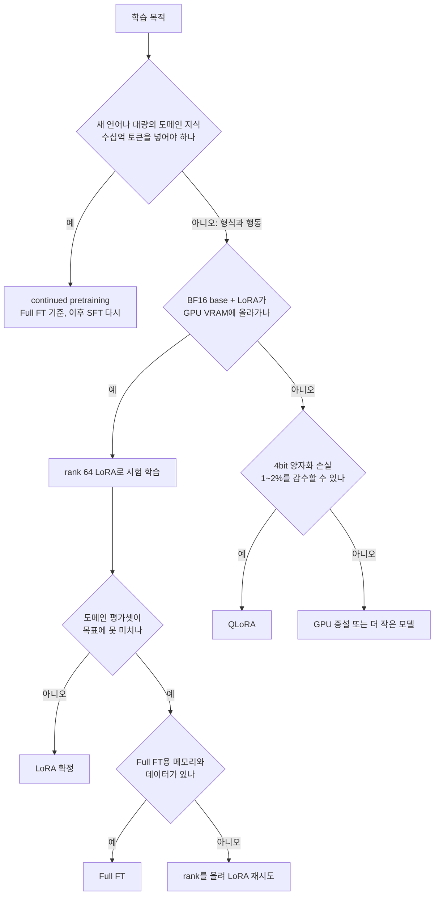

실무에서는 "아니오: 형식과 행동" 쪽 경로를 훨씬 자주 탄다. B에서 "예"가 나오는 경우에도 LoRA로 먼저 시험하고 싶은 마음이 들지만, 위에 적은 대로 새 언어를 LoRA로 가르치는 건 성능 상한이 낮아서 시험 학습에 쓴 시간이 대부분 버려진다.

## LoRA의 내부 동작

LoRA의 아이디어는 단순하다. 가중치 변화량 ΔW가 low-rank 구조를 가진다고 가정하고, ΔW = BA로 분해한다. A는 r×k, B는 d×r 크기다. r이 rank고, 보통 d, k보다 훨씬 작다.

원래 forward pass가 `h = Wx`였다면, LoRA를 붙이면 `h = Wx + (α/r) BAx`가 된다. 여기서 α는 scaling factor다. 학습 시 W는 고정되고 A, B만 업데이트된다.

입력 x가 고정된 W 경로와 학습되는 A, B 경로로 갈라졌다가 마지막에 더해지는 구조다.

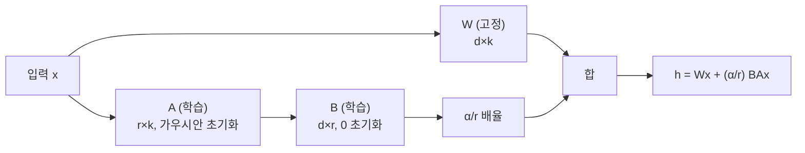

```python
import torch
import torch.nn as nn

class LoRALinear(nn.Module):
    def __init__(self, base_layer: nn.Linear, rank: int = 16, alpha: int = 32):
        super().__init__()
        self.base = base_layer
        for p in self.base.parameters():
            p.requires_grad = False

        in_dim = base_layer.in_features
        out_dim = base_layer.out_features

        self.lora_A = nn.Parameter(torch.randn(rank, in_dim) * (1 / rank ** 0.5))
        self.lora_B = nn.Parameter(torch.zeros(out_dim, rank))
        self.scaling = alpha / rank

    def forward(self, x):
        return self.base(x) + (x @ self.lora_A.T @ self.lora_B.T) * self.scaling
```

B를 0으로 초기화하는 게 핵심이다. 학습 시작 시점에 LoRA가 출력에 아무 영향을 주지 않게 만든다. A를 가우시안으로 초기화하고 B를 0으로 두면, 첫 step에서 모델 출력은 base 모델과 정확히 동일하다.

### rank와 alpha 설정

rank(r)는 LoRA가 표현할 수 있는 변화의 복잡도를 결정한다. 작으면 표현력이 부족하고, 크면 메모리와 학습 시간이 늘어난다.

| 작업 | 추천 rank |
|---|---|
| 응답 스타일 변경, 간단한 instruction tuning | 8~16 |
| 도메인 어댑테이션(법률, 의료 등) | 32~64 |
| 복잡한 reasoning, 코드 생성 | 64~128 |
| 신규 언어/대규모 지식 주입 | 256+ 또는 Full FT |

alpha는 LoRA 가중치의 스케일을 조절한다. 보편적인 룰은 alpha = 2 * rank다. rank 16이면 alpha 32. 다만 LoRA+ 같은 변형에서는 다른 값을 쓰기도 한다.

rank를 너무 크게 잡으면 Catastrophic Forgetting이 심해진다. rank 256으로 instruction tuning을 돌리면 base 모델이 알던 일반 지식이 무너지는 게 보인다. 작은 도메인 변경이 목적이라면 rank를 작게 유지하는 게 안전하다.

### 어느 레이어에 LoRA를 붙일 것인가

LoRA 논문 원본은 attention의 query, value 가중치(q_proj, v_proj)에만 붙였다. 이게 가장 효율적이라고 알려졌다. 하지만 실무에서는 더 많은 레이어에 붙이는 게 일반적이다.

```python
target_modules = [
    "q_proj", "k_proj", "v_proj", "o_proj",
    "gate_proj", "up_proj", "down_proj",
]
```

attention의 4개 projection과 MLP의 3개 projection 전체에 붙이면 학습 가능한 파라미터는 늘지만 성능이 더 잘 나오는 경우가 많다. QLoRA 논문에서 이 설정을 권장한 뒤로 거의 디폴트가 됐다.

embed_tokens와 lm_head에 LoRA를 붙이는 것은 신중해야 한다. 토큰 임베딩을 건드리면 vocab 변경 효과가 나는데, base 모델의 표현이 망가지기 쉽다. 새 토큰을 추가하는 경우가 아니면 보통 제외한다.

## QLoRA

QLoRA는 base 모델을 4bit로 양자화한 상태에서 LoRA를 학습한다. 4bit 가중치는 forward pass 직전에 BF16으로 역양자화되고, gradient는 LoRA 파라미터(BF16)에만 흐른다. 4bit base 가중치 자체는 업데이트되지 않는다.

아래 흐름에서 4bit 가중치는 계산 직전에만 BF16으로 풀리고, 역방향 gradient는 LoRA 쪽으로만 가는 것을 보면 된다.

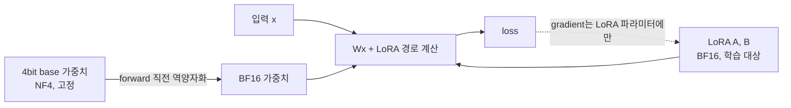

QLoRA의 핵심 기여는 세 가지다.

- **NF4 (NormalFloat 4-bit)**: 정규분포를 따르는 가중치에 최적화된 4bit 포맷. INT4보다 정보 손실이 적다.
- **Double Quantization**: 양자화 상수 자체도 양자화한다. 8bit 양자화 상수를 4bit로 또 양자화해서 메모리를 추가로 절약한다.
- **Paged Optimizer**: 옵티마이저 상태를 CPU 메모리로 페이징한다. OOM 직전에 GPU와 CPU 사이에서 자동 스왑.

```python
from transformers import AutoModelForCausalLM, BitsAndBytesConfig
import torch

bnb_config = BitsAndBytesConfig(
    load_in_4bit=True,
    bnb_4bit_quant_type="nf4",
    bnb_4bit_compute_dtype=torch.bfloat16,
    bnb_4bit_use_double_quant=True,
)

model = AutoModelForCausalLM.from_pretrained(
    "meta-llama/Llama-3.1-8B",
    quantization_config=bnb_config,
    device_map="auto",
)
```

QLoRA로 70B 모델을 단일 H100(80GB)에서 학습할 수 있다. 다만 두 가지 트레이드오프가 있다. 역양자화 오버헤드 때문에 LoRA보다 1.5~2배 느리고, 4bit 양자화로 인한 미세한 성능 손실이 누적될 수 있다. 실측해보면 작업에 따라 LoRA 대비 1~2% 성능 저하가 흔하다.

VRAM이 충분하면 LoRA(BF16 base), 부족하면 QLoRA를 쓴다. 학습 시간이 중요하면 LoRA가 낫고, 메모리가 중요하면 QLoRA다.

## Adapter 병합

LoRA 학습이 끝나면 adapter 가중치가 별도 파일로 저장된다. 이걸 base 모델과 합쳐서 단일 가중치로 만드는 게 merge다.

```python
from peft import PeftModel
from transformers import AutoModelForCausalLM

base = AutoModelForCausalLM.from_pretrained("meta-llama/Llama-3.1-8B")
model = PeftModel.from_pretrained(base, "./my-lora-adapter")
merged = model.merge_and_unload()
merged.save_pretrained("./merged-model")
```

merge의 장단점이 갈린다. 장점은 추론 시 adapter 로딩 오버헤드가 사라지고, vLLM 같은 서빙 인프라와 호환된다. 단점은 4bit 양자화된 base 모델에 merge하면 양자화 오차가 누적된다. 그래서 QLoRA로 학습한 경우 BF16 base에 merge하는 게 권장된다.

여러 adapter를 동시에 운용하는 시나리오가 있다. 고객사별로 다른 adapter를 학습해두고 요청마다 다른 adapter를 적용하는 식이다. vLLM은 multi-LoRA serving을 지원한다. 이 경우 merge하지 않고 adapter만 따로 배포한다.

서빙 방식에 따라 merge 여부가 갈리는 흐름을 정리하면 다음과 같다. adapter가 하나면 합쳐서 단일 가중치로, 여러 개면 합치지 않고 요청마다 고른다.

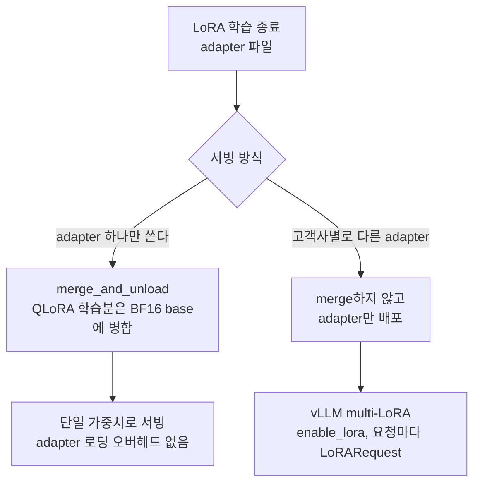

```python
from vllm import LLM
from vllm.lora.request import LoRARequest

llm = LLM(model="meta-llama/Llama-3.1-8B", enable_lora=True, max_loras=4)

response = llm.generate(
    prompts=["Hello"],
    lora_request=LoRARequest("customer_a", 1, "/path/to/adapter_a"),
)
```

adapter끼리 산술 연산도 가능하다. adapter_A + 0.5 * adapter_B 같은 식으로 결합할 수 있는데, 실무에서는 권장하지 않는다. 결과를 예측하기 어렵고 디버깅이 까다롭다.

## 학습 데이터 포맷

데이터 포맷은 두 가지가 사실상 표준이다. Alpaca 포맷과 ShareGPT 포맷.

### Alpaca 포맷

instruction-following 학습에 쓰인다. instruction, input(optional), output 세 필드로 구성된다.

```json
{
  "instruction": "다음 SQL 쿼리에서 성능 문제를 찾아라.",
  "input": "SELECT * FROM orders WHERE user_id IN (SELECT id FROM users WHERE country = 'KR')",
  "output": "IN 절의 서브쿼리는 EXISTS나 JOIN으로 바꾸는 게 낫다. 또한 SELECT *는 인덱스 only scan을 막는다."
}
```

단일 턴 대화에 적합하다. 멀티턴 대화 학습에는 부적합하다.

### ShareGPT 포맷

멀티턴 대화 학습에 쓴다. role과 content 쌍의 배열.

```json
{
  "conversations": [
    {"from": "system", "value": "당신은 데이터베이스 성능 컨설턴트다."},
    {"from": "human", "value": "쿼리 플랜에서 Seq Scan이 보인다."},
    {"from": "gpt", "value": "테이블 크기와 WHERE 조건의 선택도를 확인해라."},
    {"from": "human", "value": "100만 행이고 선택도는 0.1%다."},
    {"from": "gpt", "value": "인덱스가 있는지 확인하고 없으면 만든다. ANALYZE도 돌려라."}
  ]
}
```

실무에서는 ShareGPT 포맷이 더 많이 쓰인다. 멀티턴 학습이 가능하고 system prompt를 명시할 수 있어서다.

### Loss masking

학습 시 user 메시지에 대한 loss를 계산하면 모델이 user 발화 패턴까지 학습한다. 보통 assistant 응답에만 loss를 계산한다. TRL의 `SFTTrainer`에 `DataCollatorForCompletionOnlyLM`을 쓰면 처리된다.

```python
from trl import SFTTrainer, DataCollatorForCompletionOnlyLM

collator = DataCollatorForCompletionOnlyLM(
    response_template="<|im_start|>assistant",
    tokenizer=tokenizer,
)

trainer = SFTTrainer(
    model=model,
    train_dataset=dataset,
    data_collator=collator,
    args=training_args,
)
```

response_template을 잘못 지정하면 loss가 전혀 안 계산되거나 user 메시지에 계산되는 사고가 난다. 학습 시작 직후 첫 step의 loss 값을 확인해야 한다. 정상적인 instruction tuning이면 1~3 사이의 loss로 시작한다. 0.1 미만이면 데이터 처리가 잘못된 것이다.

아래 그림은 한 시퀀스에서 loss가 걸리는 토큰과 빠지는 토큰을 나눈 것이다. 점선 박스는 loss에서 제외되고, 굵은 박스만 loss 계산에 들어간다. response_template을 잘못 잡으면 이 경계가 어긋난다.

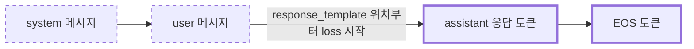

## Catastrophic Forgetting

파인튜닝 후 모델이 원래 잘하던 일반 작업에서 성능이 떨어지는 현상이다. 영어 instruction tuning에서 가장 흔하고, 한국어 모델을 다른 도메인으로 파인튜닝하면 일반 한국어 대화 능력이 떨어진다.

원인은 단순하다. 좁은 데이터로 학습하면 모델이 그 분포로 끌려간다. 학습 데이터에 없던 작업의 응답 품질이 무너진다.

방지 방법은 몇 가지가 있다.

**Replay 데이터 섞기**: 원본 instruction 데이터(OpenAssistant, Alpaca 등)를 도메인 데이터와 섞는다. 보통 도메인 데이터의 10~30% 비율로 섞는다. 가장 효과 좋고 간단한 방법이다.

**낮은 learning rate**: LoRA는 보통 1e-4 ~ 5e-4를 쓰는데, forgetting이 걱정되면 5e-5 ~ 1e-4 정도로 낮춘다. 학습이 느려지지만 base 능력을 보존한다.

**적은 epoch**: 1~3 epoch에서 멈춘다. 많은 epoch는 도메인 과적합과 forgetting을 동시에 키운다. early stopping을 validation loss 기준으로 적용한다.

**작은 rank**: 앞서 말한 대로 rank가 작을수록 base 모델 보존이 잘 된다. 도메인 적응이 목적이면 rank 16 정도가 안전하다.

**작은 alpha/rank 비율**: alpha를 rank의 1배 정도로 낮춰서 LoRA 영향력을 줄인다.

학습 후 forgetting을 측정하려면 일반 벤치마크(MMLU, KMMLU, HellaSwag)를 base와 학습 모델에서 모두 돌려본다. 도메인 벤치마크는 올라가야 하고 일반 벤치마크는 1~2% 이상 떨어지면 안 된다. 5% 이상 떨어지면 forgetting이 심한 것이다.

원인에서 증상까지의 경로와, 앞서 나열한 방지책이 그 경로의 어디를 막는지를 한 장으로 보면 아래와 같다. 점선 박스의 방지책은 모두 "분포가 끌려가는 단계"를 겨냥한다.

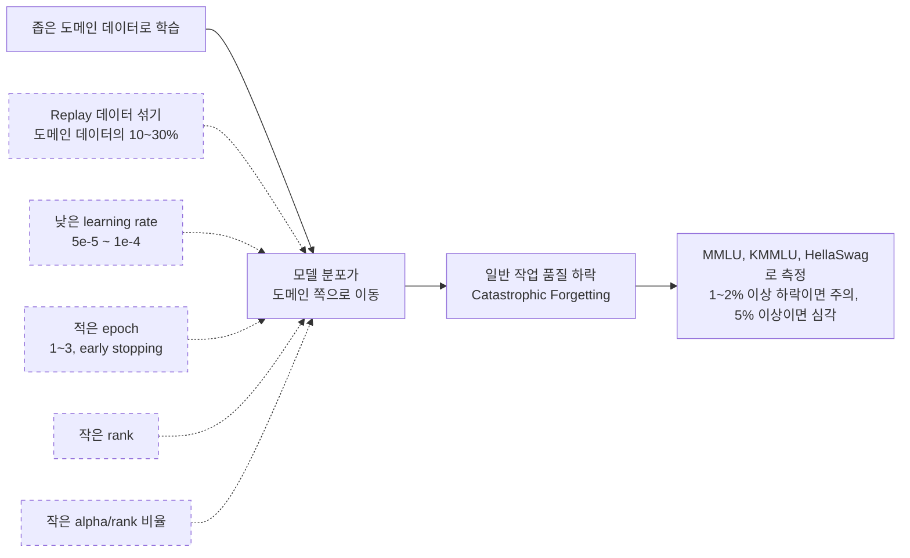

### continued pretraining에서의 forgetting과 replay

SFT의 forgetting은 대화 품질이 흔들리는 정도로 나타나지만, 도메인 코퍼스를 raw text로 이어 학습하면 더 직접적으로 나타난다. 모든 토큰에 loss가 걸리고 데이터 규모가 수십억 토큰 단위라서, 분포가 좁은 코퍼스 쪽으로 가중치가 통째로 끌려간다. 도메인 perplexity는 내려가는데 일반 코퍼스 perplexity가 같이 올라간다면 이 상태다.

대응은 두 가지로 모인다. 학습률을 어떻게 다시 시작하는지, 이전 분포의 데이터를 얼마나 섞는지. 연속 사전학습 연구([Simple and Scalable Strategies to Continually Pre-train LLMs](https://arxiv.org/abs/2403.08763))는 lr re-warming, lr re-decaying, 이전 데이터 replay를 조합하면 처음부터 다시 학습한 것과 비슷한 성능이 나온다고 보고한다. 도메인 코퍼스로 이어 학습하는 방식 자체는 [Don't Stop Pretraining](https://arxiv.org/abs/2004.10964)이 다뤘다.

#### lr 재설정

사전학습이 끝난 체크포인트의 lr은 cosine 끝값, 보통 max_lr의 10% 근처다. [사전학습 문서의 lr 스케줄](LLM_Pretraining.md#33-learning-rate-schedule)에서 min_lr을 max_lr의 0.1배로 둔 것과 같다. CPT를 시작할 때 고를 수 있는 선택지는 셋이다.

| 선택 | 장점 | 문제 |
|---|---|---|
| 끝값 그대로 이어가기 | 기존 능력이 거의 안 흔들린다 | 새 분포에 적응하는 속도가 느리다 |
| 원래 max_lr로 복귀 | 도메인을 빠르게 배운다 | 일반 능력이 크게 무너진다 |
| 원래 max_lr의 1/3~1/10으로 re-warmup 후 cosine | 위 둘의 중간 | 피크 값을 직접 찾아야 한다 |

피크를 새로 정하고 warmup부터 다시 올리는 이유가 있다. 모델 가중치만 불러오고 옵티마이저 상태는 새로 시작하는 경우가 많은데, 이때 Adam의 모멘트 추정은 초반 수백 스텝 동안 부정확하다. 옵티마이저 상태를 이어받았더라도 데이터 분포가 바뀌었으므로 기존 모멘트가 새 gradient 규모와 안 맞는다. 이 구간에 큰 lr을 바로 걸면 가중치가 한 번에 튄다. warmup은 전체 스텝의 1~5%에서 시작해 loss 곡선 초반이 튀는지 보고 늘린다.

```python
import math

def cpt_lr(step, total, warmup, peak, floor):
    if step < warmup:
        return peak * (step + 1) / warmup
    ratio = (step - warmup) / max(1, total - warmup)
    return floor + 0.5 * (1 + math.cos(math.pi * ratio)) * (peak - floor)

orig_max = 3e-4          # 사전학습 때의 max_lr
peak = orig_max / 3      # CPT 피크
lr = cpt_lr(step, total=10000, warmup=300, peak=peak, floor=peak * 0.1)
```

total 10000, warmup 300, 원래 max_lr 3e-4, 원래 min_lr 3e-5일 때 값을 직접 돌려 뽑으면 이렇다.

| 스텝 | max_lr 복귀 | 1/3 | 1/10 |
|---|---|---|---|
| 0 | 1.00e-06 | 3.33e-07 | 1.00e-07 |
| 299 (warmup 끝) | 3.00e-04 | 1.00e-04 | 3.00e-05 |
| 2000 | 2.80e-04 | 9.33e-05 | 2.80e-05 |
| 5000 | 1.72e-04 | 5.72e-05 | 1.72e-05 |
| 9999 | 3.00e-05 | 1.00e-05 | 3.00e-06 |

1/10로 잡으면 피크가 원래 min_lr과 같아진다. 이 값이 "끝값 그대로 이어가기"와 사실상 같은 구간이라서, 1/3과 1/10 사이에서 도메인 평가셋이 안 오르는 쪽으로 조정한다. 스케줄을 짤 때 cosine은 총 스텝에 묶이므로 도메인 데이터를 더 먹이기로 하고 총 스텝을 늘리면 곡선이 달라진다. 이어 학습을 여러 번 나눠 할 계획이면 사전학습 문서의 [WSD 스케줄](LLM_Pretraining.md#38-wsd-스케줄과-후반-annealing)이 맞는다.

#### replay 비율

replay는 도메인 데이터에 이전 분포의 데이터를 섞는 것이다. 배치 하나에 도메인 문서 90%, replay 문서 10%가 들어가는 식이다. 비율은 문서 수가 아니라 토큰 수 기준으로 맞춘다. 도메인 문서가 길고 replay 문서가 짧으면 문서 수 기준 10%가 토큰 기준으로는 2~3%로 줄어든다.

```python
import random

def mixed_batches(domain, replay, batch_size, replay_ratio, seed=0):
    rng = random.Random(seed)
    n_replay = round(batch_size * replay_ratio)
    while True:
        batch = rng.sample(domain, batch_size - n_replay) + rng.sample(replay, n_replay)
        rng.shuffle(batch)
        yield batch
```

적정 비율은 직접 재야 한다. 방향을 보려고 장난감 실험을 돌렸다. 20차원 입력을 6클래스로 분류하는 MLP를 도메인 A로 3000 스텝 학습하고(정확도 0.976), 입력 분포가 다른 도메인 B로 1500 스텝 이어 학습하면서 lr 피크와 A 데이터 replay 비율을 바꿨다. B 학습은 re-warmup 5% 후 cosine으로 피크의 10%까지 내렸다. 시드 1개짜리이고 LLM이 아니므로 숫자가 아니라 경향만 읽는다.

| 피크 lr | replay | A 정확도(잊은 정도) | B 정확도(새로 배운 정도) |
|---|---|---|---|
| 3e-3 (원래 피크로 복귀) | 0% | 0.133 | 0.962 |
| 3e-3 | 5% | 0.916 | 0.962 |
| 3e-3 | 25% | 0.956 | 0.957 |
| 1e-3 | 0% | 0.333 | 0.908 |
| 1e-3 | 5% | 0.905 | 0.887 |
| 1e-3 | 25% | 0.951 | 0.887 |
| 3e-4 (끝값 부근) | 0% | 0.558 | 0.747 |
| 3e-4 | 5% | 0.883 | 0.708 |
| 3e-4 | 25% | 0.933 | 0.664 |

읽어낼 수 있는 것은 세 가지다. lr을 낮추면 덜 잊지만 B도 그만큼 덜 배운다. replay 5%만 섞어도 A가 0.133에서 0.916으로 회복되고, 5%에서 25%로 올릴 때의 이득(0.04 안팎)은 0에서 5%로 가는 이득보다 훨씬 작다. 그리고 lr을 낮춰서 얻는 보존 효과보다 replay로 얻는 효과가 훨씬 크다. 피크 3e-3에서 replay 5%를 넣은 쪽이 피크 3e-4에서 replay 없이 돈 쪽보다 A와 B 모두 높다.

같은 실험을 도메인 A와 B가 입력은 같고 정답만 충돌하는 조건으로 바꾸면 결과가 달라졌다. replay를 25% 섞어도 A 정확도가 0.43 정도까지만 올라갔다. 두 도메인이 같은 입력에 서로 다른 답을 요구하면 섞어도 보존되는 양에 한계가 있다. LLM에서 이 경우는 이전에 맞던 답이 새 코퍼스에서는 틀린 답이 될 때 생긴다. 공개 문서의 관례와 반대로 정해진 사내 규칙 문서를 이어 학습시키는 경우가 그렇다.

LLM에서 시작점으로 잡는 값은 replay 5~10%다. 일반 벤치마크가 1~2% 이상 떨어지면 올리고, 도메인 지표가 안 오르면 내린다. replay 데이터는 원래 사전학습 믹스와 비슷해야 하는데, 원본 코퍼스를 못 구하는 경우에는 공개 웹 코퍼스와 코드·수학 데이터를 원래 모델의 믹스 비율에 맞춰 섞는다. 믹스를 짜는 감각은 [데이터 믹싱 비율](LLM_Pretraining.md#28-데이터-믹싱-비율)을 참고한다.

replay 비율을 정하는 과정은 한 번에 끝나지 않고 학습과 평가를 오가며 조정하는 루프다. 아래 흐름에서 두 번의 판정 결과가 각각 비율을 올리는 쪽과 내리는 쪽으로 갈린다는 점을 보면 된다.

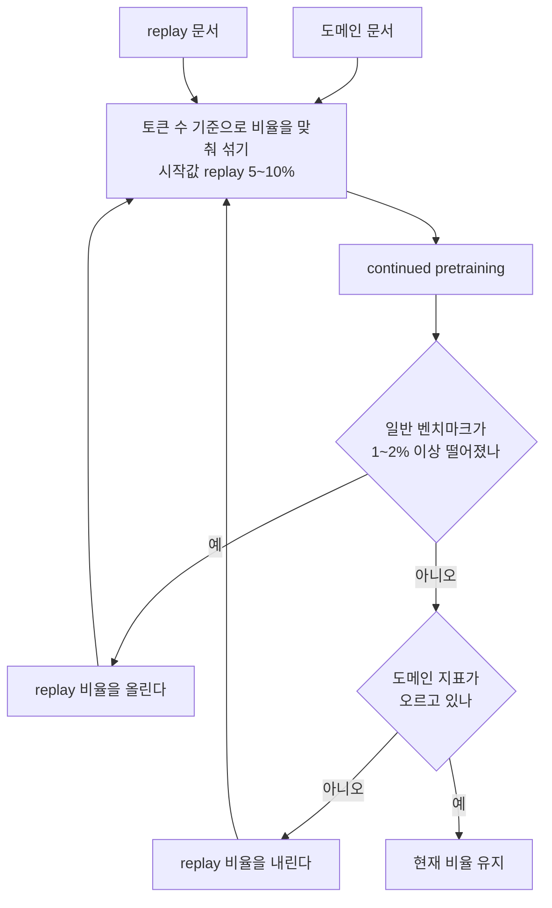

SFT 후의 선호 학습은 forgetting 쪽에서 따로 조심해야 한다. DPO는 SFT보다 lr을 한 자릿수 이상 낮춘다. Zephyr가 5e-7을 썼다([Zephyr 논문](https://arxiv.org/abs/2310.16944)). 선호 학습은 이미 정렬된 모델의 응답 분포를 미세하게 옮기는 단계라서 SFT 수준의 lr을 쓰면 응답이 한쪽으로 쏠리거나 길이가 비정상적으로 늘어나는 경우가 있다.

## 실전 도구

### Hugging Face TRL

가장 표준에 가까운 라이브러리다. SFTTrainer, DPOTrainer, PPOTrainer를 제공한다. 코드 가독성이 좋고 transformers와 직접 연동된다.

```python
from trl import SFTConfig, SFTTrainer
from transformers import AutoModelForCausalLM, AutoTokenizer
from peft import LoraConfig

model = AutoModelForCausalLM.from_pretrained("Qwen/Qwen2.5-7B")
tokenizer = AutoTokenizer.from_pretrained("Qwen/Qwen2.5-7B")

peft_config = LoraConfig(
    r=32,
    lora_alpha=64,
    target_modules=["q_proj", "k_proj", "v_proj", "o_proj",
                    "gate_proj", "up_proj", "down_proj"],
    lora_dropout=0.05,
    bias="none",
    task_type="CAUSAL_LM",
)

args = SFTConfig(
    output_dir="./out",
    num_train_epochs=2,
    per_device_train_batch_size=4,
    gradient_accumulation_steps=4,
    learning_rate=2e-4,
    warmup_ratio=0.03,
    lr_scheduler_type="cosine",
    bf16=True,
    logging_steps=10,
    save_strategy="epoch",
    max_seq_length=2048,
)

trainer = SFTTrainer(
    model=model,
    args=args,
    train_dataset=dataset,
    peft_config=peft_config,
    tokenizer=tokenizer,
)
trainer.train()
```

TRL은 유연하지만 학습 속도 최적화는 안 들어가 있다. 기본 transformers attention을 쓴다. flash-attention을 별도로 켜야 한다.

### Unsloth

학습 속도 최적화에 집중한 라이브러리다. Triton 커널로 forward/backward를 다시 짰다. TRL 대비 2배 빠르고 메모리는 50% 절약된다고 주장한다. 실측해보면 단일 GPU 7B 모델에서 1.7~1.9배 정도 빠르다.

```python
from unsloth import FastLanguageModel
import torch

model, tokenizer = FastLanguageModel.from_pretrained(
    model_name="unsloth/Qwen2.5-7B-bnb-4bit",
    max_seq_length=2048,
    dtype=None,
    load_in_4bit=True,
)

model = FastLanguageModel.get_peft_model(
    model,
    r=32,
    target_modules=["q_proj", "k_proj", "v_proj", "o_proj",
                    "gate_proj", "up_proj", "down_proj"],
    lora_alpha=64,
    lora_dropout=0,
    bias="none",
    use_gradient_checkpointing="unsloth",
    random_state=3407,
)
```

Unsloth의 단점은 멀티 GPU 지원이 유료 버전에서만 가능하다는 점이다. 단일 GPU에서 7B~13B 학습하기에는 최선의 선택이지만 70B나 멀티노드는 못 한다.

### Axolotl

YAML 설정 파일 하나로 학습을 돌린다. 멀티 GPU, DeepSpeed, FSDP를 지원한다. 70B 모델 학습이나 운영팀이 학습 파이프라인을 표준화할 때 좋다.

```yaml
base_model: meta-llama/Llama-3.1-70B
load_in_4bit: true

adapter: qlora
lora_r: 32
lora_alpha: 64
lora_target_modules:
  - q_proj
  - k_proj
  - v_proj
  - o_proj
  - gate_proj
  - up_proj
  - down_proj

datasets:
  - path: my-dataset.jsonl
    type: sharegpt

sequence_len: 4096
sample_packing: true
pad_to_sequence_len: true

gradient_accumulation_steps: 2
micro_batch_size: 1
num_epochs: 2
optimizer: paged_adamw_8bit
learning_rate: 1e-4
lr_scheduler: cosine
warmup_steps: 50

deepspeed: deepspeed_configs/zero3.json
flash_attention: true
```

Axolotl은 설정 파일이 길고 처음 익히기 어렵다. 대신 한 번 익히면 모델 교체, 데이터 교체, 하이퍼파라미터 튜닝이 YAML 수정만으로 끝난다. 학습 파이프라인을 CI에 넣기에도 적합하다.

도구 선택은 단순하다. 단일 GPU에서 빠르게 실험하려면 Unsloth, 코드를 커스터마이즈하려면 TRL, 멀티 GPU/70B 이상 또는 표준화된 파이프라인이 필요하면 Axolotl.

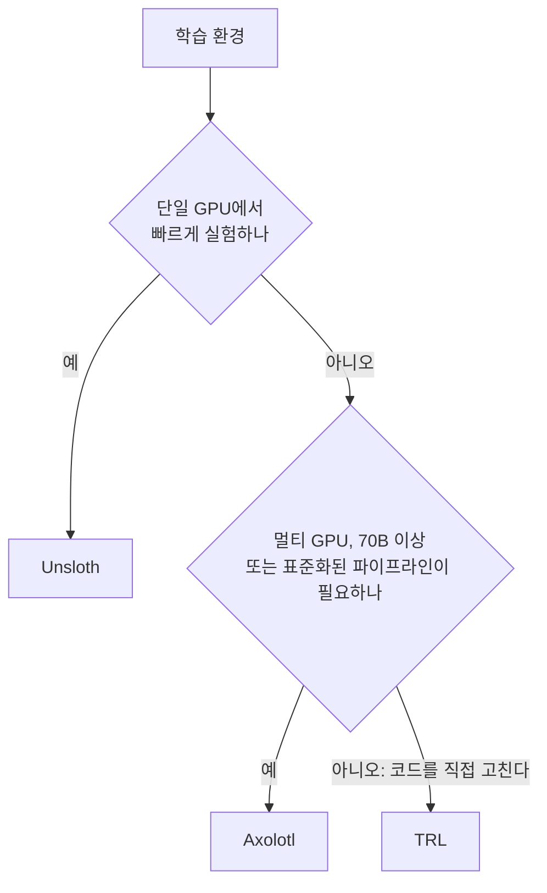

## 학습 하이퍼파라미터 감각

처음 파인튜닝을 돌리는 사람이 막히는 게 하이퍼파라미터다. 대략적인 시작값을 정리한다.

| 항목 | 값 |
|---|---|
| learning rate (LoRA) | 1e-4 ~ 2e-4 |
| learning rate (QLoRA) | 2e-4 ~ 3e-4 |
| batch size (effective) | 16 ~ 64 |
| epoch | 1 ~ 3 |
| warmup ratio | 0.03 ~ 0.1 |
| lr scheduler | cosine |
| optimizer | adamw_8bit, paged_adamw_8bit |
| gradient clipping | 1.0 |
| weight decay | 0.0 ~ 0.01 |

effective batch size는 `per_device_batch_size * gradient_accumulation_steps * num_gpus`다. GPU 메모리가 부족하면 micro batch를 1로 줄이고 accumulation을 늘려서 effective batch size를 맞춘다.

학습 중 loss curve를 보는 법이 있다. SFT 초반 loss는 1~3 사이에서 시작해서 0.5~1.0 정도로 수렴한다. loss가 0.1 미만으로 떨어지면 과적합이거나 데이터 leak이 있는 것이다. loss가 계속 2 이상이면 데이터에 문제가 있거나 learning rate가 너무 낮은 것이다.

validation loss를 별도로 측정해야 한다. train loss만 보면 과적합을 놓친다. validation set을 학습 데이터에서 10% 떼어두고 매 epoch마다 측정한다.

## 평가는 LLM으로

파인튜닝 후 평가가 가장 까다롭다. 사람이 일일이 보기는 비싸고, 자동 메트릭(BLEU, ROUGE)은 LLM 출력에 잘 안 맞는다.

실무에서 쓰는 방법은 강한 모델로 약한 모델을 평가하는 것이다. GPT-4나 Claude Opus에 base 모델 응답과 파인튜닝 모델 응답을 같이 보여주고 어느 쪽이 나은지 판정하게 한다. 평가 프롬프트를 잘 만들어야 한다.

```python
EVAL_PROMPT = """다음 사용자 질문에 대한 두 응답을 비교해라.
응답을 평가할 때는 정확성, 완성도, 명확성을 본다.
어느 한쪽이 명백히 낫지 않으면 무승부로 판정해라.

질문: {question}

응답 A: {response_a}

응답 B: {response_b}

JSON으로만 응답해라: {{"winner": "A" | "B" | "tie", "reason": "..."}}"""
```

순서 편향을 막으려면 A/B 순서를 50% 확률로 뒤집어서 측정한다. 200~500개 정도의 평가 셋이 있으면 통계적으로 의미 있는 비교가 된다.

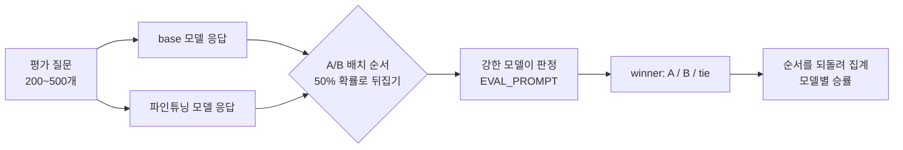

같은 질문이 두 모델 응답으로 갈라졌다가 순서를 섞은 채 judge에 들어가고, 집계 단계에서 순서를 원래대로 되돌린다는 점을 보면 된다.

도메인 작업이면 도메인 메트릭을 별도로 만든다. SQL 생성이라면 실행 결과 일치율, 코드 생성이면 테스트 통과율, JSON 출력이면 스키마 검증 통과율. 이런 객관 메트릭이 LLM-as-judge보다 신뢰도가 높다.

## 흔히 보는 실패 패턴

**데이터가 너무 적다**: 200~500건으로 파인튜닝을 시도하는 경우. 거의 항상 실패한다. 데이터를 더 모으거나 few-shot prompting으로 돌린다.

**데이터 품질이 낮다**: 데이터셋에 중복, 노이즈, 잘못된 응답이 섞여 있다. 모델이 노이즈까지 학습한다. 학습 전 데이터를 직접 100건 정도 샘플링해서 눈으로 확인해야 한다.

**chat template 불일치**: 학습 시 쓴 chat template과 추론 시 쓴 template이 다르면 응답 품질이 망가진다. tokenizer.apply_chat_template을 학습/추론 양쪽에서 동일하게 적용했는지 확인한다.

**EOS 토큰 누락**: 학습 데이터 끝에 EOS 토큰이 없으면 모델이 응답 종료를 학습하지 못한다. 추론 시 끝없이 생성을 이어간다. 데이터 전처리에서 EOS를 명시적으로 붙여야 한다.

**과한 epoch**: 작은 데이터셋에서 10 epoch씩 돌리면 학습 데이터를 그대로 외운다. validation loss가 올라가기 시작하면 멈춘다.

**LoRA를 merge하지 않고 vLLM에 올리려는 시도**: vLLM이 LoRA를 지원하지만 multi-LoRA 모드를 켜야 한다. 그냥 base 모델 경로에 LoRA만 던지면 안 된다.

**Tokenizer 변경**: 새 토큰을 추가하거나 vocab을 바꾸고 embedding layer를 학습하지 않으면 그 토큰은 무작위 임베딩 상태로 남는다. 응답에 노이즈로 나타난다.

## 파인튜닝과 RAG, 프롬프팅 사이의 선택

세 가지를 결정 흐름으로 정리하면 다음과 같다.

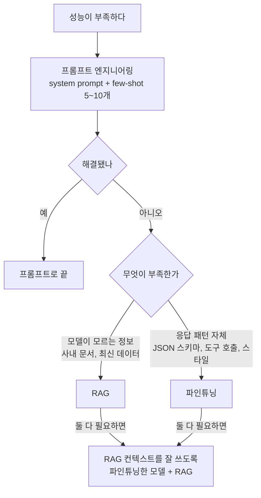

분기는 "무엇이 부족한가"에서 갈린다. 정보가 모자라면 RAG, 응답 패턴이 모자라면 파인튜닝이고, 두 갈래가 마지막에 합쳐지는 경로가 아래 본문에서 말하는 조합이다.

먼저 프롬프트 엔지니어링을 시도한다. system prompt에 역할과 출력 포맷을 명시하고, 5~10개 정도의 few-shot 예시를 넣는다. 이걸로 90%의 경우는 해결된다.

이걸로 안 되는 경우가 두 가지다. 첫째는 모델이 모르는 정보가 필요한 경우. 사내 문서, 최신 데이터, 특정 도메인 사실. 이건 RAG로 푼다. 검색해서 컨텍스트에 넣어주면 모델이 그걸 보고 응답한다.

둘째는 응답 패턴 자체를 바꿔야 하는 경우. 항상 특정 JSON 스키마로만 응답한다거나, 특정 도구를 일관되게 호출한다거나, 사내 스타일 가이드를 따른다거나. 이건 파인튜닝이 더 깔끔하다.

RAG와 파인튜닝은 배타적이지 않다. RAG로 검색한 컨텍스트를 더 잘 활용하는 모델을 파인튜닝으로 만들 수도 있다. 검색 결과를 인용하는 패턴, 검색 결과가 없을 때 모른다고 답하는 패턴 같은 행동은 파인튜닝이 잘 잡는다.

비용 측면에서도 차이가 있다. RAG는 추론 시마다 검색 비용과 늘어난 컨텍스트 비용이 든다. 파인튜닝은 학습 비용은 일회성이지만 모델 운영 비용이 따로 든다. 트래픽이 많으면 파인튜닝이 단가가 낮고, 적으면 RAG가 유리하다.

## 관련 문서

- [LLM 사전학습 파이프라인](LLM_Pretraining.md)
- [LLM 추론 최적화](LLM_Inference_Optimization.md)
- [Unsloth Qwen3 GGUF](Unsloth_Qwen3_GGUF.md)
- [RAG 파이프라인](RAG_Pipeline.md)
- [Prompt Engineering](Prompt_Engineering.md)
