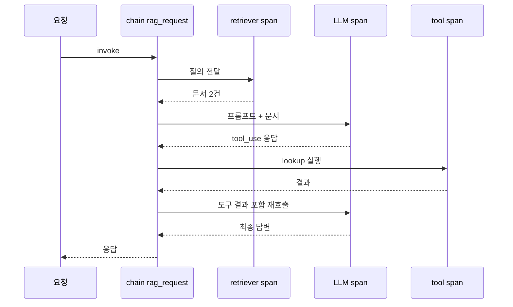
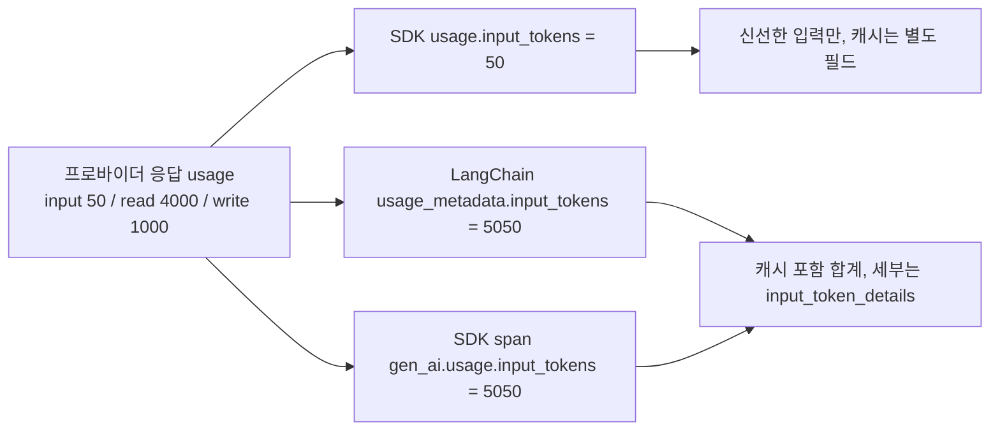
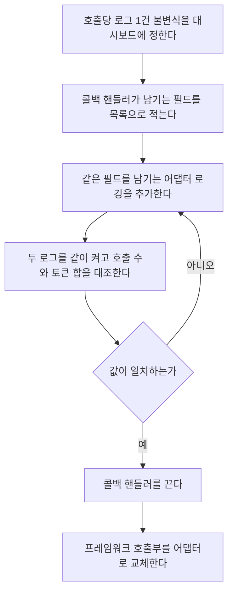

# LLM 프레임워크 관측·비용 집계·테스트

[LangChain / LlamaIndex vs 순수 SDK](Lang_Chain_vs_SDK.md)에서 고르는 기준은 다뤘다. 이 문서는 고른 다음에 갈리는 운영 항목 세 가지를 본다. 요청 한 건을 어떻게 추적하는지, 토큰과 비용을 어디서 세는지, 테스트에서 모델을 어떻게 갈아 끼우는지다. 프레임워크는 앞의 둘을 콜백으로 자동 수집하고, SDK는 직접 만들어야 한다. 대신 프레임워크가 센 숫자와 SDK가 돌려준 숫자가 어긋나는 일이 생긴다.

아래 수치는 모두 로컬 가짜 서버(Anthropic 메시지 API 응답을 흉내 낸 것)에 붙여서 재현한 값이다. 버전은 langchain-core 1.6.12, langchain-anthropic 1.7.6, anthropic 1.15.0이다.

## 요청 한 건이 남기는 span

검색, 모델 호출, 도구 호출이 한 트레이스에 부모-자식으로 묶여야 지연이 어디서 났는지 보인다.



도식에서 볼 것은 LLM span이 두 번 열린다는 점이다. 도구를 한 번 쓰는 요청도 모델 호출은 두 번이고, 두 번째 호출은 첫 번째 출력까지 입력에 싣는다. 달라지는 건 span을 누가 만드느냐다.

| 항목 | LangSmith | Langfuse | OpenTelemetry GenAI |
|---|---|---|---|
| 프레임워크 수집 | 환경변수만 켜면 자동 | 콜백 핸들러를 `config`에 전달 | 서드파티 계측 라이브러리를 쓰거나 콜백을 직접 span으로 변환 |
| SDK 직접 사용 | `wrap_anthropic` 같은 래퍼 | `@observe` 데코레이터 | `tracer.start_as_current_span`으로 직접 감쌈 |
| 저장소 | 호스팅 서비스 | 셀프호스팅 가능 | 백엔드 자유(Jaeger, Tempo 등) |
| 결합도 | 프레임워크와 같은 회사 제품 | 프레임워크 중립 | 표준, 이전 비용이 가장 낮다 |

LangSmith 단가는 [LangChain vs SDK](Lang_Chain_vs_SDK.md), 프롬프트 버전별로 트레이스를 가르는 방법은 [프롬프트 버전 관리와 A/B 테스트](Prompt_Version_AB_Testing.md)에 있다.

### 콜백을 span으로 바꾸기

LangChain 콜백은 `run_id`와 `parent_run_id`를 준다. `run_id`로 span을 들고 있다가 `parent_run_id`의 span을 부모로 지정하면 위 도식의 트리가 만들어진다.

```python
class OtelCallback(BaseCallbackHandler):
    def __init__(self):
        self._spans: dict[UUID, trace.Span] = {}

    def _open(self, run_id, parent_run_id, name):
        parent = self._spans.get(parent_run_id)
        ctx = trace.set_span_in_context(parent) if parent else None
        self._spans[run_id] = tracer.start_span(name, context=ctx)

    def on_retriever_start(self, serialized, query, *, run_id, parent_run_id=None, **kw):
        self._open(run_id, parent_run_id, "retriever")

    def on_chat_model_start(self, serialized, messages, *, run_id, parent_run_id=None, **kw):
        self._open(run_id, parent_run_id, "chat")

    def on_tool_start(self, serialized, input_str, *, run_id, parent_run_id=None, **kw):
        self._open(run_id, parent_run_id, f"tool {serialized.get('name')}")

    def on_llm_end(self, response, *, run_id, **kw):
        span = self._spans.pop(run_id)
        u = response.generations[0][0].message.usage_metadata
        if u:
            span.set_attribute("gen_ai.usage.input_tokens", u["input_tokens"])
            span.set_attribute("gen_ai.usage.output_tokens", u["output_tokens"])
        span.end()
```

`on_chain_end`, `on_retriever_end`, `on_tool_end`, `on_llm_error`에서도 span을 닫아야 한다. 에러 콜백을 빼먹으면 실패한 호출의 span이 열린 채 남는다. 이 핸들러로 체인을 돌리자 `chain rag_request` 아래에 `retriever`(문서 2건), `chat`, `tool lookup`이 한 단계 들여쓴 형태로 쌓였다.

SDK 쪽은 같은 트리를 `with tracer.start_as_current_span(...)`로 직접 만든다. 대신 재시도 횟수는 SDK가 숨기므로 `DefaultHttpxClient(event_hooks={"request": [...]})`로 요청마다 이벤트를 남겨야 한다. 앞 두 번은 529, 세 번째는 성공을 돌려주는 서버에 붙이자 이벤트가 3개 찍혔다.

### SDK 내장 계측과 콜백 span이 겹친다

anthropic 1.15.0은 `opentelemetry` 패키지가 설치돼 있으면 설정 없이 `anthropic.messages.create` span을 낸다. 이 span에 `http.request.resend_count`와 `gen_ai.usage.*`가 들어 있다. 끄려면 `ANTHROPIC_OPEN_TELEMETRY=false`다.

문제는 위 콜백처럼 `start_span`으로 만든 span이 현재 컨텍스트에 붙지 않는다는 점이다. 그 결과 `chain rag_request` 트레이스와 `anthropic.messages.create` 트레이스가 서로 다른 trace id로 갈라졌다. 환경변수로 끄면 SDK 트레이스가 사라지고 콜백 쪽만 남는다. 두 span이 모두 토큰을 갖고 있으니 둘을 같이 보내면 백엔드에서 합산할 때 두 배가 된다. 하나만 남겨야 한다.

## 같은 호출이 다른 토큰을 말한다

가짜 서버가 `input_tokens 50`, `cache_read_input_tokens 4000`, `cache_creation_input_tokens 1000`, `output_tokens 7`을 돌려주게 하고 같은 호출을 세 경로로 읽었다.



SDK의 `input_tokens`는 캐시를 뺀 값이고, LangChain 래퍼와 SDK 내장 span은 캐시를 더한 값이다. 캐시 필드 자체는 래퍼에서 사라지지 않았다. `input_token_details`에 `cache_read`, `cache_creation`으로 들어 있다. 래퍼 값에 입력 단가를 그대로 곱하면 5050이 청구 대상이 되는데, 캐시 가중치([프롬프트 캐싱](Prompt_Caching.md): 읽기 0.1배, 5분 쓰기 1.25배)를 적용하면 1700이다. 3배 가까이 차이 난다.

```python
CACHE_READ_W, CACHE_WRITE_W = 0.1, 1.25

@dataclass(frozen=True)
class Usage:
    fresh_input: int
    cache_read: int
    cache_write: int
    output: int

    def input_equiv(self) -> float:
        return self.fresh_input + self.cache_read * CACHE_READ_W + self.cache_write * CACHE_WRITE_W

def from_sdk(u) -> Usage:
    return Usage(u.input_tokens, u.cache_read_input_tokens or 0,
                 u.cache_creation_input_tokens or 0, u.output_tokens)

def from_langchain(m) -> Usage:
    d = m.get("input_token_details") or {}
    read, write = d.get("cache_read", 0), d.get("cache_creation", 0)
    return Usage(m["input_tokens"] - read - write, read, write, m["output_tokens"])
```

두 함수가 같은 응답에서 `Usage(50, 4000, 1000, 7)`과 `input_equiv() == 1700.0`으로 일치했다. 집계는 이 형태로만 저장한다.

### 재시도는 누가 세는가

같은 서버에 `ChatAnthropic(max_retries=2)`로 붙였더니 HTTP 요청은 3번 나갔는데 `on_chat_model_start`와 `on_llm_end`는 1번씩만 불렸다. 실패한 시도는 usage가 없어 토큰에는 영향이 없다. 문제는 지연이다. 콜백 span 하나가 세 번 시도한 시간을 통째로 들고 있어서, p95 지연이 올랐을 때 모델이 느려진 건지 재시도가 늘어난 건지 span만으로는 가를 수 없다. SDK 내장 span은 `http.request.resend_count`가 있어서 구분된다.

### 스트리밍에서 입력 토큰이 0이 된다

langchain-anthropic 1.7.6은 `message_start`의 usage를 쓰지 않고 `message_delta`의 usage를 최종값으로 쓴다. `message_delta`에 `input_tokens`와 캐시 필드를 누적해서 넣어 주면 `input_tokens 5050`으로 맞는다. `output_tokens`만 넣어 보내는 서버를 붙였더니 래퍼는 `input_tokens 0`, `total_tokens 7`을 냈고, SDK의 `get_final_message().usage`는 `message_start` 값을 보존해서 50, 4000, 1000을 그대로 냈다. 실제 Anthropic 서버의 `message_delta` 구성은 이 실험으로 확인하지 못했다. 프록시나 호환 게이트웨이 뒤에서 스트리밍 입력 토큰이 0으로 찍히면 이 경로를 의심한다.

## 테스트에서 모델 갈아 끼우기

프레임워크는 `FakeListChatModel`을 준다. SDK는 얇은 인터페이스를 직접 정의하고 가짜를 주입한다.

```python
# 프레임워크 쪽
def test_lc_fake_list():
    chain = build_chain(FakeListChatModel(responses=['{"label": "billing"}']))
    assert chain.invoke({"q": "환불해 주세요"}) == {"label": "billing"}

# SDK 쪽
class ChatClient(Protocol):
    def complete(self, system: str, user: str) -> Completion: ...

class FakeClient:
    def __init__(self, text):
        self.text, self.calls = text, []
    def complete(self, system, user):
        self.calls.append((system, user))
        return Completion(self.text, 10, 3)

def test_sdk_protocol():
    fake = FakeClient('{"label": "billing"}')
    assert classify(fake, "환불해 주세요") == {"label": "billing"}
    assert fake.calls[0][1] == "환불해 주세요"
```

둘 다 통과했다. 차이는 `FakeListChatModel`이 프롬프트를 보지 않는 데서 나온다. `{"q": "전혀 다른 질문"}`을 넣어도 같은 응답이 돌아왔다. 프롬프트 템플릿이 틀려도 `KeyError`가 나지 않는 한 이 테스트는 통과한다. 반면 `FakeClient`는 `calls`에 시스템·사용자 메시지를 기록하므로 "어떤 프롬프트가 나갔는가"를 직접 단언한다. `FakeListChatModel`이 낸 메시지는 `usage_metadata`가 `None`이라, 비용 집계 코드는 이 가짜로는 한 번도 실행되지 않는다. 집계를 테스트하려면 위 가짜 서버처럼 HTTP 계층에서 usage를 흉내 내야 한다.

### 녹화 재생의 한계

vcrpy로 SDK 호출을 녹화하면 anthropic 1.15.0에서도 카세트가 만들어졌다. 한계는 매칭에 있다. 기본 매칭은 메서드, 호스트, 경로, 쿼리까지라 본문을 보지 않는다. 프롬프트를 바꿔 재생하자 서버 호출 없이 옛 응답이 그대로 돌아왔다. `match_on=["method", "path", "body"]`를 주면 다른 프롬프트에서 `APIConnectionError`가 났다. 대신 모델 파라미터 하나만 바꿔도 카세트가 깨져 재녹화해야 한다. 카세트에 `x-api-key` 헤더가 평문으로 저장되는 것도 확인했다. `filter_headers`로 걸러야 한다.

## 프레임워크를 걷어낼 때 관측을 이어가는 순서

콜백에 의존하던 로깅은 걷어내는 순간 에러 없이 끊긴다. 순서를 지키면 끊기는 구간을 만들지 않는다.



대조 단계에서 값이 두 배면 콜백과 어댑터가 둘 다 남기는 것이고, 반이면 어댑터가 빠뜨린 것이다. 이때 토큰은 앞 절의 `Usage`로 정규화한 뒤 비교한다. 정규화 없이 비교하면 5050 대 50이 나와서 어댑터가 틀린 것처럼 보인다. 어댑터 구조와 두 구현체를 나란히 두는 방법은 [LangChain vs SDK](Lang_Chain_vs_SDK.md)의 걷어내기 절에 있다. 교체 뒤 응답 품질이 같은지 보는 일은 [LLM 평가 방법론](LLM_Evaluation.md)과 A/B 테스트 문서의 몫이다.

## 항목별 비교

| 항목 | 프레임워크 | 순수 SDK |
|---|---|---|
| 트레이싱 | 콜백으로 retriever, LLM, tool span 자동 수집 | span을 직접 감싼다. 내장 계측이 있으면 콜백과 중복 |
| 비용 집계 | 래퍼가 정규화한 `usage_metadata`. `input_tokens`에 캐시 포함 | `response.usage` 그대로. 캐시는 별도 필드 |
| 재시도 | 콜백 1회에 HTTP 여러 번. 시도 횟수가 안 보인다 | `resend_count`나 이벤트 훅으로 보인다 |
| 스트리밍 usage | 서버의 `message_delta` 구성에 의존 | `message_start` 값을 보존 |
| 테스트 용이성 | `FakeListChatModel` 한 줄. 프롬프트는 검증 못 함 | Protocol 직접 정의. 호출 인자를 단언 가능 |
| 업그레이드 부담 | 래퍼 버전마다 usage 해석이 달라질 수 있다 | SDK 필드 변경만 따라가면 된다 |
