# LLM 사전학습 파이프라인

Karpathy가 2024년에 공개한 "Let's reproduce GPT-2" 영상과 nanoGPT 코드를 기준으로 쓴다. 수조 토큰 규모 학습의 전체 흐름을 알고 싶은 사람보다, "왜 학습이 터지는지", "데이터를 어떻게 준비하는지"가 궁금한 사람에게 맞춰 썼다. 본문의 코드와 수치 중 직접 실행한 것은 torch 2.x CPU 환경과 순수 Python으로 돌려 출력을 확인한 값이다. 수십~수천 GPU가 필요한 값은 공개 논문의 수치를 인용하고 출처를 달았다.

---

## 1. 사전학습이 하는 일

사전학습의 목표는 단 하나다. 다음 토큰을 예측하는 것이다.

```
입력: "The transformer architecture was"
예측: "proposed"
```

이걸 수조 토큰에 반복하면, 모델은 언어 구조, 사실 관계, 추론 패턴을 전부 파라미터에 새긴다. 목적함수는 cross-entropy loss다.

```text
loss = -sum(log P(t_i | t_1, ..., t_{i-1})) / N
```

사전학습을 마친 base model은 대화를 못한다. "파이썬에서 파일 읽는 방법은?"이라고 물으면 "파이썬에서 파일 읽는 방법은? 자바에서는? C++에서는?"처럼 다음에 올 법한 텍스트를 그냥 이어쓴다. SFT와 RLHF가 필요한 이유다. 이 부분은 6장에서 다룬다.

---

## 2. 데이터 파이프라인

학습 코드보다 이 구간에서 손이 더 간다. 원시 크롤이 학습 가능한 토큰 샤드가 되기까지의 단계와, 단계마다 문서가 얼마나 떨어지는지를 먼저 본다. 아래 그림의 탈락 비율은 공개된 파이프라인 보고서에서 흔히 보이는 범위를 잡아 만든 가정값이다. 소스와 임계값에 따라 크게 달라지므로 자기 파이프라인에서는 단계마다 직접 재야 한다.

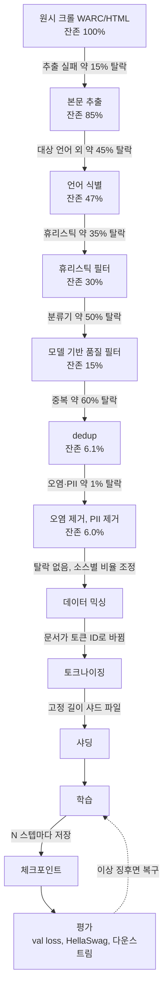

그림에서 볼 것은 두 가지다. 탈락은 믹싱 앞에서 전부 끝난다. 믹싱 뒤부터는 문서를 버리지 않고 비율과 순서만 바꾼다. 그리고 비용이 싼 단계가 앞에 오고 비싼 단계가 뒤에 온다. 휴리스틱은 문자열 연산 몇 번이면 끝나지만 분류기는 문서마다 추론을 돌리고, MinHash는 문서마다 해시를 수백 번 계산한다. 앞 단계에서 문서를 많이 줄여 놓아야 뒤 단계 비용이 준다.

### 2.1 Common Crawl과 그 한계

대부분의 대형 LLM은 Common Crawl을 기반으로 한다. Common Crawl은 2008년부터 웹을 크롤링해서 쌓은 공개 데이터셋으로, 매달 수백 TB의 HTML 덤프가 쌓인다. 규모로는 타의 추종을 불허한다.

문제는 품질이다. 그냥 가져다 쓰면 스팸, 광고 복사본, 무의미한 반복 텍스트, SEO 쓰레기가 절반 이상이다. Karpathy는 GPT-2 재현 과정에서 HuggingFace의 FineWeb(Common Crawl 필터링 버전)을 썼는데, 필터링 전후로 모델 품질이 눈에 띄게 달랐다고 했다.

**데이터 소스 구성의 현실:**

| 소스 | 비율 (대략) | 특성 |
|------|------------|------|
| Common Crawl (필터링 후) | 50~70% | 주된 소스. 품질 편차 크다 |
| 코드 (GitHub 등) | 10~20% | 추론 능력에 직접 영향 |
| Wikipedia | 3~5% | 사실 관계가 깨끗하다 |
| 책 (Books3 등) | 5~15% | 긴 문맥 학습에 도움이 된다 |
| 학술 논문 | 3~5% | 정제된 텍스트 |

코드 데이터를 섞는 건 단순히 코딩을 잘하게 만들려는 게 아니다. 코드는 구조화된 논리를 담고 있어서 수학적 추론, 단계별 문제 풀기 같은 능력 전반에 영향을 준다. GPT-3.5 이후 모델들이 GPT-3보다 추론이 좋아진 데는 코드 데이터 비율을 높인 영향도 있다.

### 2.2 품질 필터링

필터링은 크게 두 단계로 나뉜다.

**휴리스틱 필터**: 빠르고 비용이 없다. 구현은 단순하지만 쓰레기 데이터의 80%는 여기서 걸러진다.

```python
def heuristic_filter(text: str) -> bool:
    # 너무 짧거나 긴 문서 제거
    if len(text) < 200 or len(text) > 100_000:
        return False

    # 알파벳/한글 비율이 낮으면 제거 (URL 덩어리, 숫자만 있는 문서)
    alpha_ratio = sum(c.isalpha() for c in text) / len(text)
    if alpha_ratio < 0.5:
        return False

    # 반복 라인 비율이 높으면 제거
    lines = text.split('\n')
    unique_ratio = len(set(lines)) / len(lines)
    if unique_ratio < 0.8:
        return False

    # 특수문자 과다 문서 제거
    punct_ratio = sum(not c.isalnum() and not c.isspace() for c in text) / len(text)
    if punct_ratio > 0.3:
        return False

    return True
```

**모델 기반 필터**: fastText 분류기를 학습시켜서 "고품질 문서"와 "저품질 문서"를 구분한다. Wikipedia 문서를 positive 예시로, 랜덤 크롤 문서를 negative로 쓰는 방식이 흔하다. Karpathy는 GPT-2 재현에서 FineWeb이 이미 이 작업을 해줬기 때문에 직접 구현하지 않았지만, 자체 데이터셋을 구축하면 이 단계를 직접 해야 한다.

### 2.3 Deduplication

중복 제거는 데이터 파이프라인에서 가장 중요한 단계 중 하나다. 같은 텍스트가 학습 데이터에 여러 번 나타나면 모델이 그 텍스트를 과도하게 외운다. 개인정보가 담긴 문서가 중복으로 들어가면 모델이 그 정보를 생성하게 되는 문제도 있다.

중복 제거 방법은 세 가지다.

**Exact matching**: URL 또는 내용 해시가 완전히 동일한 문서를 제거한다. 가장 빠르고 단순하다. 완전히 동일한 복사본은 잡아내지만 약간 다른 버전은 통과한다.

**Near-duplicate detection (MinHash)**: MinHash + LSH(Locality Sensitive Hashing)로 문서를 signature로 변환하고, 유사도가 높은 쌍을 찾아낸다. 문서 하나를 2048개 이상의 shingle(n-gram 단위)로 쪼개고, 각 shingle에 여러 해시 함수를 적용해서 MinHash signature를 만든다.

```python
from datasketch import MinHash, MinHashLSH

def make_minhash(text: str, num_perm: int = 128) -> MinHash:
    m = MinHash(num_perm=num_perm)
    for word in text.split():
        m.update(word.encode('utf-8'))
    return m

# Jaccard 유사도 0.8 이상인 문서를 중복으로 처리
lsh = MinHashLSH(threshold=0.8, num_perm=128)

for doc_id, text in documents:
    mh = make_minhash(text)
    duplicates = lsh.query(mh)
    if not duplicates:
        lsh.insert(doc_id, mh)
    # duplicates가 있으면 이 문서는 건너뜀
```

**Substring matching (Suffix Array)**: 문서 경계를 넘어서 반복되는 긴 문자열을 찾는다. 같은 뉴스 기사가 여러 사이트에 복사된 경우를 잡는 데 쓴다. 구현 비용이 높아서 대규모 데이터셋에서는 MinHash를 먼저 쓰고 나서 Suffix Array로 보완하는 경우가 많다.

### 2.4 토크나이징

필터링, 중복 제거가 끝나면 텍스트를 토큰 ID 배열로 변환한다. GPT-2 재현에는 GPT-2의 BPE 토크나이저(vocab size 50,257)를 그대로 쓴다.

```python
import tiktoken
enc = tiktoken.get_encoding("gpt2")

# 문서 → 토큰 배열, <|endoftext|>로 문서 경계 표시
tokens = enc.encode_ordinary(text)
tokens.append(enc.eot_token)  # 50256
```

토큰화 결과를 `.npy` 파일로 저장해두고 학습 루프에서 메모리맵으로 읽는다. 데이터를 사전에 전부 토큰화해두지 않으면 학습 중 CPU에서 토큰화 병목이 생긴다.

### 2.5 단계별 문서 수 감소

단계마다 몇 개가 남는지 로그로 남겨 두지 않으면 파이프라인이 조용히 망가져도 모른다. 임계값 하나를 바꿨는데 휴리스틱 탈락률이 35%에서 70%로 뛰었다면 필터가 아니라 버그를 의심해야 한다. 아래는 문서 10억 개를 넣었을 때 앞 절의 가정 비율대로 줄어드는 모양이다.

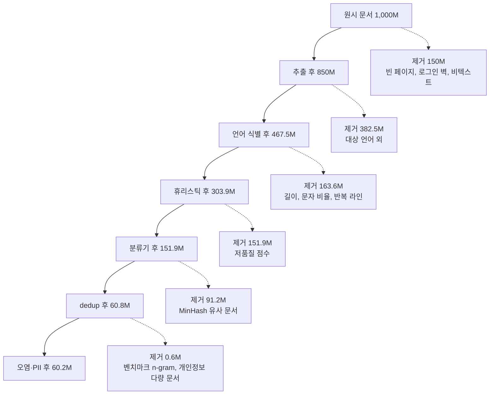

실선이 살아남는 문서, 점선이 버려지는 문서다. 최종 잔존율이 6.0%라는 건 크롤 100개 중 6개만 학습에 쓴다는 뜻이다. 이 구조에서 dedup 위치가 자주 문제가 된다. 모든 크롤 스냅샷을 합쳐 한 번에 dedup하면 오래 살아남은 고품질 페이지가 대량으로 지워지는 경우가 있어서, FineWeb은 스냅샷 단위로 MinHash를 돌리는 쪽이 더 낫다고 보고했다. 출처는 [FineWeb 논문](https://arxiv.org/abs/2406.17557)이다.

탈락률 로깅은 단계 이름과 카운터만 있으면 된다. 아래 코드는 위 표의 가정 비율을 그대로 넣어 돌린 것이다.

```python
stages = [("원시 크롤(HTML)", 0.0), ("본문 추출", 0.15), ("언어 식별", 0.45), ("휴리스틱 필터", 0.35),
          ("품질 분류기", 0.50), ("dedup", 0.60), ("오염·PII 제거", 0.01)]
n = 1000.0  # 백만 문서
for name, drop in stages:
    removed = n * drop
    n -= removed
    print(f"{name:14s} 탈락 {drop*100:4.0f}%  제거 {removed:7.1f}M  남음 {n:7.1f}M  ({n/10:.1f}%)")
```

마지막 줄 출력은 `오염·PII 제거 탈락 1% 제거 0.6M 남음 60.2M (6.0%)`이다.

### 2.6 벤치마크 오염 제거

웹에는 벤치마크 문제와 정답이 그대로 올라와 있다. 학습 데이터에 평가셋이 섞이면 점수가 부풀고, 그 점수로 체크포인트를 고르면 선택 자체가 틀어진다. GPT-3 논문은 평가셋과 13-gram이 겹치는 학습 문서를 찾아 겹친 구간 주변을 잘라냈다([GPT-3 논문](https://arxiv.org/abs/2005.14165)). 구현은 평가셋 n-gram을 집합으로 만들어 두고 학습 문서의 n-gram이 하나라도 걸리는지 보는 것이다.

```python
import re

def norm_tokens(text):
    return re.findall(r"\w+", text.lower())

def ngrams(tokens, n):
    return {tuple(tokens[i:i+n]) for i in range(len(tokens) - n + 1)}

def build_bench_index(bench_texts, n=13):
    idx = set()
    for t in bench_texts:
        idx |= ngrams(norm_tokens(t), n)
    return idx

def contaminated(doc, idx, n=13):
    return bool(ngrams(norm_tokens(doc), n) & idx)
```

GSM8K 스타일 문제 하나를 인덱스에 넣고 변형본을 던져 본 결과다.

| 학습 문서 | 13-gram 결과 |
|---|---|
| 문제와 정답이 그대로 복사된 퀴즈 덤프 | 걸림 |
| 공백, 대소문자, 구두점만 바꾼 복사본 | 걸림 |
| 숫자와 어휘를 바꿔 의역한 문제 | 안 걸림 |
| 문제 문장 일부(10단어)만 인용한 글 | 안 걸림, 8-gram으로 낮추면 걸림 |

정규화 덕분에 서식 변형은 잡히지만 의역과 번역은 n-gram으로 못 잡는다. n을 낮추면 일반 관용구까지 걸려 멀쩡한 문서가 빠지므로, 임계값은 제거된 문서 수를 보면서 정한다. 임베딩 유사도 검사를 2차로 얹는 팀도 있지만 비용이 커서 평가셋 크기가 작을 때만 현실적이다. 평가셋이 추가될 때마다 인덱스를 다시 만들어 전체 데이터에 재실행해야 하므로, 인덱스에 벤치마크 목록과 버전을 같이 기록해 둔다. 오염 제거는 dedup 뒤, 믹싱 앞에 둔다. 믹싱 뒤에 하면 업샘플링된 사본까지 따로 지워야 한다.

### 2.7 PII와 유해 콘텐츠 제거

개인정보는 정규식으로 1차를 거른다. 이메일, 전화번호, IP, 카드번호가 대상이다. 카드번호는 16자리 숫자 패턴만 쓰면 주문번호가 전부 걸리므로 Luhn 체크섬을 같이 본다.

```python
import re
EMAIL = re.compile(r"[A-Za-z0-9._%+-]+@[A-Za-z0-9.-]+\.[A-Za-z]{2,}")
IPV4 = re.compile(r"\b(?:(?:25[0-5]|2[0-4]\d|1?\d?\d)\.){3}(?:25[0-5]|2[0-4]\d|1?\d?\d)\b")
KR_PHONE = re.compile(r"\b01[016789]-?\d{3,4}-?\d{4}\b")
CARD = re.compile(r"\b(?:\d[ -]?){15}\d\b")

def luhn(s):
    d = [int(c) for c in re.sub(r"\D", "", s)][::-1]
    t = sum(d[0::2]) + sum(sum(divmod(x*2, 10)) for x in d[1::2])
    return t % 10 == 0

def scrub(t):
    t = EMAIL.sub("<EMAIL>", t)
    t = KR_PHONE.sub("<PHONE>", t)
    t = IPV4.sub("<IP>", t)
    t = CARD.sub(lambda m: "<CARD>" if luhn(m.group()) else m.group(), t)
    return t
```

"문의: kim.dev@example.com / 010-1234-5678, 서버 10.0.3.17, 카드 4539 1488 0343 6467, 주문번호 1234 5678 9012 3456, 버전 1.2.3.4"를 넣으면 이메일, 전화, IP, 카드는 치환되고 주문번호는 Luhn에서 떨어져 남는다. 그런데 마지막 `버전 1.2.3.4`도 `<IP>`로 바뀐다. 정규식은 버전 문자열과 IP를 구분하지 못한다. 코드 문서와 릴리스 노트가 많은 데이터에서는 이 오탐이 쌓여 버전 표기가 학습 데이터에서 사라진다. 무작위 16자리 숫자 2만 개를 돌려 보면 약 10.3%가 Luhn을 통과하므로 카드번호 필터에도 오탐이 남는다. 정규식 단계는 재현율 위주로 두고, 코드 블록 안이나 `v` 접두 버전은 건드리지 않는 식으로 예외를 직접 쌓아야 한다.

치환은 삭제보다 토큰으로 바꾸는 쪽이 문장 구조를 살린다. 다만 `<EMAIL>` 같은 문자열이 너무 자주 나오면 모델이 그 토큰을 생성하는 버릇이 생기므로 치환 후 빈도도 본다.

유해 콘텐츠는 URL 블록리스트와 분류기를 조합한다. 여기서 알려진 함정은 과필터링이다. C4를 분석한 [Dodge et al.](https://arxiv.org/abs/2104.08758)은 블록리스트 방식이 소수자 집단에 대한 글과 그들이 쓴 글을 더 많이 지운다고 보고했다. 욕설 사전 하나로 문서를 통째로 버리면 해당 주제를 학습할 기회가 없어진다. 문서 전체를 버리기보다 점수 임계값을 높게 잡고, 탈락한 문서를 샘플링해 사람이 읽어 보는 절차가 필요하다.

### 2.8 데이터 믹싱 비율

소스별 토큰 비율은 모델이 어떤 능력을 갖는지를 정한다. 공개된 두 모델의 구성은 이렇다.

| 모델 | 구성 | 출처 |
|---|---|---|
| LLaMA 1 | CommonCrawl 67%, C4 15%, GitHub 4.5%, Wikipedia 4.5%, Books 4.5%, ArXiv 2.5%, StackExchange 2% | [LLaMA 논문](https://arxiv.org/abs/2302.13971) |
| Llama 3 | 일반 지식 약 50%, 수학·추론 약 25%, 코드 약 17%, 다국어 약 8% | [Llama 3 논문](https://arxiv.org/abs/2407.21783) |

두 구성을 보면 3년 사이에 웹 비중이 줄고 수학, 코드 비중이 올라갔다. 비율은 이론으로 정해지지 않는다. Llama 3는 작은 모델로 비율을 바꿔 가며 돌려 본 뒤 규모를 키워 확인하는 방식으로 정했다고 밝혔다. 직접 한다면 1B 이하 모델에 20~50B 토큰 정도로 소스 비율만 바꿔 여러 번 돌리고, 코드·수학 벤치마크가 어떻게 움직이는지 본 다음 큰 모델에 옮긴다.

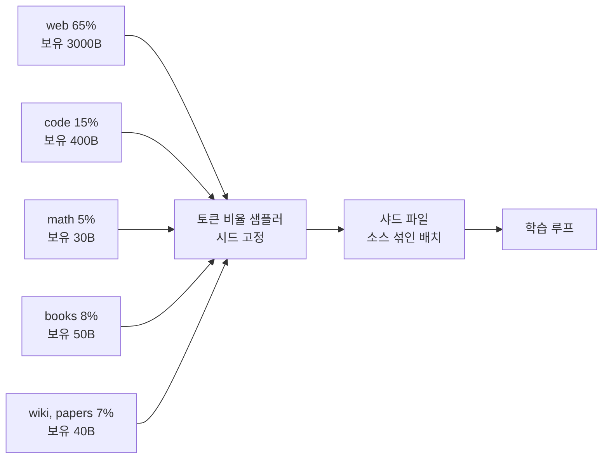

비율은 문서 수가 아니라 토큰 수 기준으로 지정한다. 문서 단위로 샘플링하면 책 한 권(수만 토큰)과 웹 문서 한 장(수백 토큰)이 같은 비중으로 뽑혀 의도한 토큰 비율과 크게 어긋난다.

### 2.9 에포크 반복과 도메인 업샘플링

고품질 소스는 양이 적다. 수학 비율 5%를 지키려면 보유량보다 더 많이 필요해져서, 같은 문서를 여러 번 읽게 된다. 총 2조 토큰을 학습하는 가상 구성으로 소스별 에포크를 계산했다.

```python
budget = 2000  # B tokens
src = {  # 비율, 보유 고유 토큰(B)
    "web":   (0.65, 3000),
    "code":  (0.15, 400),
    "math":  (0.05, 30),
    "books": (0.08, 50),
    "wiki/papers": (0.07, 40),
}
for k, (r, avail) in src.items():
    need = budget * r
    print(f"{k:12s} 필요 {need:6.0f}B  보유 {avail:5d}B  epoch {need/avail:.2f}")
```

실행 결과는 web 0.43, code 0.75, math 3.33, books 3.20, wiki/papers 3.50 에포크다. 웹은 절반도 못 읽고 작은 소스들은 3번 넘게 읽는다. 반복의 영향은 [Muennighoff et al.](https://arxiv.org/abs/2305.16264)이 측정했다. 같은 데이터를 약 4에포크까지 반복해도 새 데이터와 거의 차이가 없고, 그보다 많아지면 반복의 이득이 빠르게 사라진다. 위 구성은 4에포크 안쪽이라 허용 범위지만 수학이 5%에서 10%로 올라가면 6에포크를 넘기 때문에 데이터를 더 모으는 쪽이 낫다.

업샘플링 구현은 두 가지다. 샤드 목록에 같은 파일을 배수만큼 반복해 나열하거나, 소스 샘플링 확률에 가중치를 주는 방식이다. 전자는 같은 문서가 학습 후반에 몰려 나오는 일이 없도록 셔플을 에포크 경계가 아니라 전체 스트림에서 해야 한다. 후자는 재개할 때 소스별 소비 위치를 상태로 저장해야 하는데, 이건 4.3에서 다룬다.

### 2.10 문서 packing과 attention mask

토큰 ID 배열은 문서 길이가 제각각이다. 문서마다 시퀀스 길이로 패딩하면 연산이 낭비된다. 문서를 EOS로 이어 붙여 고정 길이로 자르는 것이 packing이다.

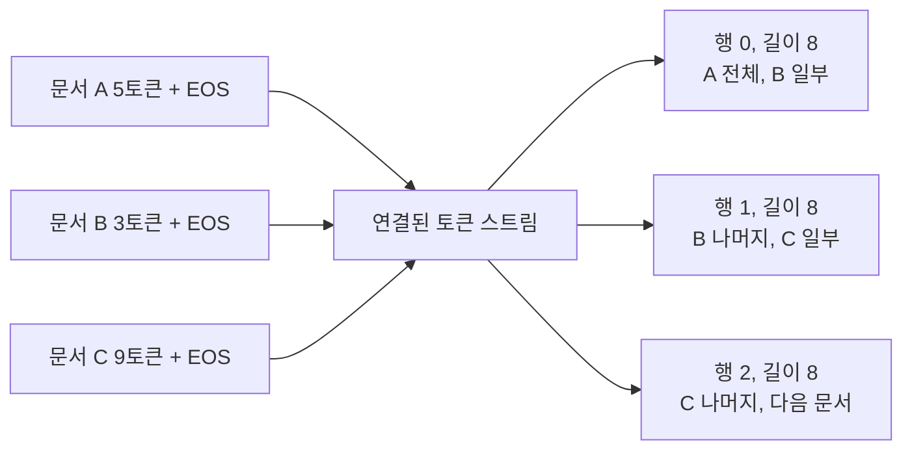

그림처럼 행 경계가 문서 중간에 떨어진다. 길이 5, 3, 9, 2, 6인 문서 5개를 seq_len 8로 packing하면 3행이 나오고, 패딩 방식은 40칸 중 30칸만 실토큰이라 25%를 버린다.

문제는 attention이다. nanoGPT처럼 마스크 없이 이어 붙이면 행 1의 문서 B 토큰이 같은 행 안의 문서 C를 보게 된다. 이 예에서 causal 마스크만 쓰면 문서 경계를 넘는 칸이 12개 생긴다. Llama 3는 같은 시퀀스 안의 서로 다른 문서 사이 self-attention을 막는 마스크를 쓴다고 밝혔다. position id도 문서마다 0부터 다시 센다.

```python
import numpy as np
EOS = 0

def pack(docs, seq_len):
    stream, doc_ids, pos = [], [], []
    for i, d in enumerate(docs):
        toks = d + [EOS]
        stream += toks
        doc_ids += [i] * len(toks)
        pos += list(range(len(toks)))
    n = len(stream) // seq_len
    cut = lambda a: np.array(a[: n * seq_len]).reshape(n, seq_len)
    return cut(stream), cut(doc_ids), cut(pos), len(stream) - n * seq_len

def doc_mask(doc_ids_row):
    L = len(doc_ids_row)
    causal = np.tril(np.ones((L, L), bool))
    same = doc_ids_row[:, None] == doc_ids_row[None, :]
    return causal & same

def cu_seqlens(doc_ids_row):
    change = np.flatnonzero(np.diff(doc_ids_row)) + 1
    return [0, *change.tolist(), len(doc_ids_row)]
```

행 1의 `doc_ids`는 `[1 1 2 2 2 2 2 2]`, `pos`는 `[2 3 0 1 2 3 4 5]`, `cu_seqlens`는 `[0, 2, 8]`이다. 문서 마스크를 적용하면 문서 간 허용된 칸이 0이다. 맨 끝에 남는 6토큰은 이 예제에서는 버렸지만 실제로는 다음 샤드의 앞부분과 이어 붙인다.

구현 쪽 함정이 하나 있다. SDPA에 `is_causal=True`를 주면 flash 경로를 타지만, 문서 마스크를 `attn_mask`로 넘기면 flash 백엔드가 선택되지 않는 경우가 있다. 버전에 따라 다르므로 `sdpa_kernel(SDPBackend.FLASH_ATTENTION)`으로 강제해서 에러가 나는지 확인한다. 이 경우 flash-attn의 varlen 함수에 `cu_seqlens`를 넘기는 방식이 보통 쓰인다. 문서가 평균 500토큰인데 시퀀스가 8K면 한 행에 문서 16개가 들어가므로, 마스크가 없으면 서로 무관한 문서 15개가 attention 대상이 된다.

---

## 3. 학습 안정성

### 3.1 Loss Spike가 발생하는 경우

사전학습 중 갑자기 loss가 치솟는 현상이 loss spike다. 10시간 학습하다가 loss가 2배로 뛰면 멘탈이 나간다. Karpathy도 재현 과정에서 이 문제를 여러 번 겪었다.

원인은 보통 세 가지다.

**데이터 품질 문제**: 특정 배치에 비정상적인 문서가 들어가는 경우다. 토큰이 10만 개짜리 문서가 배치에 끼면 loss가 폭발할 수 있다. 데이터 사전 검증 단계에서 최대 문서 길이를 제한해야 한다.

**Learning rate가 너무 큰 경우**: 학습 초반에 lr이 과도하면 loss가 발산한다. 특히 warmup 없이 전체 lr로 시작하면 초반 수백 스텝에서 loss가 오락가락한다.

**gradient exploding**: 특정 파라미터의 gradient가 매우 커져서 업데이트가 비정상적으로 이뤄지는 경우다. Gradient clipping으로 완화한다.

원인을 알아도 그 자리에서 해야 할 일은 따로 정해 둬야 한다. 새벽에 spike가 나면 판단할 여유가 없어서다. 대응 순서는 아래 흐름으로 고정해 두는 쪽이 낫다. 분기의 첫 질문은 grad norm이 같이 튀었는지다. loss만 튀고 grad norm이 그대로면 학습이 아니라 평가나 로깅 코드를 먼저 본다.

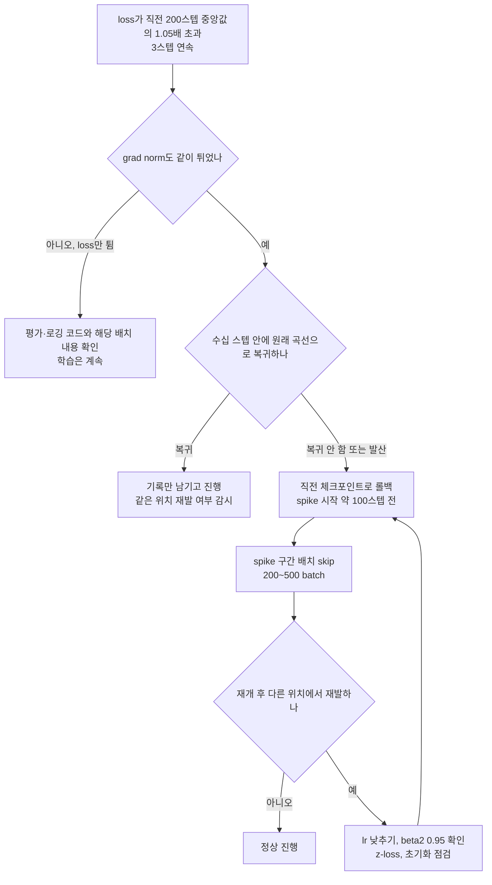

PaLM 학습 기록이 이 순서를 그대로 보여 준다. spike가 나면 spike 시작 약 100스텝 전 체크포인트에서 재개하고 이후 200~500개 배치를 건너뛰었고, 같은 배치 조합을 다시 넣으면 spike가 재현되지 않았다. 데이터와 모델 상태의 조합이 원인이었다는 뜻이다([PaLM 논문](https://arxiv.org/abs/2204.02311)). 코드와 자동 탐지는 3.10에 둔다.

### 3.2 Gradient Clipping

gradient의 global norm이 threshold를 넘으면 스케일을 줄여서 적용한다.

```python
# 실제 학습 루프에서
loss.backward()
norm = torch.nn.utils.clip_grad_norm_(model.parameters(), max_norm=1.0)
optimizer.step()
```

`max_norm=1.0`이 표준값이다. GPT-2, GPT-3 논문 모두 1.0을 쓴다. norm이 1.0을 초과하면 모든 gradient를 비율로 축소한다. 이 값을 너무 작게 설정하면 학습이 너무 느려지고, 너무 크면 clipping의 효과가 없어진다.

실제 norm 값을 로깅해두면 학습 안정성 진단에 쓸 수 있다. norm이 갑자기 10배 이상 뛰었다면 그 배치가 문제다.

```python
# norm을 로깅
if step % 100 == 0:
    writer.add_scalar('grad_norm', norm.item(), step)
```

### 3.3 Learning Rate Schedule

Karpathy는 GPT-2 재현에서 cosine decay with warmup을 썼다.

```python
def get_lr(step: int, warmup_steps: int, max_steps: int, max_lr: float, min_lr: float) -> float:
    # 1. Linear warmup
    if step < warmup_steps:
        return max_lr * (step + 1) / warmup_steps

    # 2. Min lr 이하로 떨어지지 않도록
    if step > max_steps:
        return min_lr

    # 3. Cosine decay
    decay_ratio = (step - warmup_steps) / (max_steps - warmup_steps)
    coeff = 0.5 * (1.0 + math.cos(math.pi * decay_ratio))
    return min_lr + coeff * (max_lr - min_lr)
```

GPT-2 124M 재현 기준 파라미터:

| 파라미터 | 값 |
|---------|---|
| max_lr | 6e-4 |
| min_lr | max_lr * 0.1 |
| warmup_steps | 715 (약 10%) |
| max_steps | 19073 |

warmup이 필요한 이유는 초반에 파라미터가 랜덤 초기화 상태라서 큰 lr을 바로 적용하면 학습 방향이 불안정하기 때문이다. 10~20%를 warmup에 쓰는 게 일반적이다.

### 3.4 Mixed Precision (BF16)

FP32로 학습하면 메모리가 두 배 이상 든다. A100/H100에서는 BF16이 사실상 표준이다.

```python
# PyTorch autocast 사용
with torch.autocast(device_type='cuda', dtype=torch.bfloat16):
    logits, loss = model(x, y)
```

BF16은 FP16과 달리 FP32와 같은 지수 범위를 가져서 overflow가 거의 없다. 다만 V100 이전 GPU에서는 BF16이 지원되지 않는다. T4(AWS g4dn 인스턴스)에서는 FP16을 써야 하는데, 이 경우 GradScaler가 필요하다.

```python
# FP16이면 GradScaler 필요
scaler = torch.cuda.amp.GradScaler()
with torch.autocast(device_type='cuda', dtype=torch.float16):
    loss = model(x, y)
scaler.scale(loss).backward()
scaler.step(optimizer)
scaler.update()
```

BF16 환경에서 loss가 nan으로 가면 대부분 loss scale 문제다.

### 3.5 Gradient Accumulation

배치 크기를 늘리고 싶은데 GPU 메모리가 부족할 때 쓴다. 여러 mini-batch의 gradient를 누적해서 한 번에 업데이트한다.

```python
grad_accum_steps = 8
optimizer.zero_grad()

for micro_step in range(grad_accum_steps):
    x, y = get_batch()
    with torch.autocast(device_type='cuda', dtype=torch.bfloat16):
        logits, loss = model(x, y)
    loss = loss / grad_accum_steps  # 평균 낼 때 나누기
    loss.backward()

clip_grad_norm_(model.parameters(), 1.0)
optimizer.step()
```

Karpathy가 강조한 주의사항: `loss / grad_accum_steps` 나누는 걸 빠뜨리면 gradient가 accumulation 횟수만큼 커져서 학습이 불안정해진다.

아래 흐름에서 나누기가 `backward` 앞에 들어가는 위치와, clip과 `optimizer.step()`이 루프 밖에서 한 번만 실행되는 점을 본다.

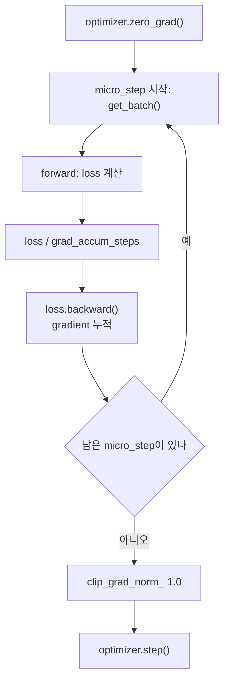

### 3.6 AdamW 하이퍼파라미터

PyTorch의 AdamW 기본값은 `betas=(0.9, 0.999)`인데 LLM 사전학습은 거의 `beta2=0.95`를 쓴다. GPT-3 논문과 LLaMA 계열이 모두 이 값이고, weight decay 0.1, grad clip 1.0이 같이 따라온다.

| 항목 | PyTorch 기본 | 사전학습에서 흔한 값 |
|---|---|---|
| beta1 | 0.9 | 0.9 |
| beta2 | 0.999 | 0.95 |
| weight decay | 0.01 | 0.1, 2차원 이상 파라미터만 |
| eps | 1e-8 | 1e-8 |
| grad clip | 없음 | 1.0 |

beta2가 작아야 하는 이유는 두 번째 moment `v`가 얼마나 긴 구간의 평균인지에 있다. beta2=0.999면 `v`는 최근 약 1000스텝의 평균이라 한동안 안정적이던 gradient가 갑자기 커져도 `v`가 따라오지 못하고, 업데이트 크기 `m / sqrt(v)`가 커진다. beta2=0.95면 약 20스텝 안에 `v`가 따라온다. 순수 Python으로 gradient가 평소의 10배로 커졌을 때 첫 3000스텝 안정 구간 뒤 업데이트 크기(평소 1.0)의 최댓값을 쟀다.

| gradient 10배 지속 | beta2=0.999 | beta2=0.95 |
|---|---|---|
| 1스텝 | 1.81 | 0.78 |
| 10스텝 | 4.81 | 1.08 |
| 50스텝 | 5.12 | 1.11 |

0.999에서는 한 스텝 업데이트가 평소의 5배까지 커지고, 0.95에서는 1.1배에서 멈춘다. 장난감 시뮬레이션이라 절대값은 모델마다 다르지만 방향은 같다. beta2를 낮추면 `v`가 노이즈를 더 타서 학습 후반 수렴이 약간 거칠어질 수 있으므로, 안정성을 얻는 대신 그 비용을 낸다고 보는 게 맞다.

weight decay는 2차원 이상 파라미터에만 건다. 임베딩 행렬은 2차원이라 걸리지만, bias와 LayerNorm 가중치는 1차원이라 제외한다. 이 둘에 decay를 걸면 정규화 스케일이 0으로 끌려간다.

```python
decay = [p for n, p in m.named_parameters() if p.dim() >= 2]
nodecay = [p for n, p in m.named_parameters() if p.dim() < 2]
opt = torch.optim.AdamW(
    [{"params": decay, "weight_decay": 0.1}, {"params": nodecay, "weight_decay": 0.0}],
    lr=6e-4, betas=(0.9, 0.95), eps=1e-8)
```

Embedding(100x16), LayerNorm(16), Linear(16x16)로 이뤄진 작은 모델에서 decay 대상은 1856개, 제외 대상은 48개로 나뉘었다.

### 3.7 초기화와 z-loss

초기화는 `std=0.02` 정규분포가 기본이다. 층이 깊으면 잔차 경로에 서브레이어 출력이 계속 더해지는데, 이때 출력 투영(attention의 proj, MLP의 마지막 선형층)의 가중치를 `1/sqrt(2 * n_layer)`로 줄여 둔다. GPT-2와 nanoGPT가 이 방식이다. 서브레이어 출력 분산을 1로 가정한 장난감 시뮬레이션(d=256)에서 최종 잔차 표준편차를 쟀다.

| 층 수 | 스케일 없음 | 1/sqrt(2L) 적용 |
|---|---|---|
| 12 | 1.858 | 1.049 |
| 48 | 3.292 | 1.048 |
| 96 | 4.546 | 1.050 |

스케일이 없으면 층이 깊을수록 잔차 분산이 커지고, 적용하면 층 수와 상관없이 1 근처다. 실제 서브레이어 출력 분산은 1이 아니므로 이 수치를 그대로 믿지 말고, 새 구조를 만들 때는 층별 활성값 표준편차를 첫 스텝에 찍어 확인한다.

z-loss는 출력 logit이 위로 떠 버리는 현상을 막는 보조 손실이다. softmax는 모든 logit에 같은 상수를 더해도 결과가 같아서 cross-entropy만으로는 logit 크기를 누르는 힘이 없다. logit이 계속 커지면 BF16에서 정밀도를 잃고 spike의 원인이 된다. PaLM이 `1e-4 * log(Z)^2`를 손실에 더해 썼다.

```python
def loss_with_zloss(logits, targets, z_coef=1e-4):
    ce = F.cross_entropy(logits.view(-1, logits.size(-1)), targets.view(-1))
    z = torch.logsumexp(logits, dim=-1)
    return ce + z_coef * (z ** 2).mean(), ce, z.mean()
```

vocab 100, 시퀀스 16인 무작위 logit에서 cross-entropy는 8.8240이고 z-loss 항은 0.0277이었다. 모든 logit에 5를 더하면 cross-entropy는 8.8240으로 그대로인데 z-loss 항은 0.0468로 올라간다. 계수가 1e-4로 작아서 평소 학습 신호는 거의 안 건드리고, logit이 폭주할 때만 힘을 쓴다.

### 3.8 WSD 스케줄과 후반 annealing

cosine은 총 스텝 수를 미리 정해야 한다. 학습 도중 "토큰을 더 먹이자"고 총 스텝을 늘리면 이미 지나온 구간의 lr 곡선이 달라진다. WSD(Warmup-Stable-Decay)는 warmup 뒤 lr을 최대값으로 유지하다가 마지막 10% 정도에서만 감쇠시킨다([MiniCPM 논문](https://arxiv.org/abs/2404.06395)).

```python
def wsd(step, total, warm, max_lr, min_lr, decay_frac=0.1):
    decay_start = int(total * (1 - decay_frac))
    if step < warm: return max_lr * (step + 1) / warm
    if step < decay_start: return max_lr
    r = (step - decay_start) / (total - decay_start)
    return max_lr + (min_lr - max_lr) * min(r, 1.0)   # 선형 감쇠
```

총 20000스텝, warmup 700, max_lr 6e-4, min_lr 6e-5로 돌린 값이다.

| step | cosine | wsd |
|---|---|---|
| 5000 | 5.37e-04 | 6.00e-04 |
| 10000 | 3.45e-04 | 6.00e-04 |
| 15000 | 1.45e-04 | 6.00e-04 |
| 18500 | 6.80e-05 | 4.65e-04 |
| 19999 | 6.00e-05 | 6.03e-05 |

총 스텝을 3만으로 바꾸면 step 15000에서 cosine은 3.40e-04로 바뀌지만 WSD는 6.00e-04 그대로다. Stable 구간의 체크포인트에서 짧게 decay만 붙여 분기하면 총 학습량을 정하지 않은 채 중간 평가용 모델을 만들 수 있다. 대신 최대 lr을 오래 유지하므로 spike가 나는 구간도 길어진다. 3.6과 3.7의 안정화 장치가 약하면 cosine보다 불리하다.

두 스케줄의 구조 차이는 Stable 구간에서 갈린다. cosine은 처음부터 총 스텝에 묶여 감쇠하고, WSD는 Stable 구간의 어느 체크포인트에서든 짧은 decay만 붙여 분기할 수 있다.

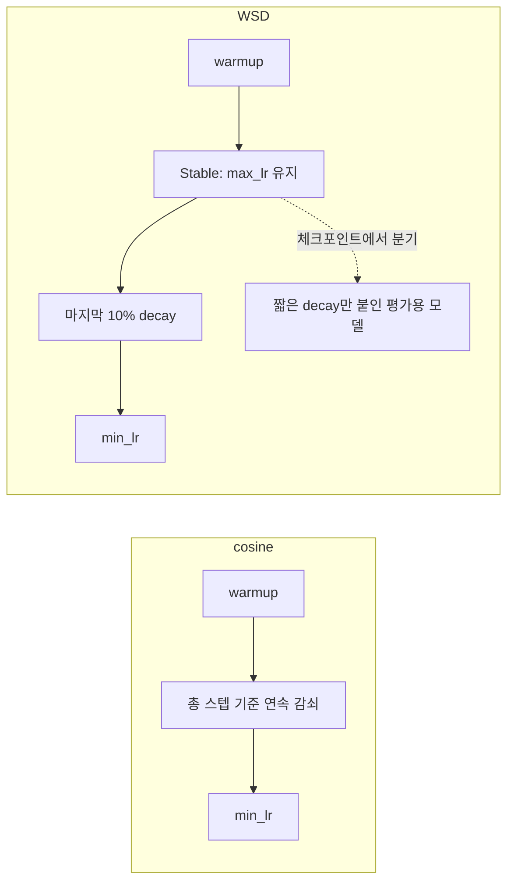

학습 후반 annealing은 lr을 0 근처로 내리면서 데이터 구성도 바꾸는 단계다. Llama 3는 마지막 약 4천만 토큰에서 lr을 선형으로 0까지 내리고, 이 구간에서 고품질 수학·코드 데이터 비중을 올렸으며 마지막 체크포인트들을 평균해 최종 모델을 만들었다([Llama 3 논문](https://arxiv.org/abs/2407.21783)). lr이 작아지는 구간이라 모델이 이 데이터에 민감하게 반응하고, 그래서 품질 좋은 데이터를 뒤로 미룬다. 이 단계에서 벤치마크 점수가 오르는 폭이 크므로 평가셋 오염이 가장 티 나는 곳도 여기다. 2.6의 오염 제거 인덱스를 annealing용 데이터에도 반드시 적용한다.

### 3.9 시퀀스 길이 curriculum과 장문 컨텍스트 확장

처음부터 긴 시퀀스로 학습하면 attention 비용이 크다. 7B 모델(L=32, h=4096) 기준으로 토큰당 연산량은 `6N + 12*L*h*s`로 근사하는데, causal 할인을 하지 않은 값으로 계산하면 이렇다.

| 시퀀스 길이 s | attention 항 | 6N 대비 | 토큰당 합계 |
|---|---|---|---|
| 4,096 | 6.4 GFLOP | 0.16배 | 46.9 GFLOP |
| 32,768 | 51.5 GFLOP | 1.27배 | 92.0 GFLOP |
| 131,072 | 206.2 GFLOP | 5.10배 | 246.6 GFLOP |

4K에서는 attention이 전체 연산의 14% 안팎인데 128K에서는 파라미터 연산의 5배가 된다. 그래서 대부분 긴 시퀀스를 학습 마지막에 짧게 한다. 시퀀스 길이를 점점 늘리는 curriculum은 초반 불안정도 줄여 주지만, 길이가 바뀔 때마다 `torch.compile`이 재컴파일되고 배치당 토큰 수를 유지하려면 배치 크기도 같이 바꿔야 한다.

장문 확장은 별도 단계로 한다. Llama 3는 8K 컨텍스트로 사전학습을 마친 뒤 6단계에 걸쳐 128K까지 늘렸고, 이 과정에 약 8천억 토큰을 썼으며 RoPE base 주파수를 500,000으로 올렸다. 한 단계가 끝나면 짧은 컨텍스트 성능이 유지되는지와 해당 길이의 needle 검색이 되는지를 둘 다 보고 다음 단계로 넘어갔다([Llama 3 논문](https://arxiv.org/abs/2407.21783)).

장문 단계에서 데이터를 잘못 쓰는 경우가 많다. 짧은 문서를 packing해서 128K 시퀀스로 채우면 문서 마스크 때문에 어차피 문서 간 attention이 막혀서 장문 능력이 생기지 않는다. 한 문서가 실제로 길어야 한다. 책, 긴 코드 저장소 단위 연결, 긴 논문 같은 데이터 비율을 이 단계 믹싱에서 따로 높인다. 128K 시퀀스는 단일 GPU 메모리에 안 들어가서 시퀀스 축을 쪼개는 context parallelism이 필요하다는 점도 8장의 병렬화 설계에 반영해야 한다.

### 3.10 Loss spike 자동 탐지와 복구 계획

사람이 loss 그래프를 보고 있다가는 늦는다. 직전 200스텝 중앙값 대비 비율로 탐지하는 코드가 이렇다. 노이즈 0.02, spike 폭 0.9인 합성 loss 곡선(step 900에서 spike 시작)에 돌렸더니 step 900에서 바로 탐지됐다.

```python
import statistics

def detect(loss, window=200, ratio=1.05, patience=3):
    hits = 0
    for s in range(window, len(loss)):
        med = statistics.median(loss[s-window:s])
        hits = hits + 1 if loss[s] > med * ratio else 0
        if hits >= patience:
            return s - patience + 1
    return None

def plan(spike_start, ckpt_interval=250, lookback=100, skip_n=300):
    target = spike_start - lookback
    resume = (target // ckpt_interval) * ckpt_interval
    return resume, (spike_start, skip_n)
```

`plan(900)`은 `(750, (900, 300))`을 돌려준다. step 750 체크포인트에서 재개하고, 배치 인덱스 900부터 300개를 건너뛴다는 뜻이다. `ratio=1.05`는 이 합성 곡선에서 맞춘 값이다. 실제 곡선에서는 학습 초반 하락 기울기가 가팔라서 중앙값보다 loss가 낮으니 오탐이 적지만, 평탄해진 후반에는 노이즈 폭에 맞춰 다시 정해야 한다. 탐지 결과로 학습을 자동 중단시키지는 말고 알림과 체크포인트 보존까지만 자동화한다. 중단과 롤백 결정은 3.1의 분기를 사람이 확인한 뒤 내리는 쪽이 안전하다.

자동화하는 범위와 사람이 판단하는 범위가 어디서 갈리는지, `plan()`이 재개 지점을 어떻게 고르는지를 아래에서 본다.

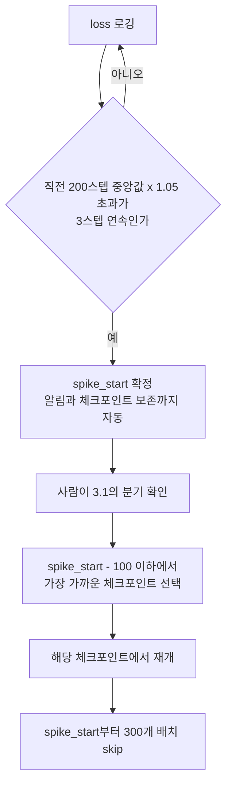

---

## 4. 체크포인트 관리

### 4.1 저장 주기

수십 시간짜리 학습이 마지막 10분에서 죽으면 전부 날린다. 체크포인트는 충분히 자주 저장해야 한다.

```python
checkpoint_interval = 1000  # 1000 스텝마다

if step % checkpoint_interval == 0:
    checkpoint = {
        'step': step,
        'model': model.state_dict(),
        'optimizer': optimizer.state_dict(),
        'config': model_config,
        'val_loss': val_loss,
    }
    torch.save(checkpoint, f'checkpoints/step_{step:06d}.pt')
```

optimizer state_dict를 같이 저장하지 않으면 재시작 후 학습 동작이 달라진다. Adam의 moment 추정값이 리셋되기 때문이다. 작은 선형 모델(AdamW, 20스텝 중 10스텝에서 중단)로 재어 보면 모델과 optimizer를 모두 복원한 경우 끊김 없이 돌린 결과와 파라미터 차이가 0.0이고, optimizer 상태만 빠뜨리면 최대 차이가 0.027이다. 작은 모델에서도 이 정도 벌어지니 대형 모델에서는 재개 직후 loss가 튀는 원인이 된다.

위 코드는 저장 중에 프로세스가 죽는 경우를 막지 못한다. `torch.save`가 파일을 쓰는 도중에 노드가 내려가면 절반만 쓰인 `step_020000.pt`가 남고, 재개 스크립트가 "가장 최신 파일"을 집어 들면 로드에서 터진다. 파일 절반을 잘라 만든 깨진 체크포인트는 `torch.load`에서 `RuntimeError`가 났다. 임시 이름으로 쓰고 fsync한 뒤 `os.replace`로 이름을 확정하면 완성된 파일만 최종 이름을 갖는다.

```python
def atomic_save(obj, path):
    tmp = path + ".tmp"
    with open(tmp, "wb") as f:
        torch.save(obj, f)
        f.flush(); os.fsync(f.fileno())
    os.replace(tmp, path)
```

저장 중 어느 시점에 죽어도 재개 스크립트가 보는 최종 이름의 파일은 완성본뿐이라는 점을 아래에서 확인한다.

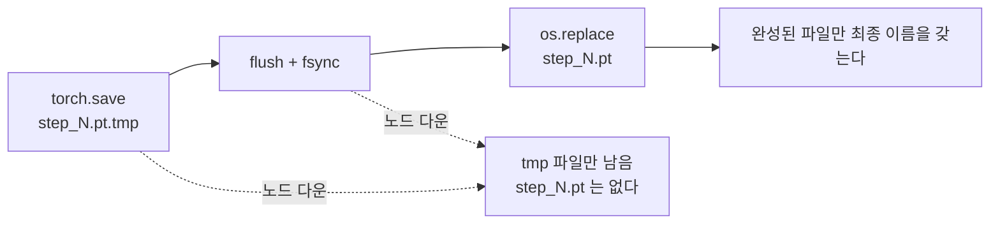

체크포인트에는 모델과 optimizer 외에 lr 스케줄러 상태, 데이터 로더 상태, 난수 상태(`torch`, `numpy`, `random`, CUDA)도 넣는다. 난수 상태가 빠지면 dropout 마스크가 달라져서 재개 후 결과가 비트 단위로 이어지지 않는다. 비트 단위 재현이 필수는 아니지만, 재개 전후 loss 곡선이 겹치는지로 복구가 맞았는지 검증하려면 있는 편이 훨씬 편하다.

### 4.2 체크포인트 선택

학습 중 val_loss가 가장 낮은 체크포인트가 항상 최종 사용 모델이 아니다. Val_loss는 사전학습 데이터의 품질과 분포에 따라 달라지기 때문에, 다운스트림 태스크(코드 생성, QA 등)에서 직접 평가해서 고르는 게 맞다.

저장 공간이 문제라면 최근 N개만 남기는 방식을 쓴다.

```python
import glob
checkpoints = sorted(glob.glob('checkpoints/step_*.pt'))
if len(checkpoints) > 5:
    for old in checkpoints[:-5]:
        os.remove(old)
```

최근 5개만 남기면 spike 복구에 문제가 생긴다. spike 시작 100스텝 전으로 되돌아가야 하는데 그 체크포인트가 이미 지워져 있을 수 있다. 3.1처럼 롤백이 필요한 상황은 spike가 난 직후에야 알게 되므로, 주기적으로 한두 개는 지우지 않고 장기 보존 목록으로 빼 둔다.

### 4.3 Resume

```python
resume_from = 'checkpoints/step_010000.pt'
checkpoint = torch.load(resume_from)

model.load_state_dict(checkpoint['model'])
optimizer.load_state_dict(checkpoint['optimizer'])
start_step = checkpoint['step']

# 데이터 로더 위치도 맞춰야 한다
# 이미 본 데이터를 다시 보면 학습에 영향을 준다
data_loader.skip(start_step * batch_size)
```

데이터 로더 위치를 맞추는 부분을 빠뜨리는 경우가 많다. skip을 안 하면 초반 데이터를 두 번 본다.

위 코드의 `start_step * batch_size`는 틀리기 쉬운 지점이다. 한 스텝이 소비하는 샘플 수는 `micro_batch * grad_accum * world_size`다. micro_batch 4, grad_accum 2, GPU 4장이면 global batch가 32이고 60스텝째 재개할 때 건너뛸 샘플은 1920개인데, `start_step * batch_size`에 micro_batch(4)를 넣으면 240개만 건너뛴다. 이러면 이미 본 데이터의 앞부분을 다시 읽는다.

더 안전한 방법은 `skip()`을 두지 않고, step만 알면 읽을 샘플이 계산되는 로더로 만드는 것이다. 시드와 에포크로 순열을 만들고 위치를 산술로 구한다. 이렇게 하면 재개가 "step을 맞추기"로 끝나고, 3.1의 spike 구간 skip도 같은 장치로 처리된다.

```python
import random

class DeterministicLoader:
    def __init__(self, n_samples, micro_bs, grad_accum, world, seed=1234, skip_ranges=()):
        self.n, self.mb, self.ga, self.world = n_samples, micro_bs, grad_accum, world
        self.seed = seed
        self.skip = sorted(skip_ranges)            # (시작 batch index, 개수)
        self.global_bs = micro_bs * grad_accum * world

    def _batch_index(self, step):
        idx = step
        for start, cnt in self.skip:
            if idx >= start:
                idx += cnt
        return idx

    def _sample_at(self, pos):
        epoch, off = divmod(pos, self.n)
        perm = list(range(self.n))
        random.Random(self.seed + epoch).shuffle(perm)
        return perm[off]

    def batch(self, step, rank):
        base = self._batch_index(step) * self.global_bs + rank * self.mb * self.ga
        return [self._sample_at(base + j) for j in range(self.mb * self.ga)]
```

n_samples 1000, GPU 4장(rank 4개)으로 100스텝을 끊김 없이 돌린 배치 목록과, 60스텝에서 죽었다가 `step=60`으로 새 로더를 만들어 재개한 배치 목록을 비교하면 완전히 같다. `skip_ranges=[(40, 5)]`를 주면 step 40의 배치가 원래 step 45의 배치와 같아지고 step 39까지는 변화가 없다. 샘플마다 순열을 새로 만드는 `_sample_at`은 예제를 짧게 하려고 비효율적으로 썼다. 실제로는 에포크별 순열을 캐시하거나 샤드 단위로 섞는다.

저장, 중단, 재개가 각 구성 요소에서 어떻게 이어지는지는 다음 순서도에서 본다. 상태를 저장하는 대상은 모델만이 아니고, 재개 때 optimizer와 로더 위치가 각자 따로 복원된다는 점에 주목한다.

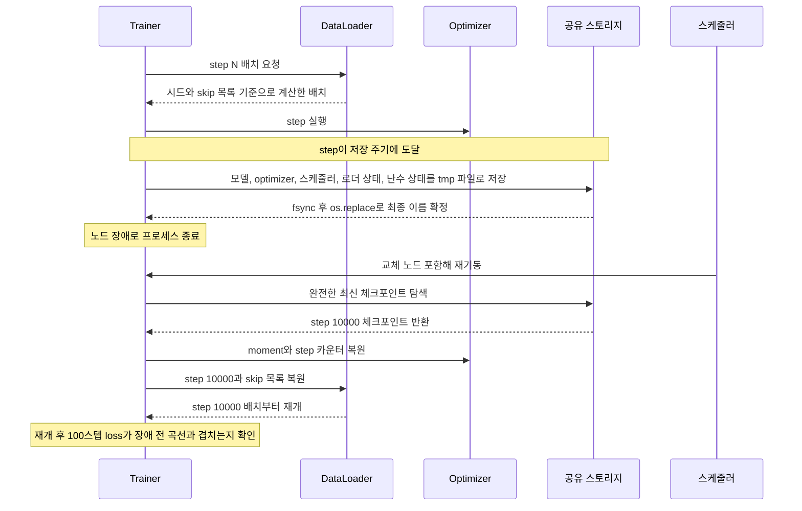

### 4.4 저장 주기 계산

"1000스텝마다"라는 숫자는 근거가 없다. 저장에 드는 시간 C와 평균 중단 간격 MTBF를 알면 Young의 근사식으로 주기를 구한다.

```python
import math
def young(ckpt_cost_s, mtbf_s):
    return math.sqrt(2 * ckpt_cost_s * mtbf_s)
```

저장이 너무 잦으면 저장 시간이 학습을 갉아먹고, 너무 드물면 장애 때 날리는 구간이 길다. 손실 비율은 `C/T + T/(2*MTBF)`로 근사한다. MTBF는 9장에서 Llama 3 보고서 수치로 GPU 1장 환산 약 50,677시간이 나오는데, GPU 수로 나눠 쓴다.

| GPU 수 | 저장 시간 | 최적 주기 | 저장+재작업 손실 |
|---|---|---|---|
| 1,024 | 30초 | 54.5분 | 1.8% |
| 1,024 | 120초 | 109.0분 | 3.7% |
| 1,024 | 600초 | 243.7분 | 8.2% |
| 16,384 | 30초 | 13.6분 | 7.3% |
| 16,384 | 120초 | 27.2분 | 14.7% |
| 16,384 | 600초 | 60.9분 | 32.8% |

GPU가 많아지면 같은 저장 시간이라도 손실이 크게 올라가고, 저장이 10분 걸리면 16K GPU에서는 시간의 3분의 1이 저장과 재작업에 쓰인다. 그래서 대형 학습은 체크포인트를 GPU에서 호스트 메모리로 먼저 복사하고 백그라운드에서 디스크로 내려 학습을 막는 시간을 줄이는 비동기 저장을 쓴다. 저장이 학습을 막는 시간 C를 줄이는 것이 주기를 늘리는 것보다 이득이 크다.

---

## 5. Karpathy가 GPT-2 재현하면서 밝힌 실전 사항

### 5.1 Flash Attention

Karpathy는 nanoGPT에서 PyTorch의 `scaled_dot_product_attention`을 쓰면 Flash Attention이 자동으로 적용된다는 걸 보여줬다.

```python
# 이걸 쓰면
y = torch.nn.functional.scaled_dot_product_attention(
    q, k, v,
    attn_mask=None,
    dropout_p=self.dropout if self.training else 0,
    is_causal=True  # causal mask 자동 처리
)

# 이렇게 직접 구현하는 것보다 메모리를 훨씬 덜 쓰고 빠르다
att = (q @ k.transpose(-2, -1)) * (1.0 / math.sqrt(k.size(-1)))
att = att.masked_fill(self.bias[:,:,:T,:T] == 0, float('-inf'))
att = F.softmax(att, dim=-1)
y = att @ v
```

attention 행렬을 메모리에 올리지 않고 재계산하는 방식이라서, 시퀀스 길이가 길수록 메모리 절약 효과가 커진다. 4096 이상 컨텍스트에서는 사실상 필수다. 8.1에서 활성값 메모리를 계산하면 7B 모델의 시퀀스 8192에서 일반 attention은 380GB, flash는 36.5GB다.

### 5.2 컴파일

PyTorch 2.0의 `torch.compile`은 첫 번째 포워드 패스에서 CUDA kernel fusion을 적용한다. Karpathy 측정 기준으로 A100에서 약 30% 속도 향상이 있었다.

```python
model = torch.compile(model)
```

첫 배치에서 컴파일 때문에 1~2분 걸린다. 그 이후부터 빨라진다. 컴파일 후 디버깅이 어려워지는 단점이 있어서, 모델 구조 확정 전까지는 꺼두는 게 낫다.

### 5.3 HellaSwag로 학습 진행 확인

Karpathy는 val_loss 외에 HellaSwag 정확도를 100 스텝마다 측정했다. HellaSwag는 4지선다형 상식 추론 문제 데이터셋으로, 추가 fine-tuning 없이 base model의 능력을 간단히 측정하는 데 쓴다.

val_loss가 내려가는데 HellaSwag 정확도가 안 올라가면 뭔가 문제가 있다는 신호다. loss는 토큰 단위 예측 지표이고, 실제 언어 이해 능력은 다운스트림 태스크에서만 보인다.

### 5.4 작은 것부터 검증하는 습관

Karpathy가 강조한 원칙: 전체 학습을 돌리기 전에 과적합 테스트를 먼저 한다. 배치 하나(32개 시퀀스)에 1000 스텝을 돌려서 loss가 0에 가깝게 떨어지는지 확인한다. 이게 안 되면 모델 구현이나 학습 루프에 버그가 있다는 뜻이다.

```python
# 과적합 테스트
for step in range(1000):
    x, y = fixed_batch  # 같은 배치만 반복
    logits, loss = model(x, y)
    loss.backward()
    optimizer.step()
    optimizer.zero_grad()
    if step % 100 == 0:
        print(f"step {step}: loss={loss.item():.4f}")

# loss가 0.01 이하로 떨어져야 정상
```

---

## 6. SFT와 RLHF 전환점

### 6.1 Base Model이 왜 직접 사용이 안 되는가

사전학습을 마친 모델은 "언어 패턴을 아는 상태"다. 질문을 받아도 대화 형식으로 응답하는 법을 모른다. 인터넷 텍스트에는 질문-답변 패턴보다 기사, 소설, 토론 텍스트가 훨씬 많아서, 모델이 "질문에는 답변이 따른다"는 걸 충분히 학습하지 못했다.

직접 테스트해보면 체감된다. GPT-2 base를 그대로 쓰면 "수도는 어디입니까?" 뒤에 "수도는 어디입니까? 국토부 관계자는..."처럼 기사체로 이어진다.

### 6.2 SFT가 행동을 바꾸는 방식

SFT는 데이터 양이 적어도 된다. InstructGPT 논문 기준으로 13K 정도의 (질문, 답변) 쌍이면 행동 패턴이 바뀐다. 단, 이 답변은 사람이 작성한 고품질 답변이어야 한다. 저품질 데이터로 SFT하면 base model보다 나빠질 수 있다.

SFT의 한계는 "좋은 답변과 나쁜 답변을 구분하는 능력"이 없다는 것이다. 그냥 주어진 답변 형식을 학습하는 것이지, "더 정확한 답변"을 추구하도록 만들지는 못한다.

### 6.3 RLHF와 DPO의 선택 기준

RLHF는 보상 모델을 별도로 학습시켜야 한다. 구현 복잡도가 높고, 보상 해킹(reward hacking) 문제가 생긴다. 보상 모델이 실제 품질이 아닌 형식적 특성(길이, 특정 단어 빈도)을 과도하게 반영하면 모델이 그걸 최대화하는 방향으로 가버린다.

DPO는 RLHF를 대체하기 위해 나왔다. (질문, 선호 답변, 비선호 답변) 형태의 데이터만 있으면 보상 모델 없이 직접 학습이 된다. 2024년 기준 공개 모델 대부분이 DPO 또는 그 변형(SimPO, ORPO)을 쓴다.

실무에서 선택 기준: 데이터가 충분하고 보상 모델 학습 인프라가 있으면 RLHF, 그게 아니라면 DPO가 현실적이다.

사전학습에서 정렬까지의 흐름과 마지막 분기 조건을 한 번에 보면 이렇다.

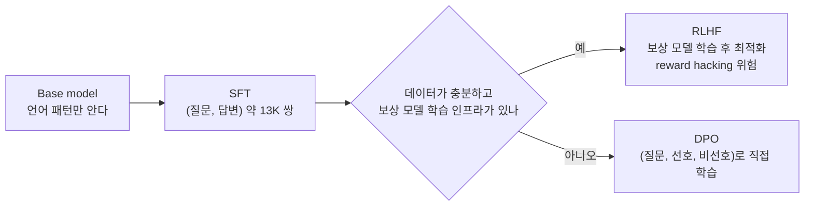

---

## 7. 규모별 실제 소요 자원

소규모 팀이 직접 사전학습을 한다면 GPT-2 수준(124M)이 현실적인 상한이다. 그 이상은 클라우드 비용이 급격히 올라간다.

| 모델 규모 | 토큰 수 | GPU (A100 기준) | 소요 시간 | 비용 (대략) |
|---------|---------|---------------|---------|-----------|
| GPT-2 124M | 10B | A100 1장 | 약 17시간 | $20~33 |
| GPT-2 124M | 100B | A100 8장 | 약 21시간 | $200~330 |
| GPT-3 수준 (175B) | 300B | A100 1024장 | 약 1개월 | $85만~140만 |

이 표는 `6 * 파라미터 * 토큰 / (GPU 수 * 312 TFLOPs * MFU)`에 MFU 40%, A100 시간당 $1.2~2를 넣어 계산한 값이다. A100 1장 4시간이라고 적는 자료도 있지만 FLOP 계산과는 4배 어긋난다. 124M 모델에 10B 토큰이면 총 연산량이 약 7.4e18 FLOP이고, A100 1장이 MFU 40%에서 내는 약 1.25e14 FLOPs/s로 나누면 16.6시간이다. 175B 행도 계산에서는 684.7시간(28.5일), 70만 GPU 시간이 나온다. 장애와 재시작을 넣으면 실제 일정은 이보다 길어진다.

Karpathy가 GPT-2 124M을 재현한 조건을 옮길 때 GPU 종류를 확인해야 한다. 같은 10B 토큰이라도 A100 8장에서 MFU 40%면 2.1시간, MFU 50%면 1.7시간이고, H100 8장에서 MFU 40%면 약 39분이다. "8장으로 1시간 남짓"이라는 말은 H100급 장비나 높은 MFU를 전제로 한 값이라 A100 기준으로 옮겨 쓰면 틀린다. OpenAI가 원래 GPT-2를 학습시킬 때는 TPU v3를 사용했고, 그 비용을 A100 기준으로 환산하면 약 $40,000 수준으로 추산된다.

직접 사전학습 대신 base model을 가져와서 fine-tuning하는 게 현실적인 이유가 여기에 있다. LoRA나 QLoRA로 7B 모델을 도메인 특화 데이터로 fine-tuning하는 비용은 A100 1장 기준 수 시간 이내다.

---

## 8. 분산 학습 병렬화

7B 모델은 GPU 1장에 안 들어간다. 파라미터는 14GB(BF16)인데 optimizer 상태까지 합치면 112GB다. 병렬화는 "무엇을 어느 GPU에 나눠 놓고, 그 대가로 어떤 통신을 감수할 것인가"를 정하는 일이다. 계산은 전부 `/tmp`에서 순수 Python으로 돌려 확인했고, 실제 GPU 클러스터 수치는 공개 논문 값을 따로 표시했다.

이 절은 개요다. FSDP 코드 실행, 파이프라인 bubble 계산, OOM 원인 분류, 샤드 체크포인트의 resharding까지 풀어 쓴 내용은 [LLM 분산 학습](Distributed_Training.md)에 따로 있다.

### 8.1 메모리 계산

혼합 정밀도 Adam 학습에서 파라미터 하나당 드는 바이트는 BF16 가중치 2, BF16 gradient 2, FP32 master 가중치 4, FP32 moment 두 개 8로 합이 16이다. [ZeRO 논문](https://arxiv.org/abs/1910.02054)이 쓰는 분해와 같다. `torch.autocast`로 FP32 가중치를 들고 가는 구성도 4+4+8로 합이 16이라 결과는 같다.

| 모델 | 상태 메모리(16 bytes x 파라미터) |
|---|---|
| 7B | 112 GB |
| 70B | 1,120 GB |
| 405B | 6,480 GB |

80GB GPU 1장에 들어가는 건 파라미터 약 5B까지다. 활성값은 여기에 더해진다. [Korthikanti et al.](https://arxiv.org/abs/2205.05198)의 근사로 재계산 없이 레이어 하나의 활성값은 `s*b*h*(34 + 5*a*s/h)` 바이트다. 괄호 안의 두 번째 항이 attention 행렬이고 flash attention은 이 항을 없앤다. 7B(L=32, h=4096, a=32), micro-batch 1에서 계산한 활성값이다.

| 시퀀스 길이 | 일반 attention | flash attention |
|---|---|---|
| 2,048 | 30.6 GB | 9.1 GB |
| 4,096 | 104.2 GB | 18.3 GB |
| 8,192 | 380.1 GB | 36.5 GB |

시퀀스가 2배가 되면 일반 attention은 약 3.6배로 커지고 flash는 정확히 2배다. 장문 학습에서 활성값 재계산(activation checkpointing)을 켜는 이유가 여기 있다. 재계산은 활성값을 줄이는 대신 순전파를 한 번 더 돌려 연산이 늘고, 그래서 8.7에서 말하는 MFU와 HFU가 갈린다.

### 8.2 DP, FSDP, ZeRO

데이터 병렬(DP)은 모델 전체를 GPU마다 복제하고 배치만 나눈다. 메모리 절약이 없다. ZeRO는 복제되는 상태를 DP 그룹에 나눠 쪼갠다. 70B, DP=64일 때 GPU당 상태 메모리다.

| 방식 | 나누는 것 | GPU당 상태 메모리 |
|---|---|---|
| DDP | 없음 | 1,120.0 GB |
| ZeRO-1 | optimizer 상태 | 293.1 GB |
| ZeRO-2 | + gradient | 155.3 GB |
| ZeRO-3, FSDP | + 파라미터 | 17.5 GB |

ZeRO-3(PyTorch의 FSDP)는 상태 메모리를 DP 수로 나눠 17.5GB까지 내리지만 파라미터를 쓸 때마다 all-gather가 필요하다. 7B 모델, GPU 64장에서 GPU당 한 스텝 통신량을 계산하면 DDP는 gradient all-reduce 한 번에 약 27.6GB이고, FSDP는 순전파 all-gather, 역전파 all-gather, gradient reduce-scatter 세 번이라 41.3GB로 정확히 1.5배다. 노드 간 유효 대역폭 50GB/s를 가정하면 DDP 통신은 0.55초, FSDP는 0.83초다.

한 스텝에서 DDP와 FSDP가 각각 어디서 통신하는지를 나란히 놓으면 횟수 차이가 보인다.

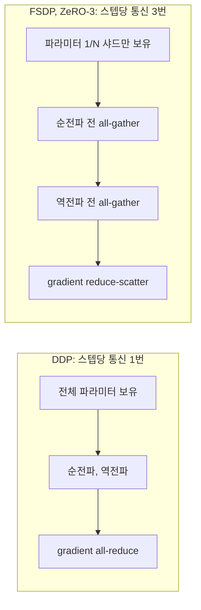

중요한 건 이 통신이 연산 시간에 얼마나 가려지느냐다. FSDP 통신량은 배치 크기와 무관하게 파라미터 크기로 정해지고, 연산 시간은 GPU당 처리 토큰 수에 비례한다. H100(989 TFLOPs, MFU 40%), GPU 64장, 대역폭 50GB/s 가정의 비율이다.

| 모델 | GPU당 토큰/step | 통신 | 연산 | 통신/연산 |
|---|---|---|---|---|
| 7B | 4,096 | 0.83초 | 0.43초 | 1.90 |
| 7B | 16,384 | 0.83초 | 1.74초 | 0.48 |
| 7B | 65,536 | 0.83초 | 6.96초 | 0.12 |
| 70B | 4,096 | 8.27초 | 4.35초 | 1.90 |
| 70B | 65,536 | 8.27초 | 69.58초 | 0.12 |

통신/연산이 1을 넘으면 통신이 노출되어 MFU가 떨어진다. 모델 크기와 상관없이 비율이 같은 이유는 통신과 연산이 둘 다 파라미터 수에 비례하기 때문이다. 결국 GPU당 토큰 수가 비율을 정한다. 그리고 gradient accumulation이 함정이다. FSDP는 micro-batch마다 all-gather를 다시 하므로, 70B에서 같은 65,536토큰을 micro-batch 16,384 x accum 4로 나누면 통신이 8.3초에서 33.1초로 4배가 되고 연산은 69.6초 그대로다. accum을 올려 메모리를 아끼면 통신 비용으로 돌아온다.

노드 안은 NVLink로 빠르고 노드 사이는 느리다. FSDP 샤딩 그룹을 노드 안으로 제한하고 노드 사이에는 복제하는 HSDP(hybrid sharded data parallel)가 이 격차를 이용하는 방식이다. 샤딩 그룹이 작아지면 GPU당 메모리가 늘어나므로 8.1 표로 먼저 계산해 본다.

### 8.3 Tensor Parallel

TP는 레이어 안의 행렬을 GPU들에 쪼갠다. Megatron-LM 방식에서는 트랜스포머 레이어 하나마다 순전파 all-reduce 2번, 역전파 2번이 생긴다. h=8192, s=4096, micro-batch 1(BF16)에서 all-reduce 한 번은 67MB, 레이어당 268MB이고 80층을 거치면 micro-batch 하나에 21.5GB가 오간다. 이 통신은 연산 중간에 끼어 있어서 가릴 여지가 작다. NVLink 같은 노드 내 고속 링크에서만 쓴다. TP 그룹이 노드 경계를 넘으면 이 21.5GB가 IB를 타고 MFU가 급락하는 경우가 많다.

TP 크기는 attention head 수의 약수여야 한다. GQA를 쓰면 KV head 수가 8일 때 TP를 16으로 잡으면 KV head를 복제해야 하는 곤란이 생긴다. 그래서 TP는 노드당 GPU 수(보통 8) 이하로 두는 것이 상례다.

### 8.4 Pipeline Parallel

PP는 레이어를 연속된 구간(stage)으로 나눠 GPU 그룹에 배치한다. 통신은 stage 경계의 활성값 하나뿐이라 TP보다 훨씬 적어서 노드 사이에 둘 수 있다. 대가는 pipeline bubble이다. 1F1B 스케줄에서 stage 수 p, micro-batch 수 m이면 놀고 있는 시간 비율이 `(p-1)/m`이다.

| p | m | bubble | interleave v=2 |
|---|---|---|---|
| 4 | 8 | 37.5% | 18.8% |
| 4 | 16 | 18.8% | 9.4% |
| 4 | 64 | 4.7% | 2.3% |
| 8 | 16 | 43.8% | 21.9% |

m이 p보다 한참 커야 bubble이 줄어든다. global batch를 고정하면 m을 늘리는 건 micro-batch를 줄이는 것이라 GPU 효율이 떨어지는 반대 압력이 있다. PP stage마다 레이어 수를 균등하게 나누면 첫 stage에는 임베딩, 마지막 stage에는 LM head와 loss가 붙어서 메모리와 시간이 쏠린다. 첫 stage와 마지막 stage의 레이어를 한두 개 줄여 맞춘다.

### 8.5 3D parallelism과 GPU 노드 매핑

TP, PP, DP를 곱한 것이 3D parallelism이다. 70B를 TP=8, PP=4, DP=2로 놓으면 64장이 필요하고, GPU당 파라미터는 `70B / (8*4) = 2.19B`다. ZeRO-1로 DP=2에 optimizer를 나누면 가중치와 gradient 8.8GB, optimizer 13.1GB로 상태 메모리가 약 22GB다. 활성값은 여기 별도다.

랭크를 노드에 배치하는 원칙은 통신이 많은 축을 가까운 곳에 두는 것이다. TP가 가장 안쪽, 즉 같은 노드의 8장이고, PP는 노드 사이, DP가 그 바깥이다. 64장에서 rank를 `(tp, pp, dp)` 좌표로 바꾸는 함수와 결과다.

```python
def layout(world, tp, pp, order=("tp", "pp", "dp")):
    dp = world // (tp * pp)
    size = {"tp": tp, "pp": pp, "dp": dp}
    out = {}
    for r in range(world):
        rem, coord = r, {}
        for ax in order:                      # order[0]이 가장 빨리 변한다(= 같은 노드)
            coord[ax] = rem % size[ax]; rem //= size[ax]
        out[r] = coord
    return out
```

rank 0~7(node 0)은 전부 `pp=0, dp=0`이고 `tp`만 0~7로 달라서 TP 그룹이 한 노드에 모인다. rank 8은 node 1에서 `pp=1`, rank 24는 node 3에서 `pp=3`, rank 32는 node 4에서 `dp=1`이다. 이 순서에서 PP 인접 stage가 인접 노드에, DP replica가 4노드씩 떨어져 놓인다. 축 순서는 프레임워크마다 다르고 토폴로지(랙, 스위치 계층)에 따라 바꿔야 할 수 있다.

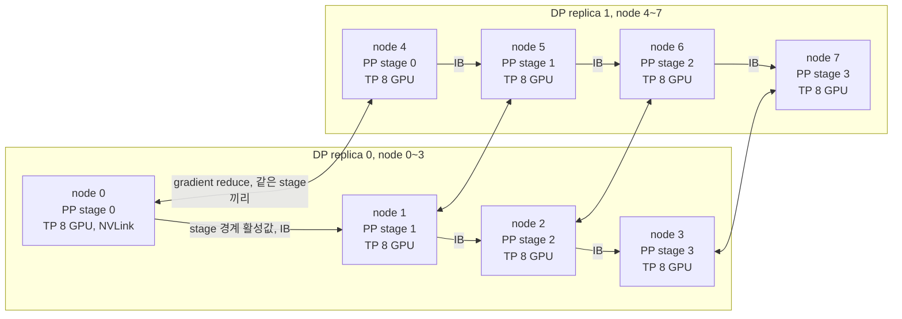

노드 안에서는 TP all-reduce가 NVLink를 타고, 노드 사이에는 PP의 활성값 전달(세로 방향)과 DP의 gradient 동기화(replica 사이)가 IB를 탄다. DP 동기화는 같은 stage끼리만 일어나므로 replica 전체가 아니라 stage별 작은 그룹에서 돈다.

### 8.6 병렬화 선택 기준

처음부터 3D로 가지 않는다. 필요한 만큼만 쌓는다.

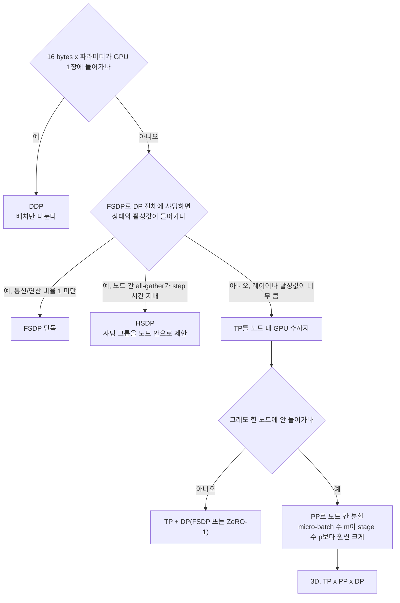

규모별 실무 기준은 이렇다. 7B 이하는 FSDP 단독이면 된다. 상태 112GB를 64장에 나누면 GPU당 2GB 미만이다. 70B는 FSDP로도 메모리가 들어가지만(17.5GB), GPU당 토큰 수가 작으면 통신이 노출되어 TP를 노드 안에 얹는다. 400B급 이상은 상태만 6.5TB라 TP와 PP를 같이 쓴다. 팀 인프라가 FSDP 위주라면 TP+PP 코드를 새로 붙이는 비용이 크므로, GPU당 토큰 수를 키우거나 HSDP를 쓰는 방향을 먼저 검토한다.

### 8.7 통신 병목과 MFU

MFU(Model FLOPs Utilization)는 모델이 실제로 필요로 하는 연산량을 하드웨어 이론 최대치로 나눈 값이다. 순전파와 역전파를 합쳐 토큰당 `6N` FLOP로 근사한다.

```python
def mfu(params, tok_per_s_per_gpu, peak_tflops):
    return 6 * params * tok_per_s_per_gpu / (peak_tflops * 1e12)
```

학습 로그에서 GPU당 tokens/s만 찍어 두면 계산된다. MFU 40%일 때 GPU 1장의 처리량은 이렇다.

| 모델 | A100(312 TFLOPs) | H100(989 TFLOPs) |
|---|---|---|
| 124M | 167,742 tok/s | 531,720 tok/s |
| 7B | 3,086 tok/s | 9,782 tok/s |
| 70B | 297 tok/s | 942 tok/s |

공개 수치를 보면 대규모 학습의 MFU는 30~50%대에 몰려 있다.

| 학습 | MFU | 출처 |
|---|---|---|
| PaLM 540B, TPU v4 6144칩 | 46.2% (HFU 57.8%) | [PaLM 논문](https://arxiv.org/abs/2204.02311) |
| Megatron-LM 1T 파라미터, A100 3072장 | 이론 피크의 52% | [Megatron-LM 논문](https://arxiv.org/abs/2104.04473) |
| Llama 3 405B, H100 8K~16K장 | 38~43% | [Llama 3 논문](https://arxiv.org/abs/2407.21783) |
| Llama 2 7B/13B/70B, A100 | 39.1%, 37.7%, 42.9% (GPU 시간으로 역산) | [Llama 2 논문](https://arxiv.org/abs/2307.09288) |

Llama 2 행은 논문에 적힌 GPU 시간(7B 184,320, 13B 368,640, 70B 1,720,320 시간)과 학습 토큰 2.0T로 GPU당 tokens/s를 구한 뒤 위 `mfu` 함수에 넣은 값이다. 논문이 MFU를 직접 적은 것은 아니므로 참고치로 본다. 50%를 넘기면 매우 잘한 것이고, 30% 아래면 어딘가 병목이 있다.

MFU와 HFU(Hardware FLOPs Utilization)는 다르다. 활성값 재계산을 켜면 순전파를 한 번 더 돌리는데, HFU는 이 연산을 세고 MFU는 세지 않는다. PaLM의 46.2%와 57.8% 차이가 그 때문이다. 재계산을 켜고 "HFU 55%"라고 보고하면 모델이 실제로 한 일은 그보다 적다.

MFU가 기대보다 낮을 때는 원인을 하나씩 가른다. 첫째, 데이터 로더가 GPU를 기다리는지 본다. 스텝마다 GPU util이 주기적으로 0으로 떨어지면 로더 병목이다. 둘째, micro-batch가 너무 작아 커널이 GPU를 못 채우는지 본다. 셋째, 통신이 연산 뒤에 가려지지 않고 노출되는지 프로파일러로 본다. 8.2의 통신/연산 비율이 1에 가까우면 거기가 원인이다. 넷째, 느린 GPU 한 장(straggler)이 있는지 본다. 열 스로틀링이나 불량 NIC로 한 장만 느려도 모든 rank가 그 장을 기다려 전체 처리량이 떨어진다.

---

## 9. 수주 단위 학습의 장애와 복구

며칠짜리 학습은 장애 없이 끝나기도 한다. 수주 단위, 수천 GPU 학습에서는 장애가 일상이다. 장애는 전제로 놓고 얼마나 빨리 이어 붙이는가를 설계해야 한다.

### 9.1 장애 빈도

Llama 3 보고서는 16,384개 H100으로 54일간 돌린 구간에서 예상치 못한 중단이 419번이었고 그중 약 78%가 하드웨어 문제로 확인되거나 의심됐다고 밝혔다. GPU 관련이 가장 많았다([Llama 3 논문](https://arxiv.org/abs/2407.21783)). 이 숫자로 평균 중단 간격을 환산했다.

```python
hours = 54 * 24
unexp = 419
cluster_mtbf_h = hours / unexp            # 3.09 시간
per_gpu_h = cluster_mtbf_h * 16384        # 50,677 시간
```

16,384장에서 클러스터 MTBF가 3.09시간이다. GPU 1장 환산으로는 약 50,677시간이고, 이를 GPU 수로 나눠 규모별 중단 간격을 추정하면 이렇다.

| GPU 수 | 평균 중단 간격 |
|---|---|
| 256 | 198.0시간 |
| 1,024 | 49.5시간 |
| 4,096 | 12.4시간 |
| 16,384 | 3.1시간 |

GPU가 16배 늘면 중단 간격이 16분의 1이 된다. 1,024장 학습이 이틀에 한 번 죽는 것은 정상 범위다. OPT-175B 학습 기록은 2개월 동안 수동 재시작이 35회 이상이었고 100대가 넘는 호스트를 교체했다고 적었다([OPT 논문](https://arxiv.org/abs/2205.01068)). 이 규모에서 "체크포인트에서 다시 시작"은 예외 처리가 아니라 본 경로다. 4.4의 주기 계산이 이 MTBF를 입력으로 쓴다.

### 9.2 NCCL 타임아웃과 hang

가장 흔한 증상은 로그가 멈추고 에러도 없는 hang이다. rank 하나가 죽거나 한 collective에서 빠지면 나머지는 그 collective에서 영원히 기다린다. `nvidia-smi`를 보면 GPU 사용률은 100%인데 스텝이 안 올라가는 경우가 있다. 대기 중인 NCCL 커널이 GPU를 점유해서다. 사용률만 보는 모니터링은 이 상태를 정상으로 읽는다. 스텝 카운터가 올라가는지로 판단해야 한다.

첫 방어는 timeout 설정이다. 기본값이면 hang이 오래 방치되고, 지나치게 짧으면 체크포인트 저장이나 첫 컴파일을 장애로 오인한다.

```python
import datetime, torch.distributed as dist
dist.init_process_group("nccl", timeout=datetime.timedelta(minutes=10))
```

예제는 GPU가 없는 환경이라 backend를 `gloo`로 바꿔 timeout 인자가 받아들여지는지만 확인했다. NCCL 비동기 에러 처리(`TORCH_NCCL_ASYNC_ERROR_HANDLING`)와 타임아웃 시 마지막 collective 기록을 덤프하는 flight recorder(`TORCH_NCCL_TRACE_BUFFER_SIZE` 등)는 PyTorch 버전에 따라 변수 이름과 동작이 다르므로 쓰는 버전의 문서에서 확인한다. timeout 이후 프로세스가 스스로 종료돼야 스케줄러가 재기동할 수 있다. hang에 빠진 채 살아 있는 프로세스는 자동 복구를 막는 최악의 상태다.

원인을 좁힐 때는 hang 시점에 각 rank가 어느 collective에 있었는지를 비교한다. 대부분 다른 rank보다 한 칸 앞이나 뒤에 있는 rank 하나가 원인이다. 그 rank의 노드에 `all_reduce_perf`(nccl-tests)를 돌려 대역폭이 같은 종류 노드보다 현저히 낮으면 NIC나 케이블 불량이다.

### 9.3 silent data corruption

더 곤란한 것은 에러 없이 틀린 값을 내는 GPU다. 프로세스는 죽지 않고 loss만 이상해진다. 한 GPU가 틀린 gradient를 내면 all-reduce 평균에 섞여 다른 rank의 정상 값에 희석된다. DP=64에서 한 rank의 오류는 평균에서 1/64로 줄어 loss 곡선으로는 거의 안 보인다. 하지만 오염된 gradient가 계속 쌓이면 파라미터가 서서히 틀어지거나, 오염이 큰 경우 3.1의 spike로 나타난다.

단서는 all-reduce 직전의 rank별 gradient norm이다. DP rank들은 서로 다른 배치를 받지만 norm 분포는 비슷해야 하므로 한 rank만 튀면 의심한다. 중앙값과 MAD로 이상치를 찾는 코드다. 64 rank의 norm을 평균 0.80, 표준편차 0.03으로 뽑아 시뮬레이션했다.

```python
import statistics

def flag_outliers(local_norms, k=6.0):
    med = statistics.median(local_norms)
    mad = statistics.median(abs(x - med) for x in local_norms) or 1e-12
    return [(r, round(x, 3)) for r, x in enumerate(local_norms) if abs(x - med) / (1.4826 * mad) > k]
```

정상일 때는 빈 목록이 나오고, rank 37의 norm을 1.6배로 오염시키면 `[(37, 1.265)]`가 나온다. 실제로는 정상 rank의 norm도 배치에 따라 흔들려서 임계값 k를 바꿔 가며 오탐을 보고, 한 번 걸렸다고 노드를 빼지 말고 같은 rank가 여러 스텝 연속으로 걸릴 때만 격리한다. 규모가 큰 학습에서는 주기적으로 같은 입력을 여러 GPU에서 돌려 결과를 비교하는 확인 작업도 한다. 이 비교는 정상 학습 시간을 쓰므로 스텝 수백 번에 한 번만 한다. CPU와 가속기에서 일어나는 SDC는 대규모 인프라 운영 논문에서도 다뤄지는 문제라, 한 번 겪고 나서 만드는 것보다 처음부터 rank별 norm 로깅을 넣어 두는 편이 훨씬 싸다.

### 9.4 노드 교체와 재개

장애 노드를 발견했을 때 흐름은 이렇다. 핵심은 교체 노드를 곧바로 학습에 넣지 않고 헬스 체크를 거치는 것이다. 새로 투입한 노드가 이미 불량이면 재기동이 또 실패하는 순환에 빠진다.

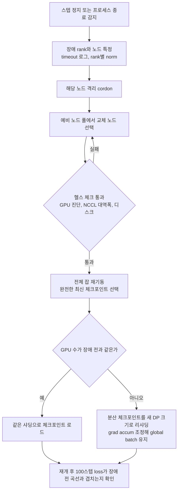

예비 노드를 확보해 두는 것이 가장 효과가 크다. 노드를 즉시 교체하지 못하면 GPU 수를 줄여서 재개해야 하고, DP 크기가 바뀌면 샤딩된 optimizer 상태도 새 구성에 맞게 나눠야 한다. PyTorch의 분산 체크포인트(`torch.distributed.checkpoint`)는 로드 시점에 샤딩 구성이 달라도 다시 나눠 읽을 수 있다. 이때 global batch가 바뀌지 않게 `grad_accum`을 늘려 보정해야 한다. 안 맞추면 배치 크기가 달라져 lr 스케줄이나 loss 곡선이 어긋난다.

재개 직후 확인은 4.3의 순서도 마지막 단계다. 결정적 로더와 난수 상태를 복원했다면 장애 직전 몇 스텝의 loss와 재개 후 같은 스텝의 loss가 거의 같아야 한다. 어긋나면 로더 위치, optimizer 상태, 스케줄러 상태 중 하나가 복원되지 않은 것이다. 장애 복구 후 loss가 조금 높아졌다가 천천히 내려오는 증상이 보이면 대부분 optimizer 상태 누락이다. 4.1에서 확인했듯 moment가 초기화되면 한동안 업데이트가 거칠어진다.
