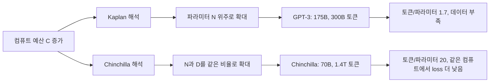
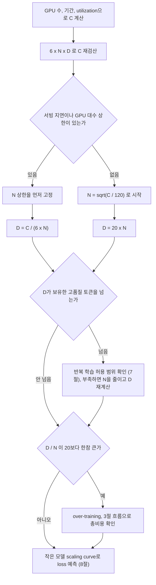
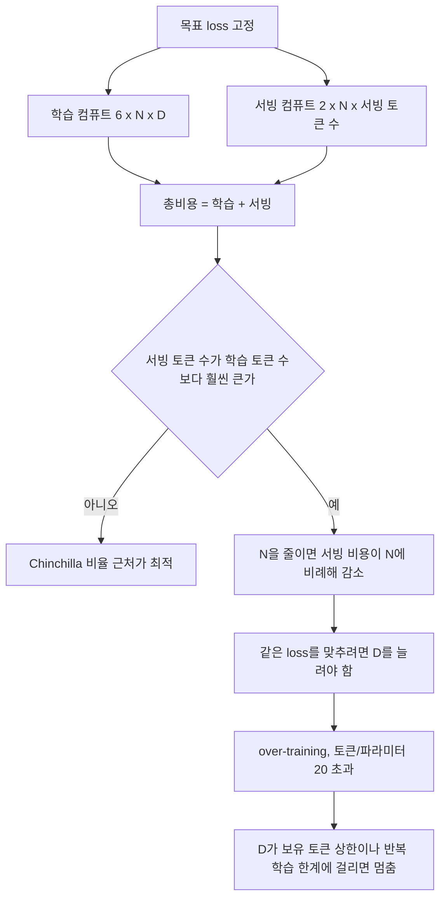
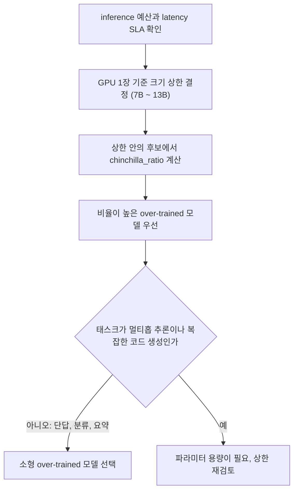
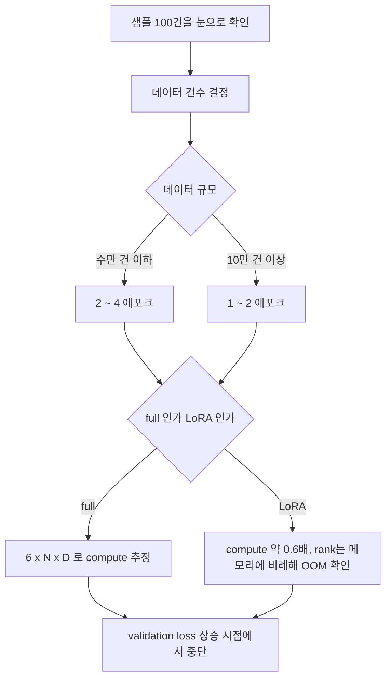
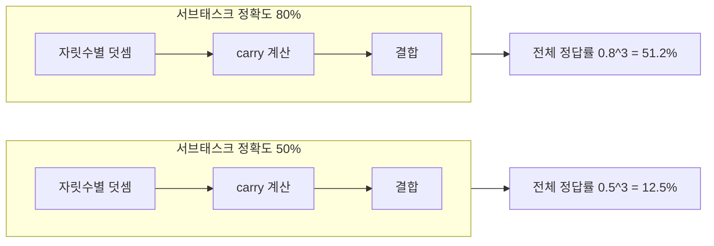
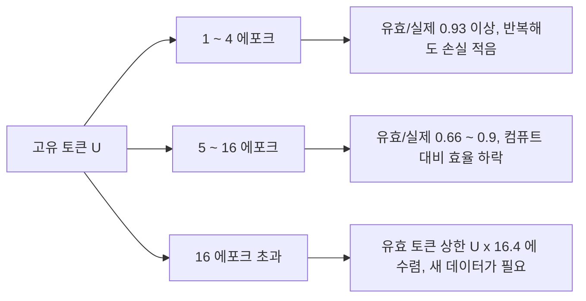
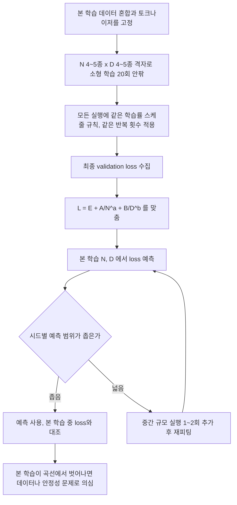

# LLM 스케일링 법칙

Karpathy의 'State of GPT'(2023)에서 가장 실용적으로 다룬 주제가 스케일링 법칙이다. 모델을 크게 만드는 게 능사가 아니라, 주어진 compute 예산 안에서 파라미터와 학습 데이터를 어떻게 배분하느냐가 핵심이라는 얘기다.

---

## 1. 스케일링 법칙의 출발점: Kaplan vs Chinchilla

2020년 OpenAI의 Kaplan et al. 논문이 스케일링 법칙의 출발점이다. 핵심 주장은 "compute 예산이 고정되어 있을 때, 파라미터를 최대한 크게 키우고 데이터는 상대적으로 덜 써도 된다"는 것이었다. GPT-3(175B)가 이 법칙대로 설계됐다. 300B 토큰으로 175B짜리 모델을 학습시켰다.

2022년 DeepMind의 Chinchilla 논문(Hoffmann et al.)이 이걸 정면으로 반박했다. 같은 compute를 쓰면서 GPT-3보다 4배 작은 70B 모델에 1.4T 토큰을 먹였더니 GPT-3을 성능에서 앞질렀다. GPT-3이 파라미터 대비 데이터가 너무 적은, "under-trained" 상태였다는 게 결론이다.

Chinchilla 논문이 제시한 결론은 단순하다. 파라미터 1개당 학습 토큰 약 20개가 compute-optimal이다. 1B 파라미터 모델이면 20B 토큰이 필요하고, 70B면 1.4T 토큰이 필요하다. 컴퓨트 C = 6ND(2절)에 D = 20N을 넣어 풀면 아래 식이 나온다.

```
C = 6 × N × D,  D = 20 × N
→ C = 120 × N²
N_opt = sqrt(C / 120)
D_opt = 20 × N_opt

N: 파라미터 수
D: 학습 토큰 수
C: 총 compute (FLOP)
```

검산하면 Chinchilla의 C = 6 × 70B × 1.4T = 5.88 × 10^23 FLOP에서 sqrt(5.88e23 / 120) = 70B가 나온다. `sqrt(C / 6)`으로 적힌 자료를 가끔 보는데, 그 식은 D = N일 때의 해라서 20배 규칙과 같이 쓰면 N이 4.5배 크게 나온다.

두 논문이 컴퓨트가 늘 때 파라미터와 토큰을 얼마나 나눠 키우라고 했는지를 표로 놓으면 차이가 분명해진다. 지수는 각 논문이 보고한 값이다.

| 항목 | Kaplan et al. (2020) | Hoffmann et al. (2022) |
|---|---|---|
| 컴퓨트 10배 증가 시 파라미터 | 약 5.4배 (C^0.73) | 약 3.2배 (C^0.5) |
| 컴퓨트 10배 증가 시 토큰 | 약 1.9배 (C^0.27) | 약 3.2배 (C^0.5) |
| 대표 모델 | GPT-3 175B / 300B 토큰 (토큰/파라미터 1.7) | Chinchilla 70B / 1.4T 토큰 (토큰/파라미터 20) |
| 같은 컴퓨트(약 3 ~ 6 × 10^23 FLOP)에서 | 모델이 크고 데이터가 적음 | 모델이 작고 데이터가 많음 |



위 그림에서 두 갈래의 차이는 컴퓨트가 늘어난 몫을 어디에 쓰느냐 하나다. Hoffmann 논문은 Kaplan 실험이 토큰 수와 관계없이 학습률 스케줄 길이를 고정했다는 점을 차이의 원인으로 짚었고, 자신들은 토큰 수마다 스케줄을 따로 맞춰 400개 넘는 모델을 학습시켰다고 밝혔다. 사전학습 파이프라인 쪽에서 토큰 수가 왜 중요한지는 [LLM 사전학습 파이프라인](LLM_Pretraining.md)의 데이터 파이프라인 절과 규모별 소요 자원 절에 이어서 적었다.

---

## 2. FLOP 계산: 학습 예산을 숫자로

"얼마나 큰 모델을 얼마나 긴 데이터로 학습시킬 수 있는가"는 보유한 GPU로 계산 가능하다. 다만 이 절의 FLOP은 이론값이고, 실제로 그 GPU 수에서 모델이 메모리에 들어가는지와 MFU가 얼마 나오는지는 [LLM 분산 학습](Distributed_Training.md)에서 따로 계산한다.

학습 1번의 FLOP 추정식이다.

```
C = 6 × N × D

C: 총 FLOP
N: 파라미터 수
D: 학습 토큰 수
```

6이 붙는 이유는 forward pass(2N FLOP) + backward pass(4N FLOP)를 합친 값이기 때문이다.

실제 GPU 기준으로 계산해보면 이렇다.

```python
# A100 80GB 기준 학습 예산 계산
# fp16 이론상 312 TFLOP/s, 실제 utilization 35~40%

gpu_tflops = 312e12          # A100 fp16 이론값 (FLOP/s)
utilization = 0.38           # 실제 utilization
gpu_count = 64
training_days = 14

total_flop = gpu_tflops * utilization * gpu_count * (training_days * 86400)
# ≈ 9.2 × 10^21 FLOP

# Chinchilla-optimal 배분 (C = 120 × N²)
import math
N_opt = math.sqrt(total_flop / 120)  # ≈ 8.7B 파라미터
D_opt = N_opt * 20                   # ≈ 175B 토큰
```

현실에서 utilization 35~40%를 넘기기가 힘들다. IO 병목, 통신 오버헤드, gradient sync 시간이 다 깎아먹는다. 논문에서 "우리는 A100 256장으로 2주 학습시켰다"는 문장이 나오면 이 계산식으로 C를 역산해서 모델 규모가 합리적인지 확인할 수 있다.

`sqrt(total_flop / 6)`을 쓰고 13.5B / 270B로 적은 예제를 본 적이 있다. 그대로 돌려보면 C는 1.1 × 10^21이 아니라 9.2 × 10^21이고, `sqrt(C / 6)`은 39B를 낸다. 39B에 토큰 780B를 쓰면 6ND가 예산의 20배가 된다. 계산한 N, D로 `6 * N * D`를 다시 곱해 C와 맞는지 보는 한 줄이 이런 실수를 잡는다.

### N과 D를 정하는 순서

컴퓨트 예산이 정해졌다고 곧바로 Chinchilla 비율로 가는 것은 아니다. 서빙 조건과 데이터 보유량이 먼저 걸러낸다. 아래 흐름은 새 모델을 학습하려는 팀이 N과 D를 정할 때 거치는 순서다.



왼쪽 분기(서빙 상한이 있는 경우)에서는 N을 고정하고 남는 컴퓨트를 전부 D로 돌리기 때문에 D/N이 20을 넘는 것이 정상이다. 오른쪽 분기에서도 보유 토큰이 모자라면 같은 이유로 N이 줄어든다.

---

## 3. 파라미터 vs 데이터 vs 컴퓨트 트레이드오프

셋 중 어디에 돈을 쓸지가 실무 결정이다.

파라미터를 늘리면 모델 용량이 커져서 더 복잡한 패턴을 암기할 수 있다. 대신 inference 비용이 같이 올라간다. 70B를 서빙하는 것은 7B 서빙보다 GPU 비용이 10배다.

데이터를 늘리면 작은 모델도 잘 동작하게 만들 수 있다. Chinchilla 이후 흐름이 이쪽으로 갔다. Llama 2(70B)는 2T 토큰으로 학습해서 Chinchilla-optimal보다 더 많이 학습시켰다. 서빙할 때는 작고 잘 학습된 모델이 크고 덜 학습된 모델보다 practical하다.

compute를 늘리면 당연히 둘 다 올린다. 하지만 compute는 GPU 수량과 전기값으로 결정되는 실물 제약이라, 배분 문제가 된다.

| 선택지 | training 비용 | inference 비용 | 주 사용 사례 |
|--------|--------------|----------------|-------------|
| 파라미터 ↑ (과소 학습) | 중간 | 높음 | 일반적으로 비효율 |
| 파라미터 = Chinchilla-opt | 높음 | 낮음 | 서빙 중심 프로덕션 |
| 데이터 추가 (over-train) | 높음 | 낮음 | inference 집약적 서비스 |

Llama 모델이 compute-optimal보다 더 학습시키는 이유가 여기 있다. 학습은 한 번 하면 되지만 inference는 매 요청마다 발생한다. inference 비용을 줄이려면 작은 모델을 충분히 학습시키는 게 장기적으로 이득이다.

### over-training이 생기는 경로

Chinchilla 식은 학습 컴퓨트만 최소화한다. 서빙에 쓰는 컴퓨트가 목적함수에 들어가는 순간 최적점이 옮겨간다. 아래 흐름에서 갈림길은 "모델을 몇 번이나 호출하는가" 하나다.



같은 목표 loss에서 총비용(학습 + 서빙)을 최소로 만드는 N, D를 수치로 찾아봤다. loss 모형은 Hoffmann 논문의 parametric 식 `L = E + A/N^α + B/D^β`이고, 상수는 Besiroglu et al.(2024, [arXiv 2404.10102](https://arxiv.org/abs/2404.10102))이 재현한 E=1.8172, A=482.01, B=2085.43, α=0.3478, β=0.3658을 썼다. 목표 loss는 이 식이 Chinchilla 70B / 1.4T에 주는 1.974다. 서빙 토큰 수는 모델 수명 동안 생성하는 총 토큰 수의 가정값이다.

```python
import numpy as np
E, A, B, a, b = 1.8172, 482.01, 2085.43, 0.3478, 0.3658
L = lambda N, D: E + A / N**a + B / D**b

def best(target, d_serve):
    out = None
    for N in np.logspace(9, 11.5, 600):
        rem = target - E - A / N**a
        if rem <= 0:
            continue
        D = (B / rem) ** (1 / b)
        cost = 6 * N * D + 2 * N * d_serve
        if out is None or cost < out[0]:
            out = (cost, N, D)
    return out

target = L(70e9, 1.4e12)   # 1.974
for d_serve in [0, 2e12, 2e13, 2e14, 2e15]:
    cost, N, D = best(target, d_serve)
    print(f"serve={d_serve:.0e} N={N/1e9:.1f}B D={D/1e12:.2f}T D/N={D/N:.0f}")
```

직접 돌린 결과다.

| 서빙 토큰 수 | 최적 N | 최적 D | D/N | 학습 컴퓨트 |
|---|---|---|---|---|
| 0 (학습만 고려) | 72.7B | 1.35T | 19 | 5.9e23 |
| 2e12 | 50.4B | 2.05T | 41 | 6.2e23 |
| 2e13 | 29.2B | 5.31T | 182 | 9.3e23 |
| 2e14 | 18.9B | 20.3T | 1074 | 2.3e24 |
| 2e15 | 14.6B | 94.3T | 6454 | 8.3e24 |

서빙 토큰이 0이면 D/N이 19로 나와서 20배 규칙이 재현된다. 서빙 토큰이 학습 토큰의 10배(2e13)만 돼도 최적 N이 29B로 내려오고 D/N이 182가 된다. 같은 loss를 얻는 데 학습 컴퓨트를 1.6배 더 쓰는 대신 서빙 비용이 모델 크기에 비례해 줄어드는 거래다. 이 방향성은 Sardana & Frankle의 "Beyond Chinchilla-Optimal"(2023)이 먼저 보였고, Llama 계열의 토큰/파라미터 비율이 수십에서 수백인 것과 맞아떨어진다.

표의 아래쪽 행은 현실에서 못 간다. D=94T는 공개된 고품질 텍스트 규모를 넘고, 7절에서 보듯 반복 학습으로 메우면 유효 토큰이 깎인다. over-training의 실제 한계는 컴퓨트가 아니라 데이터에서 먼저 걸리는 경우가 많다.

---

## 4. Chinchilla 법칙으로 모델 선택할 때

기존 공개 모델 중 무엇을 쓸지 결정할 때도 Chinchilla 법칙이 판단 기준이 된다. 모델 카드에 파라미터 수와 학습 토큰 수가 공개된 경우, compute-optimal 대비 얼마나 over/under-trained인지 계산할 수 있다.

```python
def chinchilla_ratio(param_b: float, tokens_b: float) -> float:
    """
    Chinchilla-optimal 대비 실제 학습 토큰 비율.
    1.0이면 optimal, 2.0이면 두 배 over-train.
    """
    optimal_tokens = param_b * 20
    return tokens_b / optimal_tokens

# 실제 모델들 비교
models = {
    "GPT-3 175B":        chinchilla_ratio(175, 300),    # ≈ 0.086 (심각한 under-train)
    "Llama-2 7B":        chinchilla_ratio(7,   2000),   # ≈ 14.3  (aggressive over-train)
    "Llama-2 70B":       chinchilla_ratio(70,  2000),   # ≈ 1.43
    "Chinchilla 70B":    chinchilla_ratio(70,  1400),   # ≈ 1.0   (reference)
    "Llama-3 8B":        chinchilla_ratio(8,   15000),  # ≈ 93.8 (Meta가 공개한 15T+ 토큰 기준)
}
```

GPT-3은 Chinchilla 기준으로 필요한 토큰의 8.6%밖에 안 썼다. 같은 compute로 모델을 더 작게 만들고 데이터를 더 먹이면 성능이 올라갔을 것이다.

**inference 비용 제약이 있을 때**

프로덕션에서 latency SLA가 있거나 GPU 비용이 타이트할 때, 모델 선택은 "가장 똑똑한 모델"이 아니라 "주어진 inference 예산 안에서 가장 잘 학습된 모델"이 된다.

A100 1장으로 초당 20 토큰 이상을 뽑아야 한다면 7B 또는 13B 수준이 한계다. 이 제약을 먼저 정하고 나면, 그 크기 범위에서 가장 over-trained된 모델을 고르는 게 맞다. Llama-3 8B Instruct가 Llama-2 13B Instruct보다 파라미터는 작지만 더 많은 토큰으로 학습했고 성능도 높다. 크기만 보고 13B를 고르면 더 나쁜 선택이 된다.

**태스크 특성이 맞아야 한다**

over-trained 소형 모델이 under-trained 대형 모델을 이기는 것은 단답형 추론, 분류, 요약 같은 태스크에서 주로 성립한다. 멀티홉 추론, 복잡한 코드 생성처럼 순수하게 모델 용량이 필요한 태스크는 파라미터 수가 여전히 중요하다. 7B를 아무리 많이 학습시켜도 GPT-4 수준의 추론 능력은 안 나온다. 용량 자체의 한계가 있다.

아래 흐름은 위 두 판단을 이어 붙인 모델 선택 순서다. 크기 상한이 먼저 후보를 자르고, 그 안에서 over-train 정도와 태스크 특성이 순서대로 걸러낸다.



---

## 5. 파인튜닝 예산 배분

팀에서 "70B 모델을 파인튜닝하고 싶다"는 요청이 들어왔을 때, 현실적인 compute 요구량을 계산하는 방법이다.

```python
def estimate_finetune_compute(
    param_b: float,
    num_examples: int,
    avg_seq_len: int,
    epochs: int,
    method: str = "full"  # "full" | "lora"
) -> dict:
    """
    파인튜닝 compute 추정.
    - full fine-tuning: 모든 파라미터 업데이트
    - LoRA (rank=16 기준): 학습 파라미터 ~0.1%
    """
    N = param_b * 1e9
    D = num_examples * avg_seq_len * epochs

    total_flop = 6 * N * D

    if method == "lora":
        # LoRA는 forward pass 비용은 같지만
        # backward pass에서 학습 파라미터가 줄어 ≈ 40% 절감
        total_flop *= 0.6

    a100_fp16_tflops = 312e12
    utilization = 0.35
    effective_tflops = a100_fp16_tflops * utilization
    seconds_single_gpu = total_flop / effective_tflops

    return {
        "total_exaflop": total_flop / 1e18,
        "single_a100_hours": seconds_single_gpu / 3600,
        "8gpu_hours": seconds_single_gpu / 3600 / 8,
    }
```

실제 시나리오 세 가지다.

```python
# 시나리오 A: 7B 모델, instruction 데이터 10만 건, 평균 512 토큰, 3 에포크, full
result_a = estimate_finetune_compute(7, 100_000, 512, 3, "full")
# total_exaflop: 6.45
# A100 8장 기준 약 2.1시간

# 시나리오 B: 13B 모델, 동일 데이터, full
result_b = estimate_finetune_compute(13, 100_000, 512, 3, "full")
# total_exaflop: 11.98
# A100 8장 기준 약 3.8시간

# 시나리오 C: 70B 모델, 동일 데이터, LoRA (rank=16)
result_c = estimate_finetune_compute(70, 100_000, 512, 3, "lora")
# total_exaflop: 38.71
# A100 8장 기준 약 12.3시간
```

이 계산은 상한선 추정용이다. gradient checkpointing, mixed precision 설정, 실제 sequence packing 여부에 따라 달라진다. sequence packing을 적용하면 짧은 예제들을 하나의 시퀀스로 묶어서 패딩 낭비를 줄이고 실질 throughput이 30~50% 오를 수 있다.

**에포크 수 결정**

파인튜닝 에포크는 많을수록 좋지 않다. 사전학습 데이터 규모 대비 파인튜닝 데이터가 극히 작기 때문에 과적합이 빠르게 온다. 일반적으로 수만 건 이하 데이터셋에서는 2~4 에포크가 실용 범위다. 10만 건 이상이면 1~2 에포크로도 충분한 경우가 많다. loss curve를 보면서 validation loss가 올라가기 시작하는 시점을 잡아야 한다.

**LoRA rank 선택과 compute**

LoRA rank를 올리면 학습 파라미터가 늘지만 compute 절감 효과는 크지 않다. rank 16 → 64로 4배 올려봤자 총 학습 파라미터는 0.1% → 0.4%로 늘어나는 수준이라 forward/backward 시간 차이가 거의 없다. rank를 올린다고 compute가 4배 드는 게 아니라는 얘기다. 반면 메모리는 rank에 비례해 늘어나서 OOM이 먼저 발생한다.

**데이터 품질이 양보다 중요한 이유**

파인튜닝에서 compute 계산보다 실제로 더 자주 틀리는 판단이 데이터 양 결정이다. 100만 건의 GPT-4 생성 instruction 데이터보다 1만 건의 도메인 전문가 검수 데이터가 타겟 태스크에서 성능이 높은 경우를 여러 번 봤다. Compute를 아끼려고 데이터를 줄이는 게 아니라, 품질이 낮은 데이터를 많이 써봐야 compute만 낭비된다는 뜻이다. 데이터셋 크기를 결정하기 전에 샘플 100건을 먼저 눈으로 보는 게 맞다.

위 판단을 순서대로 놓으면 아래와 같다. compute 계산은 마지막 단계고, 앞의 데이터 확인이 먼저 온다.



---

## 6. Emergent Capabilities: 왜 갑자기 나타나는가

Wei et al.(2022)의 emergence 논문은 "모델이 특정 크기를 넘으면 갑자기 능력이 생긴다"는 현상을 기록했다. 작은 모델에서는 0에 가깝던 성능이, 임계점을 넘는 순간 급격히 올라간다.

메커니즘을 직관적으로 설명하면 이렇다. 멀티 스텝 추론이 필요한 태스크는 각 단계가 모두 성공해야 최종 정답이 나온다. 예를 들어 세 자리 수 덧셈은 세 자릿수 각각의 덧셈 + carry 계산 + 결합이 전부 맞아야 한다. 모델이 각 서브태스크를 50% 확률로 맞히면, 세 단계가 모두 맞을 확률은 0.5³ = 12.5%다. 각 서브태스크 정확도가 80%면 전체는 51.2%로 올라간다. 서브태스크 정확도가 연속적으로 상승해도 복합 태스크는 threshold를 넘는 순간 갑자기 올라가는 것처럼 보인다.

아래 그림은 같은 세 단계 태스크에서 서브태스크 정확도가 50%에서 80%로 올라갈 때 전체 정답률이 어떻게 변하는지 보여 준다.



2023년 Schaeffer et al.이 다른 각도에서 반론을 제기했다. 비선형 metric(예: exact match)을 쓸 때 emergence처럼 보이는 것이지, linear metric(partial credit)으로 보면 연속적으로 상승한다는 것이다. Karpathy는 이 두 관점 모두를 인정하면서 "emergence가 완전히 환상은 아니지만, metric 선택에 따라 과장될 수 있다"는 입장이다.

실무에서 중요한 점은 이거다. 소형 모델에서 잘 안 되는 태스크를 포기하기 전에, 모델 크기를 키우거나 학습 데이터를 늘렸을 때 갑자기 동작할 가능성이 있다. 선형 보간으로 "이 모델은 이 태스크를 못 할 것"이라는 예측이 틀리는 케이스가 있다.

---

## 7. Scaling이 실패하는 경우

스케일링 법칙은 이론상 "모델과 데이터를 같이 키우면 성능이 예측 가능하게 오른다"는 전제를 깔고 있다. 하지만 이게 무너지는 경우가 여러 가지 있다.

**데이터 품질이 낮을 때**

인터넷 크롤링 데이터는 중복, 오염, 저품질 텍스트가 섞여 있다. MassiveText, C4, Dolma 같은 데이터셋이 중복 제거와 품질 필터링에 그렇게 공을 들이는 이유가 여기 있다. 같은 토큰 수라도 품질이 낮으면 스케일링 법칙이 예측하는 성능이 나오지 않는다. 쓰레기를 더 많이 보여준다고 더 똑똑해지지 않는다.

`L = E + A/N^α + B/D^β`에서 데이터 품질은 B(그리고 지수 β)에 들어간다. 토큰을 늘렸을 때 loss가 얼마나 빨리 내려가는지를 정하는 항이다. 이 상수는 논문이 쓴 데이터 혼합(Chinchilla는 MassiveText)에서 맞춘 값이라서, 필터링 기준이나 도메인 비율이 다른 코퍼스에는 그대로 못 쓴다. 남의 상수로 "토큰 20배 규칙"을 적용했다가 우리 코퍼스에서는 토큰 2배를 더 줘도 loss가 안 내려가는 경우가 생긴다. 이 때문에 데이터 혼합을 바꿀 때마다 작은 모델 실험(아래 8절)을 다시 돌려 상수를 새로 맞춘다. Llama 3 기술 보고서도 작은 모델 실험으로 데이터 혼합 비율을 정했다고 밝혔다. 필터링 단계 자체는 [LLM 사전학습 파이프라인](LLM_Pretraining.md)의 데이터 파이프라인 절을 본다.

**에포크를 반복할 때**

학습 데이터가 고갈되면 같은 데이터를 여러 번 돌린다. 에포크 2~3회까지는 큰 문제가 없는 경우도 있지만, 반복이 늘어날수록 수익 체감이 심해진다. Chinchilla 법칙은 에포크 1회를 가정한다. "데이터 1T 토큰"이 실제로는 100B 토큰을 10번 돌린 것이라면 별개의 이야기다.

Muennighoff et al.(2023, [arXiv 2305.16264](https://arxiv.org/abs/2305.16264))은 반복 토큰의 가치가 지수적으로 줄어든다고 모형화했다. 고유 토큰 U개를 R번 추가 반복했을 때 유효 토큰은 `D' = U + U × R* × (1 − exp(−R / R*))`이고 논문이 맞춘 R*는 약 15.4다. 이 식을 U = 100B에 적용해서 돌려본 값이다.

```python
import math
R_STAR, U = 15.4, 100e9
for epochs in [1, 2, 4, 8, 16, 40]:
    R = epochs - 1
    eff = U + U * R_STAR * (1 - math.exp(-R / R_STAR))
    print(epochs, f"{eff/1e9:.0f}B", f"{eff/(U*epochs):.2f}")
```

| 에포크 | 실제 처리 토큰 | 유효 토큰 | 유효/실제 |
|---|---|---|---|
| 1 | 100B | 100B | 1.00 |
| 2 | 200B | 197B | 0.98 |
| 4 | 400B | 373B | 0.93 |
| 8 | 800B | 663B | 0.83 |
| 16 | 1,600B | 1,059B | 0.66 |
| 40 | 4,000B | 1,518B | 0.38 |

4에포크까지는 낭비가 7%라서 고유 데이터가 모자랄 때 반복으로 메워도 된다. 40에포크가 되면 4T 토큰어치 컴퓨트를 쓰고도 유효 토큰은 1.5T에 그친다. 이 식에서 유효 토큰의 상한은 U × (1 + R*)이라 100B 데이터로는 아무리 반복해도 1.64T를 못 넘는다.



실무에서 이 표를 쓰는 방법은 두 가지다. 2절 흐름의 D를 정할 때 반복분을 유효 토큰으로 환산해서 D에 넣고, 8절의 작은 모델 실험에서는 반복 횟수를 본 실험과 같게 맞춘다. 작은 모델은 1에포크로 돌리고 큰 모델만 8에포크로 돌리면 곡선이 어긋난다.

**특수 도메인: 코딩, 수학**

일반 언어 태스크와 달리 코딩/수학은 도메인 데이터 비율이 성능에 결정적이다. 코드 특화 데이터를 10배 더 먹이면 코딩 성능이 스케일링 법칙의 예측을 넘기도 한다. DeepSeek-Coder, WizardCoder 계열이 파라미터 대비 코딩 성능이 높은 게 이 때문이다. 반대로 말하면 일반 텍스트로 아무리 키워도 코딩 태스크는 도메인 데이터 없이는 한계가 있다.

**Architecture 병목**

단순히 레이어를 쌓거나 파라미터를 늘리는 것이 항상 동작하지 않는다. Attention의 quadratic complexity는 컨텍스트 길이가 길어질수록 부담이 된다. 이 경우 파라미터를 두 배 늘려도 긴 문서 처리 성능이 두 배가 되지 않는다. Mamba, RetNet 같은 linear attention 계열이 나온 배경이다.

**Fine-tuning에서의 착각**

사전학습된 모델에 fine-tuning을 할 때 스케일링 법칙을 그대로 적용하면 틀린다. fine-tuning은 새 지식을 집어넣는 작업이 아니라, 이미 학습된 표현을 특정 방향으로 조정하는 작업이다. 여기서는 데이터 양보다 데이터 품질과 구성이 훨씬 중요하다. 10만 개의 평범한 instruction 데이터보다 1천 개의 정교한 예제가 나은 경우가 많다.

---

## 8. 학습 전에 작은 모델로 loss를 예측하는 절차

수천 GPU로 몇 주를 돌리는 학습은 한 번 시작하면 N, D, 데이터 혼합을 바꿀 수 없다. 그래서 본 학습 컴퓨트의 1% 안팎을 작은 모델 여러 개에 먼저 쓰고, 거기서 맞춘 곡선으로 큰 모델의 loss를 예측한다. 곡선이 틀리면 본 학습을 시작하기 전에 N/D 배분이나 데이터 혼합을 고친다.



핵심은 실행 사이에서 바꾸는 것을 N과 D 두 개로만 제한하는 것이다. 학습률 스케줄 길이를 D에 맞추지 않거나, 어떤 실행만 반복 학습을 하거나, 토크나이저가 바뀌면 곡선에 다른 변수가 섞인다. 1절에서 본 Kaplan과 Chinchilla의 차이가 바로 이 부분에서 나왔다.

실제 학습은 못 돌렸기 때문에 절차만 확인하려고 합성 데이터로 돌렸다. 3절에서 쓴 재현 상수로 loss를 만들고 0.5% 잡음을 얹은 20회 실행(N 10M ~ 300M, D 0.2B ~ 20B, 최대 3.6 × 10^19 FLOP)을 `E`, `α`, `β`는 격자 탐색으로, `A`, `B`는 최소제곱으로 맞췄다.

```python
import numpy as np

def fit(N, D, y):
    best = None
    for E in np.arange(1.0, 2.2, 0.05):
        for a in np.arange(0.2, 0.5, 0.01):
            for b in np.arange(0.2, 0.5, 0.01):
                X = np.c_[N**-a, D**-b]
                coef = np.linalg.lstsq(X, y - E, rcond=None)[0]
                if (coef < 0).any():
                    continue
                r = ((X @ coef + E - y) ** 2).sum()
                if best is None or r < best[0]:
                    best = (r, E, a, b, coef)
    return best
```

전체 격자(20회)에서 맞춘 값은 E=1.80, A=425, B=2281, α=0.34, β=0.37이고 70B / 1.4T 예측은 1.96이다. 참값 1.974와 0.014 차이다. 잡음 시드를 5개 바꿔 돌리면 예측이 1.93 ~ 2.00 사이에서 움직였다.

격자를 N 2종 x D 3종(6회)으로 줄이면 같은 잡음에서 예측이 1.53 ~ 2.24로 흩어졌다. 참값을 한참 벗어나는 시드가 절반 이상이다. 잡음을 2%로 올리면 전체 격자도 1.73 ~ 2.03으로 퍼진다. 정리하면 이렇다.

| 조건 | 70B / 1.4T 예측 범위 (참값 1.974) |
|---|---|
| 20회, 잡음 0.5% | 1.93 ~ 2.00 |
| 6회, 잡음 0.5% | 1.53 ~ 2.24 |
| 20회, 잡음 2% | 1.73 ~ 2.03 |

실행 횟수가 모자라면 E, α, β가 서로 상쇄되는 방향으로 같이 움직여서 학습 구간에서는 잘 맞아도 외삽에서 크게 틀린다. 실무에서는 E를 이미 알려진 값 근처로 고정하거나, 중간 규모 실행을 한두 개 섞어서 외삽 거리를 줄인다. 위 표의 잡음은 가정값이다. 실제 실행의 잡음은 시드와 데이터 순서에서 나오므로 같은 설정을 2~3회 반복해 측정해야 한다.

예측과 본 학습 loss가 갈라지면 두 가지를 먼저 본다. 하나는 loss spike와 재시작 같은 학습 안정성 문제고, 다른 하나는 본 학습에서 데이터 반복이 늘어난 경우다. 둘 다 [LLM 사전학습 파이프라인](LLM_Pretraining.md)에서 학습 안정성 절과 체크포인트 절에 다룬 내용이다.

---

## 9. 현재 시점에서의 해석

Chinchilla 법칙이 나온 이후 업계 관행이 바뀌었다. "파라미터를 무조건 키우자"에서 "inference 효율을 위해 소형 모델을 충분히 학습시키자"로 이동했다. Llama 시리즈, Mistral, Qwen 계열이 전부 이 방향이다.

최근에는 Chinchilla-optimal보다 훨씬 많은 데이터로 학습시키는 경향이 강해지고 있다. 학습 compute를 조금 더 쓰더라도 모델을 작게 유지해서 inference 비용을 줄이는 편이 실 서비스에서는 더 이득이기 때문이다. 학습은 한 번이지만 inference는 억 번 일어난다.

스케일링 법칙이 LLM 개발의 핵심 설계 원리로 자리 잡은 건 맞지만, 이 법칙이 모든 것을 설명하지는 않는다. 데이터 품질, 도메인 구성, 학습 안정성, 그리고 아직 이해가 충분히 되지 않은 emergence 현상이 추가 변수로 작용한다. 숫자로 계산 가능한 부분과 실험으로 확인해야 하는 부분을 구분해서 봐야 한다.
