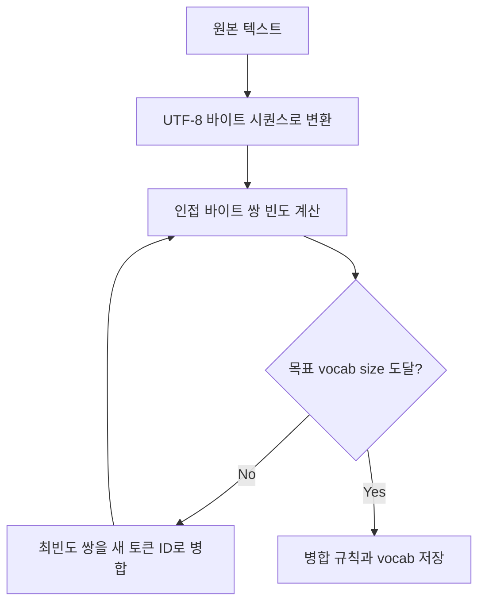
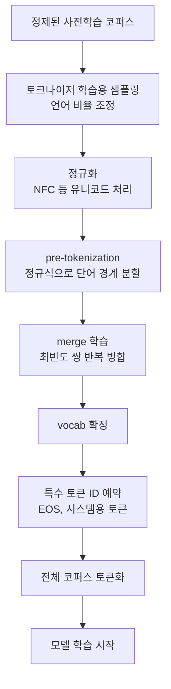
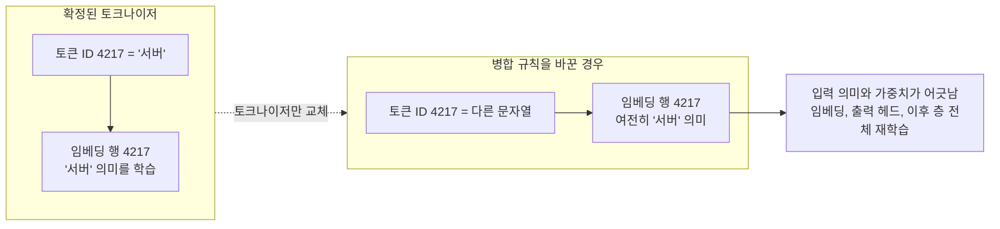
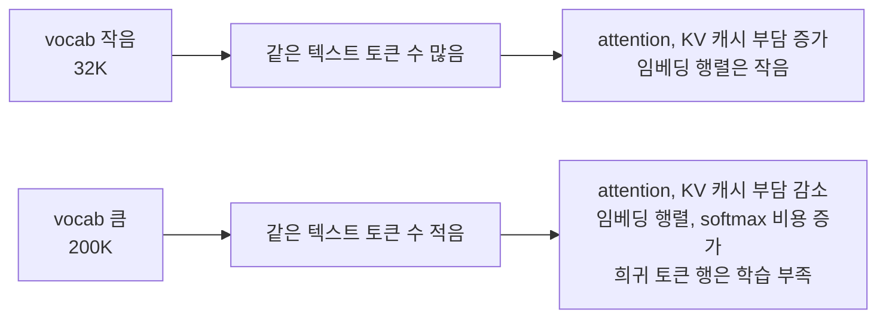
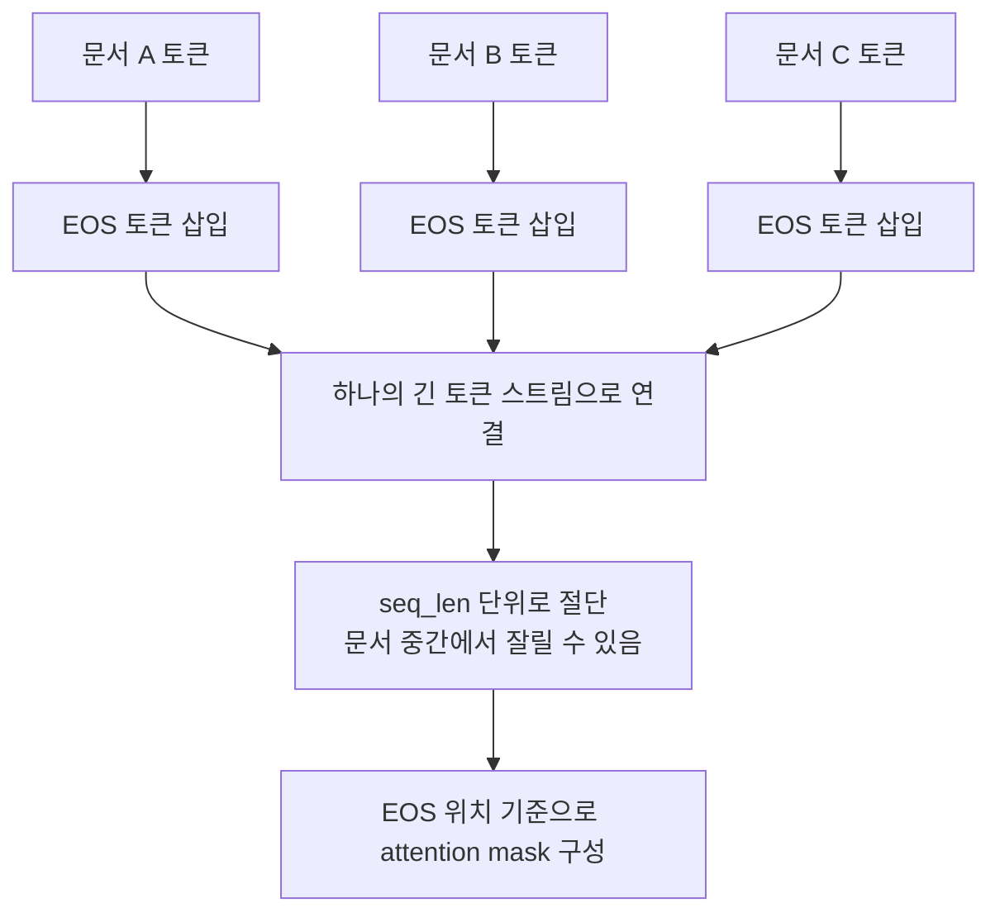

# LLM 토크나이저 — BPE 내부 동작과 병리 현상

[LLM](LLM.md) 문서에 BPE 개요는 있지만 구현 수준의 내용은 없다. 이 문서는 BPE가 내부에서 어떻게 돌아가는지, 사전학습 파이프라인에서 토크나이저가 어느 시점에 어떤 이유로 확정되는지, 그 결과 어떤 병리 현상이 생기는지를 다룬다. 토크나이저를 블랙박스로 쓰다가 이상한 동작을 만나면 여기서 원인을 찾을 수 있다. 코드 출력은 전부 `tiktoken`, `tokenizers`를 직접 돌려 확인한 값이다.

---

## BPE 알고리즘 단계별 동작

BPE(Byte Pair Encoding)는 원래 데이터 압축 알고리즘이다. 1994년에 제안된 방식을 2015년 Sennrich et al.이 NLP에 적용했고, GPT-2부터 LLM에 쓰였다.

자주 함께 등장하는 바이트 쌍을 새 토큰 하나로 묶는 과정을 반복한다. 시작은 개별 바이트(0~255)이고, 목표 vocabulary size에 도달하면 끝난다.

### 학습 과정

```python
def get_stats(ids: list[int]) -> dict[tuple, int]:
    counts = {}
    for pair in zip(ids, ids[1:]):
        counts[pair] = counts.get(pair, 0) + 1
    return counts

def merge(ids: list[int], pair: tuple, idx: int) -> list[int]:
    new_ids = []
    i = 0
    while i < len(ids):
        if i < len(ids) - 1 and ids[i] == pair[0] and ids[i+1] == pair[1]:
            new_ids.append(idx)
            i += 2
        else:
            new_ids.append(ids[i])
            i += 1
    return new_ids

text = "aaabdaaabac"
tokens = list(text.encode("utf-8"))  # [97, 97, 97, 98, 100, 97, 97, 97, 98, 97, 99]

vocab_size = 276  # 256 기본 바이트 + 20번 병합
merges = {}
for i in range(vocab_size - 256):
    stats = get_stats(tokens)
    if not stats:
        break
    pair = max(stats, key=stats.get)
    idx = 256 + i
    tokens = merge(tokens, pair, idx)
    merges[pair] = idx
```

`aa` 쌍이 가장 자주 나오므로 첫 병합 대상이 된다. 병합된 결과에서 다시 빈도를 세고 또 병합한다. cl100k_base의 vocab size는 100,277이니 약 10만 번의 병합 규칙이 적용된 셈이다.



매 반복마다 가장 빈도 높은 쌍이 하나 뽑힌다. 그래서 병합 순서는 곧 코퍼스 안의 빈도 순위다. 이 사실이 뒤에서 한국어 문제와 직결된다.

### 인코딩 과정

학습 때 저장한 `merges`를 같은 순서로 적용한다. 학습 때 먼저 병합된 쌍이 인코딩 때도 먼저 적용된다.

```python
def encode(text: str, merges: dict) -> list[int]:
    tokens = list(text.encode("utf-8"))
    while len(tokens) >= 2:
        stats = get_stats(tokens)
        pair = min(stats, key=lambda p: merges.get(p, float("inf")))
        if pair not in merges:
            break
        tokens = merge(tokens, pair, merges[pair])
    return tokens

def decode(ids: list[int], vocab: dict) -> str:
    tokens = b"".join(vocab[idx] for idx in ids)
    return tokens.decode("utf-8", errors="replace")
```

---

## Byte-level BPE

GPT-2에서 도입된 방식이다. 이전 구현은 유니코드 문자 단위에서 시작해서 학습 데이터에 없는 문자가 나오면 OOV가 생겼다. Byte-level BPE는 0~255 바이트 전체를 기본 vocab으로 깔아서 이 문제를 없앤다. 어떤 UTF-8 텍스트든 바이트로 표현되니 OOV는 이론상 발생하지 않는다.

대신 한글이 문제다. 한글 한 글자는 UTF-8에서 3바이트, 영어 소문자는 1바이트다. 영어 중심 코퍼스로 학습하면 영어 바이트 쌍은 계속 병합되는데 한글 바이트 쌍은 병합 순위에 못 든다. 한글 한 글자가 여러 토큰으로, 심하면 글자 중간에서 쪼개진다. cl100k_base로 직접 확인한 결과다.

```python
import tiktoken
e = tiktoken.get_encoding("cl100k_base")
print([e.decode_single_token_bytes(t) for t in e.encode("안녕")])
# [b'\xec\x95', b'\x88', b'\xeb\x85', b'\x95']
```

"안" 하나가 `\xec\x95`와 `\x88` 두 토큰으로 갈라진다. 토큰 하나는 단독으로 디코딩하면 깨진 UTF-8이다. 같은 단어를 o200k_base로 돌리면 `안`, `녕` 각각 토큰 하나다. 토큰 단위로 문자열을 자르는 코드(아래 청킹 절)에서 이 차이가 실제 버그로 나온다.

---

## 사전학습에서 토크나이저가 만들어지는 순서

토크나이저는 모델 학습의 일부가 아니라 모델 학습보다 앞서는 별도 학습 단계다. 파이프라인 안에서의 위치는 다음과 같다.



토크나이저 학습용 코퍼스는 전체 사전학습 데이터의 일부만 샘플링한다. 수 TB 텍스트로 merge를 세는 것은 비용이 크기 때문이다. 이 샘플의 언어·도메인 비율이 그대로 병합 규칙에 박힌다.

pre-tokenization 단계는 병합이 단어 경계를 넘지 않게 막는다. GPT-2 이후 구현은 정규식으로 텍스트를 먼저 조각낸 뒤 조각 안에서만 병합한다. cl100k_base와 o200k_base는 이 정규식에서 숫자를 최대 3자리씩 끊는다. 이 때문에 123456이 `123`, `456`으로 갈라진다.

특수 토큰은 학습된 병합과 무관하게 vocab 끝 쪽 ID에 따로 예약한다. 이 ID는 텍스트에서 만들어지는 게 아니라 코드가 직접 삽입한다.

---

## 학습 전에 고정해야 하는 이유

토크나이저는 모델이 학습을 시작하기 전에 확정하고, 이후로는 바꾸지 않는다. 이유는 임베딩 행렬과 토큰 ID가 1:1로 묶여 있기 때문이다.



토큰 ID 4217의 임베딩 행은 학습 중에 "그 ID가 가리키는 문자열이 나오는 문맥"으로 조금씩 채워진다. 병합 규칙을 바꾸면 같은 ID가 다른 문자열을 가리키게 되고, 학습된 행이 틀린 의미를 갖는다. 출력 쪽 `lm_head`도 같은 vocab 축이라 같이 어긋난다. 이후 층의 가중치도 이전 토큰 분포를 가정하고 조정된 상태라서 사실상 처음부터 다시 학습해야 한다.

비용이 되는 곳이 하나 더 있다. 학습 토큰 수 예산은 토크나이저가 정한 토큰 수 기준이다. [스케일링 법칙](LLM_Scaling_Laws.md)으로 파라미터 수 대비 토큰 수를 잡아 놓은 상태에서 토크나이저를 바꾸면 같은 코퍼스의 토큰 수가 달라지고 계획 전체가 어긋난다.

예외는 vocab 끝에 토큰을 추가하는 경우다. 기존 ID는 그대로 두고 새 ID만 붙이면 기존 행이 유지된다. 한국어 토큰을 추가한 파생 모델들이 이 방식을 쓴다. 다만 새 행은 초기화 상태에서 시작하므로 추가 사전학습이 필요하고, 기존 병합 규칙과 새 토큰이 겹쳐 같은 문자열이 두 가지로 인코딩되는 문제를 따로 정리해야 한다.

---

## 코퍼스 언어 비율이 한국어 병합 규칙을 정한다

병합 슬롯은 모든 언어가 공유하는 한정된 자원이다. 매 단계 최빈도 쌍이 하나 뽑히니 한국어 쌍은 영어·코드 쌍과 빈도로 직접 경쟁한다. 한국어 비율이 낮으면 한글 바이트 쌍이 병합 순위에 늦게 들거나 아예 못 든다.

작은 실험으로 확인했다. 이 저장소의 한국어 문서 줄과 Python 표준 라이브러리 소스를 섞어 총 50,000줄로 byte-level BPE(vocab 16,000)를 학습하고, 한국어 줄의 비율만 바꿨다.

```python
from tokenizers import Tokenizer, models, trainers, pre_tokenizers, decoders

t = Tokenizer(models.BPE())
t.pre_tokenizer = pre_tokenizers.ByteLevel(add_prefix_space=False)
t.decoder = decoders.ByteLevel()
trainer = trainers.BpeTrainer(
    vocab_size=16000,
    initial_alphabet=pre_tokenizers.ByteLevel.alphabet(),
)
t.train_from_iterator(lines, trainer)   # lines: 한국어 줄 + 영어/코드 줄
```

| 한국어 줄 비율 | 한글만으로 된 vocab 항목 수 | 32자 한국어 문장의 토큰 수 |
|---|---|---|
| 1% | 457 | 17 |
| 5% | 851 | 12 |
| 20% | 1,382 | 9 |

비율이 오를수록 한글 전용 토큰이 늘고 같은 문장이 더 적은 토큰으로 인코딩된다. 장난감 규모라서 절대값은 의미가 없고 방향만 보면 된다. 영어 중심 코퍼스에서 한국어 비율이 낮으면 병합 규칙이 음절 단위에서 멈추고, 앞서 본 cl100k_base의 `안녕` 4토큰이 그 결과다.

토크나이저 학습용 샘플은 사전학습 믹싱 비율을 그대로 따르지 않아도 된다. 모델이 볼 한국어 토큰은 적더라도 토크나이저 학습 샘플에서는 한국어 비율을 올려 두면 병합 규칙이 한국어를 더 잘게 압축한다. 반대로 샘플 비율만 올리고 모델 학습 데이터는 그대로 두면 SolidGoldMagikarp와 같은 구조의 문제가 생긴다(아래 병리 절).

---

## vocab 크기 선택 기준

vocab 크기는 임베딩 행렬 크기와 시퀀스 길이 사이의 교환이다. 크면 같은 텍스트가 적은 토큰이 되어 attention 비용이 줄지만 임베딩과 출력 헤드가 커진다.



hidden dim 4096 기준으로 임베딩 파라미터 수를 계산하면 다음과 같다. 입력 임베딩과 출력 헤드를 공유하지 않는 모델은 이 값이 두 배다.

| vocab | 임베딩 파라미터 (4096 dim) | 비고 |
|---|---|---|
| 32,000 | 약 1.3억 | Llama 2 계열이 쓰는 크기 |
| 100,277 | 약 4.1억 | cl100k_base |
| 128,256 | 약 5.3억 | Llama 3가 32K에서 올린 크기 |
| 200,019 | 약 8.2억 | o200k_base |

입력 임베딩과 출력 헤드를 따로 두는 7B 모델로 계산하면 32K는 약 2.6억(3.7%), 200K는 약 16억(23%)이다. 모델이 작을수록 이 비중이 커서 vocab을 키우는 일이 부담이다. 수백B 모델이면 같은 16억이 1% 미만이라 vocab을 키우는 쪽이 이득이다.

실무에서 고르는 기준은 다음 정도다.

- 32K: 영어 중심, 작은 모델. 한국어는 글자 단위로 쪼개져 시퀀스가 길다.
- 100K 안팎: 영어·코드에 다국어를 조금 섞는 범용 모델. 한국어는 음절 일부가 병합된다.
- 200K: 다국어를 제대로 지원하는 대형 모델. 한국어 음절과 흔한 단어가 토큰 하나가 된다.

vocab이 커질수록 희귀 토큰의 임베딩 행이 학습 중에 거의 갱신되지 않는 문제도 같이 커진다. 한 토큰이 학습 전체에서 수천 번도 안 나오면 그 행은 불안정하다.

같은 문장으로 확인해 보면 차이가 보인다. "서버가 들어오는 HTTP 요청을 처리합니다."(24자)는 cl100k_base에서 16토큰, o200k_base에서 11토큰이다. 영어 문장 "The server processes the incoming HTTP request."(47자)는 둘 다 8토큰이다. 한국어는 vocab이 두 배가 되자 토큰이 약 3분의 1 줄었고 영어는 그대로다.

---

## 문서 경계 토큰과 packing

토크나이징이 끝나면 문서마다 길이가 다른 토큰 배열이 나온다. 사전학습은 이걸 이어 붙여 고정 길이(`seq_len`)로 자른다. 문서마다 패딩하면 연산을 낭비하기 때문이다. packing 자체는 [사전학습 파이프라인](LLM_Pretraining.md)에서 다루고, 여기서는 토크나이저 쪽 요구사항만 본다.



EOS(`<|endoftext|>`)는 문서 하나가 끝났다는 신호이자 모델이 "여기서 생성을 멈춘다"를 배우는 유일한 단서다. EOS 없이 이어 붙이면 모델은 문서 경계를 모른 채 이전 문서의 끝과 다음 문서의 시작을 한 문서로 읽는다. 추론 때 멈추지 않고 계속 이어 쓰는 모델이 나온다.

토크나이저 관점에서 챙길 것은 두 가지다. 첫째, EOS는 예약된 특수 토큰 ID여야 한다. 문자열 `<|endoftext|>`를 일반 텍스트로 인코딩해서 얻으면 여러 토큰으로 쪼개져 경계 신호가 되지 못한다. 둘째, 코퍼스 문서 안에 이 문자열이 우연히 들어 있을 때다. 토큰화 함수가 `allowed_special="all"`로 호출되면 문서 속 문자열이 진짜 EOS가 되어 문서가 중간에 끊긴다. 사전학습 데이터 토큰화에서는 특수 토큰 문자열을 코퍼스에서 먼저 제거하거나 일반 텍스트로 취급하도록 막아야 한다. 서비스 입력도 마찬가지다. 사용자 입력을 `allowed_special="all"`로 인코딩하면 사용자가 특수 토큰을 직접 주입할 수 있다.

문서 마스크 없이 packing하면 같은 행의 뒤 문서가 앞 문서 토큰을 attention으로 참조한다. 마스크를 거는 구현에서도 EOS 위치를 기준으로 하니, 경계 토큰이 정확히 들어가는 게 선행 조건이다.

---

## 토크나이저 병리 현상

토크나이저가 텍스트를 숫자로 바꿀 뿐인데도, 이 변환 때문에 모델이 근본적으로 못 하는 일이 생긴다.

### SolidGoldMagikarp

2023년 Rumbelow와 Watkins가 LessWrong에 공개한 현상이다. GPT 토크나이저 vocab에 `SolidGoldMagikarp`라는 토큰이 있었고, 입력에 포함되면 모델이 엉뚱한 단어를 반복하거나 질문을 회피하는 등 예측 불가능한 동작을 보였다.

원인은 토크나이저 학습 데이터와 모델 학습 데이터의 불일치다. 이 문자열은 Reddit의 특정 유저명이었다. 토크나이저 코퍼스에는 그 유저의 글이 많아서 하나의 토큰으로 병합됐지만, 실제 사전학습 데이터에는 거의 없었다. vocab에 ID는 있는데 그 임베딩 행은 학습 중에 사실상 갱신되지 않았다. 앞 절에서 토크나이저 샘플 비율만 따로 올리면 위험하다고 한 이유가 이것이다. 토크나이저 코퍼스와 사전학습 코퍼스는 출처가 같아야 한다.

### 글자 수 세기

"strawberry에서 r이 몇 개야?"를 GPT 계열이 자주 틀리는 이유도 토크나이저다.

```python
for name in ["cl100k_base", "o200k_base"]:
    enc = tiktoken.get_encoding(name)
    print(name, [enc.decode([t]) for t in enc.encode("strawberry")])
# cl100k_base ['str', 'aw', 'berry']
# o200k_base  ['st', 'raw', 'berry']
```

모델은 문자가 아니라 토큰 ID를 본다. `raw` 안에 `r`이 있는지는 토큰을 문자로 다시 분해해야 알 수 있는데, 이 분해 능력은 학습 목표가 아니다. 두 토크나이저가 같은 단어를 다르게 쪼개는 점도 보인다.

### 산술 오류

숫자는 정규식 때문에 3자리 단위로 끊긴다.

```python
for num in ["1", "12", "123", "1234", "12345", "123456"]:
    print(num, [enc.decode([t]) for t in enc.encode(num)])
# 1 ['1']
# 12 ['12']
# 123 ['123']
# 1234 ['123', '4']
# 12345 ['123', '45']
# 123456 ['123', '456']
```

cl100k_base와 o200k_base가 같은 결과를 낸다. 끊기는 위치가 왼쪽부터라서 `1234`는 `123|4`, 천 단위 자릿수와 토큰 경계가 맞지 않는다. 사람은 오른쪽 자리부터 올림수를 계산하는데 모델은 왼쪽에서 오른쪽으로 읽으니 자릿수 정렬이 어긋난다. 큰 수 계산은 모델에 맡기지 말고 코드 실행 도구를 호출하는 쪽이 낫다.

### 한국어 토큰 비효율

```python
texts = {
    "영어": "The server processes the incoming HTTP request.",
    "한국어": "서버가 들어오는 HTTP 요청을 처리합니다.",
}
for name in ["cl100k_base", "o200k_base"]:
    enc = tiktoken.get_encoding(name)
    for lang, text in texts.items():
        n = len(enc.encode(text))
        print(f"{name} {lang}: {len(text)}자 → {n}토큰 ({n/len(text):.2f})")
# cl100k_base 영어: 47자 → 8토큰 (0.17)
# cl100k_base 한국어: 24자 → 16토큰 (0.67)
# o200k_base 영어: 47자 → 8토큰 (0.17)
# o200k_base 한국어: 24자 → 11토큰 (0.46)
```

같은 의미를 담는데 한국어가 글자당 토큰을 더 쓴다. API 비용은 토큰 단위로 붙고, 컨텍스트 창도 더 빨리 찬다. RAG에서 청크 크기를 영어 기준으로 잡으면 한국어 청크는 생각보다 적은 내용만 들어간다. 한국어 중심 작업이면 모델을 고르기 전에 실제 문서 샘플로 토큰 수를 재 보는 게 가장 확실하다.

---

## tiktoken 실무 사용

```python
import tiktoken

enc = tiktoken.encoding_for_model("gpt-4o")   # o200k_base
# enc = tiktoken.get_encoding("cl100k_base")  # gpt-4, gpt-3.5-turbo

text = "SELECT * FROM users WHERE id = 1;"
tokens = enc.encode(text)
for token_id in tokens:
    print(f"{token_id:6d} → {enc.decode([token_id])!r}")
```

### 비용 계산

메시지마다 role, 구분자 몫의 오버헤드가 붙는다. 정확한 값은 모델 버전마다 달라서 아래 상수는 근사치다.

```python
def count_tokens(messages: list[dict], model: str = "gpt-4o") -> int:
    enc = tiktoken.encoding_for_model(model)
    total = 0
    for message in messages:
        total += 4
        for key, value in message.items():
            total += len(enc.encode(str(value)))
            if key == "name":
                total -= 1
    total += 2
    return total
```

### 긴 텍스트 청킹

문자 수로 자르면 토큰 경계와 맞지 않고, 토큰 배열을 임의 위치에서 잘라 디코딩하면 앞서 본 `안` 같은 글자가 중간에서 끊겨 깨진 문자(`�`)가 나온다. cl100k_base처럼 한글이 바이트 단위로 쪼개지는 토크나이저에서 특히 그렇다. 청크 끝에서 디코딩이 깨지면 경계를 한두 토큰 옮기는 처리가 필요하다.

```python
def chunk_by_tokens(text: str, max_tokens: int, model: str = "gpt-4o", overlap: int = 50) -> list[str]:
    enc = tiktoken.encoding_for_model(model)
    tokens = enc.encode(text)
    chunks, start = [], 0
    while start < len(tokens):
        end = min(start + max_tokens, len(tokens))
        chunks.append(enc.decode(tokens[start:end]))
        if end == len(tokens):
            break
        start = end - overlap
    return chunks
```

마지막 청크에서 `break`를 두지 않으면 `start = end - overlap`이 계속 같은 위치를 가리켜 무한 루프가 된다.

### 특수 토큰 처리

`<|endoftext|>` 같은 특수 토큰은 기본 `encode()`가 거부한다.

```python
# enc.encode("<|endoftext|>")  # ValueError
tokens = enc.encode("<|endoftext|> some text", allowed_special={"<|endoftext|>"})
```

`allowed_special="all"`은 사용자 입력에 쓰지 않는다. 앞 절에서 본 대로 입력에 섞인 특수 토큰 문자열이 그대로 제어 토큰이 된다.

---

## 코드 특화 토크나이저와 혼합 언어

코드 모델은 코드 중심 코퍼스로 토크나이저를 학습한다. 들여쓰기 공백 4칸이나 `->`, `=>` 같은 연산자가 토큰 하나가 되는 식이다. 일반 토크나이저로 같은 Python 함수를 인코딩하면 시퀀스가 길어지고 attention 비용이 늘어난다. 앞서 본 언어 비율 문제의 코드 버전이다.

한국어 프롬프트에 영어 기술 용어가 섞이는 건 실무에서 흔하다. 한국어 부분은 토큰이 많고 영어 부분은 적어서, 짧은 영어 지시문은 토큰 수 대비 비중이 낮다. 토큰 수 기준으로는 영어 지시문이 한국어보다 훨씬 짧아서, 반드시 지켜야 하는 제약은 영어로 한 줄 덧붙여 두는 방법이 있다. 효과는 모델마다 달라서 직접 비교해야 한다.
