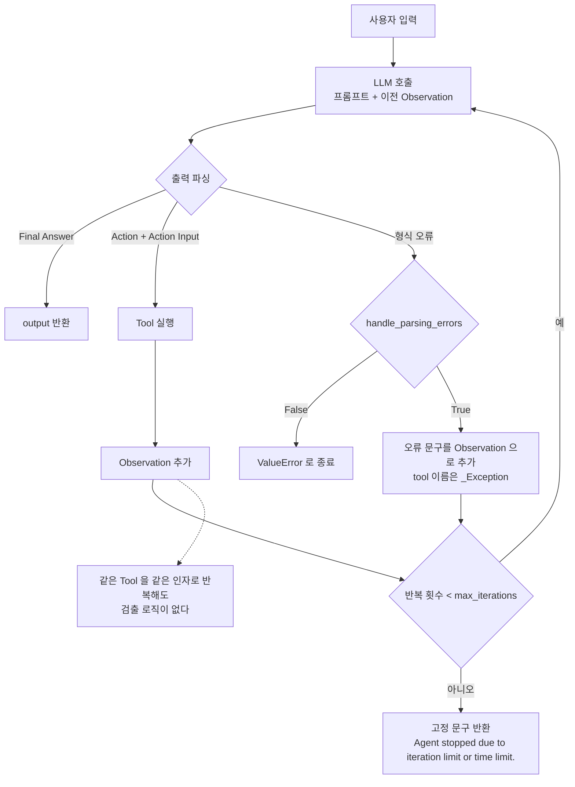
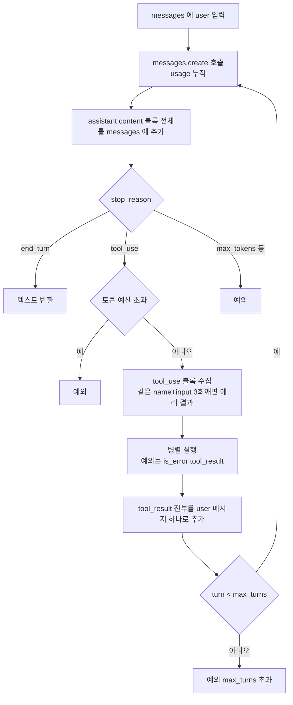
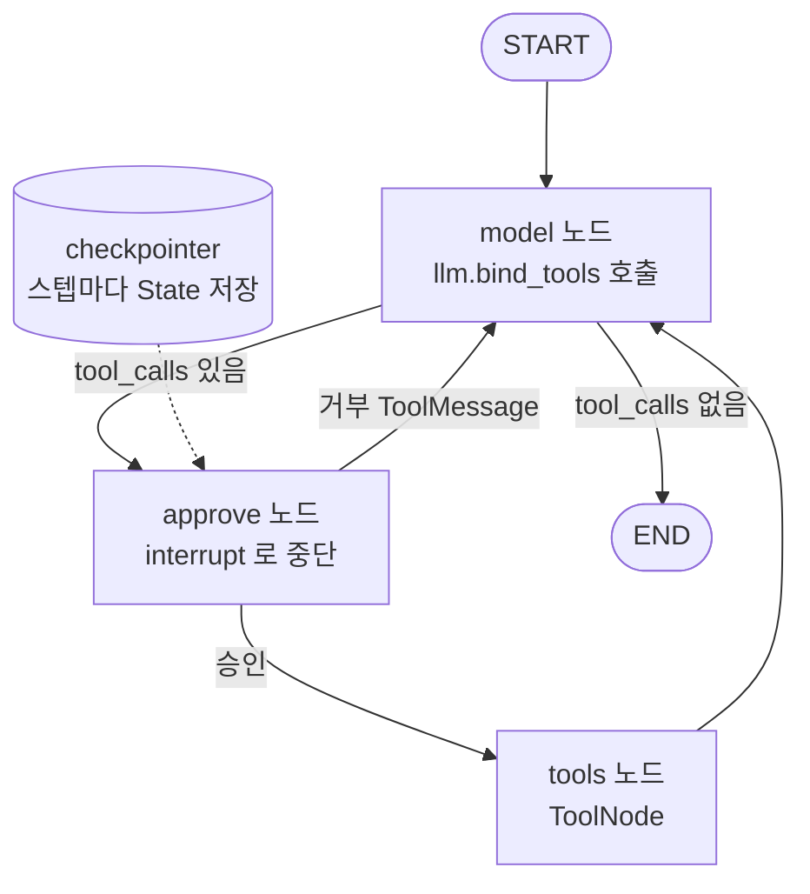
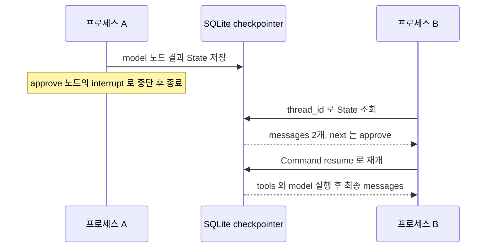

# LangChain Agent

LangChain과 순수 SDK를 비교할 때 의존 비용이 가장 크게 나오는 곳이 에이전트다. 단일 호출은 래퍼 한 겹이지만, 에이전트는 루프의 종료 판단, 에러 처리, 상태 보관을 프레임워크가 쥐고 있다. 이 문서는 AgentExecutor가 그 일을 어떻게 하는지, 같은 일을 SDK로 짜면 무엇을 직접 챙겨야 하는지, LangGraph가 어느 지점부터 값을 하는지를 비교한다.

동작 설명은 Python 3.10에서 `langchain` 1.4.6, `langchain-classic` 1.0.8, `langgraph` 1.2.16, `anthropic` 1.15.0으로 돌려 본 결과다. 모델 호출은 실제 API가 아니라 정해 둔 응답을 돌려주는 가짜 LLM과 로컬 가짜 서버로 대체했다. 루프와 상태 전이, 예외, 반환 형식은 확인했지만 모델이 실제로 얼마나 똑똑하게 도구를 고르는지는 측정하지 않았다.

루프 설계 자체(도구 스키마, 병렬 호출, 턴 상한의 근거)는 [Tool_Use](Tool_Use.md), 에이전트 개념과 ReAct 패턴은 [LLM_Agent](LLM_Agent.md), 에이전트 여러 개를 엮는 구조는 [Multi_Agent_Systems](Multi_Agent_Systems.md)에 있다. 여기서는 프레임워크를 쓸 때와 SDK로 직접 짤 때의 차이만 다룬다. 프레임워크 전반의 마이그레이션 비용은 [Lang_Chain_vs_SDK](Lang_Chain_vs_SDK.md)와 [Lang_Chain_LCEL](Lang_Chain_LCEL.md)에 있다.

## 1.x에서 AgentExecutor가 있던 자리

`langchain` 1.4.6에는 `AgentExecutor`와 `create_react_agent`가 없다. `langchain.agents`에 남은 공개 이름은 `AgentState`, `create_agent`, `factory`, `middleware`, `structured_output`이다. 기존 코드는 `langchain-classic` 패키지를 따로 설치해야 돌아간다.

```python
# pip install langchain-classic
from langchain_classic.agents import AgentExecutor, create_react_agent
```

0.x 시절 예제를 그대로 옮기면 import 단계에서 막히는 것이 여러 개다. 이 문서의 이전 판에 있던 코드도 1.x에서 아래 표처럼 깨졌다.

| 0.x 코드 | 1.x에서 |
|---|---|
| `from langchain.agents import AgentExecutor, create_react_agent` | 속성이 없어 import 실패. `langchain_classic.agents`로 옮겨야 한다 |
| `from langchain import hub` | `AttributeError: module 'langchain' has no attribute 'hub'` |
| `from langchain.callbacks.base import BaseCallbackHandler` | `ModuleNotFoundError`. `langchain_core.callbacks`에서 가져온다 |
| `BaseTool` 서브클래스에 `name = "web_search"` | `PydanticUserError`. `name: str = "web_search"`처럼 타입 주석이 필요하다 |
| `AgentExecutor(handle_tool_error=True)` | 에러는 안 나는데 효과도 없다. 'Tool 에러는 Executor가 아니라 Tool이 처리한다' 절 참고 |
| `early_stopping_method="generate"` | `create_react_agent`로 만든 에이전트에서 `ValueError`. '한도 설정과 한도에 닿았을 때' 절 참고 |

앞의 네 줄은 시끄럽게 실패하니 금방 고친다. 뒤의 두 줄은 조용하거나 실행 중에 터져서 운영에서 발견되는 쪽이다. 이 문서의 코드는 위 항목을 반영해서 다시 썼다.

## ReAct 루프의 실제 경로

AgentExecutor는 LLM 출력 텍스트를 파싱해서 다음 행동을 정한다. 프롬프트에 Tool 목록과 지금까지의 Thought, Action, Observation을 이어 붙여 LLM을 부르고, 출력에서 `Action:`과 `Action Input:`이 나오면 Tool을 실행해 결과를 `Observation:`으로 붙인 뒤 다시 부른다. `Final Answer:`가 나오면 끝난다.

그림에서 볼 것은 종료로 가는 길이 세 개(정상 종료, 파싱 예외, 한도 문구)이고, 그 어느 것도 아닌 경로는 전부 LLM 호출로 되돌아간다는 점이다.



가짜 LLM으로 세 경로를 재현했다.

정상 경로는 Tool 1번을 부르고 `Final Answer`로 끝났다. 같은 Tool을 같은 인자로 계속 부르게 한 경로는 `max_iterations=3`에서 Tool이 정확히 3번 실행됐고, 반환값은 예외가 아니라 `'Agent stopped due to iteration limit or time limit.'` 문자열이었다. 중복 호출을 알아채는 로직은 없다. 형식이 틀린 출력만 계속 나오게 하고 `handle_parsing_errors=True`를 켠 경로는 Tool이 한 번도 실행되지 않았는데 3번의 이터레이션이 소진되고 같은 고정 문구로 끝났다. 파싱 실패 한 번이 이터레이션을 하나 먹는다. `intermediate_steps`에는 `tool`이 `_Exception`인 항목이 남고 관찰값에는 `Invalid Format: Missing 'Action:' after 'Thought:'`가 들어 있다.

여기서 운영에 영향을 주는 사실은 한도에 닿아도 호출한 쪽이 예외를 받지 못한다는 것이다. `result["output"]`이 평범한 문자열이라 성공한 답변과 구분하려면 문구를 비교하거나 `intermediate_steps` 길이를 `max_iterations`와 대조해야 한다.

## Tool 정의

함수에 `@tool`을 붙이는 방식이 가장 짧다. docstring이 Tool 설명으로, 타입 힌트가 인자 스키마로 쓰인다. LLM은 이 설명만 보고 호출 여부를 정하므로 docstring이 부실하면 엉뚱한 상황에서 불린다.

```python
from langchain_core.tools import tool

@tool
def get_weather(city: str) -> str:
    """도시 이름을 받아 현재 날씨를 반환한다. 날씨 외의 질문에는 쓰지 않는다."""
    return f"{city}의 현재 날씨: 맑음, 23도"
```

인자가 여럿이거나 검증이 필요하면 `BaseTool`을 상속하고 `args_schema`를 둔다. 1.x는 pydantic v2 기준이라 `name`과 `description`에 타입 주석이 없으면 클래스 정의 시점에 터진다.

```python
from typing import Type
from langchain_core.tools import BaseTool
from pydantic import BaseModel, Field

class SearchInput(BaseModel):
    query: str = Field(description="검색할 키워드")
    max_results: int = Field(default=5, description="반환할 최대 결과 수")

class SearchTool(BaseTool):
    name: str = "web_search"
    description: str = "웹에서 정보를 검색한다. 최신 정보나 모르는 정보를 찾을 때 사용한다."
    args_schema: Type[BaseModel] = SearchInput

    def _run(self, query: str, max_results: int = 5) -> str:
        return "검색 결과: ..."
```

## 한도 설정과 한도에 닿았을 때

```python
from langchain_classic.agents import AgentExecutor, create_react_agent
from langchain_core.prompts import PromptTemplate

prompt = PromptTemplate.from_template(
    "다음 도구를 쓸 수 있다.\n{tools}\n"
    "형식: Thought / Action / Action Input / Observation 을 반복하고 마지막에 Final Answer.\n"
    "Action 은 [{tool_names}] 중 하나다.\n"
    "Question: {input}\n{agent_scratchpad}"
)
agent = create_react_agent(llm, tools, prompt)

executor = AgentExecutor(
    agent=agent,
    tools=tools,
    max_iterations=10,
    max_execution_time=60,
    handle_parsing_errors=True,
    return_intermediate_steps=True,
)
```

`hub.pull("hwchase17/react")`로 프롬프트를 받던 코드는 `hub` import가 깨지므로 이 환경에서 확인하지 못했다. 프롬프트에는 `{tools}`, `{tool_names}`, `{input}`, `{agent_scratchpad}` 네 변수가 있어야 한다.

소스에서 확인한 기본값은 `max_iterations=15`, `max_execution_time=None`, `early_stopping_method="force"`, `handle_parsing_errors=False`다. 시간 제한이 없으니 Tool이 느려지면 15번이 전부 느린 호출로 채워질 수 있다. 둘 다 거는 편이 안전하다.

`early_stopping_method="generate"`는 한도에 닿았을 때 LLM에 최종 답을 한 번 더 만들게 하는 옵션으로 알려져 있는데, `create_react_agent` 경로에서는 `ValueError: Got unsupported early_stopping_method 'generate'`가 났다. 소스에서 `generate`를 처리하는 곳은 레거시 `Agent` 클래스의 `return_stopped_response`뿐이다. 이 에러는 한도에 닿는 순간에야 발생하므로 평소 테스트에서는 안 보인다. 한도 도달 시 마무리 답변이 필요하면 executor 밖에서 `intermediate_steps`를 모아 한 번 더 호출하는 코드를 직접 둬야 한다.

## Tool 에러는 Executor가 아니라 Tool이 처리한다

Tool이 예외를 던지면 에이전트가 그 메시지를 Observation으로 받아 다음 행동을 정하기를 기대하게 된다. 가짜 LLM으로 세 가지를 돌려 봤다.

| 설정 | 결과 |
|---|---|
| Tool에서 `ValueError("db down")`, 설정 없음 | `ValueError: db down`으로 executor가 죽는다 |
| 같은 Tool, `AgentExecutor(handle_tool_error=True)` | 마찬가지로 `ValueError`. 오류가 없는 대신 효과도 없다 |
| Tool에서 `ToolException("db down")`, Tool에 `handle_tool_error = True` | 관찰값이 `'db down'`이 되어 루프가 이어지고 `Final Answer`로 끝난다 |

`handle_tool_error`는 `AgentExecutor`의 인자가 아니라 Tool의 속성이다. 그리고 확인한 것은 `ToolException`을 던지는 경우뿐이다. 임의의 예외까지 삼키는지는 돌려 보지 않았다.

```python
from langchain_core.tools import tool, ToolException

@tool
def query_db(query: str) -> str:
    """데이터베이스에서 데이터를 조회한다."""
    try:
        return str(db.execute(query))
    except TimeoutError as e:
        raise ToolException(f"조회 시간 초과: {e}. 조건을 좁혀 다시 시도하라.")

query_db.handle_tool_error = True
```

메시지에 다음 행동 힌트를 넣으면 에이전트가 인자를 고쳐 재시도할 가능성이 올라간다. 문자열을 그냥 반환하는 방식도 같은 효과가 나지만, 예외로 올리면 로그에서 실패와 성공을 구분할 수 있다.

## 무한 반복이 생기는 경로

앞의 그림에서 점선으로 그린 경로가 이 문제다. 원인은 세 가지가 대부분이다.

Tool 결과 형식이 LLM의 기대와 다르면 LLM은 아직 원하는 것을 못 얻었다고 보고 같은 Tool을 다시 부른다. Tool 설명에 적은 반환 형식과 실제 반환이 어긋나는 경우가 흔하다. 두 번째는 답할 정보를 어떤 Tool로도 가져올 수 없는 경우다. Tool이 "찾지 못했다"는 사실을 명시적으로 돌려줘야 에이전트가 포기할 근거를 얻는다. 세 번째는 시스템 프롬프트의 다른 규칙이 `Final Answer:` 출력과 충돌해 LLM이 종료 형식을 쓰지 못하는 경우다.

프롬프트로 줄일 수는 있어도 막지는 못한다. 위에서 재현했듯 AgentExecutor는 같은 호출의 반복을 검출하지 않는다. 막으려면 Tool 함수를 감싸서 직접 센다.

```python
from functools import wraps
from collections import Counter
from langchain_core.tools import tool, ToolException

def limit_repeats(fn, limit=2):
    seen = Counter()
    @wraps(fn)
    def wrapper(*args, **kwargs):
        key = (args, tuple(sorted(kwargs.items())))
        seen[key] += 1
        if seen[key] > limit:
            raise ToolException("같은 인자로 반복 호출 중이다. 다른 방법을 쓰거나 현재 정보로 답하라.")
        return fn(*args, **kwargs)
    return wrapper

search_tool = tool(limit_repeats(search))
search_tool.handle_tool_error = True
```

같은 인자로 3번 부르게 만든 가짜 LLM에서 앞 두 번은 `'no result'`, 세 번째는 위 에러 문구가 Observation으로 돌아갔고 에이전트가 다음 이터레이션에 `Final Answer`로 끝났다. `*args`가 필요한 이유는 ReAct 텍스트 에이전트가 인자 하나짜리 Tool에 문자열을 위치 인자로 넘기기 때문이다. `**kwargs`만 받게 짜면 `TypeError: search() takes 0 positional arguments but 1 was given`이 난다. 카운터가 클로저에 들어 있어서 요청마다 `limit_repeats`를 다시 호출해 Tool을 새로 만들어야 한다. 모듈 전역에 한 번만 만들어 두면 두 번째 사용자의 첫 호출부터 이전 사용자의 횟수가 쌓여 있다.

## tool-calling 에이전트로 바꾸면

ReAct는 텍스트 파싱이라 모델이 형식을 틀리면 이터레이션이 낭비된다. 모델이 구조화된 tool call을 돌려주는 방식으로 바꾸면 파싱 실패 경로가 사라진다. `langchain_classic.agents`에 `create_tool_calling_agent`, `create_openai_tools_agent`, `create_openai_functions_agent`가 모두 존재하는 것까지는 확인했다. 실제 프로바이더에 붙여 비교하지는 않았으니 파싱 에러가 얼마나 줄었는지는 이 문서에 수치가 없다.

이 방식으로 가면 에이전트가 하는 일은 SDK의 `tool_use`/`tool_result` 루프와 같은 모양이 된다. 다음 절에서 그 루프를 직접 짜 본다.

## SDK로 짠 tool-use 루프

모델이 `stop_reason`으로 `tool_use`를 돌려주면 Tool을 실행해 `tool_result`를 붙이고 다시 부르고, `end_turn`이면 끝낸다. 텍스트 파싱이 없으니 ReAct 그림의 파싱 분기와 `_Exception` 경로가 통째로 빠진다. 대신 한도와 에러, 반복 검사가 모두 내 코드로 들어온다.



최대 턴 수, tool 에러 반환, 병렬 tool_use 처리, 토큰 누적을 넣은 완전한 루프다.

```python
import json
from concurrent.futures import ThreadPoolExecutor
import anthropic

client = anthropic.Anthropic()
REPEAT = "같은 인자로 반복 호출 중이다. 다른 방법을 쓰거나 지금까지의 정보로 답을 정리해라."

def run_agent(user_input, tools, impls, max_turns=8, max_total_tokens=50_000):
    messages = [{"role": "user", "content": user_input}]
    usage = {"input": 0, "output": 0}
    seen = {}

    def execute(block):
        try:
            return str(impls[block.name](**block.input)), False
        except Exception as e:
            return f"{type(e).__name__}: {e}", True

    for turn in range(max_turns):
        resp = client.messages.create(model="claude-opus-4-7", max_tokens=2048,
                                      tools=tools, messages=messages)
        usage["input"] += resp.usage.input_tokens
        usage["output"] += resp.usage.output_tokens
        messages.append({"role": "assistant", "content": resp.content})

        if resp.stop_reason == "end_turn":
            return "".join(b.text for b in resp.content if b.type == "text"), usage
        if resp.stop_reason != "tool_use":
            raise RuntimeError(f"예상 밖의 stop_reason: {resp.stop_reason}")
        if usage["input"] + usage["output"] > max_total_tokens:
            raise RuntimeError(f"토큰 예산 초과: {usage}")

        blocks = [b for b in resp.content if b.type == "tool_use"]
        repeated = set()
        for b in blocks:
            key = (b.name, json.dumps(b.input, sort_keys=True))
            seen[key] = seen.get(key, 0) + 1
            if seen[key] > 2:
                repeated.add(b.id)
        with ThreadPoolExecutor() as pool:
            outs = list(pool.map(lambda b: (REPEAT, True) if b.id in repeated else execute(b), blocks))
        messages.append({"role": "user", "content": [
            {"type": "tool_result", "tool_use_id": b.id, "content": c, "is_error": err}
            for b, (c, err) in zip(blocks, outs)]})
    raise RuntimeError(f"{max_turns}턴 안에 끝나지 않았다. usage={usage}")
```

로컬 가짜 서버에 붙여 다섯 경우를 돌렸다. 한 응답에 `tool_use`가 둘(하나는 정상, 하나는 `ConnectionError`)이면 다음 요청의 `messages` role 순서가 `user, assistant, user`였고, 마지막 user 메시지 하나에 `tool_result` 두 개가 들어갔다. 실패한 쪽은 `"ConnectionError: db down"`에 `is_error: true`였다. 같은 호출만 반복하는 서버에는 3번째 호출부터 Tool 대신 `REPEAT` 문구가 `tool_result`로 돌아갔고, 끝내 `max_turns` 예외로 끝났다. `max_total_tokens`를 낮추면 예산 예외가, `stop_reason`이 `max_tokens`면 예상 밖의 stop_reason 예외가 났다.

몇 가지는 코드만 봐서는 안 보인다. `usage`는 턴마다 전체 대화가 입력으로 다시 들어가므로 입력 토큰 합계가 곧 청구 대상이다. 예산 검사는 호출이 끝난 뒤에 하니 한도를 최대 한 턴만큼 넘긴다. 반복 횟수는 스레드 안이 아니라 메인 스레드에서 센다. 스레드 안에서 세면 같은 호출이 병렬로 들어올 때 한 딕셔너리를 동시에 갱신한다. `stop_reason`을 `!= "tool_use"`로만 판단하면 `max_tokens`로 잘린 답이 정상 종료처럼 반환된다.

대화를 DB에 저장하려 할 때 함정이 하나 있다. `resp.content`는 `TextBlock`, `ToolUseBlock` 객체의 리스트라 `json.dumps`가 `Object of type TextBlock is not JSON serializable`로 실패한다. `model_dump()`로 딕셔너리를 만들 수 있는데 `citations: None`, `caller: None`, `toolset_name: None` 같은 필드가 같이 나온다. `exclude_none=True`를 주면 `text`와 `type`, 또는 `id`, `input`, `name`, `type`만 남는다. 이 딕셔너리를 실제 API에 되돌려 보내는 것까지는 확인하지 못했다.

### AgentExecutor가 해 주던 것과 직접 챙기는 것

| 항목 | AgentExecutor (ReAct) | SDK 루프 |
|---|---|---|
| 종료 판단 | 출력 텍스트에서 `Final Answer` 파싱 | `stop_reason`이 `end_turn` |
| 형식 오류 | `handle_parsing_errors`, 이터레이션 소모 | 해당 없음 |
| 한도 도달 | 고정 문구 반환, 예외 없음 | 직접 `raise`. 호출자가 실패를 안다 |
| Tool 예외 | Tool별 `handle_tool_error`, `ToolException`만 확인 | `try/except`에서 `is_error` 결과로 변환 |
| 병렬 호출 | ReAct 텍스트는 한 번에 Action 하나 | `tool_use` 블록을 모아 동시 실행 |
| 같은 호출 반복 | 검출 없음 | `seen` 딕셔너리로 직접 |
| 토큰 합계 | `invoke` 결과 키가 `input`, `intermediate_steps`, `output`뿐이라 별도 수집 필요 | `resp.usage` 누적 |
| 대화 이력 | scratchpad를 executor가 관리 | `messages` 리스트를 직접 보관 |

SDK 쪽 코드는 `run_agent` 38줄이다. 줄 수보다 이 38줄이 전부 내 책임이라는 점이 차이다. 반대로 어느 줄에서 무슨 일이 일어나는지 전부 보이므로, 에이전트가 이상하게 도는 날 `on_llm_start` 콜백을 뒤지는 것보다 디버깅이 쉽다.

## LangGraph

루프에 상태 저장과 분기를 얹은 것이 LangGraph다. 노드는 State를 받아 일부를 갱신하는 함수이고, 엣지가 다음 노드를 정한다. `langchain.agents.create_agent`로 만든 에이전트도 `CompiledStateGraph`이고 노드가 `model`과 `tools`였다. 즉 1.x의 기본 에이전트가 이미 그래프다. State의 reducer 동작(`Annotated`와 `operator.add`)은 [Lang_Chain_vs_SDK](Lang_Chain_vs_SDK.md)에서 다뤘으니 여기서는 에이전트 루프에 필요한 부분만 본다.

### 상태 그래프

`model` 노드가 LLM을 부르고, tool call이 있으면 `tools`로 가고 없으면 끝난다. 사람 승인이 필요하면 그 사이에 `approve` 노드를 끼운다. 아래 그림은 이 문서의 코드와 같은 구조다. `approve`에서 거부하면 거부 결과를 `tool_result`처럼 메시지에 넣고 `model`로 돌아간다.



```python
from langchain_core.messages import HumanMessage, ToolMessage
from langgraph.graph import StateGraph, MessagesState, START, END
from langgraph.prebuilt import ToolNode
from langgraph.checkpoint.sqlite import SqliteSaver   # pip install langgraph-checkpoint-sqlite
from langgraph.types import interrupt, Command

llm_with_tools = llm.bind_tools([search])

def model(state: MessagesState):
    return {"messages": [llm_with_tools.invoke(state["messages"])]}

def approve(state: MessagesState):
    calls = state["messages"][-1].tool_calls
    if not interrupt([{"tool": c["name"], "args": c["args"]} for c in calls]):
        return {"messages": [ToolMessage("사용자가 거부했다", tool_call_id=c["id"]) for c in calls]}

def after_model(state: MessagesState):
    return "approve" if state["messages"][-1].tool_calls else END

def after_approve(state: MessagesState):
    return "model" if isinstance(state["messages"][-1], ToolMessage) else "tools"

g = StateGraph(MessagesState)
g.add_node("model", model)
g.add_node("approve", approve)
g.add_node("tools", ToolNode([search]))
g.add_edge(START, "model")
g.add_conditional_edges("model", after_model, ["approve", END])
g.add_conditional_edges("approve", after_approve, ["model", "tools"])
g.add_edge("tools", "model")
```

조건부 엣지는 State를 받아 다음 노드 이름을 돌려주는 함수다. 위에서 `after_model`이 AgentExecutor의 "출력 파싱" 분기를 대신한다. 텍스트를 파싱하는 대신 `AIMessage.tool_calls`가 비었는지만 본다. 승인 노드에서 tool call이 여럿일 수 있으므로 거부할 때는 모든 `tool_call_id`에 `ToolMessage`를 돌려줘야 한다. 하나만 돌려주면 짝이 맞지 않는 `tool_use`가 남아 다음 모델 호출이 거부당한다.

이 코드에서 모델 노드는 `tool_calls`가 두 개 든 `AIMessage`를 정해진 순서로 돌려주는 가짜 모델로 대체해 돌렸다. 노드 연결과 승인, 거부, 재개를 확인한 것이고 실제 모델이 tool call을 어떻게 만드는지는 확인 범위 밖이다.

### 중단 후 재개

checkpointer를 컴파일에 넘기면 스텝마다 State가 저장되고, 같은 `thread_id`로 호출하면 이어서 돈다.

```python
with SqliteSaver.from_conn_string("agent.db") as cp:
    app = g.compile(checkpointer=cp)
    cfg = {"configurable": {"thread_id": "job-1"}, "recursion_limit": 25}

    r = app.invoke({"messages": [HumanMessage("...")]}, cfg)
    r["__interrupt__"][0].value       # 승인 요청 payload

    # 다른 요청, 다른 프로세스에서
    r = app.invoke(Command(resume=True), cfg)
```

프로세스를 둘로 나눠 돌렸다. 프로세스 A는 `approve`에서 멈추고 종료됐고, 별개 프로세스 B가 같은 `agent.db`와 `thread_id`로 `Command(resume=True)`를 호출하자 메시지 `Human, AI, Tool, Tool, AI` 순으로 이어서 끝났다. `Command(resume=False)`로 부르면 `ToolMessage` 둘이 거부 메시지로 들어가고 `model`이 마무리 답을 냈다.



두 가지를 조심해야 한다. `InMemorySaver`는 프로세스가 죽으면 같이 사라지므로 재개가 목적이면 영속 저장소를 써야 한다. SQLite saver는 `langgraph` 본체가 아니라 `langgraph-checkpoint-sqlite` 패키지다. 두 번째로 재개하면 `interrupt()`가 들어 있는 노드가 처음부터 다시 실행된다. `interrupt()` 앞에 부작용을 두고 확인했더니 재개 후 그 코드가 2번 실행됐다. 결제나 메일 발송은 `interrupt()` 뒤로 옮기거나 멱등하게 짜야 한다.

### 한도는 예외로 나온다

AgentExecutor의 `max_iterations`에 해당하는 것이 `recursion_limit`이다. 두 가지가 다르다.

단위는 노드 실행 한 번이다. `model`과 `tools`를 한 번씩 돌면 2스텝이므로 같은 Tool을 끝없이 부르는 그래프에 `recursion_limit=25`를 줬더니 모델 호출이 13번에서 멈췄다. 한도에 닿으면 문구가 아니라 `GraphRecursionError`가 올라온다. 호출한 쪽이 실패를 알 수 있다는 점은 AgentExecutor보다 낫다.

기본값이 문제다. 소스의 상수는 `DEFAULT_RECURSION_LIMIT = int(getenv("LANGGRAPH_DEFAULT_RECURSION_LIMIT", "10007"))`이고, 기본값으로 무한 루프 그래프를 돌렸더니 15초가 지나도 끝나지 않아 중단했다. AgentExecutor의 15나 예전 LangGraph의 25를 기억하고 있다가 설정 없이 올리면 비용이 수천 번의 모델 호출만큼 쌓인다. 호출마다 `recursion_limit`을 명시해야 한다.

## AgentExecutor에서 옮길 때 깨지는 것

호출 형식과 결과 모양이 다르다. 결과를 읽는 코드가 가장 많이 깨진다.

| 항목 | AgentExecutor | LangGraph |
|---|---|---|
| 입력 | `{"input": "질문"}` | `{"messages": [HumanMessage("질문")]}` |
| 최종 답 | `result["output"]` | `result["messages"][-1].content` |
| 중간 스텝 | `(AgentAction, 문자열)` 튜플 리스트. `AgentAction`에 `tool`, `tool_input`, `log` | `AIMessage.tool_calls`(`id`, `name`, `args`)와 `ToolMessage`(`tool_call_id`, `content`)가 섞인 평평한 메시지 목록 |
| LLM 원문 | `log`에 Thought 포함 원문 | 대응 필드 없음 |
| 한도 | `max_iterations`, 기본 15, 고정 문구 반환 | `recursion_limit`, 기본 10007, `GraphRecursionError` |
| `on_agent_action`, `on_agent_finish` | 호출된다 | 호출되지 않는다 |

콜백 차이는 같은 핸들러를 양쪽에 달아 확인했다. AgentExecutor는 `on_agent_action`, `on_tool_start`, `on_agent_finish`가 순서대로 왔다. LangGraph는 `on_tool_start`와 노드별 chain 시작 이벤트만 왔고 `on_agent_*`는 오지 않았다. `on_agent_action`에서 Tool 호출 로그나 지표를 남기던 코드는 에러 없이 조용히 끊긴다. 대시보드에서 호출당 로그 건수가 떨어지는지 보는 것이 가장 빨리 알아채는 방법이다. `on_tool_start`로 옮기면 Tool 단위 로그는 복구되고, `log`에 담기던 Thought 원문은 없으니 필요하면 `AIMessage.content`를 따로 남겨야 한다.

`intermediate_steps`를 읽던 코드는 메시지에서 다시 조립한다.

```python
from langchain_core.messages import AIMessage, ToolMessage

def steps_from_messages(messages):
    results = {m.tool_call_id: m.content for m in messages if isinstance(m, ToolMessage)}
    return [(c["name"], c["args"], results.get(c["id"]))
            for m in messages if isinstance(m, AIMessage) for c in m.tool_calls]
```

`ToolMessage`를 `tool_call_id`로 짝지어야 한다. 순서로 맞추면 병렬 tool call에서 어긋난다. `handle_parsing_errors`는 tool-calling 방식에서는 대응 개념이 없어서 옮길 때 같이 지워진다.

AgentExecutor를 당장 걷어낼 필요는 없다. `langchain-classic` 1.0.8에서 이 문서의 AgentExecutor 코드가 그대로 돌았다. 새 코드는 `create_agent`나 LangGraph로 짜고, 기존 코드는 위 표의 항목을 하나씩 점검하며 옮기는 순서가 현실적이다.

## 어디까지 직접 짜는가

기준은 하나다. 루프가 한 요청 안에서 끝나는가, 요청을 넘어서 상태가 살아 있어야 하는가.

| 요구 | 선택 | 이유 |
|---|---|---|
| 한 요청 안에서 Tool 몇 번 부르고 끝남 | SDK 루프 | 38줄이면 되고 종료·한도·에러가 전부 보인다 |
| 프로바이더 두 개 이상을 같은 루프로 | SDK 루프에 얇은 어댑터 | 프레임워크의 메시지 타입이 어댑터 밖으로 새지 않게 한다 |
| 사람 승인을 받고 이어서 실행 | LangGraph | 승인 대기 중에 프로세스가 내려가도 State가 남는다 |
| 몇 분 이상 걸리는 작업을 중간에서 재개 | LangGraph + 영속 checkpointer | 직접 짜면 messages와 미실행 `tool_use`를 직렬화하고 복원하는 코드가 필요하다 |
| 분기와 루프가 섞인 흐름 노드가 여럿 | LangGraph | 흐름을 그래프로 선언하는 편이 `while` 중첩보다 읽힌다 |
| 이미 AgentExecutor로 운영 중 | classic으로 유지하며 점진 이전 | 급하게 갈아엎으면 콜백·결과 파싱이 조용히 끊긴다 |

SDK로 승인과 재개를 못 짜는 것은 아니다. `messages`를 JSON으로 저장하고, 멈춘 시점의 `tool_use` 블록을 같이 저장하고, 재개할 때 이어 붙이면 된다. 다만 블록 직렬화, 저장소 선택, 중복 재개 방지까지 내 책임이 되고, 이 영역에서 LangGraph가 하는 일을 다시 만드는 셈이다. 반대로 위의 첫 줄 같은 단순한 루프에 LangGraph를 들이면 노드 세 개짜리 그래프와 recursion_limit 기본값 같은 신경 쓸 것만 늘어난다. 노드가 5개 이하이고 재개가 필요 없다는 판단은 [Lang_Chain_vs_SDK](Lang_Chain_vs_SDK.md)의 에이전트 절과 같은 결론이다.

여러 에이전트가 서로 일을 넘기는 구조는 이 선택과 별개의 문제다. 오케스트레이터와 워커의 역할 분리는 [Multi_Agent_Systems](Multi_Agent_Systems.md)에서 다룬다.
