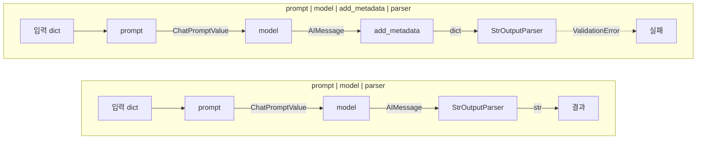
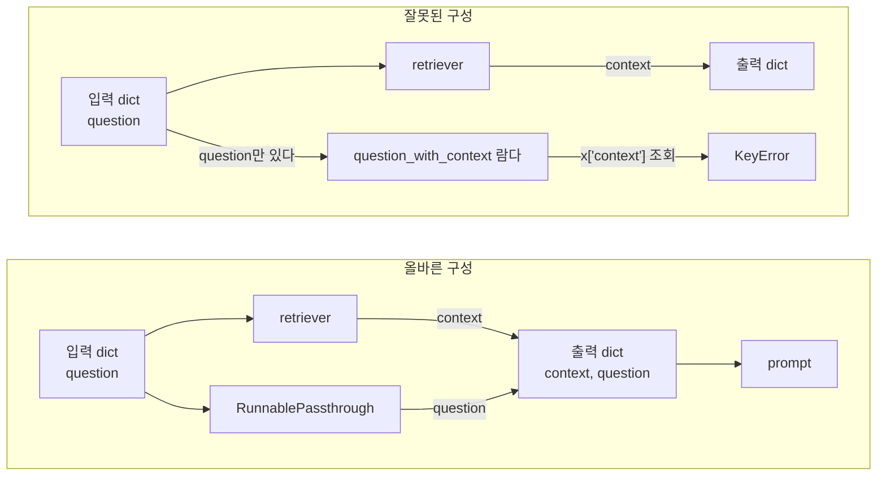
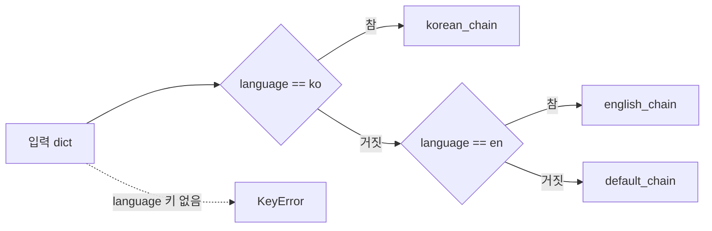
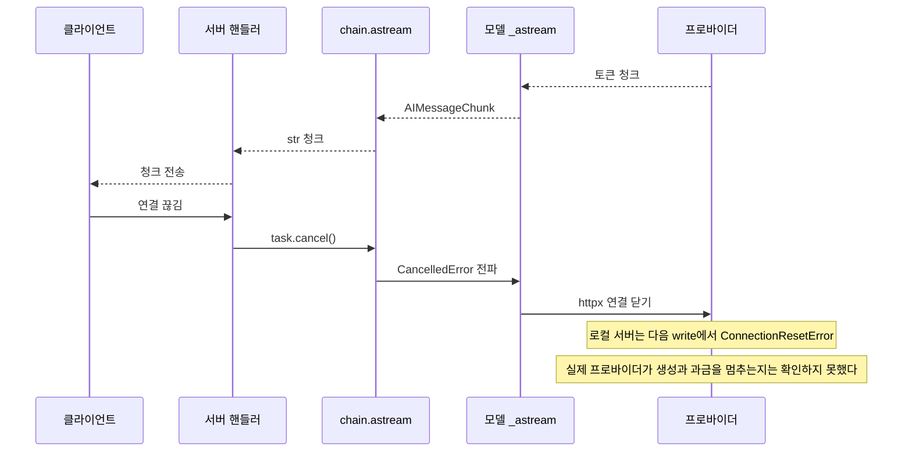
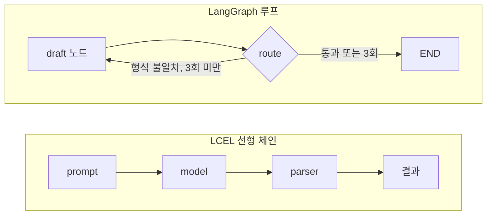

# LCEL — LangChain Expression Language

LCEL은 LangChain 0.1 시절의 `LLMChain`, `SequentialChain` 같은 레거시 체인을 대체하는 조합 방식이다. 파이프(`|`)로 컴포넌트를 연결하면 내부에서 `RunnableSequence`가 만들어지는 구조다. 추상화 수준이 얇아서 내부 동작을 이해하면 디버깅이 쉬워지지만, 타입 제약을 잘못 이해하면 엉뚱한 단계에서 예외가 나거나 엉뚱한 프롬프트가 모델로 나간다.

이 문서의 동작 설명은 `langchain-core` 0.3.86과 1.6.12에서 모두 돌려 본 결과다. 두 버전이 다르게 동작하는 곳은 본문에 따로 적었다. 평범한 함수와 비교하는 내용은 [Lang_Chain_vs_SDK](Lang_Chain_vs_SDK.md)와 이어진다.

## Runnable 인터페이스

LCEL의 모든 컴포넌트는 `Runnable` 프로토콜을 구현한다. 4개의 호출 방식이 있고 각각 쓰는 상황이 다르다.

```python
from langchain_core.runnables import Runnable
```

**invoke** — 단건 동기 호출. 입력을 넣고 완성된 출력을 기다린다. 배치 처리나 스트리밍이 필요 없을 때 쓴다.

```python
result = chain.invoke({"question": "Redis TTL이 뭔가요?"})
```

**stream** — 제너레이터를 반환한다. 첫 토큰부터 순서대로 나온다. FastAPI의 `StreamingResponse`에 바로 연결할 수 있다.

```python
for chunk in chain.stream({"question": "설명해주세요"}):
    print(chunk, end="", flush=True)
```

**batch** — 여러 입력을 동시에 처리한다. 내부적으로 `asyncio.gather`나 `ThreadPoolExecutor`를 쓴다. `max_concurrency`로 동시 실행 수를 제한한다.

```python
results = chain.batch(
    [{"question": "Q1"}, {"question": "Q2"}, {"question": "Q3"}],
    config={"max_concurrency": 5},
)
```

**astream** — 비동기 스트리밍. `async for`로 받는다. FastAPI 비동기 엔드포인트에서 주로 쓴다.

```python
async def generate():
    async for chunk in chain.astream({"question": "설명해주세요"}):
        yield chunk
```

`ainvoke`, `abatch`도 있다. 비동기 컨텍스트라면 이쪽을 쓴다.

## RunnableSequence — 파이프로 연결되는 실체

`|` 연산자를 쓰면 `RunnableSequence`가 생긴다.

```python
from langchain_core.prompts import ChatPromptTemplate
from langchain_openai import ChatOpenAI
from langchain_core.output_parsers import StrOutputParser

prompt = ChatPromptTemplate.from_template("다음을 설명해라: {topic}")
model = ChatOpenAI(model="gpt-4o-mini")
parser = StrOutputParser()

chain = prompt | model | parser
```

실행 흐름은 단순하다. `invoke({"topic": "Redis"})`를 호출하면 `prompt.invoke({"topic": "Redis"})` → `model.invoke(결과)` → `parser.invoke(결과)` 순서로 왼쪽에서 오른쪽으로 순차 실행된다.

타입 제약이 있다. 각 컴포넌트의 출력 타입이 다음 컴포넌트의 입력 타입과 맞아야 한다. `ChatPromptTemplate`의 출력은 `ChatPromptValue`이고 `ChatOpenAI`의 입력은 `BaseMessage` 목록을 담은 시퀀스다. LangChain 내부에서 자동 변환해주지만, 커스텀 컴포넌트를 중간에 끼우면 이 변환이 일어나지 않는다.

위 체인에서 단계마다 오가는 타입을 직접 찍어 보면 `dict` → `ChatPromptValue` → `AIMessage` → `str` 순서다. 아래 도식 위쪽이 정상 체인이고, 아래쪽은 `AIMessage`를 `dict`로 바꾸는 함수를 파서 앞에 끼운 경우다. 두 번째 체인에서 `StrOutputParser`가 받는 값의 타입이 바뀌는 지점을 보면 된다.



가장 흔한 실수는 딕셔너리를 반환하는 함수를 체인 중간에 넣을 때다.

```python
def extract_content(ai_message):
    # AIMessage 객체에서 content 문자열을 꺼내려는 의도
    return {"content": ai_message.content}

# 이렇게 하면 다음 단계에서 dict가 들어간다
broken_chain = prompt | model | extract_content | some_other_step
```

`some_other_step`이 `StrOutputParser`면 `dict`가 들어오는 순간 pydantic `ValidationError`(`Input should be a valid string`)가 난다. 조용히 넘어가지 않는다. `some_other_step`이 직접 만든 함수라면 `dict`를 받아도 예외가 없으므로, 그 함수 안에서 `dict`를 문자열처럼 다루다 터지는 지점까지 에러가 늦게 나타난다.

## RunnableParallel — 병렬 실행과 딕셔너리 타입

여러 체인을 동시에 실행하고 결과를 딕셔너리로 합친다.

```python
from langchain_core.runnables import RunnableParallel, RunnablePassthrough

retrieval_chain = RunnableParallel(
    context=retriever,
    question=RunnablePassthrough(),
)
```

입력이 문자열 `"Redis TTL이 뭔가요?"`라면 출력은 `{"context": [...검색결과...], "question": "Redis TTL이 뭔가요?"}` 형태가 된다. `RunnablePassthrough()`는 입력 전체를 그대로 넘기기 때문에 입력이 `{"question": "..."}` 딕셔너리면 `question` 값도 그 딕셔너리 통째로 들어간다. 이 문제는 `RunnablePassthrough` 절에서 다시 다룬다.

딕셔너리 문법으로도 쓸 수 있다. 동작은 같다.

```python
retrieval_chain = {
    "context": retriever,
    "question": RunnablePassthrough(),
}
```

LangChain이 딕셔너리를 `RunnableParallel`로 자동 변환한다.

병렬 실행이라는 이름과 달리, 각 브랜치가 완전히 독립적이어야 한다. 한 브랜치의 출력을 다른 브랜치의 입력으로 쓸 수 없다. 그게 필요하면 `RunnableSequence`를 먼저 구성하고 그 안에 `RunnableParallel`을 넣어야 한다.

모든 브랜치는 같은 입력을 받아 갈라졌다가, 각 브랜치의 출력이 키별로 하나의 딕셔너리에 모인다. 아래 도식은 올바른 구성과, 형제 브랜치의 출력을 참조하는 잘못된 구성을 나란히 놓은 것이다. 잘못된 쪽에서 람다가 받는 값이 합쳐지기 전의 원래 입력이라는 점이 핵심이다.



실제로 문제가 생기는 패턴이 있다. `RunnableParallel` 안에서 상태를 공유하려 할 때다.

```python
# 잘못된 예 — context를 retriever가 가져오고 question을 동시에 처리하는데
# question_with_context는 context가 이미 있어야 한다
broken = RunnableParallel(
    context=retriever,
    question=RunnablePassthrough(),
    question_with_context=lambda x: f"{x['question']} (context: {x['context']})",  # context가 없다
)
```

이 경우 `question_with_context`가 실행될 때 `context`가 아직 없어서 `KeyError`가 난다.

## RunnableBranch — 조건 분기

입력에 따라 다른 체인을 실행한다.

```python
from langchain_core.runnables import RunnableBranch

branch = RunnableBranch(
    (lambda x: x["language"] == "ko", korean_chain),
    (lambda x: x["language"] == "en", english_chain),
    default_chain,  # 어느 조건도 맞지 않을 때
)
```

각 튜플의 첫 번째 원소가 조건 함수이고 두 번째가 실행할 체인이다. 마지막 인자는 기본 체인이다. 마지막 인자에 튜플을 넘기면 `TypeError`(`RunnableBranch default must be Runnable, callable or mapping`)가 나고, 조건 브랜치와 기본 체인을 합쳐 두 개 미만이면 `ValueError`가 난다. 기본 체인은 생성 시점에 강제된다.

조건은 위에서 아래로 순서대로 평가하고, 처음 참이 된 브랜치 하나만 실행한다. 조건 함수가 Truthy 값을 반환해도 참으로 취급한다. 조건 함수 안에서 `x["language"]`처럼 키를 직접 꺼내는데 키가 없으면 기본 체인으로 가지 않고 `KeyError`가 난다. 기본 체인은 "어느 조건도 거짓"일 때만 쓰인다.



조건이 복잡해질수록 `RunnableLambda`를 써서 분기 로직을 명시적으로 작성하는 편이 디버깅하기 쉽다.

```python
from langchain_core.runnables import RunnableLambda

def route(input_dict):
    if input_dict.get("language") == "ko":
        return korean_chain.invoke(input_dict)
    elif input_dict.get("language") == "en":
        return english_chain.invoke(input_dict)
    return default_chain.invoke(input_dict)

branch = RunnableLambda(route)
```

`RunnableBranch`보다 코드가 길지만, 조건이 세 개 이상 생기거나 조건 자체가 복잡해지면 이 방식이 낫다.

## RunnablePassthrough — 입력을 그대로 전달

입력을 변환 없이 다음 단계로 넘긴다. 주로 `RunnableParallel`과 함께 원래 질문을 체인 끝까지 유지할 때 쓴다.

```python
from langchain_core.runnables import RunnablePassthrough

rag_chain = (
    {"context": retriever, "question": RunnablePassthrough()}
    | prompt
    | model
    | StrOutputParser()
)
```

`assign()`을 쓰면 기존 딕셔너리에 새 키를 추가할 수 있다.

```python
chain = (
    RunnablePassthrough.assign(context=retriever)
    | prompt
    | model
)
```

입력이 `{"question": "..."}` 이면 `assign(context=retriever)` 이후에 `{"question": "...", "context": [...]}` 가 된다. 원래 키를 유지하면서 새 데이터를 붙일 때 유용하다.

주의할 점이 둘 있다.

첫째, `RunnablePassthrough()`는 입력 전체를 넘긴다. 위 `rag_chain`에 `{"question": "Redis TTL이 뭔가요?"}` 딕셔너리를 넣으면 프롬프트의 `{question}` 자리에 질문 문자열이 아니라 `{'question': 'Redis TTL이 뭔가요?'}`라는 딕셔너리의 문자열 표현이 들어간다. 예외가 없고 모델은 그 문자열을 그대로 받는다. `context` 쪽은 `retriever`가 같은 딕셔너리를 통째로 받는다. 입력이 딕셔너리면 `itemgetter`로 꺼내서 쓴다.

```python
from operator import itemgetter

rag_chain = (
    {
        "context": itemgetter("question") | retriever,
        "question": itemgetter("question"),
    }
    | prompt
    | model
    | StrOutputParser()
)
```

둘째, `RunnablePassthrough.assign()`은 딕셔너리 입력을 가정한다. 입력이 문자열이면 `ValueError`(`The input to RunnablePassthrough.assign() must be a dict.`)가 난다.

## RunnableLambda — 커스텀 Runnable 구현

Python 함수를 Runnable로 감싼다. 체인 중간에 커스텀 로직을 넣을 때 쓴다.

```python
from langchain_core.runnables import RunnableLambda

def format_docs(docs):
    return "\n\n".join(doc.page_content for doc in docs)

format_chain = RunnableLambda(format_docs)
```

비동기 함수도 감쌀 수 있다.

```python
async def async_format(docs):
    return "\n\n".join(doc.page_content for doc in docs)

async_format_chain = RunnableLambda(async_format)
```

`astream`을 지원하게 하려면 제너레이터를 반환하는 함수를 넘기면 된다.

```python
def streaming_format(docs):
    for doc in docs:
        yield doc.page_content + "\n\n"

stream_chain = RunnableLambda(streaming_format)
```

`RunnableLambda`로 만든 체인은 `stream()`을 호출해도 내부 함수가 제너레이터가 아니면 완성된 결과를 한 번에 내보낸다. 스트리밍이 필요한 구간에 `RunnableLambda`를 쓸 때는 이 점을 확인해야 한다.

## bind(), with_config(), with_fallbacks()

**bind()** — 특정 파라미터를 고정한다. 런타임마다 같은 설정을 반복하지 않을 때 쓴다.

```python
model_with_stop = model.bind(stop=["Human:"])

# temperature를 고정한 버전
creative_model = model.bind(temperature=0.9)
```

`bind()`는 새 Runnable을 반환한다. 원본 `model`은 바뀌지 않는다.

**with_config()** — 런타임 설정을 주입한다. 태깅, 콜백, 재귀 제한 등을 건다.

```python
chain.with_config(
    run_name="my_rag_chain",
    tags=["production", "v2"],
    callbacks=[my_callback_handler],
)
```

`invoke()` 호출 시 `config` 인자로도 줄 수 있지만, `with_config()`로 기본값을 고정하면 매번 넘기지 않아도 된다.

**with_fallbacks()** — 실패 시 대체 체인을 실행한다.

```python
from langchain_openai import ChatOpenAI
from langchain_anthropic import ChatAnthropic

primary = ChatOpenAI(model="gpt-4o")
fallback = ChatAnthropic(model="claude-3-5-sonnet-20241022")

chain = primary.with_fallbacks([fallback])
```

`primary`가 `RateLimitError`, `Timeout`, `APIError` 같은 예외를 던지면 `fallback`으로 재시도한다. 어떤 예외에서 fallback을 실행할지 `exceptions_to_handle`로 지정할 수 있다.

```python
chain = primary.with_fallbacks(
    [fallback],
    exceptions_to_handle=(RateLimitError, Timeout),
)
```

`exceptions_to_handle`를 지정하지 않으면 모든 예외에서 fallback을 시도한다. 버그로 인한 예외까지 삼켜버리는 경우가 있어서, 운영 환경에서는 명시적으로 지정하는 편이 낫다.

## 스트리밍 중단 처리

스트리밍 도중 클라이언트가 연결을 끊으면 서버 쪽에서 처리해야 한다. FastAPI에서 `StreamingResponse`를 쓸 때, 클라이언트가 끊으면 `astream()`의 비동기 루프가 다음 토큰을 생성하기 전까지 모른다.

```python
from fastapi import FastAPI
from fastapi.responses import StreamingResponse
from starlette.requests import Request

app = FastAPI()

@app.post("/stream")
async def stream_endpoint(request: Request, body: dict):
    async def generate():
        async for chunk in chain.astream(body):
            if await request.is_disconnected():
                break
            yield chunk

    return StreamingResponse(generate(), media_type="text/plain")
```

`request.is_disconnected()`를 매 청크마다 확인한다. 이 방식은 다음 청크가 도착해야 검사가 돌기 때문에 모델이 토큰을 내보내지 않는 구간에는 끊김을 알아채지 못한다.

`astream`을 소비하는 쪽을 `asyncio.Task`로 감싸고 `cancel()`을 부르면 취소가 모델 호출까지 내려간다. 로컬에서 청크를 천천히 흘리는 HTTP 서버를 세우고, `httpx`로 그 서버를 읽는 `BaseChatModel`을 만들어 `prompt | model | StrOutputParser()`의 `astream`을 취소해 확인했다.

```python
async def consume(chain, payload):
    async for chunk in chain.astream(payload):
        await send_to_client(chunk)

task = asyncio.create_task(consume(chain, body))
# 클라이언트 연결이 끊긴 것을 감지한 시점에
task.cancel()
try:
    await task
except asyncio.CancelledError:
    pass
```

관찰한 순서는 아래 도식과 같다. `task.cancel()`이 `CancelledError`로 파이프라인을 거슬러 내려가 모델의 `_astream`까지 닿고, 거기서 `httpx` 연결이 닫히며, 서버 쪽 다음 `write`가 `ConnectionResetError`로 실패했다.



도식의 마지막 칸은 비워 둔 것이 아니라 확인하지 못한 부분이다. 로컬 서버로는 연결이 닫히는 데까지만 볼 수 있고, OpenAI나 Anthropic이 연결 종료를 감지한 시점에 생성을 멈추는지, 이미 생성한 토큰을 과금하는지는 프로바이더 정책과 청구서를 직접 봐야 안다. 취소 코드를 넣은 뒤에도 사용량 대시보드에서 취소한 요청의 출력 토큰 수를 한 번은 대조해야 한다.

`break`로 루프를 빠져나오는 경우도 같은 실험으로 봤다. `async for` 안에서 `break`한 직후 그 줄에서는 모델의 `finally`가 아직 실행되지 않았고, 이벤트 루프가 한 턴 돈 뒤(측정값 1ms) 실행되며 연결이 닫혔다. `astream(...)`이 돌려준 객체에 `aclose()`를 불러도 `break` 직후 같은 줄에서는 안쪽 모델의 `finally`가 실행되지 않았다. 안쪽 제너레이터는 이후에 비동기 제너레이터 정리 과정에서 닫혔다. 연결을 확실히 끊어야 하는 지점에서는 `break`보다 `Task.cancel()`이 의도가 분명하다.

한 가지 더 주의할 점이 있다. `async for chunk in task`처럼 `Task`를 직접 순회하는 코드는 쓸 수 없다. `TypeError: 'async for' requires an object with __aiter__ method, got _asyncio.Task`가 난다.

## 타입 불일치로 파이프라인이 조용히 깨지는 사례

타입 불일치가 어떻게 드러나는지는 경우마다 다르다. 직접 돌려 본 결과를 먼저 표로 놓는다. 두 버전(`langchain-core` 0.3.86, 1.6.12)에서 동일하게 나온 것만 적었다.

| 상황 | 결과 |
|---|---|
| `StrOutputParser`에 `dict`가 들어옴 | `ValidationError` (`Input should be a valid string`) |
| `StrOutputParser`에 `None`이 들어옴 | `ValidationError` |
| 프롬프트 변수명과 딕셔너리 키가 다름 (`ctx` vs `context`) | `KeyError` (`Input to ChatPromptTemplate is missing variables`) |
| 프롬프트에 문자열을 넘김 | `TypeError` (`Expected mapping type as input`) |
| 프롬프트에 정의되지 않은 키가 더 들어옴 | 무시된다. 예외 없음 |
| `RunnablePassthrough()`가 딕셔너리 입력을 통째로 받음 | `{question}` 자리에 딕셔너리 문자열이 들어간다. 예외 없음 |
| 직접 만든 함수가 `dict`를 받음 | 함수 안에서 터질 때까지 예외 없음 |

예외 없이 지나가는 것은 표의 마지막 세 줄이다. 정의되지 않은 키, `Passthrough`의 딕셔너리 통째 전달, 직접 만든 함수 입력이다. 나머지는 해당 단계에서 바로 터지므로 스택 트레이스만 읽으면 된다.

**dict가 파서로 들어갈 때.** `str(dict)`로 변환돼 조용히 넘어갈 것 같지만 두 버전 모두 그렇지 않다.

```python
def add_metadata(ai_message):
    return {"answer": ai_message.content, "model": "gpt-4o"}

# ValidationError: Input should be a valid string
broken = prompt | model | add_metadata | StrOutputParser()
```

**키 이름이 어긋날 때.** `RunnableParallel`의 출력은 항상 딕셔너리라 키 이름이 프롬프트 변수명과 맞아야 한다. 어긋나면 빈 문자열이 들어갈 것 같지만 실제로는 `KeyError`다.

```python
retrieval = RunnableParallel(
    ctx=retriever,        # "ctx"
    question=RunnablePassthrough(),
)

prompt = ChatPromptTemplate.from_template(
    "컨텍스트: {context}\n질문: {question}"  # "context" — ctx와 키가 다르다
)

# KeyError: Input to ChatPromptTemplate is missing variables {'context'}.
chain = retrieval | prompt | model
```

반대로 프롬프트에 없는 키가 더 들어오는 경우는 아무 말 없이 버려진다. 필요한 키는 맞는데 오타 난 키가 하나 더 붙어 있으면 그 값은 모델에 전달되지 않는데도 예외가 없다.

**RunnableLambda에서 None을 반환할 때.** 함수가 명시적으로 `return`하지 않으면 `None`이 다음 단계로 넘어간다.

```python
def process(input_dict):
    result = do_something(input_dict)
    # return을 빠뜨렸다

chain = prompt | model | RunnableLambda(process) | StrOutputParser()
```

`StrOutputParser`로 이어지면 `ValidationError`가 나고, 직접 만든 함수로 이어지면 그 함수가 `None`을 어떻게 다루느냐에 따라 달라진다.

**AIMessage의 content가 블록 리스트일 때.** Anthropic 모델처럼 `content`가 `[{"type": "text", "text": "..."}]` 형태의 리스트로 오는 경우 `StrOutputParser`의 동작이 버전마다 다르다. 텍스트 블록이 두 개인 메시지를 넣어 보면 0.3.86은 첫 블록(`'hi'`)만, 1.6.12는 이어 붙인 `'hi there'`를 돌려준다. 0.3 환경에서 긴 응답이 중간에 잘리면 이 경로를 의심한다.

**batch()에서 일부 입력만 실패할 때.** 기본값은 첫 번째 예외에서 `batch()` 전체가 실패한다. `return_exceptions=True`를 주면 나머지는 계속 실행하고 실패한 자리에 예외 객체를 넣는다.

```python
def f(x):
    if x == 2:
        raise ValueError("boom")
    return x

RunnableLambda(f).batch([1, 2, 3])
# ValueError: boom

RunnableLambda(f).batch([1, 2, 3], return_exceptions=True)
# [1, ValueError('boom'), 3]
```

`return_exceptions=True`로 받은 리스트를 그대로 다음 단계에 넘기면 예외 객체가 입력 자리에 섞여 들어간다. 결과를 쓰기 전에 `isinstance(r, Exception)`으로 걸러야 한다.

## 파이프라인 디버깅

`with_config(verbose=True)`는 아무것도 출력하지 않는다. `RunnableConfig`에 그런 키가 없어서 무시된다. 각 단계의 입출력을 콘솔로 보려면 전역 설정을 켠다.

```python
from langchain_core.globals import set_debug

set_debug(True)
chain.invoke({"topic": "Redis"})   # 단계마다 start/end 로그와 입출력이 찍힌다
set_debug(False)
```

로그에 찍히는 단계 이름은 `RunnableSequence > chain:inc` 형태다. `RunnableLambda`에 이름 있는 함수를 넘기면 함수 이름이, 람다를 넘기면 `RunnableLambda`가 그대로 찍힌다. 람다가 여럿이면 어느 단계인지 구분할 수 없으니 `def`로 이름을 붙이거나 `name=`을 준다. LangSmith를 쓰면 같은 정보를 트레이스 단위로 볼 수 있다.

LangSmith 없이 빠르게 확인하려면 중간 단계를 분리해서 `invoke()`로 직접 실행해보는 것이 빠르다.

```python
# 체인 전체 대신 중간까지만 실행
partial = prompt | model
result = partial.invoke({"topic": "Redis"})
print(type(result), result)  # AIMessage 타입인지, 내용이 맞는지 확인
```

타입 불일치 문제는 대부분 중간 결과를 직접 찍어보면 금방 찾는다. 전체 체인을 한 번에 연결하기 전에 단계별로 확인하는 습관이 필요하다.

체인 객체의 `steps`로 단계를 하나씩 꺼내 단독 실행할 수도 있다. `RunnableSequence.steps`가 단계 리스트다.

```python
chain.steps[0].invoke({"topic": "Redis"}).to_string()   # 'Human: 설명: Redis'
chain.steps[-1].invoke("  hi ")                         # 마지막 단계만 실행
```

## LCEL 없이 평범한 함수로 쓰면

앞에서 쓴 `prompt | model | parser`에 후처리 한 단계(`strip().upper()`)를 붙인 파이프라인을 두 방식으로 쓴다. 아래 두 코드는 둘 다 같은 입력에 `'HELLO'`를 돌려준다(모델은 가짜로 대체해서 실행했다).

```python
# LCEL
from langchain_openai import ChatOpenAI
from langchain_core.prompts import ChatPromptTemplate
from langchain_core.output_parsers import StrOutputParser
from langchain_core.runnables import RunnableLambda

def clean(text: str) -> str:
    return text.strip().upper()

def build_chain(model):
    return (
        ChatPromptTemplate.from_template("설명: {topic}")
        | model
        | StrOutputParser()
        | RunnableLambda(clean)
    )

build_chain(ChatOpenAI(model="gpt-4o-mini")).invoke({"topic": "Redis"})
```

```python
# 순수 SDK
from openai import OpenAI

def explain(client, topic: str, post=clean) -> str:
    resp = client.chat.completions.create(
        model="gpt-4o-mini",
        messages=[{"role": "user", "content": f"설명: {topic}"}],
    )
    return post(resp.choices[0].message.content)

explain(OpenAI(), "Redis")
```

줄 수는 큰 차이가 없다. 갈리는 곳은 테스트와 에러 추적이다. 두 방식의 단위 테스트는 이렇게 생긴다.

```python
from itertools import cycle
from types import SimpleNamespace
from langchain_core.language_models.fake_chat_models import GenericFakeChatModel
from langchain_core.messages import AIMessage

def test_lcel():
    model = GenericFakeChatModel(messages=cycle([AIMessage(content="  hello  ")]))
    assert build_chain(model).invoke({"topic": "Redis"}) == "HELLO"

class FakeClient:
    def __init__(self, text):
        msg = SimpleNamespace(message=SimpleNamespace(content=text))
        self.chat = SimpleNamespace(
            completions=SimpleNamespace(create=lambda **kw: SimpleNamespace(choices=[msg]))
        )

def test_plain():
    assert explain(FakeClient("  hello  "), "Redis") == "HELLO"
```

LCEL 쪽이 어려운 지점은 세 가지다.

첫째, 모델을 가짜로 바꾸려면 `BaseChatModel` 계약을 맞춘 대역이 필요하다. `GenericFakeChatModel`이 있어서 이 정도 체인에서는 부담이 없다. 순수 함수 쪽은 `create` 하나만 흉내 내면 된다.

둘째, 단계 사이의 값을 검증하려면 `chain.steps[i]`로 꺼내야 한다. 딕셔너리 리터럴(`{"context": ..., "question": ...}`)로 만든 단계는 `steps[0]`에서 딕셔너리가 아니라 `RunnableParallel`로 나오고, 그 안의 브랜치는 `steps__` 속성을 한 번 더 열어야 보인다. 순수 함수는 중간 값이 지역 변수라 그냥 `assert`를 걸면 된다.

셋째, 에러 스택이 길다. 후처리 함수에서 예외를 던졌을 때 LCEL 체인의 스택은 `invoke`, `_call_with_config`, `call_func_with_variable_args`, `_invoke` 같은 라이브러리 프레임 6개가 내 코드 사이에 끼었다. 순수 함수는 내 코드 프레임만 보인다.

반대로 LCEL이 얻는 것도 있다. `stream`, `astream`, `batch`가 같은 정의에서 나오고, `with_fallbacks`나 `with_config`로 콜백·태그를 한 번에 건다. 순수 함수에서는 재시도·폴백·스트리밍을 직접 짜야 한다. 이 비교는 [Lang_Chain_vs_SDK](Lang_Chain_vs_SDK.md)에서 마이그레이션 비용 쪽으로 이어서 다룬다.

## LCEL이 맞는 용도와 맞지 않는 용도

LCEL에는 루프 구문이 없다. 선형으로 흘러가는 구간은 `|`로 쓰고, 되돌아가는 흐름은 `RunnableLambda` 안에서 `while`로 직접 쓰게 된다. 그 순간 루프 안쪽은 LCEL이 아니라 평범한 코드다. 이 때문에 에이전트처럼 모델 출력에 따라 도구를 호출하고 다시 모델로 돌아가는 흐름은 LangChain 0.3 이후 LangGraph에서 쓰는 쪽으로 무게가 옮겨갔다. 에이전트 쪽은 [Lang_Chain_Agents](Lang_Chain_Agents.md)에서 다룬다.

| 용도 | LCEL | 이유 |
|---|---|---|
| 프롬프트 → 모델 → 파서 | 맞다 | 단계가 고정이고 스트리밍·배치를 그대로 얻는다 |
| 검색 → 프롬프트 → 모델 (RAG 한 번) | 맞다 | `RunnableParallel` 한 번으로 끝난다 |
| 폴백·재시도가 붙은 단발 호출 | 맞다 | `with_fallbacks`, `with_retry`로 해결된다 |
| 출력이 형식에 안 맞으면 다시 생성 | 맞지 않다 | 루프가 필요하고 시도 횟수 같은 상태를 들고 다녀야 한다 |
| 도구 호출 여부에 따라 모델로 되돌아감 | 맞지 않다 | 순환 구조다 |
| 분기가 많고 조건이 람다로 흩어져 있음 | 맞지 않다 | 어느 분기를 탔는지 코드에서 한눈에 안 보이고, 조건 평가 중 `KeyError`가 나면 기본 체인으로 가지도 않는다. 그래프는 노드와 엣지로 드러난다 |



둘을 섞어 쓰는 것이 흔한 형태다. LCEL 체인은 노드 안의 한 단계로 쓰고, 되돌아가는 판단은 그래프의 조건부 엣지가 맡는다. 아래는 `langgraph` 1.2.16에서 실행해 확인한 코드다. 모델이 세 번째 시도에서 JSON을 내놓는 상황을 가짜 모델로 만들었다.

```python
from typing import TypedDict
from langchain_core.output_parsers import StrOutputParser
from langchain_core.prompts import ChatPromptTemplate
from langgraph.graph import StateGraph, START, END

draft_chain = ChatPromptTemplate.from_template("JSON으로 답해라: {question}") | model | StrOutputParser()

class State(TypedDict):
    question: str
    answer: str
    tries: int

def draft(state: State) -> dict:
    return {"answer": draft_chain.invoke({"question": state["question"]}), "tries": state["tries"] + 1}

def route(state: State) -> str:
    if state["answer"].startswith("{") or state["tries"] >= 3:
        return END
    return "draft"

g = StateGraph(State)
g.add_node("draft", draft)
g.add_edge(START, "draft")
g.add_conditional_edges("draft", route, ["draft", END])
app = g.compile()

app.invoke({"question": "Redis TTL?", "answer": "", "tries": 0})
# {'question': 'Redis TTL?', 'answer': '{"ok": true}', 'tries': 3}
```

`tries`는 상태에 들어 있고 `route`가 읽는다. 같은 일을 LCEL로 하면 `RunnableLambda` 안에서 `for _ in range(3)`을 돌리면서 시도 횟수를 지역 변수로 들고 있어야 한다. 선형 체인이 여러 개 이어지는 정도까지는 LCEL, 되돌아가는 간선이 하나라도 생기면 그래프로 옮기는 것이 이 기준이다.
