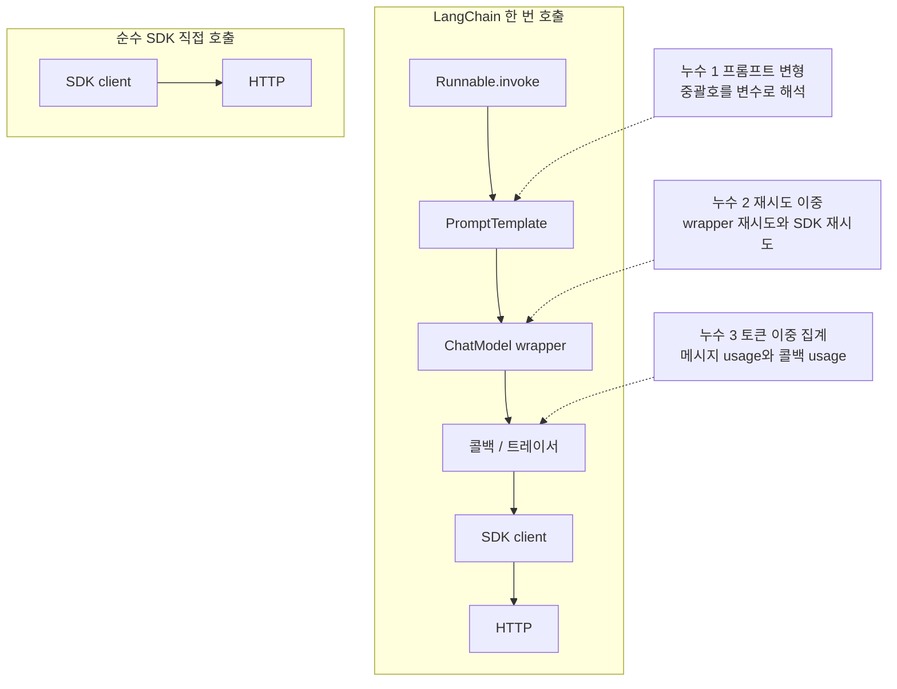
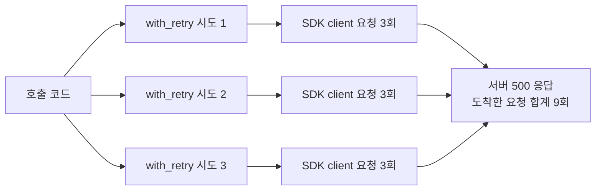
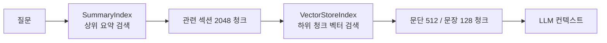
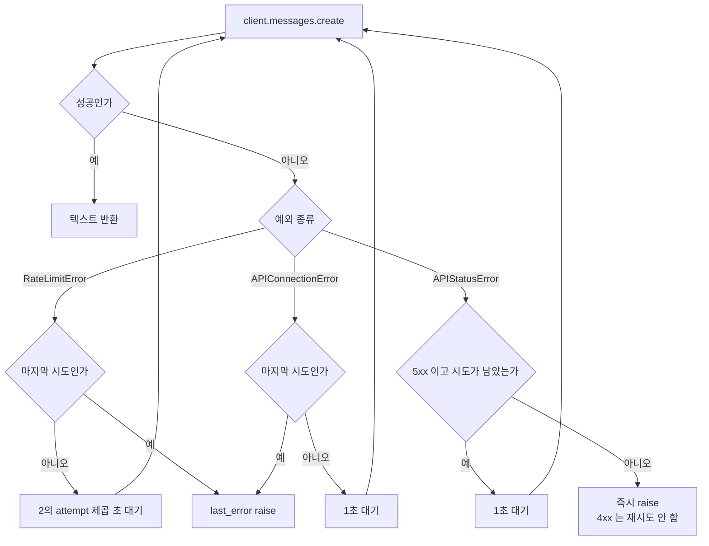
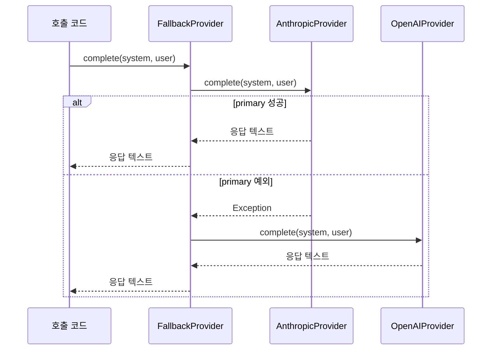
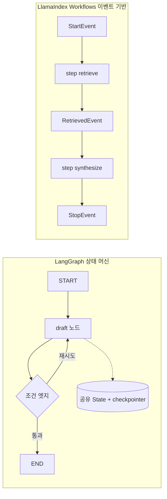
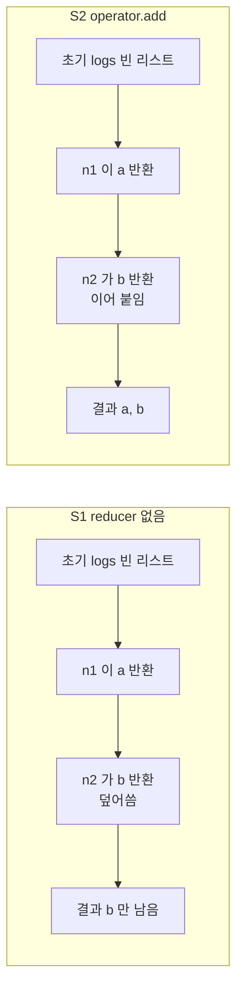
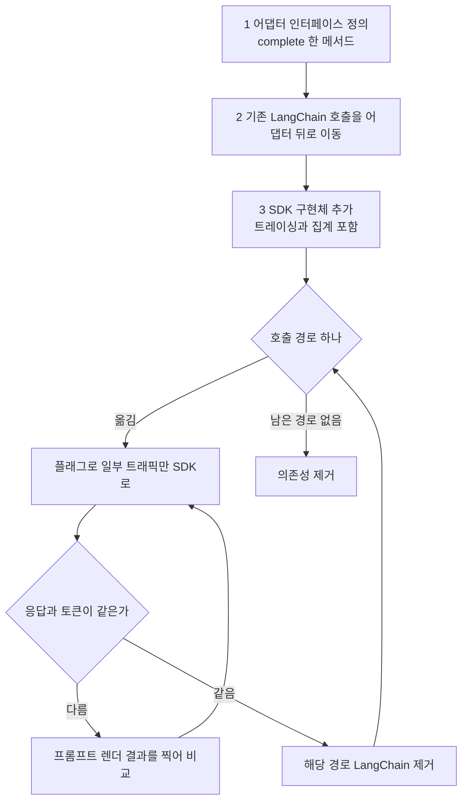
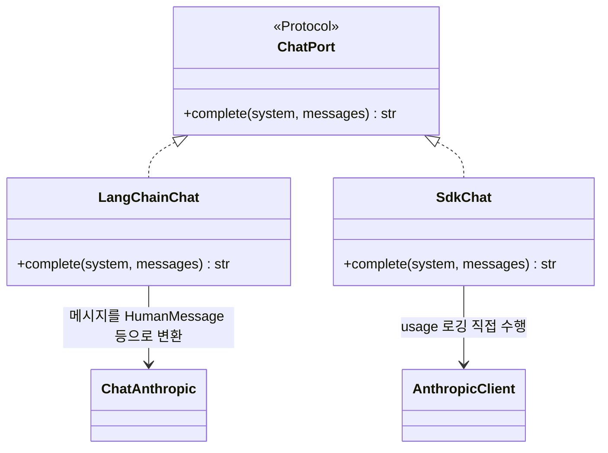
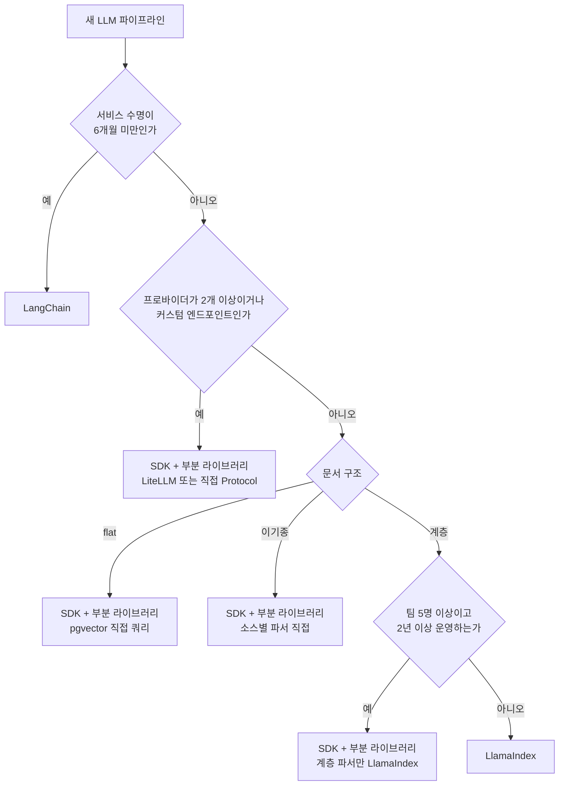

# LangChain / LlamaIndex vs 순수 SDK

LangChain과 LlamaIndex는 LLM 파이프라인 구성을 빠르게 시작할 수 있도록 추상화를 제공하는 프레임워크다. 문제는 그 추상화가 특정 시점에서 오히려 짐이 된다는 것이다.

## LangChain이 매력적인 이유

처음 LLM 기능을 붙일 때 LangChain이 빠르게 보인다. RAG 파이프라인 하나를 만들려면 문서 로더, 텍스트 분할기, 임베딩, 벡터 스토어, 리트리버, 프롬프트 템플릿, 모델 호출, 출력 파서를 각각 구현해야 한다. LangChain은 이걸 체인 하나로 묶어 준다.

LlamaIndex는 인덱싱과 검색 쪽에 집중한다. 문서 트리 구조나 요약 인덱스 같은 개념이 내장되어 있어서, 계층적 문서 검색이 필요한 경우 처음 세팅하는 데 드는 시간이 줄어든다.

## 마이그레이션에서 실제로 깨지는 것들

### LangChain: import 경로가 버전마다 바뀐다

LangChain은 0.1에서 0.3으로 오면서 패키지 구조가 두 번 크게 바뀌었다. 0.1 코드를 0.3 환경에서 실행하면 이런 오류가 바로 나온다.

```
ModuleNotFoundError: No module named 'langchain.chains'
ImportError: cannot import name 'LLMChain' from 'langchain'
```

실제로 0.1 시절 코드가 0.3에서 어떻게 달라지는지:

```python
# 0.1 시절 — 패키지 전체가 langchain 하나였다
from langchain.chains import LLMChain
from langchain.prompts import PromptTemplate
from langchain.chat_models import ChatAnthropic
from langchain.memory import ConversationBufferMemory

chain = LLMChain(
    llm=ChatAnthropic(model="claude-3-opus-20240229"),
    prompt=PromptTemplate.from_template("{input}"),
    memory=ConversationBufferMemory()
)
result = chain.run(input="질문")
```

```python
# 0.3 — 패키지가 langchain-core, langchain-community, langchain-anthropic으로 쪼개졌다
from langchain_core.prompts import PromptTemplate
from langchain_core.output_parsers import StrOutputParser
from langchain_anthropic import ChatAnthropic  # 별도 패키지
# ConversationBufferMemory는 deprecated, RunnableWithMessageHistory로 교체

chain = PromptTemplate.from_template("{input}") | ChatAnthropic(model="claude-opus-4-7") | StrOutputParser()
result = chain.invoke({"input": "질문"})
```

위 두 코드의 버전 표기(0.1, 0.3)는 당시 기준이다. 이 문서의 측정과 예제는 2026-10에 새 venv로 설치한 `langchain-core 1.6.12`, `langchain-anthropic 1.7.6`, `langgraph 1.2.16`, `langchain-text-splitters 1.1.3`, `llama-index-core 0.14.25`, `instructor 1.17.0`, `litellm 1.106.0`, `anthropic 1.15.0` 에서 돌려 확인했다. 0.3 예제의 `langchain_core.prompts`, `langchain_core.output_parsers`, `langchain_anthropic` import 3줄은 이 조합에서 그대로 import 된다. 0.1 예제의 `claude-3-opus-20240229` 같은 모델 ID는 시기를 보여 주려는 값이다. 실제로 `claude-sonnet-4-5` 로 테스트하다가 SDK가 폐기 예정 모델이라는 경고를 낸 적이 있어서, 모델 ID도 라이브러리 버전처럼 시점에 묶인다.

이 변경은 이름만 바뀐 게 아니다. LCEL(LangChain Expression Language)이라는 새 패러다임 전체를 다시 배워야 한다. 6개월 묵은 LangChain 코드베이스를 열면 deprecation 경고가 수십 개 쌓여 있고, 마이그레이션 가이드를 따라가다 보면 체인 구조를 통째로 다시 쓰게 된다.

`find . -name "*.py" | xargs grep "from langchain" | grep -v langchain_core`로 레거시 import를 찾을 수 있지만, 단순 find-and-replace로는 안 된다. `LLMChain`을 LCEL 파이프로 바꾸려면 체인이 어떻게 연결되는지 파악한 다음 재작성해야 한다.

### LlamaIndex: 패키지 분리가 더 급격했다

LlamaIndex는 0.10.x에서 패키지를 `llama-index` 단일 패키지에서 아래처럼 쪼갰다.

```
llama-index-core
llama-index-llms-anthropic
llama-index-llms-openai
llama-index-vector-stores-qdrant
llama-index-vector-stores-chroma
llama-index-embeddings-huggingface
...
```

기존 코드에서 이런 import는 전부 깨진다.

```python
# 구버전
from llama_index import GPTVectorStoreIndex, SimpleDirectoryReader
from llama_index.vector_stores import QdrantVectorStore
from llama_index.embeddings import HuggingFaceEmbedding
```

```python
# 신버전
from llama_index.core import VectorStoreIndex, SimpleDirectoryReader
from llama_index.vector_stores.qdrant import QdrantVectorStore
from llama_index.embeddings.huggingface import HuggingFaceEmbedding
```

클래스 이름도 `GPTVectorStoreIndex` → `VectorStoreIndex`로 바뀌었다. 단순 sed 치환으로는 해결이 안 되고, 새로 설치해야 하는 패키지 목록을 파악한 다음 `requirements.txt`를 통째로 갱신해야 한다.

버전 고정(`pip install llama-index==0.9.x`)을 걸어도 문제는 해결되지 않는다. 하위 의존 패키지들의 버전까지 모두 고정해야 하고, 보안 패치가 필요할 때 업그레이드 경로가 막힌다.

### 추상화 누수

LangChain이 숨겨 놓은 동작이 예상과 다르게 작동할 때 디버깅이 어렵다. `ConversationalRetrievalChain`을 쓰면 내부에서 질문을 먼저 재작성(condense)하는 서브체인이 돌아간다. 사용자 입장에서는 프롬프트가 하나인 것처럼 보이지만 실제로는 LLM 호출이 두 번 일어난다.

비용 계산이 틀려지거나 레이턴시가 예상보다 두 배가 나오는 상황이 여기서 발생한다. 내부를 뜯어보려면 LangSmith 트레이싱을 켜야 하는데, 그것도 별도 가입과 설정이 필요하다.

### 한 번 호출이 지나가는 레이어

`chain.invoke()` 한 줄이 실제로 거치는 층을 순수 SDK와 나란히 놓으면 누수가 생기는 자리가 보인다. 왼쪽이 LangChain, 오른쪽이 SDK 직접 호출이다. 점선으로 이어진 박스가 각 층에서 실제로 문제가 된 지점이다.



SDK 쪽은 요청 본문을 만드는 코드가 내 코드 안에 있다. 프레임워크 쪽은 같은 본문이 레이어 세 개를 거쳐서 만들어지고, 재시도와 집계는 서로 모르는 층에서 따로 일어난다. 아래는 로컬 가짜 서버(요청 수를 세는 `http.server`)를 세워 놓고 직접 센 결과다.

**누수 1, 프롬프트가 몰래 바뀌는 곳.** `PromptTemplate`의 기본 포맷은 f-string이라 중괄호가 전부 변수로 해석된다. JSON 예시를 프롬프트에 넣으면 호출 전에 터진다.

```python
from langchain_core.prompts import PromptTemplate
PromptTemplate.from_template('JSON으로 답해라: {"a": 1}\n질문: {q}').invoke({"q": "x"})
# KeyError: Input to PromptTemplate is missing variables {'"a"'}.
```

이건 소리 내서 터지니 차라리 낫다. 조용한 쪽은 `ConversationalRetrievalChain`의 질문 재작성이다. 사용자가 쓴 질문이 아니라 LLM이 다시 쓴 질문으로 검색하기 때문에, 검색 결과가 이상할 때 원인이 검색인지 재작성인지 호출 로그만 봐서는 구분이 안 된다. 중괄호는 `{{`, `}}` 로 이스케이프하면 되지만, 한 겹 벗겨진 채로 렌더되므로 최종 프롬프트를 한 번은 찍어 봐야 한다.

**누수 2, 재시도가 이중으로 걸리는 곳.** `ChatAnthropic`은 `max_retries=2`가 기본이고 이 값은 SDK 클라이언트로 내려간다. 여기에 `with_retry()`를 한 겹 더 씌우면 곱해진다. 서버가 항상 500 또는 400을 돌려주는 상태에서 서버에 도착한 요청 수는 이랬다.

| 호출 방식 | 서버 500 | 서버 400 |
|---|---|---|
| SDK 직접 (기본 `max_retries=2`) | 3회 | 1회 |
| `ChatAnthropic` 기본 | 3회 | 1회 |
| `ChatAnthropic.with_retry(stop_after_attempt=3)` | 9회 | 3회 |

500에서 3회가 9회가 되는 건 `3 x 3` 이다. 레이트 리밋 상황에서 이 곱셈이 걸리면 이미 막힌 쿼터에 요청을 세 배로 쏟는다. 400은 SDK가 재시도하지 않는데 `with_retry()`는 기본이 모든 예외 재시도라 3회가 나간다. `with_retry`를 쓸 거면 `retry_if_exception_type`으로 대상을 좁히고 모델 쪽 `max_retries`를 0으로 내려야 한다.

바깥 `with_retry` 시도 하나마다 안쪽 SDK 재시도가 통째로 한 번씩 돌기 때문에 서버가 받는 요청이 곱으로 늘어난다. 아래 그림에서 두 겹의 재시도가 어떻게 겹치는지 본다.



**누수 3, 토큰이 이중 집계되는 곳.** 한 번 호출한 결과의 토큰이 두 군데에 남는다. 반환된 `AIMessage.usage_metadata`(입력 10, 출력 3, 합 13)와 콜백의 `on_llm_end` 안 메시지가 같은 값이다. 콜백은 호출 1회에 1번 불렸고 요청도 1건이었으니 프레임워크가 센 값 자체는 정확하다. 문제는 쓰는 쪽이다. 응답 객체에서 한 번 더하고 콜백 핸들러에서 한 번 더하면 13이 아니라 26이 쌓인다. 여기에 LangSmith 같은 트레이서의 집계와 직접 만든 SDK 래퍼의 집계까지 있으면 대시보드 숫자가 청구서와 안 맞는 이유를 한참 찾게 된다. 집계 지점은 한 곳으로 정해 두는 수밖에 없다.

## LlamaIndex vs LangChain: 문서 구조별 판단

두 프레임워크를 동시에 다루는 문서가 많은데, 실제 선택 기준은 "문서 구조가 어떻게 생겼는가"에서 갈린다.

### Flat 구조 (FAQ, 지원 티켓, 뉴스 기사)

단일 레벨 문서 컬렉션이라면 LangChain도 LlamaIndex도 오버킬이다. pgvector + 직접 쿼리로 충분하다.

```sql
-- pgvector로 코사인 유사도 검색
SELECT content, 1 - (embedding <=> $1::vector) AS similarity
FROM documents
WHERE 1 - (embedding <=> $1::vector) > 0.7
ORDER BY similarity DESC
LIMIT 5;
```

프레임워크 없이 임베딩 API + SQL 조합으로 RAG를 만들면 의존성이 `psycopg2`와 임베딩 API 클라이언트뿐이다. 버전 이슈가 생길 지점 자체가 없다.

### 계층 구조 (법률 문서, 기술 매뉴얼, 정책 문서)

"3장 2절 a항"처럼 구조가 있는 문서는 LlamaIndex가 낫다. `SummaryIndex`와 `VectorStoreIndex`를 조합해 상위 요약 → 하위 청크 순으로 탐색하는 구조를 만들 수 있다.

```python
from llama_index.core import SummaryIndex, VectorStoreIndex, Document
from llama_index.core.node_parser import HierarchicalNodeParser

# 계층 파서: 섹션 → 문단 → 문장으로 분리
parser = HierarchicalNodeParser.from_defaults(chunk_sizes=[2048, 512, 128])
nodes = parser.get_nodes_from_documents(documents)

# 상위 레벨은 요약 검색, 하위 레벨은 벡터 검색
summary_index = SummaryIndex(nodes)
vector_index = VectorStoreIndex(nodes)
```

직접 구현하면 계층 탐색 로직만 200~300줄이 된다. 이 도메인에서 LlamaIndex는 실제로 코드를 줄여 준다.

위 코드가 만드는 탐색 순서는 아래와 같다. 질문이 상위 요약에서 먼저 범위를 좁히고, 좁혀진 범위 안에서만 하위 청크를 벡터 검색한다.



### 코드 저장소 검색

LangChain에 코드 분할기(`RecursiveCharacterTextSplitter`의 language 옵션)가 있지만, AST 기반 분할이 아니라 라인 수 기반이라 함수 경계를 무시하고 자른다. 함수 중간에서 청크가 끊기면 검색 품질이 나빠진다.

코드 검색은 Tree-sitter로 직접 AST 파싱해서 함수·클래스 단위로 청크를 만드는 게 더 낫다. 어떤 프레임워크든 이 부분은 직접 짜야 한다.

### 이기종 소스 (PDF + DB + API)

프레임워크의 로더 모듈이 가장 자주 실망을 주는 지점이다. `langchain-community`의 PDF 로더는 테이블 파싱이 약하고, DB 로더는 스키마 변경에 취약하다. 이 경우 각 소스별로 직접 파서를 만들고 통일된 `Document` 객체로 변환하는 커스텀 레이어를 쓰는 게 결국 낫다. 프레임워크 로더를 쓰다가 문제가 생기면 내부 코드를 파악해야 하는데, 그 비용이 처음부터 직접 짜는 것보다 크다.

## 순수 SDK로 직접 구현

Anthropic SDK나 OpenAI SDK를 직접 쓰면 의존성이 단순해진다. LLM 호출 흐름 전체가 코드에 그대로 드러나서, 무언가 잘못됐을 때 어디서 잘못됐는지 바로 보인다.

### 기본 RAG 호출

```python
import anthropic

client = anthropic.Anthropic()

def rag_query(question: str, context_chunks: list[str]) -> str:
    context = "\n\n".join(context_chunks)
    response = client.messages.create(
        model="claude-opus-4-7",
        max_tokens=1024,
        system="주어진 컨텍스트만 사용해서 답변한다. 컨텍스트에 없는 내용은 모른다고 말한다.",
        messages=[{"role": "user", "content": f"컨텍스트:\n{context}\n\n질문: {question}"}]
    )
    return response.content[0].text
```

`response.usage`에서 input/output 토큰을 직접 읽을 수 있다. LLM 호출이 몇 번 일어나는지, 토큰이 얼마나 쓰이는지 숨겨진 것이 없다.

### 재시도 로직

LangChain의 `with_retry()`는 한 줄이지만, 직접 구현해도 40줄 안에 끝난다. 재시도 조건을 정확하게 제어할 수 있다.

```python
import time
import logging
from anthropic import RateLimitError, APIConnectionError, APIStatusError

def call_with_retry(client, max_attempts: int = 3, **kwargs) -> str:
    last_error = None
    for attempt in range(max_attempts):
        try:
            response = client.messages.create(**kwargs)
            return response.content[0].text
        except RateLimitError as e:
            last_error = e
            if attempt == max_attempts - 1:
                break
            wait = 2 ** attempt  # 1s, 2s, 4s
            logging.warning(f"Rate limited (attempt {attempt + 1}/{max_attempts}), waiting {wait}s")
            time.sleep(wait)
        except APIConnectionError as e:
            last_error = e
            if attempt == max_attempts - 1:
                break
            time.sleep(1)
        except APIStatusError as e:
            if e.status_code >= 500 and attempt < max_attempts - 1:
                last_error = e
                time.sleep(1)
            else:
                raise
    raise last_error
```

`RateLimitError`와 `APIStatusError(5xx)`는 재시도하고, 4xx는 바로 올린다. 이 문서 앞 절에서 센 것처럼 `ChatAnthropic` 기본 재시도는 SDK 것이라 400을 재시도하지 않는다. 400을 재시도하는 건 `with_retry()`를 기본값으로 씌웠을 때다. 400은 같은 요청을 다시 보내도 같은 답이 오므로 호출 횟수와 지연만 늘어난다. 위 예제에서 SDK 자체 재시도와 겹치지 않게 `anthropic.Anthropic(max_retries=0)` 로 두는 편이 낫다.

예외 종류별로 재시도할지 바로 올릴지가 갈리는 지점을 `call_with_retry` 기준으로 그리면 아래와 같다.



### 스트리밍

LangChain의 스트리밍은 콜백 시스템을 써야 해서 처음엔 어색하다. SDK 직접 사용은 context manager로 깔끔하게 처리한다.

```python
import anthropic

client = anthropic.Anthropic()

def stream_rag(question: str, context: str) -> str:
    full_text = ""
    with client.messages.stream(
        model="claude-opus-4-7",
        max_tokens=1024,
        system="주어진 컨텍스트만 사용해서 답변한다.",
        messages=[{"role": "user", "content": f"컨텍스트:\n{context}\n\n질문: {question}"}]
    ) as stream:
        for chunk in stream.text_stream:
            print(chunk, end="", flush=True)
            full_text += chunk
    print()
    return full_text
```

async 환경이라면 `AsyncAnthropic`으로 바꾸면 된다. LangChain 스트리밍은 콜백 핸들러를 구현해야 하고, LCEL 체인에서 스트리밍이 어떻게 전파되는지 이해해야 한다.

### 멀티 프로바이더

LangChain의 LLM 추상화 대신 Protocol로 직접 만들면 의존성 없이 같은 효과를 낼 수 있다.

```python
from typing import Protocol
import anthropic
import openai

class LLMProvider(Protocol):
    def complete(self, system: str, user: str) -> str: ...

class AnthropicProvider:
    def __init__(self, model: str = "claude-opus-4-7"):
        self._client = anthropic.Anthropic()
        self._model = model

    def complete(self, system: str, user: str) -> str:
        resp = self._client.messages.create(
            model=self._model,
            max_tokens=1024,
            system=system,
            messages=[{"role": "user", "content": user}]
        )
        return resp.content[0].text

class OpenAIProvider:
    def __init__(self, model: str = "gpt-4o"):
        self._client = openai.OpenAI()
        self._model = model

    def complete(self, system: str, user: str) -> str:
        resp = self._client.chat.completions.create(
            model=self._model,
            messages=[
                {"role": "system", "content": system},
                {"role": "user", "content": user}
            ]
        )
        return resp.choices[0].message.content

class FallbackProvider:
    def __init__(self, primary: LLMProvider, fallback: LLMProvider):
        self._primary = primary
        self._fallback = fallback

    def complete(self, system: str, user: str) -> str:
        try:
            return self._primary.complete(system, user)
        except Exception:
            return self._fallback.complete(system, user)
```

Anthropic API가 다운됐을 때 OpenAI로 자동 전환하는 식으로 쓸 수 있다. LangChain의 `FallbackLLM`과 기능이 같지만 코드가 어디서 어디로 떨어지는지 전부 눈에 보인다.

`FallbackProvider.complete` 가 두 프로바이더를 부르는 순서는 다음과 같다. 예외가 나야만 두 번째 프로바이더로 넘어간다.



### 대화 히스토리 관리

```python
class ChatSession:
    def __init__(self, system_prompt: str, max_turns: int = 20):
        self.system = system_prompt
        self.max_turns = max_turns
        self.messages: list[dict] = []

    def chat(self, client, user_input: str) -> str:
        self.messages.append({"role": "user", "content": user_input})
        if len(self.messages) > self.max_turns * 2:
            # 오래된 메시지를 잘라내서 컨텍스트 폭발 방지
            self.messages = self.messages[-(self.max_turns * 2):]

        response = client.messages.create(
            model="claude-opus-4-7",
            max_tokens=1024,
            system=self.system,
            messages=self.messages,
        )
        assistant_msg = response.content[0].text
        self.messages.append({"role": "assistant", "content": assistant_msg})
        return assistant_msg
```

LangChain `ConversationBufferWindowMemory`를 대체한다. 히스토리 잘라내기 로직도 직접 제어할 수 있다.

## 운영 비용 현실

팀 규모별 판단 기준에서 "유지보수 비용"을 막연하게 언급하는 경우가 많은데, 구체적으로 따져보면 다르다.

**솔로 또는 소규모(1~3명), 프로토타입**

LangChain으로 시작해도 된다. 초기 개발 속도가 빠르고, 업그레이드 비용을 나중에 혼자 짊어져도 된다. 다만 6개월 이상 운영한다면 분기당 4~8시간을 deprecation 대응에 쓸 것으로 예상해야 한다. 0.2 → 0.3 마이그레이션에서 실제로 이틀 반 걸린 사례가 있다.

**중간 규모(5명 이상), 프로덕션 서비스**

LangSmith 유료 플랜을 월 $39/사용자로 잡으면 5명 팀이 월 $195, 연 $2,340이다. 이 단가는 이 문서를 고치는 시점에 다시 확인한 값이 아니고, 요금제 이름과 단가, 무료 트레이스 한도가 바뀐 적이 있어서 계산 전에 LangSmith 가격 페이지를 열어 봐야 한다. 단가가 달라져도 구조는 같다. LangSmith 없이 LangChain 체인 내부를 디버깅하기 어렵기 때문에 사용자 수에 비례하는 고정비가 생긴다.

업그레이드 비용은 다르게 계산된다. 팀원 모두가 LangChain 추상화를 이해해야 하고, 새 버전 마이그레이션을 모두가 리뷰해야 한다. 5명이 각자 반나절씩 쓰면 마이그레이션당 2.5인일이다. 0.1 → 0.3 사이에 이런 업그레이드가 세 번 있었다.

순수 SDK로 처음에 짜는 비용은 2~3일 더 걸린다. 재시도, 스트리밍, 히스토리 관리를 직접 만드는 시간이다. 그 이후 프레임워크 업그레이드 비용은 없다. SDK 자체의 breaking change는 LangChain보다 훨씬 드물다.

**커스텀 모델이나 파인튜닝 엔드포인트를 쓰는 경우**

LangChain의 LLM 추상화가 커스텀 엔드포인트를 충분히 지원하지 못하는 경우가 있다. 커스텀 서버에 맞추려다 래퍼 코드가 늘어나서 더 복잡해진다. 처음부터 직접 HTTP 클라이언트로 구현하는 게 낫다.

### 몇 개월째에 역전되는가

위의 두 수치를 한 축에 놓는다. SDK는 처음에 2~3일(하루 8시간으로 16~24시간) 더 들고, 프레임워크는 분기당 4~8시간을 deprecation 대응에 쓴다. 둘 다 이 문서에 이미 있는 경험치이고 벤치마크가 아니라 내가 겪은 범위다. 계산을 단순하게 하려고 SDK 쪽 유지보수는 0으로 뒀는데 실제로는 0이 아니다. SDK의 breaking change와 내가 짠 래퍼의 수정이 있으므로, 아래 역전 시점은 실제보다 조금 이르게 나온 값으로 읽어야 한다.

| 시나리오 | SDK 초기 추가 공수 | 프레임워크 분기당 대응 | 역전 시점 |
|---|---|---|---|
| 빠르게 역전 | 16시간 | 8시간 | 2분기, 약 6개월 |
| 중간값 | 20시간 | 6시간 | 3.3분기, 약 10개월 |
| 늦게 역전 | 24시간 | 4시간 | 6분기, 약 18개월 |

중간값 기준으로 개월별 누적 공수를 펼치면 아래와 같다. 프레임워크 열이 SDK 초기 비용 20시간을 넘는 지점이 역전이다.

| 경과 | SDK 누적 | 프레임워크 누적 | 앞서는 쪽 |
|---|---|---|---|
| 0개월 | 20시간 | 0시간 | 프레임워크 |
| 3개월 | 20시간 | 6시간 | 프레임워크 |
| 6개월 | 20시간 | 12시간 | 프레임워크 |
| 9개월 | 20시간 | 18시간 | 프레임워크 (거의 동률) |
| 12개월 | 20시간 | 24시간 | SDK |
| 18개월 | 20시간 | 36시간 | SDK |

팀이 5명 이상이면 이 표는 프레임워크에 더 불리하게 기운다. 마이그레이션 리뷰에 5명이 반나절씩 쓰면 한 번에 20시간인데, 이 값이 분기당 4~8시간의 대응 비용과 별개로 쌓이기 때문이다. 반대로 서비스 수명이 6개월 미만이면 이 표에서 역전 전에 끝나므로 LangChain이 맞다. 언제 폐기할지 모르는 서비스는 표를 못 쓴다. 이 경우 수명을 먼저 정해야 한다.

## 에이전트 흐름은 LangGraph와 LlamaIndex Workflows

단일 호출이 아니라 "검색하고, 부족하면 다시 검색하고, 사람 승인을 받고, 이어서 쓰는" 흐름이 되면 프레임워크가 주는 것이 달라진다. 이 영역에서 두 프레임워크가 내놓은 답이 LangGraph(상태 머신)와 LlamaIndex Workflows(이벤트 기반)다. 같은 문제를 반대 방향에서 푼다.



왼쪽은 노드와 엣지를 먼저 그리고 모든 노드가 공유 State를 읽고 쓴다. 오른쪽은 연결선이 따로 없다. step이 받는 이벤트 타입과 돌려주는 이벤트 타입이 곧 배선이다.

### LangGraph, 상태가 중심이다

노드는 State의 일부만 돌려주고, 합치는 방법은 State 스키마의 reducer가 정한다. 여기서 처음 많이 틀린다. reducer가 없는 키는 덮어쓴다.

```python
import operator
from typing import TypedDict, Annotated
from langgraph.graph import StateGraph, START, END

class S1(TypedDict):
    logs: list[str]                              # reducer 없음

class S2(TypedDict):
    logs: Annotated[list[str], operator.add]     # 이어 붙임

def n1(s): return {"logs": ["a"]}
def n2(s): return {"logs": ["b"]}

for S in (S1, S2):
    g = StateGraph(S)
    g.add_node("n1", n1); g.add_node("n2", n2)
    g.add_edge(START, "n1"); g.add_edge("n1", "n2"); g.add_edge("n2", END)
    print(S.__name__, g.compile().invoke({"logs": []}))
# S1 {'logs': ['b']}
# S2 {'logs': ['a', 'b']}
```

`S1`에서는 두 번째 노드가 첫 번째 노드의 기록을 지웠다. 에러가 나지 않으니 "로그가 가끔 비어 있다"는 증상으로만 나타난다. 리스트나 메시지 같은 누적형 키에는 reducer를 반드시 붙인다.

두 스키마에서 같은 두 노드가 State를 어떻게 합치는지 나란히 놓으면 다음과 같다. 차이는 합치는 규칙 하나뿐이다.



`InMemorySaver` 같은 checkpointer를 컴파일에 넘기고 `thread_id`를 같게 호출하면 이전 상태 위에 이어서 돈다. 같은 thread에 입력 `{"logs": []}` 로 두 번 호출했더니 상태가 `['a', 'a']` 로 쌓였다. 사람 승인으로 멈췄다가 재개하거나 며칠에 걸친 작업을 이어가야 하면 이 기능이 직접 짜기 가장 귀찮은 부분이라 LangGraph를 쓸 이유가 된다.

### Workflows, 이벤트 타입이 배선이다

```python
from llama_index.core.workflow import Workflow, StartEvent, StopEvent, step, Event

class Retrieved(Event):
    q: str

class RagFlow(Workflow):
    @step
    async def retrieve(self, ev: StartEvent) -> Retrieved:
        return Retrieved(q=ev.question)

    @step
    async def synthesize(self, ev: Retrieved) -> StopEvent:
        return StopEvent(result=ev.q.upper())

# run() 은 이벤트 루프 안에서 호출해야 한다
async def main():
    return await RagFlow(timeout=10).run(question="hi")
```

`asyncio.run(RagFlow().run(...))` 처럼 코루틴 밖에서 `run()`을 바로 부르면 `RuntimeError: no running event loop` 가 난다. 반드시 `async def` 안에서 `await` 한다. 대신 배선 오류를 시작 시점에 잡아 준다. 어떤 step도 만들지 않는 이벤트를 소비하는 step을 두고 실행하면 `WorkflowValidationError: The following events are consumed but never produced: Q` 가 바로 난다. LangGraph에서 같은 종류의 배선 실수가 언제 드러나는지는 이 문서에서 돌려보지 않았으니, 쓰기 전에 잘못된 노드 이름으로 한 번 실행해 보는 게 좋다.

### 어느 쪽을 고르는가

| 기준 | LangGraph | LlamaIndex Workflows |
|---|---|---|
| 단위 | 노드와 엣지, 공유 State | step과 Event 타입 |
| 분기 | 조건 엣지 함수가 노드 이름을 돌려준다 | step이 어떤 Event를 돌려주는지로 정해진다 |
| 상태 보존 | checkpointer 내장, `thread_id`로 이어짐 | Context를 쓰는 별도 구성. 이 문서에서는 돌려보지 않았다 |
| 배선 오류 | 실행 중 드러나는 경우가 있다 | 시작 시점 검증 |
| 잘 맞는 일 | 사람 승인, 중단과 재개, 장기 실행 | 검색 후 합성처럼 단계가 이벤트로 끊기는 파이프라인 |

노드가 5개 이하이고 중단과 재개가 필요 없다면 둘 다 과하다. SDK 위에 `while` 루프와 딕셔너리 하나로 쓰는 쪽이 디버깅이 쉽다. 상태를 저장하고 이어 돌려야 하는 순간에 비로소 LangGraph가 직접 짜는 것보다 싸진다.

## 프레임워크를 일부만 쓰는 절충안

"프레임워크냐 SDK냐"는 양자택일이 아니다. 호출 경로(프롬프트 조립, 모델 호출, 재시도, 집계)는 내 코드에 두고, 직접 짜면 시간만 드는 부품만 라이브러리로 가져오는 방식이 있다. 위에서 센 누수는 전부 호출 경로에서 났다.

### 분할기와 리더만

`langchain-text-splitters`는 `langchain-core`만 요구한다. 분할기만 쓰면 체인, 메모리, 모델 래퍼를 들여오지 않는다.

```python
from langchain_text_splitters import RecursiveCharacterTextSplitter

splitter = RecursiveCharacterTextSplitter(chunk_size=800, chunk_overlap=100)
chunks = splitter.split_text(text)
# 임베딩, 검색, 모델 호출은 SDK와 SQL로 직접 한다
```

`llama-index-readers-file`도 같은 방식이다. 이 패키지는 `llama-index-core`, `pypdf`, `pandas`, `beautifulsoup4` 등을 같이 끌어온다. PDF 한 종류만 필요한데 pandas까지 들어오니, 의존성 트리를 `pip show`로 확인한 뒤 들일지 정한다. 이기종 소스에서 로더가 약하다고 앞에서 적었는데, 로더 클래스를 그대로 쓰지 않고 파싱 결과를 내 `Document` 구조체로 바꿔 받는 용도로만 쓰는 편이 안전하다.

### Instructor로 구조화 출력만

JSON 파싱과 검증 실패 재시도만 맡기는 방식이다. 호출은 Anthropic SDK 클라이언트를 그대로 쓰고, 클라이언트를 한 번 감싼다.

```python
import anthropic, instructor
from pydantic import BaseModel

class Answer(BaseModel):
    answer: str
    confidence: float

client = instructor.from_anthropic(anthropic.Anthropic())
result = client.messages.create(
    model="claude-opus-4-7",
    max_tokens=1024,
    max_retries=2,
    response_model=Answer,
    messages=[{"role": "user", "content": "..."}],
)
```

`max_retries`는 검증 실패에 대한 재시도다. 응답이 `Answer`로 검증되지 않는 가짜 서버에 `max_retries=2` 로 보냈더니 요청이 3건 나갔다. 서버가 500을 돌려줄 때도 3건이었는데, 이건 Instructor가 아니라 안쪽 SDK의 재시도가 센 것이다. Instructor는 서버 오류에서 첫 시도에 멈췄다. 검증 재시도와 네트워크 재시도가 서로 다른 층에서 도는 것이라 곱해지지는 않았지만, 검증이 계속 실패하는 프롬프트는 호출 횟수만큼 토큰이 청구된다.

### LiteLLM으로 프로바이더 라우팅만

프로바이더마다 다른 요청 형식을 한 시그니처로 맞춰 주는 용도다. 앞에서 Protocol로 직접 짠 `FallbackProvider`가 프로바이더 두 개일 때는 충분하지만 다섯 개가 넘으면 어댑터를 매번 짜야 한다.

```python
import litellm

resp = litellm.completion(
    model="anthropic/claude-opus-4-7",
    messages=[{"role": "user", "content": "hi"}],
    num_retries=0,
)
text = resp.choices[0].message.content
```

재시도 기본값이 달라서 확인해야 한다. 서버가 항상 500을 돌려줄 때 `litellm.completion` 기본값은 1건만 보냈고 `num_retries=2` 를 주면 3건이 나갔다. `anthropic.Anthropic` 클라이언트는 기본이 3건이라 같은 모델을 어느 경로로 부르느냐에 따라 재시도 횟수가 다르다. 라우팅 층에서 재시도를 정하고 하위는 0으로 맞춰야 이중 재시도가 안 생긴다. 의존성이 큰 편이라 프로바이더가 둘 이하이면 직접 짠 Protocol이 낫다.

## 프레임워크를 걷어낼 때

앞에서 "나중에 갈아타면 된다"가 틀린 판단이라고 적었다. 그래도 걷어내야 하는 때가 온다. 한 번에 전부 바꾸면 안 되고, 어댑터를 사이에 세우고 호출 경로를 하나씩 옮긴다.



핵심은 3번에서 트레이싱을 먼저 붙이는 것이다. 프레임워크를 먼저 걷어내면 콜백이 하던 로깅과 집계가 같이 사라져서, 옮긴 뒤 값이 같은지 비교할 근거가 없어진다.

### 어댑터와 두 구현체

인터페이스는 시스템 프롬프트와 메시지 리스트만 받는다. LangChain 타입(`HumanMessage` 등)이 인터페이스 밖으로 새면 이 단계가 의미가 없다.

```python
import logging, time
from typing import Protocol
import anthropic
from langchain_anthropic import ChatAnthropic
from langchain_core.messages import HumanMessage, AIMessage, SystemMessage

class ChatPort(Protocol):
    def complete(self, system: str, messages: list[dict]) -> str: ...

class LangChainChat:
    def __init__(self):
        self._m = ChatAnthropic(model="claude-opus-4-7", max_retries=0)

    def complete(self, system, messages):
        lc = [SystemMessage(system)] + [
            HumanMessage(x["content"]) if x["role"] == "user" else AIMessage(x["content"])
            for x in messages
        ]
        return self._m.invoke(lc).text

class SdkChat:
    def __init__(self):
        self._c = anthropic.Anthropic(max_retries=0)

    def complete(self, system, messages):
        t = time.perf_counter()
        r = self._c.messages.create(
            model="claude-opus-4-7", max_tokens=1024,
            system=system, messages=messages,
        )
        logging.info("llm_call in=%s out=%s ms=%.0f",
                     r.usage.input_tokens, r.usage.output_tokens,
                     (time.perf_counter() - t) * 1000)
        return r.content[0].text
```

두 구현체를 같은 가짜 서버에 붙여 호출해 둘 다 응답을 돌려받는 것까지 확인했다. 플래그로 비율을 나눌 때는 같은 요청을 양쪽에 보내 `usage` 값을 비교하는 기간을 둔다. 프롬프트 렌더링이 다르면 입력 토큰 수가 먼저 어긋난다.

호출 코드는 `ChatPort` 하나만 알고, 두 구현체 중 어느 쪽이 응답하는지는 플래그가 정한다. 아래 구조에서 LangChain 타입이 어댑터 안쪽에만 머무는 것을 확인한다.



### 걷어내면 깨지는 것

**메모리 객체에 쌓인 대화 상태.** `ConversationBufferMemory`나 `RunnableWithMessageHistory`의 히스토리 객체는 프로세스 메모리나 별도 저장소에 LangChain 메시지 타입으로 들어 있다. 이걸 SDK의 `messages` 리스트로 바꾸는 변환이 필요하다.

```python
def to_sdk_messages(history) -> list[dict]:
    role = {"human": "user", "ai": "assistant"}
    return [{"role": role[m.type], "content": m.content} for m in history.messages]
```

`InMemoryChatMessageHistory`에 사용자, 어시스턴트, 사용자 순으로 쌓은 것이 `user`, `assistant`, `user` 딕셔너리 세 개로 나오는 것까지 확인했다. 시스템 메시지는 SDK에서 `messages`가 아니라 `system` 파라미터라서 이 변환에서 걸러 따로 넘겨야 한다. 도구 호출이나 이미지가 섞인 히스토리는 `content`가 문자열이 아니라 블록 리스트라 이 변환으로는 안 된다. 저장소에 쌓인 과거 대화를 새 형식으로 일괄 변환하는 작업이 이전 일정에서 가장 자주 빠진다.

**콜백에 의존하던 로깅.** 지연 시간, 토큰, 에러 로그를 `BaseCallbackHandler`로 모으고 있었다면 프레임워크를 걷어내는 순간 그 로그가 말없이 끊긴다. 에러도 안 난다. 위 `SdkChat.complete`처럼 어댑터 안에서 직접 남기거나 데코레이터로 감싸야 한다. 걷어내기 전에 대시보드에서 "호출당 로그 1건" 같은 불변식을 하나 정해 두고, 옮긴 경로에서도 그 값이 유지되는지 본다. 값이 반으로 줄었다면 로깅이 빠진 것이고 두 배로 늘었다면 어댑터와 하위 래퍼가 둘 다 남기고 있는 것이다.

**재시도 설정.** 위의 어댑터 예제가 양쪽 다 `max_retries=0` 인 이유는 재시도를 어댑터 바깥 한 곳에서 정하려는 것이다. 프레임워크를 걷어내면서 `with_retry()` 가 사라지면 재시도가 SDK 기본 2회만 남는다. 의도한 횟수와 같은지 확인한다.

## 선택할 때 실제로 하는 판단

프레임워크 선택에서 자주 틀리는 판단은 "나중에 복잡해지면 갈아타면 된다"는 생각이다. LangChain 위에 쌓인 코드는 LangChain의 추상화에 의존하기 때문에 걷어내는 비용이 처음부터 순수 SDK로 짰을 때보다 크다.

판단 순서를 그림으로 놓으면 이렇다. 서비스 수명을 먼저 묻는 이유는 앞 절의 역전 표가 6개월 이후부터 의미가 있기 때문이다. 프로바이더 수를 문서 구조보다 먼저 묻는 이유는 프로바이더가 둘 이상이면 문서 구조와 상관없이 호출 경로를 내가 쥐는 쪽으로 기울기 때문이다.



종착점이 셋(LangChain, LlamaIndex, SDK + 부분 라이브러리)이지만 SDK 쪽으로 가는 화살표가 훨씬 많다. 내 경험이 반영된 편향이다. 에이전트 흐름이 중심이면 이 그림 대신 앞 절의 LangGraph와 Workflows 비교로 먼저 가야 한다.

정리하면 이렇게 된다.

- **빠른 프로토타입, 폐기 예정**: LangChain. 속도가 우선이다.
- **Flat 문서 RAG**: pgvector + 직접 쿼리. 프레임워크 불필요.
- **계층 문서 검색 (법률, 매뉴얼)**: LlamaIndex가 코드를 줄여 준다.
- **프로덕션 2년 이상, 팀 5명+**: 핵심 파이프라인은 SDK 직접 구현, 필요한 부분만 라이브러리를 가져다 쓴다.
- **멀티 프로바이더, 커스텀 엔드포인트**: SDK 직접 구현.

"LangChain을 쓰지 말아야 한다"는 게 아니다. 버전 의존성과 마이그레이션 비용이 실제로 얼마나 되는지 계산에 넣고 판단해야 한다는 것이다.
