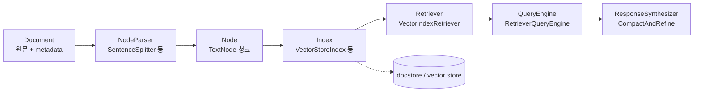
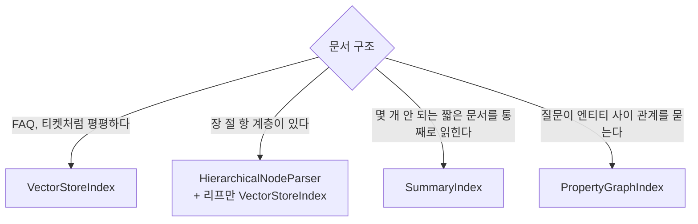
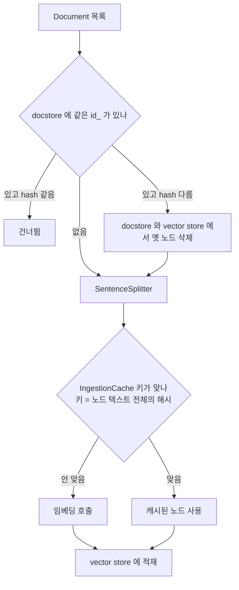
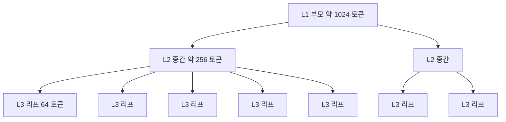
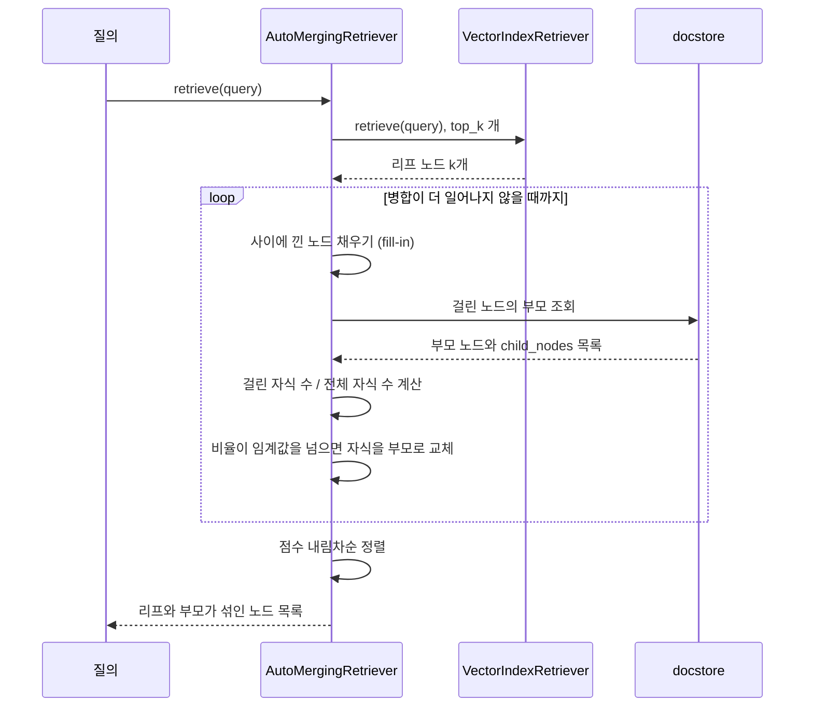
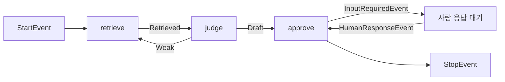
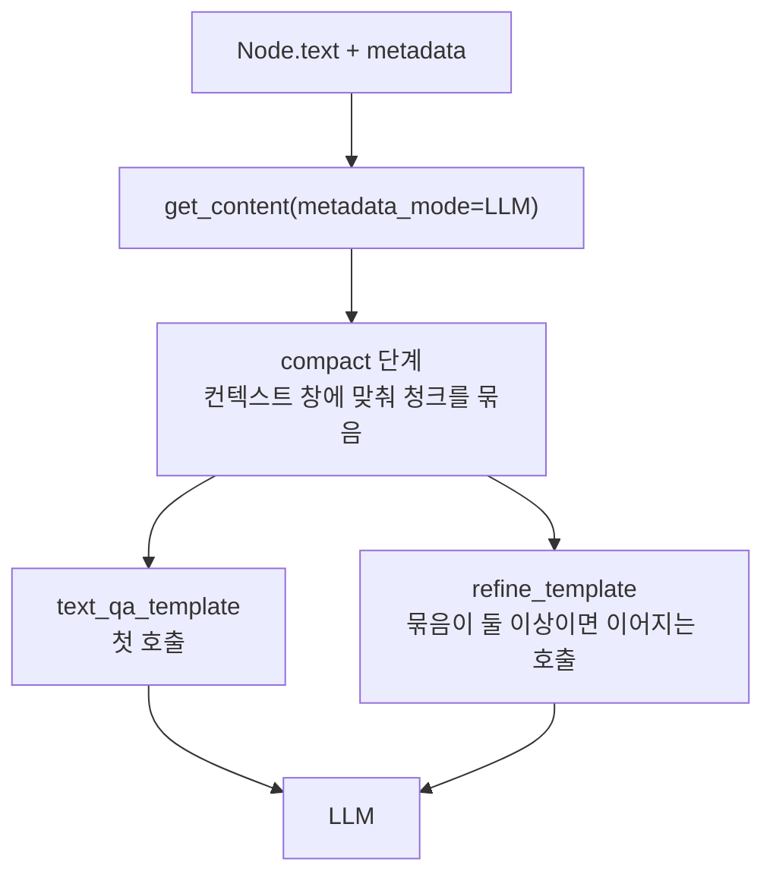

# LlamaIndex 실무 정리

LlamaIndex는 문서를 노드로 쪼개고, 인덱스에 넣고, 질의 시점에 다시 꺼내 LLM에 먹이는 과정을 클래스 단위로 나눠 놓은 라이브러리다. 일반적인 RAG 구성(청킹 크기, 임베딩 모델 선택, 평가)은 [RAG 파이프라인](RAG_Pipeline.md)에 있으니 여기서는 반복하지 않는다. LangChain과 순수 SDK를 놓고 고르는 판단은 [LangChain vs 순수 SDK](Lang_Chain_vs_SDK.md)에 있다. 이 문서는 LlamaIndex를 실제로 붙였을 때 마주치는 동작 방식만 다룬다.

아래 수치와 출력은 전부 직접 돌린 결과다.

| 항목 | 버전 |
|---|---|
| Python | 3.10.12 |
| llama-index-core | 0.14.25 |
| llama-index-workflows | 2.26.0 |
| llama-index-vector-stores-postgres | 0.9.0 |
| PostgreSQL / pgvector | 16.15 / 0.8.7 |
| psycopg / pgvector(파이썬) | 3.3.6 / 0.5.1 |

API 키 없이 돌렸다. 임베딩은 단어를 해시해 64차원 벡터로 만드는 가짜 모델이고, LLM은 받은 프롬프트를 기록만 하는 가짜 클래스다. 그래서 이 실험이 보여 주는 것은 검색 품질이 아니라 호출 횟수, 노드 구조, 프롬프트 내용이다. 답변 품질에 관한 이야기는 한 줄도 없다.

## 데이터가 지나가는 길

핵심 클래스는 다섯 개고 순서가 고정돼 있다. Document를 파서가 Node로 쪼개고, Node를 Index에 넣고, Index에서 Retriever를 꺼내고, Retriever를 QueryEngine이 감싼다. 아래 그림에서 점선은 저장소와의 연결이다.



가장 헷갈리는 지점은 Node와 Document의 관계다. 노드는 원본 문서의 id를 `ref_doc_id`로 들고 있고, 앞뒤 노드를 `relationships`에 들고 있다.

```python
from llama_index.core import Document, VectorStoreIndex, Settings
from llama_index.core.node_parser import SentenceSplitter
from llama_index.core.llms import MockLLM

Settings.llm = MockLLM(max_tokens=32)
Settings.embed_model = CountingEmbed()   # 해시 기반 가짜 임베딩

doc = Document(text="결제 취소는 승인 후 7일 이내만 가능하다. ... 부분 취소는 가맹점 설정에 따라 막혀 있을 수 있다.",
               metadata={"file_name": "refund.md"})
nodes = SentenceSplitter(chunk_size=40, chunk_overlap=0).get_nodes_from_documents([doc])
for n in nodes:
    print(type(n).__name__, n.ref_doc_id == doc.id_, list(n.relationships))
```

```
TextNode True [SOURCE, NEXT]
TextNode True [SOURCE, PREVIOUS, NEXT]
TextNode True [SOURCE, PREVIOUS, NEXT]
TextNode True [SOURCE, PREVIOUS, NEXT]
TextNode True [SOURCE, PREVIOUS]
```

`index.as_query_engine()`가 만든 객체를 열어 보면 `RetrieverQueryEngine` 안에 `VectorIndexRetriever`와 `CompactAndRefine`이 들어 있다. 검색과 합성이 분리돼 있어서 리트리버만 떼어 쓰거나 합성기만 바꿔 끼울 수 있다. 뒤에서 나오는 AutoMergingRetriever가 이 분리 덕에 끼워진다.

같은 실험에서 경고가 하나 떴다. `Metadata length (5) is close to chunk size (40)`. 노드를 자를 때 metadata 길이가 `chunk_size`에서 빠진다. 이 문서의 마지막 절에서 같은 `chunk_size=128`인데 청크 수가 8개와 10개로 갈리는 이유가 이것이다.

## 인덱스 종류와 비용

`VectorStoreIndex` 말고도 인덱스가 여럿 있고, 이름만 봐서는 구축과 질의에 LLM이 몇 번 불리는지 알 수 없다. 64토큰짜리 청크 20개를 넣고 호출 횟수를 셌다. LLM은 가짜라서 호출 횟수는 믿어도 되지만 어떤 노드가 뽑혔는지는 의미가 없다.

| 인덱스 | 구축 시 LLM 호출 | 구축 시 임베딩 | 질의 시 동작 |
|---|---|---|---|
| VectorStoreIndex | 0 | 20 | 질의 임베딩 1회, 유사도 top_k개 반환 |
| SummaryIndex | 0 | 0 | 기본 리트리버가 노드 20개를 전부 반환 |
| TreeIndex (num_children=3) | 10 | 0 | `select_leaf` 모드는 LLM 3회. `root` 모드는 루트 요약 노드 3개 반환 |
| KnowledgeGraphIndex | 20 (청크당 1회) | 0 | 키워드 추출에 LLM 1회, 노드 4개 반환 |

SummaryIndex는 이름과 달리 요약을 만들지 않는다. 노드를 순서대로 담아 두고 질의 때 전부 꺼내는 목록이다. 문서가 청크 서너 개일 때만 쓸 수 있고, 20개만 돼도 컨텍스트 창을 넘겨 refine 호출이 늘어난다.

TreeIndex는 구축 때 부모 요약을 LLM으로 만든다. 20개 청크에서 부모 노드 10개가 생겼고(전체 30개, 루트 3개) 그만큼 LLM이 불렸다. 문서를 고칠 때마다 이 비용이 다시 든다. 질의 쪽은 더 걸리는 점이 있다. `select_leaf`는 층마다 LLM이 어느 자식으로 내려갈지 고른다. `child_branch_factor=1`이면 첫 층에서 잘못 고른 순간 그 가지 밖의 노드는 후보에도 오르지 못한다. 유사도 검색은 놓친 노드를 top_k로 만회할 수 있지만, 이쪽은 `child_branch_factor`로 가지를 넓히는 수밖에 없다.

KnowledgeGraphIndex는 0.14.25에서 `deprecated` 데코레이터가 붙어 있고, 메시지는 `PropertyGraphIndex`를 쓰라고 안내한다. PropertyGraphIndex는 이 문서에서 돌려 보지 않았다. 새로 시작한다면 KnowledgeGraphIndex로 들어갈 이유가 없다.

문서 구조에서 인덱스를 고르는 흐름은 이렇게 정리된다.



계층 문서에서 TreeIndex가 아니라 계층 파서를 고르는 이유는 위에서 말한 대로다. 요약 트리를 LLM이 타고 내려가게 하는 것보다, 리프에서 유사도 검색을 하고 부모로 올라오게 하는 쪽이 틀렸을 때 복구할 길이 있다. 그 방식은 뒤의 계층 검색 절에서 다룬다. 평평한 문서는 인덱스 종류보다 [Vector Database](Vector_Database.md) 쪽 선택이 결과를 더 크게 좌우한다.

## 인제스천 파이프라인

`IngestionPipeline`은 변환(분할, 임베딩)을 순서대로 걸고, 결과를 벡터 스토어에 넣고, 이미 처리한 문서는 건너뛴다. 문서를 자주 고치는 운영이라면 이 부분의 동작을 정확히 알아야 한다. 임베딩 비용이 여기서 샌다.



이 그림에서 문서 단위 판정(위쪽 마름모)과 캐시 판정(아래쪽 마름모)은 서로 다른 장치다. 앞의 것은 문서 하나가 바뀌었는지 보고, 뒤의 것은 변환 입력이 같은지 본다.

### 캐시는 청크 단위가 아니다

캐시를 켜 두면 문서를 고쳐도 안 바뀐 청크의 임베딩은 재사용될 거라고 기대하게 된다. 아니다. 소스(`ingestion/pipeline.py`의 `get_transformation_hash`)를 보면 캐시 키는 입력 노드 전체의 텍스트를 이어 붙인 문자열에 변환 설정을 더해 해시한 값이다. 노드 하나만 바뀌어도 배치 전체가 미스가 된다.

문장 길이가 제각각인 60문장짜리 문서(청크 25개, `chunk_size=128`)로 문장 하나를 끼워 넣었다. 기본 캐시와, 청크 텍스트 해시로 직접 만든 캐시를 비교한 결과다.

| 수정 위치 | 새 청크 수 | 기본 IngestionCache 재임베딩 | 청크 해시 캐시 재임베딩 |
|---|---|---|---|
| 끝에 1문장 | 26 | 26 | 1 |
| 중간(30번)에 1문장 | 26 | 26 | 3 |
| 맨 앞에 1문장 | 26 | 26 | 14 |
| 변경 없이 재실행 | 25 | 0 | 0 |

맨 앞에 한 문장을 넣으면 청크 경계가 밀려서 26개 중 14개의 텍스트가 달라졌다. 앞쪽 청크는 밀리고, 어느 지점부터 경계가 다시 맞아 나머지는 그대로다. 경계가 얼마나 밀리는지는 문장 길이 분포에 달려 있다. 문장 길이가 모두 같은 합성 문서(2문장이 43토큰씩)에서는 앞에 문장을 넣어도 한 청크만 바뀌었다. 실제 문서는 후자가 아니라 전자에 가깝다.

기본 캐시를 쓰면 한 글자를 고친 문서가 매번 전체 재임베딩이 된다. 임베딩 변환 앞에 청크 텍스트 해시를 키로 쓰는 변환을 직접 끼워 해결했다.

```python
class ChunkCachedEmbed(TransformComponent):
    inner: CountingEmbed
    store: dict = {}

    def __call__(self, nodes, **kw):
        key = lambda n: hashlib.sha256(
            n.get_content(metadata_mode=MetadataMode.EMBED).encode()).hexdigest()
        miss = [n for n in nodes if key(n) not in self.store]
        if miss:
            texts = [n.get_content(metadata_mode=MetadataMode.EMBED) for n in miss]
            for n, e in zip(miss, self.inner.get_text_embedding_batch(texts)):
                self.store[key(n)] = e
        for n in nodes:
            n.embedding = self.store[key(n)]
        return nodes

pipe = IngestionPipeline(
    transformations=[SentenceSplitter(chunk_size=128, chunk_overlap=0),
                     ChunkCachedEmbed(inner=emb, store={})],
    docstore=SimpleDocumentStore(), vector_store=SimpleVectorStore(),
    docstore_strategy=DocstoreStrategy.UPSERTS)
```

`store`는 운영에서는 딕셔너리가 아니라 Redis나 테이블이어야 한다. 키에 `MetadataMode.EMBED`로 만든 텍스트를 쓴 이유는, metadata가 임베딩 입력에 섞여 들어가기 때문이다. metadata만 바뀌어도 벡터는 달라진다.

### 캐시 키에 카운터가 섞였던 일

이 실험을 처음 돌렸을 때 캐시가 한 번도 맞지 않았다. 같은 문서를 두 번 넣어도 임베딩이 두 번 불렸다. 원인은 내가 만든 가짜 임베딩 클래스에 호출 횟수를 세는 필드(`calls`, `texts`)를 넣어 둔 것이었다. 캐시 키에는 변환 객체를 직렬화한 값(`to_dict()`)이 들어간다. 호출할 때마다 카운터 필드가 바뀌니 키도 매번 바뀌었다. 카운터를 모듈 전역으로 빼자 정상으로 돌아왔다.

운영 코드에서 같은 일이 생기는 경우는 변환 클래스에 요청 횟수, 마지막 호출 시각, 클라이언트 객체 같은 값을 필드로 두었을 때다. 캐시 적중률이 0%로 나오면 변환 클래스의 필드부터 본다.

### 문서 id가 없으면 옛 청크가 남는다

`Document(text=...)`에 `id_`를 안 주면 매번 새 uuid가 붙는다. docstore는 id로 문서를 찾으니, 같은 파일을 고쳐서 다시 넣어도 새 문서로 취급한다. 20청크짜리 문서에서 한 문장을 고쳐 `UPSERTS`로 다시 넣은 결과다.

| 문서 id | 재적재 후 벡터 스토어 노드 | ref_doc 수 |
|---|---|---|
| 없음(랜덤 uuid) | 40 | 2 |
| 고정(`p.md`) | 20 | 1 |

id를 안 주면 옛 버전 청크 20개가 그대로 검색 대상에 남는다. 폐지된 규정이 검색 결과에 계속 올라오는 증상으로 드러난다. 파일 경로 같은 안정적인 값을 `id_`로 넣어야 한다. `SimpleDirectoryReader`로 읽는다면 `filename_as_id=True`를 켜는 식이다.

`DocstoreStrategy`는 세 가지 값이 있다. `DUPLICATES_ONLY`는 hash가 같은 문서만 건너뛰고, `UPSERTS`는 id가 같고 hash가 다르면 옛 노드를 지우고 다시 넣는다. 세 번째 `UPSERTS_AND_DELETE`는 이번 입력에 없는 문서를 지운다. 문서 두 개(`a.md`, `b.md`)를 넣은 뒤 `a.md`만 넘겨 다시 돌렸더니 두 설정의 결과가 갈렸다.

| 설정 | a.md만 재실행한 뒤 벡터 스토어의 ref_doc |
|---|---|
| UPSERTS | a.md, b.md |
| UPSERTS_AND_DELETE | a.md |

폴더별로 나눠 인제스천하는 배치에 `UPSERTS_AND_DELETE`를 쓰면 다른 폴더의 문서가 지워진다. 전체 코퍼스를 매번 한 번에 넘기는 구조에서만 써야 한다.

### 노드 id를 안정적으로 만들기

노드 id도 기본값은 uuid다. 같은 문서를 파이프라인 두 개로 각각 돌리면 20개 노드의 id가 하나도 안 겹친다. 외부 테이블이 노드 id를 참조하고 있다면(피드백 로그, 인용 기록) 재적재 때마다 참조가 끊긴다.

`SentenceSplitter(id_func=...)`로 해결하려다 한 번 틀렸다. `id_func`는 `(index, document)`를 받는데 두 번째 인자가 청크가 아니라 원본 Document다. 거기서 내용 해시를 만들면 청크 전부가 같은 id를 받는다. 처음에는 이 결과를 "20개 중 20개 일치"로 잘못 읽었다.

위치 기반 id(`p.md:3`)로 바꿔 보면 다른 문제가 나온다. 문서 맨 앞에 한 문장을 넣었을 때, 앞뒤 버전에서 id가 공통인 25개 중 25개가 서로 다른 텍스트를 가리켰다. 같은 id가 다른 내용을 가리키니 uuid보다 나쁘다. 참조가 끊기는 대신 엉뚱한 곳을 가리킨다.

분할이 끝난 뒤에 청크 내용으로 id를 다시 붙이는 변환을 두면 된다. 앞뒤 노드 관계도 새 id로 다시 이어야 한다.

```python
class StableNodeId(TransformComponent):
    def __call__(self, nodes, **kw):
        seen = Counter()
        for n in nodes:
            h = hashlib.sha1(n.get_content(metadata_mode=MetadataMode.EMBED).encode()).hexdigest()[:12]
            seen[h] += 1
            n.id_ = f"{n.ref_doc_id}:{h}:{seen[h]}"      # 같은 텍스트가 반복되면 순번으로 구분
        for i, n in enumerate(nodes):
            n.relationships.pop(NodeRelationship.PREVIOUS, None)
            n.relationships.pop(NodeRelationship.NEXT, None)
            if i > 0:
                n.relationships[NodeRelationship.PREVIOUS] = nodes[i - 1].as_related_node_info()
            if i < len(nodes) - 1:
                n.relationships[NodeRelationship.NEXT] = nodes[i + 1].as_related_node_info()
        return nodes
```

같은 60문장 문서에 맨 앞 문장을 넣어 비교했더니 id가 12개 공통이고, 공통 id 중 텍스트가 다른 것은 0개였다. 새로 생긴 id 14개, 사라진 id 13개가 실제로 바뀐 청크다. 앞의 청크 해시 캐시 표에서 "14"가 나온 것과 맞는다. 내용이 같은 청크만 같은 id를 갖는다.

## 계층 검색

계층 문서에서 작은 청크로 검색하면 정확도는 오르지만 답을 쓰기에 문맥이 모자란다. 큰 청크로 검색하면 문맥은 충분한데 질문과 무관한 문장이 섞여 유사도가 흐려진다. `HierarchicalNodeParser`와 `AutoMergingRetriever`는 작은 청크로 찾고, 같은 부모에서 여러 개가 걸리면 부모로 바꿔 돌려주는 방식으로 이 둘을 절충한다.

```python
parser = HierarchicalNodeParser.from_defaults(chunk_sizes=[1024, 256, 64], chunk_overlap=0)
nodes = parser.get_nodes_from_documents([doc])
leaves = get_leaf_nodes(nodes)

sc = StorageContext.from_defaults()
sc.docstore.add_documents(nodes)               # 부모까지 전부 docstore 에
index = VectorStoreIndex(leaves, storage_context=sc)   # 벡터 인덱스에는 리프만

base = index.as_retriever(similarity_top_k=6)
retriever = AutoMergingRetriever(base, sc, simple_ratio_thresh=0.5)
```

두 저장소에 넣는 범위가 다르다는 점이 핵심이다. docstore에는 모든 층의 노드가 들어가고, 벡터 인덱스에는 리프만 들어간다. 5,764토큰짜리 문서를 이 설정으로 자르면 1024토큰 부모 6개, 256토큰 중간 노드 29개, 64토큰 리프 134개가 나온다.



그림은 한 부모 아래 자식이 5개인 경우를 그렸다. 실측에서 L2 노드는 자식이 5개인 경우가 13개, 6개가 8개, 2개가 4개였다. 자식 수가 적은 부모는 병합이 쉽게 일어난다.

### 병합이 일어나는 순서

소스(`retrievers/auto_merging_retriever.py`)를 읽고 순서를 정리했다.



세 가지를 짚어야 한다. 비교는 `>`라서 비율이 임계값과 같으면 병합하지 않는다. 병합 조건은 `걸린 자식 수 / 부모의 전체 자식 수 > simple_ratio_thresh`이며, 분모는 벡터 인덱스에 들어간 자식이 아니라 부모가 가진 `child_nodes` 전체다. 병합된 부모의 점수는 걸린 자식 점수의 평균이다. 루프가 반복되므로 L2로 올라간 노드가 L1 부모의 자식으로 다시 계산되고, 병합이 위로 연쇄된다.

fill-in은 검색된 두 노드 사이에 노드가 정확히 하나 끼어 있으면 그것을 채워 넣는 단계다. 부모 병합과 별개로 컨텍스트를 늘린다.

### 임계값을 낮게 잡았을 때

병합 조건을 풀어 쓰면 `걸린 수 > 임계값 × 자식 수`다. 자식이 5개인 부모를 기준으로 계산하면 임계값 0.5에서는 3개가 걸려야 병합되고, 0.25에서는 2개, 0.1에서는 1개만 걸려도 병합된다(1/5 = 0.2 > 0.1). 자식이 9개 이하인 부모는 전부 이 규칙에 걸린다. 임계값 0.1은 사실상 "리프가 하나라도 걸리면 부모로 올려라"는 설정이다.

환불 관련 단어 5개로 질의하고(문서는 환불, 정산, 보안, 장애 네 주제), 반환된 컨텍스트의 토큰 수를 쟀다.

| top_k | 임계값 | 반환 노드 | 컨텍스트 토큰 | 구성 |
|---|---|---|---|---|
| 6 | 병합 없음 | 6 | 258 | L3 6 |
| 6 | 0.5 | 6 | 258 | L3 6 |
| 6 | 0.25 | 5 | 420 | L3 4, L2 1 |
| 6 | 0.1 | 2 | 1,982 | L1 2 |
| 12 | 병합 없음 | 12 | 531 | L3 12 |
| 12 | 0.5 | 9 | 615 | L3 8, L2 1 |
| 12 | 0.25 | 5 | 1,373 | L3 3, L2 1, L1 1 |
| 12 | 0.1 | 2 | 1,982 | L1 2 |

top_k가 6이고 임계값이 0.1이면 258토큰이 1,982토큰으로 7.7배가 된다. 검색에 걸린 리프 6개가 부모 L1 두 개로 모두 올라가 1024토큰 청크 두 개가 통째로 들어갔다. L1 하나가 약 990토큰이라, 걸린 리프 자리를 뺀 나머지는 질의와 상관없이 따라 들어온다.

컨텍스트가 커지면 비용이 두 군데에서 는다. 입력 토큰이 늘고, 컨텍스트 창을 넘으면 `CompactAndRefine`이 refine 호출을 추가한다. 뒤의 프롬프트 절에서 10개 청크에 호출이 3번 일어난 것을 볼 수 있다. 증상은 "검색 품질은 좋아졌는데 응답이 느리고 비싸졌다"로 나타난다.

임계값은 0.5에서 시작해서 반환 토큰 수를 로그로 찍어 보며 정해야 한다. 합계가 컨텍스트 예산을 넘는다면 임계값을 올리거나, 부모 층 구성(`chunk_sizes`)에서 맨 위층을 줄인다.

### docstore를 잃어버린 경우

벡터 인덱스에는 리프만 있으니, 프로세스가 재시작되면서 벡터 스토어(Postgres 등)만 살아 있고 docstore가 빈 메모리 객체로 새로 뜨는 구조가 되기 쉽다. 그 상태에서 AutoMergingRetriever를 돌리면 이렇게 죽는다.

```
ValueError: doc_id 238974dc-c61a-447f-9d73-edf1692dc437 not found.
```

부모 노드를 찾지 못해서다. 메시지만 보면 벡터 스토어와 docstore가 어긋났다는 것을 눈치채기 어렵다. 계층 파서를 쓰면 docstore도 영속 저장소에 두거나, 최소한 `persist()`로 디스크에 내려서 벡터 스토어와 같은 생명주기로 관리해야 한다.

## Workflows

`Workflow`는 step 함수들이 이벤트를 주고받는 구조다. LangGraph와의 구조 차이(노드와 엣지 vs 이벤트 타입이 배선)와 reducer 문제는 [LangChain vs 순수 SDK](Lang_Chain_vs_SDK.md)의 에이전트 흐름 절에 정리했다. 거기서 "돌려 보지 않았다"고 남긴 부분, 곧 상태를 저장하고 이어 돌리는 동작을 이 절에서 돌렸다.

검색 결과가 비면 질의를 넓혀 다시 검색하고, 결과가 있으면 사람 승인을 받은 뒤 끝내는 흐름이다.



```python
class RagFlow(Workflow):
    @step
    async def retrieve(self, ctx: Context, ev: StartEvent | Weak) -> Retrieved:
        tries = await ctx.store.get("tries", default=0) + 1
        await ctx.store.set("tries", tries)
        q = ev.question if isinstance(ev, StartEvent) else ev.q + " 확장"
        return Retrieved(hits=[f"{q} #{tries}"] if tries >= 2 else [])

    @step
    async def judge(self, ev: Retrieved) -> Weak | Draft:
        return Weak(q="환불") if not ev.hits else Draft(text=ev.hits[0])

    @step
    async def approve(self, ctx: Context, ev: Draft) -> StopEvent:
        ctx.write_event_to_stream(InputRequiredEvent(prefix="발송할까요? "))
        resp = await ctx.wait_for_event(HumanResponseEvent)
        return StopEvent(result=f"{ev.text} / 답변={resp.response}")
```

승인 대기에서 멈추고, 상태를 꺼내 새 `Context`로 복원해 이어 돌렸다.

```python
h = wf.run(question="환불")
async for ev in h.stream_events():
    if isinstance(ev, InputRequiredEvent):
        break
saved = h.ctx.to_dict()
await h.cancel_run()

ctx2 = Context.from_dict(wf, saved)
h2 = wf.run(ctx=ctx2)
await asyncio.sleep(0.2)
h2.ctx.send_event(HumanResponseEvent(response="예"))
print(await h2)
```

```
멈춤: 발송할까요?  | tries = 2
재개 결과: 환불 확장 #2 / 답변=예
```

`tries = 2`가 복원된 컨텍스트에서도 유지됐고, 재개한 실행이 승인 응답을 받아 끝났다. 앞 문서에서 LangGraph의 checkpointer가 "직접 짜기 가장 귀찮은 부분"이라고 한 기능과 같은 목적이다. 차이는 저장 주체다. 이 실험에서는 내가 `to_dict()`를 직접 불렀다. LangGraph는 checkpointer를 컴파일에 넘기고 `thread_id`를 맞추는 방식이다.

`to_dict()`에는 함정이 하나 있다. 기본 직렬화기는 JSON이라 임의의 파이썬 객체를 `ctx.store`에 넣어 두면 저장에서 터진다.

```
기본 실패: ValueError Failed to serialize state value for key hit: Failed to serialize value: <class '__main__.Hit'> ...
JsonPickleSerializer 성공
```

`JsonPickleSerializer`를 넘기면 저장은 되지만 pickle이라 신뢰할 수 없는 저장소에서 읽어 들이면 임의 코드가 실행될 수 있다. 사용자 입력이나 외부에서 수정 가능한 저장소를 거치는 상태라면 `ctx.store`에는 JSON으로 표현되는 값(문자열, 숫자, 딕셔너리)만 넣는 쪽이 안전하다.

## LlamaIndex가 맞지 않는 경우

### 평평한 검색

FAQ나 티켓처럼 평평한 컬렉션에서 LlamaIndex가 해 주는 일은 청킹, 임베딩, 벡터 스토어 적재, top_k 검색이다. 네 단계가 전부 SQL 몇 줄로 끝난다. 뒤의 비교 절에서 직접 구현 스크립트가 임포트와 출력을 포함해 38줄이었다. 인덱스 종류와 노드 관계 같은 추상화가 쓰이지 않는다면 의존성만 늘어난다.

### 쿼리 로직을 자주 바꾸는 경우

검색 단계에 필터, 재정렬, 질의 확장, 하이브리드 검색을 번갈아 끼워 보는 시기에는 LlamaIndex의 구조가 방해가 된다. 리트리버, 노드 후처리기, 합성기가 각각 클래스로 나뉘어 있어 한 줄 바꾸려고 어느 층의 어떤 클래스를 갈아야 하는지 찾는 시간이 든다. SQL이면 `WHERE`와 `ORDER BY`만 고치면 된다. 쿼리 구조가 굳은 뒤에 얹어도 늦지 않다.

### 내부 프롬프트를 통제해야 하는 경우

가장 크게 걸리는 경우다. LlamaIndex는 합성 단계에서 프롬프트를 직접 조립하고, 그 내용이 코드에 보이지 않는다. `as_query_engine()`에서 프롬프트 키를 열어 보면 네 개가 나온다.

```
response_synthesizer:text_qa_template
response_synthesizer:refine_template
response_synthesizer:chat_content_qa_template
response_synthesizer:chat_content_refine_template
```

`text_qa_template`의 원문은 이렇다.

```
Context information is below.
---------------------
{context_str}
---------------------
Given the context information and not prior knowledge, answer the query.
Query: {query_str}
Answer:
```

프롬프트가 영어라 답변 언어나 형식을 지정하려면 직접 덮어써야 하고, `not prior knowledge`는 모델 자체 지식을 쓰지 말라는 지시다. 자료에 없는 질문에 모른다고 답하게 하고 싶은 서비스에는 맞지만, 일반 상식을 섞어 답해야 하는 서비스에는 맞지 않는다. 직접 짠 프롬프트가 있다면 `update_prompts`로 덮어써야 한다.



몰래 끼어드는 지점은 세 곳이다. 하나씩 실제 프롬프트로 확인했다. 프롬프트는 최종 LLM 호출 직전의 이벤트를 잡아 덤프했다.

```python
import llama_index.core.instrumentation as instrument
from llama_index.core.instrumentation.event_handlers import BaseEventHandler
from llama_index.core.instrumentation.events.llm import LLMCompletionStartEvent, LLMChatStartEvent

dumps = []
class PromptDump(BaseEventHandler):
    @classmethod
    def class_name(cls): return "PromptDump"
    def handle(self, event, **kw):
        if isinstance(event, LLMCompletionStartEvent):
            dumps.append(event.prompt)
        elif isinstance(event, LLMChatStartEvent):
            dumps.append("\n".join(f"[{m.role.value}] {m.content}" for m in event.messages))

instrument.get_dispatcher().add_event_handler(PromptDump())
```

직접 만든 `CustomLLM`에서는 `complete`와 `stream_complete`에 `@llm_completion_callback()`을 붙여야 이 이벤트가 발생한다. 처음에 이 데코레이터를 빼먹어서 덤프가 비었고, LLM 호출 수가 0으로 찍혔다. 호출이 안 된 것이 아니라 이벤트가 안 나온 것이다. 상용 LLM 클래스(OpenAI, Anthropic 어댑터)는 이미 붙어 있다.

**지점 1. metadata가 프롬프트에 그대로 들어간다.** 문서에 `file_name`, `author`, `internal_ticket` 세 키를 넣고 질의했더니 LLM에 나간 프롬프트는 이랬다.

```
Context information is below.
---------------------
file_name: refund.md
author: kim
internal_ticket: OPS-1234

환불은 영업일 기준 3일 걸린다. 해외 카드는 5일까지 걸릴 수 있다.
---------------------
Given the context information and not prior knowledge, answer the query.
Query: 환불 며칠?
Answer:
```

내부 티켓 번호가 사용자에게 나가는 답변의 근거로 들어갔다. 문서별로 제외 키를 지정해야 한다. 임베딩 입력에서 빼는 키와 LLM 프롬프트에서 빼는 키가 따로다.

```python
doc = Document(text=text,
               metadata={"file_name": "refund.md", "internal_ticket": "OPS-1234"},
               excluded_llm_metadata_keys=["internal_ticket"],
               excluded_embed_metadata_keys=["internal_ticket", "file_name"])
```

```
LLM 에 보이는 것  : 'file_name: refund.md\n\n0항 환불 승인 ...'
임베딩에 들어가는 것: '0항 환불 승인 취소 ...'
```

**지점 2. 컨텍스트가 창을 넘으면 호출이 늘어난다.** 컨텍스트 창을 1024로 두고 청크 10개를 `top_k`로 가져왔더니 LLM이 3번 불렸다. 첫 호출이 `text_qa_template`이고, 나머지 둘은 `The original query is as follows:`로 시작하는 `refine_template`이다. 두 번째 호출 프롬프트는 이전 답변(`We have provided an existing answer: 답`)을 달고, 새 컨텍스트로 "고칠 필요가 있으면 고치라"고 요구한다. `top_k`를 올리면 호출 수와 비용이 비례해서 오른다. 묶음 경계에서 문장이 잘리기도 한다. 두 번째 호출의 컨텍스트가 `정산 수수료 규정 내용이다.`처럼 문장 중간에서 시작했다.

**지점 3. metadata가 `chunk_size`를 깎는다.** 청크 크기에 metadata 길이가 포함된다. 같은 문서를 같은 `chunk_size=128`로 자르는데 직접 구현은 8청크, LlamaIndex는 `file_name` 하나가 붙어서 10청크가 나왔다. metadata 문자열은 청크마다 프롬프트에 반복해서 들어간다. 위 덤프에서 `file_name: policy.md`가 청크마다 붙어 있다.

세 지점 모두 코드를 봐서는 알 수 없고, 프롬프트를 덤프해야 보인다. 새 파이프라인을 붙이면 처음 한 번은 최종 프롬프트를 눈으로 확인해야 한다.

## 직접 구현한 pgvector + SDK와의 비교

같은 문서(30문장, `chunk_size=128`)를 같은 해시 임베딩으로 같은 Postgres에 넣고 두 방식을 비교했다. 직접 구현은 psycopg와 pgvector 파이썬 패키지만 쓴다.

```python
conn = psycopg.connect("postgresql://postgres:pw@localhost:55432/cmp", autocommit=True)
conn.execute("create extension if not exists vector")
register_vector(conn)
conn.execute("""create table chunks (
  id bigserial primary key, doc_id text not null, ord int not null,
  content text not null, embedding vector(64) not null)""")
conn.execute("create index on chunks using hnsw (embedding vector_cosine_ops)")

def ingest(doc_id, text):
    chunks = SentenceSplitter(chunk_size=128, chunk_overlap=0).split_text(text)
    with conn.transaction():
        conn.execute("delete from chunks where doc_id = %s", (doc_id,))
        for i, (c, v) in enumerate(zip(chunks, emb.get_text_embedding_batch(chunks))):
            conn.execute("insert into chunks (doc_id, ord, content, embedding) values (%s,%s,%s,%s)",
                         (doc_id, i, c, v))

def retrieve(q, k=3):
    return conn.execute(
        "select content, 1 - (embedding <=> %s::vector) from chunks "
        "order by embedding <=> %s::vector limit %s",
        (emb.get_query_embedding(q), emb.get_query_embedding(q), k)).fetchall()

def build_prompt(q, rows):
    ctx = "\n\n".join(r[0] for r in rows)
    return f"아래 자료만 근거로 답한다. 자료에 없으면 모른다고 답한다.\n\n[자료]\n{ctx}\n\n[질문]\n{q}"
```

분할기는 LlamaIndex의 `SentenceSplitter`를 그대로 가져다 썼다. [LangChain vs 순수 SDK](Lang_Chain_vs_SDK.md)의 "프레임워크를 일부만 쓰는 절충안"과 같은 방식이다. LLM을 부르는 부분은 이 비교에서 뺐다. 두 방식 모두 최종 프롬프트까지만 만들어 비교한다.

`retrieve`에서 `%s::vector` 캐스트를 빼면 파이썬 리스트가 `double precision[]`로 전달돼 `operator does not exist: vector <=> double precision[]`가 난다. INSERT는 대입 캐스트가 있어 캐스트 없이 되지만 조회 연산자에는 암묵 캐스트가 없다. 처음에 이 에러를 만났다. numpy 배열을 넘기면 `register_vector`가 알아서 처리한다.

LlamaIndex 쪽은 `PGVectorStore`를 쓴다.

```python
vs = PGVectorStore.from_params(host="localhost", port=55432, database="cmp",
        user="postgres", password="pw", table_name="li", embed_dim=64,
        hnsw_kwargs={"hnsw_m": 16, "hnsw_ef_construction": 64,
                     "hnsw_ef_search": 40, "hnsw_dist_method": "vector_cosine_ops"})
index = VectorStoreIndex.from_documents(
    [doc], storage_context=StorageContext.from_defaults(vector_store=vs),
    transformations=[SentenceSplitter(chunk_size=128, chunk_overlap=0)])
qe = index.as_query_engine(similarity_top_k=3)
```

| 항목 | 직접 구현 | LlamaIndex PGVectorStore |
|---|---|---|
| 코드 | 스크립트 전체 38줄(임포트와 출력 포함) | 10줄 안팎 |
| 테이블 | `chunks`, 컬럼을 내가 정한다 | `data_li`(테이블 이름 앞에 `data_`가 붙는다), `text`, `metadata_ json`, `node_id`, `embedding` |
| 인덱스 | HNSW 한 개 | HNSW + `metadata_ ->> 'ref_doc_id'` btree |
| 청크 수 | 8 | 10 (`file_name` metadata가 `chunk_size`를 차지) |
| 10행의 `metadata_` 크기 | 해당 컬럼 없음 | 12,666바이트(같은 10행의 `text`는 2,180바이트) |
| 같은 id 재적재 | 트랜잭션에서 delete 후 insert | 10행이 20행, 30행으로 누적 |
| 삭제 | `delete from chunks where doc_id` | `index.delete_ref_doc("policy.md")` 후 0행 |

LlamaIndex 쪽이 벡터 스토어만 쓰고 docstore를 안 붙이면 재적재가 누적된다. 같은 `id_`의 문서를 두 번째로 적재했더니 10행이 20행이 됐고 세 번째에 30행이 됐다. 앞의 인제스천 절에서 본 문서 단위 판정을 하는 `IngestionPipeline`과 docstore를 붙여야 해결된다. 직접 구현은 `ingest` 한 함수에 트랜잭션이 들어 있어서 이 문제가 없다.

`metadata_` 컬럼이 `text`의 5.8배다. 안에 `_node_content`라는 키가 있고, 노드 전체를 JSON으로 직렬화해 넣는데 거기에 `text`가 또 들어 있다. 청크가 짧은 이 실험에서는 비율이 과장돼 있겠지만, 텍스트가 두 번 저장된다는 사실은 청크 길이와 무관하다. 행 수가 수백만이 되면 저장 공간이 눈에 띄게 늘어난다.

프롬프트는 두 방식이 서로 다른 모양이다. 직접 구현은 내가 쓴 문장 그대로 나가고, LlamaIndex는 영어 템플릿에 청크마다 `file_name: policy.md`가 붙어서 나간다. 이 차이는 앞 절에서 본 그대로다.

### 어느 쪽으로 가는가

평평한 코퍼스에 질의가 단순하면 직접 구현이 낫다. 코드는 길어도 테이블, 재적재, 프롬프트가 전부 눈에 보인다. 계층 파서와 자동 병합처럼 직접 짜면 200줄 넘게 드는 기능이 필요한 순간에만 LlamaIndex를 들이고, 그때도 호출 경로는 가능한 한 내 코드에 두는 편이 안전하다. 파서와 리트리버만 가져다 쓰고, 최종 프롬프트 조립과 모델 호출은 SDK로 직접 하는 구성이다. 이 문서에서 센 문제(프롬프트 개입, 캐시 키, docstore 분리)는 거의 전부 합성 단계와 저장소 연결에서 났고, 파서 쪽에서는 거의 나지 않았다.
