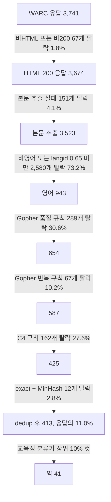
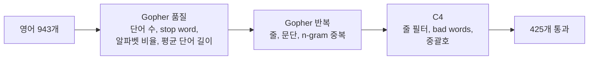
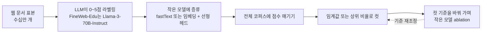
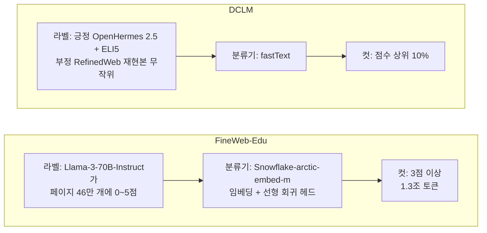
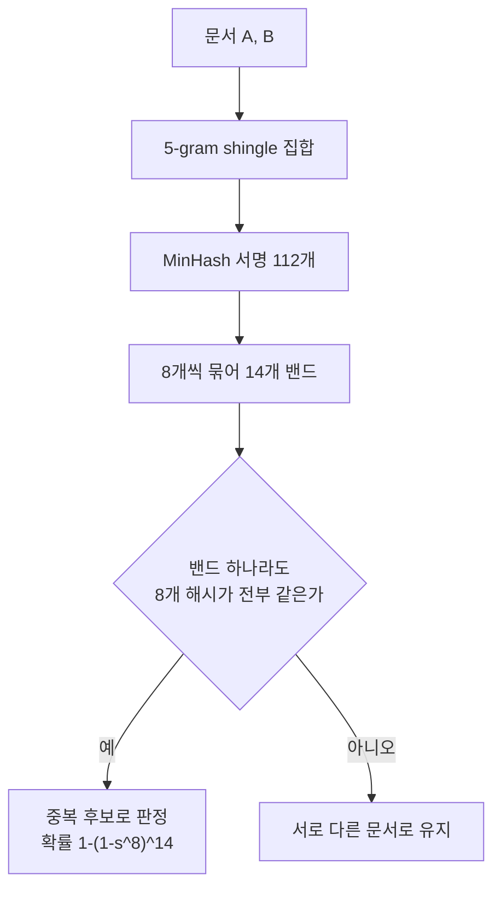
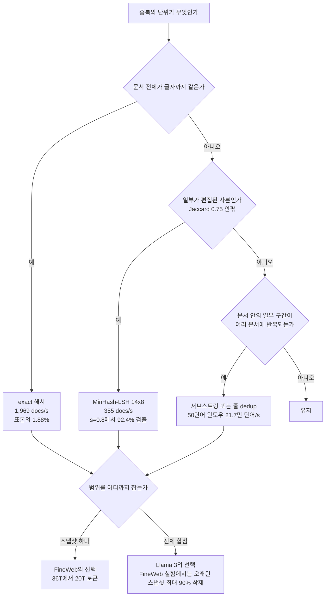
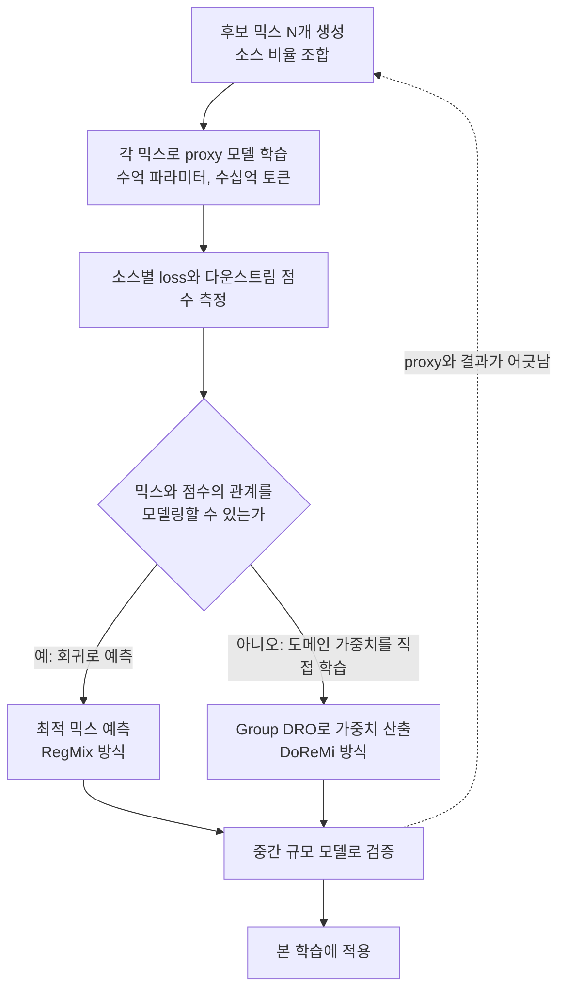
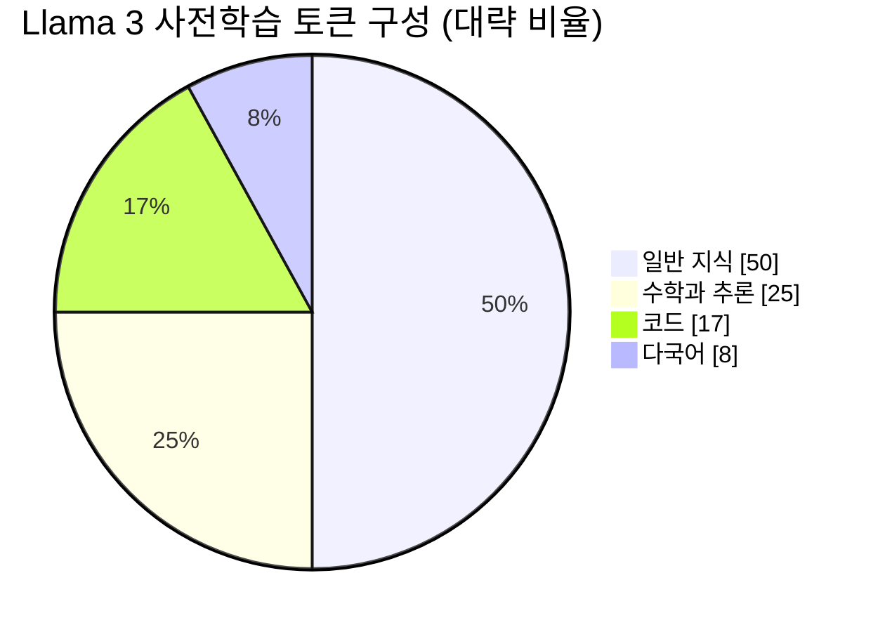

# LLM 사전학습 데이터 구축

[LLM 사전학습 파이프라인](LLM_Pretraining.md) 2장은 필터링과 dedup을 한 절씩 짧게 다뤘다. 이 문서는 그 두 단계와 앞뒤 단계를 직접 돌려 본 기록이다. 재료는 Common Crawl CC-MAIN-2024-10 WARC 파일 하나의 앞 60MB(압축 기준)다. 레코드 11,223개 중 HTTP 응답이 3,741개였고, 이 3,741개를 본문 추출부터 dedup까지 그대로 통과시켰다. 도구는 trafilatura 2.3.1, fastText(`lid.176.ftz`), datasketch 2.0.0이고 `/tmp`의 별도 venv에서 단일 프로세스로 돌렸다.

수치는 전부 이 조각에서 나온 값이다. 다른 스냅샷이나 전체 크롤에서 같은 비율이 나온다는 보장은 없다. dedup 비율은 코퍼스 크기에 따라 크게 달라지는데, 이건 5장에서 직접 보인다. 논문에서 가져온 수치에는 출처를 달았고, 내가 돌리지 않은 부분(믹싱 비율 ablation)은 돌리지 않았다고 적었다.

---

## 1. 크롤 한 조각을 끝까지 돌려 보면

3,741개 응답이 단계마다 얼마나 남는지를 먼저 본다. 아래 그림은 가정값이 아니라 이 조각에서 센 값이다. 영어 문서만 이어서 필터링했기 때문에 언어 식별 단계에서 가장 많이 줄어든다.



탈락의 대부분은 두 곳에서 나온다. 하나는 언어 식별이고, 다른 하나는 휴리스틱 필터 세 묶음의 합이다. 이 조각에서 dedup은 2.8%밖에 못 줄였다. 5장에서 보이듯 이건 표본이 작아서 그렇다. FineWeb 보고서는 스냅샷 96개를 합친 규모에서 기본 필터 후 약 36조 토큰이 스냅샷별 dedup 후 20조 토큰이 됐다고 적었다. 약 44%가 사라진 셈이다([FineWeb 논문](https://arxiv.org/abs/2406.17557)).

마지막 "약 41"은 측정이 아니라 비율 컷이다. 분류기 점수 상위 10%를 남기면 그렇게 된다는 뜻이고, 4장에서 이 컷의 근거를 다룬다.

---

## 2. 본문 추출과 언어 식별

### 2.1 WET을 쓰지 않고 WARC에서 직접 뽑는 이유

Common Crawl은 HTML 원본(WARC)과 서버가 미리 뽑아 둔 텍스트(WET)를 같이 준다. WET이 편하지만 FineWeb 쪽은 WET에 메뉴와 보일러플레이트가 너무 많이 남아 있어서 WARC에서 trafilatura로 직접 뽑았다고 적었다. 같은 보고서에서 추출기를 바꾼 것만으로 ablation 모델 점수가 달라졌다.

추출기를 바꾸면 얼마나 달라지는지 이 조각에서 재 봤다. 비교 대상은 lxml로 script와 style만 떼고 `text_content()`를 부른 단순 추출이다.

| 항목 | trafilatura | 단순 태그 제거 |
|---|---|---|
| 페이지당 시간 | 0.14초 (3,674개에 516초) | 0.0075초 (28초) |
| 추출 결과가 빈 페이지 | 151개 (4.1%) | 99개 |
| 단순 추출 대비 남은 글자 비율 | 중앙값 0.37, 하위 10% 0.09, 상위 10% 0.83 | 1.0 |

중앙값 0.37은 단순 추출 결과의 63%가 메뉴, 푸터, 사이드바, 관련 글 목록이었다는 뜻이다. 하위 10%는 단순 추출 글자의 91%가 본문이 아니었다. 이런 텍스트를 그대로 학습에 쓰면 이후 필터가 보일러플레이트와 본문을 구분해야 하는데, 그건 추출 단계보다 훨씬 어렵다.

속도 차이는 비용으로 바로 계산된다. 이 속도로 100만 페이지면 39코어시간이다. 추출은 한 번 하면 끝나는 일이라 이 비용을 감수하지만, 필터 임계값을 바꿔 가며 반복 실험할 때는 추출 결과를 저장해 두고 그 뒤 단계만 다시 돌려야 한다.

Llama 3 보고서는 오픈소스 추출기를 쓰지 않고 자체 파서를 만들었다고 적었다. 수식과 코드가 있는 페이지의 구조를 살리고, 이미지 `alt` 텍스트에 들어 있는 수식을 보존하려는 목적이다([Llama 3 논문](https://arxiv.org/abs/2407.21783)). 코드·수학 비중을 높일 계획이면 범용 추출기가 코드 블록의 들여쓰기와 수식을 어떻게 다루는지 먼저 확인해야 한다.

### 2.2 언어 식별

추출한 본문에 fastText `lid.176.ftz`를 돌려 언어를 붙였다. FineWeb과 같게 영어는 확률 0.65 이상만 남겼다. 추출된 3,523개의 분포는 영어 1,157, 중국어 613, 러시아어 291, 일본어 265, 프랑스어 167, 스페인어 136, 독일어 120, 폴란드어 93, 이탈리아어 92, 한국어 61 순이었다.

영어로 판정된 1,157개 중 214개(18.5%)가 0.65 미만이어서 떨어졌다. 한 페이지에 영어와 다른 언어가 섞였거나 코드, 표, 고유명사 위주인 페이지들이다. 임계값을 0.65로 두면 이런 페이지가 같이 빠진다는 걸 알고 써야 한다. 코드 설명 글이 많은 데이터를 만든다면 이 구간을 따로 열어 봐야 한다.

`lid.176.ftz`는 압축 모델이라 917KB밖에 안 된다. 원본 `lid.176.bin`보다 정확도가 낮을 수 있고, 이 실험에서는 두 모델을 비교하지 않았다.

아래 스크립트가 이 단계의 전부다. WARC를 순회해 200 응답의 HTML만 trafilatura에 넣고, 본문이 나오면 언어를 붙여 jsonl로 쓴다. 앞 100개 HTML 응답에 돌리면 `100 88`이 찍힌다(88개 추출 성공). 전체 60MB는 약 9분 걸렸다.

```python
import json, os, fasttext, trafilatura
from warcio.archiveiterator import ArchiveIterator

lid = fasttext.load_model('lid.176.ftz')
limit = int(os.environ.get('LIMIT', 0))
out_path = os.environ.get('OUT', 'extracted.jsonl')
n_html = n_ok = 0
with open('cc.warc.gz', 'rb') as f, open(out_path, 'w') as out:
    for rec in ArchiveIterator(f):
        if rec.rec_type != 'response' or rec.http_headers is None:
            continue
        if rec.http_headers.get_statuscode() != '200':
            continue
        if 'html' not in (rec.http_headers.get_header('Content-Type') or '').lower():
            continue
        if limit and n_html >= limit:
            break
        n_html += 1
        url = rec.rec_headers.get_header('WARC-Target-URI')
        text = trafilatura.extract(rec.content_stream().read(), url=url)
        if not text:
            continue
        n_ok += 1
        label, prob = lid.predict(text.replace('\n', ' ')[:5000])
        out.write(json.dumps({'url': url, 'text': text, 'lang': label[0][9:],
                              'p': float(prob[0])}, ensure_ascii=False) + '\n')
print(n_html, n_ok)
```

fasttext 패키지는 numpy 2.x와 `predict`에서 충돌한다(`Unable to avoid copy while creating an array`). `numpy<2`로 고정해야 한다. 이 에러는 모델 로드가 아니라 첫 `predict` 호출에서 터진다.

---

## 3. 휴리스틱 필터의 임계값과 오탐

### 3.1 C4와 Gopher 규칙

C4는 [T5 논문](https://arxiv.org/abs/1910.10683) 2.2절에, Gopher(MassiveText)는 [Gopher 논문](https://arxiv.org/abs/2112.11446) 부록 A에 규칙이 적혀 있다. 두 규칙 묶음을 구현해서 영어 943개에 각각 단독으로 적용했을 때의 탈락률이다.

| 규칙 | 임계값 | 단독 탈락률 (영어 943개) |
|---|---|---|
| Gopher 단어 수 | 50 미만 또는 10만 초과 | 21.5% |
| Gopher stop word | the, be, to, of, and, that, have, with 중 2개 미만 | 13.8% |
| Gopher 알파벳 단어 비율 | 알파벳이 든 단어 80% 미만 | 6.6% |
| Gopher 줄 말줄임표 | 30% 초과 | 2.3% |
| Gopher 불릿 줄 | 90% 초과 | 1.4% |
| Gopher 평균 단어 길이 | 3 미만 또는 10 초과 | 1.0% |
| Gopher 반복 (줄·문단·n-gram) | 표 A1의 13개 임계값 중 하나라도 초과 | 13.0% |
| C4 3줄 미만 | 줄 필터 적용 후 3줄 미만 | 54.7% (terminal punct 포함 시) |
| C4 bad words | LDNOOBW 영어 목록 단어 포함 | 9.2% |
| C4 중괄호 `{` | 포함 시 페이지 탈락 | 0.6% |

아래 그림은 이 표의 규칙이 어떤 묶음으로 나뉘는지 보여 준다. 표의 규칙은 서로 독립이 아니라 Gopher 품질, Gopher 반복, C4의 세 묶음이고, 1장 퍼널은 이 순서로 차례로 적용한 결과다.



Gopher 품질 규칙 전체의 단독 탈락률은 30.6%(289개)이고 반복 규칙은 13.0%다. 반복 규칙 중 가장 많이 걸린 건 5-gram 중복 문자 비율 0.15 초과(6.9%)와 중복 줄 비율 0.30 초과(6.7%)였다. 로그인 폼이나 게시판 목록처럼 같은 줄이 되풀이되는 페이지다.

stop word, 단어 수, 알파벳 비율 세 규칙만 뽑은 축약판은 아래 정도다. 영어 943개에 돌리면 266개(28.2%)가 걸린다. 전체 규칙의 289개와 차이 나는 건 불릿, 말줄임표, 해시 기호 규칙을 뺐기 때문이다.

```python
import json, collections

STOP = {'the', 'be', 'to', 'of', 'and', 'that', 'have', 'with'}

def gopher_quality(text):
    words = text.split(); n = len(words); hit = []
    if n < 50 or n > 100_000: hit.append('words')
    if n and not 3 <= sum(map(len, words)) / n <= 10: hit.append('mean_word_len')
    if n and sum(any(c.isalpha() for c in w) for w in words) / n < 0.8: hit.append('alpha_words')
    if len(STOP & {w.lower() for w in words}) < 2: hit.append('stopwords')
    return hit

docs = [json.loads(l) for l in open('extracted.jsonl')]
en = [d for d in docs if d['lang'] == 'en' and d['p'] >= 0.65]
c = collections.Counter(h for d in en for h in gopher_quality(d['text']))
dropped = sum(bool(gopher_quality(d['text'])) for d in en)
print(len(en), dropped, {k: f'{v / len(en):.1%}' for k, v in c.most_common()})
```

출력은 `943 266 {'words': '21.5%', 'stopwords': '13.8%', 'alpha_words': '6.6%', 'mean_word_len': '1.1%'}`다. Gopher의 stop word 규칙은 "the 같은 기능어가 하나도 없으면 영어 문장이 아니다"라는 가정이다. 이 가정이 영어에서는 맞지만 다른 언어에서는 문서를 통째로 지운다. 8장에서 한국어 61개 중 56개가 이 규칙에서 떨어진 걸 다룬다.

### 3.2 오탐이 나온 자리

임계값을 받아 적는 것보다 중요한 건 어떤 문서가 잘못 떨어지는지다. 이 조각에서 눈으로 확인한 것들이다.

C4 bad words는 영어 943개 중 87개(9.2%)를 건드렸다. 많이 걸린 단어는 `sex` 29건, `ass` 10건, `porn` 9건 순이었다. 상당수가 실제로 성인물이지만 그렇지 않은 페이지도 섞여 있었다. 빅토리아 시대 과학자의 항해 일지 원고 전사본(`sex` 포함), 욕실 용품 회사의 이용약관(`sexual` 포함), 개념 백과 항목(`intercourse` 포함, 사회적 교류라는 옛 뜻)이 그런 예다. 단어 하나로 페이지를 통째로 버리는 방식이라 그렇다. [Dodge et al.](https://arxiv.org/abs/2104.08758)이 C4를 분석하면서 이 방식이 소수자 집단 관련 글을 더 많이 지운다고 보고한 것과 같은 계열의 문제다. Gopher는 그래서 단어 목록 대신 SafeSearch를 썼다고 적었다.

C4의 `{` 규칙은 6개 페이지를 지웠다. 그중 `IDisposable` 패턴을 설명한 블로그 글, Wolfram 메일링 리스트 보관함, 오픈소스 API 문서가 있었다. 코드가 섞인 설명 글이 전부 사라진다는 뜻이다. 기술 문서를 학습시킬 모델이면 이 규칙은 빼야 한다. FineWeb은 C4 규칙 중 중괄호 필터가 토큰의 2.8%를 지우고 성능 향상은 작다고 보고했지만 규칙 자체는 유지했다. 코드 비중이 높은 코퍼스를 만들 때는 별개의 판단이 필요하다.

terminal punctuation(줄이 `.`, `!`, `?`, 닫는 따옴표로 끝나야 한다) 규칙은 영어에서도 거칠다. 이 조각에서 줄 기준 82.0%, 단어 기준 36.9%를 지웠다. FineWeb 보고서에도 이 규칙이 단독으로는 가장 큰 성능 향상을 주지만 전체 토큰의 약 30%를 지운다고 적혀 있다. FineWeb은 이 규칙만 빼고 나머지 C4 규칙을 적용했고, 그 조합이 전체를 쓸 때보다 지우는 양이 적으면서(약 7%) 성능이 더 좋았다([FineWeb 논문](https://arxiv.org/abs/2406.17557) 3.5절). 1장 그림의 "C4 규칙 162개 탈락"도 terminal punct를 뺀 값이다.

FineWeb 쪽은 임계값을 감으로 정하지 않았다. 문서 통계를 50개 넘게 뽑아 낮은 품질 문서와 높은 품질 문서의 분포를 비교하고, 그 분포가 갈리는 지점을 임계값으로 잡은 뒤 ablation 모델로 확인했다. 직접 만든다면 규칙을 먼저 정하지 말고 통계를 먼저 뽑아 분포를 보는 순서가 맞다.

---

## 4. 분류기로 품질 고르기

휴리스틱은 형식이 이상한 문서만 거른다. 형식은 멀쩡한데 내용이 쓸모없는 문서(쇼핑 목록, 개인 일기, 광고 문구)는 지나간다. 그 구간을 분류기가 맡는다.



비싼 LLM은 표본에만 쓰고, 전체 코퍼스는 싼 분류기가 처리한다는 구조가 핵심이다. 그림에서 볼 것은 E와 F 사이의 순환이다. 컷 기준은 분류기를 학습할 때가 아니라 학습 이후 ablation으로 정한다.

### 4.1 FineWeb-Edu와 DCLM의 실제 설정

FineWeb-Edu는 Llama-3-70B-Instruct로 FineWeb 페이지 46만 개에 교육적 가치를 0~5점으로 매겼다. 분류기는 Snowflake-arctic-embed-m 임베딩 위에 선형 회귀 헤드만 얹었고, 41만 개로 학습해 5만 개로 검증했다. 임계값 3점 이상만 남긴 결과가 1.3조 토큰이다. 임계값 3에서 검증 F1이 82%였다고 하고, FineWeb 15조 토큰 전체에 이 분류기를 돌리는 데 H100 6,000 GPU시간이 들었다([FineWeb 논문](https://arxiv.org/abs/2406.17557) 4절).

DCLM은 fastText를 썼다. 긍정 예시로 OpenHermes 2.5 지시 데이터와 ELI5 데이터를 쓰고 부정 예시는 RefinedWeb 재현본에서 무작위로 뽑았다. 점수 상위 10%만 남기는 설정이 가장 좋았다. 7B-1x 규모 실험에서 긍정 예시와 컷 기준을 바꿨을 때 Core 점수는 아래와 같다([DCLM 논문](https://arxiv.org/abs/2406.11794) Table 5).

| 긍정 예시 | 상위 비율 | Core |
|---|---|---|
| OH-2.5 + ELI5 | 10% | 41.0 |
| OH-2.5 + ELI5 | 15% | 39.8 |
| OH-2.5 + ELI5 | 20% | 38.7 |
| Wikipedia | 10% | 35.7 |
| OpenWebText2 | 10% | 34.7 |

긍정 예시를 Wikipedia로 바꾸면 같은 10% 컷에서 5.3점이 떨어진다. "Wikipedia를 닮은 문서"라는 기준은 품질의 대용품일 뿐 실제로 모델이 쓸모 있게 되는 문서와 다르다는 얘기다. DCLM은 fastText가 임베딩 분류기, perplexity 필터, AskLLM 같은 다른 방식보다 낫다고 비교했다.

아래 그림은 두 방식을 라벨의 출처, 분류기, 컷 기준 세 칸으로 나란히 놓은 것이다. 보아야 할 곳은 라벨을 LLM이 직접 매기느냐, 지시 데이터와 무작위 웹 문서의 구분으로 대신하느냐다.



### 4.2 라벨 4,000개로 fastText를 만들어 본 결과

FineWeb-Edu 라벨이 공개돼 있어서([fineweb-edu-llama3-annotations](https://huggingface.co/datasets/HuggingFaceFW/fineweb-edu-llama3-annotations)) 무작위 4,000행을 받아 fastText 분류기를 직접 만들었다. 점수 3 이상이 긍정이고, 학습 3,200개와 검증 800개로 나눴다. 라벨 분포는 0점 490, 1점 2,287, 2점 861, 3점 291, 4점 71개이고 5점은 표본에 없었다. 긍정은 8.0%다.

```python
import json, random, re
import numpy as np, fasttext

rows = json.load(open('edu_labels.json'))   # [{'text': ..., 'score': 0~5}] 4,000개
norm = lambda t: re.sub(r'\s+', ' ', t.lower()).strip()
random.seed(1); random.shuffle(rows)
train, test = rows[:3200], rows[3200:]

with open('ft_train.txt', 'w') as f:
    for r in train:
        label = '__label__edu ' if r['score'] >= 3 else '__label__other '
        f.write(label + norm(r['text']) + '\n')
model = fasttext.train_supervised('ft_train.txt', lr=0.3, epoch=15, wordNgrams=2,
                                  dim=64, minCount=3, thread=1, verbose=0)
model.save_model('edu.bin')

def p_edu(text):
    labels, probs = model.predict(norm(text)[:20000], k=2)
    return dict(zip(labels, probs)).get('__label__edu', 0.0)

p = np.array([p_edu(r['text']) for r in test])
y = np.array([r['score'] >= 3 for r in test])
rank = p.argsort().argsort() + 1
auc = (rank[y].sum() - y.sum() * (y.sum() + 1) / 2) / (y.sum() * (~y).sum())
top = np.argsort(-p)[:len(p) // 10]
print(f'양성 비율 {y.mean():.3f}  AUC {auc:.3f}  p>=0.5 재현율 {(p[y] >= 0.5).mean():.3f}')
print(f'상위 10% 정답률 {y[top].mean():.3f}')
```

출력은 이렇다.

```text
양성 비율 0.080  AUC 0.853  p>=0.5 재현율 0.156
상위 10% 정답률 0.312
```

확률 0.5로 자르면 교육적 문서의 15.6%만 건진다. 양성이 8%뿐이라 fastText가 대부분 문서에 낮은 확률을 주기 때문이다. 순위만 보면 AUC 0.853이고, 상위 10%를 고르면 그중 31.2%가 실제로 3점 이상이다. 무작위로 고를 때의 8.0%보다 3.9배다. 확률 임계값이 아니라 점수 순위의 상위 비율로 자르는 DCLM 방식이 이런 불균형 데이터에서 안정적이라는 걸 직접 확인한 셈이다.

이 결과는 라벨 4,000개짜리 장난감 수준이라 정확도가 낮다. 검증 800개 중 긍정은 64개뿐이라 31.2%에도 오차가 크다. 라벨을 2점 이상으로 넓혀 긍정 비율을 30.6%로 올려도 AUC는 0.858로 거의 같았다. 이 구간의 한계는 라벨 수에 있다.

학습한 모델을 dedup까지 끝난 413개 문서에 적용했다. 점수 상위 5개는 콘월어 지명 어원 설명, 척추 교정 용어 설명, 방사선 연구 기사, 컴퓨터 바이러스 개론 같은 글이었고, 하위는 웨딩 사진 업체, 일상 블로그, 이미지 갤러리 안내였다. 방향은 맞다. 0.5 이상은 413개 중 2개뿐이라 확률 임계값은 쓸 수 없고, 1장 그림에서 상위 10% 컷을 택한 이유다.

---

## 5. 중복 제거

### 5.1 세 방식의 처리량

같은 문서 425개(휴리스틱을 통과한 영어 문서, 20만 단어, 1.2MB)에 세 방식을 단일 프로세스로 돌렸다. 파이썬 구현이라 절대값은 낮고, 방식 사이의 상대 비용을 보는 용도다.

| 방식 | 잡는 것 | 처리량 | 비고 |
|---|---|---|---|
| exact 해시 | 글자 단위로 같은 문서 | 1,969 docs/s (5.6 MB/s) | 공백, 대소문자 정규화 후 md5 |
| MinHash 서명 | 일부가 편집된 사본 | 355 docs/s (16.6만 단어/s) | 5-gram shingle 생성에 별도로 1,126 docs/s |
| LSH 조회와 삽입 | 서명이 같은 밴드를 가진 문서 | 5,301 docs/s | 서명을 만든 뒤의 비용 |
| 서브스트링 | 문서 안의 일부 구간 반복 | 21.7만 단어/s | 50단어 윈도우 해시, 1회 통과 |

shingle 생성과 MinHash를 합치면 270 docs/s다. 문서 1억 개를 이 속도로 처리하면 약 100코어시간이 든다. 컴파일 언어로 짠 구현은 이보다 훨씬 빠르겠지만 이 실험에서 재지 않았다. 비용 구조는 분명하다. exact는 사실상 공짜이고, MinHash는 서명 생성이 비용의 대부분이며, LSH 조회는 서명을 만든 뒤에는 무시해도 될 만큼 싸다.

### 5.2 MinHash 밴드 설정이 검출률을 정한다

FineWeb은 5-gram, 해시 112개를 8개씩 14개 밴드로 묶었다. 밴드 하나라도 8개 해시가 전부 같으면 중복으로 본다. Jaccard 유사도 s인 두 문서가 중복으로 잡힐 확률은 `1-(1-s^8)^14`다. 이 공식이 datasketch 실측과 맞는지 확인했다. 실제 크롤 문서 150개를 단어 단위로 삭제·교체해서 Jaccard가 0.45~1.0에 걸치도록 변형본 9,000개 가까이를 만들고, 원본과 변형본이 같은 밴드를 갖는 비율을 쟀다.

아래 그림은 그 판정이 어떻게 이루어지는지 보여 준다. 해시 8개가 전부 같은 밴드가 하나라도 있으면 중복이라는 규칙이 문서 쌍 단위로 어떻게 걸리는지를 보면 된다.



```python
import json, random, re, collections
import numpy as np
from datasketch import MinHash

random.seed(3)
docs = [json.loads(l) for l in open('kept_for_dedup.jsonl')]
base = [d for d in docs if len(d['text'].split()) >= 400][:150]

def shingles(text, n=5):
    w = re.findall(r'\w+', text.lower())
    return {' '.join(w[i:i + n]) for i in range(len(w) - n + 1)}

def minhash(sh):
    m = MinHash(num_perm=112)
    m.update_batch([s.encode() for s in sh])
    return m

def same_band(a, b, bands=14, rows=8):
    A, B = a.hashvalues.reshape(bands, rows), b.hashvalues.reshape(bands, rows)
    return bool((A == B).all(axis=1).any())

def mutate(words, rate):
    out = []
    for w in words:
        r = random.random()
        if r < rate / 2: continue
        out.append(w if r >= rate else 'zz' + str(random.randint(0, 10**6)))
    return out

bucket = collections.defaultdict(list)
for d in base:
    words = d['text'].split(); s0 = shingles(d['text']); m0 = minhash(s0)
    for rate in (0.01, 0.02, 0.03, 0.04, 0.05, 0.06, 0.08, 0.10, 0.14, 0.20):
        for _ in range(6):
            s2 = shingles(' '.join(mutate(words, rate)))
            j = len(s0 & s2) / len(s0 | s2)
            bucket[round(j * 20) / 20].append((same_band(m0, minhash(s2)), j))

formula = lambda s: 1 - (1 - s**8)**14
for k in sorted(bucket):
    v = bucket[k]
    if len(v) >= 15 and 0.45 <= k <= 0.9:
        mean_j = np.mean([x[1] for x in v])
        print(f'J~{k:.2f} 쌍 {len(v):4d}  실측 {np.mean([x[0] for x in v]):.3f}  공식 {formula(mean_j):.3f}')
```

| 5-gram Jaccard | 쌍 수 | 실측 검출률 | 공식 값 |
|---|---|---|---|
| 0.50 | 593 | 0.046 | 0.053 |
| 0.60 | 705 | 0.180 | 0.213 |
| 0.70 | 796 | 0.530 | 0.561 |
| 0.75 | 705 | 0.745 | 0.772 |
| 0.80 | 630 | 0.948 | 0.924 |
| 0.85 | 613 | 0.985 | 0.987 |
| 0.90 | 630 | 1.000 | 1.000 |

실측이 공식과 2~3%p 안에서 맞는다. 0.75 근처에서 검출률이 77%밖에 안 된다는 점이 중요하다. "유사도 75% 이상을 중복으로 본다"고 말하지만 실제로는 0.75짜리 쌍의 4분의 1이 새고, 0.6짜리 쌍의 18~21%가 잡힌다. 경계가 계단이 아니라 완만한 S자라서 임계값 근처 문서는 확률적으로 처리된다.

해시를 더 쓰면 S자가 가팔라진다. RefinedWeb은 해시 9,000개를 450개 밴드 × 20개로 썼다. 공식으로 계산하면 s=0.6에서 1.6%, 0.7에서 30.2%, 0.75에서 76.1%, 0.8에서 99.5%다. 14×8의 21.1%, 56.5%, 77.2%, 92.4%와 비교하면 0.75 지점은 같고 양옆이 더 가파르다. FineWeb 쪽은 해시 수가 80배 가까이 늘어나는 계산 비용 때문에 112개를 택했다고 밝혔다([FineWeb 논문](https://arxiv.org/abs/2406.17557) 부록 E).

datasketch를 쓸 때 걸리는 점이 있다. `MinHashLSH(threshold=0.75, num_perm=112)`는 밴드 구성을 알아서 고르는데, 14×8이 아니라 11×10을 골랐다. 14×8을 쓰려면 `params=(14, 8)`을 직접 넘겨야 한다. 같은 문서 425개에 두 설정을 돌린 결과다.

```python
import json, re
from datasketch import MinHash, MinHashLSH

docs = [json.loads(l) for l in open('kept_for_dedup.jsonl')]

def minhash(text):
    w = re.findall(r'\w+', text.lower())
    m = MinHash(num_perm=112)
    m.update_batch([' '.join(w[i:i + 5]).encode() for i in range(len(w) - 4)])
    return m

sigs = [minhash(d['text']) for d in docs]

def dedup(lsh):
    kept = 0
    for i, m in enumerate(sigs):
        if lsh.query(m):
            continue
        lsh.insert(str(i), m); kept += 1
    return len(sigs) - kept

by_threshold = MinHashLSH(threshold=0.75, num_perm=112)
by_params = MinHashLSH(num_perm=112, params=(14, 8))
print('threshold=0.75 가 고른 (b, r):', by_threshold.b, by_threshold.r)
print('제거 문서  threshold=0.75:', dedup(by_threshold), ' params=(14, 8):', dedup(by_params))
```

출력은 `threshold=0.75 가 고른 (b, r): 11 10`, `제거 문서  threshold=0.75: 12  params=(14, 8): 13`이다. 이 표본에서는 한 건 차이지만 코퍼스가 커지면 임계값 부근 쌍이 많아져서 차이가 벌어진다. 어떤 밴드로 돌렸는지 로그에 남겨 두지 않으면 나중에 재현할 수 없다.

### 5.3 중복률은 코퍼스 크기에 따라 달라진다

1장에서 dedup이 2.8%밖에 못 줄였다고 했다. 같은 조각에서 크기를 바꿔 가며 중복률을 쟀다. 휴리스틱 필터 전의 추출 문서 중 30단어 이상 2,765개를 섞어서 앞 N개만 exact와 14×8 MinHash로 dedup한 값이다.

| 표본 크기 | exact 제거 | MinHash 제거 | 합계 비율 |
|---|---|---|---|
| 440 | 0 | 1 | 0.23% |
| 880 | 3 | 5 | 0.91% |
| 1,760 | 12 | 12 | 1.36% |
| 2,765 | 26 | 27 | 1.92% |

표본이 6배 커지는 동안 중복률이 8배 올랐다. 문서가 늘면 새 문서가 기존 문서와 짝이 될 확률이 같이 올라간다. 96개 스냅샷을 합친 규모에서 44%가 나오는 건 이 곡선의 연장선이다. 1~2개 샤드로 dedup 효과를 가늠하면 실제보다 한참 작게 나온다.

제거된 53개 문서는 서로 다른 도메인 45개에서 나왔다. 대표적인 원인은 URL만 다르고 본문이 같은 페이지였다. 포럼 검색 결과 페이지의 `sid=` 세션 파라미터가 URL마다 달라서 같은 도메인에서 Jaccard 1.00인 쌍이 여러 개 나왔다. 크롤 단계에서 URL 정규화를 하면 이 부류는 본문 처리 전에 줄일 수 있다.

### 5.4 범위를 스냅샷 하나로 잡을지 전체로 잡을지

두 공개 보고가 반대로 갔다. FineWeb은 96개 스냅샷 전체에 MinHash를 돌려 봤다. 최신 스냅샷부터 거꾸로 올라가며 전체 dedup을 하자 가장 오래된 스냅샷들에서 원본의 최대 90%가 지워졌다. 2013-48 스냅샷으로 시험해 보니 전체 dedup 후 남은 약 310억 토큰으로 학습한 모델이, 지워진 4,600억 토큰 중 스냅샷 안에서만 dedup한 1,710억 토큰으로 학습한 모델보다 나빴다. 남은 쪽에 광고, 키워드 나열, 깨진 서식이 더 많았다. 그래서 스냅샷별로 따로 dedup하는 쪽을 택했고 그 결과가 RefinedWeb 수준 성능이었다([FineWeb 논문](https://arxiv.org/abs/2406.17557) 3.4절, 부록 E.3).

Llama 3 보고서는 반대로 전체 데이터에 global MinHash를 돌렸다고 적었고, 거기에 줄 단위 dedup을 얹었다. 3,000만 문서 버킷 안에서 6번 넘게 나온 줄을 지운다. 이 방식이 내비게이션 메뉴와 쿠키 경고뿐 아니라 자주 인용되는 좋은 텍스트도 같이 지우는 걸 직접 봤지만, 실측 평가가 크게 좋아져서 유지했다고 한다([Llama 3 논문](https://arxiv.org/abs/2407.21783) 3.1.1절).

두 보고는 데이터 구성과 다른 필터와의 조합이 달라서 어느 쪽이 맞다고 결론낼 수 없다. 한 가지 기준은 그대로 적용된다. 전체 dedup은 "여러 번 나타났다는 이유로 좋은 글을 한 번만 남기고 지운다"는 부작용이 있고, 스냅샷별 dedup은 시간을 가로지르는 중복(오래된 글이 매 스냅샷에 다시 잡히는 경우)을 남긴다. 자기 데이터로 둘 다 돌려 작은 모델 ablation을 해 봐야 한다.

[Lee et al.](https://arxiv.org/abs/2107.06499)은 dedup이 왜 필요한지를 보여 준다. C4에서 61단어짜리 영어 문장 하나가 6만 번 넘게 반복되는 걸 찾아 지웠고, 데이터셋의 train-test 겹침이 표준 데이터셋 검증셋의 4% 넘게 영향을 준다고 보고했다. dedup한 모델은 학습 데이터를 그대로 뱉는 빈도가 10분의 1로 줄었다.



그림은 두 번의 선택을 겹쳐 놓았다. 위쪽은 무엇을 중복으로 볼지, 아래쪽은 어디까지 비교할지다. 세 방식은 서로 대체재가 아니라 단계로 이어 쓴다. 싼 exact를 먼저 돌려 MinHash 입력을 줄이고, MinHash를 통과한 문서에서 구간 중복을 찾는다.

### 5.5 서브스트링 중복은 MinHash가 놓친다

MinHash는 문서 전체의 유사도를 본다. 문서의 5%만 약관이나 메뉴로 겹치면 Jaccard가 낮아서 못 잡는다. [Lee et al.](https://arxiv.org/abs/2107.06499)은 suffix array로 50토큰 이상 겹치는 구간을 찾아 지웠다. 이 실험에서는 suffix array 대신 50단어 윈도우를 해시해 문서 두 개 이상에서 같은 윈도우가 나오는 곳을 셌다. 근사치지만 반복 구간의 크기를 보기에는 충분하다.

MinHash로 걸러 남은 2,712개 문서 중 56개(2.1%)가 다른 문서와 50단어 이상 겹치는 구간을 가졌고, 그 구간이 전체 단어의 0.81%를 차지했다. 가장 많이 겹친 구간은 두 가지였다. 하나는 `<蜘蛛词>`(거미 단어)라는 치환 안 된 SEO 템플릿 자리표시자가 수십 개 이어진 페이지들이고, 다른 하나는 폴란드어 포럼의 가입 안내 문구였다. 어느 쪽도 문서 단위 dedup으로는 안 잡히는 반복이다.

비율은 작지만 모델이 이런 구간을 반복해서 보는 건 같은 문장이 6만 번 나오는 C4 사례와 구조가 같다. 문서를 버릴지 구간만 도려낼지는 선택이다. Llama 3의 줄 단위 dedup은 구간만 도려내는 쪽이다.

---

## 6. 벤치마크 오염과 개인정보

### 6.1 n-gram 크기를 정하는 두 개의 곡선

오염 제거의 기본 구현은 [LLM 사전학습 파이프라인 2.6절](LLM_Pretraining.md)에 있다. 여기서는 n을 얼마로 둘지를 실데이터로 정했다. 변수가 두 개다. n이 작으면 멀쩡한 문서가 잘못 걸리고, n이 크면 변형된 문제를 놓친다.

GSM8K test 질문 200개로 n-gram 인덱스를 만들어 영어 크롤 문서 1,157개와 대조했다. 단어는 소문자로 바꿔 `\w+`로 나눴다.

| n | 걸린 문서 | 비율 |
|---|---|---|
| 3 | 461 | 39.8% |
| 4 | 122 | 10.5% |
| 5 | 24 | 2.1% |
| 6 | 0 | 0% |
| 8 | 0 | 0% |
| 10 | 0 | 0% |
| 13 | 0 | 0% |

n=3은 문서의 40%를 오염이라고 부른다. 이런 값을 그대로 쓰면 코퍼스가 반으로 줄어든다. n=5도 2.1%가 걸렸는데 대부분 "how many ... does she have left" 같은 수학 문제 관용구와 겹친 일반 글이었을 것이다. 6부터는 이 표본에서 0이다.

반대편은 질문 하나를 문서에 심고 단어를 무작위로 다른 단어로 바꿔 탐지되는지 본 값이다. 질문 200개를 3번씩 변형했다.

| 단어 교체율 | n=5 | n=8 | n=13 |
|---|---|---|---|
| 0% | 1.00 | 1.00 | 1.00 |
| 5% | 1.00 | 1.00 | 0.95 |
| 10% | 1.00 | 0.99 | 0.81 |
| 20% | 0.99 | 0.85 | 0.40 |
| 30% | 0.94 | 0.59 | 0.13 |

GPT-3가 쓴 13-gram은 단어 20%만 바꿔도 탐지율이 40%로 떨어진다. n=8은 20% 교체에서 85%를 잡으면서 이 표본에서 오탐이 0이었다. 두 곡선을 같이 보면 6~8이 후보다. 단, 오탐 표는 문서 1,157개와 질문 200개 기준이라 작은 표본이고, 코퍼스가 수십억 문서면 n=8에서도 오탐이 생긴다. 실제 값은 전체 데이터에서 제거되는 문서 수를 보고 정해야 한다. 어느 n을 쓰든 번역과 의역은 못 잡는다는 한계는 그대로다.

### 6.2 개인정보 정규식의 실측 오탐

[2.7절](LLM_Pretraining.md)의 정규식을 추출 문서 3,523개에 그대로 돌렸다. 이메일은 363건(261개 문서, 7.4%), 한국 휴대폰 번호는 26건, IPv4 형태는 37건이었다.

37건을 분류하면 이렇다. 공인 주소로 보이는 것 19건, 사설·루프백·`0.0.0.0` 9건, 더 긴 점 구분 숫자열의 일부 9건이다. 마지막 부류는 프랑스 전화번호 `09.52.26.57.67` 같은 것에서 `52.26.57.67`만 IP로 잘못 잡힌 경우다. 사설 주소와 `127.0.0.1`은 개인정보가 아니라 설정 문서에 흔한 값이다. 정규식이 잡은 IP의 절반 가까이가 개인정보가 아니었다.

FineWeb 공개본은 이메일과 공인 IP만 익명화했다([FineWeb 논문](https://arxiv.org/abs/2406.17557) 3.7절). 사설 주소를 건드리지 않은 건 이런 오탐을 피하려는 결정으로 읽힌다. Llama 3는 문서 단위 치환이 아니라 PII가 많은 도메인 자체를 코퍼스에서 뺐다. 정규식으로 치환하면 앞뒤 문장이 어색해지고, 도메인으로 빼면 그 사이트의 정상 글까지 같이 사라지는 교환이다.

---

## 7. 믹싱 비율과 annealing

### 7.1 비율은 작은 모델로 정한다

소스별 비율을 이론으로 정하는 방법은 없다. 공개된 방법은 전부 작은 proxy 모델을 여러 번 돌려 보고 정한다.



그림에서 점선이 중요하다. proxy에서 좋았던 믹스가 큰 모델에서도 좋다는 보장이 없어서, 중간 규모 검증이 어긋나면 후보 생성으로 돌아간다. 내가 이 실험을 직접 돌리지는 않았다. 논문 값을 가져온다.

DoReMi는 280M 파라미터 proxy로 도메인 가중치를 정해 8B 모델(30배 큰)에 적용했다. The Pile 기본 가중치로 학습한 기준 모델보다 평균 few-shot 정확도가 6.5%p 높았고, 기준 정확도에 2.6배 적은 학습 스텝으로 도달했다([DoReMi 논문](https://arxiv.org/abs/2305.10429)). RegMix는 파라미터 1M 모델 512개를 각각 10억 토큰으로 학습해 회귀를 맞췄고, 예측한 믹스로 1B 모델을 250억 토큰 학습했을 때 후보 64개 중 가장 좋았다. DoReMi와 같거나 더 좋은 성능을 연산량 10%로 냈다고 한다([RegMix 논문](https://arxiv.org/abs/2407.01492)). RegMix의 관찰 중 눈에 띄는 건, Wikipedia 같은 고품질 소스보다 웹 코퍼스가 다운스트림 성능과 상관이 가장 높았다는 점이다. "품질 좋은 소스를 많이 넣으면 된다"는 직관이 틀릴 수 있다.

Llama 3는 지식 분류기와 스케일링 법칙 실험 두 가지를 썼다. 웹에서 과대 대표되는 범주(예술·엔터테인먼트 등)는 분류기로 찾아 다운샘플링했고, 작은 모델 여러 개로 믹스별 성능을 예측해 후보를 골랐다. 최종 구성은 아래와 같다([Llama 3 논문](https://arxiv.org/abs/2407.21783) 3.1.2절).



코드 17%와 수학·추론 25%는 LLaMA 1의 GitHub 4.5%([LLaMA 논문](https://arxiv.org/abs/2302.13971))와 비교하면 몇 배다. 코드와 수학은 웹에서 양이 적어서 비율을 올리면 같은 문서를 여러 번 읽게 되는데, 그 반복 한계는 [2.9절](LLM_Pretraining.md)에서 계산했다. 수학·코드 비중을 올릴 계획이면 비율을 정하기 전에 보유 토큰 수를 먼저 확인해야 한다.

### 7.2 후반 annealing에 고품질 데이터를 몰아넣는다

학습률을 끝까지 줄이는 마지막 구간에서 데이터 믹스를 바꾸는 방법이 있다. Llama 3 보고서에 따르면 코드와 수학 고품질 데이터를 업샘플링한 믹스로 annealing하면 8B 사전학습 모델의 GSM8K 검증 성능이 24.0%, MATH가 6.4% 올랐다. 405B 모델에서는 개선이 미미했고, 보고서는 대형 모델이 이미 강한 in-context 학습과 추론 능력을 가져서 특정 도메인 학습 샘플이 필요 없기 때문이라고 해석했다([Llama 3 논문](https://arxiv.org/abs/2407.21783) 3.1.3절).

같은 장치를 데이터 평가에도 쓴다. 50%까지 학습한 8B 모델의 학습률을 400억 토큰에 걸쳐 0까지 선형으로 줄이며 후보 데이터셋의 가치를 재는 식이다. 전체를 처음부터 학습시키지 않고 작은 데이터셋의 효용을 싸게 잰다.

주의할 점이 하나 있다. annealing 믹스는 벤치마크와 가까운 도메인(수학 문제, 코딩 문제)을 일부러 업샘플링하기 때문에 오염 제거를 건너뛰기 쉬운 자리다. Llama 3 보고서는 흔히 쓰는 벤치마크의 학습셋을 annealing 데이터에 넣지 않았다고 명시한다. 6.1절의 n-gram 대조를 annealing 믹스에도 따로 돌려야 한다는 건 내 판단이다. 이 구간이 짧아도 모델이 마지막에 본 데이터라 영향이 크다.

---

## 8. 한국어 코퍼스

영어 규칙을 한국어에 그대로 얹으면 어떻게 되는지 같은 조각에서 한국어 61개에 돌려 봤다. 61개는 추출된 3,523개의 1.7%이고, 같은 조각의 일본어 265개, 중국어 613개와 비교해도 적다. 도메인은 58곳으로 흩어져 있었고 TLD는 `.kr` 32개, `.com` 24개였다. 본문 길이 중앙값은 675자였다. 표본이 작아서 비율은 방향만 본다.

| 규칙 | 영어 943개 | 한국어 61개 |
|---|---|---|
| Gopher 품질 규칙 전체 | 30.6% | 96.7% (59개) |
| stop word 2개 미만 | 13.8% | 91.8% (56개) |
| stop word를 빼고 나머지 규칙만 | 28.4% (268개) | 54.1% (33개) |
| 알파벳 단어 80% 미만 | 6.6% | 32.8% (20개) |
| 단어 수 50 미만 | 21.5% | 24.6% (15개) |
| 평균 단어 길이 3 미만 | 0.2% | 9.8% (6개) |
| C4 terminal punct 단어 기준 탈락 | 36.9% | 65.7% |

stop word 규칙은 한국어를 구조적으로 전부 지운다. the, of 같은 영어 단어가 한국어 문장에 있을 이유가 없다. 이 규칙을 빼도 나머지 규칙이 54%를 지운다. 한국어는 어절 단위로 공백이 들어가서 단어 수와 평균 단어 길이의 분포가 영어와 다르고, 숫자·기호가 섞인 어절이 많아 알파벳 단어 비율 규칙도 더 자주 걸린다. 영어 임계값은 영어 분포에서 정한 값이다.

terminal punct 규칙은 한국어에서 단어의 65.7%를 지웠다. 영어는 36.9%였다. 한국어에서 5어절 이상인데 마침표 없이 끝난 줄을 열어 보니 두 부류가 눈에 띄었다. 하나는 줄 끝이 `)`나 `>`, `」`로 끝나는 경우다. C4의 종결 부호 목록에는 닫는 괄호가 없다. 다른 하나는 문서 번역본처럼 한 문장이 줄 중간에서 하드랩으로 끊긴 경우다. 한국어 Apache 문서 번역본이 그랬는데, `복제해야 하므로 부담이 된다. CGI 실행마다 이런 부담을 주지`처럼 줄이 문장 중간에서 끝나서 줄 단위 필터가 문장의 앞 절반만 남기거나 버린다. 8어절 이상 줄 342개 중 188개(55%)가 종결 부호 없이 끝났다.

이 실험의 한계는 분명하다. 61개가 한 WARC 조각에서 나온 값이고, 한국어 전용 규칙 세트를 만들어 비교하지는 않았다. 방향은 일관되다. 영어 규칙을 한국어에 쓰면 정상 문서도 대량으로 버려진다.

[FineWeb2](https://arxiv.org/abs/2506.20920)는 이 문제를 정면으로 다룬다. 영어용으로 만든 FineWeb 파이프라인을 언어마다 자동으로 적응시키도록 바꿨고, 9개 언어에서 설계 선택을 ablation했으며, 약 100개 스냅샷에서 1,000개 넘는 언어로 확장해 20TB, 50억 문서 규모의 데이터셋을 만들었다. 중복 횟수와 품질을 같이 보는 재균형 방식도 소개한다. 한국어 부분은 Hugging Face datasets-server의 크기 조회로 `kor_Hang` 설정이 문서 약 6,090만 개, 같은 데이터셋의 `jpn_Jpan`이 약 4억 문서였다([FineWeb-2](https://huggingface.co/datasets/HuggingFaceFW/fineweb-2), 2026-10-19 조회). 일본어의 약 15%밖에 안 된다.

한국어 코퍼스를 직접 만들 때 실제로 걸리는 제약은 다섯 가지였다.

- 양이 적다. 공개 크롤에서 뽑으면 영어 대비 한 자릿수 작은 규모이고, 믹싱에서 업샘플링할 때 반복 에포크 한계에 빨리 닿는다.
- 영어 휴리스틱 임계값을 그대로 쓸 수 없다. 한국어 문서 샘플로 통계 분포를 뽑아 임계값을 새로 정해야 한다. stop word 규칙은 조사·어미 기반의 자체 목록이 필요하다.
- 분류기 학습 라벨이 없다. FineWeb-Edu 라벨은 영어 페이지에 대한 것이라, 한국어 교육성 분류기는 LLM으로 라벨링을 새로 해야 한다. 이 비용은 측정하지 않았다.
- dedup의 shingle 단위가 문제다. 이 문서의 MinHash는 `\w+` 단어 5-gram이라 한국어에서는 어절 5-gram이 된다. 조사가 붙은 형태 변화로 같은 문장이 다른 shingle이 되는 영향은 측정하지 않았다. 문자 n-gram이나 형태소 단위가 더 맞을 수 있다.
- 수집되지 않는 영역이 크다. 로그인이 필요한 커뮤니티나 앱 중심 서비스는 크롤러가 못 본다. 61개 표본으로는 이 비중을 재지 못한다.

---

## 9. 이 실험의 한계

환경은 CPU 4코어, 메모리 2GB, Python 3.10, numpy 1.26.4였다. 모든 처리량은 파이썬 단일 프로세스 값이다. 이 문서의 실행 가능한 코드는 `/tmp` 아래 venv에서 실제로 돌려 출력을 확인했고, 본문에 적은 출력이 그 결과다. 1장의 퍼널, 3장의 규칙별 탈락률, 5장의 처리량과 규모별 중복률, 6장의 오탐표, 8장의 한국어 수치는 같은 WARC 조각 하나에서 나왔다.

돌리지 않은 것도 분명히 적는다. 믹싱 비율 ablation은 논문 수치만 인용했다. proxy 모델을 학습시킬 자원이 없었다. 분류기는 라벨 4,000개짜리라 FineWeb-Edu 분류기와 정확도를 비교할 수 없다. suffix array 기반 서브스트링 dedup 대신 50단어 윈도우 해시로 근사했다.
