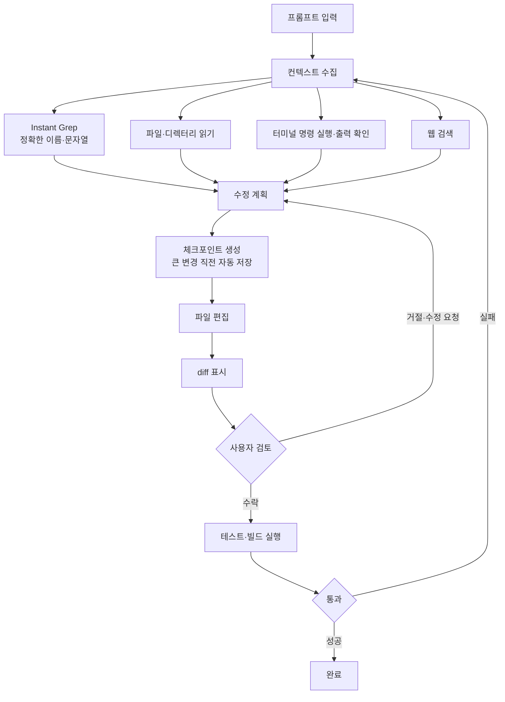
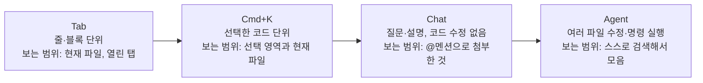
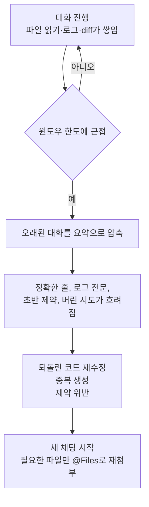

# Cursor

## 1. Cursor란

Cursor는 Anysphere가 개발한 AI 네이티브 IDE다. VS Code를 포크했지만, 에디터 코어에 AI를 심어서 멀티 파일 추론, 병렬 에이전트, 코드베이스 검색을 지원한다.

가격, 모델, 단축키, 컨텍스트 태그가 몇 달 단위로 바뀌는 도구다. 이 문서의 수치는 2026-10-20에 공식 문서를 읽고 고친 값이고, 각 절의 링크가 확인한 페이지다. 이전 판(2026-04)과 달라진 부분은 본문에 적어두었다.

### 1.1 주요 특징

- **AI 네이티브**: 플러그인이 아니라 에디터 코어에 AI가 들어 있다
- **Agent**: 코드베이스를 검색하고, 파일을 수정하고, 터미널 명령을 실행하는 자율 모드
- **병렬 에이전트**: 프롬프트 하나로 최대 8개 에이전트를 동시에 실행, 각자 git worktree 또는 원격 머신에서 격리
- **클라우드 에이전트**: 클라우드 환경에서 에이전트를 돌리고 PR 생성까지 처리 (유료 상위 플랜)
- **멀티 모델**: Anthropic, OpenAI, Google, xAI 모델과 Cursor 자체 모델을 전환해서 사용
- **Tab 자동완성**: Supermaven 기술 기반의 저지연 코드 완성
- **Context 시스템**: `@` 멘션으로 파일, 폴더, 터미널 출력, git diff 등을 프롬프트에 첨부
- **MCP 지원**: 외부 도구 연결

### 1.2 VS Code + Copilot과의 차이

| 항목 | Cursor | VS Code + Copilot |
|------|--------|-------------------|
| **아키텍처** | 독립 AI 네이티브 IDE | IDE + 플러그인 |
| **멀티 파일 편집** | Agent (병렬 실행, worktree 격리) | Agent Mode |
| **모델 선택** | 여러 제공사 모델 + 자체 모델 + 커스텀 API 키 | 플랜별로 제공되는 모델 |
| **코드 검색** | Agent가 Instant Grep과 파일 읽기로 직접 탐색 | 확장 기능과 Agent 도구에 따라 다름 |
| **가격** | 2절 참조 | 공식 가격 페이지 확인 |

Copilot 쪽 칸은 이번에 다시 확인하지 않았다. 비교가 필요하면 두 제품의 공식 문서를 나란히 열어야 한다.

---

## 2. 가격

[공식 가격 페이지](https://cursor.com/docs/account/pricing)에서 2026-10-20에 읽은 개인·팀 플랜이다. 이전 판의 Pro $20, "500 Fast 요청" 같은 요청 횟수 기반 구성은 지금 신규 플랜에 없다.

| 플랜 | 가격 | 사용량 |
|------|------|--------|
| **Free** | $0 | Agent와 Chat을 제한된 범위에서, 외부 모델 사용 불가 |
| **Plus** | $8/월 | 기본 사용량. Cursor 자체 모델 중심, 외부 모델과 클라우드 에이전트 제외 |
| **Premium** | $30/월 | Plus의 4배. 외부 모델(API 정가 청구), 클라우드 에이전트, Bugbot |
| **Super** | $100/월 | Plus의 15배. 피크 시간 우선 접근 |
| **Ultra** | $200/월 | Plus의 50배. 신제품 우선 접근 |
| **Teams** | 좌석당 $30 / $100 / $200 | Premium·Super·Ultra 단계별. 중앙 결제, 사용량 분석, SSO |
| **Enterprise** | 별도 협의 | 풀링된 사용량, SCIM, 보안 통제 |

Hobby, Start, Pro, Pro+ 는 기존 가입자용으로 남아 있고 구조가 다르다. 예전 글에서 보던 "Pro $20/월"은 이쪽이다. 사용량 배수와 제외 항목은 개정이 잦아서, 결제 전에 위 페이지에서 직접 확인해야 한다.

---

## 3. 핵심 기능

### 3.1 Agent Mode

Agent Mode는 자율적으로 코드베이스를 탐색하고, 파일을 읽고 수정하며, 터미널 명령을 실행한다. 단순 코드 생성이 아니라, 프로젝트 구조를 파악한 뒤 여러 파일을 걸쳐 작업한다.

**실제 사용 예시: Spring Boot 프로젝트에 OAuth2 추가**

아래처럼 프롬프트를 입력하면 Agent가 프로젝트를 분석한 뒤 작업을 진행한다.

```
프롬프트: "로그인 API에 Google OAuth2 인증 추가해줘.
기존 SecurityConfig.java의 필터 체인에 OAuth2 로그인 설정을 추가하고,
callback 엔드포인트는 /api/auth/callback/google로 해줘."
```

Agent가 요청을 받아 처리하는 흐름은 아래와 같다. 편집 전에 컨텍스트를 모으는 단계와, 편집 후 diff 검토·테스트로 되돌아가는 반복에 주목하면 된다.



OAuth2 예시로 따라가면 `SecurityConfig.java`와 `build.gradle`을 읽고(수집), 의존성과 설정 클래스를 고치고(편집), 테스트를 돌려서 실패하면 로그를 보고 다시 수집 단계로 돌아간다. 사용자가 개입하는 지점은 diff 검토뿐이어서, 방향이 틀렸다면 이 지점에서 바로 잡아야 비용이 적다. 체크포인트는 대화 기록을 지우지 않고 코드 상태만 되돌리는 용도다([Agent 개요](https://cursor.com/docs/agent/overview)).

Agent Mode에서 중요한 점은 **프롬프트의 구체성**이다. "OAuth2 추가해줘"만 쓰면 Agent가 프로젝트 구조에 맞지 않는 코드를 생성하는 경우가 있다. 기존 파일명이나 엔드포인트 패턴을 함께 알려주면 결과가 훨씬 낫다.

### 3.2 병렬 에이전트와 멀티 파일 편집

`Cmd + I`로 사이드패널을 열어 Agent를 쓴다. 이전 판에서 "Composer 모드"라고 부르던 자리다. 현재 문서에서 Composer는 모드가 아니라 Cursor 자체 코딩 모델의 이름이다(5절).

- **병렬 에이전트**: 하나의 프롬프트로 최대 8개 에이전트 동시 실행([2.0 changelog](https://cursor.com/changelog/2-0))
- **격리 실행**: 각 에이전트가 git worktree 또는 원격 머신에서 독립 작업해서 파일이 충돌하지 않는다

**실제 사용 예시: REST API CRUD 생성**

```
프롬프트: "@OrderController.java 이 컨트롤러 패턴을 참고해서
Product 도메인의 CRUD API를 만들어줘.
Controller, Service, Repository, DTO, Entity 전부 생성하고
기존 패키지 구조를 따라가줘."
```

생성되는 파일 목록:

```
src/main/java/com/example/product/
  ├── controller/ProductController.java
  ├── service/ProductService.java
  ├── repository/ProductRepository.java
  ├── dto/ProductRequest.java
  ├── dto/ProductResponse.java
  └── entity/Product.java
```

핵심은 **@멘션으로 기존 파일을 참조하는 것**이다. 기존 패턴을 명시하지 않으면 프로젝트 컨벤션과 다른 구조로 코드가 나온다. 병렬 실행은 같은 프롬프트를 여러 모델에 돌려 결과를 비교할 때 유용하지만, 8개가 각자 토큰을 쓰므로 사용량도 그만큼 빨리 줄어든다.

### 3.3 Context 관리 (@멘션 시스템)

채팅창에서 `@`를 입력하면 프롬프트에 붙일 소스를 고를 수 있다. 2.0부터 Agent가 필요한 컨텍스트를 스스로 모으기 때문에 태그 목록이 크게 줄었다([mentions 문서](https://cursor.com/docs/context/mentions)).

| 태그 | 넣는 내용 |
|------|-----------|
| `@Files` | 파일 |
| `@Folders` | 디렉터리 |
| `@Terminals` | 터미널 출력 (빌드 실패, 스택 트레이스) |
| `@Chats` | 이전 대화 |
| `@Commit` | 커밋하지 않은 변경 |
| `@Branch` | main과의 전체 diff |
| `@Browser` | 내장 브라우저 내용 |

이전 판에서 소개한 `@codebase`, `@docs`, `@web`, `@git`, `@definitions`, `@notepads`는 위 목록에 없다. `@Definitions`, `@Web`, `@Link`, `@Recent Changes`, `@Linter Errors`는 2.0 changelog에서 제거가 확인됐고, 나머지는 현재 지원 여부를 확인하지 못했다. 입력창에서 `@`를 쳤을 때 자동완성에 뜨지 않으면 그 태그를 쓴 프롬프트는 일반 텍스트로 처리된다.

```
"@SecurityConfig.java 여기서 CORS 설정이 왜 안 먹히는지 봐줘"
"@Terminals 방금 빌드 실패 원인 찾아줘"
```

위치를 모르는 코드는 태그 없이 코드에 실제로 쓰인 이름을 프롬프트에 적는다. "Redis 캐시 쓰는 곳"보다 "`RedisTemplate` 쓰는 곳"이 Instant Grep에 잘 걸린다.

인덱싱, `.cursorignore`, 토큰 사용량 읽는 법, 자동 요약에서 사라지는 정보, 태그 조합 패턴은 [Cursor Context 관리](Cursor_Context_Management.md)에 따로 정리했다.

### 3.4 Tab 자동완성

Supermaven 기술 기반의 초저지연 코드 자동완성이다. 단순 텍스트 매칭이 아니라 현재 파일과 열린 탭의 컨텍스트를 분석해서 제안한다.

- `Tab`: 제안 수락
- `Esc`: 제안 무시
- 부분 수락: 제안의 일부만 `Tab`으로 수락하고 나머지는 무시할 수 있다

### 3.5 인라인 편집 (Cmd + K)

커서 위치에서 바로 코드를 수정한다. 한두 군데만 고칠 때 Agent보다 빠르다.

```
1. 수정하고 싶은 코드 블록 선택
2. Cmd + K 입력
3. 프롬프트 바에 원하는 변경 사항 입력
4. 인라인 diff로 변경 사항 확인 후 적용
```

터미널에서도 `Cmd + K`가 동작한다. 명령어가 기억나지 않을 때 자연어로 설명하면 해당 명령어를 생성해준다.

### 3.6 네 가지 기능 고르기

Tab, Cmd+K, Chat, Agent는 작업 크기와 Cursor가 보는 코드 범위로 갈린다. 범위가 넓을수록 결과를 검토할 양과 토큰 사용량이 같이 늘어난다.



왼쪽에서 오른쪽으로 갈수록 작업이 커지고 Cursor가 직접 모으는 컨텍스트가 늘어난다. 아래 표는 같은 기준을 항목별로 풀었다.

| 기능 | 작업 크기 | 컨텍스트 범위 | 결과물 |
|------|-----------|---------------|--------|
| Tab | 한 줄에서 몇 줄 | 현재 파일과 열린 탭 | 커서 위치의 제안 |
| Cmd+K | 함수 하나, 선택한 블록 | 선택 영역 | 인라인 diff |
| Chat | 파일 몇 개에 대한 질문 | 내가 `@`로 붙인 것 | 설명, 코드 조각 (적용은 직접) |
| Agent | 파일 여러 개, 의존성 변경 | 검색·파일 읽기로 직접 수집 | 파일 수정, 터미널 실행 결과 |

Agent가 모든 작업을 할 수 있어도 변수명 하나 바꾸는 데 쓰면 느리고 비싸다. 반대로 Tab과 Cmd+K로 파일 열 개를 하나씩 고치는 건 시간 낭비다. 수정할 위치가 파일 2~3개 안에서 정해져 있으면 Cmd+K를 연달아 쓰는 쪽이 diff 검토도 쉽다.

### 3.7 Notepads (폐기)

Notepads는 2025-10에 폐기가 공지됐고 이후 버전에서 제거됐다([공지](https://forum.cursor.com/t/deprecating-notepads-in-cursor/138305)). `@notepads`로 부르던 내용은 아래로 옮긴다.

| 쓰던 용도 | 옮길 곳 |
|-----------|---------|
| 항상 지켜야 하는 컨벤션 | `.cursor/rules/` (7.1절) |
| 가끔 불러 쓰는 작업 절차 | `.cursor/commands/` 의 Commands |
| 대화 중 쌓인 맥락 | Memories 또는 `@Chats` |

`.cursor/notepads/`에 쓰던 파일은 그대로 두어도 해롭지 않지만 더 이상 읽히지 않는다. API 컨벤션처럼 "항상 적용할 필요는 없는데 매번 쓰는" 내용은 `globs`나 `description` 기반 Rules로 옮기면 된다.

### 3.8 클라우드 에이전트

에이전트가 클라우드 환경에서 독립적으로 실행된다. 로컬 환경을 차지하지 않고 백그라운드에서 작업이 돌아간다. 가격 페이지 기준으로 Premium 이상 플랜에 포함된다.

```
작업 흐름:
1. 에이전트가 자체 클라우드 환경 생성
2. 코드베이스 온보딩
3. 테스트 실행
4. PR 생성
```

이전 판에 있던 "25~52시간 장시간 에이전트", "Mission Control" 서술은 이번에 공식 문서에서 확인하지 못해서 뺐다.

### 3.9 BugBot

GitHub PR에 대한 자동 코드 리뷰를 수행한다. 가격 페이지에서 Premium 이상 플랜에 포함된 것으로 나온다.

---

## 4. Privacy Mode

Cursor는 Privacy Mode를 제공한다. `Cursor Settings > General > Privacy Mode`에서 설정한다.

**Privacy Mode가 켜져 있으면:**

- 코드가 Cursor 서버에 저장되지 않는다
- 코드가 모델 학습에 사용되지 않는다
- 요청 처리 후 즉시 삭제된다

**Privacy Mode가 꺼져 있으면:**

- 프롬프트와 코드 스니펫이 로그에 저장될 수 있다
- 제품 개선 목적으로 사용될 수 있다

회사 코드를 다루는 경우 반드시 Privacy Mode를 켜야 한다. Teams/Business/Enterprise 플랜은 기본적으로 Privacy Mode가 활성화되어 있다. 개인 플랜에서는 수동으로 켜야 한다.

SOC 2 인증을 받았고, 코드는 제3자와 공유되지 않는다고 명시하고 있지만, 사내 보안 정책에 따라 확인이 필요하다.

---

## 5. 지원 모델

[모델 문서](https://cursor.com/docs/models-and-pricing)에서 2026-10-20에 확인한 제공사다. 모델 이름과 버전은 한 달 단위로 바뀌어서 개별 이름은 문서 표가 정답이다.

| 제공사 | 모델 |
|--------|------|
| **Anthropic** | Claude 계열 (Opus, Sonnet, Haiku) |
| **OpenAI** | GPT-5 계열 (GPT-5.4, 5.5, 5.6 시리즈 포함) |
| **Google** | Gemini 계열 (Flash, Pro) |
| **xAI** | Grok 4.7, 4.6, 4.5 |
| **Cursor** | Composer 2.5 (자체 코딩 모델) |
| **기타** | GLM (Z.ai), Kimi (Moonshot), Muse (Meta) |

**Auto**: 모델을 Cursor가 고르는 옵션이다. Cost, Balance, Intelligence 세 모드가 있고 Balance와 Intelligence는 Teams·Enterprise에서 라우팅을 켰을 때만 쓴다. 개인 플랜은 Cost 모드만 지원한다. 특정 모델의 출력이 필요하면 수동으로 고른다.

---

## 6. 주요 단축키

macOS 기본값이다. [단축키 문서](https://cursor.com/docs/configuration/kbd)에서 확인했고, 설정에서 바꾼 키는 반영되지 않는다.

| 단축키 | 기능 |
|--------|------|
| `Cmd + I` / `Cmd + L` | 사이드패널 토글 (Agent, Chat) |
| `Cmd + E` | Agent 레이아웃 토글 |
| `Cmd + .` | 모드 메뉴 |
| `Cmd + K` | 인라인 편집, 터미널에서는 터미널 프롬프트 바 |
| `Cmd + N` | 새 채팅 |
| `Cmd + Shift + P` | 커맨드 팔레트 |
| ``Ctrl + ` `` | 터미널 토글 |
| `Cmd + B` | 사이드바 토글 |
| `@` | 채팅에서 Context 멘션 |

이전 판은 `Cmd + L`을 Chat, `Cmd + I`를 Composer로 적었다. 지금은 둘 다 같은 사이드패널을 여는 키이고 모드는 `Cmd + .`로 바꾼다. 같은 단축키가 문서에 Chat 전용으로 나오는지는 버전마다 달라서, 안 맞으면 `Cmd + Shift + P`에서 Keyboard Shortcuts를 열어 실제 바인딩을 본다.

---

## 7. 설정 및 구성

### 7.1 프로젝트 규칙 (.cursor/rules)

```markdown
<!-- .cursor/rules/backend.mdc -->
---
description: 백엔드 코딩 규칙
globs: ["src/**/*.java", "src/**/*.kt"]
alwaysApply: true
---

# 백엔드 규칙
- Spring Boot 3.x + Kotlin 사용
- 도메인 기반 패키지 구조
- JUnit 5 + Mockito로 테스트 작성
- 모든 API는 DTO를 사용하여 요청/응답
```

생성 방법: `Cmd + Shift + P` → "New Cursor Rule" 선택

Rules의 적용 방식은 네 가지다:

| 방식 | 설명 |
|------|------|
| `alwaysApply: true` | 항상 모든 프롬프트에 적용 |
| `globs` 패턴 | 해당 파일 작업 시 자동 적용 |
| `description` 매칭 | AI가 프롬프트와 관련 있다고 판단하면 적용 |
| 수동 `@rules` 멘션 | 명시적으로 호출할 때만 적용 |

> 참고: `.cursorrules` 파일(프로젝트 루트)은 레거시 방식이다. `.cursor/rules/` 폴더를 사용한다.

### 7.2 MCP 설정

```json
// .cursor/mcp.json (프로젝트 레벨)
// ~/.cursor/mcp.json (글로벌 레벨)
{
  "mcpServers": {
    "postgres": {
      "command": "npx",
      "args": ["-y", "@modelcontextprotocol/server-postgres"],
      "env": {
        "DATABASE_URL": "postgresql://localhost:5432/mydb"
      }
    }
  }
}
```

### 7.3 커스텀 모델 추가

```
Cursor Settings → Models → API Keys
→ Override OpenAI Base URL 설정
→ API Key 입력
→ Custom Model 추가
```

OpenRouter를 사용하면 다양한 모델을 하나의 API로 접근 가능하다:
```
Base URL: https://openrouter.ai/api/v1
```

---

## 8. 실무에서 자주 겪는 문제

### Context 윈도우 초과

긴 대화를 이어가다 보면 윈도우가 차서 Cursor가 오래된 대화를 요약으로 압축한다. 요약은 손실 압축이라 세부가 빠지고, 그때 증상이 나타난다.



증상은 이전에 수정한 파일을 원래대로 되돌리거나, 같은 코드를 중복 생성하거나, 초반에 준 제약을 어기는 형태로 나온다. 한도 전에 `/summarize`로 요약 시점을 직접 정할 수 있고, 작업 단위가 바뀌면 새 채팅으로 나눈다. 요약에서 무엇이 사라지는지와 사용량 확인 방법은 [Cursor Context 관리](Cursor_Context_Management.md)의 토큰 관리 절에 있다.

### Agent가 엉뚱한 파일을 수정할 때

Agent Mode가 프로젝트 구조를 잘못 파악해서 관계없는 파일을 수정하는 경우가 있다. `.cursor/rules/`에 프로젝트 구조를 명시해두면 이런 문제가 줄어든다.

```markdown
<!-- .cursor/rules/project-structure.mdc -->
---
description: 프로젝트 구조 안내
alwaysApply: true
---

# 프로젝트 구조
- src/main/java/com/example/
  - domain/ : 도메인별 패키지 (order, product, user)
  - common/ : 공통 유틸, 예외 처리
  - config/ : 설정 클래스
- src/main/resources/
  - application.yml : 메인 설정
  - application-{profile}.yml : 프로파일별 설정
```

### diff 적용 실패

가끔 Cursor가 생성한 diff가 현재 파일 상태와 맞지 않아 적용이 실패한다. 파일을 저장하지 않은 상태에서 Agent가 해당 파일을 수정하려 할 때 주로 발생한다. 작업 전 저장 습관이 필요하다.

---

## 참고

- [Cursor 공식 사이트](https://cursor.com)
- [Cursor 기능](https://cursor.com/features)
- [Cursor 문서](https://docs.cursor.com)
- [Cursor 모델](https://cursor.com/docs/models)
- [Cursor Rules 디렉토리](https://cursor.directory)
- [Cursor 가격](https://cursor.com/docs/account/pricing)
