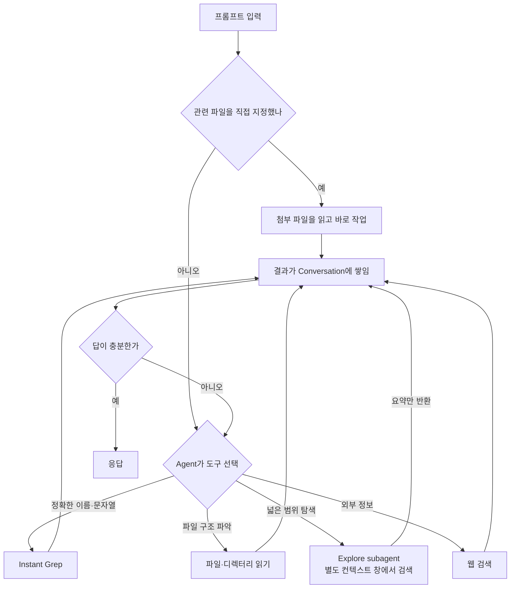
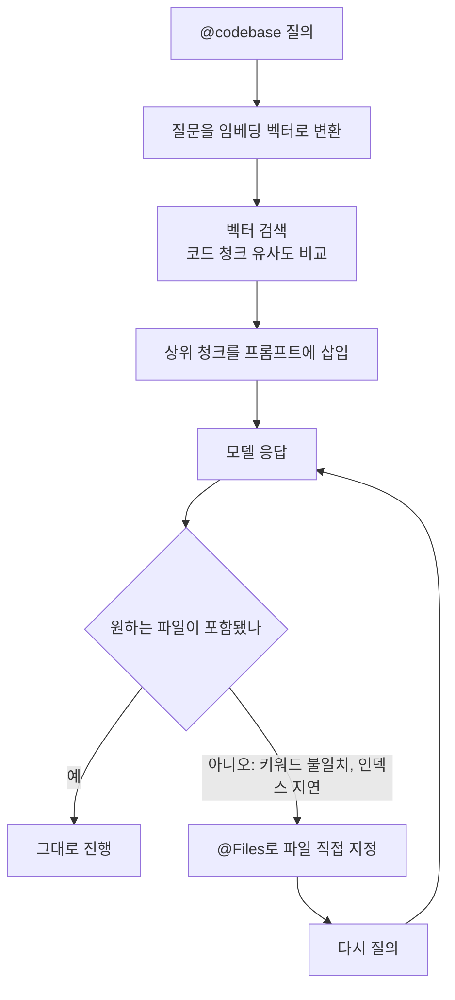
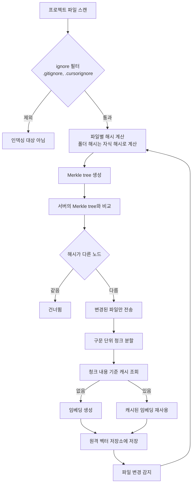
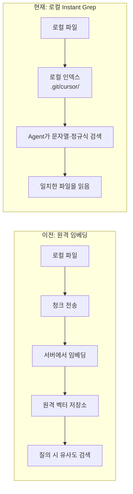
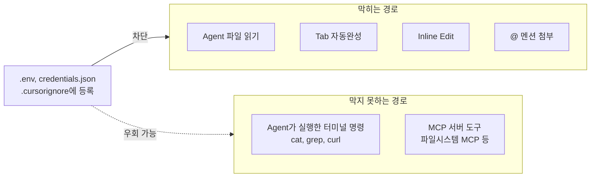
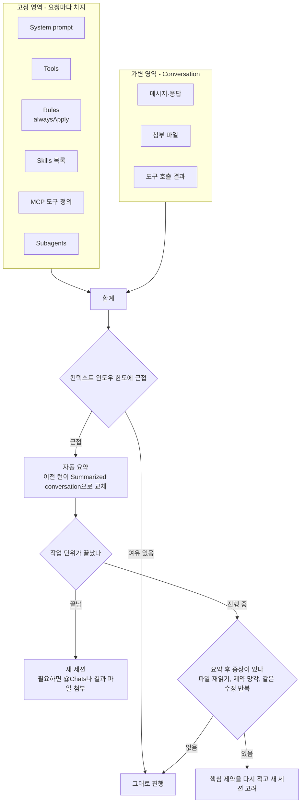
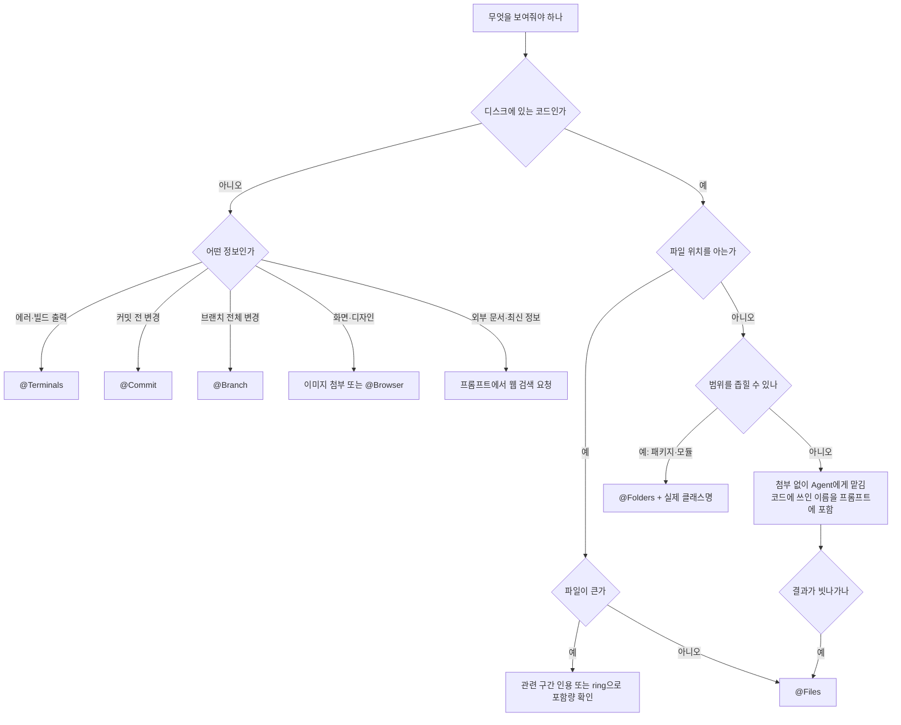

# Cursor Context 관리

## 1. 컨텍스트가 응답을 가르는 지점

Cursor에서 응답 품질은 프롬프트에 무엇이 들어갔느냐로 갈린다. 관련 파일을 정확히 첨부하면 프로젝트 컨벤션에 맞는 코드가 나오고, 아무것도 안 붙이면 어디서나 볼 법한 코드가 나온다. 반대로 파일을 과하게 붙이면 컨텍스트 윈도우가 차서 정작 중요한 정보가 요약 속으로 밀려난다.

이 영역은 Cursor에서 가장 빨리 바뀌는 부분이다. 이전 판(2026-04)에서 쓴 내용 중 상당수가 지금은 맞지 않아서 2026-10-20 기준으로 공식 문서, changelog, 포럼의 공식 답변을 다시 읽고 고쳤다. 확인하지 못한 항목은 본문에 그렇게 적었다.

| 항목 | 이전 서술 | 2026-10 기준 | 근거 |
|------|-----------|--------------|------|
| `@Definitions`, `@Web`, `@Link`, `@Recent Changes`, `@Linter Errors` | 사용 가능 | 2.0에서 메뉴에서 제거 | [2.0 changelog](https://cursor.com/changelog/2-0) |
| `@Notepads` | 사용 가능 | 2025-10 폐기 공지, 1.7.x 이후 버전에서 제거 | [폐기 공지](https://forum.cursor.com/t/deprecating-notepads-in-cursor/138305) |
| 코드베이스 인덱싱 | 원격 임베딩 인덱스, Resync Index | 서버 임베딩 인덱스 제거, 로컬 Instant Grep | [공식 답변 2026-09-07](https://forum.cursor.com/t/how-to-reindexing-my-codebase/170407/6) |
| `.cursorindexingignore` | 인덱싱만 제외 | 공식 문서에 없음, 기대한 동작이 아니라는 답변 | 같은 스레드 |
| Long Context Chat | 모델 드롭다운에서 선택 | 해당 없음. Max Mode는 구 요청 기반 플랜 전용 | [Max Mode](https://cursor.com/docs/context/max-mode) |
| 컨텍스트 사용량 | 입력창 근처 수치 | context ring 클릭 시 항목별 분해(v3.3 이상) | [포럼 공지](https://forum.cursor.com/t/context-usage-breakdown/159913) |

---

## 2. 컨텍스트 태그

### 2.1 지금 쓸 수 있는 태그

현재 공식 mentions 문서([링크](https://cursor.com/docs/context/mentions))에 올라 있는 것은 아래 일곱 가지다.

| 태그 | 넣는 내용 | 쓰는 때 |
|------|-----------|---------|
| `@Files` | 파일 | 위치를 이미 아는 코드 |
| `@Folders` | 디렉터리 | 구조를 보여주고 싶을 때 |
| `@Terminals` | 터미널 출력 | 빌드 실패, 스택 트레이스 |
| `@Chats` | 이전 대화 | 세션을 나눈 뒤 이어서 작업할 때 |
| `@Commit` | 커밋하지 않은 변경 (작업 트리 diff) | 방금 쓴 코드 리뷰 |
| `@Branch` | main과의 전체 diff | PR 올리기 전 리뷰 |
| `@Browser` | 내장 브라우저 내용 | 화면 동작 확인 |

이미지는 태그가 아니라 입력창에 드래그하거나 붙여넣는다. Agent의 파일 읽기 도구도 png, jpg, gif, webp, svg를 읽는다([도구 문서](https://cursor.com/docs/agent/tools)).

예전 문서에 있던 `@Past Chats`는 현재 문서에서 `@Chats`라는 이름으로 나온다. 같은 기능인지는 확인하지 못했다. `@Code`, `@Cursor Rules`, `@Codebase`, `@Docs`, `@Git`은 현재 mentions 문서 목록에 없다. 2.0 changelog는 제거한 항목을 나열하다 "and others"로 끝나서 이 다섯이 거기 포함되는지도 확인하지 못했다. 입력창에서 `@`를 쳤을 때 자동완성에 뜨는지가 가장 빠른 확인 방법이다. 안 뜨면 그 태그에 의존한 프롬프트는 조용히 일반 텍스트로 처리된다.

### 2.2 @Files

가장 자주 쓰는 태그다.

```
"@SecurityConfig.java 여기서 CORS 설정이 왜 안 먹히는지 봐줘"
"@application.yml DB 커넥션 풀 설정 확인해줘"
```

같은 이름의 파일이 여러 개면 경로까지 포함해서 고른다. `@src/main/resources/application.yml`처럼 쓴다. 멀티 모듈 프로젝트에서 `application.yml`이 모듈마다 있으면 파일명만으로 고르다가 엉뚱한 모듈 파일이 붙는 경우가 흔하다.

**큰 파일.** 1000줄짜리 파일을 붙이면 그만큼 토큰이 든다. 큰 파일에서 전체가 들어가는지 일부만 들어가는지, 기준이 몇 줄인지는 공식 문서에 적혀 있지 않다. 일부만 들어간다는 이야기는 들었지만 한도 수치는 확인하지 못했다. 추측으로 외우기보다 직접 재는 편이 정확하다.

1. 새 채팅을 열고 짧은 메시지를 하나 보낸 뒤 context ring에서 Conversation 수치를 적어둔다.
2. 큰 파일을 `@Files`로 붙이고 "읽기만 해, 수정하지 마"라고 보낸다.
3. Conversation 증가분을 `wc -c 파일명` 결과와 비교한다.

증가분이 파일 크기에 비해 눈에 띄게 작으면 일부만 들어간 것이다. 이 경우 파일을 통째로 붙이는 대신 관련 구간을 직접 인용하거나, 파일을 나누거나, Agent가 필요한 부분을 검색해서 읽게 두는 편이 낫다.

### 2.3 @Folders

디렉터리를 붙인다.

```
"@src/main/java/com/example/order/ 이 패키지의 구조를 분석해줘"
```

폴더를 붙이면 모든 파일 내용이 들어가는 것이 아니라 파일 목록과 구조가 들어가고, 필요한 파일은 Agent가 읽어 가는 방식으로 알고 있다. 정확한 포함 범위는 공식 문서에 없다. 큰 디렉터리를 붙인 직후 context ring의 Conversation 수치가 얼마나 늘었는지 보면 감이 잡힌다.

어떤 파일을 붙여야 할지 모를 때 폴더를 주고 Agent가 찾게 하는 용도로 쓴다. 파일 위치를 아는데 폴더를 주면 Agent가 파일을 다시 찾느라 도구 호출이 늘어난다.

### 2.4 Agent가 알아서 모으는 것과 직접 붙여야 하는 것

2.0부터 Agent가 필요한 컨텍스트를 스스로 모은다. 공식 문서는 "어떤 파일이 관련 있는지 알 때 @ 멘션을 쓰고, 모르면 생략하라"고 안내한다. Agent의 검색은 정확한 문자열과 정규식을 찾는 Instant Grep, 파일·디렉터리 읽기, 웹 검색, 셸 명령 실행으로 이루어진다([검색 문서](https://cursor.com/docs/agent/tools/search), [도구 문서](https://cursor.com/docs/agent/tools)).



위 그림에서 볼 것은 두 가지다. 직접 지정한 파일은 검색 단계를 건너뛰고, 검색 도구가 읽어 온 모든 결과는 Conversation에 쌓인다. Explore subagent는 자기 컨텍스트 창에서 검색하고 요약만 돌려주기 때문에 메인 대화가 덜 불어난다.

수동 첨부가 필요한 경우와 불필요한 경우는 이렇게 갈린다.

| 상황 | 직접 첨부 | 이유 |
|------|-----------|------|
| 수정할 파일 위치를 이미 안다 | 한다 | 검색 도구 호출 몇 번이 줄고, 엉뚱한 파일을 읽을 확률이 준다 |
| 터미널 에러 로그, 스택 트레이스 | 한다 (`@Terminals`) | 디스크에 없는 정보라 검색으로 못 찾는다 |
| 커밋 전 변경, 브랜치 diff | 한다 (`@Commit`, `@Branch`) | 코드 검색이 아니라 git 상태다 |
| 화면 캡처, 디자인 | 한다 (이미지) | 텍스트 검색 대상이 아니다 |
| 클래스·메서드가 어디 쓰이는지 | 안 한다 | grep으로 충분하다 |
| 에러 문자열의 발생 위치 | 안 한다 | 정확한 문자열 검색이 가장 빠르다 |
| 프로젝트 패턴 조사 | 안 한다 | Agent가 여러 파일을 읽어 판단한다 |

### 2.5 이전의 @codebase

`@codebase`는 임베딩 인덱스에서 질문과 가까운 코드 조각을 찾아 프롬프트에 넣던 태그다. 아래는 서버에 임베딩 인덱스가 있던 시절의 흐름이고, 지금 동작이 아니다. 오래된 프롬프트 템플릿이나 팀 위키에 이 방식이 남아 있어서 짚어둔다.



빗나가는 이유는 두 가지였다. 질문의 단어와 코드의 이름이 다르면 유사도가 낮았다. "DB 커넥션"이라고 물었는데 코드에는 `HikariConfig`만 있는 경우가 그렇다. 그리고 방금 고친 파일은 인덱스에 늦게 반영됐다. 두 경우 모두 해법은 `@Files`로 전환하는 것이었다.

지금은 이 단계가 Agent의 반복 검색으로 대체됐다. 의미 유사도에 기대던 질의는 코드에 실제로 쓰인 이름을 프롬프트에 하나라도 넣어주면 검색 횟수가 줄어든다. "결제 승인 로직이 어디야?"보다 "`PaymentApprovalService` 호출하는 곳 찾아줘"가 빠르다.

### 2.6 제거된 태그를 대신하는 것

| 제거된 태그 | 대신 쓰는 것 |
|-------------|--------------|
| `@Web` | 프롬프트에 "웹에서 찾아봐"라고 쓰면 Agent가 웹 검색 도구를 호출한다 |
| `@Definitions` | Agent의 검색·파일 읽기. 클래스명을 프롬프트에 적는다 |
| `@Git` | 작업 중인 변경은 `@Commit`, 브랜치 전체는 `@Branch`. 과거 커밋은 Agent가 셸에서 `git log`, `git show`를 실행한다 |
| `@Recent Changes`, `@Linter Errors` | `@Terminals`에 린트·빌드 출력을 붙이거나 Agent가 직접 실행하게 한다 |
| `@Notepads` | Rules, `.cursor/commands/`의 Commands, Memories |

`@Docs`로 등록해두던 외부 문서도 현재 mentions 목록에 없다. 특정 버전 문서가 꼭 필요하면 해당 페이지의 내용을 프로젝트 안에 파일로 두고 `@Files`로 붙이는 쪽이 확실하다. 버전을 프롬프트에 적지 않으면 최신 버전 기준 답이 나오는 문제는 그대로다. Spring Boot 2.x 프로젝트에서 3.x 기준 설정이 나오는 식이다.

---

## 3. 코드베이스 인덱싱

### 3.1 이전 방식: 원격 임베딩 인덱스

서버에 임베딩 인덱스를 두던 구조는 Cursor 공식 블로그([How Cursor's indexing works](https://cursor.com/blog/secure-codebase-indexing))에 설명이 있다. 핵심은 Merkle tree로 바뀐 파일만 찾아내는 부분이다.



흐름에서 볼 곳은 비교 단계다. 폴더 해시가 자식 해시로 계산되기 때문에 루트부터 내려가다 해시가 같은 폴더는 통째로 건너뛴다. 공식 블로그는 5만 개 파일 작업 공간에서 한 번 동기화할 때 오가는 해시와 파일명이 약 3.2MB라고 쓴다. 변경이 거의 없는 프로젝트에서 주기적 동기화가 가벼운 이유다. 편집은 대부분 일부 청크만 바꾸기 때문에 청크 내용 기준으로 임베딩을 캐시해서 다시 계산하는 양도 줄인다.

같은 블로그에는 팀원의 인덱스를 재사용하는 방식도 있다. 트리에서 similarity hash를 뽑아 비슷한 코드베이스의 기존 인덱스를 가져오면 첫 질의까지 걸리는 시간이 몇 시간에서 몇 초로 줄어든다고 한다.

### 3.2 지금 방식: 로컬 Instant Grep

2026-09-07 공식 답변은 이렇다. Cursor는 더 이상 시맨틱 코드 인덱스를 만들거나 서버에 임베딩을 저장하지 않으며, Agent는 Instant Grep과 일반 파일 읽기로 코드를 찾는다. 공식 검색 문서도 "Instant Grep은 인덱스를 사용자 기기에서 만들고 조회하며, 파일 경로나 코드를 업로드하지 않고 임베딩도 저장하지 않는다"고 적었다([검색 문서](https://cursor.com/docs/agent/tools/search)).

| 항목 | 임베딩 인덱스(이전) | Instant Grep(현재) |
|------|---------------------|--------------------|
| 찾는 기준 | 의미 유사도 | 정확한 문자열, 정규식, 단어 경계 |
| 인덱스 위치 | 원격 벡터 저장소 | 로컬. 답변에는 `.git/cursor/`로 언급 |
| 코드 업로드 | 청크가 서버로 전송 | 경로·코드 업로드 없음 |
| 수동 갱신 | Resync Index | 메뉴 없음. 증분으로 자동 재구성 |
| 설정 | Codebase Indexing | Indexing & Docs의 "Index Repositories for Instant Grep" 토글 |
| 단어가 달라도 찾나 | 어느 정도 | 못 찾는다. Agent가 키워드를 바꿔 다시 검색해야 한다 |

이 답변이 나온 시점 이후의 버전을 기준으로 썼다. 업데이트하지 않은 클라이언트에 Resync 메뉴가 남아 있으면 이전 동작일 수 있다. 어느 쪽인지는 설정 화면에서 그 메뉴가 있는지로 판별한다.

두 방식을 가르는 질문은 "어디서 계산하는가"다.



### 3.3 Privacy Mode와의 관계

이전 방식에서는 인덱싱이 Privacy Mode와 얽혔다. 청크가 서버로 나가 임베딩이 되기 때문이다. 외부 분석 글들은 서버에 벡터와 난독화한 파일 경로가 저장되고, Privacy Mode 사용자는 평문 코드가 저장되지 않는다고 설명한다. 이 부분은 공식 블로그가 직접 다루지 않아서 1차 출처를 확인하지 못했다. 회사 보안 검토를 받은 적이 있다면 그 문서의 기준이 이전 방식이었는지 지금 방식이었는지부터 확인해야 한다.

지금은 인덱스 자체가 업로드되지 않아서 이 문제가 사라졌다. 다만 Agent가 파일을 읽으면 그 내용은 모델 요청에 실려 나간다. 코드가 모델 제공자에게 가는 것, 그리고 저장·학습에 쓰이는지는 Privacy Mode가 정한다. 인덱싱을 껐다고 코드가 밖으로 안 나가는 것이 아니다. Privacy Mode 설정은 [Cursor 소개 문서](Cursor.md)에 정리했다.

### 3.4 멀티 루트 워크스페이스와 git worktree

공식 문서는 멀티 루트를 지원하고, 각 워크스페이스 폴더의 컨텍스트를 Agent가 쓸 수 있다고 한다. 두 가지 제약이 있다. 단일 git 루트를 전제로 하는 기능은 멀티 루트에서 꺼진다. worktree가 그 예다. Cloud Agent는 멀티 루트를 지원하지 않는다.

모노레포에서 백엔드와 프론트엔드를 한 워크스페이스에 묶어 열면 검색 범위가 둘 다 포함된다. 한쪽만 작업한다면 그 패키지 디렉터리만 열거나, 멀티 루트에 필요한 폴더만 추가한다.

worktree 병렬 작업은 확인하지 못한 부분이 있다. 이전 방식에서는 내용 해시와 청크 캐시 덕분에 같은 내용의 청크가 중복 임베딩되지 않지만 워크스페이스마다 동기화와 저장소 공간은 따로 필요했다. 지금 방식에서 worktree마다 별도 로컬 인덱스가 생기는지는 문서에서 찾지 못했다. 병렬 작업이 잦다면 직접 재본다.

```bash
git worktree list
du -sh .git/cursor 2>/dev/null
```

worktree 안의 `.git`은 디렉터리가 아니라 파일이라 위 경로가 없을 수 있다. 이 경우 인덱스가 본 저장소의 git 디렉터리에 공유되는지, 어디에 만들어지는지 확인이 필요하다.

### 3.5 트러블슈팅

**인덱싱이 안 끝난다.** 이전 방식에서는 `node_modules`, `build`, `.gradle`이 대상에 들어가면 시간이 수십 분 단위로 늘었다. 기본 무시 목록과 `.gitignore`가 이미 `node_modules`, `__pycache__`, 바이너리, lock 파일을 거르지만([ignore 문서](https://cursor.com/docs/context/ignore-files)) 프로젝트 고유의 산출물 디렉터리(`out/`, `generated/` 등)는 `.cursorignore`에 직접 넣어야 한다. 지금 방식에서는 "Index Repositories for Instant Grep" 토글 상태와 `.git/cursor/` 크기를 먼저 본다.

**Resync를 해도 삭제한 파일이 검색된다.** 이전 방식에서는 서버 인덱스가 클라이언트 트리와 몇 분 간격으로 비교될 때까지 삭제가 반영되지 않았다. 지금은 Resync 메뉴 자체가 없다. 삭제한 파일이 답변에 계속 나오면 인덱스보다 아래 순서로 의심한다.

1. `git status`로 파일이 실제로 지워졌는지 본다. 다른 브랜치에서 돌아오면서 되살아나는 경우가 있다.
2. 같은 채팅 앞 턴에서 그 파일을 이미 읽었다면 내용이 Conversation에 남아 있다. 새 채팅을 연다.
3. 요약된 대화에 파일 내용이 들어갔다면 요약에도 남는다. 이것도 새 채팅으로 끊는다.

인덱스가 아니라 대화 이력이 원인인 경우가 많다고 추정하지만, 이는 확인한 것이 아니라 인덱스가 로컬 파일을 직접 본다는 구조에서 나온 추정이다.

**`@codebase`가 빗나간다.** 이전 방식의 증상이다. 지금은 해당 태그에 기대지 말고 코드에 실제로 쓰인 이름을 프롬프트에 적는다.

---

## 4. .cursorignore

`.cursorignore`는 프로젝트 루트에 두고 `.gitignore`와 같은 문법을 쓴다. 용도는 인덱싱 속도가 아니라 접근 차단이다.

### 4.1 기본 설정

```gitignore
# .cursorignore

# 빌드 결과물
build/
dist/
target/
out/

# 생성된 파일
*.min.js
*.min.css
*.map

# 대용량 데이터
*.sql
*.csv

# 설정 파일 외의 json 제외. 예외는 별도 줄로 둔다
*.json
!package.json
!tsconfig.json

# IDE 설정
.idea/
.vscode/

# 환경 변수
.env
.env.*
```

이전 판의 `*.json  # 설정 파일 제외하려면 ...`는 주석이 같은 줄에 붙어 있었다. gitignore 문법에서 `#`은 줄 맨 앞에 올 때만 주석이다. 같은 줄에 붙으면 `*.json  # 설정...` 전체가 하나의 패턴이 되어 어떤 파일도 매치하지 않는다. git에서 직접 확인했다.

```
*.json  # 예외 처리        -> data.json: not ignored, package.json: not ignored
# 예외 처리 (별도 줄)
*.json                     -> data.json: ignored, package.json: not ignored
!package.json
```

`.cursorignore`가 git과 같은 매처를 쓰는지는 공식 문서가 "gitignore 문법"이라고만 말해서, 위 검증은 git 기준이다. 의도대로 걸렸는지는 한 번 열어서 해당 파일을 `@Files`로 붙여보고 확인한다.

예외 처리에는 제약이 하나 더 있다. 상위 디렉터리를 통째로 제외하면 안쪽 파일을 `!`로 되살릴 수 없다. 공식 문서도 같은 제약을 적었다.

```
config/                 -> config/app.yml: ignored (예외 실패)
!config/app.yml

config/*                -> config/app.yml: not ignored (예외 성공)
!config/app.yml            config/other.yml: ignored
```

디렉터리 안에서 일부만 살려야 하면 `config/`가 아니라 `config/*`로 쓴다.

### 4.2 .gitignore와 기본 무시 목록

공식 문서는 `.gitignore`에 적힌 파일과 기본 무시 목록을 Cursor가 자동으로 무시한다고 적었다. 기본 목록에는 lock 파일, 환경 변수 파일, 바이너리, 미디어 파일, `node_modules/`, `__pycache__/` 같은 흔한 의존성 디렉터리가 들어 있다. 이전 판에서 "lock 파일은 `.cursorignore`에 넣어서 제외한다"고 쓴 부분은 이미 기본 목록이 처리하므로 따로 적을 필요가 없다. `.env`는 기본 목록에 있어도 명시해두는 편이 안전하다. 기본 목록이 바뀌어도 규칙이 남는다.

두 가지 설정이 더 있다. 사용자 설정에서 모든 프로젝트에 적용되는 전역 패턴을 둘 수 있고, hierarchical ignore를 켜면 Cursor가 상위 디렉터리의 `.cursorignore`까지 찾는다. 모노레포나 회사 공통 규칙을 상위 디렉터리에 하나 두는 용도다.

### 4.3 ignore 파일별 차단 범위

이전 판은 `.cursorignore`는 "인덱싱과 AI 접근 모두 차단", `.cursorindexingignore`는 "인덱싱만 제외하고 `@files`로는 읽을 수 있다"로 구분했다. 현재 상태는 이렇다.

| 파일 | 현재 동작 | 근거 |
|------|-----------|------|
| `.gitignore` + 기본 목록 | 자동으로 무시 | ignore 문서 |
| `.cursorignore` | Agent, Tab, Inline Edit이 코드에 접근하는 것과 `@` 멘션 참조를 막는다 | ignore 문서 |
| `.cursorindexingignore` | 공식 문서에 설명이 없다. 예전의 "검색에서만 빼고 읽기는 허용"하는 소프트 제외로는 동작하지 않는다 | 공식 답변(2026-09-07) |

그래서 "검색 대상에서만 빼고 직접 첨부는 허용"하는 설정은 지금 없다. 그런 목적이라면 `.cursorignore`에 넣되 해당 파일을 AI가 못 읽게 되는 비용을 감수해야 한다. 커뮤니티에서도 이 소프트 제외를 기능 요청으로 올려둔 상태다.

### 4.4 .cursorignore로 막을 수 없는 경로

보안 파일을 `.cursorignore`에 넣으면 안전하다고 생각하기 쉽다. 공식 문서가 직접 한계를 적었다. "Agent가 쓰는 터미널과 MCP 서버 도구는 `.cursorignore`가 지키는 코드에 대한 접근을 막지 못한다."



Agent가 `cat .env`를 셸에서 실행하면 막을 방법이 없다. 그 출력은 대화에 들어가고 모델 요청에 실린다. 현실적인 대응은 세 가지다. 터미널 명령을 자동 실행하지 않고 실행 전에 눈으로 확인한다. 파일시스템을 열어주는 MCP 서버의 접근 범위를 프로젝트 디렉터리로 한정한다. 그리고 운영 비밀 값은 로컬 `.env`에 두지 않고 비밀 관리 도구에서 주입한다. `.cursorignore`는 실수로 첨부하거나 자동완성에 섞이는 것을 막는 장치이고, 악의적이거나 의도치 않은 셸 접근을 막는 장치가 아니다.

---

## 5. 대규모 프로젝트에서 컨텍스트 관리

### 5.1 모노레포

수십만 줄 규모의 모노레포에서는 Agent의 검색 범위가 넓어서 관련 없는 패키지의 같은 이름 클래스가 섞이는 경우가 있다. 범위를 좁히는 방법이 몇 가지 있다.

- 작업 중인 패키지 디렉터리를 워크스페이스로 연다.
- 프롬프트에 경로를 명시한다. 프롬프트에 `packages/payment/`를 적고 `@Folders`로 붙인다.
- `.cursorignore`로 다른 패키지를 제외한다. 패키지를 옮겨 다닐 때마다 파일을 고쳐야 해서 번거롭다. 제외한 쪽은 AI가 읽지도 못하므로 두 패키지에 걸친 작업에는 쓰지 못한다.

```
# 나쁜 예 - 전체에서 찾게 둔다
"결제 로직 어디 있어?"

# 나은 예 - 범위와 실제 이름을 준다
"@packages/payment/ 에서 PaymentApprovalService를 호출하는 곳을 찾아줘"
```

### 5.2 멀티 모듈 프로젝트

Spring Boot 멀티 모듈에서 `core`, `api`, `batch`, `admin`이 있으면 Agent가 어느 모듈 코드를 봐야 하는지 헷갈린다. 경로를 명시하고, 모듈 관계는 Rules에 적어둔다.

```
"@modules/api/src/main/java/com/example/order/OrderController.java
이 컨트롤러가 호출하는 서비스가 @modules/core/ 에 있는데,
트랜잭션 전파가 제대로 되는지 확인해줘"
```

```markdown
<!-- .cursor/rules/project-modules.mdc -->
---
description: 멀티 모듈 구조 안내
alwaysApply: true
---

# 모듈 구조
- core: 도메인 엔티티, 리포지토리, 서비스 인터페이스
- api: REST API 컨트롤러, DTO, api 전용 서비스 구현체
- batch: 배치 잡, 스케줄러
- admin: 관리자 페이지 API
- common: 공통 유틸, 예외, 상수
```

`alwaysApply: true`는 매 요청에 들어간다. 이 규칙이 몇 토큰을 차지하는지는 6.2에서 잰다. 모듈 구조처럼 짧은 규칙은 부담이 작지만, 규칙이 늘면 합쳐서 문제가 된다.

### 5.3 풀스택 프로젝트

프론트엔드와 백엔드가 한 레포에 있을 때 백엔드 작업 중 프론트 코드가 검색에 섞여 들어온다. 이전에는 `.cursorindexingignore`에 `frontend/`를 넣는 방식을 권했지만 지금은 그 파일이 기대대로 동작하지 않는다. 대신 Rules에 현재 작업 영역을 적거나 프롬프트에서 디렉터리를 지정한다. `.cursorignore`에 넣으면 검색에서 빠지는 만큼 AI가 API 스펙을 확인하러 프론트 코드를 못 읽는 문제가 생긴다.

### 5.4 레거시 코드가 많은 프로젝트

마이그레이션 중에는 Agent가 레거시 패턴을 따라 쓰는 문제가 있다. 어디를 참조하고 어디를 피할지 Rules에 적는다.

```markdown
<!-- .cursor/rules/migration.mdc -->
---
description: 마이그레이션 중 참조 규칙
alwaysApply: true
---

# 코드 참조 규칙
- 새 코드 작성 시 src/v2/ 패키지의 패턴을 따른다
- src/legacy/ 패키지의 코드는 참조하지 않는다
- 엔티티는 src/v2/domain/ 패키지의 구조를 따른다
```

---

## 6. 토큰 관리

### 6.1 사용량 표시 읽는 법

에이전트 창의 context ring을 클릭하면 컨텍스트가 어디에 쓰이는지 항목별로 나온다. 에이전트 창에서 메시지를 한 번 보낸 뒤부터 열린다. v3.3 이상 기능이다. 항목은 이렇게 나뉜다([포럼 공지](https://forum.cursor.com/t/context-usage-breakdown/159913)).

| 항목 | 내용 | 요청마다 드는가 |
|------|------|------------------|
| System prompt | Cursor 내장 지시문 | 항상 |
| Tools | 도구 목록과 호출 방법. 모드와 모델마다 다르다 | 항상 |
| Rules | 채팅 시작 시 로드된 워크스페이스·사용자 규칙 | 항상 |
| Skills | 사용 가능한 skill의 이름·설명·경로 목록 | 항상 |
| MCP | MCP 서버의 지시문과 도구·리소스 목록 | 항상 |
| Subagents | 위임 가능한 subagent 종류 설명 | 항상 |
| Summarized conversation | 요약으로 압축된 이전 대화 | 요약 이후 |
| Conversation | 메시지, 응답, 도구 호출과 결과, 읽은 파일, 검색 결과, 이미지 | 대화가 길수록 증가 |

위쪽 여섯 줄은 내가 한 마디도 하기 전에 이미 차 있는 고정분이다. 아래 Conversation만 대화에 따라 늘어난다. 윈도우가 작은 모델에서는 고정분만으로 몇 퍼센트가 차 있는 경우가 있어서, 모델을 바꿀 때 ring을 다시 본다.



그림에서 볼 것은 요약이 일어난 뒤의 분기다. 한도에 닿으면 Cursor가 이전 대화를 요약으로 바꾸는데, 이후의 판단은 사람이 한다.

### 6.2 Rules와 MCP가 매 요청 먹는 토큰 재기

`alwaysApply: true` 규칙과 MCP 서버의 도구 정의는 질문과 무관하게 매번 들어간다. 팀이 규칙을 하나씩 늘리다 보면 어느새 윈도우의 상당 부분이 규칙으로 찬다. 재는 방법은 간단하다.

```bash
# alwaysApply 규칙의 총 크기. 대략적인 지표일 뿐 토큰 수는 아니다
grep -l 'alwaysApply: true' .cursor/rules/*.mdc | xargs wc -c

# 이 프로젝트에 연결된 MCP 서버 목록
jq '.mcpServers | keys' .cursor/mcp.json
```

바이트 수는 대략의 지표고, 정확한 값은 context ring의 Rules, MCP 항목이다. 재는 순서는 이렇다.

1. 새 채팅에서 짧은 메시지를 하나 보내 ring의 Rules와 MCP 수치를 적는다.
2. MCP 서버를 하나 끄고 새 채팅에서 다시 잰다. 서버마다 차지하는 양이 다르다.
3. 규칙 하나를 `alwaysApply: false`로 바꾸고 `description`을 짧게 써서 다시 잰다.

규칙을 항상 적용에서 필요할 때 적용으로 바꾸면 Rules 항목이 줄고, Agent가 설명을 보고 필요할 때 불러온다. 대신 설명이 부실하면 필요한 순간에도 안 불러서 규칙이 무시된 것처럼 보인다. 규칙을 바꾸고 나면 해당 규칙이 필요한 작업으로 한 번 돌려본다.

MCP 도구 정의는 Cursor가 지연 로드 방식으로 바꿨다. Agent는 도구 이름만 받고 필요할 때 상세 정의를 찾아본다. Cursor가 A/B 테스트한 결과 MCP 도구를 호출한 실행에서 전체 토큰이 46.9% 줄었다고 한다([Dynamic context discovery](https://cursor.com/blog/dynamic-context-discovery)). 이 수치는 Cursor 자체 측정이고 내 환경 수치가 아니다. 그래도 서버를 많이 연결해둔 프로젝트라면 ring의 MCP 항목으로 변화를 직접 본다.

같은 글에서 긴 도구 출력은 잘라내지 않고 파일로 써서 Agent가 필요한 부분만 읽게 한다고 설명한다. 터미널 출력도 로컬 파일시스템에 동기화한다. 로그가 긴 서버 프로세스의 출력은 통째로 붙이기보다 필요한 구간만 검색하게 두는 편이 낫다.

### 6.3 자동 요약에서 사라지는 것

한도에 가까워지면 Cursor가 오래된 대화를 요약으로 압축한다([1.6 changelog](https://cursor.com/changelog/1-6)). 요약은 손실 압축이라 원문이 그대로 남지 않는다.

- 이전에 읽은 파일의 정확한 줄. 요약에는 "OrderService를 수정했다" 정도만 남고 어떤 줄을 어떻게 바꿨는지는 빠진다.
- 에러 로그 전문. 스택 트레이스는 요약에서 한 줄로 줄어든다.
- 초반에 준 세부 제약. "이 메서드 시그니처는 건드리지 마"가 요약에 안 담기면 이후 수정에서 어긴다.
- 시도했다가 버린 방법과 버린 이유. 같은 시도를 다시 한다.

Cursor는 요약 품질을 올리려고 대화 이력을 파일로 두고 Agent가 요약에서 빠진 세부를 검색해서 되찾게 한다. 그래서 완전히 사라지는 것은 아니지만 되찾는 데에도 도구 호출이 든다.

요약은 직접 부를 수도 있다. `/summarize`는 새 채팅을 열기 싫지만 윈도우 공간을 확보하고 싶을 때 쓴다. 한도 전에 부르면 요약 시점을 내가 고른다.

포럼에는 윈도우의 10~20%에서 요약이 일어난다는 버그 신고가 올라와 있다([링크](https://forum.cursor.com/t/context-keeps-summarizing-at-10-20-of-total-context-window/163850)). ring 수치가 한참 남았는데 요약이 일어나면 이 경우일 수 있다. 이때는 작업을 짧게 끊는 것 외에 해법이 마땅치 않다.

### 6.4 모델별 윈도우와 Max Mode

컨텍스트 윈도우는 모델마다 다르고 자주 바뀐다. 공식 [모델 문서](https://cursor.com/docs/models-and-pricing)에서 일부를 확인했다. Grok 4.7은 기본 256k 윈도우를 쓰고, 입력이 256k를 넘는 긴 컨텍스트는 표준 요금의 2배로 최대 500k까지 청구된다. Claude 계열 일부 모델은 확장 컨텍스트로 최대 1M 토큰이 가능하다고 적혀 있다. 모델별 기본값과 확장값은 문서의 표가 정답이므로 이 문서에 표로 옮기지 않았다.

Max Mode는 모델의 컨텍스트 윈도우를 기본 한도 너머로 늘리는 기능인데, 구 요청 기반 플랜에서만 쓸 수 있다. 그 플랜에서는 모델의 API 요금에 20%를 더해 청구한다([Max Mode 문서](https://cursor.com/docs/context/max-mode)). 현재 플랜에서는 이 토글이 없으므로, 이전 판에서 쓴 "Long Context Chat 모델을 고르면 된다"는 안내는 맞지 않는다.

윈도우가 크다고 아무 파일이나 넣어도 되는 것은 아니다. 윈도우가 크면 요약 시점이 늦어질 뿐이고, 요청마다 입력 토큰이 청구되는 구조는 그대로다. 대화가 길수록 매 요청의 입력이 커져서 비용이 늘고 응답도 느려진다.

### 6.5 세션 분리

하나의 세션에서 모든 작업을 하면 한도를 넘는다. 작업 단위로 세션을 나눈다.

```
# 나쁜 예 - 하나의 세션에서 전부 처리
세션 1: "Entity 만들어줘" → "Service도" → "Controller도" → "테스트도" → (한도 도달, 요약)

# 나은 예 - 작업 단위로 세션 분리
세션 1: Entity + Repository 생성
세션 2: @Entity.java 참조해서 Service + Controller 생성
세션 3: @Service.java @Controller.java 참조해서 테스트 작성
```

새 세션을 열 때 이전 결과물을 `@Files`로 붙이면 이어진다. 이전 대화의 맥락 자체가 필요하면 `@Chats`를 쓴다. 다만 `@Chats`로 불러온 대화도 토큰을 차지한다. 코드 결과물만 필요하면 파일 첨부가 가볍다.

**파일 첨부를 최소화한다.** 관련 파일 3~5개를 정확히 고르는 쪽이 폴더 전체보다 낫다. "혹시 필요할 수 있으니까"로 붙이면 Conversation만 늘어난다.

**대화를 짧게 유지한다.** 한 작업을 5~10턴 안에 끝내는 것을 기준으로 삼는다. 길어지면 초반 컨텍스트가 요약으로 바뀐다.

**코드를 채팅에 붙여넣지 않는다.** 500줄을 붙여넣는 것보다 `@Files`로 파일을 붙이는 쪽이 낫다. 붙여넣은 코드는 파일 경로 정보가 없어서 Agent가 수정 위치를 못 잡는다.

---

## 7. 태그 조합 패턴

### 버그 수정

```
"@SecurityConfig.java @application.yml @Terminals
CORS 프리플라이트 요청이 403으로 떨어진다. 터미널 로그와 같이 보고
설정에 뭐가 빠졌는지 봐줘"
```

설정 파일은 직접 붙이고, 터미널 로그는 `@Terminals`로 준다. 로그는 코드 검색으로 못 찾는 정보다.

### 새 기능 구현

```
"@OrderController.java @OrderService.java
이 패턴을 참고해서 Product 도메인의 CRUD API를 만들어줘.
Spring Data JPA Specification 사용법은 웹에서 찾아서 반영해줘"
```

기존 코드를 참조 패턴으로 지정한다. 외부 문서는 `@Docs` 대신 프롬프트에서 웹 검색을 요청한다.

### 코드 리뷰

```
"@Branch 이 브랜치의 변경 내용을 리뷰해줘.
변경된 메서드를 호출하는 곳도 찾아서 영향 범위를 확인해줘"
```

diff는 `@Branch`로 가져오고, 호출 관계는 Agent가 검색한다.

### 트러블슈팅

```
"@Terminals HikariCP connection leak detected 로그야.
@application.yml 현재 커넥션 풀 설정과 같이 보고 원인 후보를 좁혀줘"
```

### 태그 선택 순서



---

## 8. 정리

| 상황 | 추천 태그 | 토큰 비용 | 정확도 |
|------|-----------|-----------|--------|
| 위치를 아는 코드를 보여줄 때 | `@Files` | 파일 크기만큼. 큰 파일은 포함량을 직접 확인 | 높음. 지정한 내용 그대로 들어간다 |
| 프로젝트 구조를 파악시킬 때 | `@Folders` | 낮음. 목록 위주, 읽은 파일만큼 추가 | 중간. 구조는 정확하지만 세부는 Agent가 읽어야 한다 |
| 위치를 모르고 코드에서 찾을 때 | 첨부 없이 Agent에 맡김 | 검색 도구 호출 수에 비례. Explore subagent는 요약만 반환 | 실제 이름이 있으면 높고, 개념으로만 물으면 낮음 |
| 빌드·런타임 에러 | `@Terminals` | 로그 길이만큼. 긴 로그는 구간만 | 높음 |
| 커밋 전 변경 리뷰 | `@Commit` | diff 크기만큼 | 높음 |
| 브랜치 전체 리뷰 | `@Branch` | 커밋 수와 변경량에 비례해 큼 | 높음. 영향 범위는 별도 검색 필요 |
| 이전 작업 이어가기 | `@Chats` | 불러온 대화만큼 큼 | 요약본이면 세부가 빠짐 |
| 최신 정보, 라이브러리 사용법 | 프롬프트에서 웹 검색 요청 | 검색 결과 요약만큼 | 출처 품질에 좌우됨. 원문 확인이 필요 |
| 프로젝트 컨벤션 적용 | Rules (`alwaysApply` 또는 설명 기반) | 항상 적용은 매 요청, 설명 기반은 필요할 때만 | 설명이 부실하면 안 불러온다 |

컨텍스트 관리의 핵심은 **필요한 정보만 정확히 첨부하는 것**이다. "많이 넣으면 잘 답변하겠지"는 틀린 생각이다. 토큰 한도 안에서 관련도 높은 정보를 선별해서 넣어야 AI가 정확한 답변을 한다.

---

## 출처

문서 작성 시점(2026-10-20)에 읽은 1차 자료다. 이 영역은 빨리 바뀌므로 동작이 다르면 아래 페이지부터 확인한다.

- [Mentions](https://cursor.com/docs/context/mentions), [ignore 파일](https://cursor.com/docs/context/ignore-files), [검색(Instant Grep)](https://cursor.com/docs/agent/tools/search), [Agent 도구](https://cursor.com/docs/agent/tools)
- [모델과 요금](https://cursor.com/docs/models-and-pricing), [Max Mode](https://cursor.com/docs/context/max-mode)
- [2.0 changelog](https://cursor.com/changelog/2-0), [1.6 changelog](https://cursor.com/changelog/1-6)
- [인덱싱 구조(Merkle tree)](https://cursor.com/blog/secure-codebase-indexing), [Dynamic context discovery](https://cursor.com/blog/dynamic-context-discovery)
- [Notepads 폐기 공지](https://forum.cursor.com/t/deprecating-notepads-in-cursor/138305), [재인덱싱 관련 공식 답변](https://forum.cursor.com/t/how-to-reindexing-my-codebase/170407/6), [Context Usage Breakdown](https://forum.cursor.com/t/context-usage-breakdown/159913)

확인하지 못한 것은 다음과 같다. `@Codebase`, `@Docs`, `@Git`, `@Code`, `@Cursor Rules`의 현재 지원 여부, 큰 파일 첨부 시 포함되는 분량의 기준, worktree별 로컬 인덱스 생성 방식, `.cursorignore`가 git과 같은 매처를 쓰는지, 이전 방식의 Privacy Mode 상 서버 저장 범위(외부 분석 글에 의존).
