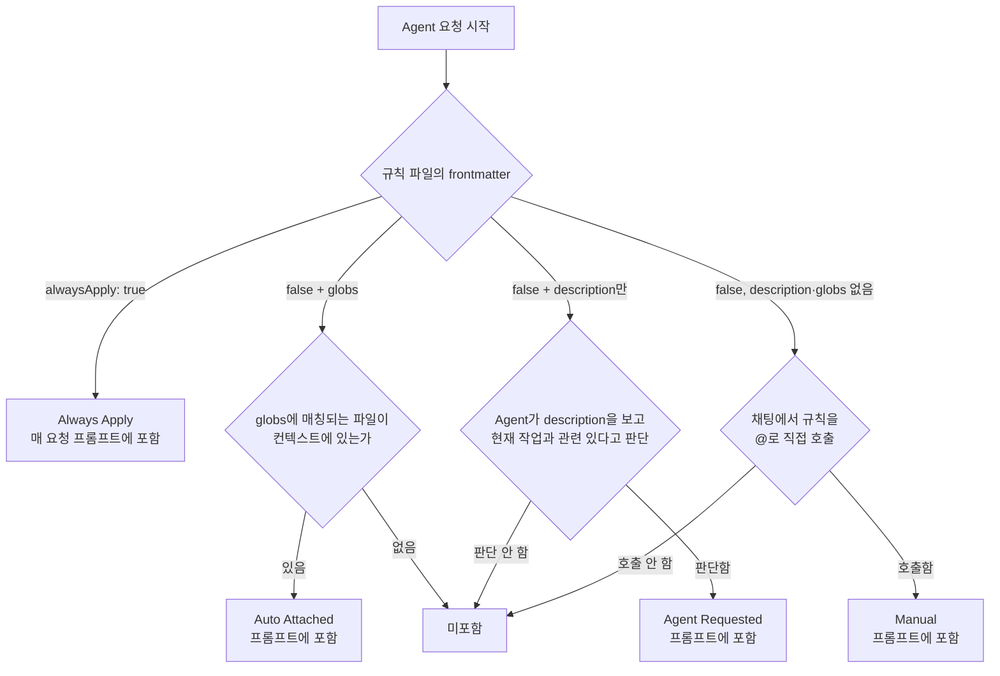
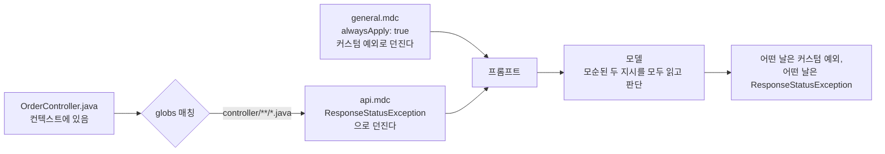
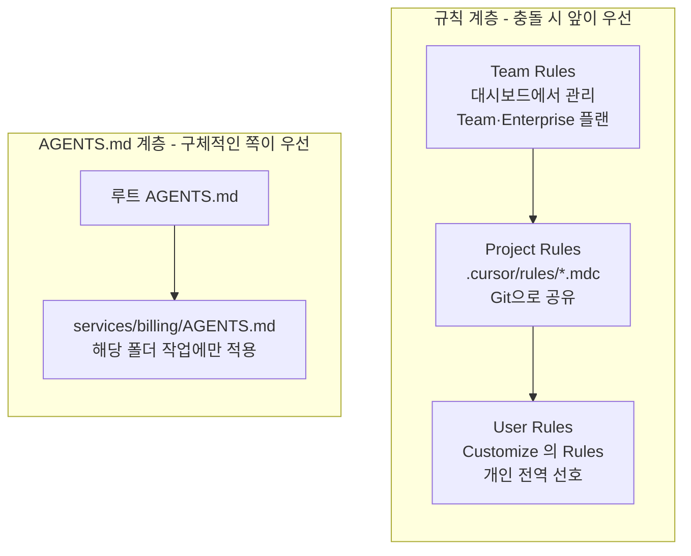

# Cursor Rules

## 1. Rules는 매 요청에 얹히는 컨텍스트다

Cursor에서 AI에게 프로젝트 맥락을 주입하는 방법이다. `.cursor/rules` 디렉토리에 `.mdc` 파일을 만들어 두면 Agent가 코드를 만들거나 고칠 때 그 내용이 프롬프트에 같이 들어간다.

"이 프로젝트는 Spring Boot 3.x + Java 21을 쓴다", "API 응답은 `ApiResponse<T>`로 감싼다" 같은 규칙이 없으면 AI는 어디서나 볼 법한 코드를 만든다. 규칙을 넣으면 팀 컨벤션에 맞는 코드가 나온다.

여기서 놓치기 쉬운 점이 있다. 규칙은 설정이 아니라 **프롬프트의 일부**다. 규칙 한 줄이 늘 때마다 그만큼 토큰을 쓰고, 규칙끼리 모순되면 모델이 둘 다 읽은 채로 판단한다. 컨텍스트 윈도우를 어떻게 쓰는지는 [Cursor Context 관리](Cursor_Context_Management.md)에 정리해 뒀고, 이 문서는 그중 Rules 쪽을 깊이 다룬다.

적용 범위도 정해져 있다. 공식 도움말은 규칙이 Agent(Chat)에만 적용되고 Tab 자동완성, Inline Edit, Bugbot PR 리뷰에는 적용되지 않는다고 적고 있다([Rules 도움말](https://cursor.com/help/customization/rules)). Tab이 규칙을 안 따른다고 규칙을 고치고 있다면 헛수고다.

## 2. 파일 형식과 디렉토리

```
project-root/
├── AGENTS.md                    # 루트 지시 파일 (frontmatter 없는 순수 마크다운)
├── .cursor/
│   └── rules/
│       ├── general.mdc          # 프로젝트 전역 규칙
│       ├── api-conventions.mdc  # API 작성 규칙
│       ├── testing.mdc          # 테스트 작성 규칙
│       └── database.mdc         # DB 관련 규칙
├── .cursorrules                 # (레거시) 단일 파일 방식
└── src/
```

프로젝트 규칙은 `.mdc` 확장자여야 한다. 공식 문서에 "`.cursor/rules`의 일반 `.md` 파일은 `description`, `globs`, `alwaysApply`를 지정할 frontmatter가 없어서 규칙 시스템이 무시한다"고 적혀 있다([Rules 문서](https://cursor.com/docs/context/rules)). `.md`로 저장하고 안 먹는다고 헤매는 경우가 생각보다 많다.

폴더 구성은 평평한 게 낫다. 도움말은 "`.cursor/rules/`를 평평하게 두라. Cursor는 이 폴더를 스캔해서 규칙을 찾으므로 하위 폴더도 동작하지만 평평한 구조가 관리하기 쉽다"고 한다. 하위 폴더는 동작하되 권장하지 않는다는 뜻이다.

`.mdc` 파일은 YAML frontmatter + Markdown 본문이다.

```
---
description: API 컨트롤러 작성 시 적용할 규칙
globs: src/main/java/**/controller/**/*.java
alwaysApply: false
---

- API 응답은 `ApiResponse<T>`로 감싼다
- 예외 처리는 `@RestControllerAdvice`에서 한다
- Controller에 비즈니스 로직을 넣지 않는다
```

## 3. Rule 타입 4가지

frontmatter 조합으로 규칙이 프롬프트에 붙는 조건이 갈린다. 공식 문서의 이름은 Always Apply, Apply Intelligently, Apply to Specific Files, Apply Manually다. 이 문서는 기존 이름(Auto Attached, Agent Requested, Manual)을 그대로 쓴다. 문서와 UI에서 이름이 바뀌어도 frontmatter 조합은 같다.

아래 그림은 규칙 파일 하나가 이번 요청의 프롬프트에 들어가는지를 frontmatter 기준으로 따라간 것이다. 분기 조건이 타입마다 다르다는 점을 보면 된다. 항상 붙는 것은 맨 위 한 갈래뿐이고, 나머지는 파일 매칭, Agent의 판단, 사용자의 `@` 호출이라는 서로 다른 조건이 필요하다.



### 3.1 Always Apply

```yaml
---
description: 프로젝트 전역 규칙
alwaysApply: true
---
```

모든 Agent 요청에 들어간다. 프로젝트 전체에 걸치는 규칙을 넣는다.

적합한 내용:
- 프로젝트에서 쓰는 언어 버전, 프레임워크 버전
- 전역 네이밍 규칙
- 금지 패턴 (특정 라이브러리 사용 금지 등)

질문이 뭐든 매번 토큰을 쓰는 유일한 타입이라 5장에서 따로 다룬다.

### 3.2 Auto Attached

```yaml
---
description: React 컴포넌트 작성 규칙
globs: src/components/**/*.tsx
alwaysApply: false
---
```

`globs`에 매칭되는 파일이 컨텍스트에 있으면 붙는다. 공식 문서 표현은 "매칭되는 파일이 컨텍스트에 있을 때"다. 기존 문서에는 "편집할 때"라고 썼는데, 편집하지 않고 `@Files`로 첨부하거나 Agent가 읽기만 해도 붙는지는 직접 확인하지 못했다. 규칙이 안 붙는 것 같으면 해당 파일을 명시적으로 첨부한 상태에서 다시 시도해 본다.

glob 패턴 예시:
- `src/**/*.test.ts` — 테스트 파일
- `**/migrations/*.sql` — 마이그레이션 파일
- `docker-compose*.yml` — Docker 설정

`alwaysApply: true`면 globs는 무시되고 항상 포함된다. 둘을 같이 쓸 이유가 없다.

### 3.3 Agent Requested

```yaml
---
description: 데이터베이스 마이그레이션 작성 시 참고할 규칙. Flyway 기반이며 V{번호}__{설명}.sql 형식을 따른다.
alwaysApply: false
---
```

`alwaysApply: false`에 `globs`가 없고 `description`만 있는 경우다. Agent가 description을 보고 현재 작업에 필요하다고 판단하면 가져온다.

Agent가 보는 것은 description 한 줄이다. 본문은 가져오기 전까지 보지 못한다. description이 모호하면 필요할 때 못 찾거나 상관없을 때 가져온다.

```yaml
# 나쁜 예 - 너무 모호함
description: DB 관련

# 좋은 예 - 구체적
description: PostgreSQL 마이그레이션 작성 규칙. Flyway 기반, 롤백 스크립트 필수 포함
```

### 3.4 Manual

`alwaysApply: false`에 description도 globs도 없는 규칙이다. 채팅에서 `@규칙이름`으로 직접 불러야만 들어간다.

기존 문서에는 이 자리에 User Rules를 적어 뒀는데 틀린 설명이었다. User Rules는 규칙 타입이 아니라 별도 계층이다. Customize → Rules에서 설정하는 전역 선호이고, 공식 문서는 Agent(Chat)가 쓰며 응답 스타일이나 코딩 관례를 정하는 데 알맞다고 한다. "응답은 한국어로 해줘" 같은 개인 선호는 여기에 둔다.

Manual은 평소에는 필요 없고 가끔 필요한 절차에 쓴다. 릴리스 체크 절차나 대규모 마이그레이션 지침처럼 Agent가 알아서 가져오길 바라지 않는 내용이다.

## 4. 프로젝트별 Rule 예제

### 4.1 Spring Boot 프로젝트

```
# .cursor/rules/general.mdc
---
description: Spring Boot 프로젝트 전역 규칙
alwaysApply: true
---

- Java 21, Spring Boot 3.3, Gradle 사용
- 패키지 구조는 도메인별로 나눈다 (com.example.order, com.example.user)
- Lombok @RequiredArgsConstructor로 의존성 주입한다
- 필드 주입(@Autowired) 금지
```

```
# .cursor/rules/api.mdc
---
description: REST API 컨트롤러 작성 규칙
globs: src/main/java/**/controller/**/*.java
alwaysApply: false
---

- 응답은 ResponseEntity<ApiResponse<T>> 형태로 반환한다
- @Valid로 요청 DTO 검증한다
- Controller에 비즈니스 로직 넣지 않는다. Service 계층에 위임한다
- API 경로는 복수형 명사를 쓴다 (/api/v1/orders)
```

```
# .cursor/rules/jpa.mdc
---
description: JPA Entity 및 Repository 작성 규칙. Querydsl 커스텀 리포지토리 포함
globs: src/main/java/**/entity/**/*.java, src/main/java/**/repository/**/*.java
alwaysApply: false
---

- Entity에 @Setter 금지. 변경은 도메인 메서드로 한다
- 양방향 연관관계는 편의 메서드를 만든다
- N+1 문제 방지를 위해 fetch join이나 @EntityGraph를 기본으로 쓴다
- Querydsl 커스텀 리포지토리는 {Entity}RepositoryCustom 인터페이스 + {Entity}RepositoryImpl 구현체
```

```
# .cursor/rules/test.mdc
---
description: 테스트 코드 작성 규칙
globs: src/test/**/*.java
alwaysApply: false
---

- 테스트 메서드 이름은 한글로 작성한다 (@DisplayName 대신 메서드명)
- given-when-then 패턴으로 구성한다
- 단위 테스트는 Mockito, 통합 테스트는 @SpringBootTest + TestContainers
- 테스트용 데이터는 Fixture 클래스에 모아둔다
```

### 4.2 NestJS 프로젝트

```
# .cursor/rules/general.mdc
---
description: NestJS 프로젝트 전역 규칙
alwaysApply: true
---

- TypeScript strict mode
- NestJS 10, Node.js 20 LTS
- pnpm 패키지 매니저
- 모듈 단위로 디렉토리를 나눈다 (src/modules/user, src/modules/order)
```

```
# .cursor/rules/api.mdc
---
description: NestJS 컨트롤러 및 DTO 작성 규칙
globs: src/modules/**/controllers/**/*.ts, src/modules/**/*.dto.ts
alwaysApply: false
---

- DTO에 class-validator 데코레이터를 쓴다
- 응답은 class-transformer의 @Exclude, @Expose로 직렬화 제어한다
- Controller 메서드에 @ApiOperation, @ApiResponse Swagger 데코레이터를 붙인다
- 에러 응답은 HttpException을 상속한 커스텀 예외로 던진다
```

```
# .cursor/rules/prisma.mdc
---
description: Prisma ORM 사용 규칙. 스키마 변경 및 마이그레이션 포함
globs: prisma/**
alwaysApply: false
---

- 마이그레이션 이름은 YYYYMMDD_설명 형식 (예: 20260410_add_user_email_index)
- 스키마 변경 후 prisma generate를 반드시 실행한다
- 프로덕션 마이그레이션은 prisma migrate deploy만 쓴다 (prisma migrate dev는 로컬 전용)
- 소프트 삭제가 필요한 테이블은 deletedAt 컬럼을 추가한다
```

### 4.3 React 프로젝트

```
# .cursor/rules/general.mdc
---
description: React 프로젝트 전역 규칙
alwaysApply: true
---

- React 19, TypeScript, Vite
- 상태 관리는 Zustand
- 스타일은 Tailwind CSS v4
- import 순서: react > 라이브러리 > 내부 모듈 > 상대 경로
```

```
# .cursor/rules/components.mdc
---
description: React 컴포넌트 작성 규칙
globs: src/components/**/*.tsx
alwaysApply: false
---

- 컴포넌트는 named export만 쓴다 (default export 금지)
- Props 타입은 컴포넌트명 + Props (예: UserCardProps)
- children을 받는 컴포넌트는 PropsWithChildren 사용
- 이벤트 핸들러 prop 이름은 on + 동사 (예: onSubmit, onClick)
- 컴포넌트 파일당 하나의 export 컴포넌트만 둔다
```

```
# .cursor/rules/hooks.mdc
---
description: 커스텀 훅 작성 규칙
globs: src/hooks/**/*.ts
alwaysApply: false
---

- 훅 이름은 use로 시작한다
- API 호출 훅은 TanStack Query를 감싸서 만든다
- 반환값이 2개 이하면 배열, 3개 이상이면 객체로 반환한다
- 훅 내부에서 다른 훅을 조합할 때 의존성 배열 관리를 신경 쓴다
```

## 5. alwaysApply가 쌓일 때

규칙은 처음에는 `general.mdc` 하나로 시작한다. 코드 리뷰에서 같은 지적이 반복될 때마다 한 줄씩 붙이다 보면 `alwaysApply: true` 파일이 서너 개가 되고, 어느 날 보면 질문이 한 줄이어도 규칙이 수백 줄 따라붙는다. 문제는 두 가지로 나온다.

### 5.1 토큰이 먼저 줄어든다

Always Apply 규칙은 질문과 무관하게 매 요청 컨텍스트에 들어간다. 규칙이 차지한 만큼 대화와 코드가 들어갈 자리가 줄고, 윈도우가 빨리 차면 Cursor가 오래된 대화를 요약으로 바꾼다. 요약에서 초반에 준 세부 제약이 빠지는 문제는 [Cursor Context 관리 6.3](Cursor_Context_Management.md)에 적어 뒀다. 규칙이 많아서 윈도우가 빨리 차고, 그래서 요약이 일찍 일어나 방금 준 지시가 사라지는 순서로 이어진다.

규칙이 얼마나 차지하는지는 context ring의 Rules 항목에서 본다. 대략의 크기는 파일로도 잴 수 있다. 바이트는 토큰이 아니라 지표일 뿐이고, 한글은 바이트 대비 토큰 비율이 영어와 다르다.

```bash
# alwaysApply 규칙만 모아 줄 수와 바이트 수를 본다
grep -l 'alwaysApply: true' .cursor/rules/*.mdc | xargs wc -lc

# 500줄을 넘는 규칙 파일
wc -l .cursor/rules/*.mdc | awk '$1 > 500 && $2 != "total"'
```

### 5.2 모순이 두 번째로 온다

규칙이 늘면 서로 다른 시기에 다른 사람이 쓴 지시가 한 프롬프트에 같이 들어간다. 한 파일에 "에러는 커스텀 예외로 던진다"가 있고 다른 파일에 "컨트롤러에서는 ResponseStatusException을 쓴다"가 있으면, 컨트롤러를 고치는 요청에는 둘 다 붙는다.

아래 그림은 `OrderController.java`를 컨텍스트에 두고 요청했을 때 어떤 규칙이 프롬프트에 합쳐지는지를 그린 것이다. `general.mdc`는 항상 붙고 `api.mdc`는 글롭이 맞아서 붙는다. 두 지시가 같은 프롬프트에 나란히 놓이는 지점이 문제다.



결과가 일관되지 않다는 게 진짜 문제다. 항상 틀리면 눈에 띄어 고치는데, 가끔 틀리면 리뷰에서 "왜 이 파일만 다르게 짰지" 하고 넘어간다.

### 5.3 500줄 이하로 쪼개야 하는 이유

공식 문서와 도움말 모두 "규칙은 500줄 아래로 두고, 큰 규칙은 작고 조합 가능한 여러 규칙으로 나누라"고 한다. 문서가 이유까지 설명하지는 않는다. 구조상 짐작되는 이유와, 직접 확인하지 못한 부분을 나눠서 적는다.

구조상 확실한 것:
- 규칙 파일은 한 단위로 붙는다. 500줄짜리 파일에 컨트롤러 규칙, 테스트 규칙, 마이그레이션 규칙이 섞여 있으면 컨트롤러 하나만 고쳐도 전부 들어간다. 파일을 주제별로 쪼개면 globs로 필요한 것만 붙는다.
- 파일이 길수록 같은 주제를 두 군데에서 다루게 되고, 5.2의 모순이 한 파일 안에서 생긴다.

직접 확인해야 하는 것:
- 긴 파일의 뒤쪽 지시를 모델이 덜 따르는지는 문서에 없다. 재현은 간단하다. 500줄 넘는 임시 규칙을 만들고 450줄쯤에 눈에 띄는 지시(예: "생성하는 모든 메서드 이름 끝에 `_x`를 붙인다")를 넣은 뒤, 같은 요청을 줄 위치만 바꿔 여러 번 돌려 본다. 지켜지는 비율이 위치에 따라 달라지면 쪼갤 근거가 생긴다.

실무에서는 줄 수보다 "이 규칙이 필요한 요청이 전체의 몇 퍼센트인가"로 나누는 편이 맞다. 대부분의 요청에 필요한 건 Always Apply로 짧게(수십 줄) 두고, 나머지는 glob이나 description으로 붙게 한다.

## 6. 우선순위와 충돌

같은 주제에 서로 다른 규칙이 있으면 누가 이기는가. 공식 도움말의 문장은 이렇다. "규칙이 충돌하면 우선순위는 Team Rules > Project Rules > User Rules다." 문서에 명시된 우선순위는 이게 전부다.

기존 문서에는 User Rules가 가장 낮고 그 위로 Always Apply, Auto Attached, Agent Requested 순서로 우선한다고 적었는데, 이 순서는 어떤 공식 문서에서도 확인하지 못했다. 같은 Project Rules 안에서 Always Apply와 Auto Attached가 충돌할 때 누가 이기는지는 정해진 바가 없다고 보고 설계해야 한다.

아래 그림은 두 갈래다. 왼쪽은 규칙 계층이고, 화살표 방향이 충돌 시 우선하는 쪽이다. 오른쪽은 AGENTS.md 계층으로, 하위 폴더 파일이 더 구체적이라 우선한다.



Team Rules는 Team/Enterprise 플랜에서 관리자가 대시보드로 만들고, 다른 규칙 유형 위에서 우선한다. 개인 플랜이면 해당 없다.

중첩 폴더의 `.cursor/rules`가 모노레포 패키지별로 따로 적용되는지는 이번에 확인한 문서에 설명이 없다. 하위 폴더 안에 `.mdc`를 두는 방식은 "동작한다"는 한 문장뿐이다. 패키지별 규칙이 필요하면 globs로 경로를 지정하는 쪽이 확실하다.

```
# 패키지별 규칙은 폴더 대신 globs 로 범위를 건다
---
description: billing 서비스 규칙
globs: services/billing/**
alwaysApply: false
---
```

### 충돌이 실제로 일어나는 경우

```
# general.mdc (alwaysApply: true)
- 에러는 RuntimeException을 상속한 커스텀 예외로 던진다

# api.mdc (globs: **/controller/**/*.java)
- 에러는 ResponseStatusException으로 던진다
```

둘 다 Project Rules라 어느 쪽이 이긴다는 규칙이 없고, 5.2 그림처럼 둘이 같이 들어간다. Cursor가 "이 규칙이 저 규칙을 덮어썼다"고 알려주지도 않는다.

### 충돌 방지 방법

- 같은 주제는 한 파일에서만 다룬다
- 전역 규칙에는 모든 상황에 적용되는 것만 넣고, 특정 영역 규칙은 해당 파일에 넣는다
- 규칙을 추가하는 PR에서 같은 키워드(`예외`, `응답`, `네이밍`)를 `grep -rn`으로 찾아 기존 규칙과 겹치는지 본다

## 7. AGENTS.md

Cursor는 `AGENTS.md`도 읽는다. 공식 문서는 이를 "에이전트 지시를 정의하는 단순한 마크다운 파일"이라고 소개하고, 프로젝트 루트에 두는 방식과 하위 폴더에 두는 방식을 모두 지원한다. 문서 문장은 이렇다. "프로젝트의 어느 하위 폴더에든 `AGENTS.md`를 둘 수 있고, 그 폴더나 하위 폴더의 파일을 다룰 때 자동으로 적용된다. 중첩 파일의 지시는 상위 폴더의 것과 합쳐지고, 더 구체적인 지시가 우선한다."

`.mdc`와 다른 점은 이렇다.

| 항목 | `.cursor/rules/*.mdc` | `AGENTS.md` |
|------|----------------------|-------------|
| 형식 | YAML frontmatter + 마크다운 | frontmatter 없는 순수 마크다운 |
| 적용 조건 | alwaysApply, globs, description, `@` 호출 | 작업 중인 파일이 있는 폴더 계층 |
| 범위 지정 | globs로 자유롭게 | 파일 위치로만 |
| 다른 도구 공유 | Cursor 전용 | AGENTS.md를 읽는 다른 에이전트와 공유 |

AGENTS.md는 조건 분기가 없다. 폴더에 두면 그 폴더 작업에 붙는다. 그래서 짧게 써야 한다. 루트 AGENTS.md는 사실상 Always Apply로 취급하고 설계하는 게 안전하다.

문서에서 확인하지 못한 것도 있다. AGENTS.md와 `.cursor/rules`에 같은 주제가 있을 때 누가 이기는지, AGENTS.md가 context ring의 Rules 항목에 잡히는지는 모른다. 둘을 같이 쓰는 프로젝트라면 같은 지시를 양쪽에 중복해 쓰지 않는 것이 안전하다. Cursor만 쓰는 팀이면 `.mdc`를 쓰는 편이 범위를 세밀하게 조절할 수 있고, Claude Code나 Codex 같은 도구를 같이 쓰는 팀이면 공통 지시를 AGENTS.md에 두는 이유가 생긴다.

## 8. .cursorrules 레거시

프로젝트 루트의 `.cursorrules`는 레거시다. 공식 도움말은 "`.cursorrules`는 레거시이며 deprecated 될 예정"이라고 적고 새 규칙을 만들어 옮긴 뒤 옛 파일을 지우라고 안내한다. 기존 문서에는 "아직 동작한다"고만 썼는데, 현재 상태는 이렇다.

- 아직 읽힌다. 포럼에서 Cursor 스태프가 ".cursorrules는 당분간 동작한다"고 답했다. 다만 이건 포럼 답변이고 문서에 보장으로 적힌 내용이 아니다.
- 그런데 Agent에서 안 먹는다는 버그 신고가 있다([포럼 스레드](https://forum.cursor.com/t/project-rule-in-cursorrules-not-applied-in-agent-chat-works-in-cursor-rules/154309)). 같은 스레드에서 스태프는 `.cursor/rules/*.mdc`가 같이 있으면 겹치는 부분에서 `.mdc`가 우선한다고 했다.
- 기존 문서의 "둘이 동시에 있으면 둘 다 적용된다"는 이 답변과 어긋난다. 겹치지 않는 내용은 둘 다 읽히겠지만 겹치는 내용은 `.mdc`가 이긴다고 보는 편이 맞다.

버전에 따라 동작이 갈리는 영역이라 `.cursorrules`에 의존하던 프로젝트는 지금 옮기는 게 낫다.

### 마이그레이션 절차

1. `.cursor/rules/` 디렉토리를 만든다
2. `.cursorrules` 내용을 역할별로 쪼갠다
3. 각 내용을 `.mdc` 파일로 만들고 frontmatter를 붙인다
4. 같은 요청을 옮기기 전후로 돌려서 결과가 같은지 본다
5. `.cursorrules` 파일을 삭제한다

기존 `.cursorrules` 내용이 이런 형태였다면:

```
# .cursorrules (레거시)
You are a Java 21 / Spring Boot 3.3 expert.

Always use constructor injection.
Use ResponseEntity<ApiResponse<T>> for all API responses.
Write tests in Korean method names.
Use Querydsl for complex queries.
```

이렇게 분리한다:

```
# .cursor/rules/general.mdc
---
description: 프로젝트 전역 규칙
alwaysApply: true
---

- Java 21, Spring Boot 3.3
- 생성자 주입만 사용 (필드 주입 금지)
```

```
# .cursor/rules/api.mdc
---
description: API 응답 형식 규칙
globs: src/main/java/**/controller/**/*.java
alwaysApply: false
---

- ResponseEntity<ApiResponse<T>> 형태로 반환
```

```
# .cursor/rules/test.mdc
---
description: 테스트 작성 규칙
globs: src/test/**/*.java
alwaysApply: false
---

- 메서드 이름은 한글로 작성
```

`.cursorrules`는 파일 하나라 어떤 요청에서든 전체가 들어간다. 쪼개면 5장의 이유로 필요한 규칙만 붙는다. 이게 옮기는 실질적인 이유다.

## 9. 팀에서 Rules 공유하기

### Git에 커밋할 것과 말 것

`.cursor/rules/` 디렉토리는 Git에 커밋한다. 팀 전체가 같은 규칙을 공유한다.

`.gitignore`에 넣으면 안 되는 것:
```
# 이렇게 하면 안 된다
.cursor/rules/
```

반대로 `.gitignore`에 넣어야 하는 것:
```
# Cursor 캐시와 개인 설정은 제외
.cursor/*
!.cursor/rules/
```

`.cursor/` 안의 다른 파일(캐시, 세션 정보 등)은 무시하고 `rules/`만 추적한다.

### 팀 공유 시 주의사항

**개인 규칙과 팀 규칙을 분리한다.**
개인 선호(응답 언어, 코드 스타일 등)는 User Rules에 넣고, 프로젝트 규칙만 `.cursor/rules/`에 넣는다. "나는 탭 들여쓰기를 선호한다"는 팀 전체에 강제할 내용이 아니다.

**Rule 파일이 너무 많아지면 관리가 어렵다.**
파일 수를 10개 이하로 유지하는 게 현실적이다. 이 숫자는 공식 기준이 아니라 경험치다. 파일이 늘수록 5장의 토큰과 모순 문제가 같이 커진다. Always Apply는 그중 두세 개로 제한한다.

**새 멤버가 합류했을 때 Rules의 존재를 알려줘야 한다.**
Cursor를 처음 쓰는 사람은 `.cursor/rules/`가 뭔지 모른다. README나 온보딩 문서에 "이 프로젝트는 Cursor Rules를 사용한다"는 내용을 넣는다.

**팀원 간 Rules 수정 충돌을 조심한다.**
`.mdc`도 일반 텍스트라 같은 파일을 두 사람이 고치면 merge conflict가 난다. 규칙 변경은 PR로 리뷰한다.

## 10. Rule 작성 시 실수하기 쉬운 부분

**확장자를 `.md`로 저장하는 경우.**
`.cursor/rules/`의 `.md`는 무시된다. 에디터 자동 저장이나 템플릿 때문에 확장자가 바뀐 채 커밋되는 경우가 있다.

**description을 빈 값으로 두는 경우.**
description도 globs도 없고 `alwaysApply: false`면 3.4의 Manual 규칙이 된다. Agent가 알아서 가져오길 기대했다면 영원히 안 붙는다. 아무 효과도 없는 규칙처럼 보이는 이유다.

**globs 패턴이 잘못된 경우.**
`src/main/**/*.java`라고 써야 하는데 `src/main/*.java`라고 쓰면 하위 디렉토리의 파일이 매칭되지 않는다. `**`는 여러 단계 디렉토리를, `*`는 한 단계만 가리킨다.

**규칙이 너무 길거나 모호한 경우.**
"코드를 잘 작성해줘"는 의미가 없다. "Controller에서 Service를 직접 호출하고, Repository는 Service에서만 접근한다"처럼 구체적이어야 따를 수 있다. 길이는 5.3의 500줄 기준을 본다.

**프롬프트처럼 작성하는 경우.**
"You are an expert Java developer..." 같은 역할 지정은 구체적인 규칙을 대신하지 못한다. 규칙 파일은 역할을 부여하는 자리가 아니라, 코드에서 확인 가능한 컨벤션을 적는 자리다. 위 8장의 `.cursorrules` 예시가 대표적인 옛 스타일이다.

**규칙을 고치고 확인하지 않는 경우.**
Always Apply를 Agent Requested로 바꿨다면 그 규칙이 필요한 작업을 한 번 돌려 본다. description이 부실하면 규칙이 있는 줄도 모르고 지나간다.

## 출처

이 영역은 자주 바뀐다. 2026-10-20에 읽은 자료다. 동작이 다르면 아래부터 확인한다.

- [Rules 문서](https://cursor.com/docs/context/rules): 규칙 4종 표, Team > Project > User 순서, 500줄 권고, `.md` 무시, AGENTS.md 지원
- [Rules 도움말](https://cursor.com/help/customization/rules): `.cursorrules` 레거시 안내, 평평한 폴더 권고, Agent(Chat)에만 적용
- [포럼 스레드 - .cursorrules가 Agent에서 안 먹는 문제](https://forum.cursor.com/t/project-rule-in-cursorrules-not-applied-in-agent-chat-works-in-cursor-rules/154309)

확인하지 못한 것은 이렇다. 하위 폴더의 `.cursor/rules`가 해당 폴더 작업에만 적용되는지, Auto Attached가 "편집"과 "단순 첨부" 중 어느 경우에 붙는지, AGENTS.md와 `.mdc`가 충돌할 때의 우선순위, AGENTS.md가 context ring의 Rules 항목에 잡히는지, 긴 규칙 파일 뒤쪽 지시의 준수율이다.
