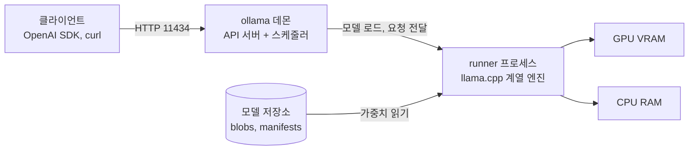
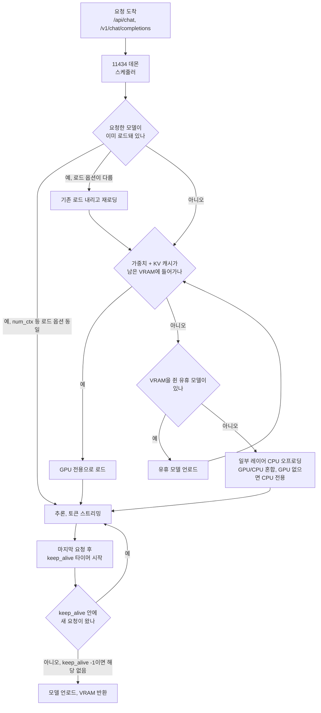
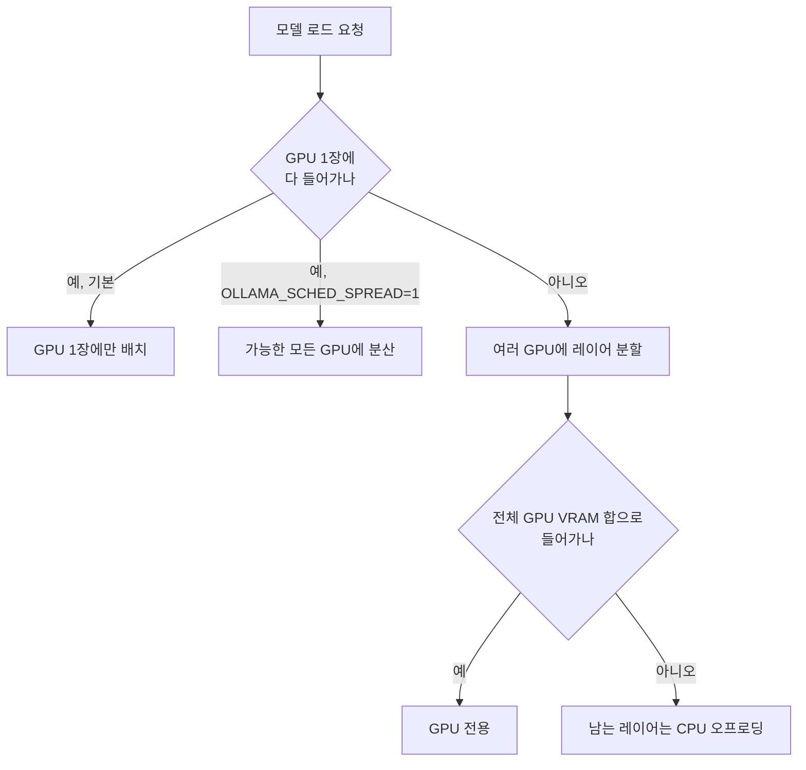
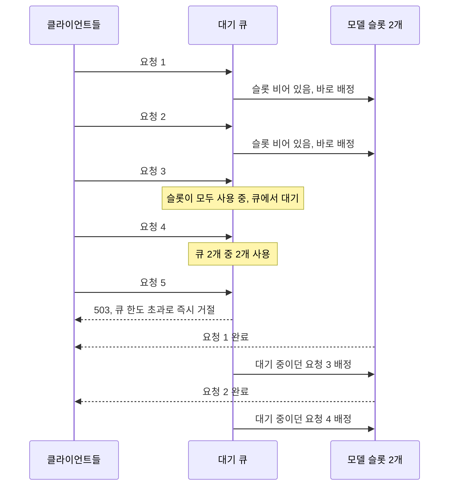
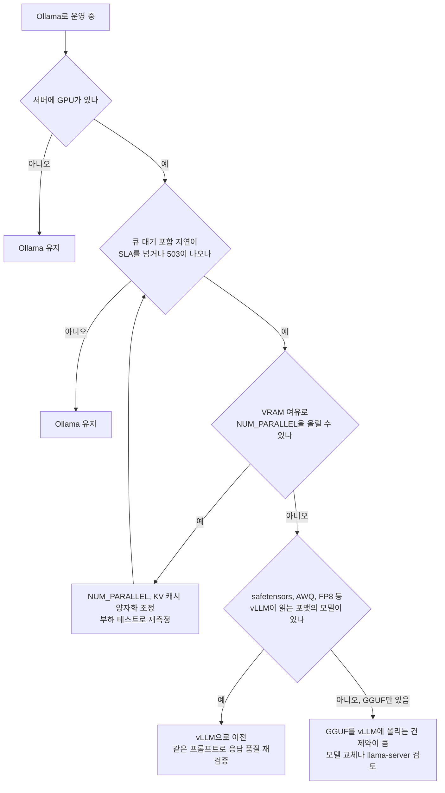

# Ollama

## 1. Ollama가 뭘 해주는 도구인지부터

Ollama는 로컬 머신에서 LLM을 돌리는 일을 `docker run` 수준으로 단순화한 런타임이다. 내부적으로는 llama.cpp 계열 엔진 위에 모델 다운로드, 버전 관리, REST API 서버를 얹어놨다. 직접 llama.cpp를 빌드하고 GGUF 파일을 받아서 `--n-gpu-layers` 같은 플래그를 손으로 맞춰본 적 있으면, Ollama가 그 과정을 통째로 감춰준다는 게 바로 와닿는다.

핵심은 두 가지다. 하나는 모델을 이미지처럼 다루는 레지스트리 개념(`ollama pull llama3.2`), 다른 하나는 백그라운드 데몬이 11434 포트로 HTTP API를 열어준다는 점이다. 이 둘 덕분에 "노트북에서 모델 한번 띄워보기"부터 "사내 서버에 추론 엔드포인트 깔기"까지 같은 도구로 커버된다.

요청이 지나가는 길은 단순하다. 클라이언트는 데몬과만 이야기하고, 데몬이 모델별로 runner 프로세스를 띄워 가중치를 VRAM과 RAM에 나눠 올린다. 이 문서에서 다루는 문제는 대부분 데몬(스케줄러)과 runner 사이, 그리고 runner와 VRAM 사이에서 생긴다.



주의할 건 Ollama는 단일 노드 추론 도구라는 점이다. 멀티 GPU 한 대에서 모델을 쪼개 올리는 것까지는 되지만, 여러 노드에 걸친 분산 서빙이나 대규모 동시 트래픽 처리는 설계 목표가 아니다. 이 경계를 넘어가면 vLLM 같은 도구로 갈아타야 하는데, 그 판단 기준은 7장에서 따로 정리한다.

---

## 2. 설치와 첫 실행

macOS/Linux는 설치 스크립트 한 줄이면 끝난다.

```bash
# Linux
curl -fsSL https://ollama.com/install.sh | sh

# 설치되면 systemd 서비스로 데몬이 자동 등록된다
systemctl status ollama
```

설치 후 모델을 받아서 바로 띄워본다.

```bash
# 모델 다운로드 + 대화형 실행
ollama run llama3.2

# 다운로드만 (실행 안 함)
ollama pull qwen2.5:7b

# 받아놓은 모델 목록
ollama list
```

`ollama run`은 모델이 없으면 먼저 받고 나서 REPL을 띄운다. 모델 태그는 `이름:파라미터수-양자화` 형태인데, 태그를 생략하면 기본값이 붙는다. `llama3.2`는 `llama3.2:3b` 쪽을 가리키는데, 어떤 양자화가 기본으로 붙는지는 레지스트리의 모델 페이지에서 확인해야 한다. 운영 환경에 깔 때 태그를 명시하지 않으면 나중에 기본 태그가 바뀌어 다른 양자화 모델이 받아지는 사고가 난다. 항상 풀 태그를 박아야 한다.

```bash
# 이렇게 박아라
ollama pull qwen2.5:7b-instruct-q4_K_M
```

### 2.1 바인딩 주소

데몬은 기본적으로 `127.0.0.1:11434`에만 바인딩된다. 다른 머신에서 붙어야 하면 환경변수로 바인딩 주소를 바꾼다.

```ini
# systemd 환경이면 override로 넣는다
# /etc/systemd/system/ollama.service.d/override.conf
[Service]
Environment="OLLAMA_HOST=0.0.0.0:11434"
```

이렇게 0.0.0.0으로 열 거면 앞단에 리버스 프록시나 방화벽을 반드시 둬라. Ollama 자체에는 인증이 없다. 11434를 외부에 그대로 노출하면 누구나 모델을 호출하고 GPU를 점유한다. 사내망이라도 그냥 열어두면 안 된다.

### 2.2 브라우저에서 직접 호출할 때 OLLAMA_ORIGINS

웹 프론트에서 `fetch("http://서버:11434/api/chat")`을 바로 때리면 브라우저가 CORS로 막는다. 서버 간 호출(백엔드 → Ollama)은 CORS와 무관해서 이 설정이 필요 없고, 브라우저 JS가 직접 호출할 때만 문제가 된다. 허용할 오리진을 `OLLAMA_ORIGINS`에 콤마로 나열한다.

```ini
[Service]
Environment="OLLAMA_ORIGINS=https://app.example.com,http://localhost:5173"
```

`OLLAMA_ORIGINS=*`로 열어버리면 편하지만, 인증이 없는 API를 사내 브라우저 어디서든 호출하게 되는 셈이다. 개발 머신에서만 쓴다.

리버스 프록시 뒤에 두고 `Authorization` 헤더로 인증을 거는 구성에서 자주 막히는 지점이 있다. 브라우저는 커스텀 헤더가 붙은 요청 앞에 `OPTIONS` preflight를 먼저 보내는데, 이 요청에는 토큰이 없다. 프록시가 모든 요청에 인증을 요구하면 preflight가 401로 떨어지고 브라우저 콘솔에는 CORS 오류로만 찍힌다. `OPTIONS`는 프록시에서 인증 없이 통과시키거나, 프록시에서 CORS 헤더를 직접 붙인다.

---

## 3. 모델 저장 구조와 GGUF 로딩

### 3.1 모델이 어디에 어떻게 저장되나

받은 모델은 `~/.ollama/models`(Linux 서비스 설치는 `/usr/share/ollama/.ollama/models`)에 저장된다. 구조는 도커 레이어와 비슷하다.

```
~/.ollama/models/
├── blobs/          # 실제 가중치 데이터 (sha256 해시 파일명)
└── manifests/      # 모델 메타데이터, 어떤 blob들을 조합하는지
```

같은 베이스 모델을 공유하는 변종이 여러 개여도 blob은 중복 저장되지 않는다. 디스크 용량을 볼 때 `ollama list`의 합산 크기와 실제 디스크 사용량이 안 맞는 이유가 이거다.

모델 저장 경로를 바꾸려면 `OLLAMA_MODELS` 환경변수를 쓴다. 루트 디스크가 작고 데이터 디스크가 따로 있는 서버에서는 거의 필수다. Linux 서비스 설치에서는 데몬이 `ollama` 사용자로 돌기 때문에, 새 경로의 소유자를 그 사용자로 바꿔주지 않으면 pull이 권한 오류로 실패한다.

```ini
Environment="OLLAMA_MODELS=/data/ollama/models"
```

### 3.2 직접 받은 GGUF 파일 올리기

허깅페이스에서 받은 GGUF나 직접 양자화한 GGUF를 Ollama에 등록하려면 Modelfile을 쓴다. 도커파일과 비슷한 포맷이다.

```dockerfile
# Modelfile
FROM ./my-model-Q4_K_M.gguf

# 프롬프트 템플릿 (모델에 맞는 걸 넣어야 한다)
TEMPLATE """{{ if .System }}<|im_start|>system
{{ .System }}<|im_end|>
{{ end }}<|im_start|>user
{{ .Prompt }}<|im_end|>
<|im_start|>assistant
"""

PARAMETER temperature 0.7
PARAMETER num_ctx 8192
PARAMETER stop "<|im_end|>"
```

```bash
ollama create my-model -f Modelfile
ollama run my-model
```

여기서 제일 자주 터지는 게 TEMPLATE를 안 맞춰서 생기는 문제다. Ollama 레지스트리에서 받은 모델은 템플릿이 이미 박혀 있지만, raw GGUF를 직접 올리면 템플릿이 비어 있거나 기본값이 들어간다. 모델이 학습된 채팅 포맷(ChatML, Llama 포맷 등)과 TEMPLATE가 안 맞으면 응답이 이상하게 끊기거나 특수 토큰이 그대로 출력된다. 모델 카드에서 정확한 프롬프트 포맷을 확인하고 STOP 토큰까지 맞춰야 한다.

`num_ctx`는 컨텍스트 길이인데, 이걸 올리면 KV 캐시 메모리가 컨텍스트 길이에 비례해 늘어난다. 얼마나 늘어나는지는 모델 구조에 달려 있다. Llama 3.1 8B(레이어 32, KV 헤드 8, 헤드 차원 128)의 `config.json` 값으로 계산하면 토큰당 KV 캐시는 `2(K,V) × 32 × 8 × 128 × 2바이트(fp16) = 131,072바이트`다. 컨텍스트 8192면 1GiB, 131072면 16GiB다. 직접 잰 값이 아니라 설정값으로 계산한 값이고, GQA를 안 쓰는 구조나 레이어가 많은 큰 모델은 이보다 훨씬 커진다. 모델이 128K를 지원한다고 `num_ctx 131072`를 박기 전에 자기 모델의 `config.json`으로 먼저 계산한다. 실제 필요한 만큼만 잡아야 한다.

### 3.3 LoRA 어댑터 붙이기 ADAPTER

파인튜닝한 LoRA 어댑터는 베이스 모델을 통째로 다시 만들지 않고 Modelfile의 `ADAPTER`로 붙인다.

```dockerfile
FROM qwen2.5:7b-instruct-q4_K_M
ADAPTER ./my-lora
```

`ADAPTER`에는 safetensors 어댑터 디렉터리나 GGUF 어댑터 파일을 줄 수 있다. 여기서 틀리기 쉬운 건 `FROM`이다. 어댑터는 학습할 때 쓴 베이스 모델과 같은 베이스에 붙여야 한다. 같은 7B라도 `Qwen2.5-7B`와 `Qwen2.5-7B-Instruct`는 다른 베이스이고, 다른 베이스에 붙이면 에러 없이 로드되고 출력만 이상해진다. `ollama create`가 성공했다고 어댑터가 맞게 붙었다는 보장은 없다. 어댑터 없는 모델과 같은 프롬프트로 응답을 비교해 변화가 의도한 방향인지 본다.

FP16 베이스로 학습한 어댑터를 Q4_K_M 베이스에 붙이는 경우도 문제 없이 로드는 된다. 다만 학습 때 본 가중치와 추론 때 쓰는 양자화 가중치가 달라서 품질이 얼마나 떨어지는지는 모델과 어댑터마다 다르다. 자기 평가셋으로 양자화 베이스와 FP16 베이스를 한 번은 비교해 본다. 학습부터 GGUF 변환까지의 흐름은 [Unsloth Qwen3 GGUF 문서의 9절](../Concepts/Unsloth_Qwen3_GGUF.md#9-unsloth로-fine-tuning하고-gguf로-내보내는-파이프라인)에 있다.

---

## 4. 메모리 요구사항 - 이게 제일 중요하다

로컬 서빙에서 실패하는 대부분의 케이스는 메모리 계산을 안 해서 생긴다. 모델이 메모리에 안 올라가면 Ollama는 일부 레이어를 CPU로 떨어뜨리거나(GPU+CPU 혼합), 아예 전부 CPU로 돌린다. 둘 다 속도가 크게 떨어진다.

### 4.1 가중치 메모리 어림 계산

양자화 레벨별 대략적인 메모리(가중치만, KV 캐시 별도)는 파라미터 수에 양자화 비트를 곱해서 잡는다. 표의 값은 비트 수로 계산한 어림값이고, 실제 GGUF 파일 크기는 모델마다 몇 퍼센트씩 다르다.

| 양자화 | 비트/파라미터 | 7B 모델 | 14B 모델 | 32B 모델 | 70B 모델 |
|--------|--------------|---------|----------|----------|----------|
| Q4_K_M | ~4.5 | ~4.5GB  | ~9GB     | ~20GB    | ~42GB    |
| Q5_K_M | ~5.5 | ~5.5GB  | ~11GB    | ~24GB    | ~50GB    |
| Q8_0   | ~8.5 | ~7.5GB  | ~15GB    | ~35GB    | ~70GB    |
| F16    | 16   | ~14GB   | ~28GB    | ~64GB    | ~140GB   |

여기에 KV 캐시와 실행 오버헤드를 더해야 한다. KV 캐시는 3.2절 계산식으로 구하고, 오버헤드는 1~3GB 정도 여유를 잡는다. 나는 GPU VRAM의 80% 안쪽에서 모델이 끝나게 잡는 편인데, 이건 경험상 잡은 여유폭이지 근거가 있는 상수는 아니다. 24GB VRAM(RTX 4090, A10)에서 Q4 기준 14B는 컨텍스트를 넉넉히 잡아도 올라가고, 32B는 컨텍스트를 짧게 잡아야 빠듯하게 올라간다.

### 4.2 Q4_K_M이 기본인 이유

Ollama 레지스트리의 많은 모델이 Q4_K_M을 기본 태그로 두고 있다. Q4 아래로 내려가면(Q3, Q2) 품질 저하가 눈에 띄기 시작하고, Q5~Q8로 올려도 품질 개선 대비 메모리 증가폭이 크다는 게 일반적인 경험칙이다. 내가 돌려본 7B급 요약·분류 태스크에서는 Q4와 Q8의 차이를 구분하기 어려웠지만, 코드 생성이나 긴 추론은 다를 수 있어서 자기 태스크로 확인해야 한다. VRAM이 빠듯할 때는 작은 모델을 Q8로 쓰는 것보다 큰 모델을 Q4로 쓰는 쪽이 낫다고 보는 사람이 많은데, 이것도 모델 계열과 태스크에 따라 뒤집히는 경우가 있다.

### 4.3 요청이 들어와서 GPU, CPU, 언로드까지

VRAM이 부족하면 Ollama는 일부 레이어를 RAM에 올리고 CPU로 계산한다(레이어 오프로딩). 요청 한 건이 들어왔을 때 스케줄러가 내리는 판단을 순서대로 그리면 이렇다. 모델이 이미 올라와 있는지, 올라가 있어도 옵션이 달라 다시 올려야 하는지, 남은 VRAM에 들어가는지가 분기점이다.



실무에서 눈여겨볼 곳은 두 군데다. 하나는 "로드 옵션이 다름" 분기다. 같은 모델이라도 요청마다 `num_ctx`를 다르게 보내면 매번 내렸다 올리는 일이 생긴다. 클라이언트마다 `options.num_ctx` 값이 제각각인 환경에서 응답이 들쭉날쭉하면 먼저 의심해 볼 곳이다. 다른 하나는 맨 아래 언로드 분기이고, 이쪽은 5.1절에서 다룬다.

혼합 오프로딩 상태는 `ollama ps`로 볼 수 있다.

```bash
ollama ps
# NAME            ID    SIZE    PROCESSOR        UNTIL
# qwen2.5:14b     ...   11 GB   38%/62% CPU/GPU  4 minutes from now
```

`38%/62% CPU/GPU`는 가중치의 38%가 CPU(RAM)에, 62%가 GPU에 올라갔다는 뜻이다. 이 상태에서는 추론 속도가 GPU 전용일 때보다 확연히 떨어진다. 얼마나 떨어지는지는 CPU 메모리 대역폭, 오프로딩 비율, 모델 크기에 따라 달라서 몇 배라고 단정할 수 없다. 내 환경에서 재보려면 같은 프롬프트로 `ollama run --verbose`를 돌려 `eval rate`(토큰/초)를 `num_gpu`를 바꿔가며 비교하면 된다. 확실한 건 CPU 쪽 병목이 메모리 대역폭이라 코어 수를 늘려도 효과가 작다는 점이다. 토큰 생성이 답답할 정도로 느리면 먼저 `ollama ps`부터 확인해라.

오프로딩을 피하려면 더 작은 모델이나 더 낮은 양자화를 쓰거나, `num_ctx`를 줄여서 KV 캐시 공간을 확보하는 수밖에 없다. 거기에 4.4절의 KV 캐시 양자화가 한 가지 더 선택지를 준다.

### 4.4 FlashAttention과 KV 캐시 양자화

가중치를 이미 Q4로 줄였는데도 컨텍스트를 길게 잡으면 KV 캐시가 VRAM을 먹는다. 이때 쓰는 게 두 환경변수다.

```ini
[Service]
Environment="OLLAMA_FLASH_ATTENTION=1"
Environment="OLLAMA_KV_CACHE_TYPE=q8_0"
```

`OLLAMA_KV_CACHE_TYPE`은 KV 캐시를 어떤 정밀도로 저장할지 정한다. 값은 `f16`(기본), `q8_0`, `q4_0`이고, KV 캐시 양자화는 FlashAttention이 켜져 있어야 동작한다. Ollama FAQ는 `q8_0`이 `f16` 대비 메모리를 대략 절반, `q4_0`이 대략 1/4 쓴다고 설명한다([Ollama FAQ](https://github.com/ollama/ollama/blob/main/docs/faq.md)). 3.2절의 Llama 3.1 8B 계산을 대입하면 컨텍스트 131072에서 16GiB가 `q8_0`이면 8GiB 안팎이 된다. 이것도 계산이지 측정은 아니다.

| 설정 | KV 캐시 메모리 | 정확도 영향 |
|------|---------------|-------------|
| `f16` | 기준 | 없음 |
| `q8_0` | 대략 1/2 | FAQ 기준 정밀도 손실 매우 작음 |
| `q4_0` | 대략 1/4 | 손실이 눈에 띌 수 있음, 직접 확인 필요 |

정확도 영향은 "공식 문서에 이렇게 적혀 있다" 수준이라 믿고 넘어가면 안 된다. 짧은 컨텍스트의 일상 질의에서는 차이를 못 느끼더라도, 긴 문서에서 특정 문장을 정확히 인용해야 하는 RAG, 숫자 연산이 섞인 추론, 한국어처럼 토큰이 많이 쪼개지는 입력에서는 열화가 먼저 드러날 수 있다. 켜기 전후로 자기 평가셋을 같은 시드로 돌려 비교하고, 문제가 있으면 `q8_0`에서 멈추거나 `f16`으로 되돌린다.

두 변수 모두 서버 환경변수라 재시작해야 적용된다. 기본값이 버전에 따라 다르므로 켰다고 생각했는데 안 켜져 있는 경우를 막으려면 서버 로그에서 실제 적용값을 확인한다.

### 4.5 멀티 GPU 배치와 GPU 지정

GPU가 여러 장인 서버에서 Ollama가 모델을 어떻게 놓는지 알아둬야 한다. 기본 동작은 모델이 GPU 한 장에 다 들어가면 한 장에만 올리고, 안 들어가면 여러 장에 쪼개 올리는 쪽이다. GPU 간 전송을 줄이려는 의도다.



`OLLAMA_SCHED_SPREAD=1`은 한 장에 들어가는 모델도 전 GPU에 펼친다. 쓸 만한 경우는 두 가지다. 한 GPU에 가중치만 꽉 채우면 `NUM_PARALLEL` 슬롯의 KV 캐시를 못 얹을 때, 그리고 GPU 장당 사용률을 고르게 맞추고 싶을 때다. 대신 한 요청이 여러 GPU를 건너다니는 통신이 생긴다. NVLink 없이 PCIe로만 연결된 서버에서는 단일 요청 속도가 오히려 떨어질 수 있고, 얼마나 떨어지는지는 서버 토폴로지에 달려 있어서 켜기 전에 직접 재야 한다.

특정 GPU만 쓰게 하려면 `CUDA_VISIBLE_DEVICES`를 쓴다. AMD는 `ROCR_VISIBLE_DEVICES`다.

```ini
[Service]
Environment="CUDA_VISIBLE_DEVICES=GPU-3f2a1c8e-0000-0000-0000-000000000000"
```

정수 인덱스 대신 `nvidia-smi -L`에 나오는 UUID를 쓰는 편이 안전하다. 인덱스는 드라이버나 PCI 순서 설정에 따라 재부팅 뒤 바뀔 수 있어서, 어제는 4090이던 0번이 오늘은 다른 카드인 경우가 있다. 큰 GPU 하나는 LLM용, 나머지는 다른 워크로드용으로 쪼갠 서버에서 이 문제를 겪기 쉽다.

GPU를 나눠 쓰는 다른 방법은 인스턴스를 여러 개 띄우는 것이다. 인스턴스마다 `OLLAMA_HOST` 포트와 `CUDA_VISIBLE_DEVICES`를 다르게 주고, 앞단 프록시가 모델별로 라우팅한다. 모델 하나가 한 장에 들어가고 동시 요청을 더 받아야 할 때, SCHED_SPREAD보다 단순하고 장애도 격리된다. 유효하지 않은 GPU ID를 줘서 CPU 전용으로 돌리는 방법은 공식 GPU 문서에 있으니 필요하면 거기서 현재 버전의 동작을 확인한다.

---

## 5. OpenAI 호환 API

운영 입장에서 Ollama의 제일 쓸모 있는 부분이다. `/v1/chat/completions` 엔드포인트가 OpenAI API와 호환되어서, 기존 OpenAI SDK 코드를 base_url만 바꿔서 그대로 붙일 수 있다.

```python
from openai import OpenAI

client = OpenAI(
    base_url="http://localhost:11434/v1",
    api_key="ollama",  # 아무 문자열이나. 검증 안 함
)

resp = client.chat.completions.create(
    model="qwen2.5:7b-instruct-q4_K_M",
    messages=[
        {"role": "system", "content": "한국어로 간결하게 답한다."},
        {"role": "user", "content": "GGUF가 뭔지 한 문장으로 설명해줘"},
    ],
    temperature=0.7,
)
print(resp.choices[0].message.content)
```

스트리밍, 함수 호출(tool calling), 임베딩(`/v1/embeddings`)도 지원한다. 다만 호환이 100%는 아니다. `logprobs`, 일부 샘플링 파라미터, OpenAI 전용 기능은 무시되거나 안 먹는다. 기존 코드를 그대로 옮길 때 이런 파라미터가 조용히 무시되는 걸 모르고 넘어가면 동작이 미묘하게 달라진다.

Ollama 네이티브 API(`/api/generate`, `/api/chat`)도 따로 있는데, 모델 로딩 제어(`keep_alive`)나 raw 프롬프트 모드 같은 세밀한 기능은 네이티브 쪽에만 있다. 운영 통합은 OpenAI 호환을 쓰고, 모델 라이프사이클 제어가 필요하면 네이티브를 섞어 쓰는 식이 된다.

### 5.1 모델 언로드 타이밍 제어

기본적으로 Ollama는 마지막 요청 후 5분간 모델을 메모리에 유지하고 그 뒤 내린다. 4.3절 도식의 맨 아래 분기가 이 동작이다. 트래픽이 띄엄띄엄 들어오는 환경에서는 5분 뒤에 언로드됐다가 다음 요청에서 다시 로딩되느라 첫 응답이 로딩 시간만큼 늦어진다. 항상 떠 있어야 하는 서비스면 `keep_alive`를 무한으로 잡는다.

```bash
# 요청 시점에 지정
curl http://localhost:11434/api/chat -d '{
  "model": "qwen2.5:7b",
  "messages": [{"role":"user","content":"hi"}],
  "keep_alive": -1
}'

# 또는 환경변수로 전역 설정
# Environment="OLLAMA_KEEP_ALIVE=-1"
```

반대로 GPU를 여러 모델이 돌아가며 써야 하면 `keep_alive`를 짧게 잡아서 빨리 내리게 한다. 모델 스위칭이 잦은 환경에서 이걸 무한으로 두면 첫 모델이 VRAM을 안 놓아서 다음 모델 로딩이 실패하거나 CPU 오프로딩으로 밀린다. 요청에 `"keep_alive": 0`을 실어 보내면 응답 직후 바로 내린다.

### 5.2 structured output과 tool calling이 조용히 실패하는 경우

JSON 스키마 응답(`format` 필드)과 tool calling은 에러 없이 200이 오고 내용만 틀리는 경우가 많다. 아래 동작은 버전과 모델에 따라 달라서 이 절의 내용은 "이런 경우가 있다"로 읽어야 하고, 내 모델로 한 번은 재현해 봐야 한다.

`format`에 JSON 스키마를 넘기면 디코딩 단계에서 문법 제약이 걸려 JSON 모양은 지켜진다.

```bash
curl http://localhost:11434/api/chat -d '{
  "model": "qwen2.5:7b-instruct-q4_K_M",
  "messages": [{"role":"user","content":"주문 123번의 상태를 알려줘"}],
  "stream": false,
  "format": {
    "type": "object",
    "properties": {
      "order_id": {"type": "integer"},
      "status": {"type": "string", "enum": ["PAID", "SHIPPED", "CANCELED"]}
    },
    "required": ["order_id", "status"]
  }
}'
```

모양이 맞는다는 것과 내용이 맞는다는 것은 별개다. 위 요청은 DB를 조회하는 게 아니라서 모델이 `status`를 enum 중 아무거나 골라 채운다. 문법 제약은 형식 오류만 막는다.

| 증상 | 원인 | 확인 방법 |
|------|------|-----------|
| `format`을 줬는데 응답이 공백이나 개행으로 길게 이어지고 끝나지 않음 | 프롬프트에 JSON을 요구하는 문장이 없어 모델이 제약된 토큰 안에서 방황한다 | 프롬프트에 "JSON으로 답한다"를 쓰고 `num_predict` 상한을 둔다 |
| 스키마가 복잡할수록 첫 토큰이 느리거나 실패 | 스키마를 문법으로 컴파일하는 비용, 중첩·재귀 스키마에서 커진다 | 스키마를 평평하게 줄여서 비교 |
| 추론(thinking) 계열 모델에서 `format`과 `think`를 같이 줬더니 추론 구간이 비거나 깨짐 | 제약이 추론 토큰까지 덮을 수 있다 | 모델·버전별로 두 옵션 조합을 따로 시험 |
| tool calling을 보냈더니 400 에러 | 모델 템플릿에 tools 처리가 없다. raw GGUF에 TEMPLATE를 직접 쓴 경우 흔하다 | `ollama show <모델>`의 capabilities 확인 |
| 에러는 없는데 `tool_calls`가 비어 있고 `content`에 JSON 비슷한 문자열이 들어옴 | 템플릿은 tools를 받지만 모델이 그 형식으로 학습되지 않았거나, 출력 형식을 Ollama 파서가 인식하지 못함 | 응답의 `message.content` 원문을 로그로 남겨서 확인 |
| 작은 모델(수 B급)에서 호출할 도구를 엉뚱하게 고르거나 인자를 빠뜨림 | 모델 능력 문제. 서버 설정으로 해결되지 않는다 | 도구 개수를 줄이고 `description`을 구체적으로 쓴다 |

`ollama show <모델>`은 최근 버전에서 capabilities(completion, tools, vision, thinking 등)를 보여준다. 모델 교체나 업그레이드 뒤에는 tool calling 응답에서 `tool_calls`가 비어 있는 비율을 지표로 따로 뽑아두면 조용한 실패를 일찍 잡는다. 이 동작을 서비스 로직 쪽에서 검증하지 않으면 모델이 도구를 안 불렀다는 사실을 사용자 불만으로 알게 된다.

---

## 6. 동시 요청 처리 한계

Ollama로 운영하다 트래픽이 늘면 제일 먼저 부딪히는 벽이다. 동작 방식을 정확히 알아야 한다.

관련 환경변수는 세 개다.

```ini
# 한 모델이 동시에 처리하는 요청 수 (슬롯 개수)
Environment="OLLAMA_NUM_PARALLEL=4"

# 동시에 메모리에 올라가는 서로 다른 모델 수
Environment="OLLAMA_MAX_LOADED_MODELS=2"

# 슬롯이 다 찼을 때 대기시키는 요청 수의 상한
Environment="OLLAMA_MAX_QUEUE=512"
```

`OLLAMA_NUM_PARALLEL`이 핵심이다. 이 값이 4면 한 모델이 요청 4개를 동시에 처리한다. 기본값은 버전에 따라 다르니 운영에서는 명시해서 박는다. 병렬 슬롯마다 KV 캐시 공간이 따로 필요하다. `num_ctx`가 8192이고 `NUM_PARALLEL`이 4면 KV 캐시를 8192×4 토큰분 잡는다. 3.2절의 Llama 3.1 8B 계산이면 4GiB다. 병렬도를 올리면 그만큼 VRAM 여유가 있어야 하고, 무턱대고 올리면 OOM이 나거나 오프로딩이 일어난다. 4.4절의 KV 캐시 양자화가 여기서 쓸모가 있다.

슬롯이 다 차면 다음 요청은 큐에서 기다린다. 큐 길이는 `OLLAMA_MAX_QUEUE`로 제한되고, 이 한도를 넘는 요청은 대기시키지 않고 바로 `503 Service Unavailable`로 돌려보낸다. 아래는 설명하려고 `NUM_PARALLEL=2`, `MAX_QUEUE=2`로 줄여 잡은 흐름이다.



도식에서 볼 점은 두 가지다. 요청 3, 4는 에러 없이 그냥 느려지고, 요청 5부터는 503으로 명시적으로 실패한다. `MAX_QUEUE` 기본값은 크다(문서 기준 512). 큐가 길면 503이 늦게 나오는 대신 대기 시간이 길어져서 클라이언트 타임아웃이 먼저 터진다. 그러면 서버 로그에는 503이 하나도 없는데 클라이언트에서는 타임아웃이 쏟아지는 상황이 된다. 사용자 응답 SLA가 있다면 큐 길이를 `NUM_PARALLEL`의 몇 배 수준으로 줄여서 빨리 거절하고 호출 쪽에서 재시도나 다른 백엔드로 보내게 하는 편이 낫다.

다른 모델을 요청하는 경우는 큐와 별개로 `MAX_LOADED_MODELS`가 걸린다. 한도까지 모델이 올라가 있으면 새 모델 요청은 기존 모델이 유휴가 되어 내려갈 때까지 기다린다.

기준을 잡자면, 동시 사용자가 한 자릿수에서 십몇 명 수준이고 응답이 약간 느려도 되는 내부용이면 Ollama로 충분하다. 수십~수백 동시 요청이 들어오는 프로덕션 트래픽이나, 처리량과 지연시간이 SLA에 걸리면 도구를 바꿔야 한다.

---

## 7. vLLM과의 비교 - 언제 갈아타나

둘 다 로컬 LLM을 서빙하지만 타겟이 완전히 다르다.

| 항목 | Ollama | vLLM |
|------|--------|------|
| 설계 목표 | 간편한 로컬 실행 | 고처리량 프로덕션 서빙 |
| 모델 포맷 | GGUF (양자화 위주) | 주로 HF safetensors (FP16/BF16, AWQ, GPTQ, FP8 등) |
| 동시 처리 | 슬롯 수 고정 (NUM_PARALLEL 기반) | continuous batching |
| KV 캐시 관리 | 슬롯마다 컨텍스트 길이만큼 확보 | PagedAttention으로 페이지 단위 관리 |
| 셋업 난이도 | 낮음 (한 줄 설치) | 중간 (CUDA/의존성 맞춰야 함) |
| GPU 없이 실행 | 됨 (CPU 추론) | 사실상 GPU 전제 |
| 멀티 GPU/노드 | 단일 노드 한 대 | 텐서 병렬, 분산 서빙 지원 |

vLLM의 핵심은 continuous batching과 PagedAttention이다. continuous batching은 요청이 들어오고 끝나는 시점이 제각각이어도 빈 배치 자리를 실시간으로 채워서 GPU를 놀리지 않는다. PagedAttention은 KV 캐시를 페이지 단위로 관리해서 짧은 요청에도 최대 컨텍스트만큼 잡아두는 낭비를 줄인다. 그래서 동시 요청이 늘수록 처리량 차이가 벌어지는 경향이 있다. 몇 배인지는 모델, GPU, 프롬프트와 출력 길이에 따라 크게 달라서 여기에 숫자를 적지 않는다. 갈아탈지 고민 중이면 실제 요청 분포로 두 서버를 같은 GPU에서 부하 테스트해 비교한다.

판단은 아래 흐름으로 한다. 처리량을 먼저 의심하기 전에 튜닝으로 해결되는지 확인하고, 그다음 모델 포맷이 vLLM으로 넘어갈 수 있는지 본다.



GGUF는 vLLM에서 실험적인 지원이라는 점이 분기의 핵심이다. vLLM 문서가 GGUF를 어떻게 설명하는지는 [Unsloth Qwen3 GGUF 문서의 10.2절](../Concepts/Unsloth_Qwen3_GGUF.md#102-vllm과-gguf)에 정리돼 있어서 여기서는 반복하지 않는다. 판단 기준을 글로 풀면 이렇다.

- 노트북/개발 머신에서 모델 띄워서 테스트, 사내 소수 인원용 도구, GPU 없는 환경이면 Ollama
- 프로덕션 트래픽, 동시 요청 수십 개 이상, 처리량/지연시간이 SLA에 걸리면 vLLM
- GGUF 양자화 모델을 꼭 써야 하고 VRAM이 빠듯하면 Ollama

실무에서는 두 단계로 가는 경우가 많다. 프로토타입과 내부 검증은 Ollama로 빠르게 돌리고, 트래픽이 실제로 붙어서 처리량이 문제가 되는 시점에 같은 모델을 vLLM으로 옮긴다. OpenAI 호환 엔드포인트라서 클라이언트 코드는 base_url만 바꾸면 되고, 프롬프트와 모델 선택은 그대로 가져갈 수 있다. 다만 양자화 포맷이 바뀌면 출력이 달라지므로 응답 품질은 이전 뒤에 다시 확인한다.

---

## 8. 운영하면서 실제로 겪는 문제들

**모델이 갑자기 CPU로 떨어진다.** 같은 모델인데 어제는 빠르고 오늘은 느리면 다른 모델이 VRAM을 점유했거나 `num_ctx`가 커진 요청이 들어와서 오프로딩이 일어난 거다. `ollama ps`로 확인하고, `OLLAMA_MAX_LOADED_MODELS`로 동시 로딩 모델 수를 제한해라. 요청마다 `options.num_ctx`가 다르면 4.3절 도식의 재로딩 분기를 타고 있을 수 있다.

**첫 요청만 유독 느리다.** `keep_alive` 만료로 모델이 언로드됐다가 재로딩되는 콜드 스타트다. 70B급 모델은 디스크에서 VRAM으로 올리는 데 시간이 꽤 걸리고, 디스크 속도와 모델 크기에 비례한다. 상시 서비스면 `OLLAMA_KEEP_ALIVE=-1`로 박아라.

**raw GGUF를 올렸더니 응답이 깨진다.** TEMPLATE와 STOP 토큰이 모델과 안 맞는 거다. 모델 카드의 채팅 포맷을 확인하고 Modelfile을 맞춰라. 이미 같은 모델이 Ollama 레지스트리에 있으면 그걸 받아서 `ollama show --modelfile`로 템플릿을 베끼는 게 빠르다.

```bash
ollama show --modelfile qwen2.5:7b
```

**디스크가 꽉 찬다.** 모델을 이것저것 받다 보면 blob이 쌓인다. `ollama list`로 안 쓰는 모델 확인하고 `ollama rm`으로 지운다. 32B, 70B 모델 몇 개면 수백 GB가 우습게 나간다.

**동시 요청이 큐에서 멈춘 것처럼 보인다.** `OLLAMA_NUM_PARALLEL` 슬롯을 넘어선 요청이 대기 중인 거다. 큐가 `OLLAMA_MAX_QUEUE` 한도 안에 있으면 로그에 명시적 에러가 안 떠서 헷갈리는데, 요청이 그냥 느린 게 아니라 앞 요청을 기다리는 중이다. 한도를 넘으면 503이 나온다. 동시성이 필요하면 병렬도를 올리되 VRAM 여유를 먼저 확인하고, 그래도 부족하면 vLLM을 검토해라.

**서버를 올렸더니 컨텍스트가 어제와 다르다.** Ollama를 업그레이드하면 `num_ctx` 기본값이 바뀌거나 스케줄러가 VRAM을 잡는 방식이 달라질 수 있다. 같은 모델, 같은 Modelfile인데 `ollama ps`의 컨텍스트와 CPU/GPU 분배가 업그레이드 전과 다르면 이 경우다. 버전별 기본값과 확인 방법은 [Unsloth Qwen3 GGUF 문서의 6.1절](../Concepts/Unsloth_Qwen3_GGUF.md#61-ollama)과 [8.4절](../Concepts/Unsloth_Qwen3_GGUF.md#84-ollama가-컨텍스트를-내-설정대로-안-잡는다)에 있다. 이 문서에서 권하는 건 운영 서버의 `num_ctx`, `OLLAMA_NUM_PARALLEL`, `OLLAMA_KV_CACHE_TYPE`을 기본값에 맡기지 않고 Modelfile과 서비스 파일에 명시하는 것, 그리고 업그레이드 직후 `ollama ps`를 한 번 찍어 비교하는 것이다.
