# Saga 패턴 및 분산 트랜잭션

## 개요

서비스가 분리되면 하나의 DB 트랜잭션으로 끝나지 않는다. 주문, 결제, 재고, 배송이 각자 저장소를 가진 순간부터 부분 성공이 기본 상태다. 이 문서는 2PC가 밀린 이유, Saga, 그리고 Saga가 풀어 주지 않는 격리성·보상 불가 단계·중복 보상을 다룬다.

## 부분 성공이 생기는 지점

로컬 트랜잭션은 한 DB 안에서 ACID를 전부 준다. 주문 서비스와 결제 서비스가 DB를 나누면 커밋 두 개를 하나로 묶을 방법이 없어지고 네 가지 문제가 따라온다. 원자성을 시스템 전체에서 만드는 대신 최종 일관성을 목표로 두고, 실패를 상태로 관리한다.

| 문제 | 실제 상황 |
|---|---|
| 부분 성공 | 주문은 생성됐는데 결제가 실패한 상태가 남는다 |
| 중복 실행 | 타임아웃 뒤 재시도가 같은 단계를 두 번 실행한다. 멱등성이 없으면 이중 결제가 된다 |
| 순서 뒤집힘 | 메시지 순서가 보장되지 않아 재고 차감 전에 배송이 생성된다 |
| 외부 의존성 지연 | PG 응답이 느려지면 앞 단계가 잡은 락과 커넥션이 같이 묶인다 |

## 2PC와 3PC가 밀린 이유

2PC는 코디네이터가 Prepare로 투표를 받고 전원 Yes일 때만 Commit을 내린다. 시퀀스는 두 번째 Prepare 직후 코디네이터가 죽는 경우로, Yes를 낸 참여자가 락을 쥔 채 기다린다.

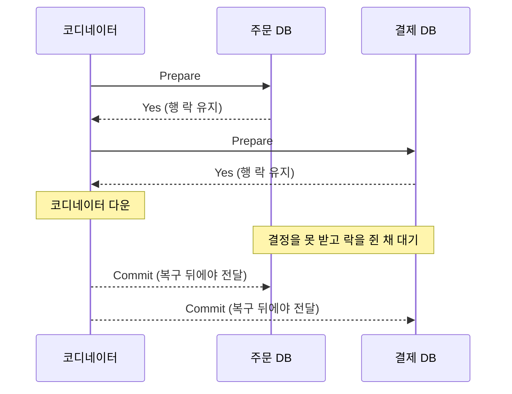

참여자는 스스로 Commit도 Rollback도 정할 수 없어 같은 행을 쓰는 요청이 줄을 선다. 가장 느린 참여자가 전체 지연이 되고, XA 미지원인 Kafka나 외부 PG는 끼지 못한다. 3PC는 PreCommit으로 블로킹을 줄이지만 네트워크 분할에서는 불일치가 남고 복잡도만 늘었다.

### 2PC, TCC, Saga 비교

TCC는 Try에서 자원을 예약하고 Confirm이나 Cancel로 확정·해제한다. Saga보다 격리가 낫지만 참여자마다 API 세 개를 구현해야 하고, Try보다 Cancel이 먼저 도착하는 빈 롤백과 Cancel 뒤에 Try가 늦게 도착하는 유령 Try를 막아야 한다.

| 항목 | 2PC (XA) | TCC | Saga |
|---|---|---|---|
| 일관성 수준 | 강한 일관성, 원자적 커밋 | Confirm 시점에 확정, 그 전에는 예약 상태가 외부에 보인다 | 최종 일관성, 중간 상태가 외부에 보인다 |
| 격리성 | 있음, 커밋 전까지 락 | 예약 레코드로 부분 보장 (semantic lock과 비슷하다) | 없음 (ACD), 애플리케이션이 대응한다 |
| 지연 구조 | Prepare와 Commit 두 왕복 동안 락 보유. 가장 느린 참여자가 전체를 결정한다 | Try 왕복과 Confirm/Cancel 왕복. 락 대신 예약 | 단계마다 로컬 커밋. 첫 단계 뒤 응답할 수 있지만 전체 완료는 단계 소요의 합이다 |
| 장애 시 | 코디네이터 장애로 블로킹 | Confirm/Cancel 재시도, 빈 롤백·유령 Try 처리 | 보상 실행. 보상 실패는 운영자가 처리한다 |
| 참여 조건 | XA 지원 DB | Try/Confirm/Cancel API 3개 | 단계마다 보상 명령 |
| 어울리는 곳 | 같은 조직의 DB 두세 개, 짧은 트랜잭션 | 결제·쿠폰처럼 자원을 예약할 수 있는 곳 | 서비스 경계를 넘는 긴 업무 흐름 |

## Saga 개요

Saga는 긴 트랜잭션을 로컬 트랜잭션 단계로 쪼개고 단계 사이를 메시지로 잇는다. 실패하면 끝난 단계를 보상 트랜잭션으로 수습한다. Saga를 넣는다고 안정해지지 않는다. 상태가 어디에 남는지, 재시도가 어디서 재개되는지를 설계해야 한다.

| 항목 | Choreography | Orchestration |
|---|---|---|
| 진행 책임 | 각 서비스가 이벤트를 구독하고 다음 이벤트를 발행한다 | 오케스트레이터가 단계를 호출하고 결과로 다음을 정한다 |
| 상태 추적 | 한 곳에서 볼 수 없다. 별도 저장소가 필요해진다 | 상태 테이블 한 곳에서 본다 |
| 결합도 | 서비스끼리 느슨하다 | 오케스트레이터가 모든 참여자를 안다 |
| 장애 지점 | 중앙 지점이 없다 | 오케스트레이터와 그 DB가 병목이 된다 |
| 보상 순서 | 이벤트 체인에 흩어져 있다 | 오케스트레이터가 고정한다 |
| 어울리는 규모 | 단계 3~4개 이하 | 단계가 늘거나 보상 순서가 복잡한 흐름 |

---

## Choreography Saga

각 서비스가 이벤트를 구독하고 다음 이벤트를 발행한다.

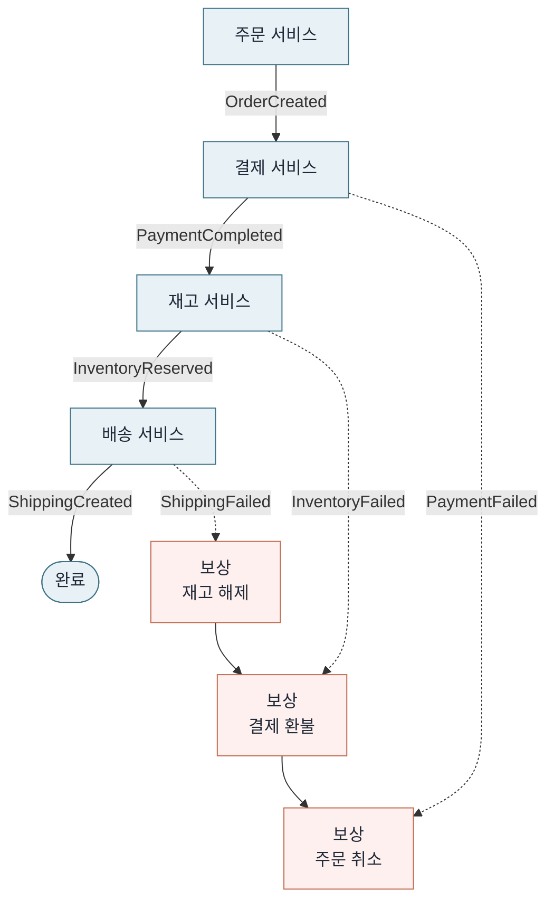

실선은 정상 경로, 점선은 실패 이벤트다. 보상은 성공한 단계를 역순으로 되감는다.

| 문제 | 상황 | 대응 |
|---|---|---|
| 진행 상태 추적 | "이 주문 지금 어디까지 갔냐"에 답할 곳이 없다. 서비스별 로그를 다 열어야 한다 | 주문 ID로 이벤트를 모두 조회하는 이벤트 스토어나 상태 저장소를 따로 둔다 |
| 스키마 변경 순서 | 새 형식을 발행하는 서비스를 먼저 배포하면 이전 형식을 기대하는 소비자가 파싱 실패로 죽고 메시지가 쌓인다 | 이벤트에 버전을 두고 필드는 추가만 한다 |
| 흩어진 보상 | 결제 취소는 됐는데 재고 복구 서비스가 장애여서 복구가 안 된 상태가 남는다 | 보상 이벤트도 정상 이벤트처럼 발행·처리 여부를 관측한다 |

결국 진행 상태 조회용 저장소가 필요해지고, 그 시점부터 Orchestration과 차이가 줄어든다.

### Spring Cloud Stream + Kafka 기반 Choreography Saga 구현

Spring Cloud Stream과 Kafka로 구현한 Choreography Saga다. 주문-결제-재고 흐름을 예제로 잡는다.

**의존성 (build.gradle):**

```groovy
dependencies {
    implementation 'org.springframework.boot:spring-boot-starter-web'
    implementation 'org.springframework.boot:spring-boot-starter-data-jpa'
    implementation 'org.springframework.cloud:spring-cloud-stream'
    implementation 'org.springframework.cloud:spring-cloud-stream-binder-kafka'
    implementation 'com.fasterxml.jackson.core:jackson-databind'
}
```

**이벤트 클래스:**

```java
// 공통 이벤트 헤더
public record SagaEventHeader(
    String sagaId,
    String correlationId,
    String businessKey,
    LocalDateTime timestamp
) {}

// 주문 생성 이벤트
public record OrderCreatedEvent(
    SagaEventHeader header,
    String orderId,
    String userId,
    List<OrderItem> items,
    BigDecimal totalAmount
) {}

// 결제 완료/실패 이벤트
public record PaymentCompletedEvent(
    SagaEventHeader header,
    String paymentId,
    String orderId,
    BigDecimal amount
) {}

public record PaymentFailedEvent(
    SagaEventHeader header,
    String orderId,
    String reason
) {}

// 재고 예약 완료/실패 이벤트
public record InventoryReservedEvent(
    SagaEventHeader header,
    String orderId,
    List<String> reservedItemIds
) {}

public record InventoryFailedEvent(
    SagaEventHeader header,
    String orderId,
    String reason
) {}
```

**주문 서비스 — 이벤트 발행:**

```java
@Service
@RequiredArgsConstructor
public class OrderService {

    private final OrderRepository orderRepository;
    private final StreamBridge streamBridge;

    @Transactional
    public Order createOrder(CreateOrderRequest request) {
        Order order = Order.create(request);
        orderRepository.save(order);

        // Outbox 대신 직접 발행하는 구조.
        // 운영에서는 Outbox 패턴을 써야 한다. 여기서는 흐름 이해용.
        OrderCreatedEvent event = new OrderCreatedEvent(
            new SagaEventHeader(
                UUID.randomUUID().toString(),
                request.correlationId(),
                order.getId(),
                LocalDateTime.now()
            ),
            order.getId(),
            request.userId(),
            order.getItems(),
            order.getTotalAmount()
        );

        streamBridge.send("order-events-out-0", event);
        return order;
    }

    // 결제 실패 시 보상: 주문 취소
    @Transactional
    public void cancelOrder(String orderId) {
        Order order = orderRepository.findById(orderId)
            .orElseThrow(() -> new IllegalStateException("주문 없음: " + orderId));
        order.cancel();
        orderRepository.save(order);
    }
}
```

**결제 서비스 — 이벤트 소비 및 발행:**

```java
@Configuration
public class PaymentEventHandler {

    @Bean
    public Consumer<OrderCreatedEvent> processPayment(
            PaymentService paymentService,
            StreamBridge streamBridge
    ) {
        return event -> {
            try {
                Payment payment = paymentService.processPayment(
                    event.orderId(),
                    event.userId(),
                    event.totalAmount()
                );

                streamBridge.send("payment-events-out-0",
                    new PaymentCompletedEvent(
                        event.header(),
                        payment.getId(),
                        event.orderId(),
                        event.totalAmount()
                    )
                );
            } catch (PaymentException e) {
                streamBridge.send("payment-events-out-0",
                    new PaymentFailedEvent(
                        event.header(),
                        event.orderId(),
                        e.getMessage()
                    )
                );
            }
        };
    }
}
```

**재고 서비스 — 이벤트 소비 및 보상:**

```java
@Configuration
public class InventoryEventHandler {

    @Bean
    public Consumer<PaymentCompletedEvent> reserveInventory(
            InventoryService inventoryService,
            StreamBridge streamBridge
    ) {
        return event -> {
            try {
                List<String> reservedIds = inventoryService
                    .reserve(event.orderId());

                streamBridge.send("inventory-events-out-0",
                    new InventoryReservedEvent(
                        event.header(),
                        event.orderId(),
                        reservedIds
                    )
                );
            } catch (InsufficientStockException e) {
                // 재고 부족 → 결제 취소 보상 이벤트 발행
                streamBridge.send("inventory-events-out-0",
                    new InventoryFailedEvent(
                        event.header(),
                        event.orderId(),
                        e.getMessage()
                    )
                );
            }
        };
    }
}
```

**보상 이벤트 핸들러 (결제 서비스):**

재고 실패 시 결제를 취소하는 보상 로직이다.

```java
@Configuration
public class PaymentCompensationHandler {

    @Bean
    public Consumer<InventoryFailedEvent> compensatePayment(
            PaymentService paymentService
    ) {
        return event -> {
            // 멱등성 보장: 이미 취소된 결제는 건너뛴다
            paymentService.cancelPayment(event.orderId());
        };
    }
}
```

**application.yml 설정:**

```yaml
spring:
  cloud:
    stream:
      bindings:
        # 주문 서비스 출력
        order-events-out-0:
          destination: order-events
          content-type: application/json
        # 결제 서비스 입력 (주문 이벤트 구독)
        processPayment-in-0:
          destination: order-events
          group: payment-service
          content-type: application/json
        # 결제 서비스 출력
        payment-events-out-0:
          destination: payment-events
          content-type: application/json
        # 재고 서비스 입력 (결제 이벤트 구독)
        reserveInventory-in-0:
          destination: payment-events
          group: inventory-service
          content-type: application/json
        # 재고 서비스 출력
        inventory-events-out-0:
          destination: inventory-events
          content-type: application/json
        # 결제 보상 입력 (재고 실패 이벤트 구독)
        compensatePayment-in-0:
          destination: inventory-events
          group: payment-compensation
          content-type: application/json
      kafka:
        binder:
          brokers: localhost:9092
        # DLQ 설정 — 3번 재시도 후 DLQ로 보낸다
        bindings:
          processPayment-in-0:
            consumer:
              enableDlq: true
              dlqName: payment-events-dlq
              autoCommitOnError: false
          reserveInventory-in-0:
            consumer:
              enableDlq: true
              dlqName: inventory-events-dlq
              autoCommitOnError: false
    function:
      definition: processPayment;reserveInventory;compensatePayment
```

**운영 시 주의사항:**

| 항목 | 이유 |
|---|---|
| consumer group을 서비스별로 고정 | 재배포 때 오프셋이 꼬인다 |
| `enableDlq: true` | 재시도 실패 메시지가 DLQ로 간다. DLQ 모니터링은 필수다 |
| Outbox 없이 직접 발행하는 예제 | DB 저장과 발행이 분리돼 유실될 수 있다. 프로덕션에서는 Outbox를 쓴다 |
| 이벤트 타입별 토픽 분리 | 한 토픽에 섞으면 소비자 필터링이 복잡해진다 |


---

## Orchestration Saga

오케스트레이터가 상태를 저장한 뒤 명령을 보내고, 돌아온 결과 이벤트로 다음 단계를 정한다. 시퀀스는 정상 경로와 배송 실패 시 보상 경로를 한 장에 담았다. 보상은 성공한 단계의 역순으로 나간다.

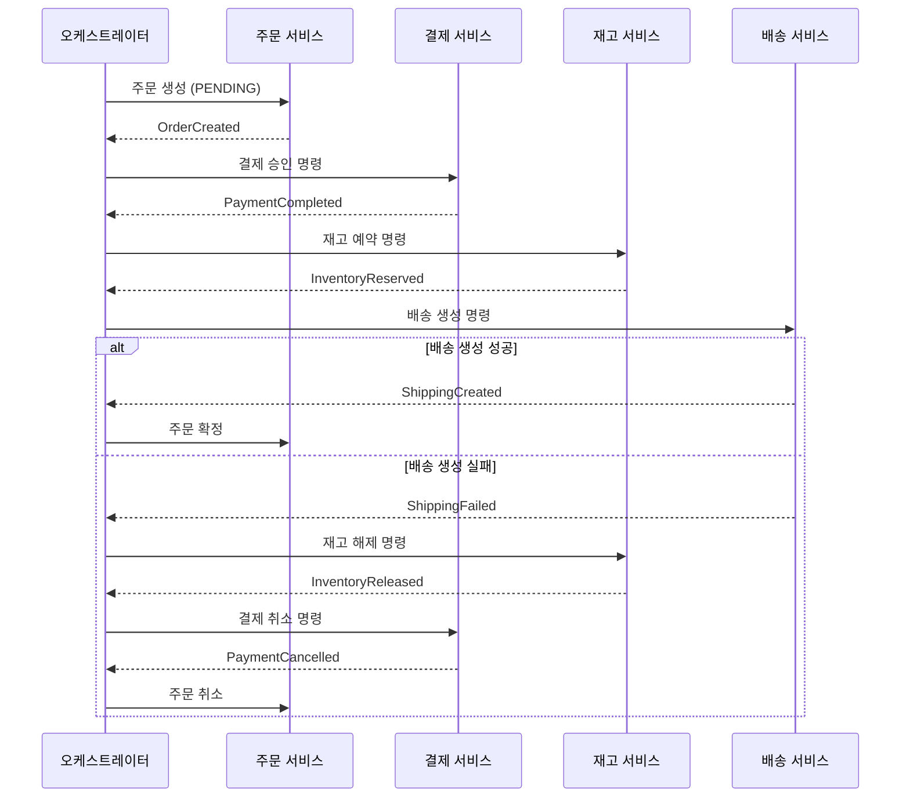

### 상태 저장소와 재시도 큐

오케스트레이터는 상태 저장과 명령 발행만 하고 실행은 큐 소비자가 한다. 결과가 안 오는 사가는 타임아웃 스캐너가 `updated_at`으로 찾아 재시도 큐에 넘긴다. 상태 저장과 명령 기록은 한 트랜잭션이다.

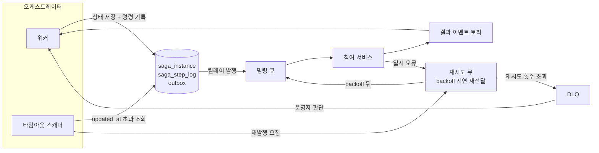

| 문제 | 상황 | 대응 |
|---|---|---|
| 오케스트레이터 DB 병목 | 단계마다 상태를 쓰니 트래픽이 늘면 DB가 먼저 터진다 | 상태 변경만 동기로 쓰고 로그성 기록은 분리한다. 오케스트레이터를 수평 확장한다 |
| 멈춘 사가 | 명령은 나갔는데 워커가 죽어 결과가 오지 않고 사가가 진행 중으로 남는다 | 타임아웃 스캐너가 재발행한다. 재발행 전에 상태를 확인한다 |
| 장애 전파 | 결제·재고·배송을 HTTP로 직렬 호출하면 결제 지연이 오케스트레이터 전체를 막는다 | 명령은 메시지로 보내고 결과는 이벤트로 받는다. 동기 호출은 타임아웃을 짧게 둔다 |

### Axon Framework 기반 Orchestration Saga 구현

Axon Framework는 Saga를 1급 시민으로 다룬다. `@Saga` 하나로 상태 관리와 재시도를 프레임워크가 처리한다.

**의존성 (build.gradle):**

```groovy
dependencies {
    implementation 'org.springframework.boot:spring-boot-starter-web'
    implementation 'org.springframework.boot:spring-boot-starter-data-jpa'
    implementation 'org.axonframework:axon-spring-boot-starter:4.9.3'
    // Axon Server 없이 쓰려면 아래 추가
    // implementation 'org.axonframework.extensions.kafka:axon-kafka-spring-boot-starter:4.9.0'
}
```

**명령(Command)과 이벤트 정의:**

```java
// 명령
public record CreateOrderCommand(
    @TargetAggregateIdentifier String orderId,
    String userId,
    List<OrderItem> items,
    BigDecimal totalAmount
) {}

public record ProcessPaymentCommand(
    @TargetAggregateIdentifier String paymentId,
    String orderId,
    BigDecimal amount
) {}

public record CancelPaymentCommand(
    @TargetAggregateIdentifier String paymentId,
    String orderId
) {}

public record ReserveInventoryCommand(
    @TargetAggregateIdentifier String inventoryId,
    String orderId,
    List<OrderItem> items
) {}

public record ReleaseInventoryCommand(
    @TargetAggregateIdentifier String inventoryId,
    String orderId
) {}

// 이벤트
public record OrderCreatedEvent(String orderId, String userId,
    List<OrderItem> items, BigDecimal totalAmount) {}

public record PaymentProcessedEvent(String paymentId, String orderId) {}
public record PaymentFailedEvent(String orderId, String reason) {}
public record PaymentCancelledEvent(String paymentId, String orderId) {}

public record InventoryReservedEvent(String orderId) {}
public record InventoryFailedEvent(String orderId, String reason) {}
public record InventoryReleasedEvent(String orderId) {}
```

**주문 Aggregate:**

```java
@Aggregate
public class OrderAggregate {

    @AggregateIdentifier
    private String orderId;
    private OrderStatus status;

    @CommandHandler
    public OrderAggregate(CreateOrderCommand cmd) {
        AggregateLifecycle.apply(new OrderCreatedEvent(
            cmd.orderId(), cmd.userId(), cmd.items(), cmd.totalAmount()
        ));
    }

    @EventSourcingHandler
    public void on(OrderCreatedEvent event) {
        this.orderId = event.orderId();
        this.status = OrderStatus.CREATED;
    }

    protected OrderAggregate() {} // Axon 필수
}
```

**Saga 오케스트레이터:**

Axon이 상태를 직렬화해 DB에 저장하므로 서버가 죽어도 이어서 진행한다.

```java
@Saga
public class OrderSaga {

    private transient CommandGateway commandGateway;

    private String orderId;
    private String paymentId;
    private String inventoryId;

    @Autowired
    public void setCommandGateway(CommandGateway commandGateway) {
        this.commandGateway = commandGateway;
    }

    // 1단계: 주문 생성 → 결제 요청
    @StartSaga
    @SagaEventHandler(associationProperty = "orderId")
    public void handle(OrderCreatedEvent event) {
        this.orderId = event.orderId();
        this.paymentId = UUID.randomUUID().toString();

        // 결제 명령 발행. 실패 시 보상 시작.
        commandGateway.send(new ProcessPaymentCommand(
            paymentId, orderId, event.totalAmount()
        )).exceptionally(ex -> {
            // 결제 명령 자체가 실패하면 사가 종료
            SagaLifecycle.end();
            return null;
        });
    }

    // 2단계: 결제 성공 → 재고 예약 요청
    @SagaEventHandler(associationProperty = "orderId")
    public void handle(PaymentProcessedEvent event) {
        this.inventoryId = UUID.randomUUID().toString();

        commandGateway.send(new ReserveInventoryCommand(
            inventoryId, orderId, List.of() // 실제로는 주문 항목 전달
        ));
    }

    // 결제 실패 → 사가 종료 (보상할 것 없음)
    @SagaEventHandler(associationProperty = "orderId")
    public void handle(PaymentFailedEvent event) {
        // 주문 상태를 FAILED로 변경하는 명령을 보낼 수 있다
        SagaLifecycle.end();
    }

    // 3단계: 재고 예약 성공 → 사가 완료
    @SagaEventHandler(associationProperty = "orderId")
    public void handle(InventoryReservedEvent event) {
        // 다음 단계(배송 등)를 이어갈 수 있다
        SagaLifecycle.end();
    }

    // 재고 실패 → 결제 취소 보상
    @SagaEventHandler(associationProperty = "orderId")
    public void handle(InventoryFailedEvent event) {
        commandGateway.send(new CancelPaymentCommand(paymentId, orderId));
    }

    // 결제 취소 완료 → 사가 종료
    @SagaEventHandler(associationProperty = "orderId")
    public void handle(PaymentCancelledEvent event) {
        SagaLifecycle.end();
    }
}
```

**Saga 데드라인 (타임아웃) 설정:**

`DeadlineManager`로 응답 없는 단계에서 보상을 시작한다.

```java
@Saga
public class OrderSagaWithDeadline {

    private transient CommandGateway commandGateway;
    private transient DeadlineManager deadlineManager;

    private String orderId;
    private String paymentId;
    private String paymentDeadlineId;

    private static final String PAYMENT_TIMEOUT = "payment-timeout";

    @Autowired
    public void setDependencies(CommandGateway commandGateway,
                                 DeadlineManager deadlineManager) {
        this.commandGateway = commandGateway;
        this.deadlineManager = deadlineManager;
    }

    @StartSaga
    @SagaEventHandler(associationProperty = "orderId")
    public void handle(OrderCreatedEvent event) {
        this.orderId = event.orderId();
        this.paymentId = UUID.randomUUID().toString();

        // 30초 타임아웃 설정
        paymentDeadlineId = deadlineManager.schedule(
            Duration.ofSeconds(30), PAYMENT_TIMEOUT
        );

        commandGateway.send(new ProcessPaymentCommand(
            paymentId, orderId, event.totalAmount()
        ));
    }

    @SagaEventHandler(associationProperty = "orderId")
    public void handle(PaymentProcessedEvent event) {
        // 정상 응답이 왔으니 데드라인 취소
        deadlineManager.cancelSchedule(PAYMENT_TIMEOUT, paymentDeadlineId);
        // 다음 단계 진행...
    }

    @DeadlineHandler(deadlineName = PAYMENT_TIMEOUT)
    public void onPaymentTimeout() {
        // 30초 동안 결제 응답이 없으면 여기로 온다
        // 보상 로직 또는 재시도 판단
        SagaLifecycle.end();
    }
}
```

**Axon 설정 (application.yml):**

```yaml
axon:
  axonserver:
    # Axon Server 사용 시
    servers: localhost:8124
  serializer:
    general: jackson
    messages: jackson
    events: jackson
  saga:
    # Saga 상태 저장소 — JPA 기본
    # saga_entry, association_value_entry 테이블이 자동 생성된다
    jpa:
      enabled: true

spring:
  jpa:
    hibernate:
      ddl-auto: update
  datasource:
    url: jdbc:postgresql://localhost:5432/saga_db
```

Axon 없이 만들면 상태 직렬화, 인스턴스 조회, 데드라인, 핸들러 라우팅, 보상 순서를 전부 구현해야 한다. 서비스 3~4개면 직접, 10개를 넘으면 프레임워크가 낫다.

**Temporal 예제:**

```java
@WorkflowInterface
public interface OrderWorkflow {
    @WorkflowMethod
    void processOrder(String orderId, BigDecimal amount);
}

@ActivityInterface
public interface PaymentActivity {
    void processPayment(String orderId, BigDecimal amount);
    void cancelPayment(String orderId);
}

@ActivityInterface
public interface InventoryActivity {
    void reserveInventory(String orderId);
    void releaseInventory(String orderId);
}
```

```java
public class OrderWorkflowImpl implements OrderWorkflow {

    private final PaymentActivity paymentActivity = Workflow.newActivityStub(
        PaymentActivity.class,
        ActivityOptions.newBuilder()
            .setStartToCloseTimeout(Duration.ofSeconds(30))
            .setRetryOptions(RetryOptions.newBuilder()
                .setMaximumAttempts(3)
                .build())
            .build()
    );

    private final InventoryActivity inventoryActivity = Workflow.newActivityStub(
        InventoryActivity.class,
        ActivityOptions.newBuilder()
            .setStartToCloseTimeout(Duration.ofSeconds(30))
            .build()
    );

    @Override
    public void processOrder(String orderId, BigDecimal amount) {
        // Saga 본체: 순서대로 실행, 실패 시 보상
        Saga saga = new Saga(new Saga.Options.Builder().build());

        try {
            paymentActivity.processPayment(orderId, amount);
            // 보상 함수 등록 — 나중에 실패하면 역순으로 실행된다
            saga.addCompensation(
                paymentActivity::cancelPayment, orderId
            );

            inventoryActivity.reserveInventory(orderId);
            saga.addCompensation(
                inventoryActivity::releaseInventory, orderId
            );

        } catch (ActivityFailure e) {
            // 실패 시 등록된 보상을 역순으로 실행
            saga.compensate();
            throw e;
        }
    }
}
```

Temporal은 워크플로 코드가 일반 Java처럼 읽히고 `try-catch`로 보상을 처리한다. 대신 서버를 따로 운영해야 한다.


### 워크플로 엔진으로 넘길 시점

사가 타입이 한두 개면 직접 구현이 싸다. 타임아웃 스캐너, 재시도 정책, 상태 화면이 사가마다 복제되기 시작하면 엔진을 검토한다. 분기에서 "예"가 한 번이라도 나오면 엔진 쪽이다.

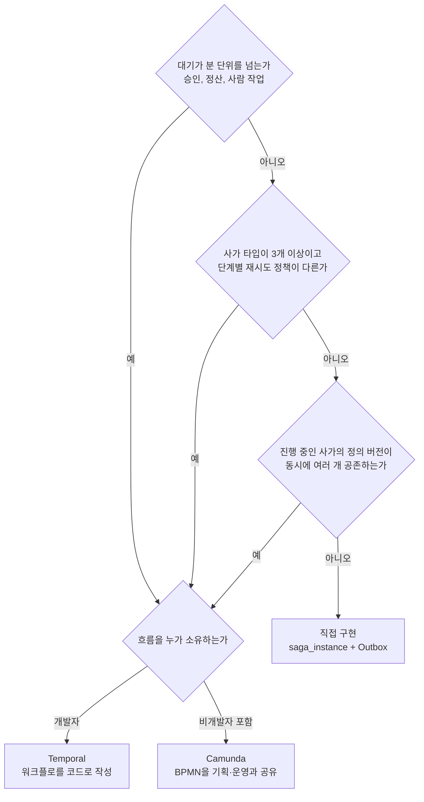

| 신호 | 직접 구현에서 생기는 일 | 엔진이 대신하는 것 |
|---|---|---|
| 며칠짜리 대기 | `timeout_at` 스캔 쿼리와 스케줄러가 늘어난다 | 내구성 있는 타이머 |
| 사람이 승인하는 단계 | 승인 화면과 상태 값을 직접 만든다 | Camunda의 user task |
| 보상 순서 변경 | 진행 중 인스턴스가 옛 순서로 보상하다 새 순서와 충돌한다 | Temporal의 버전 분기, Camunda의 정의 버전별 인스턴스 유지 |
| 단계별 재시도 | backoff와 횟수가 코드 곳곳에 흩어진다 | 선언형 retry policy |
| "어디까지 갔냐" 문의 | 상태 테이블과 조회 화면을 만든다 | 실행 이력과 UI |

엔진은 상태와 재시도를 가져가고 의미는 가져가지 않는다. Activity는 최소 한 번 실행되므로 멱등성과 보상 설계는 남고, 서버 운영과 워크플로 코드의 결정성 제약이 새로 생긴다.

---

## 사가 인스턴스 상태

상태가 없는 사가는 장애 때 로그를 보고 추측하게 만든다. 종료 상태는 COMPLETED, COMPENSATED, FAILED 셋이다. FAILED는 보상할 수 없거나 보상까지 실패한 상태라 사람이 개입해야 한다.

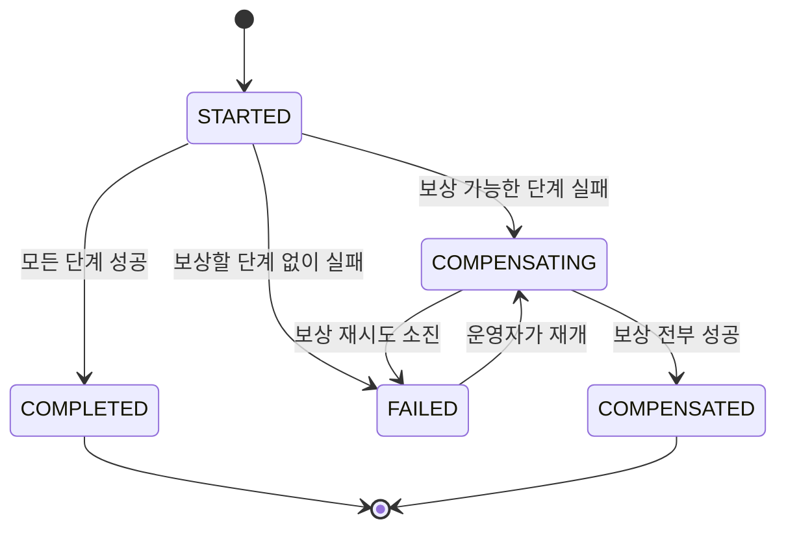

| 도식 | 코드의 `SagaStatus` | 비고 |
|---|---|---|
| STARTED | RUNNING | 인스턴스 생성 직후부터 단계 진행 중 |
| COMPENSATED | COMPENSATED | 보상 단계가 모두 `StepStatus.COMPENSATED`일 때 |
| FAILED (보상 소진) | COMPENSATION_FAILED | 알림 임계값 1. 이 상태가 데이터 불일치다 |
| 중단 | STOPPED | 재시도 소진 뒤 운영자 판단 대기 |

| 필드 | 용도 |
|---|---|
| `saga_id`, `business_key`, `saga_type` | 인스턴스, 주문 ID, 사가 종류 |
| `status`, `current_step`, `step_history` | 진행 위치와 단계별 결과 |
| `started_at`, `updated_at`, `completed_at`, `timeout_at` | 멈춘 사가 탐지 기준 |
| `last_error`, `error_step`, `retry_count` | 실패 원인과 재시도 횟수 |
| `compensation_status`, `saga_version` | 보상 진행도, 시작 시점의 보상 순서 버전 |

저장소는 RDB가 가장 단순하다. `business_key`로 주문 ID를, `(status, updated_at)` 복합 인덱스로 오래된 사가를 찾는다.

재처리는 둘로 나뉜다. 상태 확인 없이 재발행하면 중복이 커진다.

| 구분 | 대상 | 규칙 |
|---|---|---|
| 같은 단계 재시도 | RUNNING이고 `updated_at`이 오래된 사가 | 일시 오류에만 쓴다. 횟수를 제한한다 |
| 보상 단계 재시도 | COMPENSATING 중 실패한 보상 | 순서를 유지한다. 소진되면 운영자에게 넘긴다 |

---

## 보상 트랜잭션

보상은 되돌리기가 아니라 상태 수습이다. 수습 가능한 정도가 단계마다 다르다.

| 단계 | 보상 | 제약 |
|---|---|---|
| 재고 예약 | 예약 해제 | 언제든 가능 |
| 결제 승인 | 승인 취소, 매입 뒤에는 환불 | 승인 뒤 취소 가능 시간이 정해진 곳이 있고 환불은 수수료와 지연이 붙는다 |
| 포인트 적립 | 회수 | 이미 썼으면 마이너스 잔액 정책이 필요하다 |
| 배송 생성 | 취소 | 출고 전까지. 출고 뒤는 반품 절차다 |
| 이메일 발송 | 없음 | 정정 메일이 최선이다 |
| 외부 API 호출 | 업체마다 다름 | 취소 API가 없으면 불가능하다 |

| 보상 규칙 | 내용 |
|---|---|
| 순서 | 성공한 단계의 역순이 기본이다. 포인트 회수 전에 결제 취소, 배송 취소 실패 시 환불 차단처럼 정책이 역순을 깨기도 한다 |
| 순서 변경 | 운영 중에 바꾸면 진행 중 사가와 충돌한다. 시작 시점의 순서 버전을 인스턴스에 저장한다 |
| 기간 만료 | 관리자 화면 수동 처리와 CS 알림으로 넘긴다. 이 경로가 없으면 장애 대응이 끝나지 않는다 |

### 보상 불가 단계와 pivot transaction 위치

단계는 세 종류다. pivot 앞은 보상 가능, pivot은 성공하면 끝까지 전진해야 하는 분기점, 뒤는 성공할 때까지 재시도한다. 이메일과 PG 승인을 어디에 두느냐가 순서 설계다.

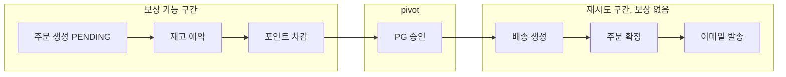

| 규칙 | 이유 |
|---|---|
| 실패 확률이 높고 보상이 싼 단계(재고 예약, 쿠폰 선점)를 pivot 앞에 둔다 | 실패해도 해제 한 번으로 끝난다 |
| 되돌리기 비싼 PG 승인을 pivot으로 삼고 앞 단계가 전부 성공한 뒤 호출한다 | 취소 수수료, 카드 명세의 승인·취소 이력, 환불 지연을 피한다 |
| 이메일·알림은 pivot 뒤 마지막에 두고, 가능하면 사가 밖에서 COMPLETED 이벤트를 받아 보낸다 | 한 번 나가면 회수할 수 없다 |
| pivot 뒤 단계가 영구 실패하면 자동 보상 대신 수동 처리 큐로 보낸다 | 재배송이나 부분 환불은 운영자가 정한다 |

PG 승인은 취소 API가 있어도 비용과 소요가 커서 pivot처럼 다룬다. Kafka 예제는 결제를 먼저 두므로 재고 실패마다 결제 취소가 붙는다. 재고를 먼저 두면 해제 한 번으로 끝난다.

### 보상 중 타임아웃과 중복 보상 방지

보상 명령에 응답이 없으면 실패가 아니라 결과 불명이다. 그대로 재발행하면 PG 취소가 두 번 나간다. 시퀀스는 두 번째 명령이 같은 `comp_id`로 유니크 제약에 걸리고, 외부 상태를 조회해 마무리하는 흐름이다.

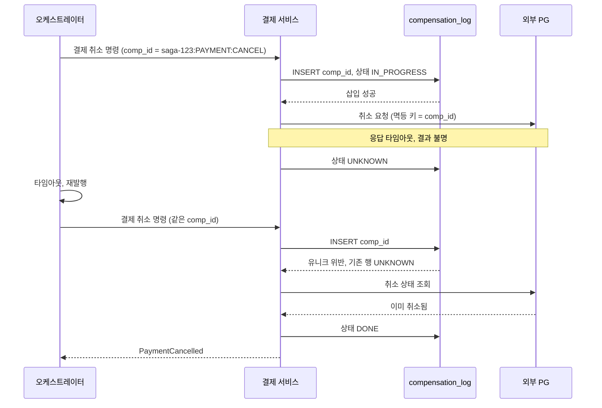

| 장치 | 막는 것 |
|---|---|
| `comp_id`를 `saga_id + 단계 + 종류`로 결정론적 생성 | 재시도마다 UUID를 새로 만들면 유니크 제약이 무력해진다 |
| 보상 서비스의 `compensation_log` 유니크 제약과 IN_PROGRESS·UNKNOWN·DONE 상태 | 같은 보상의 동시 실행과 재실행 |
| 외부 호출에 `comp_id`를 멱등 키로 전달. 미지원이면 UNKNOWN에서 조회부터 | PG 취소 이중 실행 |
| 보상이 원 명령보다 먼저 도착하면 CANCELLED 마커를 남기고, 늦게 온 원 명령은 버린다 | 취소된 사가의 결제가 뒤늦게 승인되는 일 |

---

## 격리성 부족이 만드는 이상 현상

Saga는 ACID에서 I가 빠진 ACD다. 단계마다 로컬 커밋을 하므로 진행 중인 사가의 중간 값이 다른 사가에 그대로 보인다. 대표 증상이 lost update와 dirty read다.

### lost update

재고 보상을 예약 전 값으로 복원하는 SET으로 짜면 그 사이 다른 사가의 예약이 지워진다. 시퀀스의 마지막 값은 10이지만 맞는 값은 7이다.

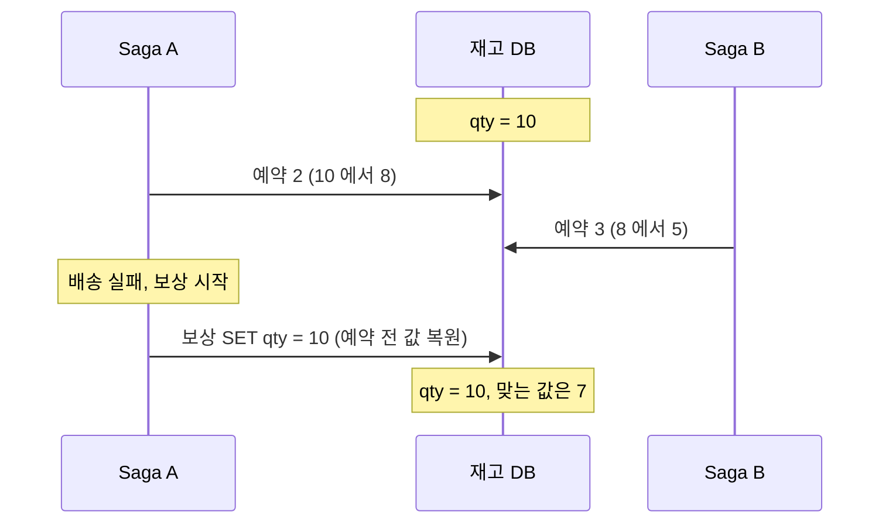

### dirty read

결제가 승인된 순간 주문 상태가 PAID로 보이고, 그 상태를 믿은 다른 사가가 움직인다. 이후 원래 사가가 보상되면 취소된 주문에 적립금이 남는다.

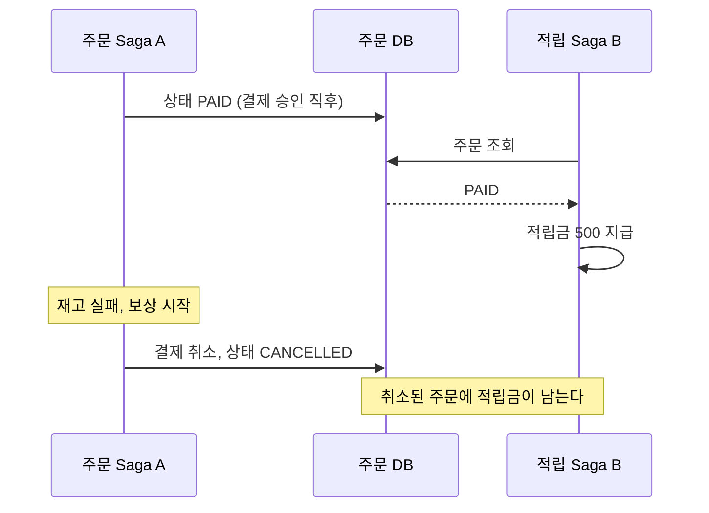

### 대응

lost update는 보상 연산의 모양을 바꿔 막고, dirty read는 중간 상태를 읽지 못하게 하거나 읽는 시점을 뒤로 민다.

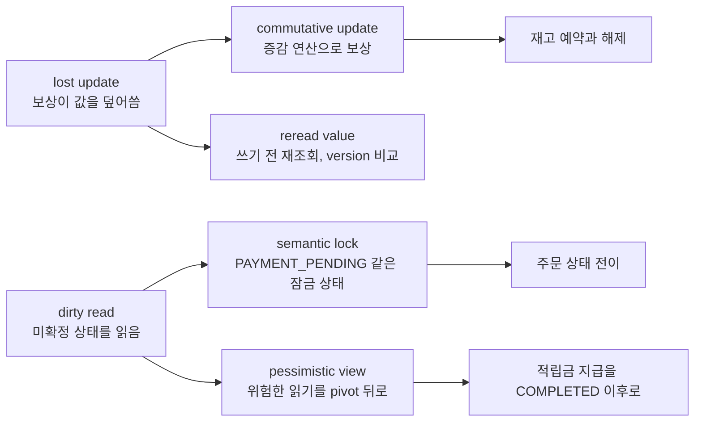

| 대응책 | 동작 | 주의 |
|---|---|---|
| semantic lock | 진행 중 사가가 `PAYMENT_PENDING` 같은 플래그를 건다. 다른 사가는 플래그를 보면 대기, 실패, 건너뛰기 중 하나를 고른다 | 성공과 보상 양쪽에서 플래그를 풀어야 한다. 사가가 멈추면 락도 남으므로 `timeout_at`이 필요하다 |
| commutative update | 단계와 보상을 `qty = qty - 2`, `qty = qty + 2` 같은 증감으로 짠다. 순서가 바뀌어도 결과가 같다 | 재고·잔액처럼 가산적인 값에만 쓴다. 예약 시 `qty >= 0` 조건이 필요하다 |
| pessimistic view | 위험한 읽기가 있는 단계를 pivot 뒤 재시도 구간으로 옮긴다 | 비즈니스 순서가 바뀐다 |
| reread value | 보상 쓰기 전에 값을 다시 읽고 `version` 컬럼으로 변경 여부를 확인한다 | 충돌하면 재시도 경로가 필요하다 |

---

## Outbox 패턴

주문은 저장됐는데 이벤트 발행이 실패하면 사가가 시작도 못 한다. Outbox는 변경과 이벤트를 한 트랜잭션에 저장하고 릴레이가 읽어 발행한다. 도식 마지막 Note는 남는 중복이다.

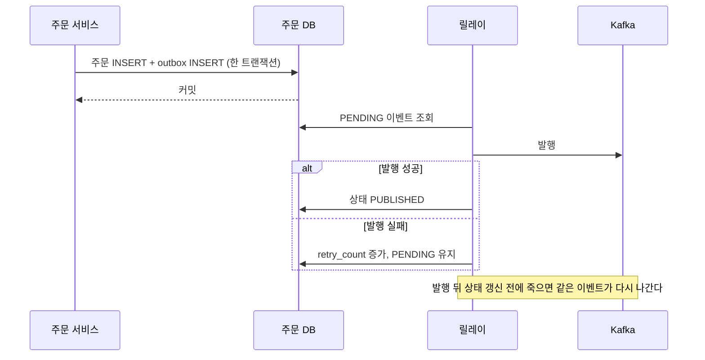

릴레이는 최소 한 번 전달이라 소비자 멱등성이 그대로 필요하다. PUBLISHED 행을 지우지 않으면 폴링이 느려진다. 테이블 구성과 CDC 방식은 [Transactional Outbox](트랜잭셔널_아웃박스_패턴.md)에서 다룬다.

---

## 메시지 설계

| 구분 | 의미 | 소비자 | 실패 시 |
|---|---|---|---|
| 명령 (`ProcessPaymentCommand`) | "해라" | 하나 | 재시도를 강하게 한다 |
| 이벤트 (`PaymentCompletedEvent`) | "됐다/안 됐다" | 여러 명 | 재시도보다 재발행 |

오케스트레이션은 명령이, 코레오그래피는 이벤트가 많다. 디버깅은 같은 묶음을 찾는 일이라 키 세 개가 메시지에 있어야 한다.

| 키 | 용도 |
|---|---|
| `saga_id` | 모든 단계와 보상에 포함. 사가 전체 추적 |
| `correlation_id` | 같은 요청에서 나온 메시지를 로그에서 묶는다 |
| `business_key` | `order_id` 같은 값. 운영 대응 때 쓴다 |

```json
{
  "headers": {
    "saga_id": "saga-123",
    "correlation_id": "req-456",
    "business_key": "order-789"
  },
  "body": {
    "event_type": "PaymentCompleted",
    "order_id": "order-789",
    "amount": 10000
  }
}
```

버전은 헤더든 바디든 한 곳에 고정한다. 버전이 없으면 배포 순서 사고가 난다. 새 버전은 필드를 추가만 한다. 1.2에서 `new_field`가 붙은 예다.

```json
{
  "version": "1.2",
  "event_type": "PaymentCompleted",
  "order_id": "order-789",
  "amount": 10000,
  "new_field": "new_value"
}
```

SQS는 메시지당 256KB다. 큰 데이터는 DB나 S3에 두고 키만 싣는다.

---

## 관측과 장애 대응

큐 적체만 보면 늦다. 사가 상태 기준으로 봐야 사용자 영향 구간이 보인다.

| 구분 | 메트릭 | 알람 |
|---|---|---|
| 진행 상태 | 진행 중, 완료, 실패, 보상 중, 보상 실패 사가 수 | 실패 수 임계값 초과, 보상 실패 1건 이상 |
| 성능 | 단계별 평균 소요 시간, 단계별 실패율 | 한 단계에 오래 멈춘 사가가 많을 때 |
| 비즈니스 | 시간대별 생성 수, 타입별 분포, 평균 완료 시간 | 없음. 용량과 사용자 경험 판단용 |

멈춘 사가는 대부분 명령이 나가 RUNNING인데 워커가 처리 중 죽어 결과 이벤트가 안 오는 경로다. 타임아웃은 외부 의존성의 최대 지연 기준이다. 평균 2초, 최대 10초인 결제 단계에서 평균 기준 6초는 정상 처리도 타임아웃시키므로 30초 안팎으로 둔다. 재발행 전에 워커 처리 여부를 상태로 확인한다.

도식은 알람 이후의 분기다. 자동화가 안 되는 구간은 마지막 수동 개입 한 곳이다.

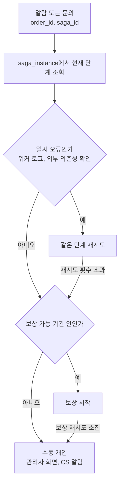

운영 화면에 상세 조회, 수동 재시도, 보상 시작 버튼이 필요하다.

### Saga 상태 추적 테이블 구현

운영에서 "이 주문 지금 어디까지 갔냐"를 답하려면 상태 추적 테이블이 필수다. Spring Data JPA 기반 구현이다.

**엔티티 정의:**

```java
@Entity
@Table(name = "saga_instance", indexes = {
    @Index(name = "idx_saga_business_key", columnList = "businessKey"),
    @Index(name = "idx_saga_status", columnList = "status"),
    @Index(name = "idx_saga_status_updated",
           columnList = "status, updatedAt")
})
public class SagaInstance {

    @Id
    private String sagaId;

    @Column(nullable = false)
    private String sagaType;  // ORDER_CREATE, ORDER_CANCEL 등

    @Column(nullable = false)
    private String businessKey;  // order_id

    @Column(nullable = false)
    @Enumerated(EnumType.STRING)
    private SagaStatus status;

    @Column(nullable = false)
    private String currentStep;

    private String lastError;
    private String errorStep;
    private int retryCount;

    @Column(nullable = false)
    private LocalDateTime startedAt;

    @Column(nullable = false)
    private LocalDateTime updatedAt;

    private LocalDateTime completedAt;
    private LocalDateTime timeoutAt;

    @OneToMany(mappedBy = "sagaInstance", cascade = CascadeType.ALL,
               fetch = FetchType.LAZY)
    @OrderBy("executedAt ASC")
    private List<SagaStepLog> stepLogs = new ArrayList<>();

    // 상태 전이 메서드
    public void advanceTo(String nextStep) {
        this.currentStep = nextStep;
        this.updatedAt = LocalDateTime.now();
    }

    public void complete() {
        this.status = SagaStatus.COMPLETED;
        this.completedAt = LocalDateTime.now();
        this.updatedAt = LocalDateTime.now();
    }

    public void fail(String step, String error) {
        this.status = SagaStatus.FAILED;
        this.errorStep = step;
        this.lastError = error;
        this.updatedAt = LocalDateTime.now();
    }

    public void startCompensation() {
        this.status = SagaStatus.COMPENSATING;
        this.updatedAt = LocalDateTime.now();
    }

    public void compensated() {
        this.status = SagaStatus.COMPENSATED;
        this.completedAt = LocalDateTime.now();
        this.updatedAt = LocalDateTime.now();
    }
}

public enum SagaStatus {
    RUNNING, COMPLETED, FAILED, COMPENSATING, COMPENSATED, COMPENSATION_FAILED, STOPPED
}
```

**단계별 로그 엔티티:**

```java
@Entity
@Table(name = "saga_step_log")
public class SagaStepLog {

    @Id
    @GeneratedValue(strategy = GenerationType.IDENTITY)
    private Long id;

    @ManyToOne(fetch = FetchType.LAZY)
    @JoinColumn(name = "saga_id")
    private SagaInstance sagaInstance;

    @Column(nullable = false)
    private String stepName;

    @Enumerated(EnumType.STRING)
    private StepStatus status;  // STARTED, COMPLETED, FAILED, COMPENSATED

    private String errorMessage;

    @Column(nullable = false)
    private LocalDateTime executedAt;

    private LocalDateTime completedAt;
    private long durationMs;  // 처리 시간(밀리초)
}
```

**Saga 상태 관리 서비스:**

```java
@Service
@RequiredArgsConstructor
public class SagaStateService {

    private final SagaInstanceRepository sagaRepository;
    private final SagaStepLogRepository stepLogRepository;

    @Transactional
    public SagaInstance startSaga(String sagaType, String businessKey,
                                  String firstStep, Duration timeout) {
        SagaInstance saga = new SagaInstance();
        saga.setSagaId(UUID.randomUUID().toString());
        saga.setSagaType(sagaType);
        saga.setBusinessKey(businessKey);
        saga.setStatus(SagaStatus.RUNNING);
        saga.setCurrentStep(firstStep);
        saga.setStartedAt(LocalDateTime.now());
        saga.setUpdatedAt(LocalDateTime.now());
        saga.setTimeoutAt(LocalDateTime.now().plus(timeout));
        return sagaRepository.save(saga);
    }

    @Transactional
    public void recordStepResult(String sagaId, String stepName,
                                  StepStatus status, String error) {
        SagaInstance saga = sagaRepository.findById(sagaId)
            .orElseThrow();

        SagaStepLog log = new SagaStepLog();
        log.setSagaInstance(saga);
        log.setStepName(stepName);
        log.setStatus(status);
        log.setErrorMessage(error);
        log.setExecutedAt(LocalDateTime.now());
        stepLogRepository.save(log);

        if (status == StepStatus.FAILED) {
            saga.fail(stepName, error);
        }

        sagaRepository.save(saga);
    }

    // 멈춘 사가 조회 — 스케줄러에서 주기적으로 호출
    public List<SagaInstance> findStuckSagas(Duration threshold) {
        LocalDateTime cutoff = LocalDateTime.now().minus(threshold);
        return sagaRepository
            .findByStatusAndUpdatedAtBefore(SagaStatus.RUNNING, cutoff);
    }

    // 타임아웃된 사가 조회
    public List<SagaInstance> findTimedOutSagas() {
        return sagaRepository
            .findByStatusAndTimeoutAtBefore(
                SagaStatus.RUNNING, LocalDateTime.now()
            );
    }
}
```

**Repository:**

```java
public interface SagaInstanceRepository
        extends JpaRepository<SagaInstance, String> {

    List<SagaInstance> findByStatusAndUpdatedAtBefore(
        SagaStatus status, LocalDateTime cutoff);

    List<SagaInstance> findByStatusAndTimeoutAtBefore(
        SagaStatus status, LocalDateTime now);

    List<SagaInstance> findByBusinessKey(String businessKey);

    // 운영 대시보드용: 상태별 카운트
    @Query("SELECT s.status, COUNT(s) FROM SagaInstance s " +
           "WHERE s.sagaType = :sagaType GROUP BY s.status")
    List<Object[]> countByStatusAndSagaType(
        @Param("sagaType") String sagaType);
}
```

### 실패 알림 연동

`@Scheduled`로 멈춘 사가를 탐지하고 임계값을 넘으면 Slack으로 알린다.

**멈춘 사가 탐지 스케줄러:**

```java
@Component
@RequiredArgsConstructor
@Slf4j
public class SagaMonitorScheduler {

    private final SagaStateService sagaStateService;
    private final SagaAlertService alertService;
    private final MeterRegistry meterRegistry;

    // 1분마다 실행
    @Scheduled(fixedRate = 60_000)
    public void detectStuckSagas() {
        // 5분 이상 진행 중인 사가를 멈춘 것으로 판단
        List<SagaInstance> stuckSagas =
            sagaStateService.findStuckSagas(Duration.ofMinutes(5));

        // 메트릭 기록 — Prometheus/Grafana에서 모니터링
        meterRegistry.gauge("saga.stuck.count", stuckSagas.size());

        if (stuckSagas.size() >= 5) {
            // 5건 이상이면 알림
            alertService.sendAlert(
                "SAGA_STUCK",
                String.format("멈춘 사가 %d건 감지. "
                    + "가장 오래된 것: %s (saga_id: %s)",
                    stuckSagas.size(),
                    stuckSagas.get(0).getBusinessKey(),
                    stuckSagas.get(0).getSagaId()
                )
            );
        }

        // 개별 사가 재시도
        for (SagaInstance saga : stuckSagas) {
            if (saga.getRetryCount() < 3) {
                sagaStateService.retrySaga(saga.getSagaId());
            } else {
                saga.setStatus(SagaStatus.STOPPED);
                alertService.sendAlert(
                    "SAGA_STOPPED",
                    String.format("사가 재시도 초과. "
                        + "수동 개입 필요. saga_id: %s, order: %s",
                        saga.getSagaId(),
                        saga.getBusinessKey()
                    )
                );
            }
        }
    }

    // 보상 실패 모니터링
    @Scheduled(fixedRate = 60_000)
    public void detectCompensationFailures() {
        List<SagaInstance> failed = sagaStateService
            .findByStatus(SagaStatus.COMPENSATION_FAILED);

        meterRegistry.gauge("saga.compensation_failed.count",
                            failed.size());

        if (!failed.isEmpty()) {
            alertService.sendAlert(
                "SAGA_COMPENSATION_FAILED",
                String.format("보상 실패 사가 %d건. "
                    + "데이터 정합성 깨질 수 있음. 즉시 확인 필요.",
                    failed.size()
                )
            );
        }
    }
}
```

**Slack 알림 서비스:**

```java
@Service
@RequiredArgsConstructor
@Slf4j
public class SagaAlertService {

    private final RestTemplate restTemplate;

    @Value("${alert.slack.webhook-url}")
    private String slackWebhookUrl;

    public void sendAlert(String alertType, String message) {
        log.warn("[{}] {}", alertType, message);

        Map<String, Object> payload = Map.of(
            "text", String.format("[%s] %s", alertType, message),
            "channel", "#saga-alerts"
        );

        try {
            restTemplate.postForEntity(
                slackWebhookUrl, payload, String.class
            );
        } catch (Exception e) {
            // 알림 실패가 사가 처리를 막으면 안 된다
            log.error("Slack 알림 전송 실패", e);
        }
    }
}
```

**Micrometer 메트릭 — Prometheus 연동:**

```java
@Component
@RequiredArgsConstructor
public class SagaMetrics {

    private final MeterRegistry registry;

    // 사가 시작 시 카운터 증가
    public void sagaStarted(String sagaType) {
        registry.counter("saga.started", "type", sagaType).increment();
    }

    // 사가 완료 시 카운터 증가 + 소요 시간 기록
    public void sagaCompleted(String sagaType, Duration duration) {
        registry.counter("saga.completed", "type", sagaType).increment();
        registry.timer("saga.duration", "type", sagaType)
            .record(duration);
    }

    // 사가 실패 시 카운터 증가 + 실패 단계 기록
    public void sagaFailed(String sagaType, String failedStep) {
        registry.counter("saga.failed",
            "type", sagaType,
            "step", failedStep
        ).increment();
    }
}
```

**Grafana 대시보드에서 볼 메트릭:**

```
# 진행 중 사가 수
saga_stuck_count

# 분당 사가 시작/완료/실패 비율
rate(saga_started_total[5m])
rate(saga_completed_total[5m])
rate(saga_failed_total[5m])

# 단계별 실패율
rate(saga_failed_total[5m]) by (step)

# 사가 평균 소요 시간
saga_duration_seconds{quantile="0.95"}

# 보상 실패 건수 — 0이 아니면 즉시 확인
saga_compensation_failed_count
```

`saga_compensation_failed_count`가 0이 아니면 데이터 정합성이 깨진 상태이므로 알림 임계값은 1이다.


---

## 테스트

사가 테스트는 성공 시나리오보다 실패 시나리오가 중요하다. 멱등성은 같은 이벤트와 같은 보상 이벤트를 여러 번 흘려 결과가 한 번과 같은지, DB에 중복 행이 없는지로 본다.

| 시나리오 | 주입 | 확인할 것 |
|---|---|---|
| 중간 단계 실패 | 결제 성공 뒤 재고 실패, 재고 성공 뒤 배송 실패 | 역순 보상, 사가가 COMPENSATED로 닫힘 |
| 워커 장애 | 배송 요청 직후 워커 종료 | 타임아웃 뒤 재시도, 상태 보존 |
| 중복 | 같은 주문 요청, 같은 이벤트·보상 이벤트 반복 | 주문 한 건, 환불 한 건 |
| 순서 뒤집힘 | 보상이 원 명령보다 먼저 도착 | 원 명령이 버려짐 |
| 외부 지연 | PG 응답을 타임아웃보다 늦춤 | 결과 불명 상태에서 조회 뒤 재시도 |
| 타임아웃 값 | 처리 시간을 일부러 늘림 | 너무 짧으면 정상 처리도 재발행, 너무 길면 멈춘 사가가 오래 남음 |
| 부하와 복구 | 동시 사가 다수, 오케스트레이터 재기동 | 상태 저장소 병목 여부, 재기동 뒤 이어서 진행 |

---
이 문서는 [트랜잭션과 동시성 허브](../../_hub/트랜잭션과_동시성.md)의 일부입니다.
