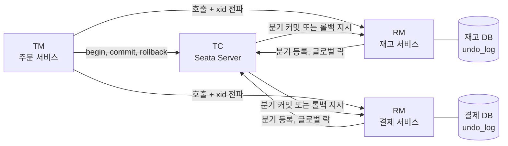
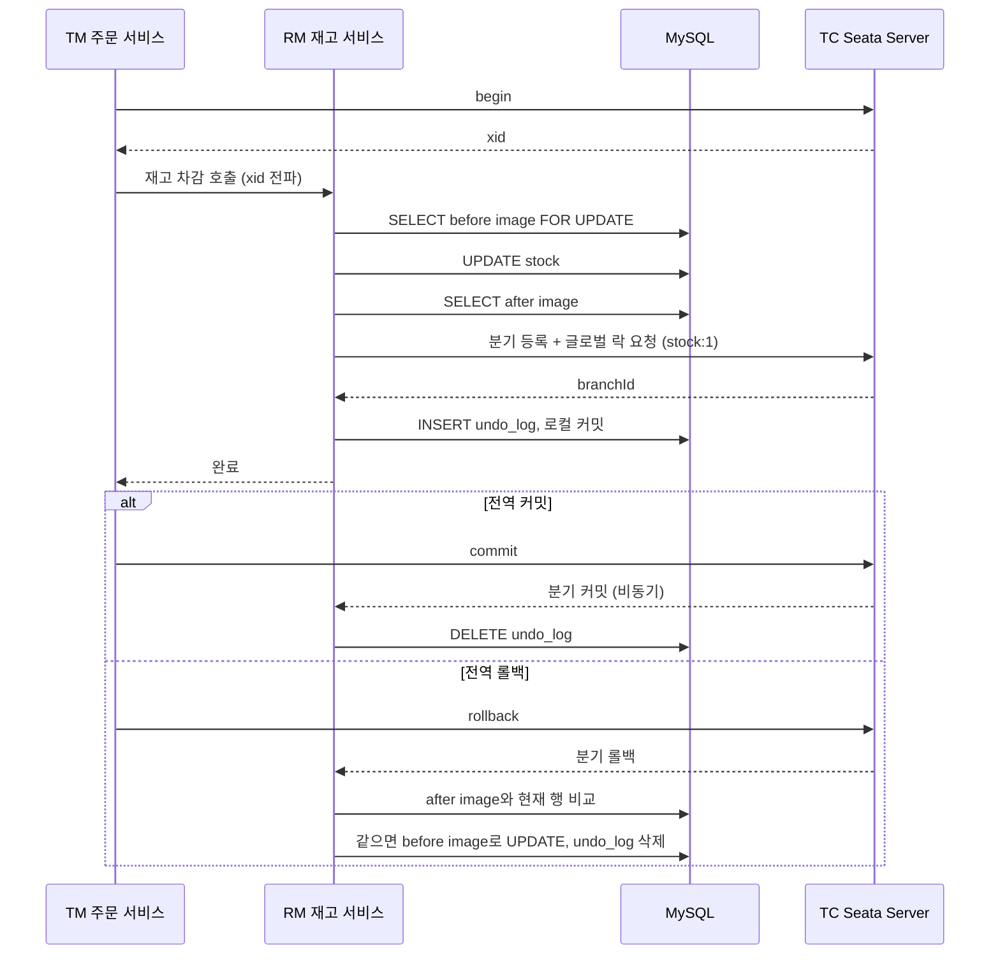
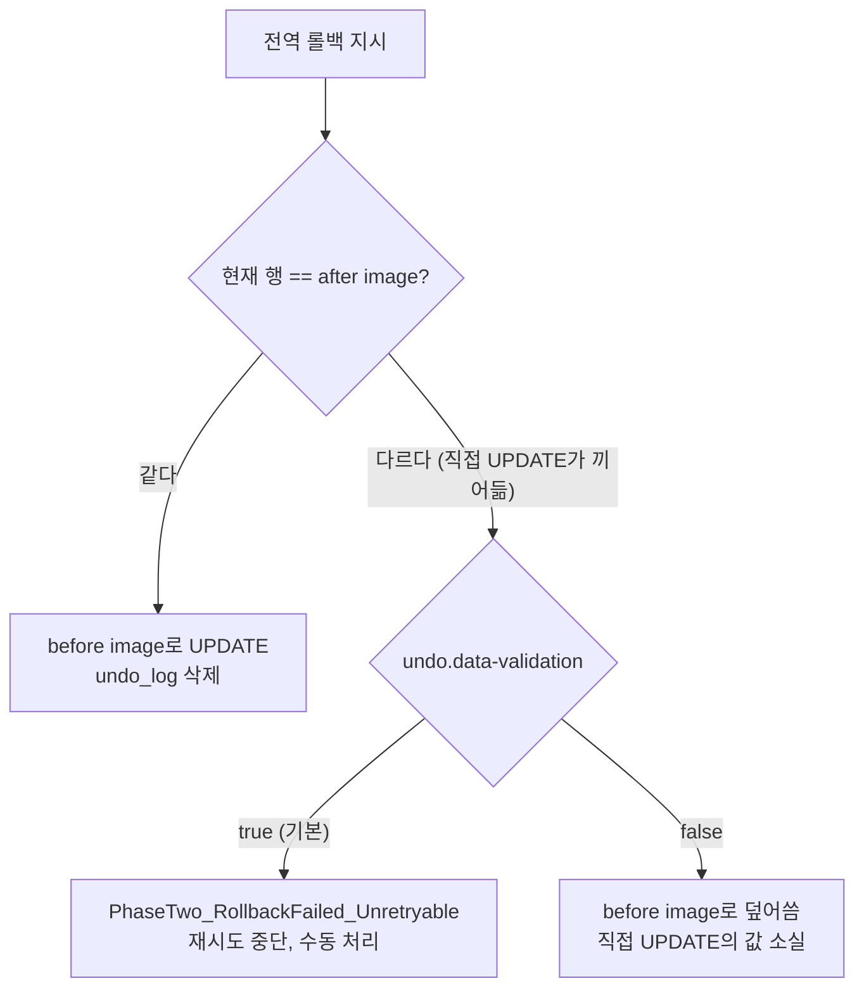
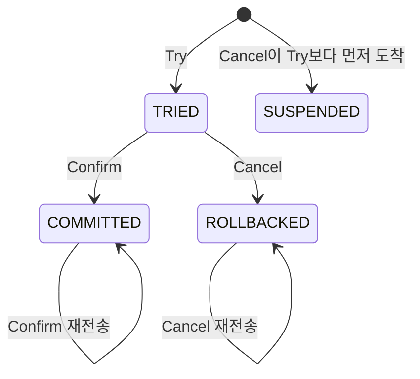
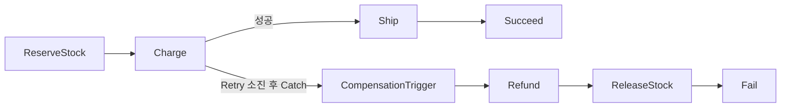

# Seata AT와 TCC 모드

[분산 트랜잭션](../../DataBase/RDBMS/Distributed_Transaction.md)에서 TCC는 Try·Confirm·Cancel과 예약 테이블을 직접 짜는 방식으로 다뤘다. 이 문서는 그 세 메서드와 방어 로직을 프레임워크가 어디까지 대신하는지, 대신하지 못하는 곳이 어디인지를 본다. Saga 일반론은 [Saga 패턴 및 분산 트랜잭션](Saga_패턴_및_분산_트랜잭션.md)에 있다.

아래 로그와 수치는 전부 직접 돌려서 얻었다. 환경은 Seata Server 2.2.0(Docker, file 저장소), 클라이언트 `seata-spring-boot-starter` 2.2.0, Spring Boot 2.7.18, JDK 17, MySQL 8.0.46이다. Temporal은 SDK 1.40.0의 인프로세스 테스트 서버로 돌렸다. 2.x는 groupId가 `org.apache.seata`이고, `io.seata` 쪽 메타데이터의 최신은 2.0.0이다. 좌표를 `io.seata`로 두면 2.2.0을 못 찾는다.

## TC, TM, RM

TC는 Seata Server다. 전역 트랜잭션과 분기의 상태, 글로벌 락을 들고 있다. TM은 `begin`·`commit`·`rollback`을 요청하는 쪽이고, RM은 DB나 TCC 리소스 앞에 서서 분기를 등록하고 2단계 지시를 실행한다. 한 서비스가 TM과 RM을 겸하는 경우가 많다. 아래 실험은 앱 하나, DB 하나라 TM과 RM이 같은 JVM이다.



도식에서 TC가 요청 경로에 직접 들어온다는 점을 봐야 한다. 호출마다 `begin`, 분기 등록, 종료 요청이 TC를 거친다.

## AT 모드의 두 단계

`DataSourceProxy`가 SQL을 가로채 UPDATE 전후의 행을 읽는다. 둘을 before/after image로 `undo_log`에 넣고, 업무 SQL과 같은 로컬 트랜잭션에서 커밋한다. 1단계가 끝나면 변경은 이미 DB에 반영된 상태다.



MySQL general log로 UPDATE 한 번에 나가는 문장을 뽑았다. 첫 호출에는 테이블 메타데이터 조회가 더 붙는데 뺐다.

```text
SET autocommit=0
SELECT id, qty FROM stock WHERE id = 1 FOR UPDATE
update stock set qty = qty - 1 where id = 1
SELECT id, qty FROM stock WHERE (id) in ( (1) )
INSERT INTO undo_log (branch_id, xid, context, rollback_info, log_status, ...) VALUES (...)
commit
SET autocommit=1
DELETE FROM undo_log WHERE branch_id IN (...) AND xid IN (...)     -- 2단계, 비동기
DELETE FROM undo_log WHERE context IN ('branchId=...') AND xid IN (...)
```

1단계 직후 `undo_log`에는 행이 1건 있었고, 전역 커밋 2초 뒤에는 0건이었다. `rollback_info`를 줄여 보면 이미지에는 PK와 바뀐 컬럼만 들어 있다. `stock.product`는 없다.

```text
branch_id=6134743356385480707  log_status=0
context=serializer=jackson&compressorType=NONE&map=67108864
rollback_info = {"sqlType":"UPDATE","tableName":"stock",
  "beforeImage": [{"id":1}, {"qty":10}],
  "afterImage":  [{"id":1}, {"qty":9}]}        <- 원문 JSON을 이 모양으로 줄였다
```

전역 롤백에서는 `qty`가 10으로 돌아왔고 `undo_log`도 비었다.

### 글로벌 락이 막아 주는 것

1단계 로컬 커밋이 끝나면 MySQL 행 락은 풀린다. 그 뒤에 같은 행을 쓰려는 다른 전역 트랜잭션은 로컬 UPDATE까지는 가고, 분기 등록 단계에서 글로벌 락에 막힌다. 두 번째 트랜잭션은 2.2초쯤 뒤 `get global lock fail, ... lockKeys:stock:1`로 실패했고 `qty`는 9 그대로였다. 롤백될지 모르는 값 위에 다른 트랜잭션이 덮어쓰는 dirty write를 이렇게 막는다.

전역 트랜잭션 밖에서 프록시 데이터소스로 쓰는 경로는 `@GlobalLock`(실험에서는 `GlobalLockTemplate`)을 붙여야 같은 검사를 받는다. 붙인 경로의 UPDATE는 2.0초 뒤 `get lock failed, lockKey: stock:1`로 막혔다.

<div class="ygd-seata-at-global-lock-contention" id="ygd-seata-at-global-lock-contention">
<style>
.ygd-seata-at-global-lock-contention{max-width:760px;margin-left:auto;margin-right:auto;margin-top:1.5em;margin-bottom:1.5em;box-sizing:border-box;padding:14px;border:1px solid var(--ygd-line);border-radius:10px;background:var(--ygd-bg);color:var(--ygd-fg);font-size:15px;line-height:1.5;--ygd-bg:#fafbfc;--ygd-fg:#1f2328;--ygd-muted:#57606a;--ygd-line:#d0d7de;--ygd-box:#ffffff;--ygd-a:#1a5fb4;--ygd-ok:#1a7f37;--ygd-bad:#b42318;--ygd-warn:#9a5b00;--ygd-actbg:#e7f0ff;--ygd-badbg:#fdecea;--ygd-warnbg:#fff4e0;--ygd-flash:#cfe2ff;--ygd-pbg:#1a5fb4;--ygd-pfg:#ffffff;--ygd-panel:#f1f4f8;--ygd-code:#e3e8ee;--ygd-focus:#0b57d0;}
body[data-md-color-scheme="slate"] .ygd-seata-at-global-lock-contention{--ygd-bg:#1b1e24;--ygd-fg:#e8eaed;--ygd-muted:#a9b0bb;--ygd-line:#3d4450;--ygd-box:#262b33;--ygd-a:#7db3ff;--ygd-ok:#6fd08c;--ygd-bad:#ff8a80;--ygd-warn:#f0b45a;--ygd-actbg:#1f3556;--ygd-badbg:#46231f;--ygd-warnbg:#43321a;--ygd-flash:#2d4f80;--ygd-pbg:#7db3ff;--ygd-pfg:#0b1b33;--ygd-panel:#20242b;--ygd-code:#333a44;--ygd-focus:#9ccbff;}
.ygd-seata-at-global-lock-contention .ygd-ttl{font-size:15px;font-weight:700;margin:0 0 10px 0;}
.ygd-seata-at-global-lock-contention .ygd-bar{display:flex;flex-wrap:wrap;align-items:center;gap:8px;margin:0 0 10px 0;}
.ygd-seata-at-global-lock-contention .ygd-btn{font:inherit;font-size:14px;font-weight:600;line-height:1.2;color:var(--ygd-fg);background:var(--ygd-box);border:1px solid var(--ygd-line);border-radius:8px;padding:8px 14px;min-height:40px;margin:0;cursor:pointer;}
.ygd-seata-at-global-lock-contention .ygd-btn.ygd-play{background:var(--ygd-pbg);color:var(--ygd-pfg);border-color:var(--ygd-pbg);}
.ygd-seata-at-global-lock-contention .ygd-btn:focus-visible{outline:3px solid var(--ygd-focus);outline-offset:2px;}
.ygd-seata-at-global-lock-contention .ygd-btn:disabled{opacity:.45;cursor:not-allowed;}
.ygd-seata-at-global-lock-contention .ygd-count{font-size:14px;color:var(--ygd-muted);margin-left:auto;}
.ygd-seata-at-global-lock-contention .ygd-svg{display:block;width:100%;height:auto;max-width:100%;}
.ygd-seata-at-global-lock-contention .ygd-svg text{font-family:inherit;text-anchor:middle;}
.ygd-seata-at-global-lock-contention .ygd-col{font-size:11px;font-weight:700;fill:var(--ygd-muted);}
.ygd-seata-at-global-lock-contention .ygd-cont{fill:none;stroke:var(--ygd-line);stroke-width:1.5;stroke-dasharray:5 4;}
.ygd-seata-at-global-lock-contention .ygd-rect{fill:var(--ygd-box);stroke:var(--ygd-line);stroke-width:1.5;transition:fill .3s,stroke .3s;}
.ygd-seata-at-global-lock-contention .ygd-box{opacity:.6;transition:opacity .3s;}
.ygd-seata-at-global-lock-contention .ygd-dash .ygd-rect{stroke-dasharray:4 3;}
.ygd-seata-at-global-lock-contention .ygd-t1{font-size:11px;font-weight:700;fill:var(--ygd-fg);}
.ygd-seata-at-global-lock-contention .ygd-t2{font-size:11px;fill:var(--ygd-fg);}
.ygd-seata-at-global-lock-contention .ygd-t3{font-size:10.5px;font-weight:700;fill:var(--ygd-muted);}
.ygd-seata-at-global-lock-contention .ygd-s-active{opacity:1;}
.ygd-seata-at-global-lock-contention .ygd-s-active .ygd-rect{fill:var(--ygd-actbg);stroke:var(--ygd-a);stroke-width:2.5;}
.ygd-seata-at-global-lock-contention .ygd-s-active .ygd-t3{fill:var(--ygd-a);}
.ygd-seata-at-global-lock-contention .ygd-s-done{opacity:.85;}
.ygd-seata-at-global-lock-contention .ygd-s-done .ygd-t3{fill:var(--ygd-ok);}
.ygd-seata-at-global-lock-contention .ygd-s-wait{opacity:1;}
.ygd-seata-at-global-lock-contention .ygd-s-wait .ygd-rect{fill:var(--ygd-warnbg);stroke:var(--ygd-warn);stroke-width:2.5;}
.ygd-seata-at-global-lock-contention .ygd-s-wait .ygd-t3{fill:var(--ygd-warn);}
.ygd-seata-at-global-lock-contention .ygd-s-fail{opacity:1;}
.ygd-seata-at-global-lock-contention .ygd-s-fail .ygd-rect{fill:var(--ygd-badbg);stroke:var(--ygd-bad);stroke-width:2.5;}
.ygd-seata-at-global-lock-contention .ygd-s-fail .ygd-t3{fill:var(--ygd-bad);}
.ygd-seata-at-global-lock-contention .ygd-cbox .ygd-rect{fill:var(--ygd-box);stroke:var(--ygd-line);}
.ygd-seata-at-global-lock-contention .ygd-ct{font-size:10.5px;fill:var(--ygd-muted);}
.ygd-seata-at-global-lock-contention .ygd-v{font-size:12.5px;font-weight:700;fill:var(--ygd-muted);}
.ygd-seata-at-global-lock-contention .ygd-v-a{fill:var(--ygd-a);}
.ygd-seata-at-global-lock-contention .ygd-v-b{fill:var(--ygd-warn);}
.ygd-seata-at-global-lock-contention .ygd-v-w{fill:var(--ygd-warn);}
.ygd-seata-at-global-lock-contention .ygd-v-ok{fill:var(--ygd-ok);}
.ygd-seata-at-global-lock-contention .ygd-v-n{fill:var(--ygd-fg);}
.ygd-seata-at-global-lock-contention .ygd-flash{animation:ygd-seata-at-global-lock-contention-flash .9s ease-out;}
@keyframes ygd-seata-at-global-lock-contention-flash{0%{fill:var(--ygd-flash);}100%{fill:var(--ygd-box);}}
.ygd-seata-at-global-lock-contention .ygd-arrow{opacity:0;transition:opacity .25s;}
.ygd-seata-at-global-lock-contention .ygd-arrow.ygd-on{opacity:1;}
.ygd-seata-at-global-lock-contention .ygd-k-ok{color:var(--ygd-ok);}
.ygd-seata-at-global-lock-contention .ygd-k-wait{color:var(--ygd-warn);}
.ygd-seata-at-global-lock-contention .ygd-k-block{color:var(--ygd-bad);}
.ygd-seata-at-global-lock-contention .ygd-ln{stroke:currentColor;stroke-width:2.2;fill:none;stroke-dasharray:5 3;}
.ygd-seata-at-global-lock-contention .ygd-on .ygd-ln-go{animation:ygd-seata-at-global-lock-contention-flow .7s linear infinite;}
@keyframes ygd-seata-at-global-lock-contention-flow{to{stroke-dashoffset:-16;}}
.ygd-seata-at-global-lock-contention .ygd-ln-bad{stroke-dasharray:none;}
.ygd-seata-at-global-lock-contention .ygd-hd{fill:currentColor;stroke:none;}
.ygd-seata-at-global-lock-contention .ygd-x{stroke:currentColor;stroke-width:2.5;stroke-linecap:round;fill:none;}
.ygd-seata-at-global-lock-contention .ygd-arrow .ygd-blk{display:none;}
.ygd-seata-at-global-lock-contention .ygd-k-block .ygd-blk{display:inline;}
.ygd-seata-at-global-lock-contention .ygd-k-block .ygd-ln-go,.ygd-seata-at-global-lock-contention .ygd-k-block .ygd-hd-go{display:none;}
.ygd-seata-at-global-lock-contention .ygd-panel{margin-top:10px;padding:12px 14px;border-radius:8px;background:var(--ygd-panel);border-left:4px solid var(--ygd-a);}
.ygd-seata-at-global-lock-contention .ygd-st{font-size:15px;font-weight:700;margin-bottom:4px;}
.ygd-seata-at-global-lock-contention .ygd-ds{font-size:15px;line-height:1.65;overflow-wrap:anywhere;}
.ygd-seata-at-global-lock-contention .ygd-code{font-family:ui-monospace,SFMono-Regular,Menlo,Consolas,monospace;font-size:14px;padding:1px 5px;border-radius:4px;background:var(--ygd-code);color:var(--ygd-fg);overflow-wrap:anywhere;word-break:break-all;}
.ygd-seata-at-global-lock-contention .ygd-note{margin-top:10px;font-size:14px;line-height:1.6;color:var(--ygd-muted);}
@media (prefers-reduced-motion:reduce){.ygd-seata-at-global-lock-contention .ygd-rect,.ygd-seata-at-global-lock-contention .ygd-box,.ygd-seata-at-global-lock-contention .ygd-arrow{transition:none;}.ygd-seata-at-global-lock-contention .ygd-flash,.ygd-seata-at-global-lock-contention .ygd-on .ygd-ln-go{animation:none;}}
</style>
<div class="ygd-ttl">같은 행 stock:1 을 두고 경합하는 전역 트랜잭션 A와 B</div>
<div class="ygd-bar">
<button type="button" class="ygd-btn ygd-play">재생</button>
<button type="button" class="ygd-btn ygd-prev">이전</button>
<button type="button" class="ygd-btn ygd-next">다음</button>
<button type="button" class="ygd-btn ygd-reset">처음으로</button>
<span class="ygd-count">단계 0 / 7</span>
</div>
<svg class="ygd-svg" viewBox="0 0 340 228" role="img" aria-label="stock:1 행을 쓰려는 전역 트랜잭션 A와 B의 시간순 흐름. 왼쪽이 A, 가운데가 MySQL 행 락과 글로벌 락과 qty 상태, 오른쪽이 B와 전역 트랜잭션 밖의 GlobalLock 경로.">
<text class="ygd-col" x="47" y="14">전역 TX A</text>
<text class="ygd-col" x="170" y="14">stock:1 행</text>
<text class="ygd-col" x="293" y="14">전역 TX B</text>
<rect class="ygd-cont" x="114" y="26" width="112" height="196" rx="10"/>
<g class="ygd-cbox" data-c="r" transform="translate(120,32)"><rect class="ygd-rect" width="100" height="56" rx="8"/><text class="ygd-ct" x="50" y="22">MySQL 행 락</text><text class="ygd-v" data-v="r" x="50" y="43">없음</text></g>
<g class="ygd-cbox" data-c="g" transform="translate(120,96)"><rect class="ygd-rect" width="100" height="56" rx="8"/><text class="ygd-ct" x="50" y="22">글로벌 락 (TC)</text><text class="ygd-v" data-v="g" x="50" y="43">없음</text></g>
<g class="ygd-cbox" data-c="q" transform="translate(120,160)"><rect class="ygd-rect" width="100" height="56" rx="8"/><text class="ygd-ct" x="50" y="22">qty (커밋된 값)</text><text class="ygd-v" data-v="q" x="50" y="43">10</text></g>
<g class="ygd-box ygd-s-idle" data-box="a1" transform="translate(2,32)"><rect class="ygd-rect" width="90" height="56" rx="8"/><text class="ygd-t1" x="45" y="18">① UPDATE</text><text class="ygd-t2" x="45" y="33">+ 분기 등록</text><text class="ygd-t3" x="45" y="48">대기 전</text></g>
<g class="ygd-box ygd-s-idle" data-box="a2" transform="translate(2,96)"><rect class="ygd-rect" width="90" height="56" rx="8"/><text class="ygd-t1" x="45" y="18">② 로컬 커밋</text><text class="ygd-t2" x="45" y="33">1단계 끝</text><text class="ygd-t3" x="45" y="48">대기 전</text></g>
<g class="ygd-box ygd-s-idle" data-box="a3" transform="translate(2,160)"><rect class="ygd-rect" width="90" height="56" rx="8"/><text class="ygd-t1" x="45" y="18">③ 전역 커밋</text><text class="ygd-t2" x="45" y="33">2단계</text><text class="ygd-t3" x="45" y="48">대기 전</text></g>
<g class="ygd-box ygd-s-idle" data-box="b1" transform="translate(248,32)"><rect class="ygd-rect" width="90" height="56" rx="8"/><text class="ygd-t1" x="45" y="18">① UPDATE</text><text class="ygd-t2" x="45" y="33">로컬 TX 안</text><text class="ygd-t3" x="45" y="48">대기 전</text></g>
<g class="ygd-box ygd-s-idle" data-box="b2" transform="translate(248,96)"><rect class="ygd-rect" width="90" height="56" rx="8"/><text class="ygd-t1" x="45" y="18">② 분기 등록</text><text class="ygd-t2" x="45" y="33">글로벌 락 요청</text><text class="ygd-t3" x="45" y="48">대기 전</text></g>
<g class="ygd-box ygd-s-idle" data-box="c" data-dash="1" transform="translate(248,160)"><rect class="ygd-rect" width="90" height="56" rx="8"/><text class="ygd-t1" x="45" y="18">갈래: TX 밖</text><text class="ygd-t2" x="45" y="33">@GlobalLock</text><text class="ygd-t3" x="45" y="48">대기 전</text></g>
<g class="ygd-arrow" data-ar="a1"><line class="ygd-ln ygd-ln-go" x1="92" y1="60" x2="106" y2="60"/><path class="ygd-hd ygd-hd-go" d="M105 56L113 60L105 64Z"/></g>
<g class="ygd-arrow" data-ar="a2"><line class="ygd-ln ygd-ln-go" x1="92" y1="124" x2="106" y2="124"/><path class="ygd-hd ygd-hd-go" d="M105 120L113 124L105 128Z"/></g>
<g class="ygd-arrow" data-ar="a3"><line class="ygd-ln ygd-ln-go" x1="92" y1="188" x2="106" y2="188"/><path class="ygd-hd ygd-hd-go" d="M105 184L113 188L105 192Z"/></g>
<g class="ygd-arrow" data-ar="b1"><line class="ygd-ln ygd-ln-go" x1="248" y1="60" x2="235" y2="60"/><path class="ygd-hd ygd-hd-go" d="M235 56L227 60L235 64Z"/></g>
<g class="ygd-arrow" data-ar="b2"><line class="ygd-ln ygd-ln-go" x1="248" y1="124" x2="235" y2="124"/><path class="ygd-hd ygd-hd-go" d="M235 120L227 124L235 128Z"/><g class="ygd-blk"><line class="ygd-ln ygd-ln-bad" x1="248" y1="124" x2="242" y2="124"/><path class="ygd-x" d="M232 120L240 128M240 120L232 128"/></g></g>
<g class="ygd-arrow" data-ar="c"><g class="ygd-blk"><line class="ygd-ln ygd-ln-bad" x1="248" y1="188" x2="242" y2="188"/><path class="ygd-x" d="M232 184L240 192M240 184L232 192"/></g></g>
</svg>
<div class="ygd-panel" aria-live="polite"><div class="ygd-st"></div><div class="ygd-ds"></div></div>
<div class="ygd-note">비유: 행 락은 서류를 손에 쥐고 고치는 동안만 유효하고, 글로벌 락은 결재가 끝날 때까지 서류에 붙여 두는 수정 금지 표지에 가깝다. 비유일 뿐이고, 실제 글로벌 락은 TC가 stock:1 같은 키 단위로 들고 있는 잠금이다.</div>
<script>
(function(){
var root=document.getElementById('ygd-seata-at-global-lock-contention');
if(!root){return;}
var q1=function(s){return root.querySelector(s);};
var qa=function(s){return root.querySelectorAll(s);};
var LAST=7;
var STEPS=[
{t:'0. 시작 상태',d:['stock:1 행의 qty는 10이고 MySQL 행 락도 글로벌 락도 비어 있다. 재생을 누르면 전역 트랜잭션 A, B가 같은 행을 쓰려는 순서를 따라간다.'],r:['없음','f'],g:['없음','f'],q:['10','n'],ar:null},
{t:'1. A: UPDATE와 분기 등록',d:['A가 stock:1을 UPDATE 하면서 MySQL 행 락을 잡고, 분기 등록 단계에서 TC로부터 글로벌 락 stock:1을 받는다. 아직 로컬 커밋 전이라 커밋된 qty는 10이다.'],r:['A 보유','a'],g:['A 보유','a'],q:['10','n'],ar:['a1','ok']},
{t:'2. A: 1단계 로컬 커밋',d:['A가 undo_log를 넣고 로컬 커밋한다. MySQL 행 락은 풀리지만 글로벌 락은 A가 그대로 쥐고, 커밋된 qty는 9가 된다.'],r:['해제됨','f'],g:['A 보유','a'],q:['9','n'],ar:['a2','ok']},
{t:'3. B: 로컬 UPDATE는 통과',d:['행 락이 이미 풀려 있어서 B의 로컬 UPDATE는 막히지 않는다. MySQL 행 락만으로는 B를 막지 못한다.'],r:['B 보유','b'],g:['A 보유','a'],q:['9','n'],ar:['b1','ok']},
{t:'4. B: 분기 등록에서 글로벌 락 대기',d:['B가 분기 등록과 함께 글로벌 락 stock:1을 요청하지만 A가 쥐고 있어 받지 못한다. B는 락이 풀리기를 기다린다.'],r:['B 보유','b'],g:['A 보유 · B 대기','w'],q:['9','n'],ar:['b2','wait']},
{t:'5. B 실패, qty=9 유지',d:['약 2.2초 뒤 B는 ',{c:'get global lock fail, ... lockKeys:stock:1'},' 로 실패한다. qty는 9 그대로이고, 롤백될지 모르는 A의 값 위에 B가 덮어쓰는 dirty write가 막혔다.'],r:['없음','f'],g:['A 보유','a'],q:['9 (그대로)','ok'],ar:['b2','block']},
{t:'6. 갈래: 전역 트랜잭션 밖의 @GlobalLock 경로',d:['전역 트랜잭션 밖에서 프록시 데이터소스로 쓰는 경로도 ',{c:'@GlobalLock'},'(실험에서는 ',{c:'GlobalLockTemplate'},')을 붙여야 같은 검사를 받는다. 같은 행의 글로벌 락이 잡혀 있으면 붙인 경로의 UPDATE는 2.0초 뒤 ',{c:'get lock failed, lockKey: stock:1'},' 로 막혔다.'],r:['없음','f'],g:['A 보유','a'],q:['9','n'],ar:['c','block']},
{t:'7. A: 2단계 완료, 글로벌 락 해제',d:['A가 전역 커밋하면 2단계가 끝나 undo_log가 비동기로 지워지고 글로벌 락이 풀린다. 그동안 qty=9는 계속 유지됐다.'],r:['없음','f'],g:['해제됨','f'],q:['9 (유지)','ok'],ar:['a3','ok']}
];
var START={a1:1,a2:2,b1:3,b2:4,c:6,a3:7};
var LABEL={idle:'대기 전',active:'진행 중',done:'완료',wait:'락 대기 중',fail:'실패'};
var cur=0;
var timer=null;
var prev={r:'없음',g:'없음',q:'10'};
var panel=q1('.ygd-panel');
var stEl=q1('.ygd-st');
var dsEl=q1('.ygd-ds');
var svg=q1('.ygd-svg');
var bPlay=q1('.ygd-play');
var bPrev=q1('.ygd-prev');
var bNext=q1('.ygd-next');
var bReset=q1('.ygd-reset');
var cnt=q1('.ygd-count');
function boxState(id,s){
var st=START[id];
if(s>=st){
if(id==='b2'){return s===4?'wait':'fail';}
if(id==='c'){return 'fail';}
if(id==='a3'){return 'active';}
return s===st?'active':'done';
}
return 'idle';
}
function setPanel(d){
stEl.textContent=d.t;
while(dsEl.firstChild){dsEl.removeChild(dsEl.firstChild);}
d.d.forEach(function(p){
if(typeof p==='string'){dsEl.appendChild(document.createTextNode(p));}
else{var c=document.createElement('code');c.className='ygd-code';c.textContent=p.c;dsEl.appendChild(c);}
});
}
function btnLabel(){
if(timer){return '일시정지';}
if(cur>=LAST){return '다시 재생';}
return cur>0?'이어서 재생':'재생';
}
function render(s){
cur=s;
var d=STEPS[s];
qa('[data-box]').forEach(function(el){
var id=el.getAttribute('data-box');
var stt=boxState(id,s);
var txt=LABEL[stt];
if(id==='a3'&&stt==='active'){txt='완료';}
if(id==='c'&&stt==='fail'){txt='막힘';}
el.setAttribute('class','ygd-box ygd-s-'+stt+(el.getAttribute('data-dash')?' ygd-dash':''));
el.querySelector('.ygd-t3').textContent=txt;
});
qa('[data-ar]').forEach(function(g){
var on=d.ar&&d.ar[0]===g.getAttribute('data-ar');
g.setAttribute('class',on?'ygd-arrow ygd-on ygd-k-'+d.ar[1]:'ygd-arrow');
});
['r','g','q'].forEach(function(k){
var v=q1('[data-v="'+k+'"]');
var val=d[k];
v.textContent=val[0];
v.setAttribute('class','ygd-v ygd-v-'+val[1]);
if(prev[k]!==val[0]){
var rc=q1('[data-c="'+k+'"] .ygd-rect');
rc.classList.remove('ygd-flash');
void rc.getBoundingClientRect();
rc.classList.add('ygd-flash');
}
prev[k]=val[0];
});
setPanel(d);
cnt.textContent='단계 '+s+' / '+LAST;
bPrev.disabled=s===0;
bNext.disabled=s>=LAST;
bPlay.textContent=btnLabel();
svg.setAttribute('aria-label','stock:1 락 경합 다이어그램. '+d.t+'. MySQL 행 락 '+d.r[0]+', 글로벌 락 '+d.g[0]+', 커밋된 qty '+d.q[0]+'.');
}
function stop(){
if(timer){clearInterval(timer);timer=null;}
bPlay.textContent=btnLabel();
}
function tick(){
if(cur>=LAST){stop();return;}
render(cur+1);
if(cur>=LAST){stop();}
}
function play(){
if(timer){stop();return;}
if(cur>=LAST){render(0);}
render(cur+1);
timer=setInterval(tick,3500);
bPlay.textContent=btnLabel();
}
function fit(){
panel.style.minHeight='0px';
var m=0;
STEPS.forEach(function(s){
setPanel(s);
if(panel.offsetHeight>m){m=panel.offsetHeight;}
});
panel.style.minHeight=m+'px';
setPanel(STEPS[cur]);
}
bPlay.addEventListener('click',play);
bPrev.addEventListener('click',function(){stop();if(cur>0){render(cur-1);}});
bNext.addEventListener('click',function(){stop();if(cur<LAST){render(cur+1);}});
bReset.addEventListener('click',function(){stop();render(0);});
var pending=false;
window.addEventListener('resize',function(){
if(pending){return;}
pending=true;
window.requestAnimationFrame(function(){pending=false;fit();});
});
render(0);
fit();
})();
</script>
</div>

### Seata 밖에서 UPDATE 하면

글로벌 락은 Seata를 거치는 쓰기만 검사한다. 배치 스크립트, 수동 UPDATE, 프록시를 안 쓰는 다른 서비스가 같은 행을 쓰면 락을 보지 않는다. 1단계 후 `qty=9`인 행에 직접 `qty=100`을 쓰고 전역 롤백을 보냈다.



| 설정 | `rollback()` 호출 | 최종 qty | undo_log |
|---|---|---|---|
| 기본(검증 켬) | 예외 없이 반환 | 100 | 1건 남음 |
| `seata.client.undo.data-validation=false` | 예외 없이 반환 | 10 | 0건 |

검증을 켜 둔 쪽의 RM 로그는 `Branch session rollback failed because of dirty undo log, please delete the relevant undolog after manually calibrating the data`였다. TC는 `RollbackFailed`로 두고 재시도를 멈췄다. 호출한 쪽은 예외를 못 받는다. 값을 after image(9)로 되돌려도 4초 뒤에 `undo_log`가 그대로 남았다.

이 실패한 세션이 글로벌 락을 놓지 않는다는 점도 겪었다. 같은 TC에 `stock:1`을 쓰는 다음 전역 트랜잭션이 전부 `get global lock fail`로 떨어져서, TC를 새로 띄워야 풀렸다. 검증을 끄면 에러는 사라지지만 100과 10 중 어느 쪽이 맞는지는 Seata가 모른다.

## TCC 모드와 fence 테이블

AT가 안 맞는 자원(외부 API, Redis, JDBC가 아닌 것)이나 락을 오래 잡아야 하는 업무에 TCC를 쓴다. Seata는 `@LocalTCC`와 `@TwoPhaseBusinessAction`으로 Try·Confirm·Cancel을 등록하고, `useTCCFence = true`를 켜면 빈 롤백·서스펜션·멱등을 `tcc_fence_log` 한 테이블로 처리한다. PK는 `(xid, branch_id)`다.

```java
@LocalTCC
public interface StockTcc {
    @TwoPhaseBusinessAction(name = "stockTcc", commitMethod = "confirm",
            rollbackMethod = "cancel", useTCCFence = true)
    boolean tryReserve(@BusinessActionContextParameter("productId") long productId,
                       @BusinessActionContextParameter("qty") int qty);
    boolean confirm(BusinessActionContext ctx);
    boolean cancel(BusinessActionContext ctx);
}

@Service
public class StockTccImpl implements StockTcc {
    public boolean tryReserve(@BusinessActionContextParameter("productId") long productId,
                              @BusinessActionContextParameter("qty") int qty) {
        if (qty < 0) throw new IllegalArgumentException("qty < 0");
        int n = jdbc.update("update tcc_stock set available = available - ?, reserved = reserved + ? "
                + "where id = ? and available >= ?", qty, qty, productId, qty);
        if (n == 0) throw new IllegalStateException("재고 부족");
        return true;
    }

    public boolean confirm(BusinessActionContext ctx) {
        jdbc.update("update tcc_stock set reserved = reserved - ? where id = ?",
                ctx.getActionContext("qty", Integer.class), ctx.getActionContext("productId", Long.class));
        return true;
    }

    public boolean cancel(BusinessActionContext ctx) {
        jdbc.update("update tcc_stock set available = available + ?, reserved = reserved - ? where id = ?",
                ctx.getActionContext("qty", Integer.class), ctx.getActionContext("qty", Integer.class),
                ctx.getActionContext("productId", Long.class));
        return true;
    }
}
```

### 세 가지 방어

fence 상태는 1 TRIED, 2 COMMITTED, 3 ROLLBACKED, 4 SUSPENDED다. Try가 업무 UPDATE와 같은 로컬 트랜잭션에서 행을 넣고, Confirm과 Cancel은 상태를 보고 업무 메서드를 호출할지 정한다.



도식의 `[*] --> SUSPENDED`가 빈 롤백이면서 서스펜션 방어를 겸한다. 호출 순서를 `SpringFenceHandler`에 직접 넣어 확인한 결과다(재고 10, 수량 3).

| 호출 순서 | 반환 | fence 상태 | 업무 메서드 실행 |
|---|---|---|---|
| Cancel, 늦은 Try | true, Try는 예외 | 4 | 둘 다 안 돌고 재고 10/0 유지 |
| Try, Confirm, Confirm | true, true | 2 | try, confirm 한 번씩 |
| Try, Cancel, Cancel | true, true | 3 | try, cancel 한 번씩 |
| Confirm 뒤 Cancel | false | 2 유지 | 없음 |
| Cancel 뒤 Confirm | false | 3 유지 | 없음 |

Cancel이 먼저 오면 빈 롤백이 성공으로 끝나면서 `status=4` 행을 남긴다. 늦게 온 Try는 `Insert tcc fence record duplicate key exception`으로 막혔다. 이 행이 없으면 [앞 문서](../../DataBase/RDBMS/Distributed_Transaction.md)의 유령 예약이 생긴다.

전역 트랜잭션으로 end-to-end도 돌렸다. 커밋은 fence 1에서 2로, 롤백은 1에서 3으로 가고 재고도 7/0, 10/0으로 맞았다. Try가 예외로 실패한 뒤 롤백하면 Try의 로컬 트랜잭션이 롤백되어 fence 행이 없다가, Cancel이 `status=4` 행을 만들고 업무 `cancel`은 호출되지 않았다.

### 구현하면서 막힌 곳

`@Bean` 메서드로 등록한 TCC 빈에는 프록시가 안 걸렸다. 2.2.0의 `GlobalTransactionScanner`는 시작할 때 빈 정의의 클래스명으로 대상을 고르는데, 팩토리 메서드 빈은 클래스명이 비어 있어 건너뛴다. 로그는 `The needed enhancement business beans are : []`였다. 에러가 없고 Try는 AT 분기(`lockKeys:tcc_stock:1`)로 등록되어, 롤백도 TCC 대신 undo_log로 돌아갔다. `@Service`로 바꾸자 `StockTccImpl$$EnhancerBySpringCGLIB`로 잡혔다.

`@BusinessActionContextParameter`를 인터페이스 파라미터에만 붙였더니 컨텍스트에 `productId`와 `qty`가 없었다. Confirm에서 NPE가 났고 TC가 이를 1.5초 안에 세 번 재호출했다. 구현 클래스의 파라미터에도 붙이니 해결됐다. 이 구성(CGLIB 프록시, 2.2.0)에서 본 동작이다.

재시도 대기 세션이 TC에 남은 채로 앱을 올리면 시작 직후 `fenceHandler is null, need to set a fenceHandler implement`가 한두 번 찍혔다. fence 핸들러가 붙기 전에 TC의 재시도가 먼저 도착한 경우다. fence 로그는 지워지지 않고 쌓이는데, 소스상 정리 작업의 기본 주기가 1일이다(`CommonFenceConfig.cleanPeriod`, 실행으로 확인하지는 않았다).

<div class="ygd-tcc-bean-proxy-silent-fallback" id="ygd-tcc-bean-proxy-silent-fallback">
<style>
.ygd-tcc-bean-proxy-silent-fallback{--ygd-bg:rgb(255,255,255);--ygd-fg:rgb(38,38,38);--ygd-muted:rgb(96,92,86);--ygd-line:rgb(176,170,162);--ygd-node:rgb(250,248,245);--ygd-accent:rgb(45,100,122);--ygd-accent-bg:rgb(228,240,245);--ygd-bad:rgb(176,48,48);--ygd-bad-bg:rgb(253,236,234);--ygd-ok:rgb(24,110,64);--ygd-ok-bg:rgb(230,246,236);--ygd-border:rgb(224,219,212);max-width:760px;margin-left:auto;margin-right:auto;box-sizing:border-box;padding:14px;border:1px solid var(--ygd-border);border-radius:12px;background:var(--ygd-bg);color:var(--ygd-fg);font-size:15px;line-height:1.55;overflow-wrap:anywhere}
body[data-md-color-scheme="slate"] .ygd-tcc-bean-proxy-silent-fallback{--ygd-bg:rgb(31,28,30);--ygd-fg:rgb(240,237,233);--ygd-muted:rgb(184,178,170);--ygd-line:rgb(110,104,100);--ygd-node:rgb(44,40,42);--ygd-accent:rgb(130,190,210);--ygd-accent-bg:rgb(34,56,66);--ygd-bad:rgb(255,150,140);--ygd-bad-bg:rgb(72,34,34);--ygd-ok:rgb(120,210,150);--ygd-ok-bg:rgb(28,62,44);--ygd-border:rgb(70,65,64)}
.ygd-tcc-bean-proxy-silent-fallback div,.ygd-tcc-bean-proxy-silent-fallback button,.ygd-tcc-bean-proxy-silent-fallback p{box-sizing:border-box}
.ygd-tcc-bean-proxy-silent-fallback .ygd-tabs{display:flex;flex-wrap:wrap;gap:8px;margin:0 0 12px}
.ygd-tcc-bean-proxy-silent-fallback .ygd-tab,.ygd-tcc-bean-proxy-silent-fallback .ygd-btn{font:inherit;font-size:14px;line-height:1.3;min-height:40px;padding:8px 14px;border-radius:8px;border:1px solid var(--ygd-line);background:var(--ygd-node);color:var(--ygd-fg);cursor:pointer;max-width:100%}
.ygd-tcc-bean-proxy-silent-fallback .ygd-tab[aria-selected="true"]{border-color:var(--ygd-accent);background:var(--ygd-accent-bg);font-weight:700}
.ygd-tcc-bean-proxy-silent-fallback .ygd-tab:focus-visible,.ygd-tcc-bean-proxy-silent-fallback .ygd-btn:focus-visible{outline:3px solid var(--ygd-accent);outline-offset:2px}
.ygd-tcc-bean-proxy-silent-fallback .ygd-btn[hidden]{display:none}
.ygd-tcc-bean-proxy-silent-fallback .ygd-btn:disabled{opacity:0.5;cursor:not-allowed}
.ygd-tcc-bean-proxy-silent-fallback .ygd-btn-main{background:var(--ygd-accent);border-color:var(--ygd-accent);color:var(--ygd-bg);font-weight:700}
.ygd-tcc-bean-proxy-silent-fallback .ygd-controls{display:flex;flex-wrap:wrap;gap:8px;margin:12px 0 0}
.ygd-tcc-bean-proxy-silent-fallback .ygd-svg{display:block;width:100%;max-width:560px;height:auto;margin:0 auto}
.ygd-tcc-bean-proxy-silent-fallback .ygd-node{opacity:0.55;transition:opacity 0.3s}
.ygd-tcc-bean-proxy-silent-fallback .ygd-node.ygd-s-done{opacity:0.9}
.ygd-tcc-bean-proxy-silent-fallback .ygd-node.ygd-s-active{opacity:1}
.ygd-tcc-bean-proxy-silent-fallback .ygd-rect{fill:var(--ygd-node);stroke:var(--ygd-line);stroke-width:1.5;transition:fill 0.3s,stroke 0.3s}
.ygd-tcc-bean-proxy-silent-fallback .ygd-s-active .ygd-rect{stroke:var(--ygd-accent);stroke-width:3;fill:var(--ygd-accent-bg)}
.ygd-tcc-bean-proxy-silent-fallback .ygd-s-done.ygd-st-bad .ygd-rect,.ygd-tcc-bean-proxy-silent-fallback .ygd-s-active.ygd-st-bad .ygd-rect{stroke:var(--ygd-bad)}
.ygd-tcc-bean-proxy-silent-fallback .ygd-s-active.ygd-st-bad .ygd-rect{fill:var(--ygd-bad-bg)}
.ygd-tcc-bean-proxy-silent-fallback .ygd-s-done.ygd-st-ok .ygd-rect,.ygd-tcc-bean-proxy-silent-fallback .ygd-s-active.ygd-st-ok .ygd-rect{stroke:var(--ygd-ok)}
.ygd-tcc-bean-proxy-silent-fallback .ygd-s-active.ygd-st-ok .ygd-rect{fill:var(--ygd-ok-bg)}
.ygd-tcc-bean-proxy-silent-fallback .ygd-t1{fill:var(--ygd-fg);font-size:14px;font-weight:700}
.ygd-tcc-bean-proxy-silent-fallback .ygd-t2,.ygd-tcc-bean-proxy-silent-fallback .ygd-t3{fill:var(--ygd-muted);font-size:12px}
.ygd-tcc-bean-proxy-silent-fallback .ygd-s-active .ygd-t2,.ygd-tcc-bean-proxy-silent-fallback .ygd-s-active .ygd-t3{fill:var(--ygd-fg)}
.ygd-tcc-bean-proxy-silent-fallback .ygd-mono{font-family:ui-monospace,Menlo,Consolas,monospace}
.ygd-tcc-bean-proxy-silent-fallback .ygd-arrow{opacity:0.55}
.ygd-tcc-bean-proxy-silent-fallback .ygd-arrow.ygd-a-done{opacity:0.9}
.ygd-tcc-bean-proxy-silent-fallback .ygd-arrow.ygd-a-active{opacity:1}
.ygd-tcc-bean-proxy-silent-fallback .ygd-aline{stroke:var(--ygd-muted);stroke-width:2;fill:none}
.ygd-tcc-bean-proxy-silent-fallback .ygd-a-active .ygd-aline{stroke:var(--ygd-accent);stroke-width:2.5;stroke-dasharray:5 4;animation:ygd-tcc-bean-proxy-silent-fallback-flow 0.8s linear infinite}
.ygd-tcc-bean-proxy-silent-fallback .ygd-ahead{fill:var(--ygd-muted)}
.ygd-tcc-bean-proxy-silent-fallback .ygd-alabel{fill:var(--ygd-muted);font-size:12px}
@keyframes ygd-tcc-bean-proxy-silent-fallback-flow{from{stroke-dashoffset:0}to{stroke-dashoffset:-9}}
.ygd-tcc-bean-proxy-silent-fallback .ygd-step{margin:12px 0 0;padding:12px;border-radius:8px;border:1px solid var(--ygd-border);background:var(--ygd-node);min-height:7em}
.ygd-tcc-bean-proxy-silent-fallback .ygd-stepno{font-size:14px;font-weight:700;color:var(--ygd-accent);margin:0 0 4px}
.ygd-tcc-bean-proxy-silent-fallback .ygd-desc{font-size:15px;margin:0;color:var(--ygd-fg)}
.ygd-tcc-bean-proxy-silent-fallback .ygd-note{font-size:14px;margin:12px 0 0;color:var(--ygd-muted)}
@media (prefers-reduced-motion:reduce){
.ygd-tcc-bean-proxy-silent-fallback .ygd-node,.ygd-tcc-bean-proxy-silent-fallback .ygd-rect{transition:none}
.ygd-tcc-bean-proxy-silent-fallback .ygd-a-active .ygd-aline{animation:none}
}
</style>
<div class="ygd-tabs" role="tablist" aria-label="TCC 빈 등록 방식 비교">
<button type="button" class="ygd-tab" role="tab" id="ygd-tcc-bean-proxy-silent-fallback-tab-bean" aria-controls="ygd-tcc-bean-proxy-silent-fallback-panel" aria-selected="true" data-tab="bean">@Bean 으로 등록</button>
<button type="button" class="ygd-tab" role="tab" id="ygd-tcc-bean-proxy-silent-fallback-tab-svc" aria-controls="ygd-tcc-bean-proxy-silent-fallback-panel" aria-selected="false" tabindex="-1" data-tab="svc">@Service 로 등록</button>
</div>
<div role="tabpanel" id="ygd-tcc-bean-proxy-silent-fallback-panel" aria-labelledby="ygd-tcc-bean-proxy-silent-fallback-tab-bean">
<svg class="ygd-svg" viewBox="0 0 360 370" width="360" height="370" role="img" aria-label="TCC 빈의 등록 방식에 따른 프록시 적용 여부와 롤백 경로를 보여주는 다이어그램">
<defs>
<marker id="ygd-tcc-bean-proxy-silent-fallback-arrow" viewBox="0 0 10 10" refX="8" refY="5" markerWidth="7" markerHeight="7" orient="auto"><path class="ygd-ahead" d="M0 0 L10 5 L0 10 z"/></marker>
</defs>
<g class="ygd-arrow" data-i="0"><line class="ygd-aline" x1="40" y1="76" x2="40" y2="102" marker-end="url(#ygd-tcc-bean-proxy-silent-fallback-arrow)"/><text class="ygd-alabel" x="52" y="93"></text></g>
<g class="ygd-arrow" data-i="1"><line class="ygd-aline" x1="40" y1="172" x2="40" y2="198" marker-end="url(#ygd-tcc-bean-proxy-silent-fallback-arrow)"/><text class="ygd-alabel" x="52" y="189"></text></g>
<g class="ygd-arrow" data-i="2"><line class="ygd-aline" x1="40" y1="268" x2="40" y2="294" marker-end="url(#ygd-tcc-bean-proxy-silent-fallback-arrow)"/><text class="ygd-alabel" x="52" y="285"></text></g>
<g class="ygd-node" data-i="0"><rect class="ygd-rect" x="10" y="8" width="340" height="66" rx="8"/><text class="ygd-t1" x="24" y="29"></text><text class="ygd-t2" x="24" y="48"></text><text class="ygd-t3" x="24" y="65"></text></g>
<g class="ygd-node" data-i="1"><rect class="ygd-rect" x="10" y="104" width="340" height="66" rx="8"/><text class="ygd-t1" x="24" y="125"></text><text class="ygd-t2" x="24" y="144"></text><text class="ygd-t3" x="24" y="161"></text></g>
<g class="ygd-node" data-i="2"><rect class="ygd-rect" x="10" y="200" width="340" height="66" rx="8"/><text class="ygd-t1" x="24" y="221"></text><text class="ygd-t2" x="24" y="240"></text><text class="ygd-t3" x="24" y="257"></text></g>
<g class="ygd-node" data-i="3"><rect class="ygd-rect" x="10" y="296" width="340" height="66" rx="8"/><text class="ygd-t1" x="24" y="317"></text><text class="ygd-t2" x="24" y="336"></text><text class="ygd-t3" x="24" y="353"></text></g>
</svg>
<div class="ygd-step" aria-live="polite"><p class="ygd-stepno"></p><p class="ygd-desc"></p></div>
</div>
<div class="ygd-controls">
<button type="button" class="ygd-btn ygd-btn-main" data-act="play">재생</button>
<button type="button" class="ygd-btn" data-act="next">다음 단계</button>
<button type="button" class="ygd-btn" data-act="reset">처음으로</button>
</div>
<p class="ygd-note">비유: 출입 명단을 이름표로 훑는 경비를 떠올리면 된다. 이름표가 빈 방문자는 명단 확인 없이 일반 출입구로 지나간다. 어디까지나 비유이고, 실제 기준은 빈 정의의 클래스명이다.</p>
<script>
(function(){
var root=document.getElementById('ygd-tcc-bean-proxy-silent-fallback');
if(!root){return;}
var data={
bean:{
label:'@Bean 으로 등록한 TCC 빈은 프록시가 걸리지 않아 AT 경로로 롤백되는 흐름',
idle:'@Bean 메서드로 등록한 TCC 빈이 어떻게 조용히 AT 경로로 빠지는지 따라가 본다. 재생이나 다음 단계를 눌러 진행한다.',
nodes:[
{t:'@Bean 메서드로 등록',a:'팩토리 메서드 빈',b:'빈 정의의 클래스명이 비어 있음',st:'neutral',m:false},
{t:'GlobalTransactionScanner',a:'시작할 때 클래스명으로 대상 선별',b:'클래스명이 없어 건너뜀, 에러 없음',st:'bad',m:false},
{t:'Try 호출: 프록시 없음',a:'AT 분기로 등록됨',b:'lockKeys:tcc_stock:1',st:'bad',m:true},
{t:'롤백: undo_log 로 복구',a:'TCC Cancel 이 아니라',b:'AT 의 undo_log 경로를 탄다',st:'bad',m:false}
],
arrows:['시작 시 스캔','Try 호출','전역 롤백'],
steps:[
'@Bean 메서드로 TCC 빈을 등록했다. 팩토리 메서드로 만든 빈이라 빈 정의의 클래스명이 비어 있다.',
'2.2.0의 GlobalTransactionScanner는 시작할 때 빈 정의의 클래스명으로 대상을 고른다. 클래스명이 빈 팩토리 메서드 빈은 건너뛰고, 로그는 The needed enhancement business beans are : [] 였다. 에러는 나지 않는다.',
'프록시가 없으니 Try는 TCC 분기가 아니라 AT 분기(lockKeys:tcc_stock:1)로 등록됐다.',
'그래서 롤백도 TCC의 Cancel 대신 undo_log로 돌아갔다. 에러 없이 다른 모드로 조용히 떨어지는 것이 이 문제의 핵심이다.'
]
},
svc:{
label:'@Service 로 등록한 TCC 빈은 CGLIB 프록시가 걸려 정상 TCC 경로를 타는 흐름',
idle:'같은 TCC 빈을 @Service로 등록하면 정상 경로를 탄다. 재생이나 다음 단계를 눌러 진행한다.',
nodes:[
{t:'@Service 로 등록',a:'빈 정의에 클래스명이 있음',b:'StockTccImpl',st:'neutral',m:false},
{t:'GlobalTransactionScanner',a:'대상으로 선별, 프록시 적용',b:'StockTccImpl$$EnhancerBySpringCGLIB',st:'ok',m:false},
{t:'Try 호출: 프록시 경유',a:'TCC 분기로 등록됨',b:'정상 TCC 경로: Try, Confirm, Cancel',st:'ok',m:false},
{t:'2단계: Confirm 또는 Cancel',a:'전역 커밋이면 Confirm 호출',b:'전역 롤백이면 Cancel 호출',st:'ok',m:false}
],
arrows:['시작 시 스캔','Try 호출','전역 커밋 또는 롤백'],
steps:[
'@Service로 등록하면 빈 정의에 클래스명(StockTccImpl)이 있다.',
'GlobalTransactionScanner가 이 클래스를 대상으로 골라 StockTccImpl$$EnhancerBySpringCGLIB 프록시로 감싼다.',
'프록시를 거친 Try가 TCC 분기로 등록되어 정상 TCC 경로(Try, Confirm, Cancel)를 탄다.',
'전역 트랜잭션이 커밋되면 Confirm, 롤백되면 Cancel이 호출된다. undo_log 경로가 아니다.'
]
}
};
var tabs=root.querySelectorAll('.ygd-tab');
var panel=root.querySelector('[role="tabpanel"]');
var svg=root.querySelector('.ygd-svg');
var nodes=root.querySelectorAll('.ygd-node');
var arrows=root.querySelectorAll('.ygd-arrow');
var stepNo=root.querySelector('.ygd-stepno');
var desc=root.querySelector('.ygd-desc');
var btnPlay=root.querySelector('[data-act="play"]');
var btnNext=root.querySelector('[data-act="next"]');
var btnReset=root.querySelector('[data-act="reset"]');
var mq=window.matchMedia?window.matchMedia('(prefers-reduced-motion: reduce)'):null;
var cur='bean',step=-1,timer=null,playing=false;
var last=3;
function reduced(){return !!(mq&&mq.matches);}
function stop(){playing=false;if(timer){clearTimeout(timer);timer=null;}}
function setText(g,sel,txt,mono){var el=g.querySelector(sel);el.textContent=txt;el.setAttribute('class',sel.slice(1)+(mono?' ygd-mono':''));}
function render(){
var d=data[cur];
var i;
for(i=0;i<nodes.length;i++){
var n=d.nodes[i];
var g=nodes[i];
var state=step<0?'pending':(i<step?'done':(i===step?'active':'pending'));
g.setAttribute('class','ygd-node ygd-st-'+n.st+' ygd-s-'+state);
setText(g,'.ygd-t1',n.t,false);
setText(g,'.ygd-t2',n.a,false);
setText(g,'.ygd-t3',n.b,n.m||/[A-Za-z]{6}/.test(n.b));
}
for(i=0;i<arrows.length;i++){
var a=arrows[i];
var as=step<0?'pending':(i+1<step?'done':(i+1===step?'active':'pending'));
if(step>i+1){as='done';}
a.setAttribute('class','ygd-arrow ygd-a-'+as);
a.querySelector('.ygd-alabel').textContent=d.arrows[i];
}
if(step<0){stepNo.textContent='시작 전';desc.textContent=d.idle;}
else{stepNo.textContent='단계 '+(step+1)+' / '+(last+1);desc.textContent=d.steps[step];}
svg.setAttribute('aria-label',d.label);
var r=reduced();
btnNext.hidden=r;
btnNext.disabled=step>=last;
if(r){btnPlay.textContent=step>=last?'처음부터':'다음 단계';}
else if(playing){btnPlay.textContent='일시정지';}
else if(step>=last){btnPlay.textContent='다시 재생';}
else if(step>=0){btnPlay.textContent='이어서 재생';}
else{btnPlay.textContent='재생';}
btnReset.disabled=step<0&&!playing;
}
function tick(){
if(!playing){return;}
step++;
render();
if(step>=last){playing=false;render();return;}
timer=setTimeout(tick,2400);
}
function play(){
if(reduced()){stop();step=step>=last?-1:step+1;render();return;}
if(playing){stop();render();return;}
if(step>=last){step=-1;}
playing=true;
tick();
}
function next(){stop();if(step<last){step++;}render();}
function reset(){stop();step=-1;render();}
function selectTab(key,focus){
if(!data[key]){return;}
stop();
cur=key;step=-1;
for(var i=0;i<tabs.length;i++){
var on=tabs[i].getAttribute('data-tab')===key;
tabs[i].setAttribute('aria-selected',on?'true':'false');
tabs[i].setAttribute('tabindex',on?'0':'-1');
if(on){panel.setAttribute('aria-labelledby',tabs[i].id);if(focus){tabs[i].focus();}}
}
render();
}
for(var t=0;t<tabs.length;t++){
(function(idx){
tabs[idx].addEventListener('click',function(){selectTab(tabs[idx].getAttribute('data-tab'),false);});
tabs[idx].addEventListener('keydown',function(e){
var k=e.key;
if(k==='ArrowRight'||k==='ArrowLeft'||k==='Home'||k==='End'){
e.preventDefault();
var j=idx;
if(k==='ArrowRight'){j=(idx+1)%tabs.length;}
else if(k==='ArrowLeft'){j=(idx-1+tabs.length)%tabs.length;}
else if(k==='Home'){j=0;}
else{j=tabs.length-1;}
selectTab(tabs[j].getAttribute('data-tab'),true);
}
});
})(t);
}
btnPlay.addEventListener('click',play);
btnNext.addEventListener('click',next);
btnReset.addEventListener('click',reset);
if(mq){
var onChange=function(){stop();render();};
if(mq.addEventListener){mq.addEventListener('change',onChange);}
else if(mq.addListener){mq.addListener(onChange);}
}
render();
})();
</script>
</div>

## Seata Saga와 Temporal

둘 다 같은 시나리오(재고 예약, 결제, 배송, 결제 실패 시 환불과 재고 복구)로 돌렸다. Seata Saga는 JSON 상태 머신을 앱 안의 엔진이 실행하고 상태를 `seata_state_machine_inst`, `seata_state_inst` 같은 테이블에 쓴다. Temporal은 워크플로를 코드로 쓰고 서버가 이력을 들고 있다.



```json
"Charge": {
  "Type": "ServiceTask", "ServiceName": "payService", "ServiceMethod": "charge",
  "CompensateState": "Refund", "Next": "Ship",
  "Retry": [{"Exceptions": ["java.lang.RuntimeException"],
             "IntervalSeconds": 1, "MaxAttempts": 3, "BackoffRate": 2}],
  "Catch": [{"Exceptions": ["java.lang.Throwable"], "Next": "CompensationTrigger"}]
}
```

결제가 계속 실패하는 경우 호출 순서는 `reserve, charge#1..#4, refund, release`였다. `MaxAttempts: 3`인데 `charge`는 4번 불렸다. 처음 1번에 재시도 3번이고 간격은 1, 2, 4초라 7.5초가 걸렸다. 최종 상태는 `status=UN, compensation=SU`다. 실패한 `Charge`도 보상 대상이라 `refund`가 호출됐다.

Temporal은 `maximumAttempts(4)`가 총 시도 횟수여서 `charge`가 4번 불렸다. 같은 숫자를 옮기면 한 번씩 어긋난다.

```java
Saga saga = new Saga(new Saga.Options.Builder().setParallelCompensation(false).build());
try {
    steps.reserveStock(orderId);
    saga.addCompensation(steps::releaseStock, orderId);
    saga.addCompensation(steps::refund, orderId);   // charge 호출보다 앞에 등록
    steps.charge(orderId);
    steps.ship(orderId);
    return "DONE";
} catch (ActivityFailure e) {
    saga.compensate();
    return "COMPENSATED";
}
```

`addCompensation(refund)`를 `charge` 뒤에 두면 `charge`가 실패했을 때 호출 순서가 `reserveStock, charge, releaseStock`으로 끝나 환불이 빠진다. 앞에 두면 `charge, refund, releaseStock` 순이다. 응답이 유실되어 결제가 실제로는 된 경우를 생각하면 앞에 두는 쪽이 맞고, 그러면 `refund`는 결제가 없던 건도 성공으로 처리해야 한다. TCC의 빈 롤백과 같은 문제다. 카드 한도 초과처럼 non-retryable로 던진 실패는 재시도 없이 바로 보상으로 갔다.

| | Seata Saga | Temporal |
|---|---|---|
| 정의 | JSON 상태 머신 | 워크플로 코드 |
| 재시도 횟수의 의미 | 첫 호출 이후의 재시도 수 | 총 시도 수 |
| 보상 대상 | `CompensateState`가 있는 상태 | `addCompensation`을 등록한 단계 |
| 실행 위치 | 앱 JVM 안의 엔진 | 워커 + Temporal 서버 |

Temporal은 time skipping이 있는 테스트 서버로만 돌렸고, 워커 재시작 뒤 이력 재생과 Seata Saga의 엔진 재시작 뒤 `forward`·`compensate` 복구는 확인하지 못했다.

<div class="ygd-saga-temporal-retry-compensation" id="ygd-saga-temporal-retry-compensation">
<style>
.ygd-saga-temporal-retry-compensation{--ygd-bg:rgb(250,250,252);--ygd-fg:rgb(31,35,40);--ygd-muted:rgb(87,96,106);--ygd-line:rgb(140,149,159);--ygd-line-soft:rgb(208,215,222);--ygd-pill:rgb(255,255,255);--ygd-ok:rgb(26,127,55);--ygd-fail:rgb(180,35,24);--ygd-comp:rgb(9,87,171);--ygd-trig:rgb(125,78,0);--ygd-accent:rgb(9,87,171);--ygd-accent-fg:rgb(255,255,255);--ygd-panel:rgb(238,242,247);max-width:760px;margin-left:auto;margin-right:auto;margin-top:1.5em;margin-bottom:1.5em;padding:14px;box-sizing:border-box;border:1px solid var(--ygd-line-soft);border-radius:12px;background:var(--ygd-bg);color:var(--ygd-fg);font-size:14px;line-height:1.6}
body[data-md-color-scheme="slate"] .ygd-saga-temporal-retry-compensation{--ygd-bg:rgb(33,37,45);--ygd-fg:rgb(231,234,238);--ygd-muted:rgb(166,174,185);--ygd-line:rgb(125,133,144);--ygd-line-soft:rgb(68,76,86);--ygd-pill:rgb(24,27,33);--ygd-ok:rgb(86,211,100);--ygd-fail:rgb(255,129,119);--ygd-comp:rgb(121,184,255);--ygd-trig:rgb(233,184,89);--ygd-accent:rgb(121,184,255);--ygd-accent-fg:rgb(13,17,23);--ygd-panel:rgb(44,50,60)}
.ygd-saga-temporal-retry-compensation .ygd-tabs{display:flex;flex-wrap:wrap;gap:8px;margin-bottom:10px}
.ygd-saga-temporal-retry-compensation .ygd-btn{font:inherit;font-size:14px;line-height:1.3;min-height:40px;padding:8px 14px;border-radius:8px;border:1px solid var(--ygd-line);background:var(--ygd-pill);color:var(--ygd-fg);cursor:pointer;box-sizing:border-box}
.ygd-saga-temporal-retry-compensation .ygd-btn:hover{border-color:var(--ygd-accent)}
.ygd-saga-temporal-retry-compensation .ygd-btn:focus-visible{outline:3px solid var(--ygd-accent);outline-offset:2px}
.ygd-saga-temporal-retry-compensation .ygd-btn[disabled]{opacity:0.5;cursor:not-allowed}
.ygd-saga-temporal-retry-compensation .ygd-btn[aria-selected="true"],.ygd-saga-temporal-retry-compensation .ygd-btn[aria-pressed="true"]{background:var(--ygd-accent);color:var(--ygd-accent-fg);border-color:var(--ygd-accent);font-weight:600}
.ygd-saga-temporal-retry-compensation .ygd-btn-play{background:var(--ygd-accent);color:var(--ygd-accent-fg);border-color:var(--ygd-accent);font-weight:600}
.ygd-saga-temporal-retry-compensation .ygd-meta{margin:0 0 8px 0;color:var(--ygd-muted)}
.ygd-saga-temporal-retry-compensation .ygd-modebar{display:flex;flex-wrap:wrap;align-items:center;gap:8px;margin-bottom:8px}
.ygd-saga-temporal-retry-compensation .ygd-modebar[hidden]{display:none}
.ygd-saga-temporal-retry-compensation .ygd-seg{display:flex;flex-wrap:wrap;gap:8px}
.ygd-saga-temporal-retry-compensation .ygd-chips{display:flex;flex-wrap:wrap;align-items:center;gap:6px;margin-bottom:8px}
.ygd-saga-temporal-retry-compensation .ygd-chips[hidden]{display:none}
.ygd-saga-temporal-retry-compensation .ygd-chip{padding:2px 10px;border-radius:999px;border:1px solid var(--ygd-line);background:var(--ygd-pill);color:var(--ygd-fg)}
.ygd-saga-temporal-retry-compensation .ygd-chip-key{border-color:var(--ygd-comp);color:var(--ygd-comp);font-weight:600}
.ygd-saga-temporal-retry-compensation .ygd-arrow{color:var(--ygd-muted)}
.ygd-saga-temporal-retry-compensation .ygd-svg{display:block;width:100%;max-width:480px;height:auto;margin:8px auto}
.ygd-saga-temporal-retry-compensation .ygd-line{stroke:var(--ygd-line);stroke-width:2;fill:none}
.ygd-saga-temporal-retry-compensation .ygd-line-on{stroke:var(--ygd-accent)}
.ygd-saga-temporal-retry-compensation .ygd-conn{stroke:var(--ygd-line);stroke-width:1.5}
.ygd-saga-temporal-retry-compensation .ygd-pill{fill:var(--ygd-pill);stroke:var(--ygd-line);stroke-width:1.5}
.ygd-saga-temporal-retry-compensation .ygd-cur .ygd-pill{stroke-width:3}
.ygd-saga-temporal-retry-compensation .ygd-name{fill:var(--ygd-fg);font-size:12.5px;font-weight:600}
.ygd-saga-temporal-retry-compensation .ygd-tag{fill:var(--ygd-muted);font-size:12px}
.ygd-saga-temporal-retry-compensation .ygd-gaptxt{fill:var(--ygd-muted);font-size:12px}
.ygd-saga-temporal-retry-compensation .ygd-k-ok .ygd-pill{stroke:var(--ygd-ok)}
.ygd-saga-temporal-retry-compensation .ygd-k-ok .ygd-dot{fill:var(--ygd-ok)}
.ygd-saga-temporal-retry-compensation .ygd-k-ok .ygd-tag{fill:var(--ygd-ok)}
.ygd-saga-temporal-retry-compensation .ygd-k-fail .ygd-pill{stroke:var(--ygd-fail)}
.ygd-saga-temporal-retry-compensation .ygd-k-fail .ygd-dot{fill:var(--ygd-fail)}
.ygd-saga-temporal-retry-compensation .ygd-k-fail .ygd-tag{fill:var(--ygd-fail)}
.ygd-saga-temporal-retry-compensation .ygd-k-comp .ygd-pill{stroke:var(--ygd-comp)}
.ygd-saga-temporal-retry-compensation .ygd-k-comp .ygd-dot{fill:var(--ygd-comp)}
.ygd-saga-temporal-retry-compensation .ygd-k-comp .ygd-tag{fill:var(--ygd-comp)}
.ygd-saga-temporal-retry-compensation .ygd-k-trig .ygd-pill{stroke:var(--ygd-trig)}
.ygd-saga-temporal-retry-compensation .ygd-k-trig .ygd-dot{fill:var(--ygd-trig)}
.ygd-saga-temporal-retry-compensation .ygd-k-trig .ygd-tag{fill:var(--ygd-trig)}
.ygd-saga-temporal-retry-compensation .ygd-k-end .ygd-pill{stroke:var(--ygd-fg)}
.ygd-saga-temporal-retry-compensation .ygd-k-end .ygd-dot{fill:var(--ygd-fg)}
.ygd-saga-temporal-retry-compensation .ygd-k-skip .ygd-pill{stroke:var(--ygd-muted);stroke-dasharray:5 4}
.ygd-saga-temporal-retry-compensation .ygd-k-skip .ygd-dot{fill:var(--ygd-muted)}
.ygd-saga-temporal-retry-compensation .ygd-k-skip .ygd-name{fill:var(--ygd-muted)}
.ygd-saga-temporal-retry-compensation .ygd-k-skip .ygd-tag{fill:var(--ygd-muted);font-weight:700}
.ygd-saga-temporal-retry-compensation .ygd-new{animation:ygd-saga-temporal-retry-compensation-pop 0.45s ease-out}
@keyframes ygd-saga-temporal-retry-compensation-pop{from{opacity:0.15}to{opacity:1}}
.ygd-saga-temporal-retry-compensation .ygd-controls{display:flex;flex-wrap:wrap;align-items:center;gap:8px;margin-top:4px}
.ygd-saga-temporal-retry-compensation .ygd-progress{margin-left:auto;color:var(--ygd-muted)}
.ygd-saga-temporal-retry-compensation .ygd-panel{margin-top:10px;padding:12px 14px;border-radius:10px;background:var(--ygd-panel);min-height:150px;box-sizing:border-box}
.ygd-saga-temporal-retry-compensation .ygd-step-title{font-weight:700;font-size:15px;margin:0 0 4px 0}
.ygd-saga-temporal-retry-compensation .ygd-step-text{margin:0;font-size:14px}
.ygd-saga-temporal-retry-compensation .ygd-note{margin:10px 0 0 0;font-size:14px;color:var(--ygd-muted)}
@media (prefers-reduced-motion: reduce){.ygd-saga-temporal-retry-compensation .ygd-new{animation:none}}
</style>
<div class="ygd-tabs" role="tablist" aria-label="비교할 방식 선택">
<button type="button" class="ygd-btn ygd-tab" role="tab" id="ygd-saga-temporal-retry-compensation-tab-seata" aria-controls="ygd-saga-temporal-retry-compensation-body" aria-selected="true" tabindex="0" data-tab="seata">Seata Saga</button>
<button type="button" class="ygd-btn ygd-tab" role="tab" id="ygd-saga-temporal-retry-compensation-tab-temporal" aria-controls="ygd-saga-temporal-retry-compensation-body" aria-selected="false" tabindex="-1" data-tab="temporal">Temporal</button>
</div>
<div id="ygd-saga-temporal-retry-compensation-body" role="tabpanel" aria-labelledby="ygd-saga-temporal-retry-compensation-tab-seata">
<p class="ygd-meta" data-role="meta"></p>
<div class="ygd-modebar" data-role="modebar" hidden>
<span>addCompensation(refund) 위치</span>
<div class="ygd-seg" role="group" aria-label="refund 보상 등록 위치">
<button type="button" class="ygd-btn ygd-mode" aria-pressed="true" data-mode="before">charge 앞에 등록</button>
<button type="button" class="ygd-btn ygd-mode" aria-pressed="false" data-mode="after">charge 뒤에 등록</button>
</div>
</div>
<div class="ygd-chips" data-role="chips" hidden></div>
<svg class="ygd-svg" data-role="svg" role="img" aria-label="호출 순서 타임라인" viewBox="0 0 320 100" preserveAspectRatio="xMidYMin meet"></svg>
<div class="ygd-controls">
<button type="button" class="ygd-btn ygd-btn-play" data-role="play">재생</button>
<button type="button" class="ygd-btn" data-role="next">다음 단계</button>
<button type="button" class="ygd-btn" data-role="reset">처음으로</button>
<span class="ygd-progress" data-role="progress"></span>
</div>
<div class="ygd-panel" aria-live="polite">
<p class="ygd-step-title" data-role="title"></p>
<p class="ygd-step-text" data-role="text"></p>
</div>
<p class="ygd-note" data-role="note"></p>
<p class="ygd-note">이 결과는 time skipping이 있는 테스트 서버로만 돌려 확인한 것입니다. 워커 재시작 뒤 이력 재생과 Seata Saga 엔진 재시작 뒤 복구는 확인하지 못했습니다.</p>
</div>
<script>
(function(){
var root=document.getElementById('ygd-saga-temporal-retry-compensation');
if(!root){return;}
var NS='http://www.w3.org/2000/svg';
var mq=window.matchMedia?window.matchMedia('(prefers-reduced-motion: reduce)'):null;
function reduced(){return !!(mq&&mq.matches);}
function q(sel){return root.querySelector('[data-role="'+sel+'"]');}
var state={tab:'seata',mode:'before',step:0,playing:false,timer:null,anim:false};
function R(name,kind,tag,gap){return {name:name,kind:kind,tag:tag,gap:gap||''};}
function seataData(){
return {
meta:'Charge 상태의 Retry 설정: IntervalSeconds 1, MaxAttempts 3, BackoffRate 2. CompensateState는 Refund입니다.',
note:'Seata Saga는 JSON 상태 머신을 앱 안의 엔진이 실행하고, 진행 상태를 seata_state_machine_inst, seata_state_inst 같은 테이블에 씁니다.',
aria:'Seata Saga 호출 순서 타임라인: reserve, charge 4번(재시도 간격 1초, 2초, 4초), CompensationTrigger, refund, release, Fail 순서',
rows:[
R('reserve','ok','성공'),
R('charge #1','fail','최초 호출 실패'),
R('charge #2','fail','재시도 1회 실패','1초 대기'),
R('charge #3','fail','재시도 2회 실패','2초 대기'),
R('charge #4','fail','재시도 3회 실패','4초 대기'),
R('CompensationTrigger','trig','Catch'),
R('refund','comp','보상'),
R('release','comp','보상'),
R('Fail','end','종료')
],
steps:[
['시나리오: 결제가 계속 실패한다','재고 예약, 결제, 배송 흐름에서 결제가 매번 실패하는 경우입니다. 재생을 누르면 서비스 호출 순서가 위에서 아래로 쌓입니다.'],
['reserve 성공','첫 단계인 재고 예약은 성공합니다. 이어지는 Charge 상태는 Retry(MaxAttempts 3, IntervalSeconds 1, BackoffRate 2)와 CompensateState Refund를 가집니다.'],
['charge #1 실패: 최초 호출','처음 1번의 호출이 실패합니다. MaxAttempts 3은 이 최초 호출을 세지 않고 재시도 횟수만 셉니다.'],
['charge #2 실패: 1초 뒤 재시도 1회','간격 1초를 기다린 뒤 다시 호출했지만 실패합니다.'],
['charge #3 실패: 2초 뒤 재시도 2회','BackoffRate 2라 간격이 2초로 늘었고, 이번에도 실패합니다.'],
['charge #4 실패: 4초 뒤 재시도 3회','간격은 4초이고 MaxAttempts 3이 여기서 소진됩니다. MaxAttempts는 3인데 charge는 4번 불렸고, 간격 1, 2, 4초로 총 7.5초가 걸렸습니다.'],
['Retry 소진 후 Catch가 CompensationTrigger로 이동','재시도가 끝나면 Catch가 흐름을 CompensationTrigger로 넘기고, 여기서 보상이 시작됩니다.'],
['refund 호출','실패한 Charge도 보상 대상이라 refund가 호출됩니다. 보상 대상은 CompensateState가 있는 상태입니다.'],
['release 호출','재고 예약이 보상됩니다. 지금까지의 호출 순서는 reserve, charge #1부터 #4, refund, release입니다.'],
['종료: Fail','최종 상태는 status=UN, compensation=SU입니다.']
]
};
}
function temporalData(mode){
var before=mode==='before';
return {
meta:'maximumAttempts(4)는 첫 호출을 포함한 총 시도 횟수입니다. 같은 시나리오를 워크플로 코드로 돌렸습니다.',
note:'비유: 거래 전에 취소 전표를 먼저 써 두는 것과 같습니다. 거래가 중간에 터져도 전표가 이미 있으니 되돌릴 대상에 들어갑니다. 실제로는 전표가 아니라 보상 콜백 등록이며, 비유는 등록 시점이 중요하다는 점만 설명합니다.',
aria:before?'Temporal 호출 순서 타임라인, refund를 charge 앞에 등록한 경우: reserveStock, charge 4번, refund, releaseStock, COMPENSATED 순서':'Temporal 호출 순서 타임라인, refund를 charge 뒤에 등록한 경우: reserveStock, charge 4번, releaseStock 순서이며 refund는 호출되지 않음',
rows:[
R('reserveStock','ok','성공'),
R('charge','fail','시도 1/4 실패'),
R('charge','fail','시도 2/4 실패'),
R('charge','fail','시도 3/4 실패'),
R('charge','fail','시도 4/4 실패'),
R('saga.compensate()','trig','ActivityFailure'),
before?R('refund','comp','보상'):R('refund','skip','호출 안 됨'),
R('releaseStock','comp','보상'),
R('COMPENSATED','end','종료')
],
steps:[
['시나리오: 같은 결제 실패를 Temporal로','재시도 횟수의 의미와, refund 보상을 charge 앞에 등록하느냐 뒤에 등록하느냐에 따라 환불이 빠지는지를 비교합니다. 위 토글로 등록 위치를 바꿔 보세요.'],
['reserveStock 성공','재고 예약이 성공합니다. 이 직후에 releaseStock 보상이 먼저 등록됩니다.'],
['charge 시도 1/4 실패','maximumAttempts(4)는 총 시도 횟수라 최초 호출도 1번으로 셉니다.'],
['charge 시도 2/4 실패','다시 호출했지만 실패합니다.'],
['charge 시도 3/4 실패','세 번째 호출도 실패합니다.'],
['charge 시도 4/4 실패','총 시도 4번이 소진되어 ActivityFailure가 발생합니다. Seata의 MaxAttempts 3을 그대로 maximumAttempts 3으로 옮기면 호출이 3번이 되어 한 번 어긋납니다.'],
['catch 블록이 saga.compensate() 호출','등록된 보상을 실행합니다. 이 시점에 refund가 등록돼 있는지가 갈림길입니다. 카드 한도 초과처럼 non-retryable로 던진 실패는 재시도 없이 바로 이 단계로 옵니다.'],
before?['refund 호출: charge 앞에 등록했기 때문','refund가 charge 호출보다 먼저 등록돼 있어 호출됩니다. 응답이 유실되어 결제가 실제로는 된 경우를 생각하면 이쪽이 맞습니다. 그래서 refund는 결제가 없던 건도 성공으로 처리해야 하며, TCC의 빈 롤백과 같은 문제입니다.']:['refund 호출 안 됨: charge 뒤에 등록했기 때문','charge가 예외를 던져 refund를 등록하는 줄까지 가지 못합니다. 그래서 등록된 보상에 refund가 없습니다.'],
['releaseStock 호출',before?'재고 예약이 보상됩니다. 호출 순서는 reserveStock, charge, refund, releaseStock입니다.':'재고 예약이 보상됩니다. 호출 순서는 reserveStock, charge, releaseStock으로 끝나 환불이 빠집니다.'],
before?['종료: COMPENSATED','환불과 재고 복구가 모두 끝나고 COMPENSATED를 반환합니다.']:['종료: COMPENSATED','환불 없이 COMPENSATED를 반환합니다. 응답이 유실되어 결제가 실제로 된 건이었다면 환불되지 않은 채 남습니다.']
]
};
}
function data(){return state.tab==='seata'?seataData():temporalData(state.mode);}
function s(tag,attrs){var e=document.createElementNS(NS,tag);for(var k in attrs){if(Object.prototype.hasOwnProperty.call(attrs,k)){e.setAttribute(k,attrs[k]);}}return e;}
function stxt(cls,x,y,txt){var t=s('text',{'class':cls,x:x,y:y,dy:'0.35em'});t.textContent=txt;return t;}
function draw(d){
var svg=q('svg');
while(svg.firstChild){svg.removeChild(svg.firstChild);}
var padY=10,ph=28,pw=156,px=36,dotX=20,y=padY,pos=[],i;
for(i=0;i<d.rows.length;i++){
var gy=null;
if(i>0){if(d.rows[i].gap){gy=y+15;y+=30;}else{y+=8;}}
pos.push({top:y,gy:gy});
y+=ph;
}
var H=y+padY;
svg.setAttribute('viewBox','0 0 320 '+H);
svg.setAttribute('aria-label',d.aria);
for(i=1;i<d.rows.length;i++){
var c1=pos[i-1].top+ph/2,c2=pos[i].top+ph/2;
svg.appendChild(s('line',{'class':'ygd-line'+(i<state.step?' ygd-line-on':''),x1:dotX,y1:c1,x2:dotX,y2:c2}));
}
for(i=0;i<d.rows.length;i++){
var r=d.rows[i],p=pos[i],cy=p.top+ph/2;
var cls='ygd-g ygd-k-'+r.kind;
var revealed=i<state.step,current=(i===state.step-1);
if(current){cls+=' ygd-cur';if(state.anim){cls+=' ygd-new';}}
var g=s('g',{'class':cls});
if(!revealed){g.setAttribute('opacity','0.5');}
if(p.gy!==null){g.appendChild(stxt('ygd-gaptxt',px,p.gy,'↓ '+r.gap));}
g.appendChild(s('line',{'class':'ygd-conn',x1:dotX+5,y1:cy,x2:px,y2:cy}));
g.appendChild(s('circle',{'class':'ygd-dot',cx:dotX,cy:cy,r:current?6.5:5}));
g.appendChild(s('rect',{'class':'ygd-pill',x:px,y:p.top,width:pw,height:ph,rx:8,ry:8}));
g.appendChild(stxt('ygd-name',px+12,cy,r.name));
g.appendChild(stxt('ygd-tag',px+pw+10,cy,r.tag));
svg.appendChild(g);
}
}
function drawChips(){
var box=q('chips');
if(state.tab!=='temporal'){box.hidden=true;return;}
box.hidden=false;
while(box.firstChild){box.removeChild(box.firstChild);}
var lab=document.createElement('span');lab.textContent='코드 순서';box.appendChild(lab);
var seq=state.mode==='before'?[['등록 releaseStock',0],['등록 refund',1],['charge 호출',0]]:[['등록 releaseStock',0],['charge 호출',0],['등록 refund',1]];
seq.forEach(function(it,idx){
if(idx>0){var a=document.createElement('span');a.className='ygd-arrow';a.textContent='→';box.appendChild(a);}
var c=document.createElement('span');c.className='ygd-chip'+(it[1]?' ygd-chip-key':'');c.textContent=it[0];box.appendChild(c);
});
}
function render(){
var d=data(),N=d.rows.length;
q('meta').textContent=d.meta;
q('note').textContent=d.note;
q('modebar').hidden=(state.tab!=='temporal');
var modeBtns=root.querySelectorAll('.ygd-mode');
for(var i=0;i<modeBtns.length;i++){modeBtns[i].setAttribute('aria-pressed',modeBtns[i].getAttribute('data-mode')===state.mode?'true':'false');}
var tabBtns=root.querySelectorAll('.ygd-tab');
for(var j=0;j<tabBtns.length;j++){
var on=tabBtns[j].getAttribute('data-tab')===state.tab;
tabBtns[j].setAttribute('aria-selected',on?'true':'false');
tabBtns[j].setAttribute('tabindex',on?'0':'-1');
if(on){q('svg').parentNode.setAttribute('aria-labelledby',tabBtns[j].id);}
}
drawChips();
draw(d);
var st=d.steps[state.step];
q('title').textContent=st[0];
q('text').textContent=st[1];
q('progress').textContent=state.step===0?'시작 전 (0 / '+N+')':'단계 '+state.step+' / '+N;
var play=q('play'),next=q('next'),reset=q('reset');
var done=state.step>=N;
if(reduced()){
play.textContent=done?'처음부터 다시':'다음 단계';
next.style.display='none';
}else{
next.style.display='';
play.textContent=state.playing?'일시정지':(done?'다시 재생':(state.step===0?'재생':'이어서 재생'));
}
next.disabled=done;
reset.disabled=(state.step===0);
}
function stop(){if(state.timer){clearTimeout(state.timer);state.timer=null;}state.playing=false;}
function advance(){
state.step++;
state.anim=!reduced();
var N=data().rows.length;
if(state.step>=N){stop();}else{state.timer=setTimeout(advance,1300);}
render();
}
function onPlay(){
var N=data().rows.length;
if(reduced()){
stop();
if(state.step>=N){state.step=0;state.anim=false;}else{state.step++;state.anim=false;}
render();return;
}
if(state.playing){stop();render();return;}
if(state.step>=N){state.step=0;}
state.playing=true;
advance();
}
function onNext(){
stop();
var N=data().rows.length;
if(state.step<N){state.step++;state.anim=!reduced();}
render();
}
function onReset(){stop();state.step=0;state.anim=false;render();}
function setTab(t){stop();state.tab=t;state.step=0;state.anim=false;render();}
function setMode(m){state.mode=m;state.anim=false;render();}
q('play').addEventListener('click',onPlay);
q('next').addEventListener('click',onNext);
q('reset').addEventListener('click',onReset);
var tabBtns0=root.querySelectorAll('.ygd-tab');
for(var a=0;a<tabBtns0.length;a++){
(function(b){
b.addEventListener('click',function(){setTab(b.getAttribute('data-tab'));});
b.addEventListener('keydown',function(ev){
if(ev.key==='ArrowRight'||ev.key==='ArrowLeft'){
ev.preventDefault();
var nt=state.tab==='seata'?'temporal':'seata';
setTab(nt);
var nb=root.querySelector('.ygd-tab[data-tab="'+nt+'"]');
if(nb){nb.focus();}
}
});
})(tabBtns0[a]);
}
var modeBtns0=root.querySelectorAll('.ygd-mode');
for(var m=0;m<modeBtns0.length;m++){
(function(b){b.addEventListener('click',function(){setMode(b.getAttribute('data-mode'));});})(modeBtns0[m]);
}
if(mq){
var onMq=function(){stop();state.anim=false;render();};
if(mq.addEventListener){mq.addEventListener('change',onMq);}else if(mq.addListener){mq.addListener(onMq);}
}
render();
})();
</script>
</div>

## Seata Server 운영

저장소는 `store.mode`로 file, db, redis, raft 중에서 고른다. file은 세션을 `sessionStore` 디렉터리에 쓰는 단일 노드용이다. `docker restart`로 TC를 재시작했더니 1단계가 끝난 채 대기하던 전역 트랜잭션이 남아 있었고 이후 롤백도 성공했다. 컨테이너를 지우고 다시 만들면(볼륨이 없을 때) 세션이 사라졌다. 재시도 대기 중이던 세션이 이렇게 없어지는 것을 여러 번 봤다.

db 모드는 `global_table`, `branch_table`, `lock_table`, `distributed_lock`, `vgroup_table`이 필요하다. 이미지의 `libs`에는 HikariCP, Druid, Jedis만 있고 MySQL 드라이버가 없어서 jar를 마운트해야 떴다. 진행 중에는 `global_table`에 `status=1`(Begin) 행이 보였다. redis는 Jedis가 들어 있고 raft는 `application.raft.example.yml`에 `group`, `server-addr`, `election-timeout-ms`, `sync` 설정이 있다. 이 둘과 TC 여러 대를 띄운 HA 전환은 돌려보지 못했다.

재시도 관련 서버 설정은 `recovery.*-retry-period`가 1000ms, `max-commit-retry-timeout`과 `max-rollback-retry-timeout`이 -1, `rollback-retry-timeout-unlock-enable`이 false가 예제의 기본값이다. 이 값을 바꿔 보지는 않았다. 관찰한 동작은 이렇다.

- 일시적 실패는 TC가 1초 주기로 재시도해 결국 롤백을 끝냈다.
- dirty undo log는 재시도가 아니라 `Unretryable`로 멈춘다.
- TM이 죽으면 타임아웃 뒤 TC가 롤백한다. 타임아웃 15초로 `begin`하고 1단계 후 JVM을 강제 종료했더니 `qty`가 9에서 10으로 복구됐다.

<div class="ygd-seata-server-failure-scenarios" id="ygd-seata-server-failure-scenarios">
<style>
.ygd-seata-server-failure-scenarios{--ygd-bg:#ffffff;--ygd-surface:#faf7f4;--ygd-text:#2b2b2b;--ygd-muted:#5f5a55;--ygd-border:#b9b2aa;--ygd-accent:#2f6a80;--ygd-onaccent:#ffffff;--ygd-ok:#2e7d4f;--ygd-fail:#b3261e;--ygd-warn:#8a5a00;max-width:760px;margin-left:auto;margin-right:auto;box-sizing:border-box;padding:14px;border:1px solid var(--ygd-border);border-radius:10px;background:var(--ygd-bg);color:var(--ygd-text);font-size:15px;line-height:1.55}
body[data-md-color-scheme="slate"] .ygd-seata-server-failure-scenarios{--ygd-bg:#1f1c1e;--ygd-surface:#2a2629;--ygd-text:#f0ede9;--ygd-muted:#b3ada5;--ygd-border:#6b655e;--ygd-accent:#7fc4dc;--ygd-onaccent:#12262d;--ygd-ok:#7ed3a0;--ygd-fail:#ff9a92;--ygd-warn:#f0c36a}
.ygd-seata-server-failure-scenarios *{box-sizing:border-box}
.ygd-seata-server-failure-scenarios .ygd-note{margin:0 0 10px;font-size:14px;color:var(--ygd-muted)}
.ygd-seata-server-failure-scenarios .ygd-tabs,.ygd-seata-server-failure-scenarios .ygd-ctl{display:flex;flex-wrap:wrap;gap:6px;margin:0 0 10px;align-items:center}
.ygd-seata-server-failure-scenarios .ygd-btn{font:inherit;font-size:14px;line-height:1.3;min-height:36px;padding:6px 10px;border:1px solid var(--ygd-border);border-radius:6px;background:var(--ygd-surface);color:var(--ygd-text);cursor:pointer}
.ygd-seata-server-failure-scenarios .ygd-btn:hover{border-color:var(--ygd-accent)}
.ygd-seata-server-failure-scenarios .ygd-btn:focus-visible{outline:3px solid var(--ygd-accent);outline-offset:2px}
.ygd-seata-server-failure-scenarios .ygd-btn[aria-selected="true"]{background:var(--ygd-accent);border-color:var(--ygd-accent);color:var(--ygd-onaccent)}
.ygd-seata-server-failure-scenarios .ygd-btn:disabled{opacity:.5;cursor:default}
.ygd-seata-server-failure-scenarios .ygd-svg{display:block;width:100%;max-width:520px;height:auto;margin:0 auto}
.ygd-seata-server-failure-scenarios .ygd-box{fill:var(--ygd-surface);stroke:var(--ygd-border);stroke-width:1.5}
.ygd-seata-server-failure-scenarios .ygd-box.ygd-dead{stroke:var(--ygd-fail);stroke-dasharray:5 4}
.ygd-seata-server-failure-scenarios .ygd-s{fill:var(--ygd-surface);stroke:var(--ygd-border);stroke-width:1}
.ygd-seata-server-failure-scenarios .ygd-rail{stroke:var(--ygd-border);stroke-width:1.5;stroke-dasharray:3 4}
.ygd-seata-server-failure-scenarios .ygd-link{stroke:var(--ygd-border);stroke-width:1.5}
.ygd-seata-server-failure-scenarios .ygd-x{fill:var(--ygd-text);font-size:13px}
.ygd-seata-server-failure-scenarios .ygd-b{font-size:14px;font-weight:700}
.ygd-seata-server-failure-scenarios .ygd-m{fill:var(--ygd-muted);font-size:12px}
.ygd-seata-server-failure-scenarios .ygd-big{font-size:22px;font-weight:700}
.ygd-seata-server-failure-scenarios .ygd-pk{fill:var(--ygd-accent);transition:transform .9s ease-in-out}
.ygd-seata-server-failure-scenarios .ygd-c-ok{fill:var(--ygd-ok)}
.ygd-seata-server-failure-scenarios .ygd-c-fail{fill:var(--ygd-fail)}
.ygd-seata-server-failure-scenarios .ygd-c-warn{fill:var(--ygd-warn)}
.ygd-seata-server-failure-scenarios .ygd-dot{fill:none;stroke:var(--ygd-muted);stroke-width:1.5}
.ygd-seata-server-failure-scenarios .ygd-dot.ygd-on{fill:var(--ygd-accent);stroke:var(--ygd-accent)}
.ygd-seata-server-failure-scenarios .ygd-panel{margin-top:10px;padding:10px 12px;min-height:104px;border-left:4px solid var(--ygd-accent);border-radius:4px;background:var(--ygd-surface)}
.ygd-seata-server-failure-scenarios .ygd-ttl{margin:0 0 4px;font-size:15px;font-weight:700}
.ygd-seata-server-failure-scenarios .ygd-desc{margin:0;font-size:14.5px}
.ygd-seata-server-failure-scenarios .ygd-cnt{margin-top:6px;font-size:14px;color:var(--ygd-muted)}
@media (prefers-reduced-motion: reduce){.ygd-seata-server-failure-scenarios .ygd-pk{transition:none !important}}
</style>
<div class="ygd-note">비유: TC는 전역 트랜잭션 장부를 쥔 관제 데스크다. 장부(세션)가 어디에 적혀 있느냐에 따라, 데스크가 쉬었다 돌아왔을 때 이어서 처리할 수 있는지가 갈린다. 비유일 뿐이고 실제 저장 방식은 store.mode 설정을 따른다.</div>
<div class="ygd-tabs" role="tablist" aria-label="장애 시나리오 선택"></div>
<div class="ygd-ctl"><button type="button" class="ygd-btn ygd-prev">이전</button><button type="button" class="ygd-btn ygd-play">재생</button><button type="button" class="ygd-btn ygd-next">다음</button></div>
<svg class="ygd-svg" viewBox="0 0 420 218" role="img" aria-label="Seata Server 장애 시나리오 다이어그램">
<line class="ygd-rail" x1="70" y1="96" x2="350" y2="96"/>
<line class="ygd-link" x1="70" y1="60" x2="70" y2="116"/>
<line class="ygd-link" x1="210" y1="60" x2="210" y2="116"/>
<line class="ygd-link" x1="350" y1="60" x2="350" y2="116"/>
<rect class="ygd-box ygd-tmbox" x="10" y="14" width="120" height="46" rx="8"/>
<text class="ygd-x ygd-b" x="70" y="34" text-anchor="middle">TM</text>
<text class="ygd-m" x="70" y="51" text-anchor="middle">주문 서비스</text>
<rect class="ygd-box ygd-tcbox" x="150" y="14" width="120" height="46" rx="8"/>
<text class="ygd-x ygd-b" x="210" y="34" text-anchor="middle">TC</text>
<text class="ygd-m" x="210" y="51" text-anchor="middle">Seata Server</text>
<rect class="ygd-box" x="290" y="14" width="120" height="46" rx="8"/>
<text class="ygd-x ygd-b" x="350" y="34" text-anchor="middle">RM</text>
<text class="ygd-m" x="350" y="51" text-anchor="middle">재고 서비스</text>
<rect class="ygd-s" x="10" y="116" width="120" height="68" rx="6"/>
<text class="ygd-m" x="70" y="132" text-anchor="middle">TM 상태</text>
<text class="ygd-x ygd-tmv1" x="70" y="153" text-anchor="middle"></text>
<text class="ygd-x ygd-tmv2" x="70" y="171" text-anchor="middle"></text>
<rect class="ygd-s" x="150" y="116" width="120" height="68" rx="6"/>
<text class="ygd-m" x="210" y="132" text-anchor="middle">TC 세션</text>
<text class="ygd-x ygd-tcv1" x="210" y="153" text-anchor="middle"></text>
<text class="ygd-x ygd-tcv2" x="210" y="171" text-anchor="middle"></text>
<rect class="ygd-s" x="290" y="116" width="120" height="68" rx="6"/>
<text class="ygd-m" x="350" y="132" text-anchor="middle">stock.qty</text>
<text class="ygd-x ygd-big ygd-qty" x="350" y="160" text-anchor="middle"></text>
<text class="ygd-m ygd-qs" x="350" y="178" text-anchor="middle"></text>
<g class="ygd-disk" style="display:none">
<line class="ygd-link" x1="210" y1="184" x2="210" y2="202"/>
<rect class="ygd-s" x="150" y="202" width="120" height="44" rx="6"/>
<text class="ygd-m" x="210" y="217" text-anchor="middle">sessionStore (file)</text>
<text class="ygd-x ygd-dv" x="210" y="236" text-anchor="middle"></text>
</g>
<text class="ygd-m ygd-lbl" x="140" y="84" text-anchor="middle" style="opacity:0"></text>
<circle class="ygd-pk" cx="0" cy="0" r="6" style="opacity:0"/>
<g class="ygd-dots" transform="translate(0,206)"></g>
</svg>
<div class="ygd-panel" aria-live="polite"><div class="ygd-ttl"></div><div class="ygd-desc"></div><div class="ygd-cnt"></div></div>
<script>
(function(){
var root=document.getElementById('ygd-seata-server-failure-scenarios');
if(!root){return;}
var q=function(s){return root.querySelector(s);};
var NS='http://www.w3.org/2000/svg';
var X={tm:70,tc:210,rm:350};
var reduce=window.matchMedia&&window.matchMedia('(prefers-reduced-motion: reduce)').matches;
var S=[
{n:'일시적 실패',st:[
{t:'전역 롤백 시작',d:'1단계가 끝나 qty는 9로 DB에 반영돼 있다. TM이 rollback을 보내면 TC가 롤백을 시작한다.',tc:['롤백 지시','받음','ok'],q:9,qs:'1단계 반영',pk:['tm','tc','ok','rollback',140]},
{t:'분기 롤백이 일시적으로 실패',d:'TC가 RM에 분기 롤백을 지시했지만 일시적으로 실패한다. TC는 세션을 버리지 않고 재시도 대기에 둔다. qty는 그대로 9다.',tc:['재시도 대기','','warn'],q:9,qs:'1단계 반영',pk:['tc','rm','fail','분기 롤백 실패',280]},
{t:'1초 주기로 재시도',d:'recovery 롤백 재시도 주기는 예제 기본값 1000ms다. 1초 뒤 TC가 같은 분기 롤백을 다시 지시한다.',tc:['1초 주기로','재시도 중','warn'],q:9,qs:'1단계 반영',pk:['tc','rm','ok','분기 롤백 재시도',280]},
{t:'롤백 완료',d:'재시도가 성공해 RM이 before image로 되돌린다. qty가 10으로 돌아오고 TC 세션은 롤백을 마친다.',tc:['롤백 완료','','ok'],q:10,qs:'원복됨',qc:'ok',pk:['rm','tc','ok','롤백 완료 보고',280]}
]},
{n:'dirty undo log',st:[
{t:'Seata 밖에서 직접 UPDATE',d:'1단계 후 qty는 9다. 배치나 수동 쿼리가 Seata를 거치지 않고 qty=100을 쓴다. 글로벌 락은 Seata를 거치는 쓰기만 검사하므로 이 쓰기를 막지 못한다.',tc:['Begin','1단계 완료','ok'],q:100,qs:'직접 UPDATE',qc:'warn'},
{t:'전역 롤백 지시',d:'TM이 rollback을 보내고 TC가 롤백을 시작한다. 여기까지는 정상 경로와 같다.',tc:['롤백 지시','받음','ok'],q:100,qs:'직접 UPDATE',qc:'warn',pk:['tm','tc','ok','rollback',140]},
{t:'after image와 비교',d:'RM이 현재 행(100)을 after image(9)와 비교한다. 다르면 undo.data-validation(기본 true)이 켜진 경우 롤백을 포기한다.',tc:['분기 롤백','지시 중','ok'],q:100,qs:'직접 UPDATE',qc:'warn',pk:['tc','rm','ok','분기 롤백 지시',280]},
{t:'Unretryable로 중단',d:'RM이 PhaseTwo_RollbackFailed_Unretryable을 보고하고, TC는 RollbackFailed로 두고 재시도를 멈춘다. rollback() 호출은 예외 없이 반환되고 qty는 100, undo_log는 1건 남는다.',tc:['RollbackFailed','재시도 중단','fail'],q:100,qs:'undo_log 1건',qc:'warn',pk:['rm','tc','fail','롤백 실패 보고',280]},
{t:'글로벌 락이 남는다',d:'이 세션은 글로벌 락을 놓지 않아, 같은 TC에서 stock:1을 쓰는 다음 전역 트랜잭션이 get global lock fail로 떨어진다. RM 로그는 수동으로 데이터를 보정한 뒤 undo_log를 지우라고 안내하고, 실험에서 락은 TC를 새로 띄워야 풀렸다.',tc:['글로벌 락','계속 보유','warn'],q:100,qs:'undo_log 1건',qc:'warn'}
]},
{n:'TM 사망',st:[
{t:'타임아웃 15초로 begin',d:'TM이 타임아웃 15초로 begin한다. 이 시간 안에 commit이나 rollback이 오지 않으면 TC가 롤백한다. qty는 아직 10이다.',tc:['Begin','타임아웃 15초','ok'],q:10,qs:'시작 값',pk:['tm','tc','ok','begin (15초)',140]},
{t:'1단계 완료',d:'재고 차감이 로컬 커밋까지 끝나 qty는 9가 된다. undo_log에는 before image(10)가 남는다.',tc:['Begin','1단계 완료','ok'],q:9,qs:'1단계 반영',pk:['tm','rm','ok','재고 차감 호출',140]},
{t:'TM 강제 종료',d:'JVM이 강제 종료돼 TM은 commit도 rollback도 보내지 못한다. TC 세션은 Begin 상태로 남고 qty는 9 그대로다.',tm:1,tc:['Begin','TM 응답 없음','warn'],q:9,qs:'1단계 반영'},
{t:'타임아웃 경과, TC가 롤백',d:'begin으로부터 15초가 지나면 TC가 스스로 전역 롤백을 시작하고 RM에 분기 롤백을 지시한다.',tm:1,tc:['15초 경과','롤백 시작','warn'],q:9,qs:'1단계 반영',pk:['tc','rm','ok','분기 롤백 지시',280]},
{t:'qty가 9에서 10으로 복구',d:'RM이 before image로 되돌려 qty가 9에서 10으로 복구된다. TM이 없어도 TC가 롤백을 마무리한다.',tm:1,tc:['롤백 완료','','ok'],q:10,qs:'원복됨',qc:'ok',pk:['rm','tc','ok','롤백 완료 보고',280]}
]},
{n:'TC 재시작 (file)',disk:1,st:[
{t:'1단계 완료 후 대기',d:'전역 트랜잭션이 1단계를 마치고 종료 요청을 기다린다. store.mode가 file이면 TC는 이 세션을 sessionStore 디렉터리에 쓴다.',tc:['Begin','1단계 완료','ok'],q:9,qs:'1단계 반영',dk:['세션 파일 있음','ok']},
{t:'docker restart',d:'TC 프로세스가 내려간다. 컨테이너는 그대로라 sessionStore 파일은 남아 있다. 이 동안 begin, 분기 등록, 종료 요청은 TC에 닿지 못한다.',tcd:1,tc:['프로세스','내려감','fail'],q:9,qs:'1단계 반영',dk:['세션 파일 있음','ok']},
{t:'세션 복원',d:'다시 뜬 TC에 1단계가 끝난 채 대기하던 전역 트랜잭션이 그대로 남아 있었다.',tc:['Begin','복원됨','ok'],q:9,qs:'1단계 반영',dk:['세션 파일 있음','ok']},
{t:'전역 롤백 지시',d:'TM이 rollback을 보낸다. TC는 복원된 세션을 기준으로 이를 처리한다.',tc:['롤백 지시','받음','ok'],q:9,qs:'1단계 반영',dk:['세션 파일 있음','ok'],pk:['tm','tc','ok','rollback',140]},
{t:'롤백 성공',d:'TC가 분기 롤백을 지시하고 RM이 before image로 되돌린다. 롤백이 성공해 qty는 10이 된다.',tc:['롤백 성공','','ok'],q:10,qs:'원복됨',qc:'ok',dk:['','ok'],pk:['tc','rm','ok','분기 롤백 지시',280]}
]},
{n:'컨테이너 재생성',disk:1,st:[
{t:'재시도 대기 중인 세션',d:'TC에 재시도 대기 중이던 전역 트랜잭션이 있다. 볼륨이 없는 경우라 세션 파일은 컨테이너 안 sessionStore에만 있다.',tc:['재시도 대기','','warn'],q:9,qs:'1단계 반영',dk:['세션 파일 있음','ok']},
{t:'컨테이너 삭제 후 재생성',d:'컨테이너를 지우면 볼륨이 없을 때 sessionStore도 함께 사라진다. docker restart와 달리 파일시스템이 새로 만들어진다.',tcd:1,tc:['컨테이너','삭제됨','fail'],q:9,qs:'1단계 반영',dk:['함께 삭제됨','fail']},
{t:'새 TC는 세션을 모른다',d:'새로 뜬 TC에는 그 전역 트랜잭션이 없다. 재시도 대기 중이던 세션이 이렇게 없어지는 것을 여러 번 봤다.',tc:['세션 없음','','fail'],q:9,qs:'1단계 반영',dk:['비어 있음','fail']},
{t:'DB에는 1단계 결과가 남는다',d:'AT 1단계는 이미 로컬 커밋돼 qty 9가 DB에 반영돼 있다. TC가 이어서 롤백해 줄 세션이 없으니 이 값은 직접 확인해야 한다.',tc:['세션 없음','','fail'],q:9,qs:'1단계 반영',qc:'warn',dk:['비어 있음','fail']}
]}
];
var si=0,i=0,timer=null;
var tabs=q('.ygd-tabs'),bPrev=q('.ygd-prev'),bPlay=q('.ygd-play'),bNext=q('.ygd-next'),svg=q('.ygd-svg');
var pk=q('.ygd-pk'),lbl=q('.ygd-lbl'),dots=q('.ygd-dots'),disk=q('.ygd-disk');
var tabBtns=[];
function cls(el,base,c){el.setAttribute('class',base+(c?' ygd-c-'+c:''));}
function stop(){if(timer){clearInterval(timer);timer=null;}bPlay.textContent=(i===S[si].st.length-1)?'다시 재생':'재생';}
function movePk(p){
if(!p){pk.style.opacity=0;lbl.style.opacity=0;return;}
cls(pk,'ygd-pk',p[2]);cls(lbl,'ygd-m ygd-lbl',p[2]);
lbl.setAttribute('x',p[4]);lbl.textContent=p[3];lbl.style.opacity=1;
pk.style.opacity=1;
if(reduce){pk.style.transition='none';pk.style.transform='translate('+X[p[1]]+'px,96px)';return;}
pk.style.transition='none';
pk.style.transform='translate('+X[p[0]]+'px,96px)';
void pk.getBoundingClientRect();
pk.style.transition='transform .9s ease-in-out';
pk.style.transform='translate('+X[p[1]]+'px,96px)';
}
function render(){
var sc=S[si],n=sc.st.length,s=sc.st[i];
tabBtns.forEach(function(b,k){b.setAttribute('aria-selected',k===si?'true':'false');b.tabIndex=(k===si)?0:-1;});
q('.ygd-tmbox').classList.toggle('ygd-dead',!!s.tm);
q('.ygd-tcbox').classList.toggle('ygd-dead',!!s.tcd);
q('.ygd-tmv1').textContent=s.tm?'JVM 강제':'정상 동작';
q('.ygd-tmv2').textContent=s.tm?'종료':'';
cls(q('.ygd-tmv1'),'ygd-x ygd-tmv1',s.tm?'fail':'ok');
cls(q('.ygd-tmv2'),'ygd-x ygd-tmv2',s.tm?'fail':'');
q('.ygd-tcv1').textContent=s.tc[0];q('.ygd-tcv2').textContent=s.tc[1];
cls(q('.ygd-tcv1'),'ygd-x ygd-tcv1',s.tc[2]);cls(q('.ygd-tcv2'),'ygd-x ygd-tcv2',s.tc[2]);
q('.ygd-qty').textContent=s.q;cls(q('.ygd-qty'),'ygd-x ygd-big ygd-qty',s.qc||'');
q('.ygd-qs').textContent=s.qs;
var hasDisk=!!sc.disk;
disk.style.display=hasDisk?'':'none';
if(hasDisk){q('.ygd-dv').textContent=s.dk[0];cls(q('.ygd-dv'),'ygd-x ygd-dv',s.dk[1]);}
var dy=hasDisk?268:206;
svg.setAttribute('viewBox','0 0 420 '+(dy+12));
dots.setAttribute('transform','translate(0,'+dy+')');
while(dots.firstChild){dots.removeChild(dots.firstChild);}
sc.st.forEach(function(x,k){
var c=document.createElementNS(NS,'circle');
c.setAttribute('cx',210+(k-(n-1)/2)*22);c.setAttribute('cy',0);c.setAttribute('r',5);
c.setAttribute('class','ygd-dot'+(k===i?' ygd-on':''));
dots.appendChild(c);
});
q('.ygd-ttl').textContent=s.t;
q('.ygd-desc').textContent=s.d;
q('.ygd-cnt').textContent=sc.n+' · 단계 '+(i+1)+' / '+n;
svg.setAttribute('aria-label','Seata Server 장애 시나리오 '+sc.n+', 단계 '+(i+1)+': '+s.t+'. TC 세션 '+s.tc[0]+' '+s.tc[1]+', stock.qty '+s.q);
bPrev.disabled=(i===0);bNext.disabled=(i===n-1);
movePk(s.pk);
}
function go(k){i=k;render();}
function pick(k){stop();si=k;i=0;render();bPlay.textContent='재생';}
S.forEach(function(sc,k){
var b=document.createElement('button');
b.type='button';b.className='ygd-btn';b.setAttribute('role','tab');b.textContent=sc.n;
b.addEventListener('click',function(){pick(k);});
b.addEventListener('keydown',function(e){
var d=e.key==='ArrowRight'?1:(e.key==='ArrowLeft'?-1:0);
if(d!==0){var t=(k+d+S.length)%S.length;pick(t);tabBtns[t].focus();e.preventDefault();}
});
tabs.appendChild(b);tabBtns.push(b);
});
bPrev.addEventListener('click',function(){stop();if(i>0){go(i-1);}stop();});
bNext.addEventListener('click',function(){stop();if(i!==S[si].st.length-1){go(i+1);}stop();});
bPlay.addEventListener('click',function(){
if(timer){stop();return;}
if(i===S[si].st.length-1){go(0);}
bPlay.textContent='일시정지';
timer=setInterval(function(){
if(i===S[si].st.length-1){stop();return;}
go(i+1);
if(i===S[si].st.length-1){stop();}
},reduce?2600:2400);
});
render();
})();
</script>
</div>

## 도입하지 않는 편이 나은 경우

이벤트로 이미 충분한 흐름에는 넣지 않는다. 결과적 일관성이 허용되면 [Outbox](트랜잭셔널_아웃박스_패턴.md)와 멱등 컨슈머로 끝나고, 요청 경로에 TC 왕복(`begin`, 분기 등록, 종료)이 들어오지 않는다.

`undo_log`는 쓰기마다 비용이 붙는다. 위 SQL 로그대로 UPDATE 하나가 `SELECT ... FOR UPDATE`, after image `SELECT`, `undo_log` INSERT, 2단계 DELETE 두 번을 달고 다닌다. 지연 시간을 재지는 않았다. 쓰기가 많은 테이블이면 이 증폭을 먼저 따져 본다.

한 행에 쓰기가 몰리면 글로벌 락 대기가 길다. 재고 한 행을 동시에 건드린 두 번째 트랜잭션은 2초 넘게 기다리다 실패했다. 인기 상품 재고 같은 핫로우에는 맞지 않는다.

Seata 밖에서도 쓰는 테이블에는 AT를 쓰지 않는다. 앞의 dirty 실험처럼 롤백이 멈추고 글로벌 락이 남는다. 그런 자원은 TCC로 예약 컬럼을 두거나, 쓰기 경로를 서비스 하나로 모은 뒤에 AT를 검토한다.
