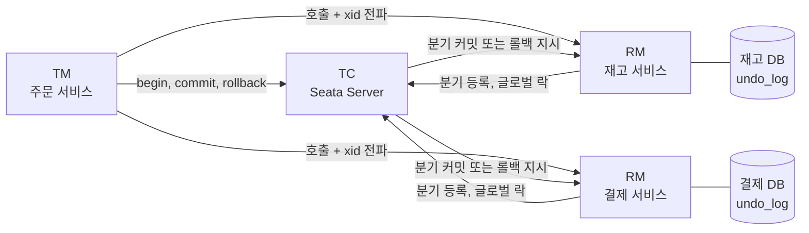
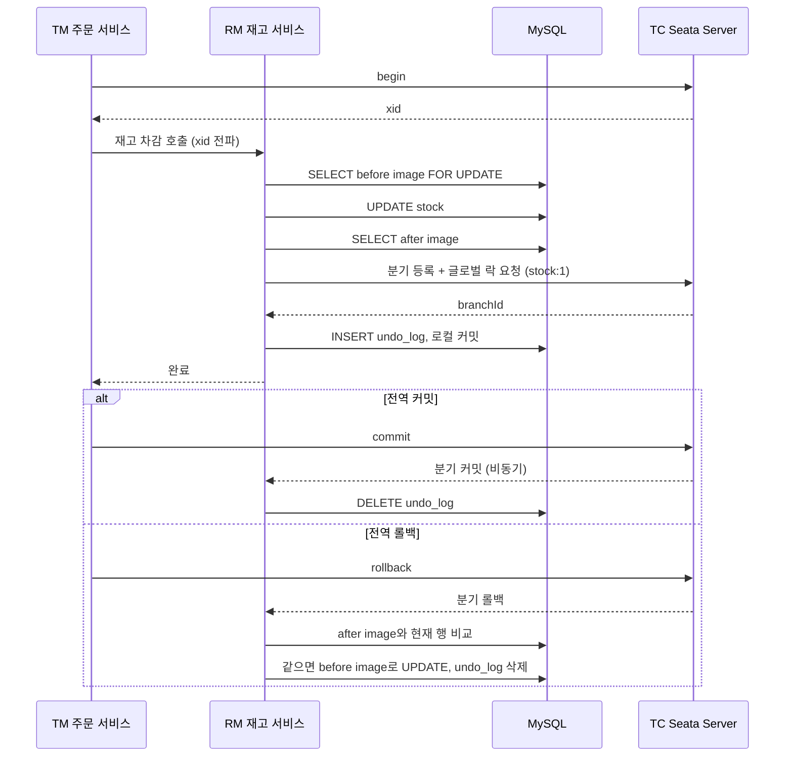
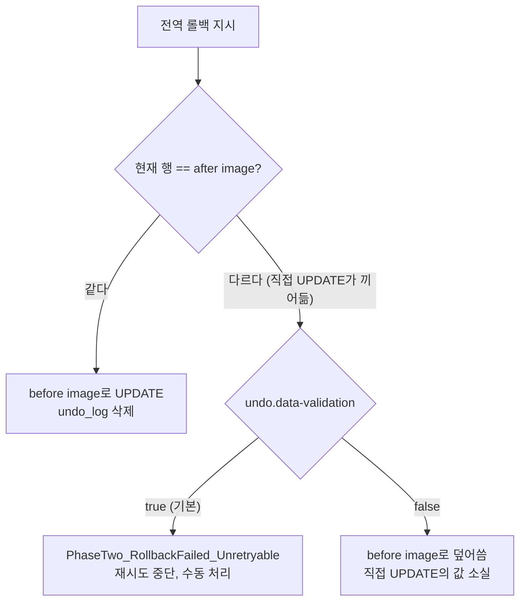
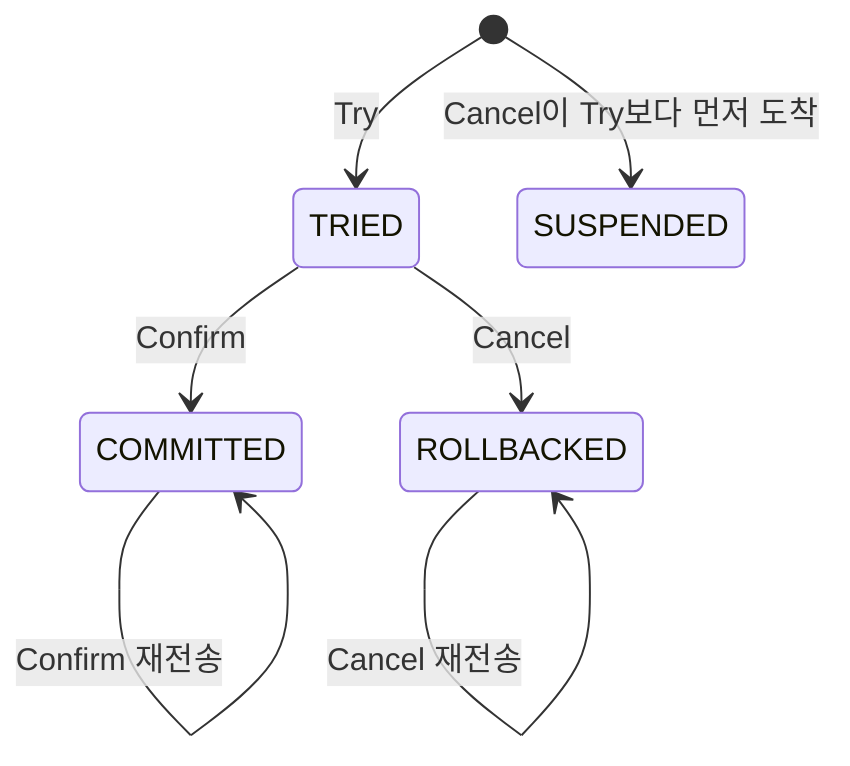
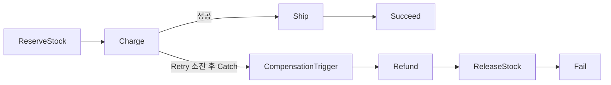

# Seata AT와 TCC 모드

[분산 트랜잭션](../../DataBase/RDBMS/Distributed_Transaction.md)에서 TCC는 Try·Confirm·Cancel과 예약 테이블을 직접 짜는 방식으로 다뤘다. 이 문서는 그 세 메서드와 방어 로직을 프레임워크가 어디까지 대신하는지, 대신하지 못하는 곳이 어디인지를 본다. Saga 일반론은 [Saga 패턴 및 분산 트랜잭션](Saga_패턴_및_분산_트랜잭션.md)에 있다.

아래 로그와 수치는 전부 직접 돌려서 얻었다. 환경은 Seata Server 2.2.0(Docker, file 저장소), 클라이언트 `seata-spring-boot-starter` 2.2.0, Spring Boot 2.7.18, JDK 17, MySQL 8.0.46이다. Temporal은 SDK 1.40.0의 인프로세스 테스트 서버로 돌렸다. 2.x는 groupId가 `org.apache.seata`이고, `io.seata` 쪽 메타데이터의 최신은 2.0.0이다. 좌표를 `io.seata`로 두면 2.2.0을 못 찾는다.

## TC, TM, RM

TC는 Seata Server다. 전역 트랜잭션과 분기의 상태, 글로벌 락을 들고 있다. TM은 `begin`·`commit`·`rollback`을 요청하는 쪽이고, RM은 DB나 TCC 리소스 앞에 서서 분기를 등록하고 2단계 지시를 실행한다. 한 서비스가 TM과 RM을 겸하는 경우가 많다. 아래 실험은 앱 하나, DB 하나라 TM과 RM이 같은 JVM이다.



도식에서 TC가 요청 경로에 직접 들어온다는 점을 봐야 한다. 호출마다 `begin`, 분기 등록, 종료 요청이 TC를 거친다.

## AT 모드의 두 단계

`DataSourceProxy`가 SQL을 가로채 UPDATE 전후의 행을 읽는다. 둘을 before/after image로 `undo_log`에 넣고, 업무 SQL과 같은 로컬 트랜잭션에서 커밋한다. 1단계가 끝나면 변경은 이미 DB에 반영된 상태다.



MySQL general log로 UPDATE 한 번에 나가는 문장을 뽑았다. 첫 호출에는 테이블 메타데이터 조회가 더 붙는데 뺐다.

```text
SET autocommit=0
SELECT id, qty FROM stock WHERE id = 1 FOR UPDATE
update stock set qty = qty - 1 where id = 1
SELECT id, qty FROM stock WHERE (id) in ( (1) )
INSERT INTO undo_log (branch_id, xid, context, rollback_info, log_status, ...) VALUES (...)
commit
SET autocommit=1
DELETE FROM undo_log WHERE branch_id IN (...) AND xid IN (...)     -- 2단계, 비동기
DELETE FROM undo_log WHERE context IN ('branchId=...') AND xid IN (...)
```

1단계 직후 `undo_log`에는 행이 1건 있었고, 전역 커밋 2초 뒤에는 0건이었다. `rollback_info`를 줄여 보면 이미지에는 PK와 바뀐 컬럼만 들어 있다. `stock.product`는 없다.

```text
branch_id=6134743356385480707  log_status=0
context=serializer=jackson&compressorType=NONE&map=67108864
rollback_info = {"sqlType":"UPDATE","tableName":"stock",
  "beforeImage": [{"id":1}, {"qty":10}],
  "afterImage":  [{"id":1}, {"qty":9}]}        <- 원문 JSON을 이 모양으로 줄였다
```

전역 롤백에서는 `qty`가 10으로 돌아왔고 `undo_log`도 비었다.

### 글로벌 락이 막아 주는 것

1단계 로컬 커밋이 끝나면 MySQL 행 락은 풀린다. 그 뒤에 같은 행을 쓰려는 다른 전역 트랜잭션은 로컬 UPDATE까지는 가고, 분기 등록 단계에서 글로벌 락에 막힌다. 두 번째 트랜잭션은 2.2초쯤 뒤 `get global lock fail, ... lockKeys:stock:1`로 실패했고 `qty`는 9 그대로였다. 롤백될지 모르는 값 위에 다른 트랜잭션이 덮어쓰는 dirty write를 이렇게 막는다.

전역 트랜잭션 밖에서 프록시 데이터소스로 쓰는 경로는 `@GlobalLock`(실험에서는 `GlobalLockTemplate`)을 붙여야 같은 검사를 받는다. 붙인 경로의 UPDATE는 2.0초 뒤 `get lock failed, lockKey: stock:1`로 막혔다.

### Seata 밖에서 UPDATE 하면

글로벌 락은 Seata를 거치는 쓰기만 검사한다. 배치 스크립트, 수동 UPDATE, 프록시를 안 쓰는 다른 서비스가 같은 행을 쓰면 락을 보지 않는다. 1단계 후 `qty=9`인 행에 직접 `qty=100`을 쓰고 전역 롤백을 보냈다.



| 설정 | `rollback()` 호출 | 최종 qty | undo_log |
|---|---|---|---|
| 기본(검증 켬) | 예외 없이 반환 | 100 | 1건 남음 |
| `seata.client.undo.data-validation=false` | 예외 없이 반환 | 10 | 0건 |

검증을 켜 둔 쪽의 RM 로그는 `Branch session rollback failed because of dirty undo log, please delete the relevant undolog after manually calibrating the data`였다. TC는 `RollbackFailed`로 두고 재시도를 멈췄다. 호출한 쪽은 예외를 못 받는다. 값을 after image(9)로 되돌려도 4초 뒤에 `undo_log`가 그대로 남았다.

이 실패한 세션이 글로벌 락을 놓지 않는다는 점도 겪었다. 같은 TC에 `stock:1`을 쓰는 다음 전역 트랜잭션이 전부 `get global lock fail`로 떨어져서, TC를 새로 띄워야 풀렸다. 검증을 끄면 에러는 사라지지만 100과 10 중 어느 쪽이 맞는지는 Seata가 모른다.

## TCC 모드와 fence 테이블

AT가 안 맞는 자원(외부 API, Redis, JDBC가 아닌 것)이나 락을 오래 잡아야 하는 업무에 TCC를 쓴다. Seata는 `@LocalTCC`와 `@TwoPhaseBusinessAction`으로 Try·Confirm·Cancel을 등록하고, `useTCCFence = true`를 켜면 빈 롤백·서스펜션·멱등을 `tcc_fence_log` 한 테이블로 처리한다. PK는 `(xid, branch_id)`다.

```java
@LocalTCC
public interface StockTcc {
    @TwoPhaseBusinessAction(name = "stockTcc", commitMethod = "confirm",
            rollbackMethod = "cancel", useTCCFence = true)
    boolean tryReserve(@BusinessActionContextParameter("productId") long productId,
                       @BusinessActionContextParameter("qty") int qty);
    boolean confirm(BusinessActionContext ctx);
    boolean cancel(BusinessActionContext ctx);
}

@Service
public class StockTccImpl implements StockTcc {
    public boolean tryReserve(@BusinessActionContextParameter("productId") long productId,
                              @BusinessActionContextParameter("qty") int qty) {
        if (qty < 0) throw new IllegalArgumentException("qty < 0");
        int n = jdbc.update("update tcc_stock set available = available - ?, reserved = reserved + ? "
                + "where id = ? and available >= ?", qty, qty, productId, qty);
        if (n == 0) throw new IllegalStateException("재고 부족");
        return true;
    }

    public boolean confirm(BusinessActionContext ctx) {
        jdbc.update("update tcc_stock set reserved = reserved - ? where id = ?",
                ctx.getActionContext("qty", Integer.class), ctx.getActionContext("productId", Long.class));
        return true;
    }

    public boolean cancel(BusinessActionContext ctx) {
        jdbc.update("update tcc_stock set available = available + ?, reserved = reserved - ? where id = ?",
                ctx.getActionContext("qty", Integer.class), ctx.getActionContext("qty", Integer.class),
                ctx.getActionContext("productId", Long.class));
        return true;
    }
}
```

### 세 가지 방어

fence 상태는 1 TRIED, 2 COMMITTED, 3 ROLLBACKED, 4 SUSPENDED다. Try가 업무 UPDATE와 같은 로컬 트랜잭션에서 행을 넣고, Confirm과 Cancel은 상태를 보고 업무 메서드를 호출할지 정한다.



도식의 `[*] --> SUSPENDED`가 빈 롤백이면서 서스펜션 방어를 겸한다. 호출 순서를 `SpringFenceHandler`에 직접 넣어 확인한 결과다(재고 10, 수량 3).

| 호출 순서 | 반환 | fence 상태 | 업무 메서드 실행 |
|---|---|---|---|
| Cancel, 늦은 Try | true, Try는 예외 | 4 | 둘 다 안 돌고 재고 10/0 유지 |
| Try, Confirm, Confirm | true, true | 2 | try, confirm 한 번씩 |
| Try, Cancel, Cancel | true, true | 3 | try, cancel 한 번씩 |
| Confirm 뒤 Cancel | false | 2 유지 | 없음 |
| Cancel 뒤 Confirm | false | 3 유지 | 없음 |

Cancel이 먼저 오면 빈 롤백이 성공으로 끝나면서 `status=4` 행을 남긴다. 늦게 온 Try는 `Insert tcc fence record duplicate key exception`으로 막혔다. 이 행이 없으면 [앞 문서](../../DataBase/RDBMS/Distributed_Transaction.md)의 유령 예약이 생긴다.

전역 트랜잭션으로 end-to-end도 돌렸다. 커밋은 fence 1에서 2로, 롤백은 1에서 3으로 가고 재고도 7/0, 10/0으로 맞았다. Try가 예외로 실패한 뒤 롤백하면 Try의 로컬 트랜잭션이 롤백되어 fence 행이 없다가, Cancel이 `status=4` 행을 만들고 업무 `cancel`은 호출되지 않았다.

### 구현하면서 막힌 곳

`@Bean` 메서드로 등록한 TCC 빈에는 프록시가 안 걸렸다. 2.2.0의 `GlobalTransactionScanner`는 시작할 때 빈 정의의 클래스명으로 대상을 고르는데, 팩토리 메서드 빈은 클래스명이 비어 있어 건너뛴다. 로그는 `The needed enhancement business beans are : []`였다. 에러가 없고 Try는 AT 분기(`lockKeys:tcc_stock:1`)로 등록되어, 롤백도 TCC 대신 undo_log로 돌아갔다. `@Service`로 바꾸자 `StockTccImpl$$EnhancerBySpringCGLIB`로 잡혔다.

`@BusinessActionContextParameter`를 인터페이스 파라미터에만 붙였더니 컨텍스트에 `productId`와 `qty`가 없었다. Confirm에서 NPE가 났고 TC가 이를 1.5초 안에 세 번 재호출했다. 구현 클래스의 파라미터에도 붙이니 해결됐다. 이 구성(CGLIB 프록시, 2.2.0)에서 본 동작이다.

재시도 대기 세션이 TC에 남은 채로 앱을 올리면 시작 직후 `fenceHandler is null, need to set a fenceHandler implement`가 한두 번 찍혔다. fence 핸들러가 붙기 전에 TC의 재시도가 먼저 도착한 경우다. fence 로그는 지워지지 않고 쌓이는데, 소스상 정리 작업의 기본 주기가 1일이다(`CommonFenceConfig.cleanPeriod`, 실행으로 확인하지는 않았다).

## Seata Saga와 Temporal

둘 다 같은 시나리오(재고 예약, 결제, 배송, 결제 실패 시 환불과 재고 복구)로 돌렸다. Seata Saga는 JSON 상태 머신을 앱 안의 엔진이 실행하고 상태를 `seata_state_machine_inst`, `seata_state_inst` 같은 테이블에 쓴다. Temporal은 워크플로를 코드로 쓰고 서버가 이력을 들고 있다.



```json
"Charge": {
  "Type": "ServiceTask", "ServiceName": "payService", "ServiceMethod": "charge",
  "CompensateState": "Refund", "Next": "Ship",
  "Retry": [{"Exceptions": ["java.lang.RuntimeException"],
             "IntervalSeconds": 1, "MaxAttempts": 3, "BackoffRate": 2}],
  "Catch": [{"Exceptions": ["java.lang.Throwable"], "Next": "CompensationTrigger"}]
}
```

결제가 계속 실패하는 경우 호출 순서는 `reserve, charge#1..#4, refund, release`였다. `MaxAttempts: 3`인데 `charge`는 4번 불렸다. 처음 1번에 재시도 3번이고 간격은 1, 2, 4초라 7.5초가 걸렸다. 최종 상태는 `status=UN, compensation=SU`다. 실패한 `Charge`도 보상 대상이라 `refund`가 호출됐다.

Temporal은 `maximumAttempts(4)`가 총 시도 횟수여서 `charge`가 4번 불렸다. 같은 숫자를 옮기면 한 번씩 어긋난다.

```java
Saga saga = new Saga(new Saga.Options.Builder().setParallelCompensation(false).build());
try {
    steps.reserveStock(orderId);
    saga.addCompensation(steps::releaseStock, orderId);
    saga.addCompensation(steps::refund, orderId);   // charge 호출보다 앞에 등록
    steps.charge(orderId);
    steps.ship(orderId);
    return "DONE";
} catch (ActivityFailure e) {
    saga.compensate();
    return "COMPENSATED";
}
```

`addCompensation(refund)`를 `charge` 뒤에 두면 `charge`가 실패했을 때 호출 순서가 `reserveStock, charge, releaseStock`으로 끝나 환불이 빠진다. 앞에 두면 `charge, refund, releaseStock` 순이다. 응답이 유실되어 결제가 실제로는 된 경우를 생각하면 앞에 두는 쪽이 맞고, 그러면 `refund`는 결제가 없던 건도 성공으로 처리해야 한다. TCC의 빈 롤백과 같은 문제다. 카드 한도 초과처럼 non-retryable로 던진 실패는 재시도 없이 바로 보상으로 갔다.

| | Seata Saga | Temporal |
|---|---|---|
| 정의 | JSON 상태 머신 | 워크플로 코드 |
| 재시도 횟수의 의미 | 첫 호출 이후의 재시도 수 | 총 시도 수 |
| 보상 대상 | `CompensateState`가 있는 상태 | `addCompensation`을 등록한 단계 |
| 실행 위치 | 앱 JVM 안의 엔진 | 워커 + Temporal 서버 |

Temporal은 time skipping이 있는 테스트 서버로만 돌렸고, 워커 재시작 뒤 이력 재생과 Seata Saga의 엔진 재시작 뒤 `forward`·`compensate` 복구는 확인하지 못했다.

## Seata Server 운영

저장소는 `store.mode`로 file, db, redis, raft 중에서 고른다. file은 세션을 `sessionStore` 디렉터리에 쓰는 단일 노드용이다. `docker restart`로 TC를 재시작했더니 1단계가 끝난 채 대기하던 전역 트랜잭션이 남아 있었고 이후 롤백도 성공했다. 컨테이너를 지우고 다시 만들면(볼륨이 없을 때) 세션이 사라졌다. 재시도 대기 중이던 세션이 이렇게 없어지는 것을 여러 번 봤다.

db 모드는 `global_table`, `branch_table`, `lock_table`, `distributed_lock`, `vgroup_table`이 필요하다. 이미지의 `libs`에는 HikariCP, Druid, Jedis만 있고 MySQL 드라이버가 없어서 jar를 마운트해야 떴다. 진행 중에는 `global_table`에 `status=1`(Begin) 행이 보였다. redis는 Jedis가 들어 있고 raft는 `application.raft.example.yml`에 `group`, `server-addr`, `election-timeout-ms`, `sync` 설정이 있다. 이 둘과 TC 여러 대를 띄운 HA 전환은 돌려보지 못했다.

재시도 관련 서버 설정은 `recovery.*-retry-period`가 1000ms, `max-commit-retry-timeout`과 `max-rollback-retry-timeout`이 -1, `rollback-retry-timeout-unlock-enable`이 false가 예제의 기본값이다. 이 값을 바꿔 보지는 않았다. 관찰한 동작은 이렇다.

- 일시적 실패는 TC가 1초 주기로 재시도해 결국 롤백을 끝냈다.
- dirty undo log는 재시도가 아니라 `Unretryable`로 멈춘다.
- TM이 죽으면 타임아웃 뒤 TC가 롤백한다. 타임아웃 15초로 `begin`하고 1단계 후 JVM을 강제 종료했더니 `qty`가 9에서 10으로 복구됐다.

## 도입하지 않는 편이 나은 경우

이벤트로 이미 충분한 흐름에는 넣지 않는다. 결과적 일관성이 허용되면 [Outbox](트랜잭셔널_아웃박스_패턴.md)와 멱등 컨슈머로 끝나고, 요청 경로에 TC 왕복(`begin`, 분기 등록, 종료)이 들어오지 않는다.

`undo_log`는 쓰기마다 비용이 붙는다. 위 SQL 로그대로 UPDATE 하나가 `SELECT ... FOR UPDATE`, after image `SELECT`, `undo_log` INSERT, 2단계 DELETE 두 번을 달고 다닌다. 지연 시간을 재지는 않았다. 쓰기가 많은 테이블이면 이 증폭을 먼저 따져 본다.

한 행에 쓰기가 몰리면 글로벌 락 대기가 길다. 재고 한 행을 동시에 건드린 두 번째 트랜잭션은 2초 넘게 기다리다 실패했다. 인기 상품 재고 같은 핫로우에는 맞지 않는다.

Seata 밖에서도 쓰는 테이블에는 AT를 쓰지 않는다. 앞의 dirty 실험처럼 롤백이 멈추고 글로벌 락이 남는다. 그런 자원은 TCC로 예약 컬럼을 두거나, 쓰기 경로를 서비스 하나로 모은 뒤에 AT를 검토한다.
