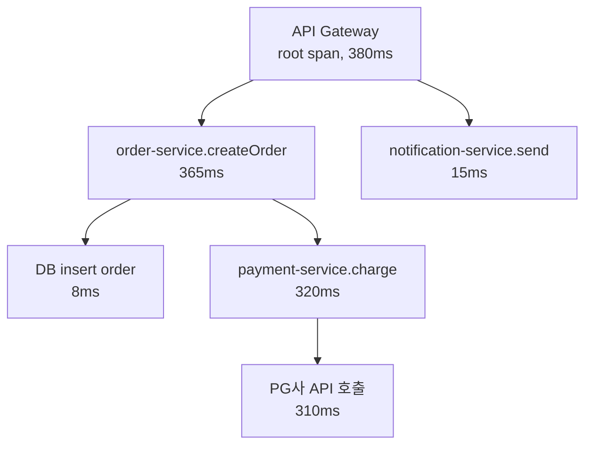
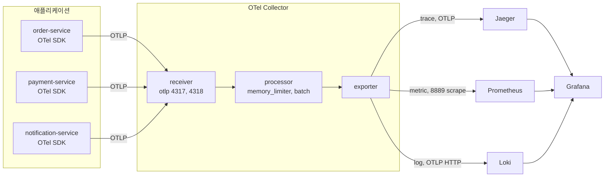
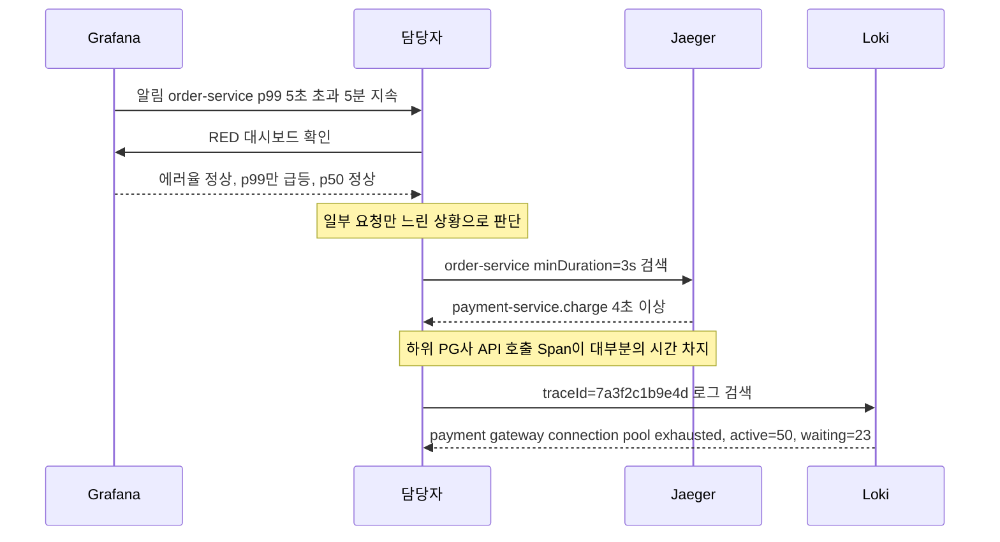
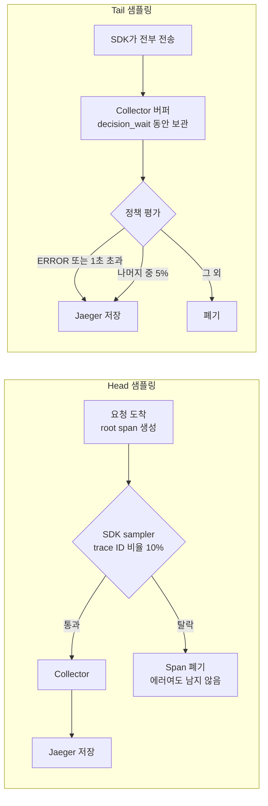

# 분산 추적 및 Observability

## 로그만으로 장애를 따라가기 어려운 이유

API 요청 하나가 5~10개 서비스를 거치는 일은 흔하다. 로그만 있으면 서비스마다 로그를 열어 시간대를 맞추고 호출 순서를 머릿속에서 다시 그려야 한다. 서비스가 3개만 넘어가도 장애 중에 할 일이 아니다.

Observability는 로그, 메트릭, 트레이스 세 신호를 함께 보고 시스템 내부 상태를 짐작하는 일이다. 신호마다 답할 수 있는 질문이 다르다.

| 신호 | 답하는 질문 | 예시 |
|------|------|------|
| 메트릭 | 지금 이상한가, 얼마나 | 요청 수, 에러율, 응답 시간 p99 |
| 트레이스 | 어느 구간이 느린가 | order-service -> payment-service -> notification-service |
| 로그 | 그 구간에서 무슨 일이 있었나 | `payment timeout, orderId=ORD-123` |


---

## Trace와 Span

Trace는 요청 하나가 시스템을 통과한 전체 경로다. 고유한 trace ID가 붙고, HTTP 헤더나 메시지 큐 메타데이터에 실려 다음 서비스로 넘어간다. Span은 Trace 안에서 각 서비스가 맡은 작업 단위다.

아래 flowchart는 주문 요청 하나의 Span 부모-자식 관계다. 화살표는 부모에서 자식으로 향한다. payment-service.charge의 320ms 중 310ms가 PG사 호출이라는 점이 트리에서 바로 읽힌다.



| Span 필드 | 용도 |
|------|------|
| trace_id | 같은 요청의 Span을 묶는 키. 로그에도 같이 찍는다 |
| span_id / parent_span_id | 트리 구조를 만드는 키. 헤더로 부모 span ID가 안 넘어오면 트리가 쪼개진다 |
| 시작·종료 시간 | 소요 시간 계산 |
| status | OK, ERROR. 예외는 `recordException`으로 이벤트에 남긴다 |
| attributes | 검색과 분석용 key-value |

---

## OpenTelemetry

예전에는 Jaeger용 SDK, Zipkin용 SDK, Prometheus 클라이언트를 따로 붙였고, 백엔드를 바꾸면 계측 코드를 전부 고쳐야 했다. OpenTelemetry(OTel)는 계측과 백엔드를 분리해서 한 번 계측한 데이터를 설정만 바꿔 Jaeger, Zipkin, Datadog 어디로든 보낸다.

| 구성 요소 | 역할 |
|------|------|
| SDK | 애플리케이션에 들어가는 라이브러리. Trace, Metric, Log를 만든다 |
| Exporter | 만든 데이터를 OTLP, Jaeger, Zipkin, Prometheus 포맷으로 내보낸다 |
| Collector | 앱과 백엔드 사이의 중간 프록시. 받아서 가공하고 나눠 보낸다. 운영에서는 거의 항상 둔다 |

서비스는 Collector로만 OTLP를 보내고, 신호별 목적지는 Collector가 정한다. Grafana는 세 백엔드를 모두 데이터 소스로 읽는다.



### Spring Boot 적용

Spring Boot 3.x에서는 자동 계측만으로 코드 수정 없이 트레이스가 만들어진다.

```groovy
implementation 'io.opentelemetry.instrumentation:opentelemetry-spring-boot-starter:2.11.0'
```

```yaml
otel:
  service:
    name: order-service
  exporter:
    otlp:
      endpoint: http://otel-collector:4317
  traces:
    exporter: otlp
  metrics:
    exporter: otlp
  logs:
    exporter: otlp
```

HTTP 요청, JDBC 쿼리, RestTemplate/WebClient 호출 Span이 자동으로 생긴다. 자동 계측은 프레임워크 경계만 잡기 때문에 비즈니스 로직 안의 구간을 보고 싶으면 수동 Span을 추가한다.

```java
@Service
public class OrderService {

    private final Tracer tracer;

    public OrderService(Tracer tracer) {
        this.tracer = tracer;
    }

    public Order createOrder(OrderRequest request) {
        Span span = tracer.spanBuilder("validate-stock")
            .setAttribute("orderId", request.getOrderId())
            .startSpan();

        try (Scope scope = span.makeCurrent()) {
            stockService.validate(request.getItems());
        } catch (Exception e) {
            span.setStatus(StatusCode.ERROR, e.getMessage());
            span.recordException(e);
            throw e;
        } finally {
            span.end();
        }

        // 이후 로직...
    }
}
```

`span.makeCurrent()`를 빠뜨리면 하위 호출에서 생기는 Span이 이 Span의 child로 잡히지 않고 형제로 붙는다. 코드는 정상 동작하니 트리를 열어 보기 전에는 모른다.

### Node.js 적용

```javascript
const { NodeSDK } = require('@opentelemetry/sdk-node');
const { OTLPTraceExporter } = require('@opentelemetry/exporter-trace-otlp-grpc');
const { getNodeAutoInstrumentations } = require('@opentelemetry/auto-instrumentations-node');

const sdk = new NodeSDK({
  serviceName: 'payment-service',
  traceExporter: new OTLPTraceExporter({
    url: 'http://otel-collector:4317',
  }),
  instrumentations: [getNodeAutoInstrumentations()],
});

sdk.start();
```

이 코드는 진입점 최상단에 둔다. http, express 같은 모듈이 먼저 로드되면 패치가 걸리지 않아 Span이 생기지 않는다.

---

## Collector 설정

Collector를 두면 앱이 백엔드 장애에 직접 영향받지 않고, 샘플링·필터링·배치를 한곳에서 처리하며, 백엔드를 바꿀 때 앱 재배포가 필요 없다.

```yaml
receivers:
  otlp:
    protocols:
      grpc:
        endpoint: 0.0.0.0:4317
      http:
        endpoint: 0.0.0.0:4318

processors:
  batch:
    timeout: 5s
    send_batch_size: 1024
  memory_limiter:
    check_interval: 1s
    limit_mib: 512
    spike_limit_mib: 128

exporters:
  otlp/jaeger:
    endpoint: jaeger:4317
    tls:
      insecure: true
  prometheus:
    endpoint: 0.0.0.0:8889
    enable_open_metrics: true
  otlphttp/loki:
    endpoint: http://loki:3100/otlp

service:
  pipelines:
    traces:
      receivers: [otlp]
      processors: [memory_limiter, batch]
      exporters: [otlp/jaeger]
    metrics:
      receivers: [otlp]
      processors: [memory_limiter, batch]
      exporters: [prometheus]
    logs:
      receivers: [otlp]
      processors: [memory_limiter, batch]
      exporters: [otlphttp/loki]
```

`memory_limiter`는 빼지 않는다. 트래픽이 몰리면 Collector가 OOM으로 죽는다. processors 배열에서 `batch`보다 앞에 둬야 한도를 넘었을 때 배치에 쌓기 전에 데이터를 먼저 버린다. `enable_open_metrics`는 뒤의 exemplar 때문에 켠다.

로컬 확인용 Docker Compose다. `latest`는 설정 키가 바뀌어 기동이 실패하는 경우가 있으니 실제로는 버전을 고정한다.

```yaml
services:
  otel-collector:
    image: otel/opentelemetry-collector-contrib:latest
    command: ["--config=/etc/otel-collector-config.yaml"]
    volumes:
      - ./otel-collector-config.yaml:/etc/otel-collector-config.yaml
    ports:
      - "4317:4317"   # gRPC
      - "4318:4318"   # HTTP
      - "8889:8889"   # Prometheus scrape

  jaeger:
    image: jaegertracing/all-in-one:latest
    ports:
      - "16686:16686"  # UI
      - "4317"         # OTLP gRPC

  prometheus:
    image: prom/prometheus:latest
    command: ["--config.file=/etc/prometheus/prometheus.yml", "--enable-feature=exemplar-storage"]
    volumes:
      - ./prometheus.yml:/etc/prometheus/prometheus.yml
    ports:
      - "9090:9090"

  loki:
    image: grafana/loki:latest
    ports:
      - "3100:3100"

  grafana:
    image: grafana/grafana:latest
    ports:
      - "3000:3000"
    environment:
      - GF_SECURITY_ADMIN_PASSWORD=admin
```

---

## Jaeger

Jaeger와 Zipkin은 둘 다 트레이스 백엔드이고 OTel에서 데이터를 받는다. 나중에 바꾸는 것도 가능하다.

| 항목 | Jaeger | Zipkin |
|------|------|------|
| 상태 | CNCF 졸업 프로젝트 | 독립 프로젝트 |
| 스토리지 | Cassandra, Elasticsearch | Elasticsearch, Cassandra, MySQL |
| 성격 | 컴포넌트 분리 배포 가능, 대규모 | 단일 바이너리, 설정이 단순 |

Jaeger UI(`http://localhost:16686`)에서 쓰는 기능은 아래 세 가지다.

| 기능 | 용도 |
|------|------|
| 트레이스 검색 | 서비스, 시간 범위, 최소 소요 시간으로 느린 요청만 추림 |
| Span 트리 | 바 차트로 병목 구간 확인 |
| 의존성 그래프 | 실제 호출 관계 확인. 문서의 아키텍처와 다른 곳을 찾을 때 쓴다 |

스토리지 선택, v1/v2 차이, ES 인덱스 운영은 [Jaeger 구성과 저장소 운영](../../DevOps/Monitoring/Jaeger.md)에서 다룬다.

### 에러 로그의 trace ID로 요청 찾기

장애 때 가장 자주 하는 작업이다. 에러 로그에서 trace ID를 복사해 Jaeger 검색창에 넣으면 그 요청의 호출 체인이 열린다.

```
2026-04-01 11:23:45 ERROR [order-service] payment failed, traceId=7a3f2c1b9e4d
```

로그에 trace ID가 찍혀 있어야 가능하다. OTel Spring Boot 계측은 MDC에 `trace_id`, `span_id`를 넣어 주므로 패턴에서 꺼내 쓰면 된다.

```xml
<pattern>
  %d{yyyy-MM-dd HH:mm:ss} %-5level [%thread] [%X{trace_id}] %logger{36} - %msg%n
</pattern>
```

이 설정은 초기 세팅 때 넣는다. 운영 중에 추가하면 그 이전 로그에는 trace ID가 없어서 과거 장애는 끝내 연결되지 않는다.

---

## Prometheus와 Grafana

Prometheus는 pull 방식이다. 서비스가 `/metrics` 엔드포인트를 열면 Prometheus가 주기적으로 가져간다.

```yaml
global:
  scrape_interval: 15s

scrape_configs:
  - job_name: 'otel-collector'
    static_configs:
      - targets: ['otel-collector:8889']

  - job_name: 'order-service'
    metrics_path: '/actuator/prometheus'
    static_configs:
      - targets: ['order-service:8080']

  - job_name: 'payment-service'
    metrics_path: '/actuator/prometheus'
    static_configs:
      - targets: ['payment-service:8080']
```

Kubernetes처럼 서비스가 계속 늘고 줄면 `static_configs` 대신 서비스 디스커버리를 쓴다.

```yaml
scrape_configs:
  - job_name: 'kubernetes-pods'
    kubernetes_sd_configs:
      - role: pod
    relabel_configs:
      - source_labels: [__meta_kubernetes_pod_annotation_prometheus_io_scrape]
        action: keep
        regex: true
```

서비스마다 메트릭이 수백 개 나오지만 장애 때 보는 건 몇 개뿐이다. 요청 기준은 RED, 자원 기준은 USE로 나눈다.

| 방법 | 항목 | 내용 |
|------|------|------|
| RED | Rate | 초당 요청 수 |
| RED | Errors | 에러율 |
| RED | Duration | 응답 시간 p50, p95, p99 |
| USE | Utilization | CPU, 메모리 사용률 |
| USE | Saturation | 큐 대기, 스레드풀 포화도 |
| USE | Errors | 디스크 full, OOM 같은 시스템 에러 |

Grafana에 Prometheus를 데이터 소스로 연결하고 PromQL로 패널을 만든다.

에러율(5분 기준):

```promql
sum(rate(http_server_request_duration_seconds_count{http_response_status_code=~"5.."}[5m]))
/
sum(rate(http_server_request_duration_seconds_count[5m]))
```

서비스별 p99 응답 시간:

```promql
histogram_quantile(0.99,
  sum(rate(http_server_request_duration_seconds_bucket[5m])) by (le, service_name)
)
```

서비스별 초당 요청 수:

```promql
sum(rate(http_server_request_duration_seconds_count[5m])) by (service_name)
```

알림은 Grafana 알림 규칙이나 Alertmanager로 건다. 실무에서 가장 먼저 거는 세 가지는 아래와 같다.

| 조건 | 지속 시간 |
|------|------|
| 에러율 5% 초과 | 5분 |
| p99 응답 시간 3초 초과 | 5분 |
| 인스턴스 scrape 실패 | 1분 |

임계값을 처음부터 낮게 잡으면 알림 피로가 와서 정작 진짜 알림을 놓친다. 넉넉하게 시작해서 운영하며 줄인다.

---

## 세 신호를 trace ID로 연결

로그, 메트릭, 트레이스가 따로 있으면 가치가 반으로 줄어든다. 이어 주는 키가 trace ID다. 트레이스에 있고, 로그에 찍히고, 메트릭에는 exemplar로 붙는다.


exemplar는 메트릭 데이터 포인트에 붙은 trace ID 샘플이다. 점을 누르면 그 요청의 트레이스로 넘어간다. 아래 네 군데를 모두 맞춰야 동작한다.

| 위치 | 설정 |
|------|------|
| Collector prometheus exporter | `enable_open_metrics: true` |
| Prometheus 기동 옵션 | `--enable-feature=exemplar-storage` (버전에 따라 필요) |
| prometheus.yml | `storage.exemplars.max_exemplars` |
| Grafana Prometheus 데이터 소스 | Exemplars 항목에서 Jaeger 연결, 레이블명 `traceID` 매핑 |

```yaml
storage:
  exemplars:
    max_exemplars: 100000
```

하나라도 빠지면 점이 안 뜨는데 에러도 없다. Collector의 `:8889/metrics`에 `# {trace_id=...}` 꼴이 있는지부터 본다. Loki는 derived field로 로그의 trace ID에서 Jaeger로 넘어가게 걸 수 있다.

---

## 주문 API 응답 지연 사례

order-service p99가 5초를 넘긴 상황을 알림 수신부터 원인 로그까지 따라간다. 단계 사이에 넘기는 값은 시간대, 서비스 이름, trace ID다.



PG사 응답이 느려지면서 커넥션이 반환되지 않았고, 풀이 가득 차자 대기 요청이 쌓였다. 에러율이 정상이었던 이유는 요청이 실패하지 않고 대기만 했기 때문이다. 에러율 알림만 걸어 두었다면 이 장애는 사용자 문의로 알게 된다.

조치는 기간별로 나눈다.

| 기간 | 조치 |
|------|------|
| 단기 | payment-service 커넥션 풀 증설, PG 호출 timeout 단축 |
| 중기 | circuit breaker 도입 검토 |
| 장기 | PG사 장애 시 대체 경로 구현 |

---

## 샘플링

모든 요청을 추적하면 데이터가 감당이 안 된다. 샘플링은 어느 지점에서 버릴지 정하는 문제이고, 그 위치가 head와 tail의 차이다.

head는 요청이 들어오는 순간 SDK가 판단하고, tail은 요청이 끝난 뒤 Collector가 판단한다. 아래 도식에서 head는 탈락한 요청이 에러여도 이미 버려졌다는 점, tail은 SDK가 전부 내보내고 Collector가 버퍼링한다는 점을 비교해서 본다.



| 항목 | Head | Tail |
|------|------|------|
| 결정 시점 | 요청 시작 | 요청 완료 후 |
| 결정 위치 | SDK (Collector에서도 가능) | Collector |
| 에러·느린 요청 보존 | 보장 못 함 | 정책으로 보장 |
| 비용 | 낮다 | Collector 메모리 사용 |
| 제약 | 서비스 간 같은 비율 설정 필요 | 한 trace의 Span이 한 Collector에 모여야 함 |

head는 SDK 환경변수로 건다. `parentbased_*`를 쓰면 상위 서비스의 결정을 하위가 따라가서 trace가 중간에 끊기지 않는다.

```bash
OTEL_TRACES_SAMPLER=parentbased_traceidratio
OTEL_TRACES_SAMPLER_ARG=0.1
```

tail은 Collector 프로세서로 건다.

```yaml
processors:
  tail_sampling:
    decision_wait: 10s
    policies:
      - name: error-policy
        type: status_code
        status_code:
          status_codes: [ERROR]
      - name: latency-policy
        type: latency
        latency:
          threshold_ms: 1000
      - name: probabilistic-policy
        type: probabilistic
        probabilistic:
          sampling_percentage: 5
```

`decision_wait`가 짧으면 늦게 도착한 Span이 판단에서 빠지고, 길면 메모리가 부족해진다. 10~30초에서 시작한다. Collector를 2대 이상 두면 같은 trace의 Span이 다른 인스턴스로 갈라져 정책이 불완전한 trace를 보고 판단한다. 앞단 Collector에 `loadbalancing` exporter로 `routing_key: traceID`를 걸어 같은 trace를 같은 인스턴스로 보내는 2단 구성이 필요하다.

---

## 운영에서 걸리는 지점

### trace 끊김

| 상황 | 증상 | 대응 |
|------|------|------|
| Kafka, RabbitMQ 경유 | 소비자 쪽에서 새 trace 시작 | 메시지 헤더에 trace context를 명시적으로 주입 |
| 비동기 스레드풀 | 작업 Span이 root로 떨어짐 | Context Propagation API로 context 수동 전달 |
| 외부 서비스(PG사, 택배사) | 외부 내부 구간은 비어 있음 | 호출 Span만 기록. 내부 추적은 불가 |

끊기는 위치별 재현과 확인 방법은 [분산 추적 컨텍스트 전파](../../DevOps/Monitoring/Distributed_Trace_Context_Propagation.md)에 정리했다.

### 카디널리티

Span attribute에 주문 ID 같은 고유 값을 넣는 것은 문제가 아니다. 시계열이 폭발하는 곳은 그 값이 메트릭 레이블로 넘어가는 지점이다. span metrics의 dimensions나 Prometheus 레이블에 orderId를 넣으면 시계열 수가 요청 수만큼 늘어난다. Jaeger ES를 쓴다면 태그 인덱스 필드 수도 같이 본다. 메트릭 쪽 설정은 [Span Metrics와 Service Graph](../../DevOps/Monitoring/Span_Metrics_And_Service_Graph.md)에서 다룬다.

### Collector 장애

Collector는 2대 이상 띄우고 앞에 로드밸런서를 둔다. OTel SDK는 데이터를 비동기로 보내서 Collector가 죽어도 요청 처리는 멈추지 않는다. 대신 SDK 내부 버퍼가 차면 그 뒤의 트레이스는 유실된다.

### 비용

서비스 10개, 초당 1000 요청이면 Span이 하루에 수천만 건 쌓인다.

| 항목 | 기준 |
|------|------|
| 보존 기간 | 7~14일 |
| 정상 요청 | tail 샘플링으로 축소 |
| 관리형(Datadog, X-Ray) | Span 단위 과금이라 도입 전에 예상 Span 수 계산 |

---
이 문서는 [관측성 허브](../../_hub/관측성.md)의 일부입니다.
