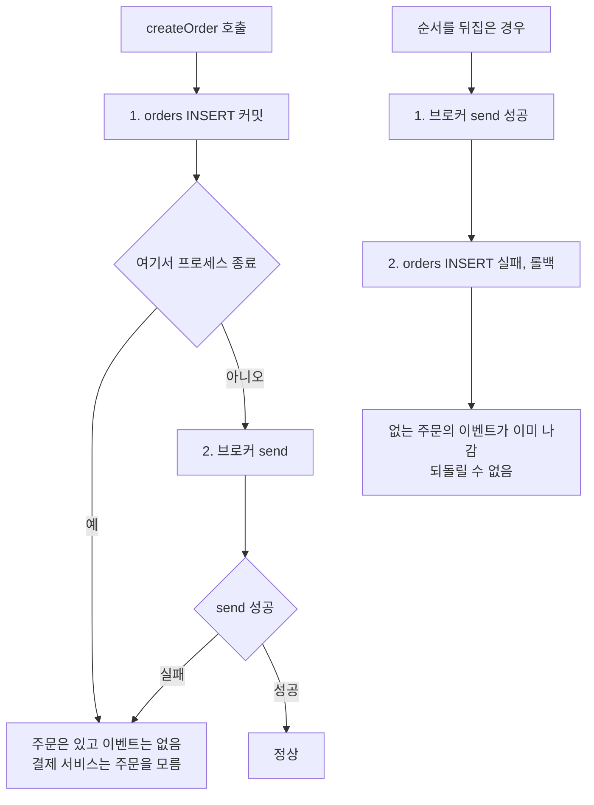
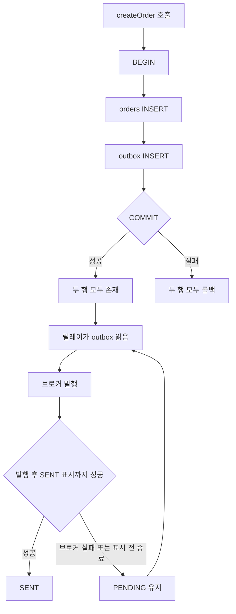
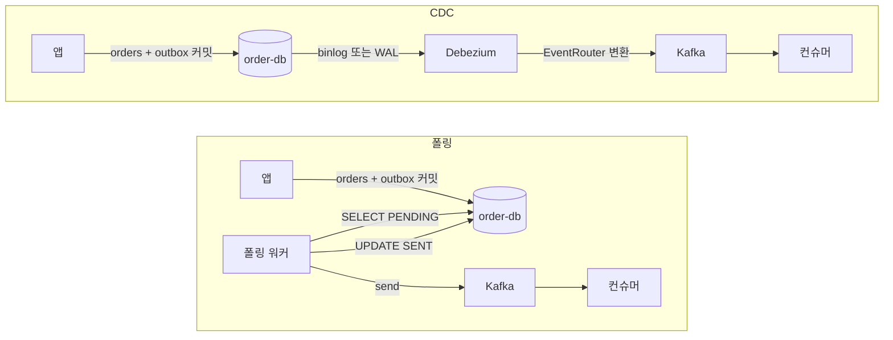
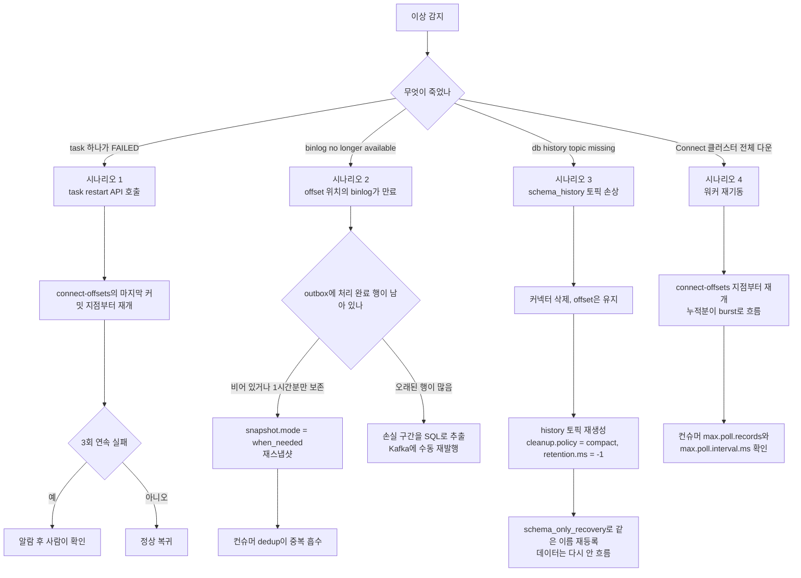
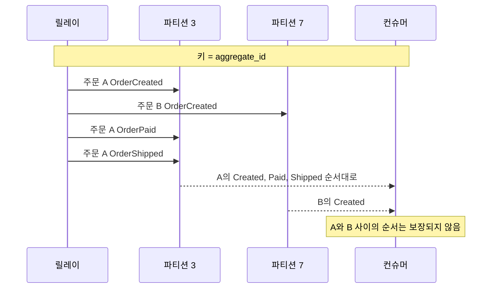
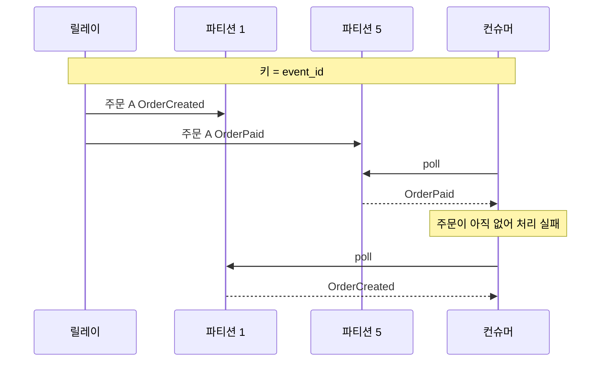
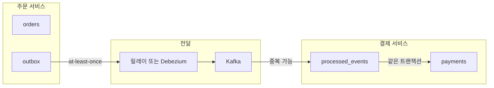
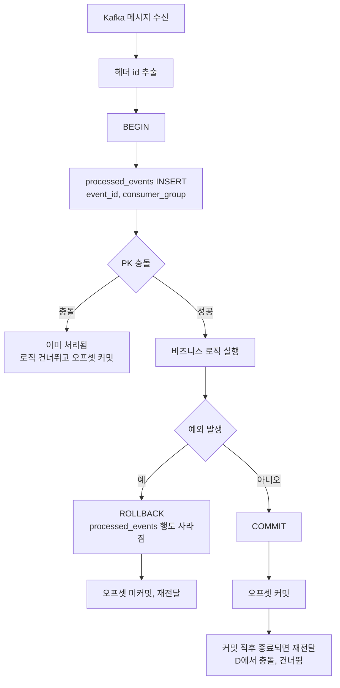
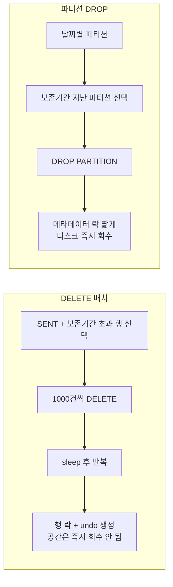
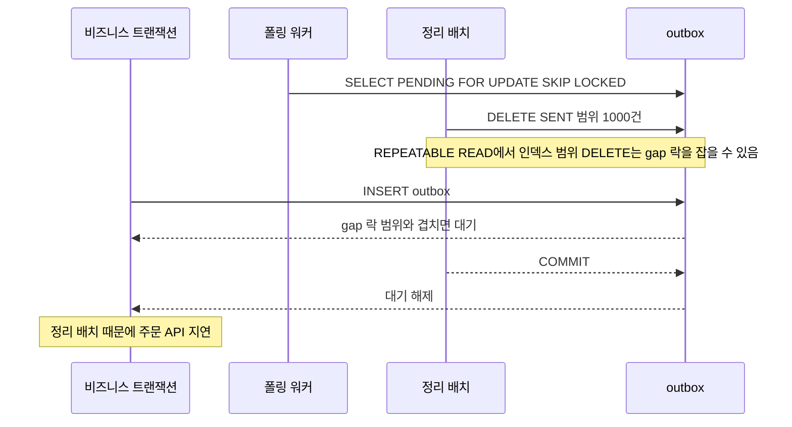

# Transactional Outbox 패턴

## 저장은 됐는데 메시지가 안 나간다

주문 서비스가 주문을 저장하고 결제 서비스에 이벤트를 보내는 흐름이다.

```java
@Transactional
public void createOrder(OrderRequest request) {
    orderRepository.save(order);          // 1. DB 저장
    messageQueue.send(orderCreatedEvent); // 2. 메시지 발행
}
```

DB 트랜잭션과 브로커는 다른 시스템이라 한 트랜잭션으로 묶이지 않는다. 순서를 어떻게 잡아도 한쪽이 샌다. 2PC는 브로커가 지원하지 않는 경우가 대부분이다.



위쪽은 저장 후 발행이라 이벤트가 유실되고, 아래쪽은 발행 후 저장이라 유령 이벤트가 생긴다.

## Outbox가 푸는 방식

이벤트를 브로커에 직접 보내지 않고 같은 DB의 outbox 테이블에 같이 INSERT한다. 비즈니스 데이터와 이벤트가 한 트랜잭션으로 커밋되니 둘은 같이 남거나 같이 사라진다. 브로커 발행은 별도 프로세스(릴레이)가 맡는다.



릴레이가 죽어도 outbox 행이 남아 이벤트는 유실되지 않는다. 대신 L에서 H로 돌아가는 경로 때문에 같은 이벤트가 두 번 나갈 수 있다. 중복은 소비자가 막는다(Inbox 절).

### Outbox 테이블 설계

```sql
CREATE TABLE outbox (
    id             BIGINT AUTO_INCREMENT PRIMARY KEY,
    event_id       CHAR(36) NOT NULL UNIQUE,    -- UUID, 소비자 dedup 키
    aggregate_type VARCHAR(255) NOT NULL,       -- 'Order', 'Payment'
    aggregate_id   VARCHAR(255) NOT NULL,       -- 주문 ID 등, 파티션 키로 쓴다
    event_type     VARCHAR(255) NOT NULL,       -- 'OrderCreated'
    payload        TEXT NOT NULL,               -- JSON
    created_at     TIMESTAMP(6) NOT NULL DEFAULT CURRENT_TIMESTAMP(6),
    sent_at        TIMESTAMP NULL,
    status         VARCHAR(20) NOT NULL DEFAULT 'PENDING'  -- PENDING, SENT, FAILED
);

CREATE INDEX idx_outbox_status ON outbox(status, created_at);
```

| 컬럼 | 쓰임 |
|------|------|
| `event_id` | 중복 발행돼도 값이 같다. 소비자 dedup 키 |
| `aggregate_type`, `aggregate_id` | "이 주문에서 어떤 이벤트가 나갔나" 추적. 토픽 라우팅과 파티션 키 |
| `created_at` | 마이크로초(`TIMESTAMP(6)`)로 잡는다. 같은 초에 수십 건이 들어오면 초 단위 정렬은 순서가 흔들린다 |

### 애플리케이션 코드

```java
@Transactional
public void createOrder(OrderRequest request) {
    Order order = Order.create(request);
    orderRepository.save(order);

    OutboxEvent event = OutboxEvent.builder()
        .eventId(UUID.randomUUID().toString())
        .aggregateType("Order")
        .aggregateId(order.getId().toString())
        .eventType("OrderCreated")
        .payload(objectMapper.writeValueAsString(new OrderCreatedEvent(order)))
        .build();
    outboxRepository.save(event);
}
```

## 릴레이 방식 폴링과 CDC

outbox에 쌓인 행을 브로커로 옮기는 방법은 두 가지다. 데이터가 지나가는 경로가 다르다.



폴링은 워커가 DB를 왕복한다(조회, 발행, 상태 갱신). CDC는 커밋된 변경을 로그에서 읽어 가므로 쿼리도 SENT 표시도 없다.

| 항목 | 폴링 | CDC (Debezium) |
|------|------|----------------|
| 지연 | 폴링 간격만큼 (보통 1~5초) | 로그에 남는 즉시 (수백 ms) |
| DB 부하 | 주기 SELECT + 상태 UPDATE | 로그 읽기. 레플리카와 같은 방식 |
| 인프라 | 앱 코드만 | Kafka Connect, Debezium 운영 |
| 순서 | 직접 관리 | 로그 순서 + 파티션 키 |
| 장애 복구 | 다시 폴링하면 끝 | offset, schema_history, snapshot 모드 |
| 분산 락 | `SKIP LOCKED`, advisory lock, Redis | 커넥터 단일 태스크가 처리 |
| 모니터링 | PENDING 건수, 워커 로그 | Connect status, source lag, slot lag |
| 맞는 상황 | 트래픽 적고 인프라를 늘리기 싫을 때 | 트래픽 많고 실시간성이 중요할 때 |

폴링으로 시작해 트래픽이 늘면 CDC로 옮기는 경우가 많다. 어느 쪽이든 소비자 dedup과 복구 절차는 똑같이 필요하다.

### 폴링 구현

```java
@Scheduled(fixedDelay = 1000)
public void publishOutboxEvents() {
    List<OutboxEvent> events = outboxRepository
        .findByStatusOrderByCreatedAtAsc("PENDING", PageRequest.of(0, 100));

    for (OutboxEvent event : events) {
        try {
            kafkaTemplate.send(
                event.getAggregateType() + ".events",
                event.getAggregateId(),
                event.getPayload()
            );
            event.markAsSent();
            outboxRepository.save(event);
        } catch (Exception e) {
            event.markAsFailed();
            outboxRepository.save(event);
            log.error("Outbox event 발행 실패: {}", event.getId(), e);
        }
    }
}
```

인스턴스가 여러 대면 같은 행을 중복으로 가져간다. `SKIP LOCKED`로 막는다.

```sql
SELECT * FROM outbox
WHERE status = 'PENDING'
ORDER BY created_at ASC
LIMIT 100
FOR UPDATE SKIP LOCKED;
```

잠긴 행을 건너뛰니 워커 여러 개가 서로 다른 행을 병렬로 가져간다.

### 워커 락 선택지

`SKIP LOCKED`는 PostgreSQL 9.5+, MySQL 8.0+, Oracle 11g+에서 쓴다. 그 이하 버전은 다른 락이 필요하다.

| 상황 | 선택 | 주의 |
|------|------|------|
| PostgreSQL 9.5+, MySQL 8.0+ | `SKIP LOCKED` | 별도 인프라 없음 |
| PostgreSQL, SKIP LOCKED 경합이 심함 | advisory lock + shardId 샤딩 | 샤드당 워커 하나라 병렬성은 샤드 수가 결정 |
| Redis를 이미 운영 | Redisson `RLock` | TTL 관리 필요. 단일 Redis 락으로 충분한 경우가 많다 |
| SKIP LOCKED 미지원, Redis 없음 | DB advisory lock, 워커 하나 | 전체 작업이 직렬화됨 |

```java
@Scheduled(fixedDelay = 1000)
public void publishOutboxEvents() {
    Boolean acquired = jdbcTemplate.queryForObject(
        "SELECT pg_try_advisory_lock(?)", Boolean.class, OUTBOX_LOCK_KEY
    );
    if (Boolean.FALSE.equals(acquired)) {
        return; // 다른 인스턴스가 처리 중
    }
    try {
        // outbox 처리
    } finally {
        jdbcTemplate.queryForObject(
            "SELECT pg_advisory_unlock(?)", Boolean.class, OUTBOX_LOCK_KEY
        );
    }
}
```

advisory lock은 워커가 죽으면 세션이 끊기며 해제된다. 커넥션 풀에서는 lock과 unlock이 같은 커넥션에서 실행돼야 한다. MySQL `GET_LOCK`은 5.7 이전에 같은 세션의 두 번째 호출이 첫 락을 푼다.

## Debezium CDC 연동

Debezium은 Kafka Connect 기반 CDC 도구다. outbox 테이블의 변경을 Kafka 토픽으로 보낸다.

```json
{
  "name": "outbox-connector",
  "config": {
    "connector.class": "io.debezium.connector.mysql.MySqlConnector",
    "database.hostname": "order-db",
    "database.port": "3306",
    "database.user": "debezium",
    "database.password": "dbz-password",
    "database.server.id": "184054",
    "database.server.name": "order-service",
    "database.include.list": "order_db",
    "table.include.list": "order_db.outbox",
    "transforms": "outbox",
    "transforms.outbox.type": "io.debezium.transforms.outbox.EventRouter",
    "transforms.outbox.table.field.event.id": "event_id",
    "transforms.outbox.table.field.event.key": "aggregate_id",
    "transforms.outbox.table.field.event.type": "event_type",
    "transforms.outbox.table.field.event.payload": "payload",
    "transforms.outbox.route.topic.replacement": "${routedByValue}.events"
  }
}
```

`EventRouter`가 `aggregate_type`으로 토픽을 정하고 payload를 본문으로 보낸다. `event.id`는 Kafka 헤더 `id`에 실려 소비자 dedup 키가 되고, `event.key`는 파티션 키가 된다.

| 주의점 | 내용 |
|--------|------|
| 커넥터 재시작 | 마지막 offset부터 다시 읽는다. 밀린 메시지가 한꺼번에 오니 소비자가 burst를 받아야 한다 |
| binlog 보존 | 커넥터 다운타임보다 길게 잡는다. `binlog_expire_logs_seconds` 확인 |
| 스키마 변경 | 컬럼 추가나 타입 변경은 EventRouter 설정과 어긋나면 에러. 커넥터를 멈추고 설정을 맞춘 뒤 재시작 |
| 전용 계정 | `REPLICATION SLAVE`, `REPLICATION CLIENT` 권한. 앱 계정과 분리 |

```sql
CREATE USER 'debezium'@'%' IDENTIFIED BY 'dbz-password';
GRANT SELECT, REPLICATION SLAVE, REPLICATION CLIENT ON *.* TO 'debezium'@'%';
```

## MySQL binlog와 PostgreSQL WAL

같은 Debezium이어도 DB에 따라 운영상 위험이 다르다.

| 항목 | MySQL binlog | PostgreSQL WAL |
|------|--------------|----------------|
| 활성화 | `log_bin`, `binlog_format = ROW` | `wal_level = logical`, slot 생성 |
| 보존 | 시간/크기 기준으로 무조건 삭제 | slot이 소비할 때까지 보존 |
| 커넥터 장기 정지 시 | binlog 만료, 데이터 유실, snapshot 재실행 | WAL 누적, 디스크 가득, DB 쓰기 중단 |
| 식별자 | 자동 | `REPLICA IDENTITY` 지정 |
| 디스크 보호 | `binlog_expire_logs_seconds` | `max_slot_wal_keep_size` (13+) |

```ini
# my.cnf
server-id = 1
log_bin = mysql-bin
binlog_format = ROW          # STATEMENT는 NOW() 같은 값이 row로 확정되지 않는다
binlog_row_image = FULL      # 빠지면 EventRouter가 payload를 못 읽는 경우가 있다
binlog_expire_logs_seconds = 1209600   # 14일
```

```ini
# postgresql.conf
wal_level = logical
max_replication_slots = 4
max_wal_senders = 4
```

```sql
CREATE ROLE debezium WITH REPLICATION LOGIN PASSWORD '...';
GRANT CONNECT ON DATABASE order_db TO debezium;
GRANT USAGE ON SCHEMA public TO debezium;
GRANT SELECT ON public.outbox TO debezium;
ALTER TABLE outbox REPLICA IDENTITY FULL;

-- confirmed_flush_lsn이 멈춰 있으면 위험 신호
SELECT slot_name, active, restart_lsn, confirmed_flush_lsn,
       pg_size_pretty(pg_wal_lsn_diff(pg_current_wal_lsn(), confirmed_flush_lsn)) AS lag_bytes
FROM pg_replication_slots;
```

PostgreSQL은 slot 알람 없이 CDC를 운영하지 않는다. 새벽에 디스크가 차서 깨는 일이 실제로 있다. `max_slot_wal_keep_size`를 넘으면 slot이 무효화되어 디스크는 지키지만 Debezium은 snapshot부터 다시 뜬다.

## Debezium 장애 복구

장애 유형별로 복구 경로가 갈린다. 먼저 `connector.state`와 `tasks[].state`를 따로 본다. 커넥터는 RUNNING인데 태스크만 FAILED인 경우가 잦다.



| 시나리오 | 데이터 유실 | 확인할 것 |
|----------|-------------|-----------|
| 1. task FAILED | 없음 | 헬스체크가 `tasks[].state`까지 보는지. 무한 재시도는 금지 |
| 2. binlog 만료 | `schema_only`면 영구 유실 | outbox 보존 정책. 보존분이 있으면 snapshot이 전부 재발행한다 |
| 3. schema_history 손상 | 없음 (스키마만 복구) | 이 토픽에 삭제 권한이 가지 않게 ACL 설정 |
| 4. 클러스터 다운 | 없음 | burst 때 처리 시간이 `max.poll.interval.ms`를 넘으면 rebalance가 나고 같은 메시지를 또 받는다 |

```bash
curl -s http://kafka-connect:8083/connectors/outbox-connector/status | jq
curl -X POST http://kafka-connect:8083/connectors/outbox-connector/tasks/0/restart
```

시나리오 2에서 운영은 보통 `when_needed`를 두고 처리 완료 행을 1시간만 남긴다. 1시간 안에 복구되는 다운타임은 snapshot으로 흡수하고, 그 이상은 사람이 개입한다.

## 메시지 순서 보장

Kafka의 순서 보장은 같은 파티션 안에서만 성립한다. 같은 주문의 `OrderCreated`, `OrderPaid`, `OrderShipped`가 순서를 지키려면 같은 파티션으로 가야 하고, 파티션 키를 `aggregate_id`로 잡으면 해시가 같아 한 파티션에 들어간다.



반대로 키를 `event_id`처럼 이벤트마다 다른 값으로 잡으면 같은 주문의 이벤트가 흩어진다.



글로벌 순서가 필요하면(회계 원장) 단일 파티션이 되어 처리량이 컨슈머 하나로 묶인다.

순서를 깨는 다른 원인이다.

| 원인 | 증상 | 대응 |
|------|------|------|
| 커넥터 SMT로 필터링 | `OrderPaid` 다음 `OrderShipped`가 안 와서 유실인지 정상인지 구분 불가 | 필터링은 소비자에서. 커넥터는 가공을 최소화 |
| `RegexRouter`로 토픽 분기 | 같은 aggregate가 다른 토픽으로 흩어짐 | aggregate 단위로 토픽이 갈리게 설계 |
| 프로듀서 재시도 + `max.in.flight` 5 | 재시도된 요청이 뒤에 보낸 것보다 늦게 들어감 | `enable.idempotence=true`. Debezium은 기본으로 켜져 있음 |

폴링 워커가 직접 발행하면 프로듀서 옵션을 직접 잡는다.

```properties
acks=all
enable.idempotence=true
max.in.flight.requests.per.connection=5  # 멱등 프로듀서에서는 5까지 순서 유지
retries=2147483647
```

## 중복 발행과 Inbox 패턴

Outbox는 at-least-once를 보장한다. 중복이 나오는 경로는 세 가지다.

| 경로 | 중복이 생기는 지점 |
|------|-------------------|
| 폴링 | Kafka 발행 성공 후 `SENT` 업데이트 전에 앱 종료 |
| CDC | Kafka 발행 후 offset 커밋 전에 커넥터 재시작 |
| 프로듀서 | 재시도로 같은 메시지가 두 번 들어감 |

발행 쪽에서는 못 막으니 받는 쪽이 막는다. 이 수신 측 구조가 **Inbox 패턴**이다. 받은 `event_id`를 자기 DB에 기록하고, 이미 있으면 처리를 건너뛴다. Outbox는 보내는 쪽의 원자성(저장과 발행 예약을 한 트랜잭션)을, Inbox는 받는 쪽의 원자성(처리와 수신 기록을 한 트랜잭션)을 맡는다. 둘이 짝이어야 서비스 간 전달이 effectively-once가 된다.



주문 서비스의 outbox가 유실을 막고, 결제 서비스의 `processed_events`가 중복을 막는다. 한쪽만 있으면 유실 또는 중복이 남는다.

### 소비자 dedup 흐름



핵심은 D와 G가 같은 트랜잭션이라는 점이다. 분리하면 로직은 실행됐는데 기록이 실패하거나, 기록은 됐는데 로직이 실패해서 영구히 건너뛰는 일이 생긴다.

```java
@KafkaListener(topics = "Order.events")
@Transactional
public void handleOrderCreated(ConsumerRecord<String, String> record) {
    String eventId = new String(record.headers().lastHeader("id").value());

    if (!processedEventRepository.tryMarkProcessed(eventId)) {
        return;
    }

    OrderCreatedEvent event = objectMapper.readValue(record.value(), OrderCreatedEvent.class);
    paymentService.initiatePayment(event.getOrderId(), event.getAmount());
}
```

```sql
INSERT INTO processed_events (event_id, processed_at, consumer_group)
VALUES (?, NOW(), ?)
ON CONFLICT (event_id, consumer_group) DO NOTHING;
-- MySQL은 INSERT IGNORE
```

`consumer_group`을 같이 둔 이유는 같은 이벤트를 결제와 알림 서비스가 각자 받을 때 dedup 상태가 따로여야 하기 때문이다.

### dedup window와 파티셔닝

`processed_events`는 무한히 커진다. 보존 기간은 Debezium 다운타임 최대치와 Kafka retention 중 긴 값에 안전 마진을 곱해 잡는다. retention 7일이면 14~30일이다.

수억 건이 되면 PK 인덱스가 커져 캐시 미스가 늘고 INSERT가 느려진다. 시간 파티션으로 나누고 window를 넘긴 파티션을 DROP한다. `DELETE`와 달리 테이블 부풀림이 없다.

```sql
CREATE TABLE processed_events (
    event_id VARCHAR(64) NOT NULL,
    consumer_group VARCHAR(64) NOT NULL,
    processed_at TIMESTAMPTZ NOT NULL DEFAULT NOW(),
    PRIMARY KEY (processed_at, event_id, consumer_group)
) PARTITION BY RANGE (processed_at);

CREATE TABLE processed_events_2026_11 PARTITION OF processed_events
    FOR VALUES FROM ('2026-11-01') TO ('2026-12-01');
```

파티션 키 `processed_at`이 PK에 들어가야 하므로 `event_id`만으로 조회하면 인덱스를 못 탄다. dedup 조회에 시간 범위를 같이 준다.

```sql
SELECT 1 FROM processed_events
WHERE event_id = ? AND consumer_group = ?
  AND processed_at >= NOW() - INTERVAL '30 days';
```

### 자연 멱등성

상태 기계로 짠 로직은 별도 테이블 없이 멱등하다.

```java
public void cancelOrder(String orderId) {
    Order order = orderRepository.findById(orderId)
        .orElseThrow(() -> new OrderNotFoundException(orderId));
    if (order.getStatus() == OrderStatus.CANCELLED) {
        return;
    }
    order.cancel();
    orderRepository.save(order);
}
```

결제처럼 외부 부수효과가 있으면 `event_id` dedup이 필수다.

### 프로듀서 단 보강

폴링 워커가 직접 발행할 때 `enable.idempotence=true`는 한 프로듀서 세션 안에서만 중복을 막는다. 프로듀서가 새로 뜨면 새 ID가 붙어 중복으로 인식되지 않는다. `transactional.id`를 인스턴스마다 고유하게 주면 이전 프로듀서의 미완료 트랜잭션이 abort된다. 같은 값으로 두 인스턴스가 뜨면 나중 쪽이 먼저 뜬 쪽을 무효화한다.

## Outbox 테이블이 커졌을 때

outbox도 행이 쌓인다. 폴링 쿼리가 느려지는 원인은 대체로 세 가지다.

| 원인 | 증상 | 대응 |
|------|------|------|
| 통계가 오래돼 옵티마이저가 인덱스를 안 탐 | PENDING이 적은데 `EXPLAIN`에 풀스캔 | `ANALYZE TABLE`, 인덱스 힌트 |
| SENT 갱신으로 인덱스와 dead tuple이 부풀음 (PostgreSQL) | 같은 쿼리가 점점 느려짐 | PENDING만 담는 부분 인덱스, autovacuum 조정 |
| `SKIP LOCKED`가 잠긴 행을 건너뛰며 스캔 | 워커 수가 늘수록 쿼리 시간 증가 | 배치 크기 축소, 워커를 샤딩 |

```sql
-- PostgreSQL: PENDING 행만 인덱싱. SENT가 쌓여도 인덱스 크기는 그대로
CREATE INDEX idx_outbox_pending ON outbox(created_at) WHERE status = 'PENDING';
```

MySQL에는 부분 인덱스가 없다. 정리를 자주 돌려 테이블 크기를 작게 유지하는 쪽이 현실적이다.

### 정리 방식 비교



| 항목 | DELETE 배치 | 파티션 DROP |
|------|-------------|-------------|
| 비용 | 행 수에 비례. binlog와 undo가 커짐 | 행 수와 무관 |
| 디스크 | MySQL은 조각 남음, PostgreSQL은 VACUUM 필요 | 즉시 회수 |
| 락 | 행 락, 범위 조건이면 gap 락 | 파티션 DDL용 메타데이터 락 |
| 제약 | 없음 | 파티션 키가 모든 unique 키에 포함돼야 함 |
| 맞는 상황 | 하루 수만 건 이하 | 하루 수백만 건 이상 |

```sql
-- MySQL: 배치 삭제. affected rows가 1000 미만이면 종료
DELETE FROM outbox
WHERE status = 'SENT' AND created_at < NOW() - INTERVAL 1 HOUR
ORDER BY id
LIMIT 1000;

-- PostgreSQL은 DELETE ... LIMIT이 없어 서브쿼리로 우회
DELETE FROM outbox WHERE id IN (
    SELECT id FROM outbox
    WHERE status = 'SENT' AND created_at < NOW() - INTERVAL '1 hour'
    ORDER BY id LIMIT 1000 FOR UPDATE SKIP LOCKED
);
```

MySQL 파티셔닝은 모든 unique 키에 파티션 컬럼을 넣어야 한다. `event_id UNIQUE`는 포기하고 PK는 `(id, created_at)`이 된다.

```sql
CREATE TABLE outbox (
    id BIGINT AUTO_INCREMENT,
    event_id CHAR(36) NOT NULL,
    aggregate_type VARCHAR(255) NOT NULL,
    aggregate_id VARCHAR(255) NOT NULL,
    event_type VARCHAR(255) NOT NULL,
    payload TEXT NOT NULL,
    created_at TIMESTAMP(6) NOT NULL DEFAULT CURRENT_TIMESTAMP(6),
    status VARCHAR(20) NOT NULL DEFAULT 'PENDING',
    PRIMARY KEY (id, created_at),
    KEY idx_event_id (event_id),
    KEY idx_status (status, created_at)
) PARTITION BY RANGE (UNIX_TIMESTAMP(created_at)) (
    PARTITION p20261103 VALUES LESS THAN (UNIX_TIMESTAMP('2026-11-04 00:00:00')),
    PARTITION p20261104 VALUES LESS THAN (UNIX_TIMESTAMP('2026-11-05 00:00:00'))
);

ALTER TABLE outbox DROP PARTITION p20261103;
```

파티션 선행 추가를 빼먹으면 INSERT가 실패한다. `MAXVALUE` 파티션을 두거나 추가 작업을 알람에 묶는다.

### 락 경합

정리 작업은 비즈니스 INSERT, 폴링 워커와 부딪친다.



가장 나쁜 경우는 비즈니스 트랜잭션이 정리 배치에 막히는 것이다. 주문 API 응답이 정리 주기마다 튄다.

| 경합 | 원인 | 완화 |
|------|------|------|
| 정리 DELETE와 비즈니스 INSERT | 범위 조건 DELETE의 gap 락 (MySQL REPEATABLE READ) | `id` 범위로 좁은 배치, 배치 사이 sleep, 격리 수준 확인 |
| 정리 DELETE와 폴링 워커 | PENDING과 SENT는 행이 달라 직접 충돌은 적음. 같은 인덱스 페이지 경합은 있음 | 정리를 한가한 시간대로, 배치 크기 축소 |
| 파티션 DROP과 폴링 | DROP이 메타데이터 락을 기다리는 동안 뒤의 쿼리가 줄줄이 대기 | 장시간 트랜잭션이 없는 시간에 실행. `lock_wait_timeout`을 짧게 |
| PostgreSQL 파티션 제거 | `DROP TABLE`은 부모 테이블에 강한 락 | PostgreSQL 14+는 `DETACH PARTITION ... CONCURRENTLY` 후 DROP |

정리 배치는 운영과 같은 격리 수준에서 락 대기 시간을 재본다.

### CDC에서 즉시 삭제

CDC는 INSERT만 읽으면 되니 INSERT 직후 같은 트랜잭션에서 DELETE해서 테이블을 비워두는 방법이 있다.

```java
outboxRepository.save(event);
outboxRepository.delete(event);  // Debezium은 binlog의 INSERT를 이미 캡처한다
```

정리 배치가 필요 없고 테이블이 작게 유지된다. 단점이 있다.

- outbox를 직접 조회해 디버깅할 수 없다. 로그나 Kafka 토픽을 봐야 한다.
- Debezium EventRouter는 DELETE 이벤트를 라우팅하지 않는 것이 기본 동작이다(사용 버전 문서에서 확인).
- PostgreSQL에서는 dead tuple이 생겨 VACUUM 부담이 크다. 이 테이블만 `autovacuum_vacuum_scale_factor`를 작게 잡는다.
- 앞서 본 시나리오 2에서 snapshot이 가져올 행이 없어 유실 구간을 SQL로 복구할 수 없다.

## 운영 모니터링

| 지표 | 확인 방법 | 알람 기준 |
|------|-----------|-----------|
| outbox 적체 | `COUNT(*)`, `MIN(created_at)` WHERE `status = 'PENDING'` | 건수가 1만 초과, 가장 오래된 행이 5분 초과 |
| Debezium lag (MySQL) | JMX `MilliSecondsBehindSource` | 평소 100ms 이하가 30초 이상으로 상승 |
| slot lag (PostgreSQL) | `pg_replication_slots`의 `lag_bytes` | 수 GB 이상이거나 줄지 않음 |
| 커넥터/태스크 상태 | `GET /connectors?expand=status` | `tasks[].state`에 FAILED 하나라도 |
| 컨슈머 lag | `kafka-consumer-groups.sh --describe` | 평소 대비 10배 |
| 파티션 선행 생성 | 마지막 파티션 상한 날짜 | 7일 이내로 줄어듦 |

```sql
SELECT COUNT(*) AS pending_count, MIN(created_at) AS oldest_pending
FROM outbox
WHERE status = 'PENDING';
```

```bash
curl -s http://kafka-connect:8083/connectors?expand=status | jq '
  to_entries[] | {
    name: .key,
    connector_state: .value.status.connector.state,
    task_states: [.value.status.tasks[].state]
  }'
```

CDC에서 INSERT 직후 DELETE하는 패턴이면 PENDING은 0에 가깝다. 1000건이 쌓였으면 Debezium이 못 따라오는 것이다. FAILED task는 1회 restart 후 5분 뒤에도 FAILED면 알람을 보낸다.

## Outbox가 맞지 않는 경우

| 경우 | 이유 | 대신 |
|------|------|------|
| 동기 응답이 필요한 호출 (결제 게이트웨이) | outbox는 fire-and-forget이라 결과를 기다릴 수 없다 | 동기 호출 + 멱등 키 + 재시도. 통계나 알림만 outbox로 |
| 1초 안에 의미를 잃는 이벤트 (입찰가, typing indicator) | 워커가 0.5초만 밀려도 늦다 | WebSocket 직접 push, Redis Pub/Sub |
| 외부 API 직접 호출 (슬랙, SMS) | 외부 장애가 outbox 적체로 번진다 | 내부 이벤트만 outbox에 두고 외부 호출은 별도 큐(SQS 등)와 DLQ |
| 글로벌 순서 필요 | 단일 파티션이면 처리량이 사라진다 | 이벤트 소싱 + append-only 저장소 |
| P99가 빡빡한 OLTP, payload가 큼 (100KB JSON) | outbox INSERT가 트랜잭션을 늘린다 | payload는 외부 스토리지에 두고 참조만 저장, 또는 outbox 전용 DB 분리 |

## 구현 시 자주 부딪히는 문제

payload는 JSON이 무난하다. Avro나 Protobuf는 스키마 레지스트리까지 필요하다.

반복되는 outbox 저장 코드는 `@TransactionalEventListener`로 줄인다.

```java
@Transactional
public void createOrder(OrderRequest request) {
    Order order = Order.create(request);
    orderRepository.save(order);
    applicationEventPublisher.publishEvent(new OrderCreatedEvent(order));
}

@TransactionalEventListener(phase = TransactionPhase.BEFORE_COMMIT)
public void handleOrderCreated(OrderCreatedEvent event) {
    outboxRepository.save(OutboxEvent.from(event));
}
```

`BEFORE_COMMIT`이어야 outbox가 같은 트랜잭션에 들어간다. `AFTER_COMMIT`은 커밋 뒤에 실행되어 원자성이 깨진다.

---
이 문서는 [메시징과 전달 보장 허브](../../_hub/메시징과_전달_보장.md)의 일부입니다.
