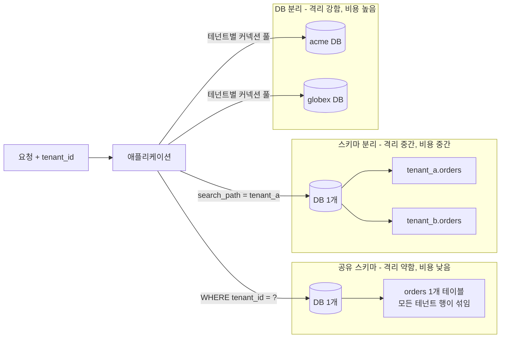
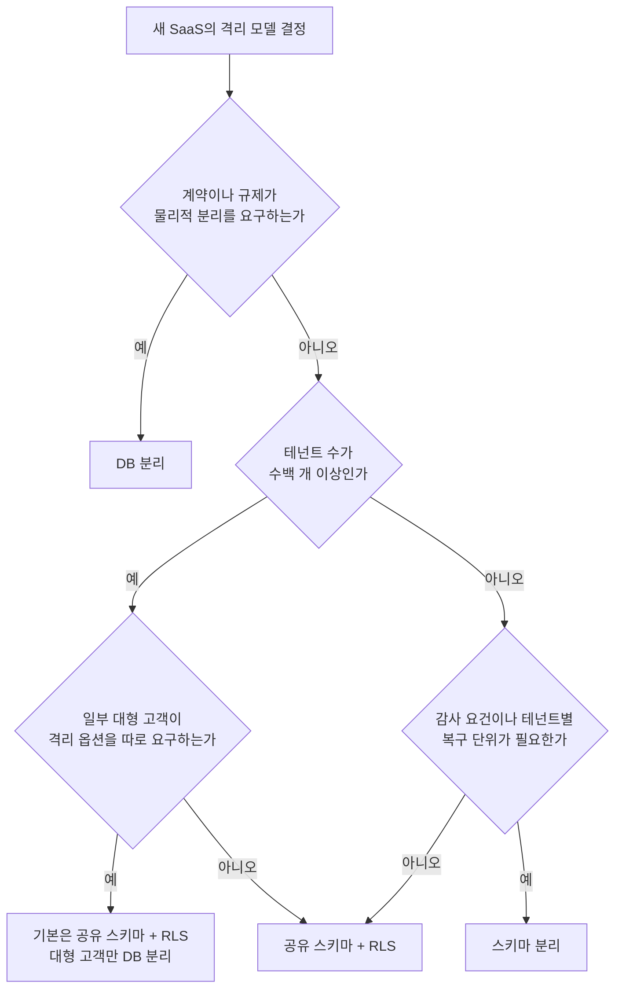
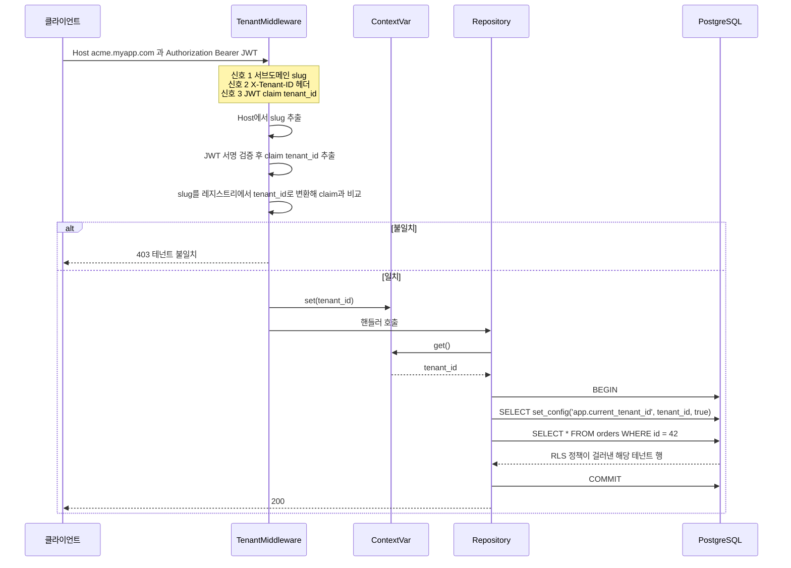
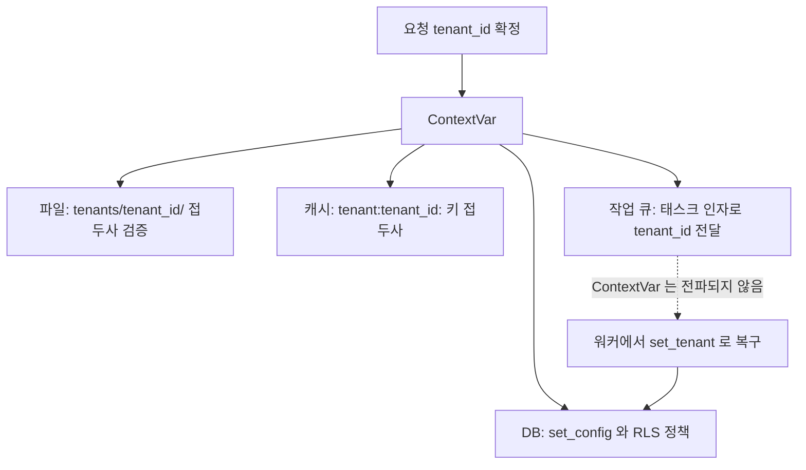
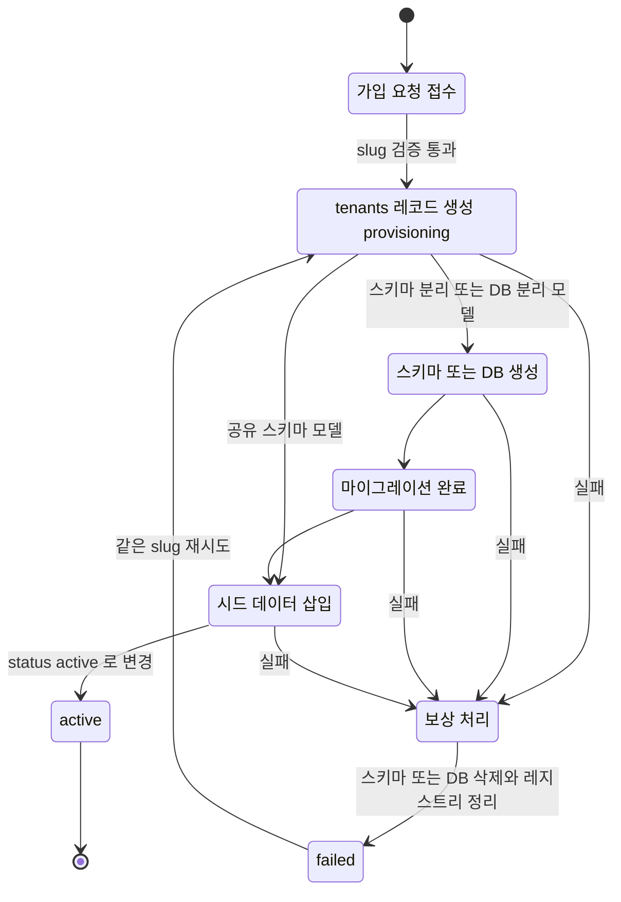
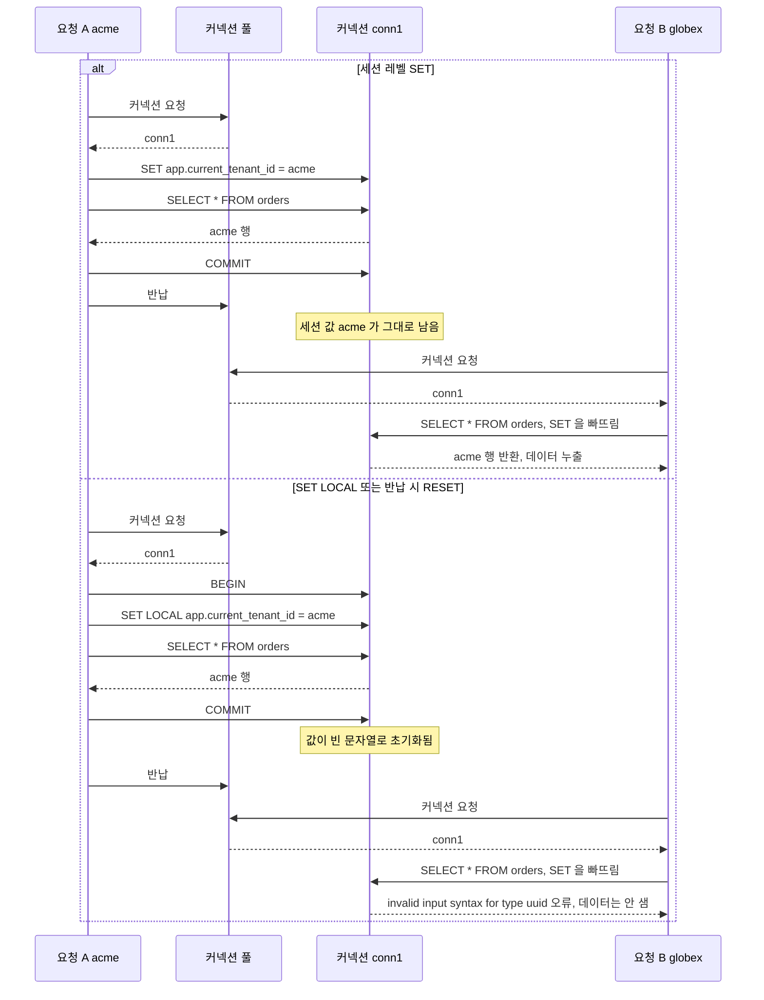

# 멀티테넌시

## 시작하기 전에

멀티테넌시는 하나의 애플리케이션 인스턴스를 여러 고객(테넌트)이 공유하는 구조다. B2B SaaS를 만들다 보면 필연적으로 맞닥뜨린다. 고객사 A와 B가 같은 서버에서 돌아가는 같은 코드를 사용하지만, 서로의 데이터는 절대 보이면 안 된다.

문제는 이게 생각보다 까다롭다는 거다. 단순히 WHERE 절에 `tenant_id`를 붙이는 것만으로는 안 된다. 개발자가 실수로 필터를 빠뜨리면 다른 테넌트 데이터가 노출된다. 실제로 이 이유로 SaaS 서비스가 크게 터진 사례는 여럿 있다.

멀티테넌시를 제대로 구현하려면 DB 격리 모델을 결정하고, 요청마다 테넌트를 정확히 식별하고, 데이터 누출을 구조적으로 막는 것까지 세 가지가 맞물려야 한다.

---

## DB 격리 모델 3가지

격리 수준이 높을수록 운영 비용이 올라가고, 낮을수록 보안 사고 가능성이 올라간다. 같은 요청이 앱을 지나 DB의 어디에 닿는지 모델별로 먼저 본다. 경계가 행(공유 스키마), 스키마(스키마 분리), DB 인스턴스(DB 분리) 순으로 한 단계씩 바깥으로 나간다.



### 공유 DB, 공유 스키마 (Shared Database, Shared Schema)

모든 테넌트가 같은 DB, 같은 테이블을 쓴다. 테이블마다 `tenant_id` 컬럼이 있고, 모든 쿼리에 이 컬럼을 기준으로 필터링한다.

```sql
CREATE TABLE orders (
    id          BIGSERIAL PRIMARY KEY,
    tenant_id   UUID NOT NULL,
    user_id     BIGINT NOT NULL,
    total       NUMERIC(12,2) NOT NULL,
    created_at  TIMESTAMPTZ DEFAULT now()
);

CREATE INDEX idx_orders_tenant ON orders (tenant_id);

-- 조회할 때는 반드시 tenant_id 포함
SELECT * FROM orders WHERE tenant_id = $1 AND id = $2;
```

비용이 제일 싸다. 인스턴스 하나, DB 하나로 수천 개 테넌트를 처리할 수 있다. 대신 코드 레벨에서 `tenant_id` 필터를 빠뜨리는 순간 데이터 누출이 발생한다. 이 위험을 막으려면 뒤에 설명할 PostgreSQL RLS나 미들웨어 레벨 강제 필터가 필요하다.

이 모델이 맞는 상황은 테넌트 수가 수백~수천 개이고, 테넌트별 데이터 크기가 크지 않으며, 고객이 완전한 데이터 격리를 계약상 요구하지 않을 때다.

### 공유 DB, 스키마 분리 (Shared Database, Separate Schema)

같은 DB 인스턴스를 쓰되, 테넌트마다 별도의 PostgreSQL 스키마(네임스페이스)를 만든다.

```sql
-- 테넌트 A 프로비저닝
CREATE SCHEMA tenant_a;
CREATE TABLE tenant_a.orders (
    id         BIGSERIAL PRIMARY KEY,
    user_id    BIGINT NOT NULL,
    total      NUMERIC(12,2) NOT NULL,
    created_at TIMESTAMPTZ DEFAULT now()
);

-- 연결 시 search_path 설정으로 격리
SET search_path TO tenant_a;
SELECT * FROM orders; -- tenant_a.orders를 조회
```

`tenant_id` 컬럼 필터가 없어도 스키마 자체가 물리적 경계다. 쿼리를 잘못 짜도 다른 스키마에 접근하려면 명시적으로 스키마명을 붙여야 한다. 공유 스키마 모델보다 훨씬 안전하다.

단점은 테넌트 수가 늘어날수록 스키마 관리가 복잡해진다는 거다. PostgreSQL에서 스키마 수가 수천 개를 넘어가면 `pg_catalog` 조회가 눈에 띄게 느려지기 시작한다. 마이그레이션도 테넌트 수만큼 실행해야 한다. 스키마 100개면 마이그레이션 100번이다.

테넌트 수가 수십~수백 개 범위이고, 규정 준수나 감사 요건이 있어 논리적 격리가 필요할 때 선택한다.

### DB 분리 (Separate Database)

테넌트마다 완전히 분리된 DB 인스턴스를 둔다. 물리적으로 격리되니 데이터 누출 가능성이 가장 낮다. 고객이 자기 DB 인스턴스를 직접 접근하거나, 규제 요건으로 물리적 분리가 의무일 때 쓴다.

비용이 테넌트 수에 비례해서 올라간다. 테넌트 100개면 DB 인스턴스 100개다. 연결 풀 관리도 복잡하다. 각 테넌트 DB의 연결 정보를 런타임에 동적으로 가져와서 연결해야 한다.

```python
# 테넌트별 DB 연결 동적 라우팅 예시
class TenantDatabaseRouter:
    def __init__(self, tenant_registry: TenantRegistry):
        self._registry = tenant_registry
        self._pools: dict[str, ConnectionPool] = {}

    def get_connection(self, tenant_id: str) -> Connection:
        if tenant_id not in self._pools:
            config = self._registry.get_db_config(tenant_id)
            self._pools[tenant_id] = create_pool(config)
        return self._pools[tenant_id].acquire()
```

엔터프라이즈 계약을 맺은 대형 고객에게만 이 옵션을 제공하는 게 현실적이다.

### 모델 선택 기준

| 기준 | 공유 DB/스키마 | 스키마 분리 | DB 분리 |
|------|--------------|-----------|--------|
| 테넌트 수 | 수백~수천 | 수십~수백 | 수십 이하 |
| 데이터 격리 수준 | 낮음 (코드 의존) | 중간 (논리적) | 높음 (물리적) |
| 비용 | 낮음 | 중간 | 높음 |
| 마이그레이션 복잡도 | 낮음 | 높음 | 매우 높음 |
| 컴플라이언스 | 어려움 | 가능 | 용이 |

표의 기준을 실제 질문 순서로 바꾸면 아래 흐름이 된다. 규제가 제일 먼저 걸리고, 그다음이 테넌트 수, 마지막이 고객 규모다. 규제나 계약이 물리적 분리를 요구하면 나머지 조건은 볼 필요가 없다.



스키마 분리는 테넌트가 수천 개를 넘으면 카탈로그 부담과 마이그레이션 횟수 때문에 Q2에서 이미 탈락한다. 초기 스타트업은 대개 공유 스키마 + RLS로 시작한다. 이때 모든 테이블에 `tenant_id`를 넣고 접근 계층을 한 곳으로 모아두면 나중에 대형 고객 한두 곳만 DB 분리로 빼는 일이 가능하다. 스키마 분리 방식의 운영은 [Schema-Per-Tenant](../DataBase/RDBMS/Schema_Per_Tenant.md) 문서에 따로 정리했다.

---

## 테넌트 식별 방법

요청이 들어왔을 때 어느 테넌트인지를 파악하는 방법이 세 가지 있다.

### 서브도메인

```
acme.myapp.com → 테넌트: acme
globex.myapp.com → 테넌트: globex
```

사용자 경험이 가장 자연스럽다. 브라우저 주소창에서 어느 테넌트인지 바로 보인다. 단점은 인증서 관리다. 테넌트마다 서브도메인이 있으면 와일드카드 인증서(`*.myapp.com`)로 커버하거나, Let's Encrypt로 동적 발급해야 한다.

서버에서 처리할 때는 `Host` 헤더에서 서브도메인을 파싱한다. 흔히 `.`으로 나눠서 세그먼트가 3개 이상이면 첫 번째를 쓰는 식으로 짜는데, 실행해 보면 틀린 결과가 나온다.

| 입력 | 점으로 나눠 첫 세그먼트를 쓰는 코드 | 의도한 결과 |
|------|------------------------------|-----------|
| `acme.myapp.com` | `acme` | `acme` |
| `ACME.myapp.com` | `ACME` (대문자 그대로) | `acme` |
| `myapp.co.kr` | `myapp` (도메인 이름이 테넌트가 됨) | `None` |
| `a.b.myapp.com` | `a` | `None` |
| `10.0.0.5` | `10` (IP가 테넌트가 됨) | `None` |

포트가 붙은 `acme.myapp.com:8443`은 우연히 맞게 나오지만, 로컬 개발에서 `acme.localhost:3000`은 세그먼트가 2개라 `None`이 된다. 기준 도메인을 설정값으로 고정하고 그 접미사를 떼어내는 방식이 안전하다.

```python
BASE_DOMAIN = "myapp.com"
RESERVED = {"www", "api", "admin"}

def extract_tenant_from_host(host: str) -> str | None:
    hostname = host.split(':')[0].lower()
    suffix = '.' + BASE_DOMAIN
    if not hostname.endswith(suffix):
        return None
    sub = hostname[:-len(suffix)]
    if not sub or '.' in sub or sub in RESERVED:
        return None
    return sub
```

### URL 경로

```
myapp.com/acme/dashboard
myapp.com/globex/dashboard
```

모바일 앱이나 API 클라이언트에서 많이 쓴다. 서브도메인 처리가 복잡한 환경에서 대안이 된다. 라우팅 설정이 조금 더 복잡해지고, 경로 첫 번째 세그먼트가 테넌트 슬러그라는 걸 모든 API 설계에서 고려해야 한다.

### 커스텀 헤더

API 서버간 통신이나 내부 서비스에서 많이 쓴다.

```http
POST /api/orders HTTP/1.1
X-Tenant-ID: acme-corp-uuid
Authorization: Bearer eyJ...
```

사용자 대면 앱에서는 쓰기 어렵다. 브라우저가 커스텀 헤더를 자동으로 붙여주지 않으니 클라이언트 코드에서 매번 헤더를 설정해야 한다. B2B API에서 고객사 서버가 직접 호출할 때는 깔끔하다.

### 실무에서 쓰는 방식

서브도메인 + JWT 조합이 제일 흔하다. 서브도메인으로 테넌트를 1차 식별하고, JWT 페이로드에 `tenant_id`를 넣어서 서버 내부에서는 JWT를 신뢰한다. 두 값이 같은 테넌트를 가리키는지 검증하는 미들웨어를 인증 레이어 뒤에 둔다.

식별 신호는 세 가지가 있고, 어느 것이든 미들웨어에서 하나의 `tenant_id`로 합쳐진 뒤에는 같은 경로를 탄다. 서브도메인과 헤더는 호출자가 마음대로 바꿀 수 있는 값이라 JWT claim과 대조해야 하고, JWT는 서명 검증이 끝난 값만 믿는다. 아래 흐름에서 `SET`이 아니라 `set_config(..., true)`를 쓰는 이유는 RLS 절에서 설명한다.



이 문서의 이전 판 예제는 `_resolve_tenant(request)`의 결과를 JWT의 `tenant_id`와 바로 `!=` 비교했고, 검증을 통과한 값을 `ContextVar`에 넣는 코드도 없었다. `_resolve_tenant`가 서브도메인에서 slug를 돌려주는 구현이면 `"acme" != "11111111-..."`이라 정상 요청이 전부 403이 된다. 반대로 JWT에 slug를 넣으면 테넌트 이름을 바꾸는 순간 발급된 토큰이 전부 무효가 된다. slug는 레지스트리에서 `tenant_id`로 변환한 뒤에 비교하고, 검증이 끝나면 `ContextVar`에 값을 넣고 응답 후에 복원한다.

```python
class TenantMiddleware:
    def __init__(self, registry: TenantRegistry):
        self._registry = registry

    async def __call__(self, request: Request, call_next):
        slug = extract_tenant_from_host(request.headers.get("host", ""))
        if slug is None:
            return Response(status_code=400, content="테넌트를 식별할 수 없습니다")

        tenant = await self._registry.find_by_slug(slug)
        if tenant is None:
            return Response(status_code=404, content="존재하지 않는 테넌트")

        token_tenant = request.state.jwt_payload.get("tenant_id")
        if token_tenant != str(tenant.id):
            return Response(status_code=403, content="테넌트 불일치")

        request.state.tenant_id = str(tenant.id)
        token = set_tenant(str(tenant.id))
        try:
            return await call_next(request)
        finally:
            reset_tenant(token)
```

---

## PostgreSQL Row-Level Security

RLS는 공유 DB/스키마 모델에서 데이터 누출을 막는 가장 확실한 방법이다. DB 레벨에서 강제하기 때문에 애플리케이션 코드가 `tenant_id` 필터를 빠뜨려도 다른 테넌트 데이터가 조회되지 않는다.

### 설정 방법

```sql
-- 1. orders 테이블에 RLS 활성화
ALTER TABLE orders ENABLE ROW LEVEL SECURITY;

-- 2. 정책 생성: 현재 tenant_id와 일치하는 행만 접근 허용
CREATE POLICY tenant_isolation ON orders
    USING (tenant_id = current_setting('app.current_tenant_id')::UUID);

-- 3. 테이블 소유자에게도 정책을 적용한다
ALTER TABLE orders FORCE ROW LEVEL SECURITY;

-- 4. 애플리케이션 DB 유저에게는 슈퍼유저 권한 부여 금지
-- (슈퍼유저는 RLS를 우회함)
GRANT SELECT, INSERT, UPDATE, DELETE ON orders TO app_user;
```

3번 줄은 이전 판에 없던 것이다. 테이블 소유자는 `ENABLE ROW LEVEL SECURITY`만으로는 정책을 우회한다. 마이그레이션을 `app_user`로 돌려서 `orders`의 소유자가 `app_user`가 된 DB에서 실제로 `SELECT count(*) FROM orders`가 설정 없이 전체 3행을 돌려줬다. `FORCE`를 건 뒤에는 같은 쿼리가 설정 변수가 없다는 오류로 막혔다. 소유자와 애플리케이션 계정을 분리하는 것이 먼저고, `FORCE`는 분리가 안 된 환경에 대한 안전망이다.

애플리케이션에서 DB 연결을 맺은 뒤 요청마다 세션 변수를 설정한다.

```sql
BEGIN;
-- 쿼리 실행 전 테넌트 설정. 세 번째 인자 true 가 SET LOCAL 과 같은 트랜잭션 범위다
SELECT set_config('app.current_tenant_id', '11111111-1111-1111-1111-111111111111', true);

-- 이후 조회는 자동으로 필터링됨
SELECT * FROM orders; -- 해당 tenant_id 행만 반환
COMMIT;
```

`SET LOCAL`은 트랜잭션 범위에서만 유효하고 트랜잭션이 끝나면 풀린다. `SET`은 세션 전체에 유효하니 커넥션 풀 환경에서 세션이 재사용될 때 문제가 된다. 같은 이유로 `set_config`의 세 번째 인자는 `false`가 아니라 `true`여야 한다. PostgreSQL 16.15에서 각 상황을 실행한 결과는 아래와 같다.

| 상황 | 결과 |
|------|------|
| 새 커넥션에서 설정 없이 조회 | `unrecognized configuration parameter` 오류 |
| 트랜잭션 안에서 `SET LOCAL` 후 조회 | 해당 테넌트 행만 반환 |
| `SET LOCAL` 트랜잭션이 끝난 뒤 같은 커넥션에서 설정 없이 조회 | `invalid input syntax for type uuid: ""` 오류 |
| 트랜잭션 밖에서 `SET LOCAL` | `WARNING: SET LOCAL can only be used in transaction blocks`, 설정은 적용되지 않음 |
| 세션 `SET` 후 설정 없이 다른 요청이 같은 커넥션을 받음 | 이전 테넌트의 행이 그대로 조회됨 |
| 다른 테넌트의 `tenant_id`로 INSERT | `new row violates row-level security policy` |

세 번째 줄을 조심해야 한다. `SET LOCAL`이 풀려도 변수는 NULL이 아니라 빈 문자열로 남아서, 같은 커넥션을 재사용하는 후속 요청이 설정을 빠뜨리면 `''::UUID` 캐스팅 오류가 난다. 데이터는 새지 않지만 "UUID 문법 오류"라는 메시지만 보고는 원인이 테넌트 컨텍스트 누락이라는 걸 바로 알기 어렵다. 에러 로그에서 이 문자열이 보이면 컨텍스트 설정이 빠진 코드 경로부터 찾는다.

### ORM 연동 (SQLAlchemy 예시)

이전 판은 `SET LOCAL app.current_tenant_id = :tid`로 바인딩했다. 이 문장은 드라이버에 따라 갈린다. psycopg2는 파라미터를 클라이언트에서 문자열로 치환해서 보내므로 동작한다. psycopg 3(`postgresql+psycopg`)는 서버 쪽 바인딩을 쓰는데, `SET`은 바인드 파라미터를 받지 못해서 `syntax error at or near "$1"`이 난다. asyncpg도 `SET LOCAL app.current_tenant_id = $1`에서 같은 오류가 난다. 드라이버를 바꾸는 순간 모든 요청이 실패하므로 처음부터 `set_config`를 쓴다. SQLAlchemy 2.0.55로 psycopg2와 psycopg 3, 그리고 asyncpg 직접 호출로 확인했고, `set_config` 쪽만 세 경우 모두 정상이었다.

```python
from sqlalchemy import event, text
from sqlalchemy.orm import Session

@event.listens_for(Session, "after_begin")
def set_tenant_context(session, transaction, connection):
    tenant_id = get_tenant()  # ContextVar 에서 가져옴. 없으면 RuntimeError
    connection.execute(
        text("SELECT set_config('app.current_tenant_id', :tid, true)"),
        {"tid": tenant_id},
    )
```

트랜잭션 시작 직후 자동으로 테넌트 컨텍스트를 설정한다. 개발자가 쿼리마다 `tenant_id`를 신경 쓸 필요가 없다. `if tenant_id:`로 감싸서 컨텍스트가 없으면 조용히 넘어가던 이전 판과 달리, 컨텍스트가 없으면 예외가 나게 했다. 설정 없이 쿼리가 나가는 경로를 로그가 아니라 예외로 드러내려는 의도다.

### RLS 주의사항

슈퍼유저나 `BYPASSRLS` 권한을 가진 유저는 RLS를 무시한다. 마이그레이션 도구나 DBA 작업용 유저는 이 권한이 필요할 수 있는데, 애플리케이션 서비스 계정과 분리해야 한다.

`SECURITY DEFINER` 함수를 조심해야 한다. 이 함수 안에서 실행되는 쿼리는 함수를 정의한 유저의 권한으로 실행된다. 함수 소유자가 RLS를 우회할 수 있는 권한이 있으면 정책이 적용되지 않는다.

---

## 테넌트 간 데이터 누출 방지

RLS 하나로 다 해결되면 좋겠지만, 실제로는 여러 레이어에서 방어해야 한다. RLS는 PostgreSQL 안의 행만 지킨다. 같은 요청이 파일, 캐시, 큐까지 건드리면 각각 자기 방식의 격리 키가 필요하고, 이 키들은 모두 같은 `ContextVar`의 `tenant_id`에서 나와야 한다.



### 코드 레벨: 컨텍스트 전파

스레드나 코루틴 로컬 변수에 현재 테넌트를 저장하고, 모든 리포지토리에서 이 컨텍스트를 강제로 참조하게 만든다.

```python
from contextvars import ContextVar

_current_tenant: ContextVar[str | None] = ContextVar('current_tenant', default=None)

def set_tenant(tenant_id: str):
    return _current_tenant.set(tenant_id)

def reset_tenant(token) -> None:
    _current_tenant.reset(token)

def get_tenant() -> str:
    tid = _current_tenant.get()
    if tid is None:
        raise RuntimeError("테넌트 컨텍스트가 설정되지 않았습니다")
    return tid

class OrderRepository:
    def find_by_id(self, order_id: int) -> Order | None:
        tenant_id = get_tenant()  # 컨텍스트에서 강제로 가져옴
        return self.db.query(Order).filter(
            Order.tenant_id == tenant_id,
            Order.id == order_id
        ).first()
```

이렇게 짜면 `find_by_id`를 호출하는 코드는 `tenant_id`를 인자로 넘기지 않아도 된다. 컨텍스트에서 자동으로 읽으니 누락될 가능성이 줄어든다.

`set_tenant`가 토큰을 돌려주게 바꾼 이유는 요청이 끝날 때 `reset_tenant`로 되돌리기 위해서다. 이전 판은 값만 넣고 복원하지 않았다. 요청마다 새 태스크가 만들어지는 서버에서는 문제가 드러나지 않지만, 워커 스레드나 이벤트 루프를 재사용하는 코드에서 한 번 설정된 값이 다음 작업에 남는다.

`ContextVar`는 모든 실행 단위로 전파되지 않는다. Python 3.10에서 직접 실행한 결과는 아래와 같다.

| 실행 방식 | 부모가 설정한 테넌트가 보이는가 |
|----------|------------------------------|
| `await` 하는 코루틴, `asyncio.create_task` | 보임 (생성 시점 컨텍스트를 복사) |
| `asyncio.to_thread` | 보임 |
| `loop.run_in_executor` | 안 보임. `get_tenant()`가 `RuntimeError` |
| `threading.Thread` | 안 보임 (`None`) |

동기 라이브러리를 `run_in_executor`로 감싸는 코드에서 예외가 나는 건 그나마 낫다. 더 나쁜 경우는 값을 기본값으로 대체하는 코드가 중간에 끼어 있어 조용히 다른 값을 쓰는 것이다. `get_tenant`가 기본값 없이 예외를 던지게 해 둔 이유다.

### 파일 스토리지 격리

S3 버킷에 파일을 저장할 때 테넌트 ID를 경로 prefix로 쓴다.

```
s3://my-bucket/tenants/{tenant_id}/uploads/{file_id}
```

파일 다운로드 URL을 생성할 때 현재 테넌트와 파일 경로의 테넌트가 일치하는지 반드시 검증해야 한다.

```python
def generate_presigned_url(file_key: str, tenant_id: str) -> str:
    if not file_key.startswith(f"tenants/{tenant_id}/"):
        raise PermissionError("다른 테넌트의 파일에 접근할 수 없습니다")
    return s3_client.generate_presigned_url(...)
```

이전 판은 `file_key.split('/')[1]`로 두 번째 세그먼트만 비교했다. 첫 세그먼트를 보지 않으니 `uploads/acme/1`처럼 `tenants/`로 시작하지 않는 키도 `acme` 테넌트로 통과했고, 슬래시가 없는 키(`acme`)는 `IndexError`로 500이 났다. 접두사 전체를 비교하면 둘 다 막힌다. 접두사 비교만으로는 `tenants/acme/../globex/x`가 통과한다는 점이 남는다. S3 자체는 `..`를 키 이름의 일부로 취급하지만, 디스크를 백엔드로 쓰는 스토리지나 URL을 정규화하는 중간 계층이 끼면 다른 테넌트 경로로 풀릴 수 있다. 파일 키를 사용자 입력으로 받는 API라면 `..`가 든 키를 거부하거나, 키를 직접 받지 말고 DB의 파일 레코드에 저장된 `tenant_id`와 대조하는 쪽이 안전하다.

### 캐시 격리

Redis 캐시에 테넌트별 데이터를 저장할 때 키에 테넌트 ID를 포함시킨다.

```python
def cache_key(tenant_id: str, entity: str, entity_id: int) -> str:
    return f"tenant:{tenant_id}:{entity}:{entity_id}"

# "tenant:acme-corp:order:42"
```

캐시 무효화도 테넌트 범위로 한정한다. `FLUSHDB`를 쓰면 모든 테넌트 캐시가 날아간다.

### 백그라운드 작업

비동기 작업 큐(Celery, Worker 등)에 태스크를 등록할 때 `tenant_id`를 태스크 인자에 명시적으로 포함시켜야 한다. 컨텍스트 변수는 태스크 실행 환경까지 전파되지 않는다.

```python
@celery_app.task
def generate_report(tenant_id: str, report_type: str):
    set_tenant(tenant_id)  # 작업 시작 시 컨텍스트 복구
    # ... 이후 로직
```

---

## 온보딩과 프로비저닝

신규 테넌트가 가입했을 때 데이터 구조를 만들고 초기 설정을 완료하는 과정이다. 격리 모델에 따라 복잡도가 달라진다.

테넌트는 `provisioning` 상태로 먼저 기록되고, 모든 단계가 끝나야 `active`가 된다. 공유 스키마 모델은 스키마·DB 생성과 마이그레이션 단계가 없어서 레코드 생성에서 바로 시드로 넘어간다. 중간 단계 어디서든 실패하면 만들어 둔 리소스를 지우는 보상 경로를 타고 `failed`로 끝나며, 같은 slug로 재시도할 수 있어야 한다.



### 공유 스키마 모델의 프로비저닝

`tenants` 테이블에 레코드를 하나 추가하는 게 전부다.

```sql
INSERT INTO tenants (id, slug, name, plan, created_at)
VALUES (gen_random_uuid(), 'acme-corp', 'ACME Corp', 'starter', now())
RETURNING id;
```

이후 해당 `tenant_id`를 외래키로 참조하는 테이블에 데이터가 쌓이기 시작한다.

### 스키마 분리 모델의 프로비저닝

스키마 생성, 테이블 생성, 초기 데이터 삽입이 순서대로 일어나야 한다.

```python
import re

SLUG_RE = re.compile(r"[a-z][a-z0-9-]{1,40}")

async def provision_tenant(db, tenant_id: str, slug: str) -> None:
    if not SLUG_RE.fullmatch(slug):
        raise ValueError(f"허용되지 않는 slug: {slug!r}")
    schema_name = f"tenant_{slug.replace('-', '_')}"

    try:
        async with db.transaction():
            # 1. 스키마 생성
            await db.execute(f'CREATE SCHEMA "{schema_name}"')

            # 2. 스키마에 테이블 생성. 반드시 같은 커넥션으로 실행한다
            await run_migrations(db, schema=schema_name)

            # 3. 테넌트 레지스트리에 등록
            await db.execute(
                "INSERT INTO tenant_registry (id, slug, schema_name) VALUES ($1, $2, $3)",
                tenant_id, slug, schema_name,
            )

            # 4. 기본 설정 데이터 삽입
            await db.execute(
                f'INSERT INTO "{schema_name}".settings (key, value) VALUES ($1, $2)',
                "plan", "starter",
            )

            # 5. 마지막에 active 로 전환
            await db.execute("UPDATE tenants SET status = 'active' WHERE id = $1", tenant_id)
    except Exception:
        await db.execute("UPDATE tenants SET status = 'failed' WHERE id = $1", tenant_id)
        raise
```

이전 판 코드를 PostgreSQL 16에서 그대로 돌려 보니 문제가 세 가지 나왔다.

| 문제 | 실행 결과 | 고친 방법 |
|------|----------|----------|
| slug를 SQL 문자열에 그대로 끼워 넣음 | `x; DROP TABLE scratch; CREATE SCHEMA y`를 slug로 넣자 psycopg 3의 파라미터 없는 `execute`가 세 문장을 모두 실행해서 테이블이 지워짐. `-` 치환 때문에 `--` 주석 페이로드는 구문 오류로 끝나서 눈에 안 띄었을 뿐이다 | slug를 `[a-z][a-z0-9-]{1,40}`로 검증하고 스키마명을 따옴표로 감쌈 |
| `run_migrations(schema=...)`가 트랜잭션 밖에서 실행됨 | 다른 커넥션에서 아직 커밋 전인 스키마에 접근하자 `schema "tenant_zz" does not exist`. 마이그레이션이 자기 커넥션을 쓰면 이 트랜잭션에 묶이지 않는다 | `db`를 인자로 넘겨 같은 커넥션과 트랜잭션에서 실행 |
| 식별자 길이 | 슬러그가 길면 스키마명이 63바이트에서 잘려서 서로 다른 70자 slug 두 개가 같은 스키마로 취급되어 `DuplicateSchema` | slug 최대 길이를 41자로 제한 (`tenant_` 접두사 포함 48자) |

실패 시 정리는 이 모델에서는 트랜잭션이 대신한다. PostgreSQL의 DDL은 트랜잭션 안에서 롤백되므로 마이그레이션이나 시드에서 실패해도 스키마와 레지스트리 행이 함께 사라진다. 위 코드로 마이그레이션 단계와 시드 단계에서 각각 예외를 일으켜 보니 두 경우 모두 스키마 0개, 레지스트리 0행에 `status = failed`만 남았고, 같은 slug로 재시도하면 `active`가 됐다. 그래서 이전 판이 권하던 `IF NOT EXISTS`는 오히려 쓰지 않는다. 다른 테넌트가 이미 쓰는 스키마와 이름이 겹쳤을 때 실패하지 않고 그 스키마를 그대로 가져다 쓰게 되기 때문이다.

DB 분리 모델에서는 이 방식이 통하지 않는다. `CREATE DATABASE`는 트랜잭션 블록 안에서 실행하면 `CREATE DATABASE cannot run inside a transaction block` 오류가 난다. 단계마다 완료 여부를 `tenants` 테이블에 기록하고, 실패하면 `DROP DATABASE`와 레지스트리 정리를 보상 작업으로 직접 실행해야 한다. 위 상태 도식의 `보상 처리`가 이 경우를 가리킨다.

### 느린 프로비저닝 처리

스키마 분리나 DB 분리 모델에서는 프로비저닝이 수 초 이상 걸릴 수 있다. 사용자가 가입 버튼을 눌렀을 때 즉시 완료되길 기대한다면 비동기 처리가 필요하다.

```python
@router.post("/tenants/register")
async def register_tenant(data: TenantRegisterRequest):
    tenant_id = uuid4()

    # 테넌트 레코드를 "provisioning" 상태로 먼저 저장하고 커밋까지 끝낸다
    await tenant_repo.create(id=tenant_id, slug=data.slug, status="provisioning")

    # 커밋 이후에 작업 큐에 등록한다
    provision_tenant_task.delay(str(tenant_id), data.slug)

    return {"tenant_id": str(tenant_id), "status": "provisioning"}


@celery_app.task
def provision_tenant_task(tenant_id: str, slug: str) -> None:
    asyncio.run(_run_provision(tenant_id, slug))
```

이전 판은 `async def provision_tenant`를 그대로 `.delay`로 호출했다. Celery 태스크를 `async def`로 선언하면 워커가 코루틴을 실행하지 않고 코루틴 객체만 결과로 돌려준다. `task_always_eager`로 돌려 보니 `r.get()`의 결과가 `<coroutine object provision ...>`였고 프로비저닝 코드는 한 줄도 실행되지 않았다. 동기 태스크에서 `asyncio.run`으로 감싸야 한다. `_run_provision`은 커넥션을 열고 `provision_tenant(db, ...)`를 호출하는 얇은 함수다.

`tenant_repo.create`와 `.delay`의 순서도 중요하다. 레코드 커밋 전에 큐에 넣으면 워커가 먼저 도착해서 `UPDATE tenants SET status = 'active'`가 0행을 갱신하고 끝난다. 반대로 커밋은 됐는데 `.delay`가 브로커 장애로 실패하면 `provisioning`에 영원히 머무는 테넌트가 생긴다. 일정 시간 넘게 `provisioning`인 행을 주기적으로 찾아 재큐잉하는 작업을 따로 둔다.

프론트엔드에서 폴링하거나 웹소켓으로 완료 이벤트를 받는 방식으로 처리한다.

---

## 실무 트러블슈팅 사례

### 커넥션 풀에서 테넌트 컨텍스트 오염

`SET app.current_tenant_id`를 트랜잭션이 아닌 세션 레벨로 설정하면, 커넥션이 풀에 반환된 후 다음 요청에서도 이전 테넌트 설정이 남아있다. 증상은 간헐적으로 다른 테넌트 데이터가 섞여 나오는 거다. 풀에 커넥션이 하나뿐이면 매번, 여러 개면 우연히 같은 커넥션을 받을 때만 재현되기 때문에 개발 환경에서는 잘 안 보인다.

위쪽 분기가 오염이 생기는 경로고, 아래쪽 `else` 분기가 `SET LOCAL`로 막은 경로다. 요청 B가 `SET`을 빠뜨리는 상황은 새 코드 경로, 백그라운드 작업, 설정 훅이 예외로 건너뛰어진 경우처럼 실제로 일어난다.



SQLAlchemy 풀에서 직접 확인한 동작이 있다. 풀은 커넥션을 반납할 때 `rollback`을 한다. 세션 `SET`을 하고 커밋하지 않은 채 반납하면 이 롤백이 `SET`을 되돌린다. 반면 `commit`을 한 뒤 반납하면 값이 그대로 남는다. 위 도식의 첫 번째 분기에서 `COMMIT` 뒤에 오염이 생기는 이유다. 일반적인 요청은 마지막에 커밋하므로 대부분 이쪽이고, 예외로 롤백된 요청에서는 오염이 없어서 원인 추적을 더 어렵게 만든다.

해결은 `SET LOCAL`(또는 `set_config(..., true)`)을 트랜잭션 블록 안에서만 쓰는 거다. ORM 이벤트 훅으로 트랜잭션 시작 시 설정한다. 세션 레벨 설정을 쓸 수밖에 없는 코드 경로가 있으면 풀의 `checkin` 이벤트에서 `RESET app.current_tenant_id`를 실행하고 커밋해서 정리한다. 두 드라이버에서 모두 `checkin` 훅으로 RESET한 뒤 다음 요청이 받은 값은 빈 문자열이었다. NULL이 아니라는 점은 앞의 RLS 절에서 본 것과 같다.

### 마이그레이션 실수

스키마 분리 모델에서 새 컬럼을 추가하는 마이그레이션을 실행할 때, 모든 테넌트 스키마에 순서대로 적용해야 한다. 중간에 실패하면 스키마마다 컬럼 유무가 달라진다.

```python
async def run_migration_all_tenants(migration_fn):
    tenants = await tenant_registry.list_all()
    failed = []
    
    for tenant in tenants:
        try:
            await migration_fn(schema=tenant.schema_name)
        except Exception as e:
            failed.append((tenant.id, str(e)))
            logger.error(f"마이그레이션 실패 tenant={tenant.id}: {e}")
    
    if failed:
        raise MigrationPartialFailure(failed_tenants=failed)
```

실패한 테넌트만 재시도할 수 있도록 실패 목록을 남겨야 한다.

### N+1 쿼리와 테넌트 수

공유 스키마에서 테넌트가 1000개 넘어갔을 때 관리자 대시보드에서 테넌트 목록과 각 테넌트의 주문 수를 같이 보여주는 화면이 문제가 된다. 리포지토리 코드가 단건 조회를 루프로 돌리면 DB 쿼리가 1001번 나간다. 집계 쿼리 한 번으로 끝내야 한다.

```sql
SELECT t.id, t.name, COUNT(o.id) AS order_count
FROM tenants t
LEFT JOIN orders o ON o.tenant_id = t.id
GROUP BY t.id, t.name;
```

이 쿼리를 RLS가 걸린 `app_user` 커넥션에서 실행하면 조용히 틀린 값이 나온다. `tenants`에는 정책이 없어서 두 테넌트가 모두 나오는데, `orders`는 현재 테넌트 것만 보이므로 다른 테넌트의 `order_count`가 실제 주문 수와 상관없이 0이다. 에러도 경고도 없다. 플랫폼 관리자 화면의 집계는 `BYPASSRLS` 권한을 가진 읽기 전용 계정으로 따로 연결해서 돌린다.

### RLS 성능

RLS 정책이 붙은 테이블은 `EXPLAIN ANALYZE`를 돌려봤을 때 실행 계획에 필터가 추가되는 걸 확인해야 한다. 대용량 테이블에서 `tenant_id` 인덱스가 없으면 풀 스캔이 발생한다.

```sql
-- tenant_id 단독 인덱스 또는 복합 인덱스
CREATE INDEX idx_orders_tenant_created ON orders (tenant_id, created_at DESC);
```

쿼리 패턴에 맞게 복합 인덱스를 만들되, `tenant_id`는 항상 첫 번째 컬럼에 둬야 인덱스를 제대로 탄다. 복합 인덱스의 첫 컬럼이 `tenant_id`이면 앞에서 만든 `idx_orders_tenant`는 중복이다. 둘 다 두면 쓰기 비용만 늘어나므로 복합 인덱스를 만든 뒤에 단독 인덱스를 지운다.

---

## 관련 문서

격리 모델과 직접 이어지는 문서는 아래에 있다. 오프보딩(보존 기간과 삭제 순서), 테넌트별 설정, 테넌트별 사용량 계량은 별도 문서로 분리하는 주제라서 이 문서에서는 다루지 않는다.

- [Schema-Per-Tenant](../DataBase/RDBMS/Schema_Per_Tenant.md)
- [테넌트 네트워크 격리](Tenant_Network_Isolation.md)
- [Noisy Neighbor](Noisy_Neighbor.md)
- [테넌트별 암호화 키 격리](../Security/Tenant_Key_Management.md)
