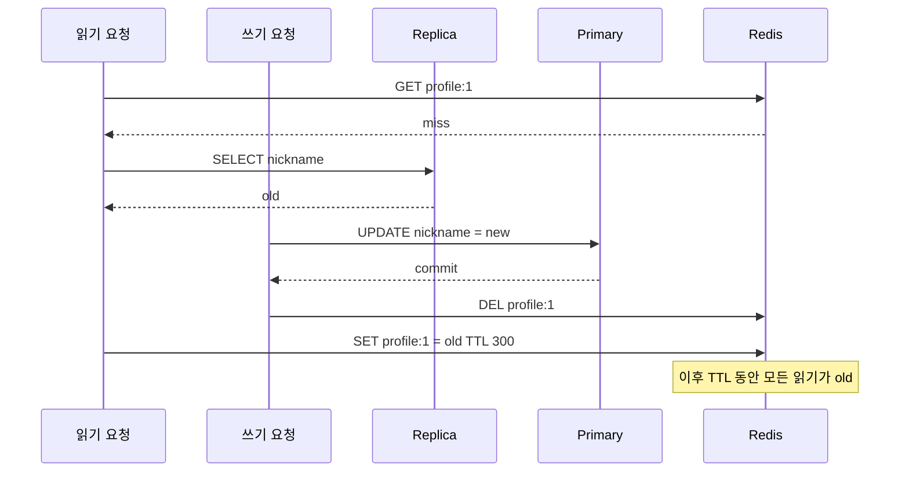
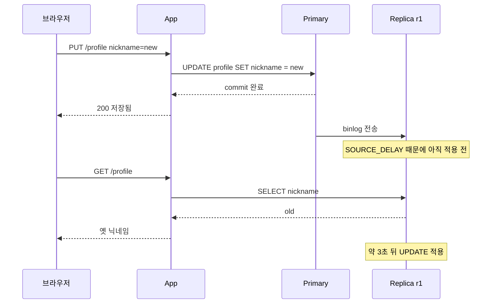
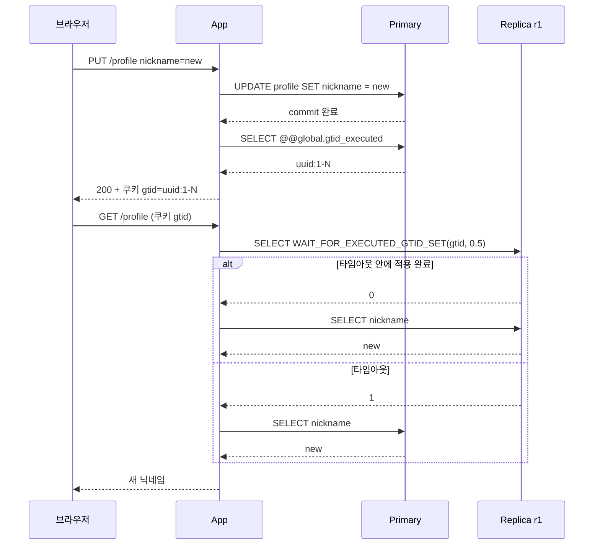
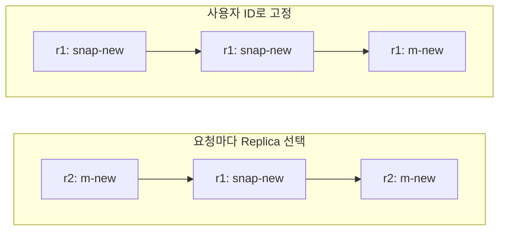
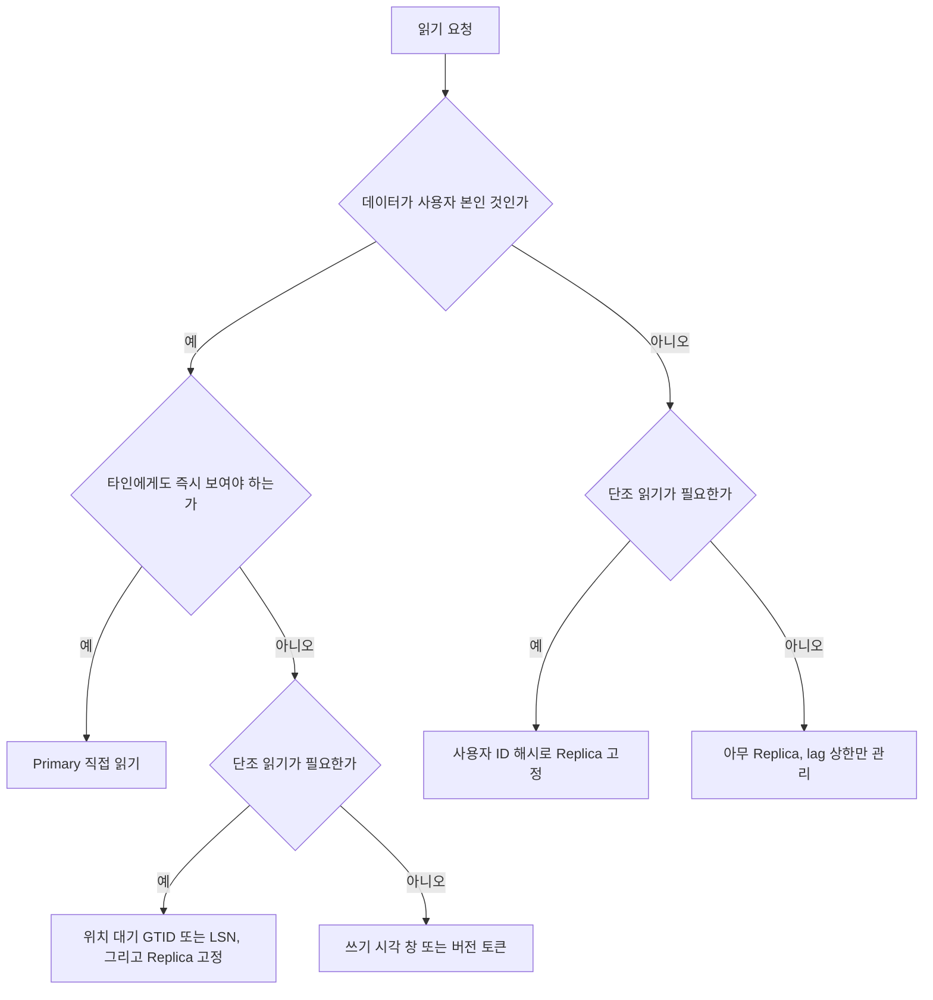

# 쓰기 직후 읽기 일관성 - 프로필을 고쳤는데 옛 값이 보일 때

닉네임을 바꾸고 저장을 누르면 프로필 페이지로 돌아가는데, 거기에 옛 닉네임이 떠 있다. 새로고침하면 바뀌어 있다. 사용자는 저장이 안 된 줄 알고 한 번 더 누르거나 고객센터에 문의한다. 서버 로그에는 UPDATE가 성공했고 에러도 없다. 이 증상은 재현이 어렵고, 개발 환경(DB 한 대)에서는 절대 나오지 않는다.

`읽기_경로` 문서에서는 이 문제를 "쓰기 직후는 Primary로 보낸다" 한 줄로 넘겼다. 그 한 줄이 실제로는 레이어마다 다른 원인과 다른 해법으로 갈라진다. 이 문서는 옛 값이 나오는 자리를 먼저 가르고, MySQL 복제 3대(Primary 1, Replica 2)를 Docker로 띄워 재현한 뒤, 해법 네 가지가 각각 어디서 깨지는지 실측값과 함께 적는다.

## 옛 값이 나오는 자리

같은 증상이라도 원인 레이어가 다르면 고치는 곳이 다르다. 복제 지연이라고 단정하고 DB 쪽을 한참 팠는데 원인이 CDN의 `s-maxage`였던 적이 있다. 응답 헤더 하나로 서빙한 레이어를 남기게 해두면 첫 5분에 범인이 좁혀진다.

```
X-Read-Source: caffeine | redis | replica-2 | primary
```

| 레이어 | 옛 값이 남는 이유 | 해법이 닿는 범위 |
|---|---|---|
| CDN | 프로필 API 응답에 `public, s-maxage`가 붙어 있고 쓰기 때 purge를 안 했다. TTL이 끝날 때까지 옛 값 | 이 문서의 해법으로는 못 고친다. 본인 데이터는 `private, no-store`로 내려서 CDN을 문제에서 뺀다 |
| 로컬 캐시(Caffeine) | 인스턴스마다 따로 가진다. 수정 요청을 받은 인스턴스만 비우고 나머지는 TTL까지 옛 값을 쥐고 있다 | 버전 토큰이 닿는다. 위치 대기는 닿지 않는다(DB 앞단의 일이라) |
| Redis | 쓰기에서 `DEL` 한 직후, 그 전에 Replica에서 옛 값을 읽던 요청이 `SET`으로 되살린다 | write-through에 버전 가드를 붙이면 닿는다 |
| Replica | 복제 지연 | 쓰기 시각, 위치 대기, 버전 토큰 모두 닿는다 |
| CQRS 읽기 모델 | 이벤트 발행, 소비, 반영이 비동기라 DB 커밋 후에도 한참 옛 값 | GTID나 LSN으로는 기다릴 수 없다. 읽기 모델이 소비한 이벤트의 버전으로 비교해야 한다 |

Redis 되살림은 한 번 보면 잊히지 않는 패턴이라 시퀀스로 그린다. 읽기 요청이 Replica에서 옛 값을 가져온 뒤, `SET`을 하기 전에 쓰기 요청이 커밋하고 `DEL`까지 끝내는 순서다. 마지막 `SET`이 새 값 위에 옛 값을 덮는다.



이 경우는 복제 지연이 없어도 생긴다. Replica가 아주 빨라도 `SELECT`가 `UPDATE`보다 먼저 시작했으면 옛 값을 읽는다. 지연이 길수록 확률이 높아질 뿐이다. TTL이 5분이면 5분 동안 고정된 옛 값이 나오고, 이쪽이 사용자 문의로 오는 쪽이다. 복제 지연은 길어야 몇 초이기 때문이다.

나머지 문서는 Replica 레이어를 중심으로 쓰고, 캐시 쪽은 해당 해법 절에서 따로 다룬다.

## 재현 환경

MySQL 8.0.46 이미지로 서버 3대를 띄우고 GTID 자동 포지션으로 복제를 건다. Replica 하나(r1)에는 `SOURCE_DELAY=2`를 줘서 지연을 일부러 만들고, 다른 하나(r2)는 지연 없이 둔다. 지연이 없는 Replica도 쓰기 직후에는 옛 값을 줄 수 있는지 보려는 구성이다.

```bash
docker network create ryw-net
docker run -d --name ryw-primary --network ryw-net -e MYSQL_ROOT_PASSWORD=root mysql:8.0-debian \
  --server-id=1 --gtid-mode=ON --enforce-gtid-consistency=ON --log-bin=mysql-bin
# r1, r2 는 --server-id=2, 3 에 --log-replica-updates=ON 을 더한다
```

```sql
-- r1 (r2 는 SOURCE_DELAY=0)
CHANGE REPLICATION SOURCE TO
  SOURCE_HOST='ryw-primary', SOURCE_USER='repl', SOURCE_PASSWORD='repl',
  SOURCE_AUTO_POSITION=1, SOURCE_DELAY=2, GET_SOURCE_PUBLIC_KEY=1;
START REPLICA;
SET GLOBAL super_read_only=ON;
```

`super_read_only`는 컨테이너 기동 옵션으로 주면 안 된다. 이미지의 초기화 스크립트가 계정을 만들다가 `ERROR 1290 ... running with the --super-read-only option`으로 죽고 컨테이너가 내려간다. 기동한 뒤 `SET GLOBAL`로 켠다.

테이블은 하나다.

```sql
CREATE TABLE profile (
  user_id BIGINT PRIMARY KEY,
  nickname VARCHAR(50),
  version BIGINT NOT NULL DEFAULT 0,
  updated_at TIMESTAMP(3) DEFAULT CURRENT_TIMESTAMP(3)
);
```

`SOURCE_DELAY=2`를 줬는데 새 값이 r1에 보이기까지는 실측으로 약 3초가 걸렸다. 1초 차이의 원인은 확인하지 않았다. 이 문서에서 "r1의 lag"는 이 실측값 약 3초를 말한다.

## 쓰기 직후 읽기가 깨지는 과정

사용자 1번의 닉네임을 Primary에서 바꾸고, 커밋이 끝난 직후에 같은 커넥션 흐름에서 r1과 r2를 한 번씩 읽는다. 이걸 30번 반복했다.



결과는 이렇다.

```
r1 stale 30/30, r2 stale 14/30
r1 이 새 값을 보이기까지 2989 ms (poll 55회)
```

지연을 건 r1은 30번 모두 옛 값을 줬다. 놀라운 쪽은 r2다. 지연 설정이 없는 같은 호스트의 Replica인데 30번 중 14번이 옛 값이었다. 응답이 클라이언트에 닿고 브라우저가 다음 요청을 보내는 시간은 현실에서는 수십 밀리초 이상이라 이 비율이 그대로 나오지는 않는다. 그래도 `PUT` 응답에서 곧바로 `GET`을 때리는 SPA나 서버 사이드 리다이렉트에서는 "지연이 거의 없는 Replica"도 확률적으로 옛 값을 준다는 점은 확인됐다. 평소 lag가 밀리초라서 문제가 없다고 판단한 시스템이 실제로는 가끔 이 증상을 낸다.

## 쓰기 시각을 세션이나 쿠키에 두는 방식

가장 흔하고 가장 먼저 만드는 방식이다. 쓰기가 끝나면 서버 시각을 세션이나 서명된 쿠키에 남기고, 읽기 때 그 시각에서 N초 안이면 Primary로 보낸다. 코드는 `읽기_경로` 문서에 있으니 여기서는 깨지는 조건만 본다.

Spring 라우팅에서 창을 1초로 두고, lag가 약 3초인 r1에 대해 쓴 뒤 1.5초에 읽어봤다.

```
쓰기 후 1.5초, 창 1초 (lag ~3초)     : server=2 nick=spring-1
  그 뒤 2초 지나서 같은 읽기          : server=2 nick=spring-3
```

`nick=spring-1`은 직전 쓰기(`spring-3`) 이전 값이다. 창이 lag보다 짧으면 창이 닫히는 순간 Replica로 돌아가고, 거기서 옛 값을 만난다. 이때 사용자는 새 값을 한 번도 못 본 게 아니라 Primary에서 새 값을 보다가 Replica에서 옛 값으로 되돌아가는 경험을 한다. 그래서 창은 평소 lag가 아니라 **허용하는 최대 lag**에 맞춰야 하고, 그만큼 쓰기 직후 읽기가 전부 Primary로 몰린다. 쓰기가 많은 서비스에서 창을 10초로 잡으면 사실상 Primary 읽기 서비스가 된다.

깨지는 조건은 세 가지를 겪었다.

**여러 기기.** 회사 PC에서 닉네임을 바꾸고 휴대폰 앱을 열면, 휴대폰은 자기 세션에 쓰기 기록이 없으니 Replica로 간다. 본인 데이터인데도 기기가 다르면 보호를 못 받는다. 쓰기 시각을 쿠키나 기기 세션에 두는 한 이 구멍은 안 닫힌다. 막으려면 사용자 ID를 키로 서버 쪽 저장소(Redis)에 `lastWriteAt`을 둬야 하는데, 이러면 모든 읽기에 Redis 조회가 하나 붙는다.

**로드밸런서 뒤에서 세션 저장소가 갈라진 경우.** 인스턴스 메모리 세션을 쓰면서 sticky를 안 켰으면 `PUT`을 받은 인스턴스 A의 세션에만 시각이 남는다. 다음 `GET`이 B로 가면 기록이 없다. 인스턴스를 늘리는 순간 확률이 올라가는 식이라 트래픽이 적던 시절엔 안 보이다가 증설 후에 문의가 늘었다. 세션을 Redis로 빼거나 서명 쿠키로 바꾸면 해결된다. 쿠키는 LB와 무관하게 따라다니지만 기기를 건너지 못한다.

**쿠키의 시각을 클라이언트 시계로 비교하는 경우.** 서버가 서명한 서버 시각만 쓰고, 비교도 서버 시각끼리 해야 한다. 클라이언트가 만든 타임스탬프를 믿으면 시계가 틀린 단말에서 Primary 우회가 영영 켜지거나 꺼진다.

## 복제 위치를 기다리는 방식

시간 창은 lag를 추측하는 방식이다. 위치 대기는 추측을 없앤다. 쓰기가 커밋된 위치(GTID나 LSN)를 기억해 두었다가, Replica가 그 위치까지 따라잡을 때까지 읽기를 멈춘다.

### MySQL의 GTID 대기

쓰기 커밋 직후 Primary의 `@@global.gtid_executed`를 읽어 토큰으로 쓴다. 읽기 때는 Replica에서 `WAIT_FOR_EXECUTED_GTID_SET(토큰, 타임아웃)`을 먼저 실행하고, 반환값이 0이면 같은 커넥션에서 SELECT 한다. 1이면 타임아웃이므로 Primary로 폴백한다.



앞 절의 도식과 비교해서 보면 Replica에서 `SELECT`가 바로 나가지 않고 `WAIT_FOR_EXECUTED_GTID_SET`이 먼저 가는 한 단계가 늘었다. 대기가 실패하면 알아서 Primary로 가기 때문에 어느 쪽으로 가도 새 값이 나온다.

Spring에서 돌려본 결과다. 읽기 트랜잭션 안에서 대기와 SELECT가 같은 커넥션에서 나가야 해서 `@Transactional(readOnly = true)` 안에 같이 넣었다.

```java
@Transactional(readOnly = true)
public String readAfterWait(long id, String gtid, double timeoutSec) {
    Integer rc = jdbc.queryForObject(
        "SELECT WAIT_FOR_EXECUTED_GTID_SET(?, ?)", Integer.class, gtid, timeoutSec);
    if (rc == null || rc != 0) return null;
    return read(id);
}
```

호출하는 쪽은 `null`이면 Primary로 다시 읽는다.

```
GTID 대기 0.5초 (r1 lag ~3초)        : null
  타임아웃 -> Primary 폴백             : server=1 nick=spring-1
GTID 대기 5초                        : server=2 nick=spring-1
GTID 대기 0.5초 (user 1 -> r2, lag 없음): server=3 nick=spring-2 (9 ms)
```

`server=1`이 Primary, `2`가 r1, `3`이 r2다. 이 실험에서 r1은 lag 약 3초에 대기 상한 0.5초라 폴백했고, 상한을 5초로 늘리면 대기 끝에 r1이 새 값을 줬다. 지연이 없는 r2는 9ms 만에 끝났다. 앞 절에서 14/30으로 틀리던 r2가, 대기를 넣으면 대기 시간이 거의 없이 정확해진다. 위치 대기의 장점은 Replica가 빠를수록 비용이 0에 가깝고 느릴수록 알아서 늘어나는 점이다. 시간 창은 빠른 Replica에서도 창만큼 Primary를 쓴다.

비용은 세 군데서 나온다.

- 대기하는 동안 Replica 커넥션이 풀에서 점유된다. 상한을 0.5초로 둬도 lag가 길어지는 장애 때는 읽기 요청 전부가 0.5초씩 커넥션을 쥐고 폴백한다. 풀 크기와 상한은 같이 봐야 한다.
- 토큰을 운반해야 한다. 응답 쿠키나 헤더로 내려보내고 다음 요청에서 받는다. 클라이언트가 토큰을 안 보내는 요청은 보호받지 못한다.
- `@@global.gtid_executed`는 이 사용자의 트랜잭션만이 아니라 서버 전체의 실행 집합이다. 같은 순간 다른 사용자의 트랜잭션이 끼어 있으면 그것까지 기다린다. 대기가 약간 길어질 뿐 틀린 답이 나오지는 않는다. 정밀하게 자기 GTID만 얻으려면 `session_track_gtids=OWN_GTID`를 쓰는데, JDBC 표준 API로는 이 값을 꺼낼 길을 못 찾아서 이 실험에서는 쓰지 않았다.

**트랜잭션 스냅샷 함정.** 기본 격리 수준인 REPEATABLE READ에서는 트랜잭션 안의 첫 일반 SELECT가 스냅샷을 만든다. 같은 트랜잭션에서 SELECT를 먼저 하고 대기를 나중에 하면, 대기가 성공해도 SELECT가 옛 값을 준다.

```
트랜잭션 시작 후 첫 SELECT: spring-3
wait rc=0
같은 트랜잭션에서 wait 후 SELECT: spring-3
커밋 후 SELECT: snap-new
```

대기는 `rc=0`으로 성공했는데 값은 그대로다. 대기는 반드시 테이블을 처음 읽는 SELECT보다 앞에 있어야 한다. 읽기 전용 메서드 안에 공통 로직으로 먼저 SELECT 하나를 끼워 두었다면 이 방식은 조용히 무력화된다. 에러도 안 나서 테스트에서 놓치기 쉽다.

### PostgreSQL의 LSN 비교

PostgreSQL 16에서는 GTID 대기 함수에 대응하는 내장 함수를 쓰지 않고 Replica의 `pg_last_wal_replay_lsn()`을 폴링했다. 쓰기 커밋 후 Primary의 `pg_current_wal_lsn()`을 토큰으로 쓰고, Replica에서 재생 위치가 토큰 이상이 될 때까지 짧게 쉬며 기다린다.

```sql
-- Primary: 커밋 직후
SELECT pg_current_wal_lsn();   -- 0/3061BC8

-- Replica: 읽기 전에
DO $$ BEGIN
  WHILE pg_last_wal_replay_lsn() < '0/3061BC8'::pg_lsn LOOP
    PERFORM pg_sleep(0.01);
  END LOOP;
END $$;
SELECT nickname FROM profile WHERE user_id = 1;
```

PostgreSQL 16 스트리밍 복제에 `recovery_min_apply_delay=2s`를 걸고 5번 돌렸다.

```
i=1 lsn=0/3061BC8 즉시읽기=old  대기후=pg-1 (1690ms)
i=2 lsn=0/3061C38 즉시읽기=pg-1 대기후=pg-2 (1727ms)
...
즉시읽기 stale=5/5, LSN 대기 후 정상=5/5
```

즉시 읽기는 5번 모두 옛 값이었고, LSN을 기다린 뒤에는 5번 모두 새 값이었다. 위 예제의 `DO` 블록은 상한이 없다. 실제로 쓰려면 루프에 경과 시간 검사를 넣어 상한을 걸어야 한다. 복제가 끊긴 Replica에서 이 루프를 돌리면 커넥션 하나가 영원히 잠긴다.

MySQL의 `WAIT_FOR_EXECUTED_GTID_SET`은 서버가 대기를 해주니 앱이 폴링할 필요가 없다는 점에서 PostgreSQL보다 편하다. 대신 GTID 집합 문자열은 길어질 수 있다. `gtid_executed`에 소스가 여러 개이거나 failover 이력이 있으면 `uuid1:1-100,uuid2:1-50` 같은 형태가 되고, 쿠키에 싣기엔 부담이다. 서버 쪽 저장소에 두고 쿠키에는 키만 내려보내는 쪽으로 바꾼 적이 있다.

## 쓰기 응답에 버전 토큰을 싣는 방식

DB 위치 대신 **행 자체의 버전**을 기준으로 삼는 방식이다. 쓰기 응답에 `version: 7`을 내려보내고, 클라이언트는 다음 읽기에 `X-Min-Version: 7`을 보낸다. 서버는 읽은 행의 `version`이 7 미만이면 그 결과를 버리고 Primary에서 다시 읽는다.

```java
Profile p = replicaReader.find(id);
if (minVersion != null && p.version() < minVersion) {
    p = primaryReader.find(id);
}
```

이 방식이 다른 방식과 다른 점은 **어떤 레이어에서 읽었든** 같은 검사가 먹는다는 것이다. 로컬 캐시에서 나온 값도, Redis에서 나온 값도 안에 `version`이 들어 있으니 낮으면 버리면 된다. 앞의 레이어별 표에서 로컬 캐시와 Redis와 Replica를 한 번에 막는 유일한 방식이다. CQRS 읽기 모델도 읽기 모델 행에 소비한 aggregate 버전을 넣어두면 같은 방식으로 비교한다.

비용은 모든 읽기에서 버전을 꺼내 비교해야 한다는 것이다. 응답 DTO에 `version`을 노출해야 하고, API 규약(헤더 이름, 쓰기 응답에 포함)을 클라이언트와 합의해야 한다. 서버만 고쳐서는 안 된다.

깨지는 조건은 이렇다.

- 토큰을 들고 있는 클라이언트에서만 동작한다. 다른 기기, 다른 브라우저 탭을 열면 토큰이 없다. 쿠키 방식과 같은 한계다. 토큰을 서버 저장소에 사용자별로 두면 해결되지만 그만큼 조회 비용이 든다.
- 토큰은 어딘가에 만료 시점이 있다. 클라이언트가 앱 메모리에만 들고 있다면 앱 재시작에서 사라지고, 쿠키로 들고 있다면 `Max-Age`가 끝나면 사라진다. 만료를 lag보다 훨씬 길게 잡지 않으면 구멍이 생긴다. 반대로 너무 길면 한 번 쓴 뒤로 몇 시간 동안 모든 읽기에 버전 비교를 붙이게 된다. 비교 자체는 싸니까 큰 문제는 아니다.
- 목록 조회에는 쓰기 어렵다. 단건 프로필은 버전이 하나지만, 주문 목록처럼 여러 행을 보는 읽기에는 "어느 행의 버전이 최소 몇이어야 하나"를 정의할 수 없다. 이 경우는 위치 대기가 낫다.
- 버전이 거꾸로 갈 수 있다. 백업 복원, 행 삭제 후 재생성 같은 일이 있으면 `version`이 낮아진다. 낮아진 버전 때문에 영원히 Primary로 우회되는 사용자가 생긴다. 낮아지는 경로가 있는 테이블에는 쓰지 않는다.

이 방식은 위 실험 환경에서 실행해 보지 않았다. 위 테이블의 `version` 컬럼이 쓰기마다 올라가는 것은 확인했지만, 헤더로 운반하고 비교하는 부분은 코드 구조만 적은 것이다.

## 캐시에 쓰면서 자기 값을 먼저 채우는 방식

앞서 본 Redis 되살림은 쓰기에서 `DEL`만 하기 때문에 생긴다. `DEL` 대신 쓰기 직후 새 값으로 `SET`(write-through)을 하면, 읽기 요청이 Replica까지 내려갈 일이 없어진다. 방금 바꾼 본인의 읽기는 캐시에서 새 값을 받는다.

하지만 write-through만으로는 안 막힌다. 옛 값을 쥔 읽기 요청이 `SET`을 늦게 하는 순서가 남아 있다. 새 값을 채운 뒤에 옛 값 `SET`이 덮으면 같은 문제다. 낮은 버전으로는 덮을 수 없게 해야 하고, 이건 Lua 스크립트로 비교와 쓰기를 한 번에 해야 한다.

```lua
-- KEYS[1]=profile:1, ARGV[1]=version, ARGV[2]=nickname, ARGV[3]=ttl
local cur = redis.call('HGET', KEYS[1], 'version')
if cur and tonumber(cur) >= tonumber(ARGV[1]) then return 0 end
redis.call('HSET', KEYS[1], 'version', ARGV[1], 'nickname', ARGV[2])
redis.call('EXPIRE', KEYS[1], ARGV[3])
return 1
```

캐시 채우기(읽기 miss 후 `SET`)와 쓰기 후 `SET`을 모두 이 스크립트로 통일하면 낮은 버전이 높은 버전을 덮지 못한다. 버전 토큰 방식과 같은 `version`이 두 군데에서 쓰이게 된다.

깨지는 조건은 TTL 만료다. 키가 만료되어 없어지면 다음 읽기는 miss라서 Replica로 내려가고, lag 중이면 옛 값을 가져와 캐시에 채운다. 가드할 버전이 없으니 통과한다. 쓰기 직후 TTL이 끝나는 경우는 드물지만 TTL이 짧은 키(수 초)에서는 현실적인 확률이다. 이때는 캐시 채우기 때만 Primary에서 읽거나, 위치 대기를 병행한다.

로컬 캐시 문제는 남는다. write-through가 닿는 곳은 Redis까지고, 다른 인스턴스의 Caffeine은 그대로 TTL까지 옛 값을 쥔다. Pub/Sub으로 무효화 메시지를 보내도 메시지가 도착하는 시간 동안은 창이 열린다. 본인 데이터에 한해서는 로컬 캐시 TTL을 짧게(1~2초) 두거나 아예 쓰지 않는 쪽이 안전하다.

이 Redis 코드도 이번 실험에서는 실행하지 않았다. 로직은 위 순서 도식에서 이어지는 구조만 적은 것이다.

## 새로고침할 때마다 값이 오락가락하는 문제

쓰기 직후 읽기를 해결해도 따로 남는 증상이 있다. 새로고침할 때마다 요청이 서로 다른 Replica로 가고, Replica마다 따라간 정도가 다르면 값이 새 값, 옛 값, 새 값 순으로 오간다. 이전에 본 것보다 과거 값을 보게 되는 것을 단조 읽기(monotonic reads) 위반이라고 부른다. 쓰기 직후 읽기보다 사용자가 더 이상하게 느낀다. 저장이 됐다 안 됐다 하기 때문이다.

r1(lag 약 3초)과 r2(lag 없음)를 요청마다 번갈아 읽은 결과다. 사용자 2번의 닉네임을 `m-new`로 바꾼 직후부터 300ms 간격으로 읽었다.

```
   0ms r2 -> m-new
 450ms r1 -> snap-new
 754ms r2 -> m-new
1057ms r1 -> snap-new
1361ms r2 -> m-new
...
3183ms r2 -> m-new
3486ms r1 -> m-new
```

r2는 처음부터 `m-new`를 주고 r1은 `snap-new`(그 직전에 있던 값)를 준다. 요청이 둘을 오가면 `m-new -> snap-new -> m-new` 로 값이 뒤로 갔다가 돌아온다. r1이 따라잡는 약 3초 뒤에야 끝난다. 여기서 Replica는 어느 쪽도 틀리지 않았다. 각자 자기 시점의 일관된 값을 줬을 뿐이고, 요청 사이에 시점이 바뀐 것이다.

사용자 ID로 Replica를 고정하면 이 문제가 풀린다. 한 사용자의 읽기가 항상 같은 Replica로 가면, 그 Replica의 값은 시간이 지나며 앞으로만 간다. 같은 시간대에 r1 고정과 r2 고정을 각각 읽은 결과다.

```
r1 고정: ooooooooooNNNN
r2 고정: NNNNNNNNNNNNNN
```

`o`는 이전 값, `N`은 새 값이다. r1 고정 사용자는 3초 가까이 옛 값을 보다가 새 값으로 넘어가고 다시 돌아가지 않는다. 오래 걸리지만 거꾸로 가지는 않는다. 단조 읽기가 보장되는 대신 쓰기 직후 읽기는 여전히 해결되지 않는다(`ooooooooooNNNN`의 앞부분이 그것이다). 두 문제는 다른 문제여서 고정만으로는 첫 증상을 못 고친다.



왼쪽은 값이 뒤로 갔다 돌아오고, 오른쪽은 느리게 앞으로만 간다.

고정 방식의 약점도 있다.

- 고정된 Replica가 느리면 그 사용자는 계속 느린 데이터를 본다. 위 r1 고정 사용자가 그렇다. 사용자 분포가 한쪽으로 쏠리면 특정 Replica에 읽기가 몰린다.
- Replica 하나가 죽어서 풀에서 빠지면 그 사용자들이 다른 Replica로 재배치되는데, 새 Replica가 더 뒤처져 있으면 그 순간 한 번 거꾸로 간다. 완전히 막지는 못한다.
- Replica 수가 바뀔 때 `userId % 대수`는 대부분의 사용자 배정이 바뀐다. 증설할 때마다 한꺼번에 재배치되는 구간이 생긴다. 일관 해싱이나 rendezvous 해싱으로 바꾸면 이동하는 사용자가 줄어든다.

쓰기 시각 창 방식과 같이 쓸 때의 주의도 있다. 창 안에서는 Primary(새 값)를 읽다가 창이 끝나면 Replica로 가는데, 그 Replica가 아직 덜 따라왔다면 여기서 값이 뒤로 간다. 앞서 본 `쓰기 후 1.5초, 창 1초` 조건에서 창 안의 읽기가 Primary로 갔다면 곧바로 이 상황이다. 쓰기 시각 창은 단조 읽기도 깨는 방식이다.

## Spring 라우팅에서 걸린 것

`AbstractRoutingDataSource`에서 `TransactionSynchronizationManager.isCurrentTransactionReadOnly()`로 Replica와 Primary를 가르는 구성은 흔하다. 이걸 그대로 써서 돌려보니 `@Transactional(readOnly = true)`가 Primary로 갔다.

```
[LazyConnectionDataSourceProxy 없음] readOnly=true -> server_id 1
```

`server_id 1`은 Primary다. 읽기 전용 메서드가 Replica로 안 가고 있었다. `determineCurrentLookupKey()`가 호출되는 시점은 커넥션을 얻는 순간인데, 트랜잭션 매니저가 커넥션을 얻는 일은 `readOnly` 플래그를 동기화 매니저에 올리기보다 앞에 있다. 키를 정할 때 `isCurrentTransactionReadOnly()`는 아직 `false`다. 관측한 결과와 맞는 설명이다.

고치는 방법은 라우팅 데이터소스를 `LazyConnectionDataSourceProxy`로 감싸는 것이다. 실제 커넥션을 첫 SQL이 실행될 때까지 미뤄서, 그때는 플래그가 올라가 있다.

```java
@Configuration
@EnableTransactionManagement
public class SpringDemo {
    static final ThreadLocal<Long> USER = new ThreadLocal<>();
    static final ThreadLocal<Boolean> FORCE_PRIMARY = ThreadLocal.withInitial(() -> false);

    static class ReplicaRoutingDataSource extends AbstractRoutingDataSource {
        @Override protected Object determineCurrentLookupKey() {
            boolean readOnly = TransactionSynchronizationManager.isCurrentTransactionReadOnly();
            if (!readOnly || FORCE_PRIMARY.get()) return "primary";
            Long uid = USER.get();
            return (uid == null || uid % 2 == 0) ? "r1" : "r2";
        }
    }

    @Bean DataSource dataSource() {
        ReplicaRoutingDataSource routing = new ReplicaRoutingDataSource();
        Map<Object, Object> targets = new HashMap<>();
        targets.put("primary", pool(32773));
        targets.put("r1", pool(32774));
        targets.put("r2", pool(32775));
        routing.setTargetDataSources(targets);
        routing.setDefaultTargetDataSource(targets.get("primary"));
        routing.afterPropertiesSet();
        return new LazyConnectionDataSourceProxy(routing);
    }

    @Bean PlatformTransactionManager tm(DataSource ds) { return new DataSourceTransactionManager(ds); }
}
```

트랜잭션 매니저에 넘기는 `DataSource`도 Lazy 프록시여야 한다. 라우팅 데이터소스를 직접 매니저에 넣으면 소용없다. 감싼 뒤 결과다.

```
[Lazy 있음] readOnly=true, user 2 -> server_id 2
[Lazy 있음] readOnly=true, user 1 -> server_id 3
[Lazy 있음] 쓰기 트랜잭션 -> server_id 1
```

사용자 2는 r1(`uid % 2 == 0`), 사용자 1은 r2로 고정되고, 쓰기 트랜잭션은 Primary로 갔다. 위 예제는 실험용이라 `uid % 2`로 두 대에 나눴다. 운영에서는 `Math.floorMod(userId.hashCode(), replicas.size())`를 쓰고, 죽은 Replica는 후보에서 빼야 한다.

몇 가지 더 겪은 것들이다.

- `FORCE_PRIMARY`나 `USER` 같은 ThreadLocal은 요청 필터에서 세팅하고 반드시 `finally`로 지운다. 서블릿 스레드는 재사용되어서 안 지우면 다음 요청이 앞 사용자의 값을 쥔다. 위 코드는 실험용 단일 스레드라서 지우는 부분이 없다.
- 같은 클래스 안에서 `this.read()`로 부르면 `@Transactional` 프록시를 안 거쳐서 `readOnly`가 안 적용된다. 자기 호출 때문에 Replica 읽기가 Primary로 가는 실수는 조용히 일어난다.
- 쓰기 트랜잭션 안에서 한 읽기는 모두 Primary로 간다. 쓰고 나서 같은 트랜잭션 안에서 읽는 흐름은 이미 안전하다. 문제는 쓰기와 읽기가 서로 다른 HTTP 요청으로 갈라질 때다.

## 해법 고르기

네 가지는 서로 경쟁하는 방식이 아니라 데이터와 요구에 따라 갈린다. 세 질문으로 나눈다. 데이터가 사용자 본인 것인가, 타인에게도 즉시 보여야 하는가, 단조 읽기가 필요한가.



도식의 왼쪽 분기가 이 문서의 주제다. 본인 데이터이면서 타인에게는 즉시 안 보여도 되는 경우(프로필 수정, 설정 변경)가 가장 많고, 이때는 가볍게 쓰기 시각 창으로 시작해도 된다. 창을 넘는 지연이 실제 장애로 나타나거나 단조 읽기가 필요해지면 위치 대기로 올린다. 타인에게도 즉시 보여야 하는 경우(재고, 결제 상태, 권한)는 어떤 보조 수단도 근본적 해법이 아니어서 Primary를 읽는다.

| 방식 | 추가 비용 | 깨지는 조건 |
|---|---|---|
| 쓰기 시각(세션/쿠키) | 읽기마다 시각 비교, 창만큼 Primary 읽기 증가 | 여러 기기, LB 뒤 세션 저장소 분리, 창이 lag보다 짧을 때. 단조 읽기도 깨짐 |
| GTID/LSN 위치 대기 | 대기 중 Replica 커넥션 점유, 토큰 운반 | 토큰이 없는 요청, 토큰 쿠키 만료, 같은 트랜잭션에서 SELECT가 대기보다 앞설 때(MySQL), 상한 없는 대기 루프(PostgreSQL) |
| 버전 토큰 | 응답 DTO와 요청 헤더 규약, 읽기마다 비교 | 토큰을 못 가진 다른 기기, 토큰 만료, 목록 조회, 버전이 거꾸로 가는 테이블 |
| 캐시 write-through | 쓰기 경로에 캐시 쓰기 추가, 버전 가드 스크립트 | TTL 만료 직후의 캐시 채우기, 다른 인스턴스의 로컬 캐시 |
| 사용자 ID로 Replica 고정 | 라우팅 코드 | 고정된 Replica가 느릴 때, Replica 증감과 장애 시 재배치. 쓰기 직후 읽기는 해결 못 함 |

세 가지 기기 문제(여러 기기 로그인, LB 뒤 서로 다른 세션 저장소, 토큰 만료)는 클라이언트 측에 토큰을 두는 방식 전체가 공유하는 약점이다. 기기를 넘어서는 보호가 필요하면 토큰을 사용자 ID 키로 서버 저장소에 두고 읽을 때마다 조회하는 비용을 받아들이거나, 그 데이터는 Primary로 읽는다. 어느 쪽을 택해도 비용은 사라지지 않고 옮겨질 뿐이다.

## 돌려보지 못한 것

이 문서의 수치는 전부 위 Docker 환경(MySQL 8.0.46 3대, PostgreSQL 16 2대, Spring Framework 6.1.14, Connector/J 8.4.0)에서 직접 얻은 값이다. 아래는 구조만 적었고 실행하지 않았다.

- 버전 토큰의 헤더 운반과 비교 로직
- Redis Lua 스크립트와 write-through 흐름
- failover로 서버 UUID가 바뀐 뒤의 GTID 토큰 동작. 토큰의 UUID를 Replica가 영영 받지 못하면 대기가 타임아웃까지 가리라고 추정하지만, 실행으로 확인하지 않았다
- `session_track_gtids=OWN_GTID`로 자기 GTID만 얻는 방법
- 실제 네트워크 구간이 있는 환경에서의 r2 stale 비율. 같은 호스트의 컨테이너끼리라 네트워크 구간이 있는 환경에서는 이 비율이 달라진다

## 관련 문서

- `읽기_경로`: 레이어별 캐시와 Replica 라우팅의 전체 그림
- `CQRS_Pattern`: 읽기 모델이 비동기로 갱신될 때의 구조
- `Logical_Clocks`: 이벤트 순서를 숫자로 비교하는 방식. 버전 토큰의 이론적 배경
