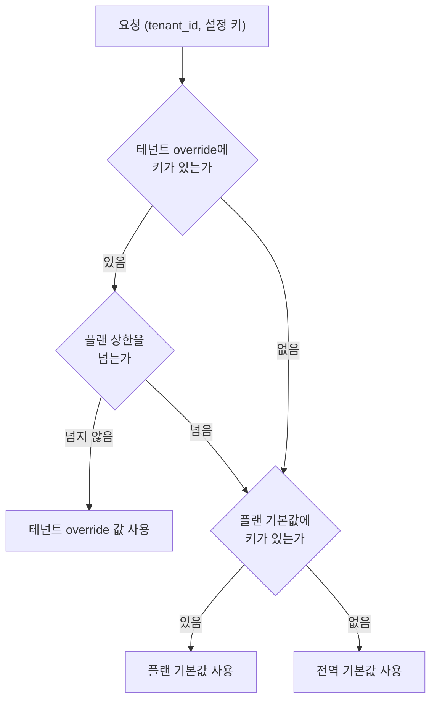
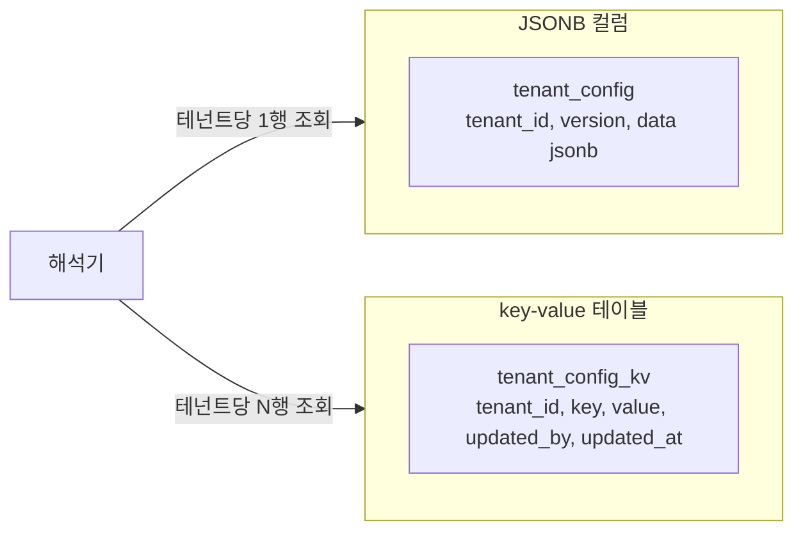
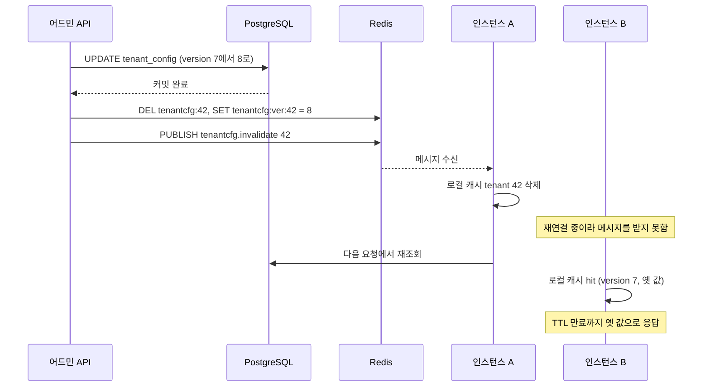
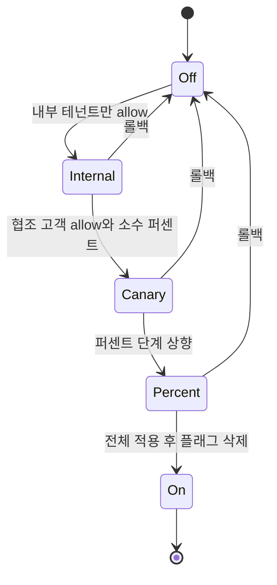

# 테넌트별 설정과 기능 플래그

B2B SaaS를 1년쯤 운영하면 코드 어딘가에 이런 줄이 생긴다.

```python
if tenant.slug == "acme":
    rows = rows[:5000]
```

영업이 큰 고객사 계약에 "엑스포트 5,000행까지"를 약속했고, 급해서 분기 한 줄로 넣은 것이다. 이 한 줄이 문제가 되는 때는 한참 뒤다. 같은 분기가 서른 개쯤 쌓이고, 고객사 이름이 바뀌거나 계약이 끝나도 아무도 지우지 못한다. 이름이 박힌 줄은 어디서 쓰이는지 검색하기도 어렵다.

이 문서는 테넌트별로 달라지는 값을 코드 밖으로 밀어내는 구조를 다룬다. 플랜 기반 권한(entitlement), 테넌트별 override, 설정 해석 순서, 저장 방식, 캐시 무효화, 점진 배포와 롤백까지 이어진다. 데이터 격리 자체는 [멀티테넌시](Multi_Tenancy.md)에서 다루므로 여기서는 "같은 코드가 테넌트마다 다르게 동작해야 할 때" 만 본다.

## 테넌트 분기가 코드에 쌓이는 과정

분기는 보통 세 단계로 늘어난다.

1. 계약에 없던 요구가 들어와 `if tenant == 'acme'` 한 줄이 생긴다.
2. 비슷한 요구가 다른 고객사에서 또 들어와 `if tenant in ('acme', 'globex')`가 된다.
3. 조건이 두 개로 늘어서 `if tenant == 'acme' and region == 'kr'` 같은 줄이 생기고, 테스트가 불가능해진다.

세 번째 단계에 가면 테넌트 이름이 코드 곳곳에 흩어져 있어서 "acme 계약이 끝났으니 정리하자"는 일이 배포 한 번으로 안 끝난다. 이름 검색으로 찾은 줄을 지웠는데 `tenant_id == 1042`로 박힌 줄이 남아 있는 식이다.

모든 분기를 설정으로 옮기는 게 답은 아니다. 설정으로 옮길지는 아래 기준으로 가른다.

| 질문 | 예 | 아니오 |
|---|---|---|
| 값이 테넌트마다 다를 뿐 로직은 같은가 | 설정으로 (`max_rows`, 타임아웃, 허용 포맷) | 다음 질문으로 |
| 켜고 끄는 것으로 끝나는가 | 기능 플래그로 | 다음 질문으로 |
| 다른 고객사에도 팔 수 있는 동작인가 | 플랜 기능으로 승격하고 entitlement에 추가 | 한 고객사 전용 로직 |
| 한 고객사 전용 로직 | 별도 구현 클래스나 플러그인으로 분리하되 선택 키는 설정에 둔다 | |

마지막 칸이 중요하다. 고객사 전용 로직이 정말 필요하면 `if tenant == 'acme'`로 두지 말고 `invoice.template = "acme_v2"` 같은 설정값으로 구현체를 고른다. 코드 안에는 "template 값에 따라 구현체를 고르는 곳" 한 군데만 남고, 테넌트 이름은 데이터로만 존재한다.

반대 방향의 실수도 흔하다. 모든 값을 설정으로 빼면 키가 수백 개로 늘고, 아무도 어떤 조합이 유효한지 모른다. 설정 키는 코드에서 읽는 곳이 있어야 하고, 읽는 곳이 없어진 키는 같이 삭제해야 한다. 테넌트마다 값이 실제로 달라진 적이 한 번도 없는 키는 설정이 아니라 상수다.

## 설정 해석 순서

테넌트가 요청을 보내면 설정 값은 세 군데를 차례로 뒤져서 정한다. 가장 구체적인 곳이 이기고, 없으면 한 단계 넓은 곳으로 내려간다.



위 도식에서 봐야 할 곳은 상한 확인 분기다. 테넌트 override가 항상 플랜을 이기면 Free 플랜 테넌트에 운영자가 실수로 `rate_limit_per_min: 600000`을 넣어도 그대로 적용된다. 그래서 숫자 한도는 플랜 상한을 넘으면 무시하고 플랜 값으로 되돌린다. 영업이 약속한 예외가 정당하다면 상한을 올리는 쪽이 아니라 플랜을 올리거나 별도 플랜(`enterprise_custom`)을 만든다.

우선순위는 정리하면 이렇다.

| 순위 | 위치 | 누가 바꾸는가 | 바뀌는 빈도 |
|---|---|---|---|
| 1 | 테넌트 override | 운영자, 영업 지원 | 계약 변경 때 |
| 2 | 플랜 기본값 | 제품 | 요금제 개편 때 |
| 3 | 전역 기본값 | 개발자 | 배포 때 |

전역 기본값은 코드와 함께 배포하고, 플랜 기본값과 테넌트 override는 DB에 둔다. 전역 기본값을 DB에 두면 신규 환경을 띄울 때 시드 데이터가 빠져서 빈 설정으로 올라오는 경우가 있다. 코드에 두면 최소한 "아무것도 없는 상태"는 안전한 값으로 시작한다. 이 기본값은 보수적으로 잡는다. 새 기능은 `enabled: False`, 한도는 가장 낮은 플랜 수준이다.

## Entitlement 모델

플랜은 "이 테넌트가 무엇을 쓸 수 있는가"를 정하는 묶음이다. 기능 플래그와 헷갈리기 쉬운데 성격이 다르다.

| 구분 | Entitlement (권한) | 기능 플래그 (롤아웃) |
|---|---|---|
| 목적 | 계약·요금에 따른 접근 범위 | 새 코드를 안전하게 내보내기 |
| 수명 | 상품이 존재하는 동안 계속 | 배포가 끝나면 삭제 |
| 바꾸는 사람 | 영업·운영 | 개발자 |
| 기본값 출처 | 플랜 | 전역 기본값(꺼짐) |
| 테넌트 override | 계약 예외로 쓴다 | 먼저 켤 테넌트를 고르는 데 쓴다 |

둘을 같은 테이블, 같은 해석기로 처리해도 되지만 이름은 구분해 둔다. `sso.enabled`는 entitlement이고 `new_export_engine`은 롤아웃 플래그다. 롤아웃이 끝난 플래그는 코드에서 분기를 지우고 설정에서도 지워야 하는데, 구분 없이 섞여 있으면 "이건 지워도 되는 건가"를 판단할 수 없다.

플랜별 기본값은 아래 해석기에서 이렇게 잡았다.

| 키 | Free | Pro | Enterprise |
|---|---|---|---|
| `export.enabled` | false | true | true |
| `export.max_rows` | 1,000 | 50,000 | 1,000,000 |
| `export.formats` | csv | csv, xlsx | csv, xlsx, parquet |
| `api.rate_limit_per_min` | 60 | 600 | 6,000 |
| `sso.enabled` | false | false | true |

## 우선순위 병합 해석기

병합 규칙 세 가지만 정하면 해석기는 짧다. dict는 재귀로 병합하고, 스칼라와 리스트는 통째로 교체하고, `null`은 override가 없는 것으로 본다. 어디서 값이 왔는지 추적하는 `source`도 같이 돌려준다. 장애 때 "이 값이 왜 이렇게 나왔나"를 가장 많이 묻기 때문이다.

```python
from dataclasses import dataclass, field
import hashlib

GLOBAL_DEFAULTS = {
    "export": {"enabled": False, "max_rows": 1000, "formats": ["csv"]},
    "api": {"rate_limit_per_min": 60},
    "sso": {"enabled": False},
    "invoice": {"template": "default"},
}

PLAN_DEFAULTS = {
    "free": {"api": {"rate_limit_per_min": 60}},
    "pro": {
        "export": {"enabled": True, "max_rows": 50000, "formats": ["csv", "xlsx"]},
        "api": {"rate_limit_per_min": 600},
    },
    "enterprise": {
        "export": {"enabled": True, "max_rows": 1000000,
                   "formats": ["csv", "xlsx", "parquet"]},
        "api": {"rate_limit_per_min": 6000},
        "sso": {"enabled": True},
    },
}

# 테넌트 override 가 넘으면 안 되는 숫자 한도
PLAN_CEILINGS = {
    "free": {"api.rate_limit_per_min": 120, "export.max_rows": 1000},
    "pro": {"api.rate_limit_per_min": 1200, "export.max_rows": 100000},
}


def deep_merge(base, over):
    out = dict(base)
    for k, v in over.items():
        if isinstance(v, dict) and isinstance(out.get(k), dict):
            out[k] = deep_merge(out[k], v)
        else:
            out[k] = v
    return out


def drop_nulls(d):
    return {k: (drop_nulls(v) if isinstance(v, dict) else v)
            for k, v in d.items() if v is not None}


def flatten(d, prefix=""):
    for k, v in d.items():
        path = f"{prefix}{k}"
        if isinstance(v, dict):
            yield from flatten(v, path + ".")
        else:
            yield path, v


def _set(d, path, value):
    *head, last = path.split(".")
    for h in head:
        d = d[h]
    d[last] = value


@dataclass
class Resolved:
    values: dict
    source: dict = field(default_factory=dict)


def resolve(plan: str, tenant_override: dict) -> Resolved:
    tenant_override = drop_nulls(tenant_override)
    plan_cfg = PLAN_DEFAULTS.get(plan, {})
    base = deep_merge(GLOBAL_DEFAULTS, plan_cfg)
    merged = deep_merge(base, tenant_override)

    source = {p: "global" for p, _ in flatten(GLOBAL_DEFAULTS)}
    source.update({p: "plan" for p, _ in flatten(plan_cfg)})
    source.update({p: "tenant" for p, _ in flatten(tenant_override)})

    base_flat = dict(flatten(base))
    for path, limit in PLAN_CEILINGS.get(plan, {}).items():
        if source.get(path) == "tenant" and dict(flatten(merged))[path] > limit:
            _set(merged, path, base_flat[path])
            source[path] = "plan(override가 상한 초과)"
    return Resolved(merged, source)
```

위 코드를 `/tmp`에서 돌려 본 케이스를 표로 모았다. 의도대로 움직이는 것과 예상 밖으로 움직이는 것이 섞여 있다.

| 케이스 | 결과 |
|---|---|
| Free, override 없음 | `export = {enabled: False, max_rows: 1000, formats: ['csv']}`. `export.enabled`는 global, `api.rate_limit_per_min`은 plan에서 왔다 |
| Pro, `export.max_rows`만 80000 override | `{enabled: True, max_rows: 80000, formats: ['csv', 'xlsx']}`. 건드리지 않은 `formats`는 플랜 값이 남는다 |
| Pro, `export.formats`를 `["csv"]`로 override | `['csv']`. 리스트는 병합이 아니라 교체다 |
| Free, `rate_limit_per_min`을 5000으로 override | `60`으로 되돌아가고 source는 `plan(override가 상한 초과)` |
| Free, `export.enabled`를 true로 override | 그대로 `True`, source는 `tenant`. 상한은 숫자 한도에만 건다 |
| Pro, `export.max_rows`를 `None`으로 override | `50000`. null은 override 없음으로 취급 |
| 존재하지 않는 플랜 `legacy_plan` | 에러 없이 전역 기본값으로 동작한다 |

세 가지는 직접 겪기 쉬운 함정이다.

**리스트는 합쳐지지 않는다.** 플랜이 `["csv", "xlsx"]`인 테넌트에 `["parquet"]`을 override로 넣으면 `["parquet"]`만 남는다. csv와 xlsx를 쓰던 사용자가 갑자기 막힌다. "추가"가 의도라면 override 포맷을 `formats_extra` 같은 별도 키로 두거나, 리스트를 `{"add": [...], "remove": [...]}` 구조로 바꿔야 한다. 리스트 병합 규칙을 해석기에 넣으면 규칙이 키마다 달라져서 더 추적하기 어렵다.

**null 처리를 정하지 않으면 해석기가 죽는다.** 처음 짠 버전은 `drop_nulls`가 없었고, `max_rows: None`이 들어오자 상한 비교(`None > 1000`)에서 `TypeError`가 났다. 어드민 화면에서 입력칸을 비우면 `null`이 저장되기 때문에 실제로 일어난다. 해석 중 예외가 나면 해당 테넌트의 모든 요청이 500이 되므로 해석기 입구에서 null을 걸러낸다. "값을 명시적으로 비운다"는 의미가 필요하면 null이 아니라 별도 sentinel을 쓴다.

**알 수 없는 플랜이 조용히 가장 낮은 권한이 된다.** `legacy_plan`처럼 플랜 테이블에 없는 값이 오면 위 코드는 전역 기본값으로 동작한다. 장애는 안 나지만 결제하는 고객이 Free처럼 보인다. 플랜 이름이 사전에 없을 때는 경고 로그와 메트릭을 남겨야 한다. 플랜 이름 변경이나 마이그레이션 직후에 이 경로로 문의가 들어오는 일이 있다.

## 저장 방식

해석기가 읽는 override를 DB에 어떻게 두느냐가 다음 결정이다. 두 방식이 흔하다.



왼쪽은 테넌트당 한 행에 설정 전체가 들어가고, 오른쪽은 키 하나가 한 행이다. 읽기 한 번에 가져오는 행 수가 다르고, 그 차이가 나머지 장단점을 거의 정한다.

| 항목 | JSONB 컬럼 | key-value 테이블 |
|---|---|---|
| 읽기 | 1행 조회로 설정 전체를 가져온다 | `WHERE tenant_id = ?`로 N행을 가져와 조립한다 |
| 쓰기 | 키 하나를 바꿔도 행 전체가 새로 쓰인다 | 바뀐 키의 행만 쓴다 |
| 동시 수정 | 두 운영자가 다른 키를 바꿔도 같은 행을 건드려 충돌한다 | 다른 키면 충돌하지 않는다 |
| 변경 이력 | 행 단위 버전만 남는다. 키별 이력은 별도로 만들어야 한다 | 키 단위 이력·감사 로그를 붙이기 쉽다 |
| 키 단위 조회 | `data->'export'->>'max_rows'`로 가능하지만 인덱스를 따로 잡아야 한다 | "max_rows를 override한 테넌트 전부"가 일반 쿼리다 |
| 값 타입 검증 | 스키마 검증은 애플리케이션이 한다 | 값 컬럼이 JSON이거나 문자열이라 마찬가지다 |
| 중첩 구조 | 그대로 표현된다 | 경로를 점으로 이은 키(`export.max_rows`)로 펼쳐야 한다 |
| 캐시 단위 | 행 하나가 곧 캐시 엔트리 | 조립한 결과가 캐시 엔트리 |

테넌트 수천 개에 키가 수십 개 수준이라면 JSONB가 단순하다. 읽기 한 번에 끝나고 캐시 엔트리와 저장 단위가 같다. 반대로 "어떤 테넌트가 이 값을 override하고 있는가"를 자주 물어야 하거나, 키마다 누가 언제 바꿨는지 감사 이력을 남겨야 하면 key-value 쪽이 낫다. 설정 변경이 규제 대상이거나 영업 계약과 대조해야 하는 환경이 그렇다.

JSONB를 고르면 갱신 방식에서 주의할 점이 있다. PostgreSQL의 `||` 연산자는 최상위 키만 교체한다. 설정을 `data || '{"export": {"max_rows": 80000}}'`로 갱신하면 `export` 전체가 새 객체로 바뀌어서 같은 객체에 있던 `formats` 같은 형제 키가 사라진다. 중첩된 키 하나만 바꾸려면 `jsonb_set(data, '{export,max_rows}', '80000')`를 써야 한다. 이 환경에서는 psql 서버를 띄우지 못해 두 연산자를 직접 실행해 보지는 못했고, PostgreSQL 문서의 정의를 따른 설명이다. 운영 DB에 쓰기 전에 사본에서 한 번 돌려 보는 편이 안전하다.

JSONB로 갈 때 최소한 이렇게 만든다.

```sql
CREATE TABLE tenant_config (
    tenant_id   bigint PRIMARY KEY REFERENCES tenants(id),
    version     bigint NOT NULL DEFAULT 1,
    data        jsonb  NOT NULL DEFAULT '{}'::jsonb,
    updated_by  text   NOT NULL,
    updated_at  timestamptz NOT NULL DEFAULT now()
);

-- version 이 기대한 값일 때만 갱신한다 (동시 수정 충돌 방지)
UPDATE tenant_config
   SET data = jsonb_set(data, '{export,max_rows}', '80000'),
       version = version + 1,
       updated_by = 'ops@example.com',
       updated_at = now()
 WHERE tenant_id = 42
   AND version = 7
RETURNING version;
```

`WHERE ... AND version = 7`에서 영향받은 행이 0이면 다른 운영자가 먼저 바꾼 것이다. 어드민 화면에서 최신 값을 다시 보여주고 재시도하게 한다. 이 `version` 컬럼은 뒤에서 캐시 검증에도 쓰인다.

## 캐시와 무효화

설정은 거의 모든 요청에서 읽는데 바뀌는 건 하루에 몇 번이다. 읽기마다 DB를 치면 설정 조회가 가장 많은 쿼리가 된다. 그래서 거의 모든 구현이 인스턴스 로컬 캐시, Redis, DB의 3단 구조를 쓴다.

캐시 키는 테넌트 단위로 잡는다. 키 하나가 바뀌었을 때 설정 전체를 무효화해도 되지만 다른 테넌트까지 날리면 안 된다.

```
tenantcfg:{tenant_id}          해석 전 override 원본 (또는 해석 결과)
tenantcfg:ver:{tenant_id}      버전 숫자 하나
plancfg:{plan}                 플랜 기본값 (변경 빈도가 낮다)
```

플랜 기본값이 바뀌면 해당 플랜의 모든 테넌트에 영향이 가지만, 그 경우도 테넌트 키를 전부 지우지 않는다. 캐시에는 override 원본만 두고 해석은 요청 시점에 메모리에서 하면, 플랜 기본값 변경은 `plancfg:{plan}` 하나만 지우면 된다. 해석 결과를 캐시에 넣으면 플랜 하나를 바꿀 때 그 플랜 테넌트 수천 개의 키를 무효화해야 하고, 그 순간 DB로 한꺼번에 몰린다.

### 변경이 전파되는 순서

설정을 바꾸면 DB 기록, Redis 무효화, 인스턴스별 로컬 캐시 삭제가 차례로 일어난다. 아래 시퀀스에서 눈여겨볼 곳은 인스턴스 B가 invalidate 메시지를 놓치는 구간이다.



순서에서 가장 중요한 건 DB 커밋이 끝난 뒤에 무효화한다는 점이다. 반대로 하면 무효화 직후 들어온 요청이 아직 커밋되지 않은 옛 값을 읽어 캐시에 다시 채운다. 이 상태는 TTL이 끝날 때까지 안 풀린다.

Redis Pub/Sub은 구독자가 연결돼 있을 때만 전달된다. 인스턴스가 재시작 중이거나 네트워크가 잠깐 끊겼다 복구된 구간의 메시지는 버려지고 재전송도 없다. Pub/Sub을 유일한 무효화 수단으로 쓰면 이 구멍이 그대로 사고가 된다.

### 일부 인스턴스만 옛 값을 쓰는 사고

실제로 겪은 형태는 이렇다. 고객사가 플랜을 Pro로 올렸고 운영자가 override를 갱신했는데, 고객 쪽에서 "새로고침할 때마다 어떨 땐 되고 어떨 땐 안 된다"는 문의가 왔다. 로드밸런서가 요청을 인스턴스 여러 개로 나누니 인스턴스마다 값이 달랐다. 배포 직후에 막 뜬 인스턴스와 오래된 인스턴스가 섞여 있었고, 로컬 캐시 TTL이 10분이어서 오래된 인스턴스 하나가 최대 10분간 옛 값을 줬다.

재현해 보려고 인스턴스 둘, 가짜 Redis, 가짜 시계로 시뮬레이션했다. 인스턴스 B가 invalidate 메시지를 놓치는 것으로 가정하고, 변경 시점부터 B가 새 값을 볼 때까지 걸린 시간을 쟀다.

| 설정 | B가 새 값을 볼 때까지 | 10분간 DB 읽기 | 버전 키 읽기 |
|---|---|---|---|
| TTL 600초, 버전 확인 없음 | 590초 | 4회 | 0회 |
| TTL 30초, 버전 확인 없음 | 20초 | 26회 | 0회 |
| TTL 30초, 버전 확인 있음 | 20초 | 4회 | 23회 |

TTL을 줄이면 stale 구간은 줄지만 DB 읽기가 4회에서 26회로 늘어난다. 테넌트가 수천 개이고 인스턴스가 수십 개면 이 곱이 DB 부하가 된다. 세 번째 줄이 그 타협안이다. 로컬 TTL이 지났을 때 바로 DB로 가지 않고 Redis의 `tenantcfg:ver:{id}` 숫자 하나만 읽어서 자기가 가진 버전과 같으면 TTL만 연장한다. 값이 크지 않은 키 하나를 읽는 비용이라서 DB 조회보다 훨씬 싸고, stale 상한은 짧은 TTL과 같다.

```python
import time

LOCAL_TTL = 30  # 초. 이 값이 곧 메시지를 놓쳤을 때의 stale 상한이다.

class TenantConfigCache:
    def __init__(self, db, redis):
        self.db, self.redis = db, redis
        self.local = {}  # tenant_id -> (version, data, fetched_at)

    def invalidate(self, tenant_id):
        """Pub/Sub 핸들러에서 호출한다."""
        self.local.pop(tenant_id, None)

    def get(self, tenant_id):
        entry = self.local.get(tenant_id)
        now = time.monotonic()
        if entry:
            version, data, fetched_at = entry
            if now - fetched_at < LOCAL_TTL:
                return data
            remote = self.redis.get(f"tenantcfg:ver:{tenant_id}")
            if remote is not None and int(remote) == version:
                self.local[tenant_id] = (version, data, now)
                return data
        version, data = self.db.fetch_config(tenant_id)
        self.redis.set(f"tenantcfg:ver:{tenant_id}", version)
        self.local[tenant_id] = (version, data, now)
        return data
```

이 구조의 한계도 있다. Redis가 죽으면 `redis.get`이 예외를 던지는데, 그때는 DB로 폴백하도록 감싸야 한다. 폴백이 없으면 Redis 장애가 설정 조회 전체 장애가 된다. 또 Redis에서 버전 키가 evict되면 `remote is None`이라 모든 인스턴스가 한꺼번에 DB로 간다. `maxmemory-policy`가 `allkeys-*` 계열이면 버전 키도 지워질 수 있다. `volatile-*` 계열 정책에서 만료 시간 없이 두면 eviction 대상에서 빠진다.

마지막으로, 보안과 직결되는 값은 TTL 30초도 길 수 있다. 계약 해지로 접근을 끊는 경우가 그렇다. 이런 키는 캐시하지 않거나 별도로 짧은 TTL을 준다. "해지했는데 20초 동안 접근된다"를 허용할 수 있는지는 설정 시스템이 아니라 보안 요구에서 정할 일이다.

## 점진 배포와 롤백

새 기능을 모든 테넌트에 한꺼번에 켜는 건 위험하다. 특히 테넌트마다 데이터 모양이 달라서 한 고객사 데이터에서만 터지는 경우가 있다. 그래서 내부 테넌트, 소수의 협조적인 고객, 전체 순으로 켠다.



각 단계에서 문제가 보이면 어디서든 Off로 돌아간다. 마지막의 "플래그 삭제"를 빼먹는 게 흔한 실수다. 100%로 올려 놓고 코드의 분기와 플래그를 그대로 두면 몇 달 뒤 그 분기가 어느 쪽 코드인지 아무도 모른다.

테넌트 선택은 허용 목록, 거부 목록, 퍼센트 세 가지를 조합한다.

```python
def in_rollout(tenant_id: str, flag: str, percent: int,
               allow=(), deny=()) -> bool:
    if tenant_id in deny:
        return False
    if tenant_id in allow:
        return True
    h = hashlib.sha256(f"{flag}:{tenant_id}".encode()).digest()
    return int.from_bytes(h[:4], "big") % 100 < percent
```

판정 순서는 거부, 허용, 퍼센트다. 거부가 최우선인 이유는 문제가 생긴 고객사를 허용 목록과 퍼센트 어느 쪽에 걸려 있든 즉시 빼야 하기 때문이다. 시뮬레이션에서 `allow`와 `deny`에 같은 테넌트를 넣으면 `False`가 나왔다.

퍼센트 판정은 해시를 쓴다. 요청마다 랜덤으로 뽑으면 같은 테넌트가 어떨 땐 새 기능을, 어떨 땐 옛 기능을 본다. 해시에 `flag` 이름을 섞은 것도 이유가 있다. 테넌트 ID만으로 해시하면 항상 같은 테넌트가 모든 플래그의 앞 5%에 들어가서 카나리 부담이 한 고객사에 몰린다.

테넌트 1,000개로 돌린 켜진 수는 표와 같다.

| percent | 켜진 테넌트 수 |
|---|---|
| 0 | 0 |
| 5 | 50 |
| 20 | 199 |
| 50 | 515 |
| 100 | 1,000 |

5%로 켠 집합은 20%로 켠 집합에 모두 포함됐다(`s5 <= s20`이 `True`). 퍼센트를 올릴 때 이미 켜진 테넌트가 꺼졌다 켜지지 않는다는 뜻이다. 이 성질이 없으면 5%에서 20%로 올리는 순간 일부 고객이 기능을 잃었다 되찾는다.

### 롤백이 느린 이유와 대비

롤백은 설정을 되돌리는 것이라 빠를 것 같지만 캐시 전파가 끝나야 실제로 반영된다. 위에서 본 stale 구간이 그대로 롤백 지연이 된다. 장애 중에 플래그를 껐는데 일부 인스턴스가 최대 TTL만큼 새 코드를 계속 실행한다.

그래서 새 코드 경로에는 플래그와 별개로 두 가지를 둔다. 하나는 킬 스위치다. 일반 설정과 다른 경로로, TTL이 짧고 버전 확인을 매번 하는 전역 플래그를 따로 만든다. 장애 때는 이쪽을 끈다. 다른 하나는 이전 코드 경로 유지다. 롤아웃이 끝나기 전에는 옛 경로를 지우지 않는다. 플래그를 껐을 때 돌아갈 곳이 없으면 롤백이 아니라 배포가 필요하다.

롤백 후에는 새 경로가 이미 만든 데이터를 따로 봐야 한다. 새 엑스포트 엔진이 다른 형식으로 파일을 남겼다면, 플래그를 끈 뒤에도 그 파일은 남아 있고 옛 코드가 읽지 못할 수 있다. 롤아웃 전에 "꺼도 데이터가 호환되는가"를 확인한다. 호환되지 않으면 그 기능은 플래그로 끄는 롤백이 불가능하다고 보고 다른 방식(읽기 쪽 먼저 배포, 쓰기 쪽 나중에)으로 나눠 낸다.

## 운영하면서 정리해 둔 것들

설정 시스템은 만들 때보다 방치될 때 문제가 된다. 몇 가지는 처음부터 넣어두는 게 낫다.

설정 키마다 소유자와 만든 날짜를 둔다. 롤아웃 플래그에는 삭제 예정일을 적는다. 이게 없으면 플래그가 계속 쌓인다.

어드민에서 override를 볼 때 해석 결과와 `source`를 같이 보여준다. 운영자가 "이 테넌트는 max_rows가 왜 1,000이야"를 물을 때 `plan(override가 상한 초과)`가 보이면 답이 바로 나온다. 위 해석기가 `source`를 돌려주도록 만든 이유가 이것이다.

설정 변경은 반드시 감사 로그를 남긴다. 누가, 언제, 어떤 값에서 어떤 값으로. JSONB 방식이면 변경 전후 `data`를 이력 테이블에 통째로 넣는다. 고객이 "그때 왜 갑자기 막혔냐"고 물을 때 변경 이력이 없으면 답할 방법이 없다.

테넌트가 많아지면 override 개수를 센다. 테넌트의 상당수가 같은 override를 들고 있으면 그건 예외가 아니라 새 플랜이 필요하다는 신호다. override가 플랜 기본값을 대체하기 시작하면 해석 순서가 의미를 잃는다.

## 관련 문서

- [멀티테넌시](Multi_Tenancy.md): 격리 모델과 테넌트 식별, 캐시 키에 테넌트를 넣는 방법
- [Noisy Neighbor](Noisy_Neighbor.md): 플랜별 한도를 실제로 집행하는 쪽
- [테넌트 네트워크 격리](Tenant_Network_Isolation.md): 설정으로 정하는 격리 수준이 네트워크에서 어떻게 구현되는지
