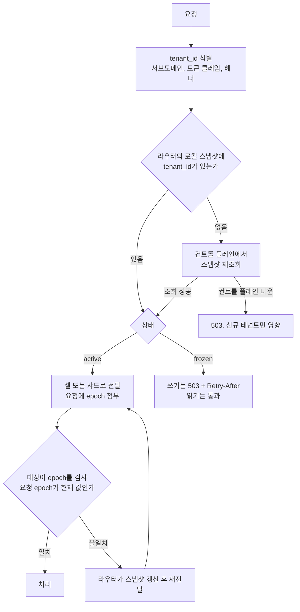
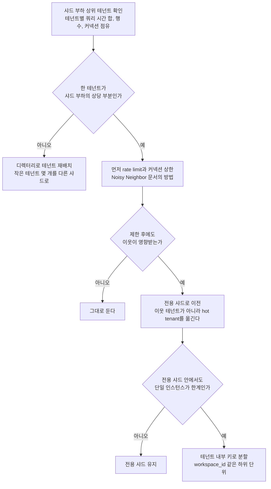
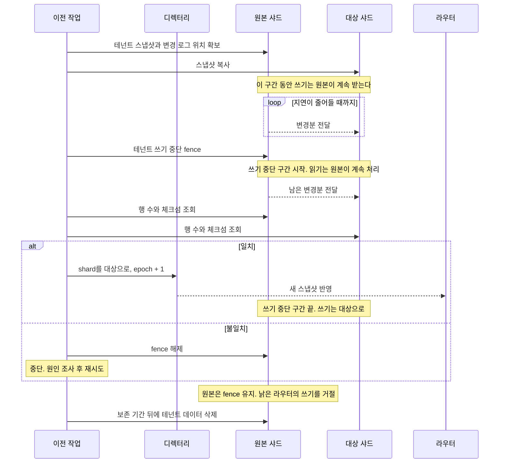
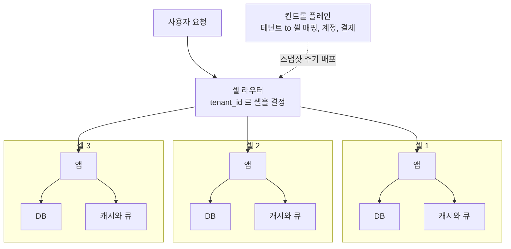
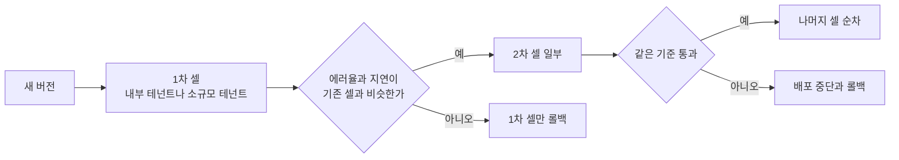
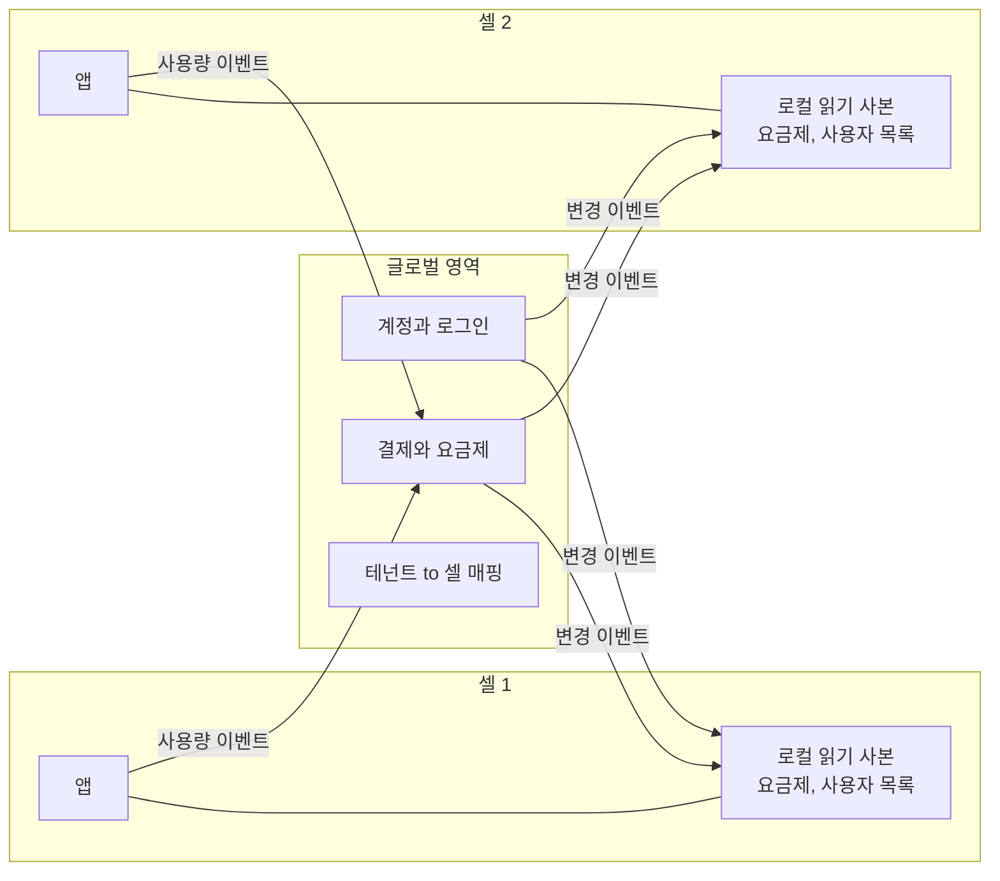
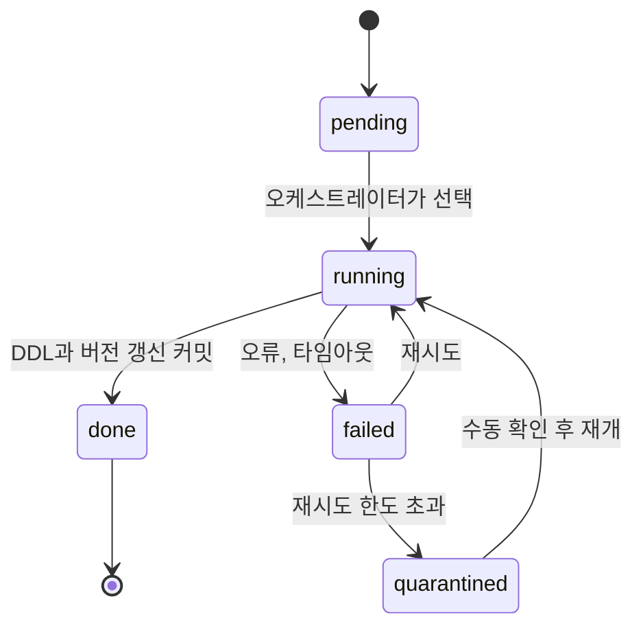

# 테넌트 샤딩과 셀 아키텍처

## 단일 DB 다음에 오는 문제

공유 스키마 + RLS로 시작한 SaaS는 테넌트가 늘면 DB 한 대가 먼저 한계에 닿는다. 한계가 오는 순서는 서비스마다 다르지만 대개 이렇게 나타난다. 커넥션 수가 먼저 부족해지고, 그다음 쓰기 처리량이 천장을 치고, 테이블 하나가 커져서 인덱스 유지와 vacuum이 느려진다. 마지막으로 마이그레이션과 백업 복원에 걸리는 시간이 운영 부담으로 올라온다. 복원 시간은 평소에는 아무도 재지 않다가 장애가 난 날 처음 숫자로 확인된다.

[멀티테넌시](Multi_Tenancy.md) 문서에서 격리 모델 세 가지를 다뤘고, [Noisy Neighbor](Noisy_Neighbor.md)에서 자원 독점을 막는 방법을 다뤘다. 둘 다 DB 한 대 안에서 테넌트를 어떻게 나누느냐의 이야기다. 이 문서는 그 DB가 이미 한 대로는 부족할 때 쓰는 선택지를 모은다. 테넌트 단위 샤딩, 큰 테넌트 한 곳 때문에 생기는 쏠림, 테넌트 이전, 앱 계층까지 통째로 나누는 셀 아키텍처, 샤드가 수백 개일 때의 스키마 변경이 주제다.

여기 나오는 라우팅 코드, 이전 절차, 마이그레이션 오케스트레이션은 `/tmp`에서 실제로 실행한 결과를 근거로 쓴다. PostgreSQL 서버는 실행하지 못했다. 샤드는 sqlite 인메모리 DB와 파이썬 객체로 대신했고, 복제 스트림은 변경 로그 리스트로 흉내 냈다. 실제 복제 도구가 내는 지연 시간이나 쓰기 중단 구간의 길이 같은 수치는 이 환경에서 잴 수 없어서 쓰지 않았다.

## 세 가지 배치 모델

| 항목 | 단일 DB | 테넌트 샤드 | 셀 |
|------|---------|------------|-----|
| 나누는 대상 | 없음 | 데이터 계층만 | 앱, DB, 캐시, 큐 전체 |
| 라우팅 | 불필요 | 앱 안이나 프록시에서 `tenant_id`로 샤드 결정 | 앞단 라우터가 `tenant_id`로 셀 결정 |
| 용량을 늘리는 방법 | 인스턴스를 키운다 | 샤드를 추가하고 테넌트를 옮긴다 | 셀을 추가한다. 셀 크기는 고정 |
| 나쁜 배포의 영향 | 전체 | 전체. 앱 서버는 공유이므로 | 배포된 셀의 테넌트만 |
| 테넌트 하나가 앱 풀을 독점 | 전체 | 전체. 앱 서버가 공유이므로 | 같은 셀의 테넌트만 |
| 테넌트 간 조인과 집계 | 쉽다 | 샤드를 돌며 모아야 한다 | 셀을 돌며 모아야 한다 |
| 스키마 변경 | 한 번 | 샤드 수만큼 | 셀 수 x 셀 안의 DB 수 |
| 운영 부담 | 낮음 | 중간. 라우팅 계층과 이전 도구가 필요 | 높음. 컨트롤 플레인이 따로 필요 |
| 시작하기 적당한 시점 | 처음부터 | DB 한 대가 쓰기나 용량에서 막힐 때 | 장애 범위를 테넌트 일부로 제한해야 할 때 |

샤드와 셀의 차이는 앱 계층에 있다. 샤드는 DB만 나누므로 앱 서버 풀, 캐시, 큐는 여전히 모든 테넌트가 같이 쓴다. 배포 하나가 잘못되면 샤드가 아무리 많아도 전체가 같이 죽는다. 셀은 앱 서버부터 DB까지 한 벌을 통째로 복제하고 테넌트를 셀 하나에 배정한다. 셀이 N개이고 테넌트가 고르게 배정돼 있다면 셀 하나의 장애는 테넌트의 1/N에만 닿는다. 대가로 셀 수만큼 인프라 한 벌과 배포 대상이 늘어난다.

샤드로 시작해서 셀로 가는 경로가 흔하다. 샤드 라우팅 계층이 있으면 앱 계층까지 포함하도록 라우팅 범위를 넓히는 일이 어렵지 않다. 반대로 라우팅 없이 커진 단일 DB에서 바로 셀로 가려면 `tenant_id`를 모든 호출 경로에 흘려보내는 작업부터 해야 한다.

## 라우터가 목적지를 찾는 구조

요청이 들어오면 테넌트를 식별하고, 매핑에서 목적지를 찾고, 거기로 보낸다. 샤드든 셀이든 이 구조는 같다. 다른 점은 목적지가 DB 커넥션 풀이냐 셀 전체의 진입점이냐다.



이 그림에서 눈여겨볼 곳은 두 군데다. 라우터는 요청마다 컨트롤 플레인을 부르지 않고 로컬 스냅샷만 읽는다. 그리고 대상 쪽이 epoch로 요청을 한 번 더 검사한다. 앞의 것은 라우터가 장애 지점이 되는 걸 줄이려는 것이고, 뒤의 것은 이전 직후에 낡은 캐시를 든 라우터가 옛 위치에 쓰는 사고를 막으려는 것이다. 둘 다 뒤에서 실행 결과와 함께 다시 나온다.

## 해시와 디렉터리

`tenant_id`를 샤드로 매핑하는 방법은 둘로 갈린다. 해시로 계산하거나, 테넌트마다 한 행씩 들어 있는 매핑 테이블을 조회한다.

| 항목 | 해시 | 디렉터리 |
|------|------|---------|
| 저장할 상태 | 샤드 목록뿐 | 테넌트 수만큼의 행 |
| 조회 비용 | 계산만 | 캐시 미스 때 조회 |
| 특정 테넌트를 따로 빼기 | 불가능. 예외 테이블이 따로 필요 | 행 하나를 고친다 |
| 샤드를 추가할 때 | 해시 방식에 따라 크게 달라진다 | 옮길 테넌트만 골라서 옮긴다 |
| 매핑 저장소가 죽으면 | 영향 없음 | 캐시가 없는 라우터는 멈춤 |

### 해시는 샤드를 추가할 때 갈린다

`hash(tenant_id) % N`은 N이 바뀌면 거의 전부가 움직인다. 테넌트 1만 개를 md5로 해시해서 샤드를 하나 추가했을 때 샤드가 바뀌는 테넌트의 비율을 쟀다. rendezvous 해시(highest random weight)와 비교했다.

| 샤드 수 | 나머지 연산 | rendezvous | 이론상 최소 (1/(N+1)) |
|--------|-----------|-----------|----------------------|
| 4 → 5 | 0.805 | 0.206 | 0.200 |
| 8 → 9 | 0.891 | 0.099 | 0.111 |
| 16 → 17 | 0.939 | 0.059 | 0.059 |

나머지 연산은 샤드가 늘수록 이동 비율이 100%에 가까워진다. 샤드 하나 추가가 사실상 전체 재배치다. rendezvous는 새 샤드가 가져가야 할 몫만 움직인다. 8 → 9에서 이론값보다 조금 작게 나온 것은 표본이 1만 개라서 생긴 편차다. 구현은 샤드마다 `해시(샤드 이름 + tenant_id)`를 구해서 가장 큰 값을 가진 샤드를 고르는 게 전부다.

```python
import hashlib

def stable_hash(key: str) -> int:
    return int.from_bytes(hashlib.md5(key.encode()).digest()[:8], "big")

class RendezvousRouter:
    def __init__(self, shards):
        self.shards = list(shards)

    def route(self, tenant_id):
        return max(self.shards, key=lambda s: stable_hash(f"{s}:{tenant_id}"))
```

파이썬에서는 내장 `hash()`를 쓰면 안 된다. 문자열 해시가 프로세스마다 다른 시드로 계산돼서, `PYTHONHASHSEED`를 1과 2로 바꿔 `hash('tenant-42') % 4`를 찍으면 각각 1과 2가 나왔다. 라우터 인스턴스 두 대가 같은 테넌트를 서로 다른 샤드로 보낸다는 뜻이다. 개발 환경에서는 프로세스 하나라 안 드러나고, 라우터를 두 대로 늘린 날 데이터가 두 군데에 쌓이기 시작한다. 위 코드처럼 md5 같은 안정된 해시를 직접 쓴다.

해시의 한계는 이동 비율이 아니라 "이동할 테넌트를 고를 수 없다"는 점이다. 테넌트 `t0`이 커져서 따로 빼고 싶어도 해시는 `t0`을 같은 자리에 둔다. 해시로 시작한 시스템도 결국 "이 테넌트는 해시 결과를 무시하고 여기로"라는 예외 테이블이 생긴다. 예외가 늘어나면 그건 이미 디렉터리다.

### 디렉터리는 해시를 배치 정책으로만 쓴다

현실적인 형태는 디렉터리를 정답 저장소로 두고, 해시는 새 테넌트를 어디에 배정할지 정하는 데만 쓰는 방식이다. 배정 결과는 항상 디렉터리에 기록한다. 이러면 이후에 샤드가 늘어도 이미 배정된 테넌트의 위치는 바뀌지 않고, 옮기고 싶은 테넌트만 행을 고쳐서 옮긴다.

```sql
-- 구조 예시. 이 문서에서 실행해 보지는 않았다
CREATE TABLE tenant_placement (
    tenant_id  text PRIMARY KEY,
    shard_id   text NOT NULL,
    epoch      integer NOT NULL DEFAULT 1,
    state      text NOT NULL DEFAULT 'active',  -- active | frozen
    updated_at timestamptz NOT NULL DEFAULT now()
);
```

`epoch`는 이전할 때마다 1씩 올린다. 이 값이 라우터 캐시와 샤드 사이의 합의 수단이 된다. 행 수는 테넌트 수와 같으므로 수만 개 수준이면 라우터 메모리에 통째로 올려도 부담이 없다. 디렉터리에 읽기 쓰기가 몰리는 건 이전 작업 중뿐이고, 평소 요청 경로는 로컬 스냅샷만 읽는다.

디렉터리가 만드는 새 문제는 둘이다. 하나는 디렉터리 자체가 모든 요청의 의존성이 된다는 점이다. 로컬 스냅샷으로 완화하되, 스냅샷이 낡을 수 있다는 점을 받아들여야 한다. 다른 하나는 낡은 스냅샷이 틀린 샤드로 요청을 보낼 수 있다는 점이고, 이건 아래 이전 절차에서 epoch 검사로 막는다.

## 한 테넌트가 샤드를 독점할 때

샤딩을 도입하면 부하가 고르게 퍼질 거라고 기대하기 쉽다. 테넌트 수가 많고 크기가 비슷할 때만 맞는 기대다. B2B SaaS는 테넌트 크기 분포가 심하게 치우쳐 있어서, 한 곳이 전체의 큰 비중을 차지하는 일이 흔하다.

배치를 시뮬레이션해서 확인했다. 테넌트 2,000개, 샤드 8개, 크기는 파레토 분포(shape 1.2, seed 7)로 뽑았다. 샤드의 부하는 그 샤드에 배정된 테넌트 크기의 합으로 잡았다. 실제 쿼리 부하가 아니라 크기의 합이라는 점은 감안해야 한다.

처음에는 분포를 그대로 썼다. 가장 큰 테넌트가 샤드 평균 부하의 0.27배였고, 해시 배치에서 가장 무거운 샤드가 평균의 1.32배였다. 이 정도면 해시만으로 충분히 버틴다. 문제는 가장 큰 테넌트를 전체 부하의 30%로 키웠을 때 나타났다.

| 배치 방식 | 가장 무거운 샤드 / 평균 |
|----------|----------------------|
| 해시 | 3.11 |
| 디렉터리, 큰 테넌트부터 가장 한가한 샤드에 배정 | 2.40 |
| hot tenant 전용 샤드 + 나머지 7개에 같은 방식 | hot 샤드 2.40, 나머지 7개 중 최대 1.00 |

이 표에서 세 가지를 읽는다.

해시에서 가장 무거운 샤드는 hot tenant가 사는 샤드 그 자체였고, 거기에는 다른 테넌트 263개가 같이 살고 있었다. 부하 3.11은 hot tenant 몫 2.40에 이웃 263개의 몫이 더해진 값이다. hot tenant가 자원을 먹으면 이 이웃들이 전부 같이 느려진다.

디렉터리로 큰 테넌트부터 가장 한가한 샤드에 배정하면 hot tenant는 샤드를 혼자 쓰게 됐다(이웃 0개). 이미 샤드 하나가 평균의 2.4배라서 다른 테넌트가 그 샤드로 갈 이유가 없기 때문이다. 그래도 2.40 아래로는 내려가지 않는다. 어디에 놓든 그 샤드는 평균의 2.4배이고, 샤딩은 테넌트를 나누는 도구이지 테넌트 하나를 쪼개는 도구가 아니다.

세 번째 행은 같은 결과를 의도적으로 만든 경우다. hot tenant를 전용 샤드에 고정하고 나머지를 7개 샤드에 배정하면 나머지 샤드의 부하는 서로 균형이 맞는다. 결과 숫자는 두 번째 행과 같지만, 두 방식은 성격이 다르다. 두 번째는 배정 알고리즘이 우연히 그렇게 놓은 것이고, 세 번째는 운영자가 "이 테넌트는 전용"이라고 못 박은 것이다. 못 박아 두지 않으면 테넌트 크기가 바뀌었을 때 다음 재배치에서 다시 이웃이 붙을 수 있다.

전용 샤드를 만들어도 그 샤드는 여전히 평균의 2.4배다. 인스턴스를 더 큰 것으로 쓰거나, 아래 흐름의 마지막 단계로 부하를 따로 줄여야 한다.



이전 대상은 hot tenant 쪽이어야 한다. 위 해시 배치에서는 이웃이 263개였고, 이웃을 전부 옮기는 것보다 hot tenant 하나를 옮기는 게 작업량도 적고 위험도 작다. 운영 중에 나오는 첫 반응은 "큰 테넌트를 옮기면 무거우니 작은 쪽을 옮기자"인 경우가 많다. 큰 테넌트는 복사에 시간이 더 걸리지만, 아래 절차에서 복사는 서비스를 세우지 않고 돌아간다. 크기가 쓰기 중단 구간에 영향을 주는 경로는 검증 비용 하나이고, 이것도 설계로 줄일 수 있다.

내부 키로 분할하는 마지막 단계는 비용이 크다. 테넌트 한 곳 안에서 `workspace_id`나 `project_id`로 샤드를 나누면 그 테넌트의 데이터를 쓰는 모든 쿼리가 샤드 키를 두 단계로 가져야 한다. 전용 샤드에서 인스턴스 증설이 몇 번 더 가능한지부터 따지고, 그게 막혔을 때 꺼낼 카드로 두는 게 낫다.

## 테넌트를 무중단으로 옮기는 절차

디렉터리 방식이 유용한 이유는 한 테넌트의 데이터를 샤드 A에서 B로 옮기는 일을 서비스 중단 없이 할 수 있기 때문이다. 정확히는 쓰기가 잠깐 멈추는 구간이 한 번 있다. 읽기는 계속 받고, 쓰기는 거절하거나 대기시킨다.



단계마다 하는 일과 틀어지기 쉬운 곳을 순서대로 적는다.

**복사**: 이 테넌트의 행만 일관된 스냅샷으로 읽어서 대상에 넣는다. 복사 시작 시점의 변경 로그 위치를 같이 기록한다. 복사에 시간이 걸리는 동안 원본은 평소처럼 쓰기를 받고, 그 변경은 로그로 쌓인다. 테넌트 크기가 커도 서비스는 영향이 없다.

**따라잡기**: 복사 중에 쌓인 변경 로그를 대상에 적용한다. 적용하는 동안에도 새 변경이 계속 들어오므로 한 번에 끝나지 않고, 남은 양이 충분히 작아질 때까지 반복한다. "충분히 작다"의 기준은 서비스가 허용하는 쓰기 중단 시간에서 거꾸로 정한다. 이 기준을 숫자로 잡으려면 사용하는 복제 도구의 실제 처리 속도를 먼저 재야 한다.

**쓰기 중단과 잔여 적용**: 원본이 이 테넌트의 쓰기를 거절하게 만든다. 이 시점부터 새 변경이 생기지 않으므로 남은 로그를 마저 적용하면 두 샤드가 같아진다. 이 구간의 길이는 중단 시점의 지연과 검증 비용을 합친 값이다.

**검증**: 시뮬레이션에서는 테넌트의 행 수, 금액 합, 행 전체의 해시를 양쪽에서 비교했다. 여기서 주의할 점은 검증이 쓰기 중단 구간 안에서 돌아간다는 점이다. 전체를 읽어서 비교하는 검증은 테넌트가 클수록 구간이 길어진다. 무거운 전체 비교는 구간 밖에서 스냅샷 기준으로 한 번 돌려 두고, 구간 안에서는 변경 로그 위치가 일치하는지와 최근 행의 체크섬 같은 가벼운 확인만 하는 구조가 더 현실적이다.

**전환**: 디렉터리의 `shard`를 바꾸고 `epoch`를 올린다. 이 한 번의 갱신이 전환의 순간이다. 전환 전까지는 fence만 풀면 원래 상태로 돌아가므로 되돌림이 쉽다. 전환 후에는 대상에 이미 새 쓰기가 들어갔을 수 있어서 되돌리려면 역방향 복제가 필요하다. 되돌릴 수 있는 마지막 시점이 전환 직전이라는 점을 작업 계획에 적어 둔다.

**정리**: 원본은 바로 지우지 않는다. fence를 유지한 채 보존 기간 동안 읽기 전용으로 두다가 지운다. PostgreSQL에서는 행을 지워도 파일 크기가 바로 줄지 않으므로, 샤드 용량을 줄이는 목적이라면 삭제 후 별도 작업이 필요하다.

### 낡은 라우터가 옛 샤드에 쓰는 문제

전환 직후가 가장 위험하다. 라우터 인스턴스는 여러 대이고 각자 로컬 스냅샷을 들고 있다. 디렉터리가 바뀐 시점부터 모든 라우터가 새 값을 보기까지 시간차가 있다. 그 사이에 낡은 스냅샷을 든 라우터가 옛 샤드로 쓰기를 보내면, 그 쓰기는 이미 비워질 곳에 들어간다. 에러도 없고 로그에도 정상으로 남는다. 나중에 "방금 만든 주문이 없어졌다"는 문의로 드러난다.

이 상황을 재현했다. 라우터 두 대가 각자 스냅샷을 캐시하고, 이전이 끝난 뒤에 낡은 캐시를 든 라우터가 쓰기를 한 번 더 보내는 시나리오다. 이전 전에 101행이 있었고, 복사 중에 한 행이 원본에 들어와서 따라잡기로 대상에 반영됐다. 이전이 끝난 시점에 대상은 102행이어야 한다.

| 원본에 fence 검사 | 낡은 라우터의 쓰기 결과 | 원본 행 수 | 대상 행 수 |
|------------------|---------------------|----------|----------|
| 있음 | 거절 후 스냅샷 갱신, 대상으로 재전송 | 102 | 103 |
| 없음 | 원본에 그대로 기록 | 103 | 102 |

fence가 없으면 쓰기는 성공으로 응답되고, 데이터는 서비스가 더 이상 읽지 않는 샤드에 쌓인다. 대상은 102행으로 고정이다. 검증은 전환 전에 이미 끝났으니 그 뒤의 손실은 아무 검사에도 걸리지 않는다. 핵심은 원본 샤드가 이전을 마친 테넌트의 쓰기를 영구히 거절해야 한다는 점이다.

```python
class Shard:
    def write(self, tenant, oid, amount):
        if tenant in self.fenced:
            raise Fenced(f"{self.name}: {tenant} fenced")
        self.db.execute("INSERT INTO orders VALUES (?,?,?)", (oid, tenant, amount))

class CachedRouter:
    def write(self, tenant, oid, amount):
        if tenant not in self.cache:
            self.cache[tenant] = tuple(self.dir.t[tenant])
        shard_name, _ = self.cache[tenant]
        try:
            self.shards[shard_name].write(tenant, oid, amount)
        except Fenced:
            del self.cache[tenant]                      # 스냅샷 폐기
            shard_name, _ = tuple(self.dir.t[tenant])    # 디렉터리에서 다시 조회
            self.shards[shard_name].write(tenant, oid, amount)
```

실제 DB에서는 이 fence를 구현할 자리를 정해야 한다. 앱 서버가 `tenant_placement`를 읽어서 확인하면 그 앱 서버도 낡은 캐시를 쓸 수 있으므로 소용이 없다. 샤드가 스스로 판단해야 한다. 샤드 안에 이전 완료 목록 테이블을 두고 쓰기 트랜잭션이 그 테이블을 확인하게 하거나, 해당 테넌트의 쓰기 권한을 DB 계정 수준에서 회수하는 방법이 있다. 어느 쪽이든 앱 코드의 캐시와 무관하게 DB가 거절해야 한다. 이 두 방법의 실제 동작은 이 문서에서 확인하지 않았다.

## 셀 기반 아키텍처

샤딩은 DB를 나누지만, 앞서 표에서 본 것처럼 앱 서버 풀과 배포 단위는 하나다. 셀 아키텍처는 서비스 전체를 한 벌씩 만들고 테넌트를 셀에 배정한다. 셀은 완결된 단위다. 앱 서버, DB, 캐시, 큐가 모두 셀 안에 있고, 셀끼리는 서로를 호출하지 않는다.



셀을 쓰는 가장 큰 이유는 장애 범위를 구조로 제한하는 것이다. 서킷브레이커나 벌크헤드가 코드 수준에서 영향을 줄이려는 시도라면, 셀은 영향이 닿을 수 있는 범위 자체가 물리적으로 나뉜 상태다. 한 셀의 DB가 죽거나, 한 셀에서 메모리 누수가 터지거나, 한 셀에 독특한 요청이 몰려도 다른 셀은 그 일이 있었는지 모른다. [장애 격리 패턴](MSA/장애_격리_패턴.md)에서 다룬 벌크헤드를 인프라 단위까지 끌어올린 형태다.

### 배포 단위로서의 셀

셀의 두 번째 효용은 배포다. 새 버전을 모든 서버에 한 번에 내보내는 대신 셀 하나씩 내보낸다. 첫 셀에 문제가 생겨도 영향받는 테넌트는 그 셀의 것뿐이고, 롤백도 그 셀에서만 한다.



배포를 셀 순서로 나눌 때 1차 셀에 어떤 테넌트를 둘지가 의외로 중요하다. 내부 테넌트나 영향이 작은 고객만 모아 둔 셀이 1차가 돼야 한다. 대형 고객이 몰린 셀을 먼저 배포하면 셀 단위 배포의 이점이 없어진다. 비교 기준인 "기존 셀"의 지표도 필요하다. 1차 셀의 에러율이 올랐을 때 원인이 새 버전인지 그 셀의 트래픽 특성인지는, 같은 시각 다른 셀과 비교해야 구분된다.

### 셀 라우터가 단일 장애점이 되는 문제

셀 하나가 죽어도 다른 셀은 멀쩡하게 설계했는데, 모든 요청이 지나가는 라우터가 죽으면 모든 셀이 동시에 닿지 않는다. 셀 아키텍처에서 격리되지 않은 유일한 컴포넌트가 라우터다. 라우터를 셀 안에 넣을 수도 없다. 셀을 찾기 위한 컴포넌트가 셀 안에 있을 수 없다.

라우터가 지켜야 할 조건은 대체로 세 가지다.

- 라우터는 매핑 조회와 전달만 한다. 인증, 비즈니스 로직, 요청 본문 변형은 넣지 않는다. 코드가 적을수록 배포 사고도 줄어든다.
- 요청 경로에서 외부 저장소를 부르지 않는다. 매핑은 라우터 메모리의 스냅샷이고, 컨트롤 플레인은 스냅샷을 갱신할 때만 쓴다.
- 컨트롤 플레인이 죽어도 이미 알고 있는 테넌트는 계속 라우팅한다. 이 방식을 fail-static이라고 부른다.

세 번째 조건을 코드로 확인했다. 컨트롤 플레인을 내려 둔 상태에서 기존 테넌트와 신규 테넌트, 이전된 테넌트를 라우팅했다.

```python
class CellRouter:
    """데이터 경로는 로컬 스냅샷만 읽는다. 컨트롤 플레인은 갱신에만 쓴다."""

    def refresh(self):
        try:
            self.version, self.mapping = self.cp.snapshot()
            return True
        except ControlPlaneDown:
            return False

    def route(self, tenant_id):
        cell = self.mapping.get(tenant_id)
        if cell is None:
            if self.refresh():
                cell = self.mapping.get(tenant_id)
            if cell is None:
                raise LookupError(f"{tenant_id}: 매핑 없음 (스냅샷 v{self.version})")
        return cell
```

실행 결과는 이렇다.

| 상황 | 결과 |
|------|------|
| 정상 | `acme`는 cell-1, `globex`는 cell-2 |
| 컨트롤 플레인 다운 | 둘 다 그대로 라우팅됨 |
| 다운 중 `acme`를 cell-3으로 이전 | 라우터는 여전히 cell-1을 가리킴 |
| 다운 중 신규 테넌트 `newco` 요청 | `LookupError: newco: 매핑 없음 (스냅샷 v1)` |

컨트롤 플레인이 내려가도 기존 테넌트의 요청은 처리된다. 대가는 두 줄이다. 신규 테넌트는 매핑이 스냅샷에 없어서 라우팅이 안 된다. 이전된 테넌트는 라우터가 옛 셀로 보내는데, 이건 앞 절에서 본 문제와 같은 종류다. 옛 셀이 이전을 마친 테넌트의 요청을 거절하고 라우터가 스냅샷을 갱신해야 한다. 그러니 이전 작업도 컨트롤 플레인이 살아 있는 동안만 진행하도록 막아 두는 편이 안전하다.

스냅샷 배포도 장애 원인이 된다. 컨트롤 플레인의 오류로 대부분의 테넌트가 셀 하나를 가리키는 스냅샷이 만들어져 라우터에 배포되면, 셀 장애가 아니라 설정 하나로 전체 장애가 난다. 새 스냅샷이 직전 스냅샷과 비교해 바뀐 비율이 임계치를 넘으면 라우터가 적용을 거부하게 해야 한다. 임계치는 서비스의 이전 빈도에 맞춰 정한다. 이 문서에서는 값을 검증하지 못해서 제시하지 않는다.

서브도메인으로 테넌트를 식별하는 서비스라면 라우터를 거치지 않는 선택지도 있다. 테넌트 서브도메인의 DNS 레코드가 해당 셀의 진입점을 직접 가리키게 하는 방식이다. 라우터가 죽어도 요청이 셀에 닿는다. 대신 이전 때 DNS TTL만큼 전환이 느려지고, 낡은 레코드로 오는 요청은 옛 셀이 받아서 거절하거나 대상 셀로 넘겨야 한다.

### 셀 사이에서 공유되는 데이터

셀은 서로 독립이어야 하지만 계정, 결제, 요금제, 테넌트-셀 매핑은 셀 바깥에 있어야 한다. 로그인 요청은 이메일을 받을 때 아직 어느 테넌트인지 모르기 때문에 셀을 고르기 전에 조회가 필요하다. 한 사용자가 여러 테넌트에 속하는 경우는 더 그렇다. 결제도 고객 단위로 한 곳에서 처리하는 게 낫다.



공유 데이터를 다루는 방식은 정해져 있다. 셀은 요청 처리 중에 글로벌 영역을 동기 호출하지 않는다. 글로벌 영역의 변경은 이벤트로 셀에 전달돼 셀 로컬에 읽기 사본으로 쌓이고, 셀 안의 코드는 그 사본만 읽는다. 사용량 같은 셀에서 만드는 데이터는 반대 방향으로 이벤트를 보내 결제 영역에 모은다. 사용량 계량 쪽은 [테넌트별 사용량 계량과 쿼터](Tenant_Usage_Metering_and_Quota.md)에서 다룬 멱등 키 처리가 그대로 적용된다.

이 구조의 대가는 일관성이다. 요금제를 다운그레이드해도 이벤트가 셀에 닿기 전까지는 셀이 이전 요금제로 동작한다. 이 지연을 허용할 수 없는 기능, 예를 들어 결제 실패 직후 즉시 차단해야 하는 기능은 셀이 글로벌 영역을 동기 호출해야 하고, 그 호출은 글로벌 영역 장애가 셀로 번지는 통로가 된다. 그런 호출은 최소한으로 두고, 타임아웃에 걸렸을 때 열어 둘지 닫아 둘지를 기능별로 정해야 한다.

글로벌 영역이 죽었을 때의 영향을 미리 구분해 두면 장애 대응이 빠르다. 이미 로그인한 사용자는 토큰과 로컬 사본으로 계속 쓴다. 신규 가입, 요금제 변경, 신규 로그인, 신규 테넌트 라우팅은 막힌다. 글로벌 영역은 셀 수가 늘어도 한 벌이므로 셀과 달리 격리의 이점이 없고, 그만큼 변경이 적고 읽기 위주로 유지해야 한다.

## 샤드 수백 개에 스키마를 바꾸는 문제

샤드나 셀 안의 DB가 수백 개가 되면 스키마 변경은 수백 번의 배포가 된다. 이 중 하나라도 중간에 실패하면 서비스는 스키마 버전이 서로 다른 DB 집합 위에서 돈다. [멀티테넌시](Multi_Tenancy.md)의 마이그레이션 실수 항목에 있는 루프가 이 문제의 초기 형태다. 실패한 목록을 메모리에만 두고 마지막에 예외로 올리는 코드라서, 프로세스가 중간에 죽으면 어디까지 했는지 알 수 없다.

### 버전이 갈라지는 두 가지 경로

시뮬레이션은 sqlite 샤드 40개에 버전 1에서 3까지 올리는 작업이다. 버전 2는 `ALTER TABLE orders ADD COLUMN currency TEXT`, 버전 3은 `tenant_id` 인덱스 생성이다. 동시 실행은 8개로 했고, 샤드 세 개에 장애를 넣었다. `s07`은 버전 2에서 연결이 끊기고, `s23`은 버전 3에서 연결이 끊기고, `s31`은 버전 2의 DDL을 실행한 직후 버전 번호를 올리기 전에 죽는다.

버전 번호 갱신을 DDL과 같은 트랜잭션에 넣은 경우는 이렇게 끝났다.

| 시점 | 버전 분포 (버전: 샤드 수) |
|------|------------------------|
| 1차 실행 후 | 1: 1개, 2: 1개, 3: 38개 |
| 실패한 샤드만 재실행 후 | 3: 40개 |

DDL과 버전 갱신을 별도 문장으로 실행한 경우는 다르게 끝났다.

| 시점 | 버전 분포 |
|------|---------|
| 1차 실행 후 | 1: 2개, 2: 1개, 3: 37개 |
| `s31`의 실제 상태 | 버전은 1인데 `currency` 컬럼이 이미 존재함 |
| 실패한 샤드만 재실행 후 | 1: 1개, 3: 39개. `s31`은 `duplicate column name: currency`로 실패 |

두 번째 경우에서 `s31`은 영구히 갇힌다. 버전 번호는 1이라 마이그레이션 2를 다시 실행하려 하는데, 컬럼은 이미 있어서 DDL이 실패한다. 사람이 `s31`에 들어가 버전 번호를 직접 고치기 전까지 자동 재시도는 계속 같은 에러를 낸다. 수백 개 중 하나가 이런 상태가 되면 찾기도 어렵다.

첫 번째 경우의 `s31`은 정상으로 끝났다. 시뮬레이션에서 "DDL 직후, 버전 갱신 직전에 죽는" 지점은 트랜잭션이 없는 경로에만 존재하기 때문이다. 트랜잭션 안에서 DDL과 버전 갱신 사이에 롤백을 일으켜 보면 버전은 1로 남고 `currency` 컬럼도 생기지 않았다. 둘이 같이 반영되거나 같이 취소된다.

이 방법은 DDL이 트랜잭션 안에서 롤백되는 DB에서만 통한다. PostgreSQL과 sqlite는 그렇다. MySQL은 DDL이 암묵적으로 커밋되므로 이 보호가 없다. 이 경우는 마이그레이션 문장 자체를 멱등하게 써야 한다. `ADD COLUMN IF NOT EXISTS` 같은 조건부 문법이 있는 DB라면 그걸 쓰고, 없으면 실행 전에 `information_schema`를 조회해서 이미 적용됐는지 확인한다.

### 오케스트레이터가 가져야 할 상태

실패한 샤드를 다시 찾으려면 샤드별 진행 상태가 샤드 바깥의 영속 저장소에 있어야 한다. 컨트롤 플레인 DB에 이런 테이블을 둔다.

```sql
-- 구조 예시. 이 문서에서 실행해 보지는 않았다
CREATE TABLE shard_migration_run (
    shard_id       text NOT NULL,
    target_version integer NOT NULL,
    status         text NOT NULL,   -- pending | running | done | failed
    attempts       integer NOT NULL DEFAULT 0,
    last_error     text,
    updated_at     timestamptz NOT NULL DEFAULT now(),
    PRIMARY KEY (shard_id, target_version)
);
```

오케스트레이터는 이 테이블을 읽어서 `done`이 아닌 샤드만 대상으로 삼는다. 프로세스가 중간에 죽어도 다시 띄우면 이어서 진행한다. 실행한 코드의 핵심은 이 함수이고, 시뮬레이션에서는 이 테이블 대신 딕셔너리를 썼다.

```python
def run(shards, target, atomic, ledger, workers=8):
    def one(sh):
        try:
            while sh.version() < target:
                apply_one(sh, sh.version() + 1, atomic)
            ledger[sh.name] = "done"
        except Exception as e:
            ledger[sh.name] = f"failed: {e}"
    with ThreadPoolExecutor(workers) as ex:
        list(ex.map(one, shards))
```

샤드 하나의 실패가 다른 샤드의 진행을 막지 않게 샤드 단위로 예외를 잡아 기록한다. 샤드 안에서는 버전을 한 단계씩 올린다. 중간에서 멈춘 샤드가 `current_version + 1`부터 이어서 진행할 수 있어야 하기 때문이다.



`quarantined`는 자동 재시도로 풀리지 않는 샤드를 분리하는 상태다. 위의 `s31`처럼 DDL 상태와 버전이 어긋난 경우가 여기 들어간다. 이 상태의 샤드는 사람이 카탈로그를 직접 조회해 실제 스키마를 확인한 뒤 풀어 준다.

### 순서와 호환성

오케스트레이션 도구보다 중요한 건 마이그레이션이 버전이 섞인 상태에서 돌아가도록 짜는 것이다. 수백 개 샤드를 한 번에 올릴 수는 없으므로 진행 중에는 항상 일부 샤드가 옛 버전이다. 앱이 새 컬럼을 필수로 요구하면 옛 샤드에서 에러가 난다. 컬럼 추가는 앱을 먼저 새 컬럼 없이도 동작하게 만들고, 모든 샤드에 컬럼을 추가한 뒤, 그다음에 앱이 컬럼을 쓰게 한다. [Expand, Migrate, Contract](MSA/Expand_Migrate_Contract.md) 문서가 이 순서를 다룬다.

실행 순서도 정해야 한다. 한 번에 모든 샤드에 돌리지 않고 작은 샤드 하나를 먼저 올려 본다. 이어서 일부를 올리고, 실패율이 임계치를 넘으면 전체 진행을 멈추고, 나머지를 병렬 한도 안에서 진행한다. 이 병렬 한도는 컨트롤 플레인과 샤드 모두가 DDL의 락 대기를 견디는 수준에서 정해야 한다. 한도를 정하는 숫자는 서비스마다 다르므로 처음에는 낮게 시작해서 올린다.

버전 번호가 맞는다고 스키마가 같다는 뜻은 아니다. 위 시뮬레이션에서 `s31`은 버전과 실제 스키마가 달랐다. 정기적으로 샤드마다 카탈로그에서 컬럼 목록과 인덱스를 읽어서 기준 샤드와 비교하는 검사를 돌려야 한다. 이 검사가 버전 번호만 믿는 오케스트레이터가 놓치는 구멍을 메운다.

마지막으로, 라우터가 최소 스키마 버전 미만의 샤드로는 해당 기능의 요청을 보내지 않게 하는 방법이 있다. 새 기능이 켜진 상태에서 옛 스키마 샤드에 요청이 가는 순간을 막을 수 있다. 다만 이 방식은 라우터가 샤드 버전을 알아야 하므로 라우터의 책임이 늘고, 앞서 본 "라우터는 얇게" 원칙과 충돌한다. 기능 플래그에서 샤드 버전을 조건으로 검사하는 쪽이 더 낫다. 플래그 쪽은 [테넌트별 설정과 기능 플래그](Tenant_Configuration_and_Feature_Flags.md)에서 다뤘다.

## 관련 문서

- [멀티테넌시](Multi_Tenancy.md): 공유 스키마, 스키마 분리, DB 분리 모델과 테넌트 식별
- [Noisy Neighbor](Noisy_Neighbor.md): hot tenant를 전용 샤드로 빼기 전에 시도하는 자원 제한
- [테넌트 네트워크 격리](Tenant_Network_Isolation.md): 셀과 전용 샤드 사이의 네트워크 경계
- [테넌트별 사용량 계량과 쿼터](Tenant_Usage_Metering_and_Quota.md): 셀에서 결제 영역으로 보내는 사용량 이벤트
- [테넌트별 설정과 기능 플래그](Tenant_Configuration_and_Feature_Flags.md): 샤드 버전에 따른 기능 활성화
- [Schema-Per-Tenant](../DataBase/RDBMS/Schema_Per_Tenant.md): 스키마 수백 개에 마이그레이션을 돌릴 때의 병렬 실행과 롤백
- [장애 격리 패턴](MSA/장애_격리_패턴.md): 코드 수준의 벌크헤드와 서킷브레이커
- [Expand, Migrate, Contract](MSA/Expand_Migrate_Contract.md): 버전이 섞인 상태를 견디는 스키마 변경 순서
