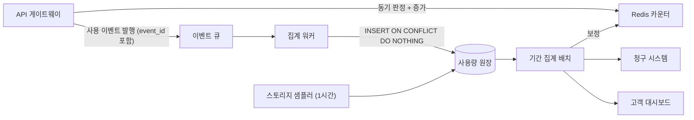
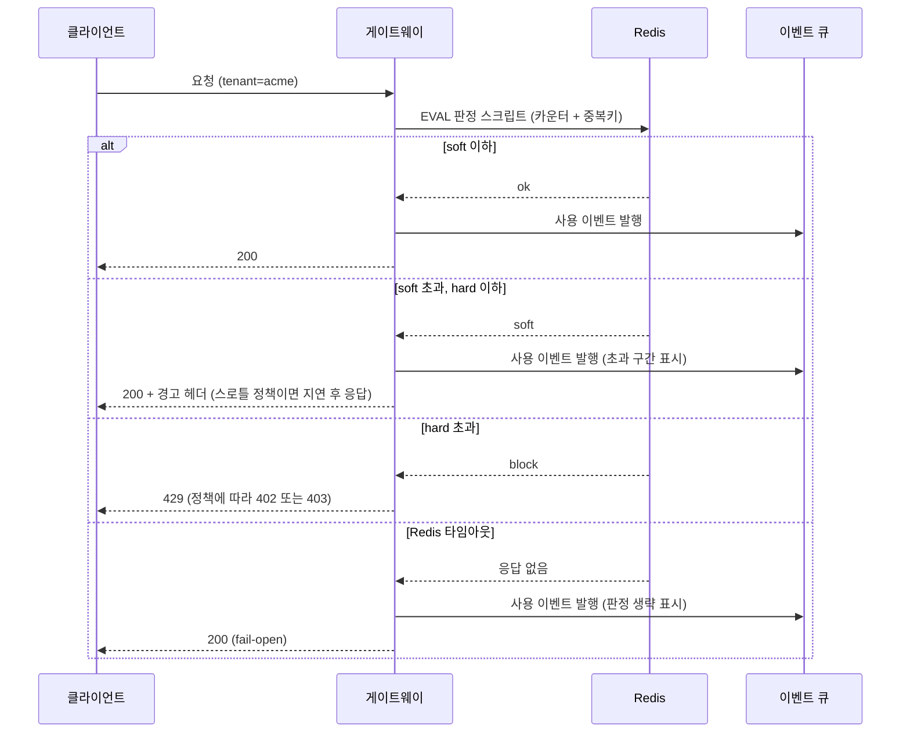
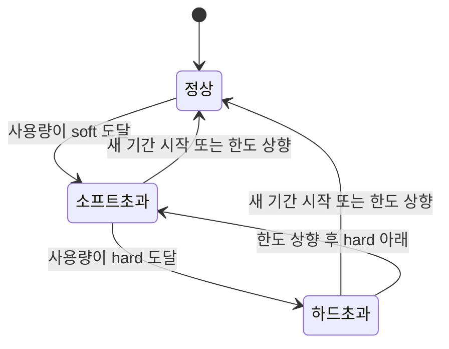
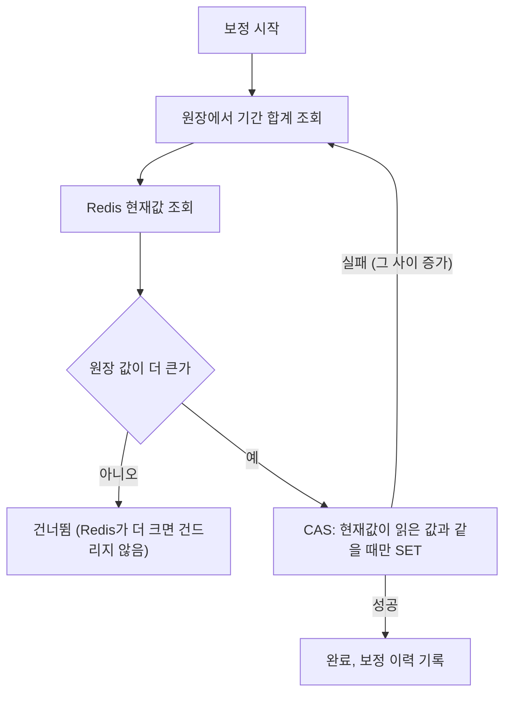

# 테넌트별 사용량 계량과 쿼터

멀티테넌트 SaaS에서 "이 테넌트가 이번 달에 얼마나 썼나"는 처음에는 `SELECT COUNT(*)` 한 줄이다. 요금제가 붙고 한도가 붙고 초과 과금이 붙으면 이 질문에 세 군데서 답해야 한다. 게이트웨이는 지금 요청을 통과시킬지 1ms 안에 정해야 하고, 청구 시스템은 월말에 1원 단위까지 맞는 숫자를 내야 하고, 고객 대시보드는 그 중간쯤의 숫자를 보여준다. 세 곳이 같은 숫자를 보지 않으면 고객이 "대시보드에는 9,800건인데 청구서에는 10,300건"이라는 문의를 보내온다.

자원 간섭 자체(한 테넌트가 CPU나 커넥션을 독점하는 문제)는 [Noisy Neighbor](Noisy_Neighbor.md)에서 다룬다. 초당 단위 요청 제한과 Bulkhead는 [Rate Limiting & Bulkhead](../Backend/Resilience/Rate_Limiting_and_Bulkhead.md)가 맡는다. 이 문서는 그 위 계층, 즉 "얼마나 썼는지 재서 월 한도와 청구서로 연결하는 부분"만 다룬다. 요금제별 한도 값을 어디에 저장하느냐는 [테넌트별 설정과 기능 플래그](Tenant_Configuration_and_Feature_Flags.md)와 겹치는데, 여기서는 한도 값이 이미 조회된다고 가정한다.

이 문서의 코드와 SQL은 `/tmp`에서 실행해 확인했다. Redis 서버를 설치할 수 없는 환경이라 카운터 코드는 fakeredis 2.40(Lua 실행에 lupa 사용)으로 돌렸고, SQL은 SQLite 3.37로 돌렸다. PostgreSQL 전용 문법은 직접 실행하지 않았기 때문에 본문에서 따로 표시한다.

## 무엇을 세는가: 세 가지 계량 유형

계량 대상은 성질이 세 가지로 갈린다. 이걸 섞어서 한 테이블에 `usage_count` 하나로 넣으면 나중에 청구 로직이 전부 예외 처리가 된다.

| 유형 | 예 | 더하면 의미가 있나 | 월 청구값 |
|---|---|---|---|
| 누적 이벤트 | API 호출, 메시지 발송, 리포트 생성 | 있다 | 기간 내 합계 |
| 수준 값(gauge) | 저장 용량, 동시 접속 좌석 수 | 없다 (시점 값) | 평균, 최댓값, 또는 GB-시간 |
| 고유 개수 | 활성 사용자(MAU) | 없다 (중복 제거 필요) | 기간 내 DISTINCT 개수 |

저장 용량은 가장 자주 틀린다. 이벤트처럼 "증가량"을 더해서 관리하면 삭제 이벤트가 하나라도 유실될 때 영원히 어긋난다. 시간 단위로 현재 크기를 샘플링해서 그 값을 저장하는 쪽이 복구가 쉽다. 10월 1일부터 100GB를 쓰다가 15일 하루만 900GB로 올렸다 지운 테넌트를 시간 단위 샘플 744개로 만들어 집계하면 이렇게 나온다.

```sql
CREATE TABLE storage_samples(
  tenant_id TEXT, sampled_at TEXT, bytes INTEGER,
  PRIMARY KEY (tenant_id, sampled_at));

SELECT COUNT(*), AVG(bytes)/1e9, MAX(bytes)/1e9
FROM storage_samples
WHERE tenant_id = 'acme'
  AND sampled_at >= '2026-10-01T00:00:00Z' AND sampled_at < '2026-11-01T00:00:00Z';
-- 744 | 125.806... | 900.0
```

월 평균은 약 125.8GB, 최댓값은 900GB다. 어느 값으로 청구하느냐는 요금제 정책이지만, 정책을 정하기 전에 두 값이 이만큼 벌어진다는 걸 영업팀과 같이 봐야 한다. 최댓값 기준으로 하면 하루 스파이크 때문에 고객이 한 달치 상위 구간 요금을 낸다. 샘플링 주기도 정책의 일부다. 1시간 주기라면 그 사이에 올렸다 지운 데이터는 안 잡힌다.

샘플러는 같은 시각에 두 번 돌아도 한 행만 남도록 PK를 `(tenant_id, sampled_at)`로 잡았다. 이벤트 쪽 중복 제거는 뒤에서 다룬다.

활성 사용자는 `COUNT(DISTINCT user_id)`로 센다. 일별로 미리 집계해 두면 월 DISTINCT를 못 구한다. 하루 단위 개수를 더하면 매일 로그인하는 사용자가 30번 센다. 일별 집계는 대시보드용으로만 쓰고, 청구용은 원장에서 기간 전체 DISTINCT를 다시 계산한다.

```sql
SELECT COUNT(DISTINCT user_id) FROM usage_events
WHERE tenant_id = 'seoul' AND metric = 'login'
  AND occurred_at >= '2026-10-01T00:00:00Z' AND occurred_at < '2026-11-01T00:00:00Z';
```

Redis의 HyperLogLog(`PFADD`/`PFCOUNT`)로 실시간 근사치를 만들 수도 있다. 표준 오차가 0.81%라서 화면 표시나 소프트 경고에는 쓸 만하고, 청구서 숫자로는 쓰지 않는다.

## 이벤트가 청구서까지 가는 길

사용 이벤트는 요청 경로 안에서 만들어지지만 요금 계산은 요청 경로 밖에서 일어난다. 그 사이에 Redis 카운터(판정용)와 원장 DB(청구용)라는 두 개의 저장소가 따로 존재한다는 점이 이 문서의 나머지를 전부 결정한다.



게이트웨이에서 Redis로 가는 선은 요청을 막을지 정하는 경로이고, 큐로 가는 선은 기록을 남기는 경로다. 두 선은 독립적이다. Redis 증가는 성공했는데 큐 발행이 실패할 수도, 반대일 수도 있다. 청구 시스템은 원장만 읽고 Redis는 읽지 않는다. 보정 화살표가 `기간 집계 배치`에서 `Redis 카운터`로 향하는 이유가 뒤의 유실 사례다.

### 이벤트 계량과 배치 집계

계량 방식은 두 가지다. 요청마다 이벤트를 내보내는 방식(위 그림)과, 기존 로그나 테이블을 주기적으로 훑어 집계하는 방식이다.

| 항목 | 이벤트 기반 | 배치 집계 (로그/테이블 스캔) |
|---|---|---|
| 한도 판정 | 실시간 카운터와 결합 가능 | 배치 주기만큼 늦다 |
| 코드 침투 | 게이트웨이/서비스에 발행 코드 필요 | 없음 (기존 데이터 활용) |
| 누락 위험 | 발행 실패, 큐 유실 | 로그 로테이션, 샘플링 설정 |
| 중복 위험 | at-least-once 재전달 | 배치 재실행 |
| 재계산 | 원장에서 가능 | 원본 보관 기간 안에서만 가능 |
| 저장 용량, 좌석 같은 gauge | 부적합 | 적합 |

둘 중 하나를 고르는 문제가 아니다. API 호출처럼 요청 단위로 생기고 한도 판정이 필요한 것은 이벤트로, 저장 용량처럼 상태를 읽어야 하는 것은 배치 샘플러로 간다. 이벤트 계량이 없는 지표를 나중에 추가해야 할 때 로그 스캔으로 먼저 시작하는 경우도 많다. 로그 스캔은 응답 상태 코드로 거른 "성공한 호출만 과금" 같은 규칙을 구현하기도 쉽다. 단점은 로그 보관 기간이 지나면 분쟁이 생겨도 재계산을 못 한다는 것이다. 청구에 쓰는 지표는 원장에 이벤트로 남겨 둬야 한다.

## 중복 이벤트와 idempotency key

큐는 at-least-once로 동작하는 경우가 대부분이라 같은 이벤트가 두 번 들어온다. 컨슈머가 처리 도중 죽고 재시작하면 오프셋 커밋 전 메시지가 다시 온다. 게이트웨이가 큐 발행 타임아웃으로 재시도했는데 첫 발행도 사실은 성공했던 경우도 있다. 중복 하나는 1건이지만, 컨슈머 재배포 한 번에 수천 건이 중복되기도 한다.

해결은 이벤트마다 안정적인 ID를 붙이고 두 곳에서 막는 것이다.

1. 게이트웨이의 Redis 판정 스크립트 안에서 `SET NX`로 막는다. TTL이 있는 짧은 중복 방지다.
2. 원장 테이블의 `PRIMARY KEY (tenant_id, event_id)`로 막는다. 최종 방어선이고 만료되지 않는다.

ID는 발행 시점에 정해야 한다. 컨슈머가 `uuid4()`를 새로 만들면 재전달된 메시지가 다른 ID를 받아서 아무것도 막지 못한다. API 호출 계량이면 `{request_id}:{metric}`, 스토리지 샘플러면 `storage:{tenant_id}:{시각}`처럼 입력만 같으면 같은 값이 나오는 형태가 안전하다. 클라이언트 재시도까지 한 건으로 세려면 클라이언트가 보낸 `Idempotency-Key` 헤더를 ID에 포함해야 한다. 이 경우 게이트웨이 내부 request_id만 쓰면 클라이언트가 같은 요청을 두 번 보낼 때 별개의 이벤트가 된다. 과금 정책으로 "재시도도 과금"을 선택했다면 의도된 동작이므로 문서에 적어 둬야 한다.

원장 INSERT는 충돌 시 아무것도 하지 않게 한다.

```sql
INSERT INTO usage_events (tenant_id, event_id, metric, quantity, user_id, occurred_at)
VALUES ('seoul', 'b1', 'api', 1, NULL, '2026-10-31T15:30:00Z')
ON CONFLICT (tenant_id, event_id) DO NOTHING;
```

같은 이벤트를 다시 넣었을 때 영향받은 행 수가 0으로 나오는 것까지 확인했다. 컨슈머는 이 행 수가 0이면 중복으로 보고 로그 카운터만 올리고 넘어간다. 이 메트릭이 갑자기 늘면 컨슈머가 재시작을 반복하고 있다는 신호다.

PostgreSQL에서 원장을 `occurred_at` 기준 파티션 테이블로 만들면, 파티션 테이블의 유니크 제약은 파티션 키를 포함해야 한다. 이 경우 PK가 `(tenant_id, event_id, occurred_at)`가 되어 같은 `event_id`가 다른 `occurred_at`으로 들어오면 중복으로 인식되지 않는다. 같은 이벤트는 항상 같은 `occurred_at`을 갖도록 발행 시점에 시각을 고정해야 한다. 이 부분은 직접 실행하지 않았고 PostgreSQL 문서 기준으로 적었다.

## Redis 카운터와 DB 집계의 정합성

게이트웨이가 요청마다 원장 DB를 `SUM`으로 조회할 수는 없다. 그래서 Redis 카운터를 두는데, 이 순간부터 같은 숫자가 두 군데에 있고 둘이 어긋난다. 어긋나는 경로는 정해져 있다.

| 원인 | Redis 값 | 방향 |
|---|---|---|
| Redis 장애 후 비동기 복제가 뒤처진 노드 승격, 재시작, 플러시 | 작아진다 | 한도 우회, 과소 청구 위험 |
| 큐 발행 실패 (Redis만 증가) | 원장보다 크다 | 조기 차단 |
| Redis 증가 실패 (fail-open으로 통과, 이벤트는 발행) | 원장보다 작다 | 한도 우회 |
| 컨슈머 지연 | 원장이 일시적으로 작다 | 자연 해소 |
| 중복 방지 키 만료 후 재전달 | 커진다 | 조기 차단 |

원칙은 하나다. **청구서는 원장으로 만들고, Redis 카운터는 한도 판정용 근사치로만 쓴다.** 판정이 틀려도 청구는 맞는 구조여야 한다. 반대로 Redis 값을 청구에 쓰는 순간 Redis 장애가 매출 장애가 된다. 이 문서에서 가장 비싸게 틀릴 수 있는 지점이 이것이라 뒤에서 재현한다.

### 판정과 증가를 한 번에

"조회한 다음 증가"를 두 번의 왕복으로 나누면 동시 요청이 한도를 넘는다. 읽고 비교하고 쓰는 세 단계가 Lua 스크립트 하나 안에서 실행되게 한다. 중복 방지 키와 카운터 키를 같은 스크립트에서 건드리므로 Redis Cluster에서는 두 키가 같은 슬롯에 있어야 한다. 키에 `{테넌트ID}` 해시 태그를 넣는다.

```python
# KEYS[1]=사용량 카운터, KEYS[2]=이벤트 중복 방지 키
# ARGV: 중복키 TTL(초), 증가량, soft, hard, 카운터 TTL(초)
LUA = """
if redis.call('SET', KEYS[2], 1, 'NX', 'EX', ARGV[1]) == false then
  return {'dup', tonumber(redis.call('GET', KEYS[1]) or '0')}
end
local cur  = tonumber(redis.call('GET', KEYS[1]) or '0')
local inc  = tonumber(ARGV[2])
local hard = tonumber(ARGV[4])
if cur + inc > hard then
  redis.call('DEL', KEYS[2])
  return {'block', cur}
end
local new = redis.call('INCRBY', KEYS[1], inc)
if tonumber(redis.call('TTL', KEYS[1])) < 0 then
  redis.call('EXPIRE', KEYS[1], ARGV[5])
end
if new > tonumber(ARGV[3]) then
  return {'soft', new}
end
return {'ok', new}
"""

class Quota:
    def __init__(self, r, soft, hard):
        self.soft, self.hard = soft, hard
        self.script = r.register_script(LUA)

    def consume(self, tenant, metric, period, event_id, qty=1):
        ck = f"usage:{{{tenant}}}:{metric}:{period}"
        dk = f"evt:{{{tenant}}}:{event_id}"
        v = self.script(keys=[ck, dk],
                        args=[86400 * 3, qty, self.soft, self.hard, 86400 * 40])
        return v[0].decode(), int(v[1])
```

soft 80, hard 100으로 두고 같은 `event_id`를 세 번, 서로 다른 ID를 120번 보냈다.

```
dup  : [('ok', 1), ('dup', 1), ('dup', 1)]
count: Counter({'ok': 79, 'block': 21, 'soft': 20})
final: b'100'
```

중복은 카운터를 올리지 않고, 79건이 정상, 20건이 soft 구간, 21건이 차단되고 최종값은 hard에서 멈춘다. 스레드 8개가 각 300건씩 동시에 쏘는 테스트(soft 800, hard 1000)도 돌렸다. 결과는 `ok` 800, `soft` 200, `block` 1400이고 최종 카운터는 정확히 1000이었다. 한도 초과 요청 때문에 카운터가 넘쳐 올라가는 일이 없다.

몇 가지 설계 선택이 코드에 들어 있다.

- 차단된 요청은 중복 방지 키를 지운다(`DEL KEYS[2]`). 지우지 않으면 한도를 올려 준 직후 같은 `event_id`로 재시도해도 `dup`으로 판정되어 영영 통과하지 못한다.
- 카운터 TTL은 40일이다. 기간 키(`2026-10`)가 월이 바뀌면 자연히 다른 키가 되므로, TTL은 청소 용도이면서 월말 보정 작업이 끝날 때까지 값을 살려 두는 여유 기간이다.
- 중복 방지 키 TTL은 3일이다. 이 시간이 지나서 재전달된 이벤트는 Redis에서는 새 이벤트로 보인다. 원장 PK가 걸러 주지만 Redis 카운터는 이미 올라간 뒤다. 컨슈머 지연이 3일을 넘는 상황이면 그건 이미 다른 장애다.
- `TTL`이 음수일 때만 `EXPIRE`를 건다. 매 요청마다 `EXPIRE`를 걸면 TTL이 계속 40일로 갱신되어, 요청이 끊이지 않는 테넌트의 키는 월이 바뀌어도 만료되지 않는다.

## 쿼터 판정

한도는 두 단계로 둔다. soft limit은 "곧 한도다"를 알리는 선이고, hard limit은 실제로 동작을 바꾸는 선이다. soft만 있으면 경고가 무시되고, hard만 있으면 고객은 한도 도달을 장애로 경험한다.



그림에서 볼 것은 네 번째 분기다. Redis가 응답하지 않을 때 요청을 막으면 Redis 장애가 전체 서비스 장애가 된다. 그래서 보통 fail-open으로 통과시키고 이벤트만 남긴다. 이 경우 Redis 카운터는 그 요청을 못 세었지만 원장에는 기록이 있으므로 나중에 보정 작업이 맞춘다. 판정 생략 표시를 이벤트에 남겨 두면 어느 구간이 판정 없이 지나갔는지 사후에 센다.

### 초과 시 동작

hard를 넘었을 때 무엇을 할지는 지표마다 다르다. 같은 "차단"이라도 막는 대상이 다르다.

| 지표 | 권장 동작 | 이유 |
|---|---|---|
| API 호출 | 스로틀 후 차단, 또는 초과 과금 | 고객 서비스가 끊기면 장애 문의가 온다. 요금제에 초과 과금을 넣을 수 있으면 막지 않고 과금한다 |
| 저장 용량 | 쓰기만 차단, 읽기·삭제는 허용 | 삭제까지 막으면 고객이 스스로 용량을 줄일 방법이 없다 |
| 활성 사용자 | 신규 초대·활성화만 차단 | 이미 쓰는 사용자의 로그인을 막으면 한도 안내가 아니라 장애가 된다 |
| 리포트·내보내기 | 큐 대기 후 지연 실행 | 실시간 응답이 필요 없어 스로틀이 가장 자연스럽다 |

초과 과금(overage)은 가장 단순해 보이는데 청구 시스템 쪽 요구가 크다. 초과분 단가가 있어야 하고, 초과분이 몇 건인지 원장에서 구분해 센다. 위 시퀀스에서 soft 구간 이벤트에 "초과 구간 표시"를 붙인 이유다. 다만 이 표시는 판정 시점의 Redis 값 기준이라 정확하지 않을 수 있다. 청구서의 초과분은 원장 기간 합계에서 포함 수량을 빼서 계산한다. 이벤트의 표시는 알림이나 화면용이고 청구용이 아니다.

차단 응답은 429로 통일하는 경우가 많다. 하지만 429는 "잠시 후 재시도하면 된다"는 의미로 읽히고 클라이언트 SDK가 자동 재시도한다. 월 한도 소진은 재시도해도 풀리지 않으므로, 응답 본문에 `quota_exceeded`와 리셋 시각을 넣어 주거나 별도 상태 코드를 쓴다. 초당 Rate Limit의 429와 월 쿼터의 429를 구분하지 않으면 SDK가 월말까지 재시도 폭풍을 만든다. 초당 제한 쪽 구현은 [Rate Limiting & Bulkhead](../Backend/Resilience/Rate_Limiting_and_Bulkhead.md)를 참고하면 된다.



상태 전이마다 알림이 하나씩 나가도록 만들면 된다. 판정마다 알림을 보내면 소프트초과 상태에서 요청 하나당 메일이 한 통씩 나간다. 알림은 "상태가 바뀐 순간" 한 번이고, 그 기록은 `(tenant_id, period, state)`에 유니크 키로 둔다.

## 월 경계: UTC와 테넌트 타임존

청구 기간은 "10월"이다. 문제는 누구의 10월이냐다. 서울 테넌트가 11월 1일 00:30(KST)에 보낸 요청은 UTC로 10월 31일 15:30이다. 계량을 UTC로 자르면 이 요청은 10월 청구서로 들어가고, 고객 화면(서울 시각)에는 11월 1일 요청으로 보인다. 고객이 대시보드의 11월 합계와 청구서를 대조하면 안 맞는다.

경계 부근에 이벤트 네 개를 넣고 기간을 두 방식으로 계산했다.

| event_id | occurred_at (UTC) | 서울 시각 |
|---|---|---|
| b3 | 2026-10-31T14:59:59Z | 10-31 23:59:59 |
| b1 | 2026-10-31T15:30:00Z | 11-01 00:30:00 |
| b4 | 2026-11-30T14:59:59Z | 11-30 23:59:59 |
| b5 | 2026-11-30T15:00:00Z | 12-01 00:00:00 |

UTC 11월에 들어가는 이벤트는 `b4,b5`, 서울 11월에 들어가는 이벤트는 `b1,b4`다. 개수는 둘 다 2건인데 들어 있는 이벤트가 다르다. 건수 합계만 비교하는 검증은 이 오류를 놓친다. 이벤트 ID 단위로 대조해야 한다.

테넌트 타임존 기준으로 자르려면 기간의 시작과 끝을 테넌트 타임존으로 만든 뒤 UTC로 바꿔서 SQL에 바인딩한다. 원장의 `occurred_at`은 항상 UTC로 저장한다.

```python
from datetime import datetime, timezone
from zoneinfo import ZoneInfo

def iso(d):
    return d.astimezone(timezone.utc).strftime("%Y-%m-%dT%H:%M:%SZ")

def month_range(tz_name, year, month):
    tz = ZoneInfo(tz_name)
    start = datetime(year, month, 1, tzinfo=tz)
    end = datetime(year + (month == 12), month % 12 + 1, 1, tzinfo=tz)
    return iso(start), iso(end)

# month_range("Asia/Seoul", 2026, 11)
#   -> 2026-10-31T15:00:00Z, 2026-11-30T15:00:00Z
# month_range("America/Los_Angeles", 2026, 10)
#   -> 2026-10-01T07:00:00Z, 2026-11-01T07:00:00Z
# month_range("America/Los_Angeles", 2026, 11)
#   -> 2026-11-01T07:00:00Z, 2026-12-01T08:00:00Z
```

세 가지를 눈여겨봐야 한다.

- 범위는 반열린 구간 `[start, end)`다. `<= '...23:59:59'`로 쓰면 초 단위 미만 값이 빠진다.
- LA는 서머타임 때문에 시작이 07:00Z였다가 11월이 되면 08:00Z로 바뀐다. 로스앤젤레스 2026년 3월은 31일이지만 서머타임 시작 때문에 743시간이다. 기간 길이를 `30*24`로 가정하는 코드는 이런 달에 어긋난다.
- 이 쿼리는 인덱스를 탄다. 실행 계획이 `SEARCH usage_events USING INDEX ix_usage (tenant_id=? AND metric=? AND occurred_at>? AND occurred_at<?)`로 나왔다. 컬럼에 타임존 변환 함수를 씌우는 방식(`date_trunc('month', occurred_at AT TIME ZONE tz)` 같은 식)은 PostgreSQL에서 인덱스를 못 쓰고 전체 스캔이 되는 경우가 많다. 이 쪽은 직접 실행하지 않았다. 경계를 먼저 계산해서 바인딩하는 방식이면 DB 종류와 무관하게 같은 쿼리가 된다.

Redis 키의 기간 문자열(`2026-10`)도 같은 규칙으로 만든다. 요청이 들어온 순간의 테넌트 타임존으로 `period`를 정한다. 서버 시계가 UTC인 컨테이너에서 `datetime.now().strftime("%Y-%m")`을 쓰면 서울 테넌트의 11월 첫 9시간이 10월 카운터에 들어간다.

테넌트가 타임존을 바꾸는 요청을 할 수 있다면 진행 중인 청구 기간에는 적용하지 않고 다음 기간부터 적용해야 한다. 기간 중간에 바꾸면 이미 쌓인 이벤트의 소속 월이 달라진다. 청구용 타임존은 계약 정보에 박아 두고 사용자 프로필의 표시용 타임존과 분리해 두는 편이 안전하다.

늦게 도착하는 이벤트도 경계에서 문제가 된다. 컨슈머 지연으로 10월 31일 23:59에 발생한 이벤트가 11월 2일에 원장에 들어올 수 있다. 소속 월은 도착 시각이 아니라 `occurred_at` 기준이다. 대신 청구서를 확정하는 시점(예: 익월 3일)을 정하고, 그 이후에 들어온 10월 이벤트는 11월 청구서에 조정 항목으로 넣는다. 확정 이후에 과거 청구서를 다시 쓰면 고객이 이미 본 금액이 바뀐다.

## 카운터가 유실된 날

Redis 카운터의 가장 나쁜 실패 모드는 값이 작아지는 것이다. 장애 후 복제가 뒤처진 노드가 승격되면 최근 쓰기가 사라진다. 한도 판정이 틀리는 것으로 끝나면 다행이고, 월말 청구 배치가 Redis 카운터를 그대로 읽는 구조라면 청구액이 틀어진다.

이 상황을 재현했다. 한 테넌트가 10월에 API를 5,000번 호출했고, 3,200번째 요청 직후 카운터가 유실(`flushall`)됐다고 하자. 원장에는 5,000건이 모두 들어가고, Redis는 유실 이후 1,800건만 센다.

```
redis 1800 db 5000 diff 3200 64.0%
```

Redis 값으로 청구했다면 64.0%가 빠진 금액이 나간다. 이 경우는 과소 청구라서 고객이 먼저 문의하지 않는다. 몇 달 뒤 정산 대조에서 발견되면 이미 지난 청구서를 다시 발행해야 한다. 반대로 카운터가 실제보다 커지는 경우(큐 발행 실패 등)는 과다 청구라서 고객이 바로 항의한다.

두 가지를 같이 바꿔야 한다.

1. 청구 배치는 원장 합계만 읽는다.
2. 한도 판정이 맞아지도록 Redis 카운터를 원장 값으로 보정하는 작업을 주기적으로 돌린다.

유실과 함께 중복 방지 키도 사라진다는 점도 알아야 한다. 유실 직후에 재전달되는 이벤트는 `SET NX`를 통과해서 Redis에서 한 번 더 센다. 원장은 PK로 막지만 Redis는 모른다. 유실 사건이 단순히 "값이 작아짐"으로 끝나지 않는 이유다.

### 보정 작업

보정을 `SET key 원장값`으로 하면 안 된다. 원장 합계를 읽는 사이에도 요청이 계속 들어와서 Redis 값이 올라가고, 그 위에 옛날 값을 덮어쓰면 그 사이 증가분이 사라진다. 현재값이 내가 읽은 값 그대로일 때만 쓰는 CAS(compare-and-set)로 하고, 실패하면 다시 읽는다.



Redis가 원장보다 큰 경우(큐 발행 실패 등)는 일부러 건드리지 않는다. 컨슈머 지연 때문에 원장이 일시적으로 작아 보이는 상황과 구별이 안 되기 때문이다. 이 경우는 지연이 해소된 뒤에 다시 비교하거나 별도 알림으로 올린다.

```python
CAS = """
local cur = tonumber(redis.call('GET', KEYS[1]) or '0')
if cur == tonumber(ARGV[1]) then
  redis.call('SET', KEYS[1], ARGV[2])
  return 1
end
return 0
"""
cas = r.register_script(CAS)

def reconcile(r, cas, key, ledger_sum):
    cur = int(r.get(key) or 0)
    if ledger_sum > cur:
        return bool(cas(keys=[key], args=[cur, ledger_sum]))
    return False
```

스레드 하나가 5,000건을 계속 넣고(2,000번째에 카운터 삭제), 다른 쪽에서 보정을 계속 돌려 봤다.

```
보정 적용 1 CAS 실패 27 최종 redis 5000 truth 5000
```

CAS 실패 27번은 읽은 직후 값이 바뀐 경우다. 단순 SET이었다면 이 27번이 전부 그 사이 증가분을 덮어쓰는 지점이었다. 이 실험에서 원장 값은 지연 없는 진실로 가정했다.

원장이 큐 지연으로 50건 뒤처진 상태를 흉내 내면 결과가 다르다.

```
보정 적용 2 CAS 실패 18 최종 redis 4950 truth 5000
재보정 후 5000
```

보정 시점의 원장 값에 아직 반영되지 않은 50건이 있어서, 그 값으로 덮은 Redis는 지연분만큼 낮게 남는다. 컨슈머가 따라잡은 뒤 한 번 더 돌려서 5,000으로 수렴했다. 보정을 한 번만 하고 끝내면 안 된다는 뜻이다. 주기를 짧게 두고(분 단위) 계속 돌리면 지연분이 자연히 메워진다. 한도 판정은 지연분만큼 관대해지는데, 이건 판정이 근사치라는 전제로 받아들인다.

보정이 적용될 때마다 이전 값, 새 값, 차이를 기록해 두면 어느 날부터 Redis가 반복해서 원장보다 낮아지는 패턴을 찾을 수 있다. 하루에 몇 번 이상 보정이 일어나면 Redis 인프라 쪽(failover, maxmemory 정책으로 인한 키 퇴출)을 의심한다. `maxmemory-policy`가 `allkeys-lru`이거나 `volatile-*`면 메모리 압박 때 카운터 키가 조용히 퇴출된다. 카운터 키에는 TTL이 걸려 있어서 `volatile-*` 정책도 퇴출 대상이다. 카운터 전용 인스턴스는 `noeviction`으로 두고 메모리 사용량을 따로 감시한다.

## 테넌트 ID 라벨과 Prometheus 카디널리티

사용량을 보려고 가장 먼저 하는 일은 기존 메트릭에 `tenant` 라벨을 붙이는 것이다. 테넌트가 10개일 때는 문제가 없다. 시계열 수는 라벨 값 조합의 곱이다.

`prometheus_client`로 `tenant` × `route`(20개) × `status`(3개) 조합을 실제로 만들어 시계열 줄 수를 셌다.

| 테넌트 수 | Counter 시계열 | Histogram 시계열 (버킷 10개) | Histogram 스크레이프 텍스트 크기 |
|---|---|---|---|
| 10 | 600 | 7,800 | 581,348 B |
| 100 | 6,000 | 78,000 | 5,888,089 B |
| 1,000 | 60,000 | 780,000 | 59,711,870 B |

Histogram은 라벨 조합 하나당 `_bucket` 11줄(버킷 10개와 `+Inf`)에 `_sum`, `_count`가 더해져 13개 시계열이 생긴다. 테넌트 1,000개면 한 번의 스크레이프 응답이 약 60MB 텍스트다. 이 응답을 15초마다 파싱하고 저장하는 쪽이 먼저 죽는다. Prometheus 서버 메모리 증가는 시계열 수에 비례한다. 다만 시계열당 메모리 값은 버전과 라벨 길이에 따라 달라서 여기에 적지 않았다.

테넌트는 계속 늘어난다는 점이 더 문제다. 라벨 값이 무한히 늘어나는 구조는 고객 수가 늘 때마다 모니터링 비용이 늘어나는 구조다. 롱테일 테넌트 대부분은 들여다볼 일이 없다.

대안은 세 가지다.

**상위 N개만 라벨로 달고 나머지는 `other`로 묶는다.** 사용량 기준 상위 테넌트를 일 단위로 갱신해서 라벨 값을 제한한다.

```python
from collections import Counter

class TopN:
    def __init__(self, n):
        self.n, self.top = n, set()

    def refresh(self, usage):          # usage: {tenant_id: 최근 사용량}
        self.top = {t for t, _ in Counter(usage).most_common(self.n)}

    def label(self, tenant_id):
        return tenant_id if tenant_id in self.top else "other"
```

테넌트 2,000개가 멱함수 분포(상위 테넌트가 압도적으로 많이 쓰는 형태)로 트래픽을 만든다고 가정한 합성 데이터에서, 상위 20개가 전체 트래픽의 55.0%를 차지했고 라벨 값은 21개(20개 + `other`)로 줄었다. 실제 트래픽 분포는 서비스마다 다르므로 이 비중은 참고만 한다.

이 방식에는 함정이 있다. 상위 N 집합이 바뀌면 어떤 테넌트의 시계열이 갑자기 사라지고 `other`로 흡수된다. `rate()` 그래프에 단절이 생기고, 알림 규칙이 해당 라벨을 가리키고 있으면 테넌트가 상위에서 빠지는 순간 알림이 조용해진다. 갱신 주기를 길게(일 단위) 잡고, 한 번 들어온 테넌트는 일정 기간 유지하는 완충을 둔다. 알림 규칙은 개별 테넌트 라벨이 아니라 `other`를 포함한 합계로 건다.

**티어나 요금제 같은 낮은 카디널리티 라벨로 대신한다.** `plan="free|pro|enterprise"`는 값이 3개뿐이라 시계열이 늘지 않는다. "free 티어의 p99가 오르는가"는 이 라벨로 충분히 답이 나온다.

**테넌트 단위 분석은 로그나 OLAP으로 보낸다.** 메트릭은 "지금 이상한가"를 알려 주는 도구이고, "어느 테넌트가 얼마나"는 원장이나 ClickHouse 같은 열 지향 저장소가 맡는 질문이다. 사용량 원장이 이미 있으니 테넌트별 질의는 거기에 던지면 된다. 특정 테넌트 하나를 추적하는 문제라면 트레이스에 `tenant_id`를 속성으로 남기는 것이 라벨보다 낫다. 속성은 시계열을 만들지 않는다. 분산 추적 쪽은 [분산 시스템 관측성](분산_시스템_관측성.md)에서 다룬다.

쿼터 사용률 같은 게이지 메트릭도 같은 방식으로 제한한다. 모든 테넌트의 `tenant_quota_used_ratio`를 내보내지 않고, 80%를 넘은 테넌트만 내보내면 시계열 수는 "한도에 가까운 테넌트의 수"로 제한된다. 이 값은 월초에는 거의 비어 있다가 월말에 늘어나는 모양이 된다. 월말에 시계열이 급증하는 패턴이라 용량 계획은 월말 기준으로 잡아야 한다.

## 관련 문서

- [Noisy Neighbor](Noisy_Neighbor.md): 한 테넌트의 자원 독점이 다른 테넌트에 미치는 영향과 격리 방법
- [Rate Limiting & Bulkhead](../Backend/Resilience/Rate_Limiting_and_Bulkhead.md): 초당 요청 제한 알고리즘과 Bulkhead 구현
- [멀티테넌시](Multi_Tenancy.md): 테넌트 격리 모델 전반
- [테넌트별 설정과 기능 플래그](Tenant_Configuration_and_Feature_Flags.md): 요금제별 한도 값의 저장과 조회
