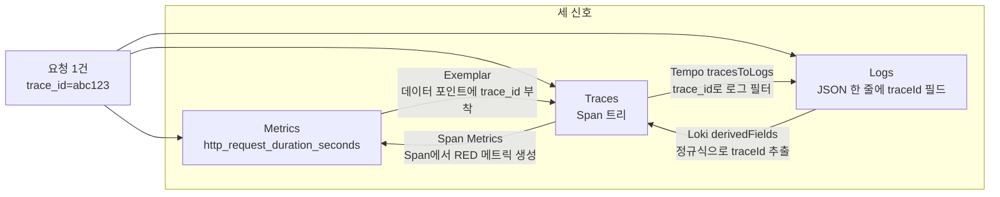
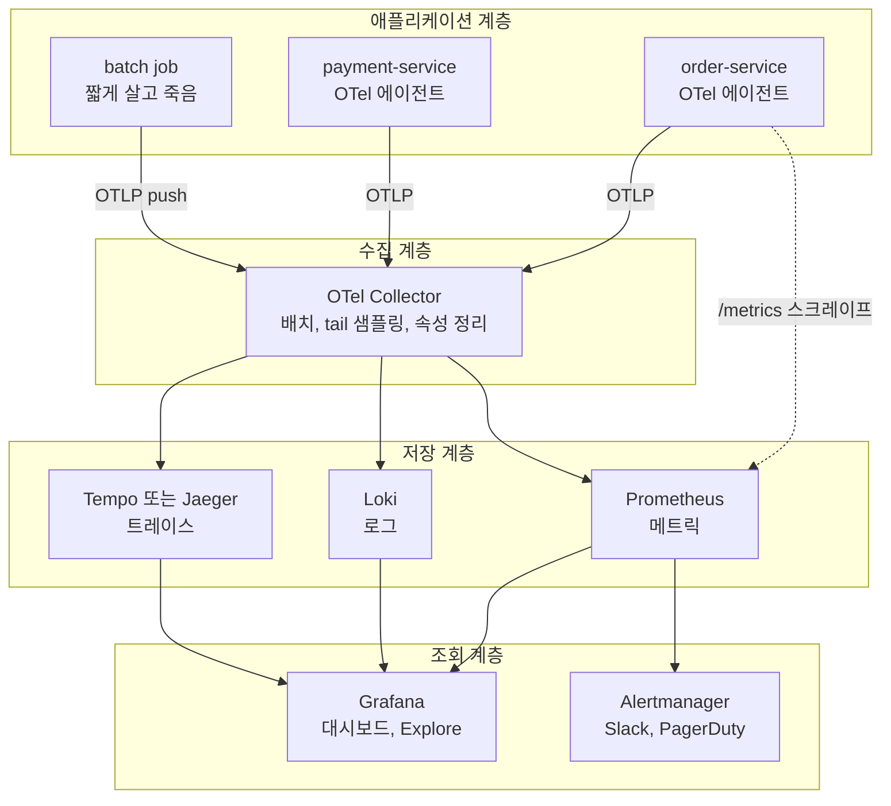
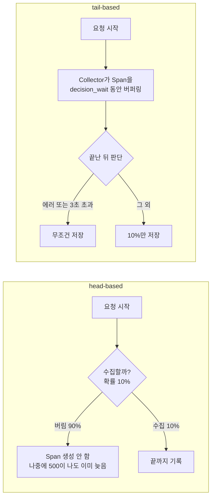
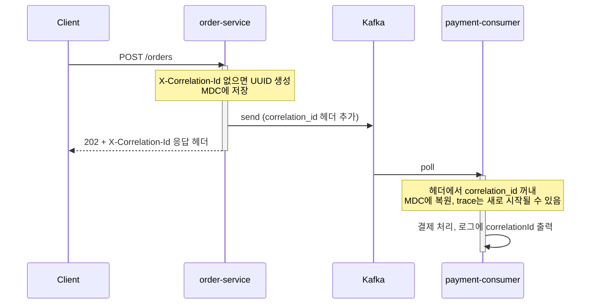
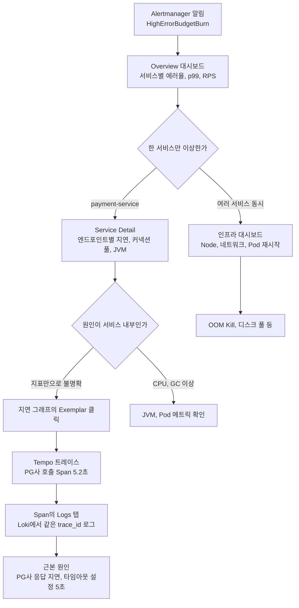
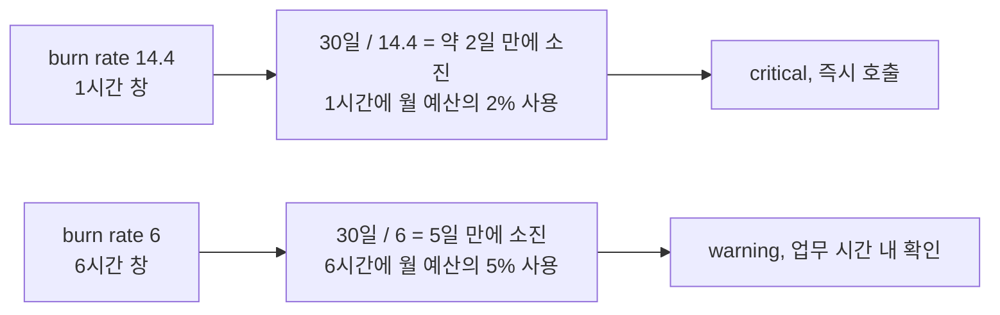

# 분산 시스템 관측성

분산 시스템에서 장애가 나면 "어디서 느려졌는지"를 찾는 데 대부분의 시간이 간다. 로그만으로는 서비스 간 호출 흐름이 안 보이고, 메트릭만으로는 원인을 특정할 수 없다. 이 문서는 메트릭·로그·트레이스 세 신호를 `trace_id` 로 연결하는 방법과, 알림이 울린 뒤 실제로 어떤 순서로 내려가며 보는지를 정리한다.

OpenTelemetry SDK 설정, Collector 구성, Jaeger·Tempo·Loki·Prometheus 각각의 운영 세부는 [DevOps/Monitoring](../DevOps/Monitoring/index.md) 아래 문서에 있다. 여기서는 그 도구들을 한 시스템으로 엮는 쪽만 다룬다.

---

## 세 신호는 서로 다른 질문에 답한다

관측성 도구를 처음 붙일 때 흔한 실수가 세 신호를 같은 용도로 쓰는 것이다. 메트릭에 요청별 상세를 넣으려다 시계열이 폭발하고, 로그로 p99를 계산하려다 쿼리 비용이 폭발한다. 신호마다 잘하는 질문이 다르다.

| 신호 | 답하는 질문 | 단위 | 카디널리티 | 저장 비용 | 보존 기간 |
|---|---|---|---|---|---|
| Metrics | 지금 문제가 있는가, 얼마나 심한가 | 집계된 숫자 시계열 | 낮아야 한다. 레이블 조합 수가 곧 시계열 수 | 시계열 수에 비례. 트래픽에는 거의 무관 | 길게 둔다 (수개월~1년) |
| Logs | 그 시점에 무슨 일이 있었는가 | 이벤트 한 줄 | 필드 값은 자유. 인덱스를 거는 레이블만 낮게 유지 | 트래픽과 로그 양에 비례 | 중간 (수주) |
| Traces | 이 요청이 어느 서비스 어느 구간에서 시간을 썼는가 | 요청 하나의 Span 트리 | 높아도 된다. 요청 단위라 `order.id` 같은 값을 속성에 넣을 수 있다 | 샘플링 비율과 Span 수에 비례 | 짧게 둔다 (수일) |

트레이스가 높은 카디널리티를 받아주는 이유는 값이 시계열의 키가 아니라 Span 속성으로 저장되기 때문이다. 같은 `order.id` 를 메트릭 레이블에 넣으면 주문 수만큼 시계열이 생긴다.

세 신호가 따로 놀면 조사가 끊긴다. 메트릭에서 이상을 보고, 로그 도구로 옮겨 시간대를 눈으로 맞추고, 다시 트레이스 도구에서 비슷한 시각의 느린 요청을 찾는 식이 된다. 같은 요청임을 보장하는 키가 없으니 추측이다. 그 키가 `trace_id` 다.



화살표 네 개가 각각 Grafana 설정 하나에 대응한다. 메트릭에서 트레이스로는 Exemplar, 로그에서 트레이스로는 derivedFields, 트레이스에서 로그로는 tracesToLogs 다. 마지막 화살표(트레이스에서 메트릭)는 Tempo 의 metrics-generator 같은 Span Metrics 설정이며 [Span Metrics와 Service Graph](../DevOps/Monitoring/Span_Metrics_And_Service_Graph.md)에서 다룬다.

---

## 수집에서 조회까지의 파이프라인

도구가 많아 보여도 계층으로 나누면 구조가 단순해진다. 애플리케이션은 OTLP 하나만 알고, 그 뒤는 Collector 가 갈라 준다. 백엔드를 Jaeger 에서 Tempo 로 바꿔도 애플리케이션은 건드리지 않는다.



실선은 push, 점선은 pull 이다. 서비스가 `/metrics` 를 노출하면 Prometheus 가 직접 긁어 가는 경로가 하나 더 있고, 대부분의 현장에서 이 경로와 OTLP 경로가 섞여 있다.

Pull 방식의 이점은 대상이 죽었을 때 스크레이프 실패(`up == 0`) 자체가 신호가 된다는 점이다. Push 는 대상이 죽으면 데이터가 안 올 뿐이라 일부러 안 보낸 건지 장애인지 구분이 안 된다. 반대로 CronJob 처럼 스크레이프 주기보다 짧게 사는 프로세스는 pull 로 못 잡는다. 이런 건 Collector 로 push 하거나 Pushgateway 를 쓴다.

수집 계층에 Collector 를 두는 가장 큰 이유는 샘플링이다. 애플리케이션 안에서 결정하면 요청이 끝나기 전에 버릴지 말지를 정해야 하기 때문이다.

---

## 계측은 자동으로 시작하고 수동은 최소로

OTel SDK 와 에이전트 설정 전반은 [OpenTelemetry](../DevOps/Monitoring/OpenTelemetry.md)에 있다. 여기서는 판단 기준만 적는다.

Java 서비스라면 에이전트를 먼저 붙인다. HTTP 클라이언트, JDBC, Kafka 클라이언트에서 Span 이 자동으로 생기고, 코드는 한 줄도 바뀌지 않는다.

```bash
java -javaagent:opentelemetry-javaagent.jar \
     -Dotel.service.name=order-service \
     -Dotel.exporter.otlp.endpoint=http://otel-collector:4317 \
     -jar order-service.jar
```

수동 계측은 에이전트가 모르는 비즈니스 구간을 쪼갤 때만 넣는다. 예를 들어 `processOrder` 안에서 "재고 확인"과 "쿠폰 적용" 중 어디가 느린지 봐야 할 때다.

```java
Span span = tracer.spanBuilder("applyCoupon").startSpan();
try (Scope scope = span.makeCurrent()) {
    span.setAttribute("order.id", orderId);
    couponService.apply(orderId);
} catch (Exception e) {
    span.setStatus(StatusCode.ERROR, e.getMessage());
    span.recordException(e);
    throw e;
} finally {
    span.end();
}
```

`span.end()` 를 `finally` 에 두지 않으면 예외 경로에서 Span 이 열린 채 남고, 백엔드에는 아예 안 나타난다. 트레이스에서 특정 구간만 계속 비어 있다면 이 경우를 먼저 의심한다.

### 샘플링 때문에 장애 트레이스가 없는 경우

Jaeger 나 Tempo 에서 트레이스가 안 보이는 원인은 대부분 샘플링이다. 문제는 샘플링에서 빠진 요청이 하필 에러 요청일 수 있다는 점이다.



head-based 는 가볍지만 에러를 놓친다. tail-based 는 결과를 보고 결정하니 에러와 느린 요청을 보존하는 대신, Collector 가 요청이 끝날 때까지 Span 을 메모리에 들고 있어야 한다.

```yaml
processors:
  tail_sampling:
    decision_wait: 10s
    policies:
      - name: error-policy
        type: status_code
        status_code: {status_codes: [ERROR]}
      - name: latency-policy
        type: latency
        latency: {threshold_ms: 3000}
      - name: probabilistic-policy
        type: probabilistic
        probabilistic: {sampling_percentage: 10}
```

tail 샘플링에는 함정이 하나 있다. 같은 `trace_id` 의 Span 이 Collector 인스턴스 여러 대에 흩어지면 각자 일부만 보고 판단한다. Collector 를 여러 대 띄우면 앞단에서 `trace_id` 기준으로 라우팅(load-balancing exporter)해서 한 트레이스가 한 인스턴스로 모이게 해야 한다. 이걸 빼먹으면 에러 트레이스가 반쪽으로 저장된다.

---

## Correlation ID 와 Trace ID 를 같이 쓰는 이유

Trace ID 로 충분해 보이지만 끊기는 지점이 있다.

- Kafka 같은 비동기 큐를 지나면서 컨텍스트가 전파되지 않으면 트레이스가 둘로 쪼개진다
- 배치가 새 트레이스를 시작한다
- 트레이싱을 안 붙인 레거시 서비스가 중간에 낀다

이런 구간을 건너서도 살아 있는 키가 필요하다. 요청 ID나 주문 ID 같은 비즈니스 Correlation ID 를 헤더로 따로 실어 보낸다. 컨텍스트 전파 규격(W3C Trace Context)과 메시지 큐에서 끊기는 문제는 [분산 추적 컨텍스트 전파](../DevOps/Monitoring/Distributed_Trace_Context_Propagation.md)에서 자세히 다룬다.



Kafka 를 건너는 순간 트레이스는 끊길 수 있지만 `correlationId` 는 로그에 계속 남는다. 문의가 들어오면 응답 헤더에서 받은 ID 로 양쪽 로그를 한 번에 검색한다.

### Spring Boot 구현

수신 측은 필터에서 ID 를 MDC 에 넣고, 송신 측은 인터셉터에서 헤더에 옮긴다.

```java
@Component
public class CorrelationFilter implements Filter {
    private static final String HEADER = "X-Correlation-Id";

    @Override
    public void doFilter(ServletRequest req, ServletResponse res, FilterChain chain)
            throws IOException, ServletException {
        String id = ((HttpServletRequest) req).getHeader(HEADER);
        if (id == null) {
            id = UUID.randomUUID().toString();
        }
        MDC.put("correlationId", id);
        ((HttpServletResponse) res).setHeader(HEADER, id);
        try {
            chain.doFilter(req, res);
        } finally {
            MDC.clear();
        }
    }
}
```

```java
@Component
public class CorrelationInterceptor implements ClientHttpRequestInterceptor {
    @Override
    public ClientHttpResponse intercept(HttpRequest request, byte[] body,
                                         ClientHttpRequestExecution execution) throws IOException {
        String id = MDC.get("correlationId");
        if (id != null) {
            request.getHeaders().set("X-Correlation-Id", id);
        }
        return execution.execute(request, body);
    }
}
```

Kafka 프로듀서는 헤더에 직접 넣는다. `MDC.get` 결과에 바로 `getBytes` 를 호출하면 배치처럼 MDC 가 비어 있는 곳에서 NPE 가 나므로 null 검사를 붙인다.

```java
String id = MDC.get("correlationId");
if (id != null) {
    record.headers().add("correlation_id", id.getBytes(StandardCharsets.UTF_8));
}
producer.send(record);
```

### 비동기에서 MDC 가 사라지는 문제

MDC 는 스레드 로컬이라 스레드가 바뀌면 값이 없다. `@Async`, `CompletableFuture`, 별도 스레드 풀에서 로그에 `correlationId` 가 `null` 로 찍히는 건 거의 이 때문이다.

- `@Async` 는 `TaskDecorator` 로 호출 스레드의 MDC 를 복사해서 넘긴다
- WebFlux/Reactor 는 스레드가 요청 중에도 바뀌므로 MDC 대신 Reactor `Context` 에 담고 필요한 자리에서 꺼내 쓴다
- OTel Baggage 로 커스텀 키-값을 Trace Context 와 같이 전파할 수 있다. 다만 Baggage 는 나가는 모든 요청 헤더에 실리므로 사용자 식별 정보나 토큰을 넣으면 외부 서비스에까지 샌다

---

## Metrics 설계에서 자주 틀리는 것

### 타입 선택

| 타입 | 값의 성격 | 쓰는 곳 |
|---|---|---|
| Counter | 단조 증가 | 요청 수, 에러 수 |
| Gauge | 올라갔다 내려감 | 커넥션 수, 큐 길이 |
| Histogram | 버킷별 분포 | 응답 시간, 요청 크기 |
| Summary | 클라이언트에서 분위수 계산 | 인스턴스 하나의 p99 (여러 인스턴스 합산 불가) |

응답 시간을 Gauge 로 재는 경우가 있다. 마지막 응답 시간 하나만 남기므로 스크레이프 주기(보통 15초) 사이에 들어온 요청은 전부 버려진다. 응답 시간은 Histogram 이어야 `histogram_quantile` 로 서비스 전체 분위수를 계산할 수 있다. Summary 는 인스턴스별로 계산한 분위수라 인스턴스를 합쳐 p99 를 낼 수 없다.

### 이름 규칙과 카디널리티

```java
private static final Histogram orderProcessingDuration = Histogram.build()
    .name("order_processing_duration_seconds")
    .help("Time spent processing orders")
    .labelNames("order_type", "payment_method")
    .buckets(0.1, 0.25, 0.5, 1.0, 2.5, 5.0, 10.0)
    .register();

private static final Gauge pendingOrders = Gauge.build()
    .name("orders_pending")
    .help("Number of orders currently pending")
    .labelNames("order_type")
    .register();
```

`_total` 접미사는 Counter 에만 붙는다. Gauge 에 `_total` 을 붙이면 이름만 보고 누적값으로 착각해서 `rate()` 를 씌우게 된다. 단위는 `_seconds`, `_bytes` 처럼 이름 끝에 둔다.

레이블 값의 가짓수는 곱해진다. `order_type` 5종 × `payment_method` 8종이면 40개 시계열이고, 여기에 Histogram 이면 버킷 수만큼 또 곱해진다. `userId`, `orderId`, 요청 URL 전체 같은 값을 레이블에 넣으면 Prometheus 메모리가 요청 수에 맞춰 늘다가 OOM 으로 죽는다. 이런 값은 트레이스 속성이나 로그 필드로 보낸다. Loki 레이블도 같은 문제가 있으며 [Loki 레이블 설계와 카디널리티](../DevOps/Monitoring/Loki_레이블_설계와_카디널리티.md)에 정리돼 있다.

---

## 로그에 Trace ID 를 넣고 도구 사이를 오가게 만들기

연결의 출발점은 로그에 `traceId` 를 찍는 것이다.

```json
{
  "timestamp": "2026-10-24T14:22:31.123Z",
  "level": "ERROR",
  "service": "payment-service",
  "message": "Payment gateway timeout",
  "traceId": "abc123def456",
  "spanId": "789ghi",
  "correlationId": "req-xyz-789",
  "paymentId": "PAY-20261024-001",
  "latencyMs": 5200
}
```

Java 에이전트를 쓰면 MDC 에 `trace_id`, `span_id` 가 자동으로 들어간다. 키 이름이 스네이크 케이스(`trace_id`)라서, 로그 레이아웃에서 `traceId` 로 바꿔 출력한다면 Grafana 쪽 정규식도 같은 이름으로 맞춰야 한다. 한쪽만 바꾸면 링크가 조용히 안 생긴다.

### Exemplar

Exemplar 는 메트릭 데이터 포인트에 `trace_id` 를 얹는 기능이다. Grafana 그래프에서 점을 클릭하면 그 요청의 트레이스로 넘어간다.

주의할 점은 `trace_id` 를 속성(레이블)으로 기록하면 안 된다는 것이다. 요청마다 값이 달라서 요청 수만큼 시계열이 생긴다. Exemplar 는 레이블이 아니라 샘플에 붙는 별도 메타데이터다.

```java
// 잘못된 예. trace_id가 메트릭 속성이 되어 시계열이 요청 수만큼 늘어난다
histogram.record(duration,
    Attributes.of(AttributeKey.stringKey("trace_id"),
                  Span.current().getSpanContext().getTraceId()));
```

OTel SDK 는 샘플링된 Span 컨텍스트가 활성 상태일 때 기록하면 Exemplar 를 알아서 붙인다. 그러므로 코드에서 `trace_id` 를 직접 다루지 않고 평범하게 `histogram.record(duration, attributes)` 만 호출한다. 서버 쪽은 Prometheus 에서 Exemplar 저장 기능 플래그(`--enable-feature=exemplar-storage`)를 켜야 하고, 스크레이프 형식이 OpenMetrics 여야 Exemplar 가 전달된다. 둘 중 하나라도 빠지면 그래프에 점이 안 뜨는데 에러는 없다.

### Grafana 데이터 소스 연동

```yaml
datasources:
  - name: Prometheus
    type: prometheus
    url: http://prometheus:9090
    jsonData:
      exemplarTraceIdDestinations:
        - name: trace_id
          datasourceUid: tempo
          urlDisplayLabel: "View Trace"

  - name: Tempo
    type: tempo
    uid: tempo
    url: http://tempo:3200
    jsonData:
      tracesToLogs:
        datasourceUid: loki
        filterByTraceID: true
      nodeGraph:
        enabled: true

  - name: Loki
    type: loki
    uid: loki
    url: http://loki:3100
    jsonData:
      derivedFields:
        - name: TraceID
          matcherRegex: "traceId\":\"(\\w+)\""
          url: "$${__value.raw}"
          datasourceUid: tempo
```

Tempo 의 `tracesToLogs.datasourceUid: loki` 가 가리키는 Loki 데이터 소스에는 `uid: loki` 가 있어야 한다. uid 를 지정하지 않으면 Grafana 가 임의 값을 붙여서 참조가 끊긴다. 이 설정이 완성되면 Prometheus 에서 Tempo, Tempo 에서 Loki, Loki 에서 다시 Tempo 로 세 방향 이동이 모두 열린다.

---

## 알림에서 근본 원인까지 내려가기

알림이 울리면 대시보드를 위에서 아래로 내려가며 범위를 좁힌다. 서비스 전체 → 문제 서비스 → 문제 요청 → 문제 구간 순서다. 위쪽 단계일수록 메트릭이, 아래쪽일수록 트레이스와 로그가 주로 쓰인다.



위 분기에서 두 번째 질문(원인이 서비스 내부인가)이 중요하다. 메트릭만 보고 서비스를 의심하며 코드를 파는 경우가 많은데, 트레이스를 한 번 열어 보면 하위 의존성의 Span 하나가 시간을 전부 쓰고 있을 때가 흔하다.

### 3단계 대시보드

**Overview.** 장애 때 제일 먼저 여는 화면이다. RED(Rate, Errors, Duration)를 서비스별로 한 화면에 올린다.

| 패널 | PromQL | 목적 |
|---|---|---|
| 서비스별 에러율 | `sum(rate(http_requests_total{status=~"5.."}[5m])) by (service)` | 어떤 서비스가 에러를 내는지 |
| p99 응답 시간 | `histogram_quantile(0.99, sum(rate(http_request_duration_seconds_bucket[5m])) by (le, service))` | 어떤 서비스가 느린지 |
| 처리량 | `sum(rate(http_requests_total[5m])) by (service)` | 트래픽이 평소와 다른지 |
| 에러 버짓 소진율 | recording rule | SLO 위반 임박 여부 |
| 죽은 인스턴스 | `up == 0` | 스크레이프 실패 대상 |

p99 쿼리에서 `by (le, service)` 의 `le` 를 빼면 `histogram_quantile` 이 버킷을 못 찾아 `NaN` 을 낸다. 집계할 때 `le` 레이블은 항상 유지한다.

**Service Detail.** Overview 에서 지목한 서비스를 파고드는 화면이다. HTTP 상태 코드 분포(4xx 와 5xx 구분), 엔드포인트별 응답 시간, DB 커넥션 풀 사용량, JVM Heap·GC 시간, 외부 API 호출 지연, 최근 에러 로그(Loki 패널)를 둔다.

**Infrastructure.** 서비스 레벨에서 원인이 안 나올 때 본다. Node CPU·메모리·디스크, 네트워크 I/O, Pod 재시작 횟수(OOM Kill, Liveness 실패), PVC 사용량이다.

---

## SLI, SLO, SLA 와 에러 버짓

| 용어 | 의미 | 정하는 쪽 |
|---|---|---|
| SLI | 서비스 품질을 재는 지표 | 엔지니어링 |
| SLO | SLI 의 목표 수준 | 엔지니어링과 비즈니스 |
| SLA | 외부 고객과의 계약 | 비즈니스와 법무 |

SLA 는 SLO 보다 느슨하게 잡는다. SLO 를 99.95% 로 운영하면서 SLA 를 99.9% 로 약속하면 SLO 를 조금 못 맞춰도 계약 위반은 아니다. 둘을 같은 값으로 두면 여유가 없다.

### 서비스 유형별 SLI

API 서비스는 가용성(성공 응답 비율), 지연(p99), 에러율을 쓴다.

```promql
# 가용성
sum(rate(http_requests_total{status!~"5.."}[5m])) / sum(rate(http_requests_total[5m]))

# p99 지연
histogram_quantile(0.99, sum(rate(http_request_duration_seconds_bucket[5m])) by (le))
```

데이터 파이프라인은 신선도(마지막 성공 처리 시각과 현재의 차이), 정확도(검증 실패 건수 / 전체 처리 건수), 처리량을 쓴다. 저장소는 내구성(데이터 유실 건수)과 읽기·쓰기 성공률을 쓴다. 같은 "가용성"이라도 서비스 유형에 따라 의미가 달라서 요청 성공률을 일괄 적용하면 파이프라인에서는 의미가 없다.

### 숫자가 현실에 주는 부담

| SLO | 월간 허용 다운타임 (30일) | 어울리는 서비스 |
|---|---|---|
| 99% | 약 7시간 12분 | 내부 관리 도구 |
| 99.9% | 43.2분 | 일반 백엔드 |
| 99.95% | 21.6분 | 결제, 인증 |
| 99.99% | 약 4.3분 | DNS, 로드밸런서 같은 기반 인프라 |

99.99% 는 한 달에 4분 남짓이다. 이 수준을 지키려면 다중 리전, 자동 페일오버, 카나리 배포가 전제이고, 배포 한 번의 실패 구간이 예산을 통째로 먹는다. 대부분의 내부 서비스는 99.9% 로 충분하다.

### 에러 버짓 계산

SLO 99.9% 면 한 달 예산은 요청의 0.1% 다. 실제 가용성이 99.85% 였다면 에러율이 0.15% 이므로 예산 0.1% 를 이미 넘었다.

```
SLO 99.9%        -> 허용 에러율 0.1% (예산 100%)
실제 가용성 99.85% -> 실제 에러율 0.15%
소진율 = 0.15 / 0.1 = 150%  -> 예산 초과, 배포 중단
```

예산이 남아 있으면 배포를 계속하고, 소진됐으면 기능 배포를 멈추고 안정화 작업을 하고, 소진 속도가 빠르면 최근 배포를 롤백한다. 이 기준을 팀이 합의해 두면 "배포해도 되느냐"를 감이 아니라 숫자로 정한다. 구현 세부는 [SLO와 에러 버짓 구현](../DevOps/Monitoring/SLO_Error_Budget_Implementation.md)에 있다.

### burn rate 알림

고정 임계값("에러율 5% 초과")은 SLO 와 무관해서 오탐과 미탐이 모두 많다. burn rate 는 예산을 소진하는 속도를 SLO 기준으로 환산한다. burn rate 1 은 한 달에 정확히 예산을 다 쓰는 속도다.



```yaml
groups:
  - name: slo-alerts
    rules:
      - alert: HighErrorBudgetBurn
        expr: |
          (
            sum(rate(http_requests_total{status=~"5.."}[1h])) by (service)
            /
            sum(rate(http_requests_total[1h])) by (service)
          ) > (14.4 * 0.001)
        for: 5m
        labels:
          severity: critical
        annotations:
          summary: "{{ $labels.service }} 에러 버짓 빠르게 소진 중"

      - alert: SlowErrorBudgetBurn
        expr: |
          (
            sum(rate(http_requests_total{status=~"5.."}[6h])) by (service)
            /
            sum(rate(http_requests_total[6h])) by (service)
          ) > (6 * 0.001)
        for: 30m
        labels:
          severity: warning
        annotations:
          summary: "{{ $labels.service }} 에러 버짓 점진적 소진"
```

`0.001` 은 SLO 99.9% 의 에러 예산이다. SLO 를 바꾸면 이 숫자도 같이 바꿔야 하는데, 룰마다 하드코딩해 두면 SLO 조정 때 빠뜨린다. 서비스가 늘면 recording rule 로 에러율을 미리 계산해 두고 SLO 값을 레이블이나 별도 시계열로 뺀다.

위 룰은 창이 하나라 장애가 끝난 뒤에도 한 시간 가까이 알림이 유지된다. 실제 운영에서는 긴 창(1h)과 짧은 창(5m)을 AND 로 묶어 "지금도 진행 중인 경우"에만 울리게 한다. 알림 룰 작성 전반은 [Alerting Rules](../DevOps/Monitoring/Alerting_Rules.md)에서 다룬다.

---

## 도입 순서

한 번에 다 구축하려고 하면 설정만 하다가 끝난다. 비용 대비 효과가 큰 순서로 간다.

| 단계 | 내용 | 비고 |
|---|---|---|
| 1 | 구조화 로그(JSON)와 Correlation ID | 기존 로그에 필드만 추가. 가장 싸고 효과가 크다 |
| 2 | Prometheus + Grafana, RED 대시보드, 기본 알림 | |
| 3 | OTel 자동 계측으로 분산 추적 시작 | 수동 계측은 핵심 로직에만 |
| 4 | 로그에 Trace ID, Exemplar, Grafana 데이터 소스 링크 | 세 신호 연결 |
| 5 | SLI/SLO, 에러 버짓 대시보드, burn rate 알림, 배포 정책 연동 | |

1단계만 끝내도 장애 대응 시간이 눈에 띄게 줄어든다. 서비스 간 요청 흐름을 `correlationId` 한 줄로 따라갈 수 있기 때문이다. 처음부터 5단계를 목표로 잡으면 4단계에서 데이터 소스 설정이 하나 틀려도 원인을 못 찾고 멈추는 경우가 많다. 각 단계가 끝날 때마다 실제 장애나 재현 시나리오 하나를 그 도구만으로 추적해 보고 다음으로 넘어간다.

---

이 문서는 [관측성 허브](../_hub/관측성.md)의 일부입니다.
