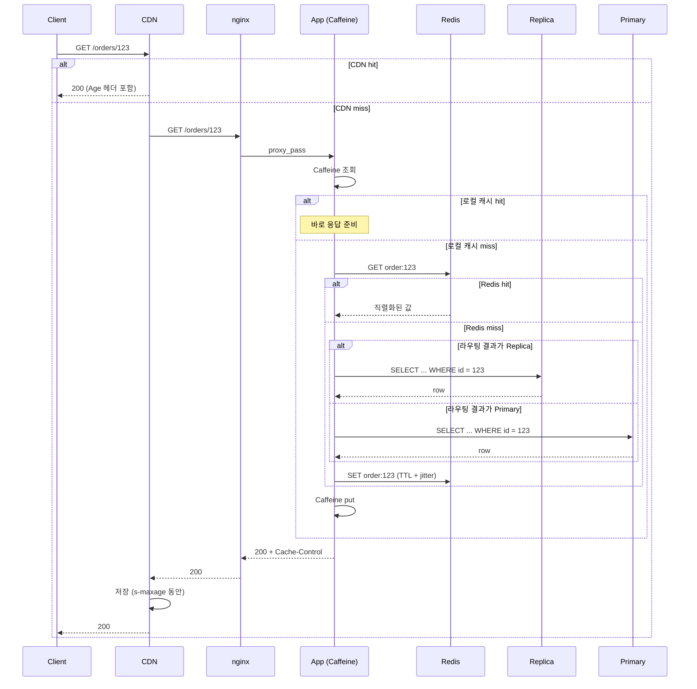
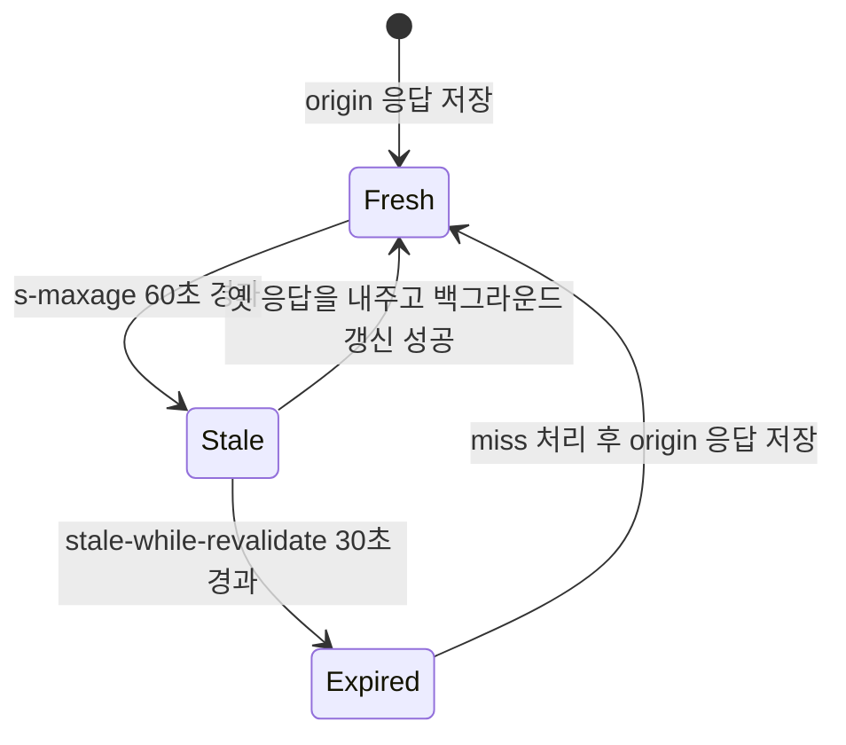
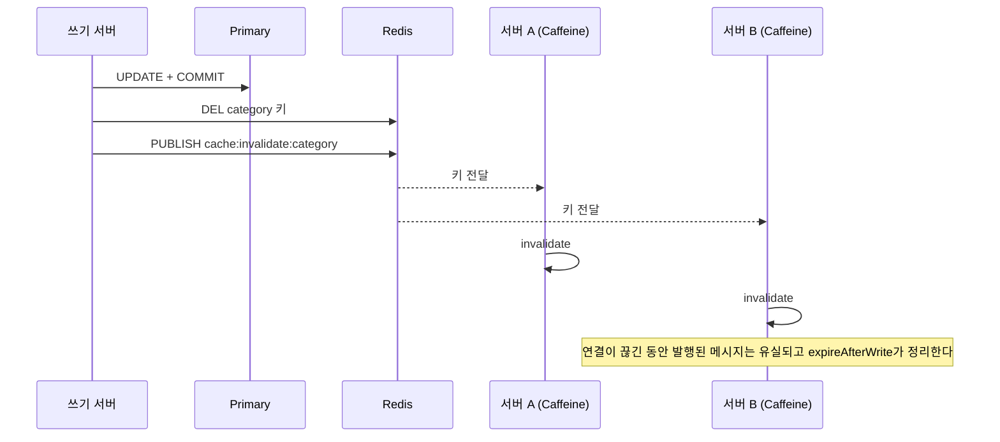
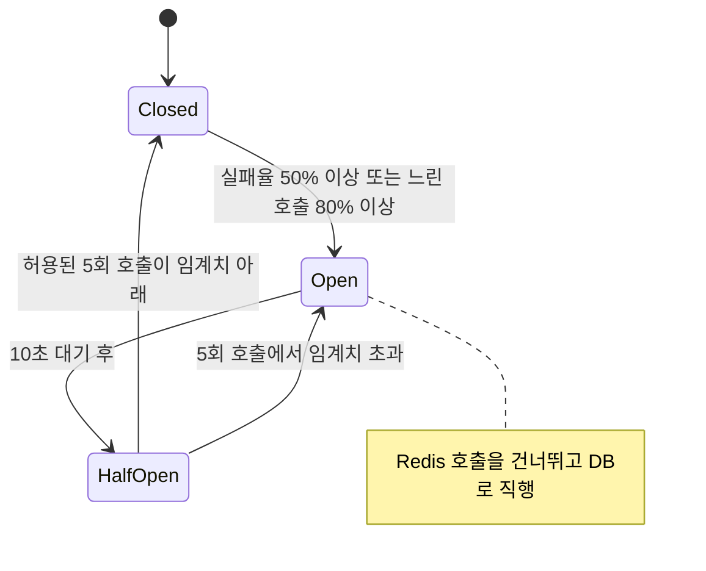
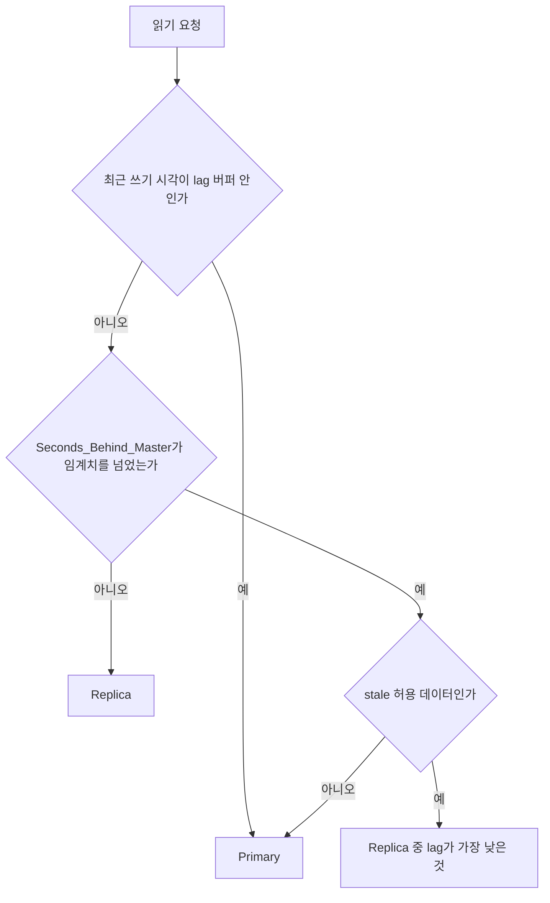
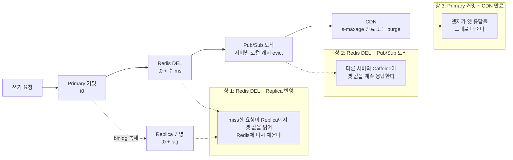

# 읽기 경로

## 한 요청이 지나가는 길

클라이언트가 `GET /orders/123`을 보내면 응답이 돌아올 때까지 최대 7개 레이어를 거친다. CDN, 리버스 프록시(nginx/Envoy), 앱 서버의 로컬 캐시(Caffeine), Redis, Read Replica, Primary DB 순서다. 레이어마다 자기 캐시에 값이 있으면 거기서 끝내고, 없으면 안쪽으로 넘긴다. 값을 찾은 뒤에는 바깥쪽으로 돌아오면서 지나온 레이어가 각자 값을 채운다.

아래 시퀀스에서 봐야 할 것은 두 가지다. 어느 지점에서 hit가 나면 그 안쪽 레이어는 아예 호출되지 않는다는 점, 그리고 채우기(Redis SET, Caffeine put, CDN 저장)가 DB 조회가 끝난 뒤 돌아오는 길에 일어난다는 점이다.



레이어가 늘어날수록 평균 응답은 빨라지고 일관성은 약해진다. 각 레이어가 "얼마나 오래된 값까지 내줘도 되는가"를 따로 갖기 때문에, 같은 주문을 요청해도 어느 레이어가 답했는지에 따라 내용이 달라질 수 있다. 이 문서의 나머지는 레이어를 하나씩 보면서 어디서 사고가 났는지를 적은 것이다.

## CDN

CDN이 응답을 들고 있는 경우는 정적 리소스와 캐시 가능한 API 응답 두 가지다. API 응답을 CDN에 올리려면 세 조건이 맞아야 한다.

- 사용자 식별 없이 모두에게 같은 응답이 나가는 데이터 (상품 목록, 카테고리 트리)
- 응답에 `Cache-Control: public`을 달 수 있을 것
- 수 분에서 수 시간 stale해도 비즈니스가 받아들일 것

사용자마다 응답이 달라야 하면 `Cache-Control: private, no-store`를 단다. 자주 보는 실수는 로그인 없이 볼 수 있는 상품 상세 API에 `private`을 달아 두는 경우다. 아무도 의도하지 않았는데 CDN을 통과만 하는 구성이 된다.

CDN이 origin에 요청을 보낼 때 원래 클라이언트 IP는 `X-Forwarded-For`에 들어온다. 접근 로그 포맷에서 이 헤더를 빼먹으면 로그에 CDN 엣지 IP만 남아서 국가별, 사용자별 분석을 못 한다. 나중에 로그 포맷을 고쳐도 지난 로그는 복구되지 않는다.

### s-maxage와 stale-while-revalidate

`max-age`는 브라우저와 CDN이 같이 읽는다. `s-maxage`는 CDN 같은 공유 캐시만 읽고, 둘이 같이 있으면 공유 캐시에서는 `s-maxage`가 이긴다. 이 차이를 쓰면 브라우저와 CDN의 보관 시간을 따로 줄 수 있다.

```
Cache-Control: public, max-age=0, s-maxage=60, stale-while-revalidate=30
```

브라우저에는 0초를 주고 CDN에서만 60초 들고 있게 한다. 브라우저 캐시에 박힌 값은 서버가 지울 방법이 없지만, CDN 캐시는 purge API로 지울 수 있다. 상품 가격을 바꿨을 때 purge 한 번으로 정리하려면 브라우저 쪽 `max-age`를 길게 주면 안 된다.

`stale-while-revalidate=30`은 60초가 지난 뒤 30초 동안은 옛 응답을 일단 내주고 뒤에서 origin을 호출해 갱신하라는 뜻이다. 만료 직후 첫 요청이 origin 응답을 기다리는 일이 없어지고, origin이 잠깐 느려져도 사용자 응답 시간은 그대로다. 이 지시어를 해석하는지는 CDN 제품마다 다르다. 지원하지 않는 CDN에서는 헤더가 무시되고 `s-maxage`가 끝나면 평범한 miss로 처리되므로, 쓰는 제품의 문서를 먼저 확인해야 한다.

아래 상태 전이에서 볼 것은 `Stale` 구간이다. 이 30초 동안은 요청이 origin을 기다리지 않고, 첫 요청이 갱신을 촉발한다.



### Vary 때문에 히트율이 무너진 사례

공개 상품 API인데 CDN 히트율이 30%대에서 올라오지 않았다. TTL도 충분했고 `public`도 달려 있었다. 응답 헤더를 `curl -I`로 찍어 보니 `Vary: Accept-Encoding, User-Agent`가 붙어 있었다. 게이트웨이 설정에서 모바일과 PC 응답을 나누려고 넣은 것이었다.

`Vary`에 적힌 헤더는 캐시 키의 일부가 된다. `User-Agent`는 브라우저 종류와 버전, OS 조합마다 문자열이 달라서 사실상 사용자 기기마다 다른 키가 생긴다. 같은 URL이 수백 개의 변형으로 쪼개지니 각 변형은 한두 번 요청받고 만료된다.

`Accept-Encoding`은 gzip/br 구분이라 변형이 몇 개 안 돼서 문제없다. 해결은 `User-Agent`를 `Vary`에서 빼고, 모바일/PC 구분이 꼭 필요하면 CDN이 제공하는 디바이스 구분 헤더나 정규화된 값(`mobile`/`desktop` 두 가지)을 캐시 키에 쓰는 것이었다. 고친 뒤 히트율은 90%대로 올랐다. `Vary: Cookie`도 같은 부류다. 세션 미들웨어가 쿠키를 건드리기만 해도 자동으로 붙이는 프레임워크가 있어서, 공개 API 응답에 `Vary`가 어떻게 나가는지는 배포 전에 한 번씩 찍어 봐야 한다.

## 리버스 프록시

CDN을 통과한 요청이 nginx나 Envoy에 도착한다. 읽기 경로에서 하는 일은 세 가지다.

로드밸런싱은 앱 서버가 여러 대일 때 요청을 나눈다. stateless JWT면 round-robin으로 충분하고, 서버 세션을 쓰면 sticky session이 필요하다. SSL 종단은 HTTPS를 여기서 끊고 내부는 HTTP로 가는 구성이라 인증서를 앱마다 관리하지 않아도 된다. 응답 캐싱은 nginx `proxy_cache`로 앱 응답을 들고 있는 것인데, CDN이 외부 트래픽만 받기 때문에 서비스 A가 서비스 B를 반복 호출하는 내부 경로에서 의미가 있다.

`proxy_read_timeout` 기본값은 60초다. upstream이 응답을 안 주는 동안 클라이언트도 60초를 기다린다. 슬로우 쿼리가 돌고 있을 때 요청이 몰리면 연결이 쌓이고 앱 서버의 스레드와 커넥션 풀이 같이 마른다. 서비스 특성에 맞는 값을 명시해야 한다. 타임아웃을 레이어마다 어떻게 맞추는지는 뒤에서 한 번에 정리한다.

## 앱 서버

요청이 앱 서버에 닿으면 로컬 캐시, Redis, DB 순서로 찾는다.

### 로컬 캐시

Caffeine(Java)이나 `functools.lru_cache`(Python) 같은 프로세스 내 캐시다. 네트워크 홉이 없어서 Redis보다 빠르다. 대신 앱 서버가 여러 대면 서버마다 내용이 달라진다. 서버 A에는 갱신 전 값이, 서버 B에는 갱신 후 값이 있으면 로드밸런서가 어느 쪽으로 보내느냐에 따라 응답이 갈린다.

그래서 로컬 캐시는 변경이 거의 없는 값(코드 테이블, 카테고리 구조), TTL을 30초에서 5분으로 짧게 잡아도 되는 값, 잠깐의 불일치를 비즈니스가 허용하는 값에만 쓴다.

```java
@Bean
public Cache<String, ProductCategory> categoryCache() {
    return Caffeine.newBuilder()
        .expireAfterWrite(5, TimeUnit.MINUTES)
        .maximumSize(1000)
        .recordStats()
        .build();
}

public ProductCategory getCategory(Long categoryId) {
    return categoryCache.get(
        "category:" + categoryId,
        key -> categoryRepository.findById(categoryId).orElseThrow()
    );
}
```

TTL만으로 5분 stale을 견딜 수 없는 데이터라면 변경 시점에 모든 서버의 로컬 캐시를 비워야 한다. 서버 수만큼 호출하는 방식은 서버 목록 관리가 부담이라, Redis Pub/Sub으로 무효화 메시지를 뿌리는 쪽이 단순하다. 쓰기를 처리한 서버가 커밋 직후 채널에 키를 발행하고, 모든 서버가 구독하다가 받으면 자기 Caffeine에서 해당 키를 지운다.

아래 시퀀스는 그 순서다. 무효화 메시지가 커밋 이후에 나가는 점, 그리고 구독이 끊긴 서버는 메시지를 못 받는 점을 보면 된다.



```java
@Component
public class CategoryCacheInvalidator implements MessageListener {
    private static final String CHANNEL = "cache:invalidate:category";
    private final Cache<String, ProductCategory> categoryCache;
    private final StringRedisTemplate redis;

    @TransactionalEventListener(phase = TransactionPhase.AFTER_COMMIT)
    public void onCategoryChanged(CategoryChangedEvent e) {
        redis.delete("category:" + e.categoryId());
        redis.convertAndSend(CHANNEL, "category:" + e.categoryId());
    }

    @Override
    public void onMessage(Message message, byte[] pattern) {
        categoryCache.invalidate(new String(message.getBody(), StandardCharsets.UTF_8));
    }
}

@Bean
RedisMessageListenerContainer listenerContainer(
        RedisConnectionFactory cf, CategoryCacheInvalidator invalidator) {
    var container = new RedisMessageListenerContainer();
    container.setConnectionFactory(cf);
    container.addMessageListener(invalidator, new ChannelTopic("cache:invalidate:category"));
    return container;
}
```

`AFTER_COMMIT`을 쓴 이유가 있다. 트랜잭션 안에서 먼저 발행하면 다른 서버가 무효화 직후 DB를 다시 읽는데 아직 커밋 전이라 옛 값을 읽어 도로 캐시에 올린다. 무효화는 반드시 커밋 뒤에 한다.

Pub/Sub은 at-most-once다. 구독 연결이 끊긴 동안 발행된 메시지는 그냥 사라지고 재전송도 없다. 네트워크 순단이나 Redis 페일오버 때 몇몇 서버가 옛 값을 계속 들고 있게 되는데, `expireAfterWrite`를 안전망으로 반드시 같이 둬야 하는 이유다. 메시지가 오면 빨리 지워지고, 놓치면 TTL이 지운다. 메시지 유실이 허용되지 않는 데이터라면 로컬 캐시를 쓰지 않는 쪽이 맞다.

### Redis

로컬 캐시에 없으면 Redis로 간다. 앱 서버가 몇 대든 같은 값을 본다. 값이 있으면 역직렬화해서 반환하고, 없으면 DB를 조회한 뒤 TTL과 함께 SET하고 응답한다.

조회가 몰리는 key의 TTL이 만료되는 순간 같은 key에 대한 miss가 동시에 여러 개 발생하고 전부 DB로 간다. Cache Stampede다. TTL에 jitter를 섞어 만료 시각을 흩뜨리는 방법이 가장 단순하다.

```python
import random

BASE_TTL = 3600  # 1시간

def set_cache(key: str, value: dict) -> None:
    jitter = random.randint(0, BASE_TTL // 10)
    redis_client.setex(key, BASE_TTL + jitter, json.dumps(value))
```

Mutex(SETNX)로 한 요청만 DB를 조회하게 하는 방법도 있다. 락을 잡은 요청이 죽었을 때의 만료 처리, 대기하는 요청의 재시도 간격까지 구현하면 jitter 대비 이득이 크지 않은 경우가 많다. 특정 key 하나에 읽기가 쏠리는 문제는 jitter로 안 풀린다. 그쪽은 `Hot_Key_Handling` 문서에서 따로 다룬다.

## 레이어별 타임아웃과 서킷 브레이커

레이어는 안쪽으로 갈수록 느려지고, 안쪽이 죽으면 바깥쪽이 그 대기를 그대로 떠안는다. 타임아웃은 바깥이 안쪽보다 길어야 한다. 안쪽이 먼저 실패하고 에러를 올려 줘야 바깥이 상황을 알고 대응할 수 있다. 반대로 바깥이 먼저 끊으면 안쪽은 아무도 기다리지 않는 쿼리를 계속 돌린다.

| 구간 | 기본값이 문제되는 곳 | 실무에서 잡는 값 | 걸려 있어야 하는 장치 |
|---|---|---|---|
| CDN → origin | 제품별 origin 응답 대기 시간 (수십 초대) | origin 최악 응답보다 약간 길게 | stale-if-error 류 지시어 |
| nginx → 앱 | `proxy_read_timeout` 60초 | API는 3~5초 | upstream 헬스체크, 재시도 제한 |
| 앱 → Redis | Lettuce command timeout 60초 | 50~100ms | 서킷 브레이커 |
| 앱 → DB | HikariCP `connectionTimeout` 30초 | 풀 대기 1~2초, 쿼리 타임아웃 별도 | 벌크헤드(동시 호출 제한) |

Redis가 가장 조심스럽다. Lettuce의 기본 command timeout이 60초라서, Redis가 멈추면 앱 스레드가 60초씩 걸린 채 쌓인다. 캐시는 없어도 서비스가 돌아가야 하는 부가 장치인데, 캐시 때문에 서비스가 죽는 구조가 된다. 타임아웃을 줄이고 서킷 브레이커를 걸어서, 연속으로 실패하거나 느리면 Redis 호출을 건너뛰고 바로 DB로 가게 한다.

서킷의 상태 전이는 아래와 같다. Open 동안 Redis 호출은 아예 나가지 않고, Half-Open에서 소수의 호출로 복구 여부를 확인한다.



```java
CircuitBreakerConfig config = CircuitBreakerConfig.custom()
    .slidingWindowType(SlidingWindowType.TIME_BASED)
    .slidingWindowSize(10)
    .failureRateThreshold(50)
    .slowCallDurationThreshold(Duration.ofMillis(50))
    .slowCallRateThreshold(80)
    .waitDurationInOpenState(Duration.ofSeconds(10))
    .permittedNumberOfCallsInHalfOpenState(5)
    .build();

public Optional<Order> findCached(long id) {
    try {
        return Optional.ofNullable(
            redisBreaker.executeSupplier(() -> redisOrderStore.get("order:" + id)));
    } catch (CallNotPermittedException e) {
        return Optional.empty();
    }
}
```

서킷이 열리면 Redis hit가 전부 miss로 바뀌어 요청이 DB로 몰린다. 서킷 브레이커만 걸고 DB 쪽에 동시 호출 제한이 없으면 캐시 장애가 DB 장애로 번진다. DB 앞에는 벌크헤드(`maxConcurrentCalls` 30 안팎)를 걸고, 초과한 요청은 빨리 실패시키거나 로컬 캐시에 남아 있는 옛 값을 내준다. 이 지점에서 로컬 캐시가 Redis 장애 시의 완충 역할을 한다.

## miss 비용

레이어별 대략의 지연은 표의 값으로 잡고 설계한다. 환경마다 다르니 자기 서비스에서 한 번은 재봐야 하지만, 자릿수가 어디서 바뀌는지는 거의 비슷하다.

| 레이어 | 단건 조회 기준 지연 | 비고 |
|---|---|---|
| Caffeine | 마이크로초 단위 | GC 압박이 있으면 튄다 |
| Redis (같은 AZ) | 0.3~1ms | 앱에서 보면 직렬화 포함 1~2ms |
| Read Replica | PK 조회 1~5ms | 커넥션 풀 대기 제외, 조인이 붙으면 수십 ms 이상 |
| Primary | Replica와 비슷, 부하에 민감 | 쓰기와 같은 자원을 쓴다 |
| CDN hit | 클라이언트 위치에 따라 수십 ms | origin에는 도달하지 않음 |

자릿수 차이가 실제로 문제가 된 건 Redis 장애 때였다. 주문 상세 API가 평소엔 Redis hit로 2ms 안팎이었다. Redis 노드가 페일오버되는 몇 초 동안 서킷이 열려서 전 요청이 Replica로 갔는데, 주문 상세 쿼리가 세 테이블 조인이라 쿼리당 30~50ms가 걸렸다. 초당 요청 수는 그대로인데 건당 DB 시간이 20배 가까이 늘었으니 Replica 커넥션 풀이 금방 찼고, 풀 대기 시간이 쿼리 시간보다 커졌다. 응답 지연은 쿼리 시간이 아니라 대기열에서 정해졌다.

이 일 이후 miss 비용을 볼 때 "쿼리가 몇 ms인가"보다 "hit였던 트래픽이 전부 miss가 되면 DB가 몇 배의 동시성을 받는가"를 계산한다. 평소 hit율이 95%면 DB는 요청의 5%만 받던 것인데, 그 5%를 기준으로 커넥션 풀과 Replica 용량을 잡아 놓으면 캐시가 사라지는 순간 감당이 안 된다.

## DB 레이어

Redis까지 miss면 DB다. 읽기는 Read Replica로, Primary는 쓰기 전용으로 두는 게 기본이다.

### Read Replica와 라우팅

Primary에 쓴 변경이 Replica에 반영되기까지 시간이 걸린다. MySQL에서 평소에는 밀리초 단위지만 쓰기 부하가 높거나 Replica가 binlog 적용을 못 따라가면 수 초까지 벌어진다. 문제가 되는 건 쓰기 직후 같은 데이터를 읽는 경우다. 프로필을 수정하고 바로 프로필 페이지를 여는 흐름, 주문을 만들고 곧바로 주문 목록을 받는 흐름에서 Replica는 방금 쓴 데이터를 모를 수 있다.

라우팅은 세 가지 질문을 순서대로 한다. 이 사용자가 방금 썼는가, Replica가 지금 건강한가, 이 데이터가 stale해도 되는가.



본인 쓰기는 항상 먼저 확인한다. 그 사용자가 자기 쓰기를 못 보는 것이 가장 눈에 띄는 증상이기 때문이다. 세션에 최근 쓰기 시각을 저장하고, 그 시각부터 lag 버퍼 안이면 Primary로 보낸다.

```java
public DataSource determineDataSource(String operation) {
    if ("write".equals(operation)) {
        return primaryDataSource;
    }

    Long lastWriteTime = (Long) session.getAttribute("lastWriteTime");
    if (lastWriteTime != null &&
        System.currentTimeMillis() - lastWriteTime < REPLICA_LAG_BUFFER_MS) {
        return primaryDataSource;
    }

    return replicaDataSource;
}
```

두 번째 질문은 `SHOW SLAVE STATUS`(MySQL 8.0.22 이상은 `SHOW REPLICA STATUS`)의 `Seconds_Behind_Master` 값을 주기적으로 읽어서 임계치(예: 5초)를 넘은 Replica를 읽기 풀에서 빼는 것이다. Spring이라면 `AbstractRoutingDataSource`로 동적 라우팅이 된다. 이 값은 정수 초 단위이고 복제 스레드가 멈추면 NULL이 나오니, NULL도 "제외" 처리해야 한다. 이걸 빠뜨리면 복제가 완전히 멈춘 Replica가 풀에 계속 남는다.

세 번째 질문의 기준은 서비스마다 다르다. 많이 쓰는 구분선은 사용자가 직접 바꾼 데이터는 즉시 반영, 시스템이 만든 집계나 추천 같은 데이터는 지연 허용이다. 피드나 통계는 1~2초 늦어도 사용자가 못 느낀다. 위 도식에서 lag가 임계치를 넘은 상태에서도 stale 허용 데이터를 Replica에 보내는 경로를 둔 것은 Primary를 지키기 위해서다. 이때도 허용 상한(예: 60초)은 따로 정해야 한다. 상한이 없으면 복제가 몇 분씩 밀린 Replica 데이터가 그대로 나간다. 쓰기 직후 읽기 일관성을 더 엄밀하게 보장하는 방법은 `Read_Your_Writes_Consistency` 문서에서 다룬다.

### Primary 직접 읽기

금융 거래, 재고 수량 확인, 결제 직전 잔고 확인처럼 강한 일관성이 필요하면 Primary에서 읽는다. lag 문제는 없지만 Primary 부하가 늘어난다. 이 경로의 쿼리는 인덱스와 실행 계획을 가장 엄격하게 관리해야 한다. Replica든 Primary든 읽기 성능은 결국 데이터가 InnoDB buffer pool에 올라와 있는지에 크게 좌우되는데, 이 부분은 `Buffer_Pool_and_Read_IO` 문서에 정리한다.

## CQRS 읽기 모델과의 연결

CQRS를 적용하면 읽기 경로의 끝이 바뀐다. 읽기 모델은 별도 저장소(Elasticsearch, 별도 DB)에 조인 없이 바로 꺼낼 수 있는 형태로 미리 계산돼 있다. 위 시퀀스의 Replica/Primary 자리에 읽기 모델 저장소가 들어가고, 앞단의 Redis와 로컬 캐시는 그대로 둘 수 있다.

일관성 수준은 프로젝션 방식이 정한다. 동기 프로젝션은 쓰기와 같은 트랜잭션에서 읽기 모델을 갱신해서 일관성이 강하지만, 읽기 모델 갱신이 실패하면 쓰기까지 롤백되고 쓰기 지연도 늘어난다. 비동기 프로젝션은 이벤트 브로커를 거쳐 갱신하므로 쓰기 성능에는 영향이 없지만 eventual consistency다. 대부분의 구현이 후자다.

비동기 프로젝션에서 이벤트 처리가 밀리면 읽기 모델은 최신 쓰기를 모르는 상태가 된다. Replica lag와 성격이 같다. 이 지연을 정상 범위로 볼지 장애로 볼지는 설계 때 정해 두어야 한다. 읽기 모델에 `updatedAt`을 함께 저장해서 대시보드에 "최근 업데이트: 3분 전"처럼 보여 주면 사용자가 stale임을 알고 해석한다.

## 쓰기가 퍼지는 순서와 어긋나는 창

데이터를 바꾸면 변경은 한 번에 모든 레이어에 닿지 않는다. Primary에 커밋된 뒤 Replica로 복제되고, 앱이 Redis 키를 지우고, Pub/Sub으로 각 서버의 로컬 캐시가 비워지고, CDN은 TTL이 끝나거나 purge될 때까지 기다린다. 각 구간 사이에 서로 다른 응답이 나오는 창이 열린다.



세 창 중 가장 위험한 건 창 1이다. 창 2와 창 3은 시간이 지나면 저절로 닫히는데, 창 1은 닫히지 않는 오염을 만든다. Redis를 지운 직후, Replica가 아직 변경을 반영하기 전에 다른 요청이 miss를 내면 그 요청은 Replica에서 옛 값을 읽어 Redis에 다시 올린다. Replica가 따라잡은 뒤에도 Redis에는 옛 값이 TTL 동안 남는다. 로컬 캐시 무효화 메시지는 이미 지나갔으므로 아무도 다시 지우지 않는다.

대응은 몇 가지다. 쓰기 직후 일정 시간은 캐시 채우기 조회를 Primary로 보낸다. 지연 삭제(첫 DEL 후 수백 ms 뒤 한 번 더 DEL)를 건다. 값에 버전을 넣어 낮은 버전의 SET을 거부한다. 지연 삭제는 구현이 가장 쉽지만 창을 줄일 뿐 없애지는 못하고, 버전 방식이 확실하다.

레이어별 허용 지연과 적합한 데이터는 이 표대로 잡는다.

| 레이어 | 일관성 수준 | 허용 지연 | 적합한 데이터 |
|---|---|---|---|
| CDN | 가장 약함 | 분~시간 | 정적 리소스, 공통 API 응답 |
| 로컬 캐시 | 약함 | 수십 초~분 | 설정값, 코드 테이블 |
| Redis | 중간 | 초~분 | 사용자별 세션, 조회 캐시 |
| Read Replica | 중간~강함 | 밀리초~초 | 일반 비즈니스 데이터 |
| Primary DB | 강함 | 없음 | 금융, 재고, 권한 |

"모든 데이터는 Primary에서 읽는다"는 원칙은 트래픽이 늘면 유지할 수 없고, "모든 데이터를 CDN에 올린다"는 원칙은 사용자 맞춤 데이터에 적용할 수 없다. 데이터별로 허용 범위를 정하고 그 결정을 문서로 남겨야 이상한 응답이 나왔을 때 의도한 동작인지 버그인지 가려진다.

## 레이어별 히트율은 어디서 보는가

히트율은 레이어마다 보는 곳이 다르다. 한 곳에서 합쳐 보이는 지표는 없다.

| 레이어 | 측정 위치 | 주의 |
|---|---|---|
| CDN | CDN 대시보드의 cache hit ratio, 접근 로그의 캐시 상태 헤더 | 제품별로 헤더 이름이 다르다. 엣지 로그를 직접 보면 URL 패턴별로 쪼갤 수 있다 |
| nginx | `proxy_cache`를 쓰면 `$upstream_cache_status`를 access log에 남긴다 | `HIT`, `MISS`, `EXPIRED`, `STALE` 값이 나온다 |
| Caffeine | `recordStats()` 후 Micrometer로 노출 (Spring `cache.gets` 의 `result=hit/miss`) | `recordStats()`를 안 켜면 값이 항상 0이다 |
| Redis | `INFO stats`의 `keyspace_hits`, `keyspace_misses` | 모든 키, 모든 명령이 섞여 있다. 앱 쪽에서 캐시 조회마다 hit/miss 카운터를 따로 세는 편이 정확하다 |
| DB | InnoDB buffer pool: `Innodb_buffer_pool_reads` 대 `Innodb_buffer_pool_read_requests` | 캐시 히트율이 아니라 디스크 읽기 비율이다 |

레이어별 히트율은 "그 레이어까지 도달한 요청 중 비율"이다. CDN hit가 90%, 로컬 캐시 hit가 40%, Redis hit가 80%면 DB까지 가는 요청은 전체의 `0.1 × 0.6 × 0.2 = 1.2%`다. 한 레이어의 hit율이 낮아 보여도 앞단이 많이 걸러 주고 있을 수 있어서, 숫자 하나만 보고 그 레이어를 의심하면 헛수고가 된다. 판단은 각 레이어의 hit율과 함께 DB에 실제로 도달하는 QPS를 같이 놓고 한다.

## 관련 문서

읽기 경로에서 파생되는 주제는 별도 문서로 나뉘어 있다.

- `Read_Your_Writes_Consistency`: 쓰기 직후 같은 사용자의 읽기를 보장하는 방법과 세션/토큰 기반 라우팅
- `Hot_Key_Handling`: 특정 key에 읽기가 쏠릴 때 Redis와 로컬 캐시에서 대응하는 방법
- `Buffer_Pool_and_Read_IO`: Replica와 Primary 읽기 성능을 좌우하는 InnoDB buffer pool과 읽기 I/O
