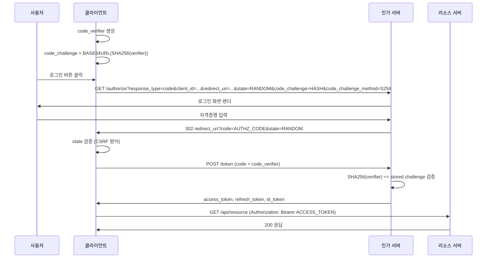

# OAuth2 Authorization Code + PKCE 구현

## 왜 PKCE가 필요한가

Authorization Code Flow는 원래 서버 사이드 앱 전용으로 설계됐다. 서버는 `client_secret`을 안전하게 보관할 수 있으니, authorization code를 탈취당해도 token endpoint에서 client_secret 없이는 교환이 안 된다.

SPA와 모바일 앱은 이 전제가 성립하지 않는다. SPA의 코드는 브라우저 DevTools로 전부 볼 수 있고, 안드로이드 APK는 디컴파일된다. `client_secret`을 넣어봤자 그냥 평문이다.

그래서 Implicit Flow가 나왔는데, 이건 더 나빴다. authorization code 교환 단계 자체를 없애고 redirect URI에 access token을 직접 박아서 돌려준다. URL fragment는 브라우저 히스토리에 남고, referrer 헤더에 실리고, 로그에 찍힌다. 2019년 RFC 8252 이후로 모바일 앱에서 Implicit 쓰지 말라는 게 공식 입장이고, OAuth 2.1 초안에서는 아예 빠졌다.

PKCE(Proof Key for Code Exchange, RFC 7636)는 다른 접근이다. client_secret 없이도 "이 authorization code는 내가 요청한 것"을 증명할 수 있게 한다. 요청 시점에 랜덤 값을 만들어서 그 해시를 서버에 보내고, 교환 시점에 원본 값을 보내는 방식이다. 중간에 code를 가로챈 공격자는 원본 값을 모르니 교환을 못 한다.

<div class="ygd-pkce-code-interception ygd-m-no" id="ygd-pkce-code-interception">
<style>
.ygd-pkce-code-interception{--ygd-bg:#FAF8F6;--ygd-fg:#2B2825;--ygd-muted:#5F5A54;--ygd-line:#9A948C;--ygd-box:#FFFFFF;--ygd-acc:#3D7387;--ygd-bad:#B3261E;--ygd-ok:#1E7B3A;--ygd-panel:#F1EEEA;--ygd-border:#D9D4CE;--ygd-on-acc:#FFFFFF;max-width:760px;margin-left:auto;margin-right:auto;margin-top:16px;margin-bottom:16px;box-sizing:border-box;padding:14px;border:1px solid var(--ygd-border);border-radius:12px;background:var(--ygd-bg);color:var(--ygd-fg);font-size:15px;line-height:1.6;overflow:hidden}
body[data-md-color-scheme="slate"] .ygd-pkce-code-interception{--ygd-bg:#262224;--ygd-fg:#F0EDE9;--ygd-muted:#B8B2AA;--ygd-line:#8A847C;--ygd-box:#332E31;--ygd-acc:#7FB5C9;--ygd-bad:#FF8A80;--ygd-ok:#7FD99A;--ygd-panel:#2E2A2C;--ygd-border:#4A4448;--ygd-on-acc:#15191B}
.ygd-pkce-code-interception *{box-sizing:border-box}
.ygd-pkce-code-interception .ygd-bar{display:flex;flex-wrap:wrap;gap:8px;margin-bottom:10px;align-items:center}
.ygd-pkce-code-interception .ygd-grp{display:flex;flex-wrap:wrap;gap:8px}
.ygd-pkce-code-interception .ygd-btn{font:inherit;font-size:14px;line-height:1.3;min-height:40px;padding:6px 14px;border-radius:8px;border:1px solid var(--ygd-border);background:var(--ygd-box);color:var(--ygd-fg);cursor:pointer;margin:0}
.ygd-pkce-code-interception .ygd-btn:hover{border-color:var(--ygd-acc)}
.ygd-pkce-code-interception .ygd-btn:focus-visible{outline:3px solid var(--ygd-acc);outline-offset:2px}
.ygd-pkce-code-interception .ygd-btn[aria-pressed="true"],.ygd-pkce-code-interception .ygd-btn.ygd-primary{background:var(--ygd-acc);border-color:var(--ygd-acc);color:var(--ygd-on-acc);font-weight:700}
.ygd-pkce-code-interception .ygd-btn:disabled{opacity:.5;cursor:default}
.ygd-pkce-code-interception .ygd-svg{display:block;width:100%;max-width:560px;height:auto;margin:0 auto}
.ygd-pkce-code-interception .ygd-life{stroke:var(--ygd-line);stroke-width:1.5;stroke-dasharray:4 4}
.ygd-pkce-code-interception .ygd-hdbox{fill:var(--ygd-box);stroke-width:2}
.ygd-pkce-code-interception .ygd-h-s{stroke:var(--ygd-acc)}
.ygd-pkce-code-interception .ygd-h-a{stroke:var(--ygd-acc)}
.ygd-pkce-code-interception .ygd-h-x{stroke:var(--ygd-bad)}
.ygd-pkce-code-interception .ygd-hd{fill:var(--ygd-fg);font-size:12px;font-weight:700}
.ygd-pkce-code-interception .ygd-hd-x{fill:var(--ygd-bad)}
.ygd-pkce-code-interception .ygd-tx{fill:var(--ygd-fg);font-size:11px}
.ygd-pkce-code-interception .ygd-tx2{fill:var(--ygd-muted);font-size:11px}
.ygd-pkce-code-interception .ygd-tx-bad{fill:var(--ygd-bad);font-size:11px;font-weight:700}
.ygd-pkce-code-interception .ygd-st{transition:opacity .3s}
.ygd-pkce-code-interception .ygd-future{opacity:.45}
.ygd-pkce-code-interception .ygd-past{opacity:.85}
.ygd-pkce-code-interception .ygd-idle{opacity:.8}
.ygd-pkce-code-interception .ygd-now{opacity:1}
.ygd-pkce-code-interception .ygd-ar{fill:none;stroke-width:2}
.ygd-pkce-code-interception .ygd-now .ygd-ar{stroke-width:3}
.ygd-pkce-code-interception .ygd-c-acc{stroke:var(--ygd-acc)}
.ygd-pkce-code-interception .ygd-c-bad{stroke:var(--ygd-bad)}
.ygd-pkce-code-interception .ygd-bx{fill:var(--ygd-box);stroke:var(--ygd-line);stroke-width:1.5}
.ygd-pkce-code-interception .ygd-bx-bad{stroke:var(--ygd-bad);stroke-width:2}
.ygd-pkce-code-interception.ygd-m-no .ygd-r5,.ygd-pkce-code-interception.ygd-m-no .ygd-r6{stroke:var(--ygd-bad)}
.ygd-pkce-code-interception.ygd-m-yes .ygd-r5,.ygd-pkce-code-interception.ygd-m-yes .ygd-r6{stroke:var(--ygd-ok)}
.ygd-pkce-code-interception .ygd-r5{stroke-width:2}
.ygd-pkce-code-interception.ygd-m-no .ygd-r6t{fill:var(--ygd-bad);font-size:11px;font-weight:700}
.ygd-pkce-code-interception.ygd-m-yes .ygd-r6t{fill:var(--ygd-ok);font-size:11px;font-weight:700}
.ygd-pkce-code-interception .ygd-pt-dot{fill:var(--ygd-bad)}
.ygd-pkce-code-interception .ygd-mk-a{fill:var(--ygd-acc)}
.ygd-pkce-code-interception .ygd-mk-b{fill:var(--ygd-bad)}
.ygd-pkce-code-interception .ygd-mk-g{fill:var(--ygd-ok)}
.ygd-pkce-code-interception .ygd-panel{margin-top:10px;padding:10px 12px;border-left:4px solid var(--ygd-acc);background:var(--ygd-panel);border-radius:6px}
.ygd-pkce-code-interception .ygd-panel.ygd-pn-bad{border-left-color:var(--ygd-bad)}
.ygd-pkce-code-interception .ygd-panel.ygd-pn-ok{border-left-color:var(--ygd-ok)}
.ygd-pkce-code-interception .ygd-pt{font-size:15px;font-weight:700;margin:0 0 4px}
.ygd-pkce-code-interception .ygd-pb{font-size:15px;margin:0}
.ygd-pkce-code-interception .ygd-note{margin-top:10px;font-size:14px;line-height:1.6;color:var(--ygd-muted)}
@media (prefers-reduced-motion:reduce){.ygd-pkce-code-interception .ygd-st{transition:none}}
</style>
<div class="ygd-bar">
<div class="ygd-grp" role="group" aria-label="PKCE 적용 여부 선택">
<button type="button" class="ygd-btn" data-mode="no" aria-pressed="true">PKCE 없음</button>
<button type="button" class="ygd-btn" data-mode="yes" aria-pressed="false">PKCE 있음</button>
</div>
<div class="ygd-grp">
<button type="button" class="ygd-btn ygd-primary" data-act="play">재생</button>
<button type="button" class="ygd-btn" data-act="next">다음 단계</button>
<button type="button" class="ygd-btn" data-act="reset">처음으로</button>
</div>
</div>
<svg class="ygd-svg" viewBox="0 0 420 424" role="img" aria-label="authorization code 탈취 시나리오 시퀀스 다이어그램" data-ygd="svg">
<defs>
<marker id="ygd-pkce-code-interception-mk-a" markerUnits="userSpaceOnUse" markerWidth="10" markerHeight="10" refX="9" refY="5" orient="auto"><path class="ygd-mk-a" d="M0,1 L10,5 L0,9 z"/></marker>
<marker id="ygd-pkce-code-interception-mk-b" markerUnits="userSpaceOnUse" markerWidth="10" markerHeight="10" refX="9" refY="5" orient="auto"><path class="ygd-mk-b" d="M0,1 L10,5 L0,9 z"/></marker>
<marker id="ygd-pkce-code-interception-mk-g" markerUnits="userSpaceOnUse" markerWidth="10" markerHeight="10" refX="9" refY="5" orient="auto"><path class="ygd-mk-g" d="M0,1 L10,5 L0,9 z"/></marker>
</defs>
<line class="ygd-life" x1="70" y1="40" x2="70" y2="422"/>
<line class="ygd-life" x1="220" y1="40" x2="220" y2="422"/>
<line class="ygd-life" x1="370" y1="40" x2="370" y2="422"/>
<rect class="ygd-hdbox ygd-h-s" x="20" y="8" width="100" height="32" rx="6"/>
<text class="ygd-hd" x="70" y="28" text-anchor="middle">인가 서버</text>
<rect class="ygd-hdbox ygd-h-x" x="170" y="8" width="100" height="32" rx="6"/>
<text class="ygd-hd ygd-hd-x" x="220" y="28" text-anchor="middle">공격자</text>
<rect class="ygd-hdbox ygd-h-a" x="320" y="8" width="100" height="32" rx="6"/>
<text class="ygd-hd" x="370" y="28" text-anchor="middle">클라이언트</text>
<g data-step="1">
<line class="ygd-ar ygd-c-acc" x1="364" y1="90" x2="76" y2="90" marker-end="url(#ygd-pkce-code-interception-mk-a)"/>
<text class="ygd-tx" x="295" y="62" text-anchor="middle">GET /authorize</text>
<text class="ygd-tx2" x="295" y="76" text-anchor="middle" data-t="s1b">code_challenge 없음</text>
<g data-yes="1" display="none">
<rect class="ygd-bx" x="320" y="106" width="100" height="26" rx="5"/>
<text class="ygd-tx" x="370" y="123" text-anchor="middle">verifier 보관</text>
</g>
</g>
<g data-step="2">
<line class="ygd-ar ygd-c-acc" x1="76" y1="196" x2="364" y2="196" marker-end="url(#ygd-pkce-code-interception-mk-a)"/>
<text class="ygd-tx" x="295" y="168" text-anchor="middle">302 redirect_uri</text>
<text class="ygd-tx2" x="295" y="182" text-anchor="middle">?code=AUTHZ_CODE</text>
</g>
<g data-step="3">
<circle class="ygd-pt-dot" cx="220" cy="196" r="6"/>
<rect class="ygd-bx ygd-bx-bad" x="155" y="218" width="130" height="28" rx="5"/>
<text class="ygd-tx-bad" x="220" y="236" text-anchor="middle">code 사본 확보</text>
</g>
<g data-step="4">
<line class="ygd-ar ygd-c-bad" x1="214" y1="300" x2="76" y2="300" marker-end="url(#ygd-pkce-code-interception-mk-b)"/>
<text class="ygd-tx" x="145" y="272" text-anchor="middle">POST /token</text>
<text class="ygd-tx2" x="145" y="286" text-anchor="middle" data-t="s4b">code만 제출</text>
</g>
<g data-step="5">
<rect class="ygd-bx ygd-r5" x="80" y="322" width="130" height="36" rx="5"/>
<text class="ygd-tx" x="145" y="337" text-anchor="middle" data-t="s5a">challenge 없음</text>
<text class="ygd-tx2" x="145" y="351" text-anchor="middle" data-t="s5b">code만 유효하면 통과</text>
</g>
<g data-step="6">
<line class="ygd-ar ygd-r6" x1="76" y1="410" x2="214" y2="410" marker-end="url(#ygd-pkce-code-interception-mk-b)" data-ygd="r6line"/>
<text class="ygd-r6t" x="145" y="382" text-anchor="middle" data-t="s6a">access_token 발급</text>
<text class="ygd-tx2" x="145" y="396" text-anchor="middle" data-t="s6b">공격자가 토큰 획득</text>
</g>
<circle class="ygd-dot" r="5" cx="0" cy="0" display="none" data-ygd="dot"/>
</svg>
<div class="ygd-panel" aria-live="polite" data-ygd="panel">
<div class="ygd-pt" data-ygd="title"></div>
<div class="ygd-pb" data-ygd="body"></div>
</div>
<div class="ygd-note">비유: code는 물건을 맡기고 받은 보관증이고, code_verifier는 맡길 때 본인만 알고 있는 확인 문구다. 보관증만 주워서는 물건을 찾을 수 없어야 한다. 실제 검증은 확인 문구 자체가 아니라 그 SHA-256 해시를 비교하는 방식이다.</div>
<script>
(function(){
var root=document.getElementById('ygd-pkce-code-interception');
if(!root||root.getAttribute('data-ygd-init')){return;}
root.setAttribute('data-ygd-init','1');
var q=function(s){return root.querySelector(s);};
var qa=function(s){return Array.prototype.slice.call(root.querySelectorAll(s));};
var TOTAL=6;
var mode='no',step=0,playing=false,timer=null,raf=null;
var TEXT={
no:{s1b:'code_challenge 없음',s4b:'code만 제출',s5a:'challenge 없음',s5b:'code만 유효하면 통과',s6a:'access_token 발급',s6b:'공격자가 토큰 획득'},
yes:{s1b:'code_challenge 포함',s4b:'code + 임의 verifier',s5a:'SHA256(verifier)',s5b:'challenge와 불일치',s6a:'교환 거부',s6b:'토큰 발급 안 함'}
};
var TITLES=['시작 전','1. /authorize 요청','2. authorization code 발급','3. code 탈취','4. 공격자의 /token 요청','5. 인가 서버 검증','6. 결과'];
var BODY={
no:[
'PKCE 없이 Public Client(SPA, 모바일 앱)가 code를 탈취당하면 어떻게 되는지 본다. 재생을 누르거나 다음 단계로 한 단계씩 넘겨 본다.',
'클라이언트가 /authorize를 요청한다. PKCE가 없으니 code_challenge가 요청에 없고, 인가 서버는 이 code를 누가 교환해야 하는지 대조할 값을 받지 못한다.',
'사용자 인증이 끝나면 인가 서버가 redirect_uri?code=... 로 authorization code를 돌려준다. 이 code는 클라이언트에 도착하기 전까지 redirect 경로를 따라 이동한다.',
'공격자가 중간에서 authorization code를 가로챈다. 이 시점의 code는 아직 토큰이 아니라 토큰으로 교환할 수 있는 값일 뿐이다.',
'공격자가 가로챈 code를 그대로 /token에 보낸다. SPA와 모바일 앱에는 보관할 수 있는 client_secret이 없으니 code 말고 요구되는 값이 없다.',
'인가 서버가 대조할 challenge가 없다. code가 유효하다는 사실만으로 요청이 통과한다.',
'공격자가 access_token을 받는다. 정상 클라이언트가 아닌데도 교환이 성공하는 것이 PKCE 없는 Public Client의 문제다.'],
yes:[
'PKCE를 쓰면 같은 탈취가 왜 실패하는지 본다. 재생을 누르거나 다음 단계로 한 단계씩 넘겨 본다.',
'클라이언트가 code_verifier를 만들고, 그 SHA-256 해시인 code_challenge를 /authorize에 실어 보낸다. 원본 verifier는 클라이언트만 가지고 있고 아직 서버로 보내지 않는다.',
'사용자 인증이 끝나면 인가 서버가 redirect_uri?code=... 로 code를 돌려준다. 인가 서버는 이 code와 함께 요청 때 받은 challenge를 저장해 둔다.',
'공격자가 중간에서 code를 가로챈다. 하지만 공격자가 얻은 것은 code뿐이고, 원본 code_verifier는 모른다.',
'공격자가 가로챈 code와 함께 임의로 만든 verifier를 /token에 보낸다. 원본 값을 모르니 맞는 verifier를 낼 수 없다.',
'인가 서버가 받은 verifier의 SHA-256 해시를 계산해 저장된 challenge와 비교한다. 두 값이 다르다.',
'교환이 거부되어 토큰이 발급되지 않는다. 정상 클라이언트는 원본 verifier를 갖고 있으므로 이 검증을 통과할 수 있다.']
};
var DOTS={1:[364,76,90,'acc'],2:[76,364,196,'acc'],4:[214,76,300,'bad'],6:[76,214,410,'res']};
function reduced(){return !!(window.matchMedia&&window.matchMedia('(prefers-reduced-motion: reduce)').matches);}
function stop(){if(timer){clearInterval(timer);timer=null;}playing=false;}
function runDot(){
var dot=q('[data-ygd="dot"]');
if(raf){cancelAnimationFrame(raf);raf=null;}
var d=DOTS[step];
if(!d||reduced()){dot.setAttribute('display','none');return;}
var col=d[3]==='acc'?'var(--ygd-acc)':d[3]==='bad'?'var(--ygd-bad)':(mode==='no'?'var(--ygd-bad)':'var(--ygd-ok)');
dot.style.fill=col;
dot.setAttribute('cy',d[2]);
dot.setAttribute('cx',d[0]);
dot.setAttribute('display','inline');
var t0=null,dur=900;
function tick(ts){
if(t0===null){t0=ts;}
var p=Math.min(1,(ts-t0)/dur);
dot.setAttribute('cx',d[0]+(d[1]-d[0])*p);
if(p<1){raf=requestAnimationFrame(tick);}else{raf=null;dot.setAttribute('display','none');}
}
raf=requestAnimationFrame(tick);
}
function render(){
root.classList.toggle('ygd-m-no',mode==='no');
root.classList.toggle('ygd-m-yes',mode==='yes');
qa('[data-step]').forEach(function(g){
var n=parseInt(g.getAttribute('data-step'),10);
var c=step===0?'ygd-idle':(n<step?'ygd-past':(n===step?'ygd-now':'ygd-future'));
g.setAttribute('class','ygd-st '+c);
});
qa('[data-yes]').forEach(function(g){
if(mode==='yes'){g.removeAttribute('display');}else{g.setAttribute('display','none');}
});
qa('[data-t]').forEach(function(el){el.textContent=TEXT[mode][el.getAttribute('data-t')];});
q('[data-ygd="r6line"]').setAttribute('marker-end','url(#ygd-pkce-code-interception-mk-'+(mode==='no'?'b':'g')+')');
qa('[data-mode]').forEach(function(b){b.setAttribute('aria-pressed',b.getAttribute('data-mode')===mode?'true':'false');});
q('[data-ygd="title"]').textContent=TITLES[step];
q('[data-ygd="body"]').textContent=BODY[mode][step];
var pn=q('[data-ygd="panel"]');
pn.className='ygd-panel'+(step===TOTAL?(mode==='no'?' ygd-pn-bad':' ygd-pn-ok'):'');
q('[data-act="play"]').textContent=playing?'일시정지':(step>=TOTAL?'다시 재생':'재생');
q('[data-act="next"]').disabled=step>=TOTAL;
q('[data-act="reset"]').disabled=step===0&&!playing;
q('[data-ygd="svg"]').setAttribute('aria-label',mode==='no'
?'PKCE 없음: 공격자가 가로챈 authorization code를 /token에 그대로 제출해 access_token을 받는 시퀀스 다이어그램'
:'PKCE 있음: 공격자가 원본 code_verifier를 몰라 challenge 검증에서 교환이 거부되는 시퀀스 다이어그램');
runDot();
}
function advance(){
step=step+1;
if(step>=TOTAL){stop();}
render();
}
function play(){
if(playing){stop();render();return;}
if(step>=TOTAL){step=0;}
playing=true;
advance();
if(playing){
timer=setInterval(function(){
if(step>=TOTAL){stop();render();return;}
advance();
},3600);
}
}
root.addEventListener('click',function(e){
var t=e.target;
while(t&&t!==root&&!(t.getAttribute&&(t.getAttribute('data-act')||t.getAttribute('data-mode')))){t=t.parentNode;}
if(!t||t===root){return;}
var act=t.getAttribute('data-act');
var m=t.getAttribute('data-mode');
if(m){stop();mode=m;step=0;render();return;}
if(act==='play'){play();}
else if(act==='next'){stop();if(step<TOTAL){step=step+1;}render();}
else if(act==='reset'){stop();step=0;render();}
});
render();
})();
</script>
</div>

## Authorization Code Flow 전체 흐름

Public Client 기준으로 단계별로 뜯어본다.

```
[1] code_verifier 생성     클라이언트 로컬
[2] code_challenge 계산    클라이언트 로컬
[3] /authorize 요청        클라이언트 → 인가 서버
[4] 사용자 인증            브라우저 ↔ 인가 서버
[5] authorization code 발급 인가 서버 → redirect_uri
[6] /token 요청            클라이언트 → 인가 서버
[7] token 응답             인가 서버 → 클라이언트
[8] API 호출               클라이언트 → 리소스 서버
```



<div class="ygd-auth-code-pkce-flow-playback" id="ygd-auth-code-pkce-flow-playback">
<style>
.ygd-auth-code-pkce-flow-playback{--ygd-bg:#FFFFFF;--ygd-card:#FBFAF8;--ygd-cell:#F1EEEA;--ygd-border:#CFC9C2;--ygd-text:#2B2724;--ygd-muted:#665F58;--ygd-accent:#2F6A80;--ygd-accent-tint:#E3EFF3;--ygd-on-accent:#FFFFFF;--ygd-hot:#B3261E;--ygd-cv:#2F6A80;--ygd-bv:#E3EFF3;--ygd-cc:#6A4C93;--ygd-bc:#EEE8F5;--ygd-cs:#A0561A;--ygd-bs:#FBEBDD;--ygd-ck:#2E7D4F;--ygd-bk:#E2F2E8;--ygd-ct:#7A5C00;--ygd-bt:#F7EFD0;max-width:760px;margin:16px auto;padding:14px;border:1px solid var(--ygd-border);border-radius:10px;background:var(--ygd-bg);color:var(--ygd-text);font-size:14px;line-height:1.6;box-sizing:border-box}
body[data-md-color-scheme="slate"] .ygd-auth-code-pkce-flow-playback{--ygd-bg:#26221F;--ygd-card:#2E2A27;--ygd-cell:#383330;--ygd-border:#554E48;--ygd-text:#F0EDE9;--ygd-muted:#B5AEA5;--ygd-accent:#7CC0D8;--ygd-accent-tint:#2B3E46;--ygd-on-accent:#1B1816;--ygd-hot:#FF8A80;--ygd-cv:#7CC0D8;--ygd-bv:#2B3E46;--ygd-cc:#C3A8E8;--ygd-bc:#3A3048;--ygd-cs:#F0A868;--ygd-bs:#4A3626;--ygd-ck:#7FD2A0;--ygd-bk:#28402F;--ygd-ct:#E8CC6A;--ygd-bt:#453C1C}
.ygd-auth-code-pkce-flow-playback *{box-sizing:border-box}
.ygd-auth-code-pkce-flow-playback .ygd-cap{margin:0 0 10px;font-size:14px;color:var(--ygd-muted)}
.ygd-auth-code-pkce-flow-playback .ygd-ctrl{display:flex;flex-wrap:wrap;align-items:center;gap:8px;margin:0 0 10px}
.ygd-auth-code-pkce-flow-playback .ygd-btn{appearance:none;min-height:44px;padding:8px 14px;border:1.5px solid var(--ygd-border);border-radius:8px;background:var(--ygd-card);color:var(--ygd-text);font:inherit;font-size:14px;cursor:pointer}
.ygd-auth-code-pkce-flow-playback .ygd-btn:hover{border-color:var(--ygd-accent)}
.ygd-auth-code-pkce-flow-playback .ygd-btn:focus-visible{outline:3px solid var(--ygd-accent);outline-offset:2px}
.ygd-auth-code-pkce-flow-playback .ygd-btn[disabled]{opacity:.5;cursor:default}
.ygd-auth-code-pkce-flow-playback .ygd-play{background:var(--ygd-accent);border-color:var(--ygd-accent);color:var(--ygd-on-accent);font-weight:700;min-width:96px}
.ygd-auth-code-pkce-flow-playback .ygd-count{font-size:14px;color:var(--ygd-muted)}
.ygd-auth-code-pkce-flow-playback .ygd-stage{margin:0 0 12px}
.ygd-auth-code-pkce-flow-playback .ygd-svg{display:block;width:100%;max-width:560px;height:auto;margin:0 auto}
.ygd-auth-code-pkce-flow-playback .ygd-hold{fill:var(--ygd-cell)}
.ygd-auth-code-pkce-flow-playback .ygd-life{stroke:var(--ygd-border);stroke-width:1.2;stroke-dasharray:3 3}
.ygd-auth-code-pkce-flow-playback .ygd-head{fill:var(--ygd-card);stroke:var(--ygd-border);stroke-width:1.5}
.ygd-auth-code-pkce-flow-playback .ygd-head.ygd-act{fill:var(--ygd-accent-tint);stroke:var(--ygd-accent);stroke-width:2.2}
.ygd-auth-code-pkce-flow-playback .ygd-hd{fill:var(--ygd-text);font-size:12px;font-weight:700}
.ygd-auth-code-pkce-flow-playback .ygd-row{opacity:.5;transition:opacity .3s}
.ygd-auth-code-pkce-flow-playback .ygd-row.ygd-done{opacity:.85}
.ygd-auth-code-pkce-flow-playback .ygd-row.ygd-now{opacity:1}
.ygd-auth-code-pkce-flow-playback .ygd-line{fill:none;stroke:var(--ygd-muted);stroke-width:1.6}
.ygd-auth-code-pkce-flow-playback .ygd-line.ygd-fwd{marker-end:url(#ygd-auth-code-pkce-flow-playback-arr)}
.ygd-auth-code-pkce-flow-playback .ygd-line.ygd-both{marker-end:url(#ygd-auth-code-pkce-flow-playback-arr);marker-start:url(#ygd-auth-code-pkce-flow-playback-arr)}
.ygd-auth-code-pkce-flow-playback .ygd-line.ygd-dash{stroke-dasharray:5 4}
.ygd-auth-code-pkce-flow-playback .ygd-now .ygd-line{stroke:var(--ygd-accent);stroke-width:2.4}
.ygd-auth-code-pkce-flow-playback .ygd-now .ygd-line.ygd-fwd{marker-end:url(#ygd-auth-code-pkce-flow-playback-arr-on)}
.ygd-auth-code-pkce-flow-playback .ygd-now .ygd-line.ygd-both{marker-end:url(#ygd-auth-code-pkce-flow-playback-arr-on);marker-start:url(#ygd-auth-code-pkce-flow-playback-arr-on)}
.ygd-auth-code-pkce-flow-playback .ygd-mk{fill:var(--ygd-muted)}
.ygd-auth-code-pkce-flow-playback .ygd-mk-on{fill:var(--ygd-accent)}
.ygd-auth-code-pkce-flow-playback .ygd-lbg{fill:var(--ygd-bg)}
.ygd-auth-code-pkce-flow-playback .ygd-t{fill:var(--ygd-text);font-size:12px;font-weight:600}
.ygd-auth-code-pkce-flow-playback .ygd-s{fill:var(--ygd-muted);font-size:10.5px}
.ygd-auth-code-pkce-flow-playback .ygd-bdg{fill:var(--ygd-card);stroke:var(--ygd-border);stroke-width:1.2}
.ygd-auth-code-pkce-flow-playback .ygd-now .ygd-bdg{fill:var(--ygd-accent);stroke:var(--ygd-accent)}
.ygd-auth-code-pkce-flow-playback .ygd-bn{fill:var(--ygd-text);font-size:10px;font-weight:700}
.ygd-auth-code-pkce-flow-playback .ygd-now .ygd-bn{fill:var(--ygd-on-accent)}
.ygd-auth-code-pkce-flow-playback .ygd-box{fill:var(--ygd-card);stroke:var(--ygd-border);stroke-width:1.5}
.ygd-auth-code-pkce-flow-playback .ygd-now .ygd-box{stroke:var(--ygd-hot);stroke-width:2.5}
.ygd-auth-code-pkce-flow-playback .ygd-k-V{--ygd-kc:var(--ygd-cv);--ygd-kb:var(--ygd-bv)}
.ygd-auth-code-pkce-flow-playback .ygd-k-C{--ygd-kc:var(--ygd-cc);--ygd-kb:var(--ygd-bc)}
.ygd-auth-code-pkce-flow-playback .ygd-k-S{--ygd-kc:var(--ygd-cs);--ygd-kb:var(--ygd-bs)}
.ygd-auth-code-pkce-flow-playback .ygd-k-K{--ygd-kc:var(--ygd-ck);--ygd-kb:var(--ygd-bk)}
.ygd-auth-code-pkce-flow-playback .ygd-k-T{--ygd-kc:var(--ygd-ct);--ygd-kb:var(--ygd-bt)}
.ygd-auth-code-pkce-flow-playback .ygd-cr{fill:var(--ygd-kb);stroke:var(--ygd-kc);stroke-width:1.2}
.ygd-auth-code-pkce-flow-playback .ygd-cb{fill:var(--ygd-kc)}
.ygd-auth-code-pkce-flow-playback .ygd-ct{fill:var(--ygd-text);font-size:10px;font-weight:600}
.ygd-auth-code-pkce-flow-playback .ygd-hot .ygd-cr{stroke:var(--ygd-hot);stroke-width:3}
.ygd-auth-code-pkce-flow-playback .ygd-panel{padding:12px 14px;border:1px solid var(--ygd-border);border-left:5px solid var(--ygd-accent);border-radius:8px;background:var(--ygd-card);min-height:210px}
.ygd-auth-code-pkce-flow-playback .ygd-panel.ygd-verify{border-left-color:var(--ygd-hot)}
.ygd-auth-code-pkce-flow-playback .ygd-ptitle{display:block;margin:0 0 6px;font-size:16px;font-weight:700;color:var(--ygd-text)}
.ygd-auth-code-pkce-flow-playback .ygd-pdesc{margin:0 0 10px;font-size:14px;color:var(--ygd-text)}
.ygd-auth-code-pkce-flow-playback .ygd-pmoves{display:flex;flex-wrap:wrap;align-items:center;gap:6px 8px;font-size:14px;color:var(--ygd-muted)}
.ygd-auth-code-pkce-flow-playback .ygd-mchips{display:inline-flex;flex-wrap:wrap;gap:6px}
.ygd-auth-code-pkce-flow-playback .ygd-pchip{display:inline-block;padding:1px 8px;border-left:4px solid var(--ygd-kc);border-radius:4px;background:var(--ygd-kb);color:var(--ygd-text);font-size:14px;font-weight:600}
.ygd-auth-code-pkce-flow-playback .ygd-mlabel{font-weight:700;color:var(--ygd-text)}
.ygd-auth-code-pkce-flow-playback .ygd-note{margin:12px 0 0;font-size:14px;color:var(--ygd-muted)}
.ygd-auth-code-pkce-flow-playback .ygd-note strong{color:var(--ygd-text)}
@media (max-width:480px){.ygd-auth-code-pkce-flow-playback{padding:10px}.ygd-auth-code-pkce-flow-playback .ygd-panel{min-height:300px}.ygd-auth-code-pkce-flow-playback .ygd-btn{padding:8px 12px}}
@media (prefers-reduced-motion:no-preference){
.ygd-auth-code-pkce-flow-playback .ygd-now .ygd-line:not(.ygd-dash){stroke-dasharray:1;animation:ygd-auth-code-pkce-flow-playback-draw .7s ease-out both}
.ygd-auth-code-pkce-flow-playback .ygd-chip.ygd-new{animation:ygd-auth-code-pkce-flow-playback-pop .45s ease-out .5s both}
.ygd-auth-code-pkce-flow-playback .ygd-hot .ygd-cr{animation:ygd-auth-code-pkce-flow-playback-pulse 1s ease-in-out infinite}
@keyframes ygd-auth-code-pkce-flow-playback-draw{from{stroke-dashoffset:1}to{stroke-dashoffset:0}}
@keyframes ygd-auth-code-pkce-flow-playback-pop{from{opacity:0;transform:translateY(-5px)}to{opacity:1;transform:none}}
@keyframes ygd-auth-code-pkce-flow-playback-pulse{0%,100%{stroke-opacity:1}50%{stroke-opacity:.35}}
}
</style>
<p class="ygd-cap">각 주체 위쪽 칸은 그 주체가 지금 들고 있는 값이다. 강조된 화살표가 이번 단계의 메시지다.</p>
<div class="ygd-ctrl">
<button type="button" class="ygd-btn ygd-play">재생</button>
<button type="button" class="ygd-btn ygd-prev">이전</button>
<button type="button" class="ygd-btn ygd-next">다음</button>
<button type="button" class="ygd-btn ygd-reset">처음으로</button>
<span class="ygd-count"></span>
</div>
<div class="ygd-stage">
<svg class="ygd-svg" viewBox="0 0 400 558" role="img" aria-label="Authorization Code와 PKCE 8단계 흐름. 사용자, 클라이언트, 인가 서버, 리소스 서버 사이의 메시지와 각 주체가 보관한 code_verifier, code_challenge, state, code 값을 보여준다.">
<defs>
<marker id="ygd-auth-code-pkce-flow-playback-arr" viewBox="0 0 10 10" refX="9" refY="5" markerWidth="7" markerHeight="7" orient="auto-start-reverse"><path class="ygd-mk" d="M0,0 L10,5 L0,10 z"></path></marker>
<marker id="ygd-auth-code-pkce-flow-playback-arr-on" viewBox="0 0 10 10" refX="9" refY="5" markerWidth="7" markerHeight="7" orient="auto-start-reverse"><path class="ygd-mk-on" d="M0,0 L10,5 L0,10 z"></path></marker>
</defs>
</svg>
</div>
<div class="ygd-panel" role="status" aria-live="polite">
<strong class="ygd-ptitle"></strong>
<p class="ygd-pdesc"></p>
<div class="ygd-pmoves"><span class="ygd-mlabel">값 이동</span><span class="ygd-mchips"></span><span class="ygd-mtext"></span></div>
</div>
<p class="ygd-note"><strong>비유</strong> 보관함에 짐을 맡기며 비밀번호를 정한다. 보관소에는 비밀번호 자체가 아니라 그 지문(해시)만 남기고, 찾을 때 비밀번호를 말하면 보관소가 같은 방식으로 지문을 만들어 대조한다. 접수증(code)만 주운 사람은 비밀번호를 몰라 짐을 찾지 못한다. 다만 실제 verifier는 요청마다 새로 만드는 일회성 랜덤 값이라는 점이 다르다.</p>
<script>
(function(){
var root=document.getElementById('ygd-auth-code-pkce-flow-playback');
if(!root)return;
var NS='http://www.w3.org/2000/svg';
function mk(tag,at,par,txt){var e=document.createElementNS(NS,tag);for(var k in at){e.setAttribute(k,at[k]);}if(txt!=null)e.textContent=txt;if(par)par.appendChild(e);return e;}
function q(s){return root.querySelector(s);}
function tw(s,z){var w=0;for(var i=0;i<s.length;i++){w+=s.charCodeAt(i)>255?z:z*0.56;}return w;}
var X=[50,150,250,350];
var LN=['사용자','클라이언트','인가 서버','리소스 서버'];
var NAME={V:'code_verifier',C:'code_challenge',S:'state',K:'code',T:'access_token'};
var svg=q('.ygd-svg');
var BASE=svg.getAttribute('aria-label');
var gLane=mk('g',{},svg),gRow=mk('g',{},svg),gChip=mk('g',{},svg);
var heads=[],layers=[];
for(var i=0;i<4;i++){
var x=X[i];
mk('rect',{x:x-46,y:38,width:92,height:90,rx:6,'class':'ygd-hold'},gLane);
mk('line',{x1:x,y1:132,x2:x,y2:552,'class':'ygd-life'},gLane);
heads[i]=mk('rect',{x:x-46,y:4,width:92,height:30,rx:6,'class':'ygd-head'},gLane);
mk('text',{x:x,y:23,'text-anchor':'middle','class':'ygd-hd'},gLane,LN[i]);
layers[i]=mk('g',{},gChip);
}
var ROWS=[
{id:'1',n:'1',y:150,k:'self',l:1,t:'code_verifier 생성',s:'랜덤 43~128자'},
{id:'2',n:'2',y:192,k:'self',l:1,t:'code_challenge 계산',s:'BASE64URL(SHA256(verifier))'},
{id:'3',n:'3',y:234,a:1,b:2,t:'GET /authorize',s:'challenge · state · S256'},
{id:'4',n:'4',y:276,a:0,b:2,both:1,t:'로그인 · 자격증명 입력',s:'브라우저 ↔ 인가 서버'},
{id:'5',n:'5',y:318,a:2,b:1,t:'302 redirect_uri',s:'code · state'},
{id:'6',n:'6',y:360,a:1,b:2,t:'POST /token',s:'code · code_verifier'},
{id:'6b',n:'6',y:409,k:'box'},
{id:'7',n:'7',y:458,a:2,b:1,t:'토큰 응답',s:'access · refresh · id_token'},
{id:'8',n:'8',y:500,a:1,b:3,t:'GET /api/resource',s:'Authorization: Bearer access_token'},
{id:'8r',y:542,a:3,b:1,dash:1,t:'200 응답'}
];
var rowG=[],rowIdx={};
ROWS.forEach(function(r,j){
rowIdx[r.id]=j;
var g=mk('g',{'class':'ygd-row'},gRow);
rowG[j]=g;
if(r.n){mk('circle',{cx:14,cy:r.y,r:8,'class':'ygd-bdg'},g);mk('text',{x:14,y:r.y+3.5,'text-anchor':'middle','class':'ygd-bn'},g,r.n);}
var cx,anchor='middle',ty,sy;
if(r.k==='box'){
mk('rect',{x:162,y:386,width:234,height:46,rx:6,'class':'ygd-box'},g);
mk('text',{x:279,y:403,'text-anchor':'middle','class':'ygd-t'},g,'SHA256(verifier) == 저장된 challenge ?');
mk('text',{x:279,y:421,'text-anchor':'middle','class':'ygd-s'},g,'일치해야 토큰을 발급한다');
return;
}
if(r.k==='self'){
var sx=X[r.l];
mk('path',{d:'M'+sx+','+(r.y-9)+' H'+(sx+24)+' V'+(r.y+9)+' H'+(sx+3),pathLength:1,'class':'ygd-line ygd-fwd'},g);
cx=sx+32;anchor='start';ty=r.y-3;sy=r.y+11;
}else{
var a=X[r.a],b=X[r.b];
mk('path',{d:'M'+a+','+r.y+' H'+b,pathLength:1,'class':'ygd-line '+(r.both?'ygd-both':'ygd-fwd')+(r.dash?' ygd-dash':'')},g);
cx=(a+b)/2;ty=r.y-6;sy=r.y+14;
}
function lab(txt,cls,z,y){
var w=tw(txt,z)+8;
var x0=anchor==='start'?cx-4:cx-w/2;
mk('rect',{x:x0,y:y-z*0.8,width:w,height:z*1.1,'class':'ygd-lbg'},g);
mk('text',{x:cx,y:y,'text-anchor':anchor,'class':cls},g,txt);
}
lab(r.t,'ygd-t',12,ty);
if(r.s)lab(r.s,'ygd-s',10.5,sy);
});
var F=[
{step:1,r:['1'],lanes:[1],h:[[],['V'],[],[]],title:'1. code_verifier 생성',
desc:'클라이언트가 로컬에서 43~128자의 URL-safe 랜덤 문자열을 만든다. Math.random()은 예측 가능하므로 쓰지 않고, 암호학적 난수(Web Crypto 등)를 쓴다.',
mv:{k:['V'],t:'클라이언트 로컬에서 생성. 아직 어디로도 나가지 않는다.'}},
{step:2,r:['2'],lanes:[1],h:[[],['V','C'],[],[]],title:'2. code_challenge 계산',
desc:'verifier를 SHA-256으로 해시하고 Base64URL로 인코딩해 code_challenge를 만든다(S256). plain 방식은 code를 탈취당하면 verifier와 같아져서 의미가 없다.',
mv:{k:['C'],t:'클라이언트 로컬에서 계산. verifier 원문은 클라이언트에 남는다.'}},
{step:3,r:['3'],lanes:[1,2],h:[[],['V','C','S'],['C','S'],[]],title:'3. /authorize 요청',
desc:'사용자가 로그인 버튼을 누르면 클라이언트가 state를 랜덤으로 만들어 저장하고, code_challenge·code_challenge_method=S256·state를 쿼리에 실어 /authorize로 보낸다. verifier 원문은 이 요청에 들어가지 않는다.',
mv:{k:['C','S'],t:'클라이언트 → 인가 서버. state 사본은 클라이언트 세션에도 남는다.'}},
{step:4,r:['4'],lanes:[0,2],h:[[],['V','C','S'],['C','S'],[]],title:'4. 사용자 인증',
desc:'인가 서버가 로그인 화면을 보여주고, 사용자는 자격증명을 인가 서버에 직접 입력한다. 이 단계에서는 PKCE 값이 새로 만들어지거나 전달되지 않는다.',
mv:{k:[],t:'새로 전달되는 값 없음. 인가 서버는 저장한 challenge를 들고 대기한다.'}},
{step:5,r:['5'],lanes:[2,1],h:[[],['V','C','S+','K'],['C','S','K'],[]],title:'5. authorization code 발급',
desc:'인가 서버가 302로 redirect_uri?code=...&state=... 에 되돌려 보낸다. 클라이언트는 돌아온 state가 저장해 둔 값과 같은지 먼저 확인하고(CSRF 방어), 일회용이므로 확인 후 지운다.',
mv:{k:['K','S'],t:'인가 서버 → 클라이언트(redirect_uri 쿼리). state는 보냈던 값 그대로 돌아온다.'}},
{step:6,r:['6'],lanes:[1,2],h:[[],['C','K'],['C','S','K','V'],[]],title:'6. /token 요청',
desc:'클라이언트가 POST /token 으로 code와 code_verifier 원문을 보낸다. redirect_uri는 /authorize 때와 정확히 같아야 하고, Public Client는 client_secret 없이 verifier만 보낸다.',
mv:{k:['K','V'],t:'클라이언트 → 인가 서버. verifier 원문이 처음으로 네트워크에 나간다(세션 사본은 삭제).'}},
{step:6,tag:'검증 순간',verify:1,r:['6b'],lanes:[2],hot:['C','V'],h:[[],['C','K'],['C','S','K','V'],[]],title:'6. 검증: SHA256(verifier) == 저장된 challenge',
desc:'인가 서버가 받은 verifier를 SHA-256으로 해시하고 Base64URL로 인코딩해, 3단계에서 저장해 둔 challenge와 비교한다. code만 가로챈 공격자는 verifier를 모르므로 여기서 막힌다.',
mv:{k:['V','C'],t:'인가 서버 내부에서 비교. 두 값이 일치해야 다음 단계로 간다.'}},
{step:7,r:['7'],lanes:[2,1],h:[[],['C','K','T'],['C','S','K','V'],[]],title:'7. token 응답',
desc:'검증이 통과하면 인가 서버가 access_token, refresh_token, id_token을 응답한다. 클라이언트는 이제 access_token으로 리소스 서버를 호출할 수 있다.',
mv:{k:['T'],t:'인가 서버 → 클라이언트. refresh_token, id_token도 함께 온다.'}},
{step:8,r:['8','8r'],lanes:[1,3],h:[[],['C','K','T'],['C','S','K','V'],['T']],title:'8. API 호출',
desc:'클라이언트가 Authorization: Bearer 헤더에 access_token을 실어 리소스 서버를 호출하고 200 응답을 받는다. PKCE 값은 이 구간에서 쓰이지 않는다.',
mv:{k:['T'],t:'클라이언트 → 리소스 서버(Authorization 헤더).'}}
];
var cur=-1,hold=[[],[],[],[]],timer=null,playing=false,DELAY=4500;
var playBtn=q('.ygd-play'),prevBtn=q('.ygd-prev'),nextBtn=q('.ygd-next'),resetBtn=q('.ygd-reset');
var count=q('.ygd-count'),panel=q('.ygd-panel'),pTitle=q('.ygd-ptitle'),pDesc=q('.ygd-pdesc'),mChips=q('.ygd-mchips'),mText=q('.ygd-mtext');
function keys(list){return list.map(function(s){return s.charAt(0);});}
function apply(i){
var f=F[i],fwd=i>cur;
var mn=99,mx=-1;
f.r.forEach(function(id){var j=rowIdx[id];if(j<mn)mn=j;if(j>mx)mx=j;});
rowG.forEach(function(g,j){g.setAttribute('class','ygd-row'+(j<mn?' ygd-done':(j<=mx?' ygd-now':'')));});
heads.forEach(function(h,l){h.setAttribute('class','ygd-head'+(f.lanes.indexOf(l)>=0?' ygd-act':''));});
for(var L=0;L<4;L++){
var layer=layers[L];layer.textContent='';
var old=keys(hold[L]||[]);
f.h[L].forEach(function(it,s){
var key=it.charAt(0),ok=it.length>1;
var isNew=fwd&&old.indexOf(key)<0;
var hot=f.hot&&L===2&&f.hot.indexOf(key)>=0;
var cx0=X[L]-46,cy0=42+s*21;
var g=mk('g',{'class':'ygd-chip ygd-k-'+key+(isNew?' ygd-new':'')+(hot?' ygd-hot':'')},layer);
mk('rect',{x:cx0,y:cy0,width:92,height:17,rx:4,'class':'ygd-cr'},g);
mk('rect',{x:cx0,y:cy0,width:5,height:17,rx:2,'class':'ygd-cb'},g);
mk('text',{x:cx0+10,y:cy0+12,'class':'ygd-ct'},g,NAME[key]+(ok?' ✓ 일치':''));
});
}
hold=f.h;cur=i;
pTitle.textContent=f.title;
pDesc.textContent=f.desc;
mChips.textContent='';
f.mv.k.forEach(function(k){var s=document.createElement('span');s.className='ygd-pchip ygd-k-'+k;s.textContent=NAME[k];mChips.appendChild(s);});
mText.textContent=f.mv.t;
panel.className='ygd-panel'+(f.verify?' ygd-verify':'');
count.textContent='단계 '+f.step+' / 8'+(f.tag?' · '+f.tag:'');
svg.setAttribute('aria-label',BASE+' 현재: '+f.title);
syncBtn();
}
function syncBtn(){
prevBtn.disabled=cur<=0;
nextBtn.disabled=cur>=F.length-1;
playBtn.textContent=playing?'일시정지':(cur>=F.length-1?'다시 재생':'재생');
}
function stop(){playing=false;clearTimeout(timer);syncBtn();}
function tick(){
if(cur>=F.length-1){stop();return;}
apply(cur+1);
if(cur>=F.length-1){stop();}else{timer=setTimeout(tick,DELAY);}
}
playBtn.addEventListener('click',function(){
if(playing){stop();return;}
if(cur>=F.length-1)apply(0);
playing=true;syncBtn();
timer=setTimeout(tick,DELAY);
});
prevBtn.addEventListener('click',function(){stop();if(cur>0)apply(cur-1);});
nextBtn.addEventListener('click',function(){stop();if(cur<F.length-1)apply(cur+1);});
resetBtn.addEventListener('click',function(){stop();apply(0);});
apply(0);
})();
</script>
</div>

## PKCE 파라미터 생성

### code_verifier

43~128자의 URL-safe 랜덤 문자열이다. RFC 7636 스펙은 문자셋을 `[A-Z a-z 0-9 - . _ ~]`로 제한한다. Base64URL 인코딩을 직접 쓰는 것이 가장 쉽다.

```python
import secrets
import base64

def generate_code_verifier() -> str:
    token = secrets.token_bytes(32)  # 32바이트 = 43자 Base64URL
    return base64.urlsafe_b64encode(token).rstrip(b'=').decode('ascii')
```

```typescript
// 브라우저 Web Crypto API
async function generateCodeVerifier(): Promise<string> {
  const array = new Uint8Array(32);
  crypto.getRandomValues(array);
  return btoa(String.fromCharCode(...array))
    .replace(/\+/g, '-')
    .replace(/\//g, '_')
    .replace(/=/g, '');
}
```

`Math.random()` 쓰면 안 된다. 예측 가능한 값이라 공격자가 verifier를 추측할 수 있다.

### code_challenge

verifier를 SHA-256으로 해시한 뒤 Base64URL 인코딩한다. `S256` 방식이 필수다. `plain`은 스펙에 있지만 code를 탈취당하면 verifier와 동일하니 의미 없다. 인가 서버가 `plain`을 허용하면 PKCE가 없는 것과 같다.

```python
import hashlib
import base64

def generate_code_challenge(verifier: str) -> str:
    digest = hashlib.sha256(verifier.encode('ascii')).digest()
    return base64.urlsafe_b64encode(digest).rstrip(b'=').decode('ascii')
```

```typescript
async function generateCodeChallenge(verifier: string): Promise<string> {
  const encoder = new TextEncoder();
  const data = encoder.encode(verifier);
  const digest = await crypto.subtle.digest('SHA-256', data);
  return btoa(String.fromCharCode(...new Uint8Array(digest)))
    .replace(/\+/g, '-')
    .replace(/\//g, '_')
    .replace(/=/g, '');
}
```

## state 파라미터로 CSRF 방어

`state`는 선택 파라미터처럼 보이지만 생략하면 CSRF 공격에 노출된다.

공격 시나리오는 이렇다. 공격자가 자기 계정으로 로그인하다가 redirect 직전에 멈추고, 그 URL을 피해자에게 클릭하게 만든다. 피해자가 클릭하면 공격자의 authorization code가 피해자의 세션과 연결된다. 이후 피해자가 앱을 쓰면 공격자 계정으로 연결되는 상황이 생길 수 있다.

`state`는 요청 전에 클라이언트가 생성한 랜덤 값이고, 인가 서버가 그대로 돌려준다. redirect를 받은 클라이언트는 자신이 만든 값과 일치하는지 검증한다.

```python
import secrets

class AuthSession:
    def start_authorization(self, redirect_uri: str) -> str:
        state = secrets.token_urlsafe(32)
        code_verifier = generate_code_verifier()
        
        # 세션에 저장 (서버 사이드 세션 또는 브라우저 sessionStorage)
        session.set('oauth_state', state)
        session.set('code_verifier', code_verifier)
        
        params = {
            'response_type': 'code',
            'client_id': CLIENT_ID,
            'redirect_uri': redirect_uri,
            'scope': 'openid profile email',
            'state': state,
            'code_challenge': generate_code_challenge(code_verifier),
            'code_challenge_method': 'S256',
        }
        return f"{AUTHORIZATION_ENDPOINT}?{urlencode(params)}"
    
    def handle_callback(self, code: str, returned_state: str) -> TokenResponse:
        stored_state = session.get('oauth_state')
        
        if not stored_state or stored_state != returned_state:
            raise SecurityError("state mismatch — possible CSRF")
        
        # state는 일회용. 재사용 공격 차단
        session.delete('oauth_state')
        
        code_verifier = session.get('code_verifier')
        session.delete('code_verifier')
        
        return self.exchange_code(code, code_verifier)
```

SPA에서 `state`를 sessionStorage에 저장하는 경우가 많은데, localStorage는 쓰지 않는다. 같은 도메인의 다른 탭에서 읽힌다.

<div class="ygd-state-csrf-defense" id="ygd-state-csrf-defense">
<style>
.ygd-state-csrf-defense{--ygd-bg:rgb(253,251,250);--ygd-fg:rgb(38,34,32);--ygd-muted:rgb(104,99,93);--ygd-line:rgb(150,144,138);--ygd-accent:rgb(61,115,135);--ygd-onacc:rgb(255,255,255);--ygd-actor-bg:rgb(233,241,244);--ygd-note-bg:rgb(244,241,237);--ygd-bad:rgb(150,28,28);--ygd-bad-line:rgb(185,50,50);--ygd-bad-bg:rgb(253,236,234);--ygd-ok:rgb(16,90,52);--ygd-ok-line:rgb(30,125,75);--ygd-ok-bg:rgb(229,245,235);--ygd-panel:rgb(246,243,240);max-width:760px;margin-left:auto;margin-right:auto;box-sizing:border-box;padding:12px;border:1px solid var(--ygd-line);border-radius:10px;background:var(--ygd-bg);color:var(--ygd-fg);font-size:15px;line-height:1.55;overflow:hidden}
body[data-md-color-scheme="slate"] .ygd-state-csrf-defense{--ygd-bg:rgb(31,28,30);--ygd-fg:rgb(240,237,233);--ygd-muted:rgb(170,164,156);--ygd-line:rgb(120,114,108);--ygd-accent:rgb(130,190,210);--ygd-onacc:rgb(20,24,28);--ygd-actor-bg:rgb(40,52,58);--ygd-note-bg:rgb(52,48,50);--ygd-bad:rgb(255,176,168);--ygd-bad-line:rgb(230,120,112);--ygd-bad-bg:rgb(84,34,36);--ygd-ok:rgb(150,230,178);--ygd-ok-line:rgb(100,200,140);--ygd-ok-bg:rgb(26,66,44);--ygd-panel:rgb(42,39,41)}
.ygd-state-csrf-defense *{box-sizing:border-box}
.ygd-state-csrf-defense .ygd-ctrl{display:flex;flex-wrap:wrap;gap:8px;align-items:center;margin-bottom:10px}
.ygd-state-csrf-defense .ygd-seg{display:flex;flex-wrap:wrap;gap:6px}
.ygd-state-csrf-defense .ygd-btn{font:inherit;font-size:14px;line-height:1.2;min-height:40px;padding:8px 14px;border-radius:8px;border:1px solid var(--ygd-accent);background:transparent;color:var(--ygd-fg);cursor:pointer}
.ygd-state-csrf-defense .ygd-btn[aria-pressed="true"]{background:var(--ygd-accent);color:var(--ygd-onacc);font-weight:700}
.ygd-state-csrf-defense .ygd-btn:disabled{opacity:0.5;cursor:default}
.ygd-state-csrf-defense .ygd-btn:focus-visible{outline:3px solid var(--ygd-accent);outline-offset:2px}
.ygd-state-csrf-defense .ygd-play{background:var(--ygd-accent);color:var(--ygd-onacc);font-weight:700}
.ygd-state-csrf-defense .ygd-sp{flex:1 1 auto}
.ygd-state-csrf-defense .ygd-count{font-size:14px;color:var(--ygd-muted)}
.ygd-state-csrf-defense .ygd-svg{display:block;width:100%;max-width:100%;height:auto}
.ygd-state-csrf-defense .ygd-svg text{font-family:inherit;fill:var(--ygd-fg)}
.ygd-state-csrf-defense .ygd-life{stroke:var(--ygd-line);stroke-width:1.5;stroke-dasharray:4 4}
.ygd-state-csrf-defense .ygd-actor{fill:var(--ygd-actor-bg);stroke:var(--ygd-accent);stroke-width:1.5}
.ygd-state-csrf-defense .ygd-actor-t{font-size:12px;font-weight:700}
.ygd-state-csrf-defense .ygd-t{font-size:11px}
.ygd-state-csrf-defense .ygd-mono{font-size:10.5px;font-family:ui-monospace,Menlo,Consolas,monospace}
.ygd-state-csrf-defense .ygd-note{fill:var(--ygd-note-bg);stroke:var(--ygd-line);stroke-width:1.5}
.ygd-state-csrf-defense .ygd-note-bad{fill:var(--ygd-bad-bg);stroke:var(--ygd-bad-line);stroke-width:1.5}
.ygd-state-csrf-defense .ygd-note-ok{fill:var(--ygd-ok-bg);stroke:var(--ygd-ok-line);stroke-width:1.5}
.ygd-state-csrf-defense .ygd-svg text.ygd-bad-t{fill:var(--ygd-bad)}
.ygd-state-csrf-defense .ygd-svg text.ygd-ok-t{fill:var(--ygd-ok)}
.ygd-state-csrf-defense .ygd-b{font-weight:700;font-size:12px}
.ygd-state-csrf-defense .ygd-arrow{stroke:var(--ygd-accent);stroke-width:1.8;fill:none}
.ygd-state-csrf-defense .ygd-mk{fill:var(--ygd-accent)}
.ygd-state-csrf-defense .ygd-el{opacity:0.45;transition:opacity 0.4s ease}
.ygd-state-csrf-defense .ygd-el.ygd-done{opacity:1}
.ygd-state-csrf-defense .ygd-el.ygd-cur .ygd-hl{stroke-width:3}
.ygd-state-csrf-defense .ygd-hide{display:none}
.ygd-state-csrf-defense .ygd-cap{margin-top:10px;padding:10px 12px;border-radius:8px;background:var(--ygd-panel);min-height:7.5em}
.ygd-state-csrf-defense .ygd-cap-t{font-size:15px;font-weight:700;margin-bottom:4px}
.ygd-state-csrf-defense .ygd-cap-b{font-size:14px;line-height:1.6}
.ygd-state-csrf-defense .ygd-analogy{margin-top:10px;font-size:14px;line-height:1.6;color:var(--ygd-muted)}
@media (prefers-reduced-motion:reduce){.ygd-state-csrf-defense .ygd-el{transition:none}}
</style>
<div class="ygd-ctrl">
<div class="ygd-seg" role="group" aria-label="state 파라미터 사용 여부">
<button type="button" class="ygd-btn ygd-m-off" aria-pressed="true">state 없음</button>
<button type="button" class="ygd-btn ygd-m-on" aria-pressed="false">state 있음</button>
</div>
<span class="ygd-sp"></span>
<button type="button" class="ygd-btn ygd-next">다음 단계</button>
<button type="button" class="ygd-btn ygd-play">재생</button>
</div>
<svg class="ygd-svg" viewBox="0 0 360 358" role="img" aria-label="state 없음: 공격자의 authorization code가 피해자 세션에 연결되는 CSRF 시나리오">
<defs>
<marker id="ygd-state-csrf-defense-arrow" viewBox="0 0 9 8" refX="9" refY="4" markerWidth="9" markerHeight="8" orient="auto" markerUnits="userSpaceOnUse"><path class="ygd-mk" d="M0,0 L9,4 L0,8 z"/></marker>
</defs>
<line class="ygd-life" x1="60" y1="44" x2="60" y2="300"/>
<line class="ygd-life" x1="180" y1="44" x2="180" y2="300"/>
<line class="ygd-life" x1="300" y1="44" x2="300" y2="300"/>
<rect class="ygd-actor" x="8" y="8" width="104" height="34" rx="6"/>
<text class="ygd-actor-t" x="60" y="30" text-anchor="middle">공격자</text>
<rect class="ygd-actor" x="128" y="8" width="104" height="34" rx="6"/>
<text class="ygd-actor-t" x="180" y="30" text-anchor="middle">피해자 브라우저</text>
<rect class="ygd-actor" x="248" y="8" width="104" height="34" rx="6"/>
<text class="ygd-actor-t" x="300" y="30" text-anchor="middle">클라이언트 앱</text>
<g class="ygd-el" data-s="0" data-m="off">
<rect class="ygd-note ygd-hl" x="8" y="58" width="142" height="54" rx="6"/>
<text class="ygd-t" x="79" y="74" text-anchor="middle">자기 계정으로 로그인</text>
<text class="ygd-t" x="79" y="89" text-anchor="middle">redirect 직전에 중단</text>
<text class="ygd-t" x="79" y="104" text-anchor="middle">자기 code A 확보</text>
</g>
<g class="ygd-el" data-s="0" data-m="on">
<rect class="ygd-note ygd-hl" x="8" y="58" width="142" height="54" rx="6"/>
<text class="ygd-t" x="79" y="74" text-anchor="middle">자기 계정으로 로그인</text>
<text class="ygd-t" x="79" y="89" text-anchor="middle">redirect 직전에 중단</text>
<text class="ygd-t" x="79" y="104" text-anchor="middle">code A, state Sa 확보</text>
</g>
<g class="ygd-el" data-s="1" data-m="off">
<text class="ygd-t" x="120" y="134" text-anchor="middle">링크 클릭 유도</text>
<line class="ygd-arrow ygd-hl" x1="62" y1="146" x2="178" y2="146" marker-end="url(#ygd-state-csrf-defense-arrow)"/>
<text class="ygd-mono" x="120" y="164" text-anchor="middle">code=A</text>
</g>
<g class="ygd-el" data-s="1" data-m="on">
<text class="ygd-t" x="120" y="134" text-anchor="middle">링크 클릭 유도</text>
<line class="ygd-arrow ygd-hl" x1="62" y1="146" x2="178" y2="146" marker-end="url(#ygd-state-csrf-defense-arrow)"/>
<text class="ygd-mono" x="120" y="164" text-anchor="middle">code=A&amp;state=Sa</text>
</g>
<g class="ygd-el" data-s="2" data-m="off">
<text class="ygd-t" x="240" y="200" text-anchor="middle">callback 요청</text>
<line class="ygd-arrow ygd-hl" x1="182" y1="212" x2="298" y2="212" marker-end="url(#ygd-state-csrf-defense-arrow)"/>
<text class="ygd-mono" x="240" y="230" text-anchor="middle">code=A</text>
</g>
<g class="ygd-el" data-s="2" data-m="on">
<text class="ygd-t" x="240" y="200" text-anchor="middle">callback 요청</text>
<line class="ygd-arrow ygd-hl" x1="182" y1="212" x2="298" y2="212" marker-end="url(#ygd-state-csrf-defense-arrow)"/>
<text class="ygd-mono" x="240" y="230" text-anchor="middle">code=A&amp;state=Sa</text>
</g>
<g class="ygd-el" data-s="3" data-m="off">
<rect class="ygd-note-bad ygd-hl" x="196" y="246" width="156" height="54" rx="6"/>
<text class="ygd-t ygd-bad-t" x="274" y="262" text-anchor="middle">state 검증 없음</text>
<text class="ygd-t ygd-bad-t" x="274" y="277" text-anchor="middle">code A를 그대로 수락</text>
<text class="ygd-t ygd-bad-t" x="274" y="292" text-anchor="middle">피해자 세션과 연결</text>
</g>
<g class="ygd-el" data-s="3" data-m="on">
<rect class="ygd-note-ok ygd-hl" x="196" y="246" width="156" height="54" rx="6"/>
<text class="ygd-t ygd-ok-t" x="274" y="262" text-anchor="middle">세션 oauth_state ≠ Sa</text>
<text class="ygd-t ygd-ok-t" x="274" y="277" text-anchor="middle">(없거나 값이 다름)</text>
<text class="ygd-t ygd-ok-t" x="274" y="292" text-anchor="middle">불일치 감지</text>
</g>
<g class="ygd-el" data-s="4" data-m="off">
<rect class="ygd-note-bad ygd-hl" x="8" y="312" width="344" height="44" rx="6"/>
<text class="ygd-b ygd-bad-t" x="180" y="330" text-anchor="middle">피해자 세션이 공격자 계정에 연결됨</text>
<text class="ygd-t ygd-bad-t" x="180" y="347" text-anchor="middle">이후 앱 사용이 공격자 계정에 묶일 수 있음</text>
</g>
<g class="ygd-el" data-s="4" data-m="on">
<rect class="ygd-note-ok ygd-hl" x="8" y="312" width="344" height="44" rx="6"/>
<text class="ygd-b ygd-ok-t" x="180" y="330" text-anchor="middle">요청 차단: state mismatch</text>
<text class="ygd-t ygd-ok-t" x="180" y="347" text-anchor="middle">SecurityError 발생, code 교환 안 함</text>
</g>
</svg>
<div class="ygd-cap" aria-live="polite">
<div class="ygd-count"></div>
<div class="ygd-cap-t"></div>
<div class="ygd-cap-b"></div>
</div>
<div class="ygd-analogy">비유: 창구에서 받아 둔 접수번호표와 같다. 내가 받아 둔 번호와 다른 번호가 적힌 회신은 내 요청의 답으로 받지 않는다. 다만 state는 추측하기 어려운 랜덤 값이어야 하고, 한 번 쓰면 세션에서 지운다는 점이 번호표와 다르다.</div>
<script>
(function(){
var root=document.getElementById('ygd-state-csrf-defense');
if(!root){return;}
var LAST=4;
var mode='off';
var step=0;
var timer=null;
var TEXT={
off:[
['공격자가 자기 code를 확보한다','공격자가 자기 계정으로 인가 서버에 로그인하다가 redirect 직전에 멈춘다. 이 시점에 공격자 손에는 자기 계정의 authorization code A가 담긴 redirect URL이 있다. 이 요청에는 state가 없다.'],
['피해자에게 URL을 클릭시킨다','공격자는 이 redirect URL을 피해자가 클릭하도록 유도한다. URL에는 공격자 계정의 code A가 들어 있다.'],
['피해자 브라우저가 callback을 호출한다','피해자가 클릭하면 브라우저가 클라이언트 앱의 callback에 code A를 보낸다. state가 없어서 이 응답이 피해자 자신이 시작한 로그인의 결과인지 확인할 방법이 없다.'],
['앱이 검증 없이 수락한다','비교할 state가 없으니 앱은 code A를 피해자 세션에서 시작된 요청의 응답으로 그대로 받아들인다.'],
['피해자 세션이 공격자 계정에 연결된다','공격자의 authorization code가 피해자의 세션과 연결된다. 이후 피해자가 앱을 쓰면 공격자 계정으로 연결되는 상황이 생길 수 있다.']
],
on:[
['공격자가 자기 code와 state를 확보한다','공격자는 자기 flow를 시작하면서 만들어진 state Sa를 자기 세션에 저장한다. redirect 직전에 멈추면 code A와 state Sa가 담긴 URL만 손에 남는다.'],
['피해자에게 URL을 클릭시킨다','공격자는 이 redirect URL을 피해자가 클릭하도록 유도한다. URL에는 code A와 state Sa가 함께 들어 있다.'],
['피해자 브라우저가 callback을 호출한다','피해자가 클릭하면 브라우저가 code A와 state Sa를 callback으로 보낸다. 그러나 피해자 세션에 저장된 state는 Sa가 아니다.'],
['저장해 둔 state와 돌아온 값을 비교한다','클라이언트는 세션의 oauth_state와 돌아온 state를 비교한다. 저장된 값이 없거나 Sa와 다르므로 불일치를 감지한다.'],
['불일치로 차단한다','state mismatch로 SecurityError를 내고 code 교환까지 가지 않는다. 피해자 세션은 공격자 계정에 연결되지 않는다.']
]
};
var LABEL={off:'state 없음: 공격자의 authorization code가 피해자 세션에 연결되는 CSRF 시나리오',on:'state 있음: 세션에 저장한 state와 돌아온 state의 불일치를 감지해 CSRF를 차단하는 시나리오'};
var svg=root.querySelector('.ygd-svg');
var els=root.querySelectorAll('.ygd-el');
var btnOff=root.querySelector('.ygd-m-off');
var btnOn=root.querySelector('.ygd-m-on');
var btnNext=root.querySelector('.ygd-next');
var btnPlay=root.querySelector('.ygd-play');
var capT=root.querySelector('.ygd-cap-t');
var capB=root.querySelector('.ygd-cap-b');
var count=root.querySelector('.ygd-count');
function stop(){
if(timer){clearInterval(timer);timer=null;}
}
function render(){
var i,el,m,s;
for(i=0;i<els.length;i++){
el=els[i];
m=el.getAttribute('data-m');
s=Number(el.getAttribute('data-s'));
el.classList.toggle('ygd-hide',!!m&&m!==mode);
el.classList.toggle('ygd-done',s<=step);
el.classList.toggle('ygd-cur',s===step);
}
capT.textContent=TEXT[mode][step][0];
capB.textContent=TEXT[mode][step][1];
count.textContent='단계 '+(step+1)+' / '+(LAST+1);
svg.setAttribute('aria-label',LABEL[mode]);
btnOff.setAttribute('aria-pressed',mode==='off'?'true':'false');
btnOn.setAttribute('aria-pressed',mode==='on'?'true':'false');
btnNext.disabled=(step>=LAST);
btnPlay.textContent=timer?'일시정지':(step>=LAST?'다시 재생':'재생');
}
function setMode(m){
stop();
mode=m;
step=0;
render();
}
function tick(){
if(!document.body.contains(root)){stop();return;}
if(step<LAST){step++;}
if(step>=LAST){stop();}
render();
}
btnOff.addEventListener('click',function(){setMode('off');});
btnOn.addEventListener('click',function(){setMode('on');});
btnNext.addEventListener('click',function(){
stop();
if(step<LAST){step++;}
render();
});
btnPlay.addEventListener('click',function(){
if(timer){stop();render();return;}
if(step>=LAST){step=0;}
render();
timer=setInterval(tick,3200);
render();
});
render();
})();
</script>
</div>

## Token Endpoint 교환

authorization code를 받은 뒤 token endpoint를 호출한다. 이 요청에는 `code_verifier`를 원문 그대로 보낸다.

```python
import httpx

async def exchange_code(
    code: str,
    code_verifier: str,
    redirect_uri: str
) -> dict:
    async with httpx.AsyncClient() as client:
        response = await client.post(
            TOKEN_ENDPOINT,
            data={
                'grant_type': 'authorization_code',
                'code': code,
                'redirect_uri': redirect_uri,
                'client_id': CLIENT_ID,
                'code_verifier': code_verifier,  # client_secret 대신
            },
            headers={'Content-Type': 'application/x-www-form-urlencoded'},
        )
        response.raise_for_status()
        return response.json()
```

Confidential Client(서버 사이드)는 `client_secret`과 PKCE를 같이 쓴다. 인가 서버가 두 가지를 모두 검증한다. Public Client는 `client_secret` 없이 `code_verifier`만 보낸다.

redirect_uri는 `/authorize` 요청 때 쓴 것과 정확히 같아야 한다. 쿼리 파라미터 하나만 달라도 인가 서버가 거부한다.

## SPA 구현 시 주의사항

### code와 verifier를 같은 곳에 저장하지 않는다

code는 URL에 노출된다. verifier는 안전한 곳에 있어야 한다. sessionStorage는 괜찮지만 동일 탭 한정이다. 탭을 새로 열면 code 교환이 실패한다.

실무에서는 code_verifier를 sessionStorage에 넣고, redirect 후 callback 페이지에서 꺼내 쓰는 패턴이 표준이다.

```typescript
// 로그인 시작
sessionStorage.setItem('pkce_verifier', codeVerifier);
sessionStorage.setItem('oauth_state', state);
window.location.href = authorizationUrl;

// callback 페이지
const urlParams = new URLSearchParams(window.location.search);
const code = urlParams.get('code');
const returnedState = urlParams.get('state');

const storedState = sessionStorage.getItem('oauth_state');
const verifier = sessionStorage.getItem('pkce_verifier');

// 검증 후 즉시 삭제
sessionStorage.removeItem('oauth_state');
sessionStorage.removeItem('pkce_verifier');

if (returnedState !== storedState) {
  throw new Error('CSRF detected');
}

const tokens = await exchangeCode(code, verifier);
```

### access token을 localStorage에 넣지 않는다

XSS 공격 한 번이면 전부 가져간다. 메모리에 두거나, HttpOnly 쿠키로 서버 사이드에서 관리하는 BFF(Backend for Frontend) 패턴을 쓴다.

BFF 패턴은 SPA → BFF 서버 → 인가 서버 구조로, token은 서버 세션에만 있고 브라우저에는 세션 쿠키만 내린다. SPA에서 직접 token을 다루는 복잡성이 없어지고, XSS로 token이 탈취되는 경로가 막힌다. 구현 복잡도가 올라가는 대신 보안 수준이 올라간다.

## 모바일 앱 구현 시 주의사항

### Custom URL Scheme 대신 Universal Link / App Link

모바일에서 redirect_uri로 `myapp://callback`처럼 custom scheme을 쓰면 다른 앱이 같은 scheme을 등록할 수 있다. 공격자 앱이 먼저 응답하면 authorization code가 그쪽으로 간다.

iOS는 Universal Link(`https://app.example.com/callback`), 안드로이드는 App Link를 쓴다. 도메인 소유권을 검증하기 때문에 다른 앱이 가로챌 수 없다. 앱 스토어 가이드라인도 이쪽을 요구하는 추세다.

<div class="ygd-mobile-redirect-scheme-compare" id="ygd-mobile-redirect-scheme-compare">
<style>
.ygd-mobile-redirect-scheme-compare{--ygd-bg:#FFFFFF;--ygd-box:#F6F3F0;--ygd-line:#8A847C;--ygd-text:#2B2724;--ygd-sub:#5F5A55;--ygd-accent:#2F6A80;--ygd-good:#23744A;--ygd-bad:#B3372F;--ygd-panel:#F3F0EC;--ygd-border:#D8D3CC;--ygd-tab-on:#2F6A80;--ygd-tab-on-text:#FFFFFF;max-width:760px;margin-left:auto;margin-right:auto;margin-top:1.2em;margin-bottom:1.2em;box-sizing:border-box;padding:12px;background:var(--ygd-bg);border:1px solid var(--ygd-border);border-radius:8px;color:var(--ygd-text);font-size:15px;line-height:1.6}
body[data-md-color-scheme="slate"] .ygd-mobile-redirect-scheme-compare{--ygd-bg:#1F1C1E;--ygd-box:#2B2729;--ygd-line:#8F8981;--ygd-text:#F0EDE9;--ygd-sub:#B8B2AA;--ygd-accent:#7FBBD0;--ygd-good:#6FCF97;--ygd-bad:#FF8F85;--ygd-panel:#2A2628;--ygd-border:#453F42;--ygd-tab-on:#7FBBD0;--ygd-tab-on-text:#17252B}
.ygd-mobile-redirect-scheme-compare,.ygd-mobile-redirect-scheme-compare *{box-sizing:border-box}
.ygd-mobile-redirect-scheme-compare .ygd-tabs{display:flex;gap:8px;margin-bottom:10px}
.ygd-mobile-redirect-scheme-compare .ygd-tab{flex:1 1 0;min-width:0;padding:8px 6px;font-size:14px;line-height:1.35;font-family:inherit;color:var(--ygd-text);background:var(--ygd-panel);border:1px solid var(--ygd-border);border-radius:6px;cursor:pointer;overflow-wrap:anywhere}
.ygd-mobile-redirect-scheme-compare .ygd-tab[aria-selected="true"]{background:var(--ygd-tab-on);color:var(--ygd-tab-on-text);border-color:var(--ygd-tab-on);font-weight:700}
.ygd-mobile-redirect-scheme-compare .ygd-stage{width:100%}
.ygd-mobile-redirect-scheme-compare .ygd-svg{display:block;width:100%;height:auto;max-width:100%}
.ygd-mobile-redirect-scheme-compare .ygd-g{opacity:.55;transition:opacity .25s}
.ygd-mobile-redirect-scheme-compare .ygd-g.ygd-on{opacity:1}
.ygd-mobile-redirect-scheme-compare .ygd-node{fill:var(--ygd-box);stroke:var(--ygd-line);stroke-width:1.5}
.ygd-mobile-redirect-scheme-compare .ygd-g.ygd-on .ygd-node{stroke:var(--ygd-accent);stroke-width:2.5}
.ygd-mobile-redirect-scheme-compare .ygd-g.ygd-good .ygd-node{stroke:var(--ygd-good);stroke-width:2.5}
.ygd-mobile-redirect-scheme-compare .ygd-g.ygd-bad .ygd-node{stroke:var(--ygd-bad);stroke-width:2.5}
.ygd-mobile-redirect-scheme-compare .ygd-name{fill:var(--ygd-text);font-size:14px;font-weight:700;text-anchor:middle}
.ygd-mobile-redirect-scheme-compare .ygd-sub{fill:var(--ygd-sub);font-size:11.5px;text-anchor:middle}
.ygd-mobile-redirect-scheme-compare .ygd-mono{font-family:ui-monospace,Menlo,Consolas,monospace;font-size:11px}
.ygd-mobile-redirect-scheme-compare .ygd-st{fill:var(--ygd-sub);font-size:12px;font-weight:700;text-anchor:middle}
.ygd-mobile-redirect-scheme-compare .ygd-st.ygd-st-good{fill:var(--ygd-good)}
.ygd-mobile-redirect-scheme-compare .ygd-st.ygd-st-bad{fill:var(--ygd-bad)}
.ygd-mobile-redirect-scheme-compare .ygd-arrow{fill:none;stroke:var(--ygd-line);stroke-width:2;opacity:.55;transition:opacity .25s}
.ygd-mobile-redirect-scheme-compare .ygd-arrow.ygd-dash{stroke-dasharray:5 4}
.ygd-mobile-redirect-scheme-compare .ygd-arrow.ygd-on{stroke:var(--ygd-accent);opacity:1;stroke-width:2.5}
.ygd-mobile-redirect-scheme-compare .ygd-arrow.ygd-good{stroke:var(--ygd-good);opacity:1;stroke-width:2.5}
.ygd-mobile-redirect-scheme-compare .ygd-arrow.ygd-bad{stroke:var(--ygd-bad);opacity:1;stroke-width:2.5}
.ygd-mobile-redirect-scheme-compare .ygd-ah{fill:var(--ygd-line)}
.ygd-mobile-redirect-scheme-compare .ygd-ah-on{fill:var(--ygd-accent)}
.ygd-mobile-redirect-scheme-compare .ygd-ah-good{fill:var(--ygd-good)}
.ygd-mobile-redirect-scheme-compare .ygd-ah-bad{fill:var(--ygd-bad)}
.ygd-mobile-redirect-scheme-compare .ygd-arrow-label{fill:var(--ygd-sub);font-size:11.5px;text-anchor:start}
.ygd-mobile-redirect-scheme-compare .ygd-dot{fill:var(--ygd-accent);stroke:var(--ygd-bg);stroke-width:1.5}
.ygd-mobile-redirect-scheme-compare .ygd-dot.ygd-good{fill:var(--ygd-good)}
.ygd-mobile-redirect-scheme-compare .ygd-dot.ygd-bad{fill:var(--ygd-bad)}
.ygd-mobile-redirect-scheme-compare .ygd-controls{display:flex;flex-wrap:wrap;gap:8px;margin:10px 0}
.ygd-mobile-redirect-scheme-compare .ygd-btn{padding:8px 14px;font-size:14px;font-family:inherit;line-height:1.3;color:var(--ygd-text);background:var(--ygd-panel);border:1px solid var(--ygd-line);border-radius:6px;cursor:pointer}
.ygd-mobile-redirect-scheme-compare .ygd-btn.ygd-primary{background:var(--ygd-tab-on);color:var(--ygd-tab-on-text);border-color:var(--ygd-tab-on);font-weight:700}
.ygd-mobile-redirect-scheme-compare .ygd-btn:focus-visible,.ygd-mobile-redirect-scheme-compare .ygd-tab:focus-visible{outline:3px solid var(--ygd-accent);outline-offset:2px}
.ygd-mobile-redirect-scheme-compare .ygd-panel{background:var(--ygd-panel);border:1px solid var(--ygd-border);border-radius:6px;padding:10px 12px;min-height:7.2em}
.ygd-mobile-redirect-scheme-compare .ygd-step{font-size:14px;font-weight:700;color:var(--ygd-accent);margin:0 0 4px}
.ygd-mobile-redirect-scheme-compare .ygd-desc{font-size:15px;margin:0;color:var(--ygd-text);overflow-wrap:anywhere}
.ygd-mobile-redirect-scheme-compare .ygd-note{font-size:14px;color:var(--ygd-sub);margin:10px 0 0;overflow-wrap:anywhere}
@media (prefers-reduced-motion:reduce){.ygd-mobile-redirect-scheme-compare .ygd-g,.ygd-mobile-redirect-scheme-compare .ygd-arrow{transition:none}}
</style>
<div class="ygd-tabs" role="tablist" aria-label="모바일 redirect 방식 선택">
<button type="button" class="ygd-tab" role="tab" id="ygd-mobile-redirect-scheme-compare-tab-scheme" aria-selected="true" aria-controls="ygd-mobile-redirect-scheme-compare-panel" data-tab="scheme">Custom URL Scheme</button>
<button type="button" class="ygd-tab" role="tab" id="ygd-mobile-redirect-scheme-compare-tab-universal" aria-selected="false" aria-controls="ygd-mobile-redirect-scheme-compare-panel" tabindex="-1" data-tab="universal">Universal Link / App Link</button>
</div>
<div class="ygd-stage">
<svg class="ygd-svg" viewBox="0 0 360 316" role="img" aria-label="Custom URL Scheme 방식에서 악성 앱이 같은 scheme을 등록해 authorization code를 먼저 받는 흐름">
<defs>
<marker id="ygd-mobile-redirect-scheme-compare-ah" viewBox="0 0 8 8" refX="7" refY="4" markerWidth="8" markerHeight="8" markerUnits="userSpaceOnUse" orient="auto"><path class="ygd-ah" d="M0,0 L8,4 L0,8 z"/></marker>
<marker id="ygd-mobile-redirect-scheme-compare-ah-on" viewBox="0 0 8 8" refX="7" refY="4" markerWidth="8" markerHeight="8" markerUnits="userSpaceOnUse" orient="auto"><path class="ygd-ah-on" d="M0,0 L8,4 L0,8 z"/></marker>
<marker id="ygd-mobile-redirect-scheme-compare-ah-good" viewBox="0 0 8 8" refX="7" refY="4" markerWidth="8" markerHeight="8" markerUnits="userSpaceOnUse" orient="auto"><path class="ygd-ah-good" d="M0,0 L8,4 L0,8 z"/></marker>
<marker id="ygd-mobile-redirect-scheme-compare-ah-bad" viewBox="0 0 8 8" refX="7" refY="4" markerWidth="8" markerHeight="8" markerUnits="userSpaceOnUse" orient="auto"><path class="ygd-ah-bad" d="M0,0 L8,4 L0,8 z"/></marker>
</defs>
<line class="ygd-arrow ygd-a1" x1="180" y1="60" x2="180" y2="112" marker-end="url(#ygd-mobile-redirect-scheme-compare-ah)"/>
<text class="ygd-arrow-label" x="192" y="90">code 포함 redirect</text>
<line class="ygd-arrow ygd-dash ygd-a2" x1="120" y1="188" x2="94" y2="240" marker-end="url(#ygd-mobile-redirect-scheme-compare-ah)"/>
<line class="ygd-arrow ygd-dash ygd-a3" x1="240" y1="188" x2="266" y2="240" marker-end="url(#ygd-mobile-redirect-scheme-compare-ah)"/>
<g class="ygd-g ygd-g-srv">
<rect class="ygd-node" x="100" y="12" width="160" height="48" rx="8"/>
<text class="ygd-name" x="180" y="33">인가 서버</text>
<text class="ygd-sub" x="180" y="50">authorization code 발급</text>
</g>
<g class="ygd-g ygd-g-os">
<rect class="ygd-node" x="50" y="116" width="260" height="72" rx="8"/>
<text class="ygd-name" x="180" y="137">OS (redirect 처리)</text>
<text class="ygd-sub ygd-mono ygd-t-uri" x="180" y="156">myapp://callback</text>
<text class="ygd-sub ygd-t-verify" x="180" y="175">scheme 소유권을 검증하지 않음</text>
</g>
<g class="ygd-g ygd-g-ok">
<rect class="ygd-node" x="16" y="244" width="150" height="64" rx="8"/>
<text class="ygd-name" x="91" y="265">정상 앱</text>
<text class="ygd-sub ygd-t-oksub" x="91" y="282">myapp:// 등록</text>
<text class="ygd-st ygd-t-okst" x="91" y="299">—</text>
</g>
<g class="ygd-g ygd-g-bad">
<rect class="ygd-node" x="194" y="244" width="150" height="64" rx="8"/>
<text class="ygd-name" x="269" y="265">악성 앱</text>
<text class="ygd-sub ygd-t-badsub" x="269" y="282">같은 scheme 등록</text>
<text class="ygd-st ygd-t-badst" x="269" y="299">—</text>
</g>
<circle class="ygd-dot" cx="180" cy="60" r="5" visibility="hidden"/>
</svg>
</div>
<div class="ygd-controls">
<button type="button" class="ygd-btn ygd-primary ygd-play">재생</button>
<button type="button" class="ygd-btn ygd-next">다음 단계</button>
<button type="button" class="ygd-btn ygd-reset">처음으로</button>
</div>
<div class="ygd-panel" id="ygd-mobile-redirect-scheme-compare-panel" role="tabpanel" aria-live="polite">
<p class="ygd-step"></p>
<p class="ygd-desc"></p>
</div>
<p class="ygd-note">비유: Custom URL Scheme는 이름표만 맞으면 누구나 받아 갈 수 있는 사서함에 가깝고, Universal Link / App Link는 소유 증명을 확인한 뒤에만 전달하는 등기 우편에 가깝다. 어디까지나 비유이고, 실제로는 OS가 도메인과 연결된 앱인지 확인한다.</p>
<script>
(function(){
var root=document.getElementById('ygd-mobile-redirect-scheme-compare');
if(!root){return;}
var P='ygd-mobile-redirect-scheme-compare';
var $=function(s){return root.querySelector(s);};
var reduce=window.matchMedia&&window.matchMedia('(prefers-reduced-motion: reduce)').matches;
var svg=$('.ygd-svg');
var g={srv:$('.ygd-g-srv'),os:$('.ygd-g-os'),ok:$('.ygd-g-ok'),bad:$('.ygd-g-bad')};
var ar={a1:$('.ygd-a1'),a2:$('.ygd-a2'),a3:$('.ygd-a3')};
var geo={a1:[180,60,180,112],a2:[120,188,94,240],a3:[240,188,266,240]};
var dot=$('.ygd-dot');
var tUri=$('.ygd-t-uri'),tVerify=$('.ygd-t-verify'),tOkSub=$('.ygd-t-oksub'),tBadSub=$('.ygd-t-badsub'),tOkSt=$('.ygd-t-okst'),tBadSt=$('.ygd-t-badst');
var stepEl=$('.ygd-step'),descEl=$('.ygd-desc');
var playBtn=$('.ygd-play'),nextBtn=$('.ygd-next'),resetBtn=$('.ygd-reset');
var tabs=root.querySelectorAll('.ygd-tab');
var data={
scheme:{
label:'Custom URL Scheme 방식에서 악성 앱이 같은 scheme을 등록해 authorization code를 먼저 받는 흐름',
uri:'myapp://callback',verify:'scheme 소유권을 검증하지 않음',okSub:'myapp:// 등록',badSub:'같은 scheme 등록',
steps:[
['앱이 인가 요청을 보낸다','앱이 인가 요청을 보내고 사용자는 인가 서버에서 로그인한다. 이때 redirect_uri는 myapp://callback 이다.'],
['인가 서버가 scheme으로 redirect 한다','인가 서버가 myapp://callback?code=... 로 redirect 한다. 이 주소를 어느 앱이 처리할지는 OS가 정한다.'],
['다른 앱도 같은 scheme을 등록할 수 있다','custom scheme은 다른 앱이 같은 이름으로 등록할 수 있다. 공격자 앱이 myapp:// 을 등록해 두면 처리 후보가 둘이 된다.'],
['악성 앱이 code를 받는다','공격자 앱이 먼저 응답하면 authorization code가 그쪽으로 간다. 정상 앱은 code를 받지 못한다.']
]},
universal:{
label:'Universal Link 또는 App Link 방식에서 도메인 소유권 검증으로 정상 앱만 authorization code를 받는 흐름',
uri:'https://app.example.com/callback',verify:'도메인 소유권 검증',okSub:'도메인과 연결된 앱',badSub:'도메인과 연결 안 됨',
steps:[
['앱이 인가 요청을 보낸다','앱이 인가 요청을 보내고 사용자는 인가 서버에서 로그인한다. 이때 redirect_uri는 https://app.example.com/callback 이다.'],
['인가 서버가 https 주소로 redirect 한다','인가 서버가 https://app.example.com/callback?code=... 로 redirect 한다. iOS는 Universal Link, 안드로이드는 App Link로 처리한다.'],
['OS가 도메인 소유권을 검증한다','도메인 소유권을 검증하기 때문에, 이 도메인과 연결되지 않은 앱은 주소를 가로챌 수 없다.'],
['정상 앱만 code를 받는다','도메인 소유자의 정상 앱만 authorization code를 받는다. 악성 앱은 같은 주소를 처리하려 해도 가로챌 수 없다.']
]}
};
var tab='scheme',step=0,timer=null,playing=false,raf=null;
function markerFor(k){return 'url(#'+P+(k?'-ah-'+k:'-ah')+')';}
function setG(el,on,cls){el.setAttribute('class','ygd-g '+el.getAttribute('class').split(' ').filter(function(c){return c.indexOf('ygd-g-')===0;}).join(' ')+(on?' ygd-on':'')+(cls?' ygd-'+cls:''));}
function setA(key,state,dash){
var el=ar[key];
var cls='ygd-arrow '+('ygd-a'+key.charAt(1));
if(dash){cls+=' ygd-dash';}
if(state){cls+=' ygd-'+state;}
el.setAttribute('class',cls);
el.setAttribute('marker-end',markerFor(state==='on'?'on':(state||'')));
}
function stopAnim(){if(raf){cancelAnimationFrame(raf);raf=null;}}
function runDot(key,cls){
stopAnim();
var c=geo[key];
dot.setAttribute('class','ygd-dot'+(cls?' ygd-'+cls:''));
dot.setAttribute('visibility','visible');
function put(t){dot.setAttribute('cx',c[0]+(c[2]-c[0])*t);dot.setAttribute('cy',c[1]+(c[3]-c[1])*t);}
if(reduce){put(0.5);return;}
var t0=null,dur=900;
function frame(ts){
if(t0===null){t0=ts;}
var t=Math.min(1,(ts-t0)/dur);
put(t);
if(t<1){raf=requestAnimationFrame(frame);}else{raf=null;}
}
put(0);
raf=requestAnimationFrame(frame);
}
function hideDot(){stopAnim();dot.setAttribute('visibility','hidden');}
function render(){
var d=data[tab];
var uni=tab==='universal';
svg.setAttribute('aria-label',d.label);
tUri.textContent=d.uri;
tVerify.textContent=d.verify;
tOkSub.textContent=d.okSub;
tBadSub.textContent=d.badSub;
var s=step;
setG(g.srv,s===0||s===1,'');
setG(g.os,s===1||s===2,'');
setG(g.ok,false,'');
setG(g.bad,false,'');
setA('a1',s===1?'on':'',false);
setA('a2','',true);
setA('a3','',true);
tOkSt.textContent='—';tBadSt.textContent='—';
tOkSt.setAttribute('class','ygd-st ygd-t-okst');
tBadSt.setAttribute('class','ygd-st ygd-t-badst');
hideDot();
if(s===1){runDot('a1','');}
if(s===2){
setG(g.os,true,'');
setG(g.ok,true,'');
setA('a2','on',true);
if(uni){setA('a3','',true);}else{setG(g.bad,true,'');setA('a3','on',true);}
}
if(s===3){
setG(g.os,true,'');
if(uni){
setG(g.ok,true,'good');
setA('a2','good',false);
setA('a3','',true);
tOkSt.textContent='code 수신';
tOkSt.setAttribute('class','ygd-st ygd-st-good ygd-t-okst');
tBadSt.textContent='가로채기 불가';
runDot('a2','good');
}else{
setG(g.bad,true,'bad');
setG(g.ok,false,'');
setA('a3','bad',false);
setA('a2','',true);
tBadSt.textContent='code 탈취';
tBadSt.setAttribute('class','ygd-st ygd-st-bad ygd-t-badst');
tOkSt.textContent='code 수신 못 함';
runDot('a3','bad');
}
}
stepEl.textContent='단계 '+(s+1)+' / 4 · '+d.steps[s][0];
descEl.textContent=d.steps[s][1];
playBtn.textContent=playing?'일시정지':'재생';
nextBtn.disabled=(s===3);
nextBtn.style.opacity=(s===3)?'0.5':'1';
}
function stopPlay(){playing=false;if(timer){clearTimeout(timer);timer=null;}}
function tick(){
if(!playing){return;}
if(step>=3){stopPlay();render();return;}
step+=1;
render();
if(step>=3){stopPlay();render();return;}
timer=setTimeout(tick,2600);
}
function startPlay(){
if(step>=3){step=0;}
playing=true;
render();
timer=setTimeout(tick,2600);
}
playBtn.addEventListener('click',function(){
if(playing){stopPlay();render();}else{startPlay();}
});
nextBtn.addEventListener('click',function(){
stopPlay();
if(step<3){step+=1;}
render();
});
resetBtn.addEventListener('click',function(){stopPlay();step=0;render();});
function selectTab(name,focus){
tab=name;step=0;stopPlay();
Array.prototype.forEach.call(tabs,function(t){
var on=t.getAttribute('data-tab')===name;
t.setAttribute('aria-selected',on?'true':'false');
t.setAttribute('tabindex',on?'0':'-1');
if(on&&focus){t.focus();}
});
render();
}
Array.prototype.forEach.call(tabs,function(t){
t.addEventListener('click',function(){selectTab(t.getAttribute('data-tab'),false);});
t.addEventListener('keydown',function(e){
if(e.key==='ArrowRight'||e.key==='ArrowLeft'){
e.preventDefault();
selectTab(tab==='scheme'?'universal':'scheme',true);
}
});
});
render();
})();
</script>
</div>

### 인앱 브라우저(WebView)를 쓰지 않는다

WebView는 앱이 입력 내용을 볼 수 있고, cookie를 조작할 수 있다. 인가 서버 입장에서는 신뢰할 수 없는 환경이다. 구글은 WebView 기반 OAuth 요청을 2021년부터 차단하고 있다.

iOS는 `ASWebAuthenticationSession`, 안드로이드는 Custom Tabs를 쓴다. 시스템 쿠키를 공유하면서 앱과 격리된 환경에서 인증이 이뤄진다.

## 인가 서버 구현 (Spring Boot)

직접 인가 서버를 구현하는 경우다. Spring Authorization Server 1.x 기준이다.

```java
@Configuration
public class AuthorizationServerConfig {

    @Bean
    @Order(1)
    public SecurityFilterChain authorizationServerSecurityFilterChain(HttpSecurity http) throws Exception {
        OAuth2AuthorizationServerConfiguration.applyDefaultSecurity(http);
        
        http.getConfigurer(OAuth2AuthorizationServerConfigurer.class)
            .oidc(Customizer.withDefaults());
        
        return http.build();
    }

    @Bean
    public RegisteredClientRepository registeredClientRepository() {
        RegisteredClient spaClient = RegisteredClient.withId(UUID.randomUUID().toString())
            .clientId("my-spa")
            .clientAuthenticationMethod(ClientAuthenticationMethod.NONE)  // Public Client
            .authorizationGrantType(AuthorizationGrantType.AUTHORIZATION_CODE)
            .authorizationGrantType(AuthorizationGrantType.REFRESH_TOKEN)
            .redirectUri("https://app.example.com/callback")
            .scope(OidcScopes.OPENID)
            .scope(OidcScopes.PROFILE)
            .clientSettings(ClientSettings.builder()
                .requireProofKey(true)          // PKCE 필수
                .requireAuthorizationConsent(false)
                .build())
            .tokenSettings(TokenSettings.builder()
                .accessTokenTimeToLive(Duration.ofMinutes(15))
                .refreshTokenTimeToLive(Duration.ofDays(7))
                .reuseRefreshTokens(false)       // Refresh Token Rotation
                .build())
            .build();

        return new InMemoryRegisteredClientRepository(spaClient);
    }
}
```

`requireProofKey(true)`를 설정하면 PKCE 없는 요청은 인가 서버가 거부한다. Public Client에는 항상 켠다.

`reuseRefreshTokens(false)`는 Refresh Token을 사용할 때마다 새 토큰을 발급한다. 탈취된 refresh token으로 한 번 쓰면 기존 token이 무효화되어 정상 사용자가 다시 로그인하게 된다.

### PKCE 검증 로직

인가 서버가 내부에서 하는 일이다. 직접 구현할 때 참고한다.

```python
import hashlib
import base64

def verify_pkce(stored_challenge: str, received_verifier: str) -> bool:
    computed = hashlib.sha256(received_verifier.encode('ascii')).digest()
    computed_challenge = base64.urlsafe_b64encode(computed).rstrip(b'=').decode('ascii')
    
    # 타이밍 공격 방지를 위해 hmac.compare_digest 사용
    import hmac
    return hmac.compare_digest(stored_challenge, computed_challenge)
```

`==`로 비교하면 타이밍 공격에 취약하다. 두 문자열이 앞에서부터 달라지는 지점에서 비교가 끝나기 때문에 응답 시간으로 원본 값을 추측할 수 있다. `hmac.compare_digest`는 항상 전체를 비교한다.

## 자주 만나는 문제

**redirect_uri mismatch**: 인가 서버에 등록된 URI와 요청의 URI가 다를 때 난다. 쿼리 파라미터 유무, trailing slash, 대소문자가 전부 영향을 준다. 개발 환경에서 `localhost:3000`과 `localhost:3000/`을 둘 다 등록해두면 된다.

**state 재사용**: 같은 state를 두 번 쓰면 두 번째 요청이 mismatch로 실패한다. state는 요청마다 새로 만들어야 한다. sessionStorage를 쓰는데 탭 두 개로 동시에 로그인하면 두 번째 탭의 callback이 첫 번째 탭의 state를 덮어쓴다. 이런 경우 state에 탭 구분자를 넣거나 IndexedDB를 쓴다.

**code 재사용 시도**: authorization code는 일회용이고 짧은 시간(보통 60~600초) 안에 써야 한다. 같은 code로 두 번 교환을 시도하면 인가 서버가 발급한 토큰을 전부 취소하는 구현도 있다(RFC 6749 §4.1.2 권고 사항). 코드 재사용 감지 자체가 공격 징후다.

**PKCE 없이 요청하면 어떻게 되는가**: `requireProofKey(true)`가 설정된 서버는 `invalid_request` 에러를 돌려준다. Public Client에 PKCE가 없으면 받지 않는 것이 맞다.
