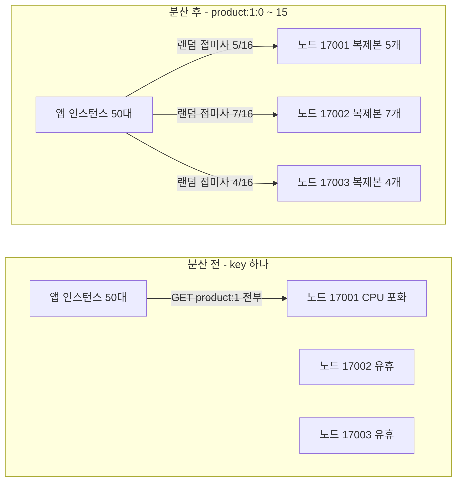
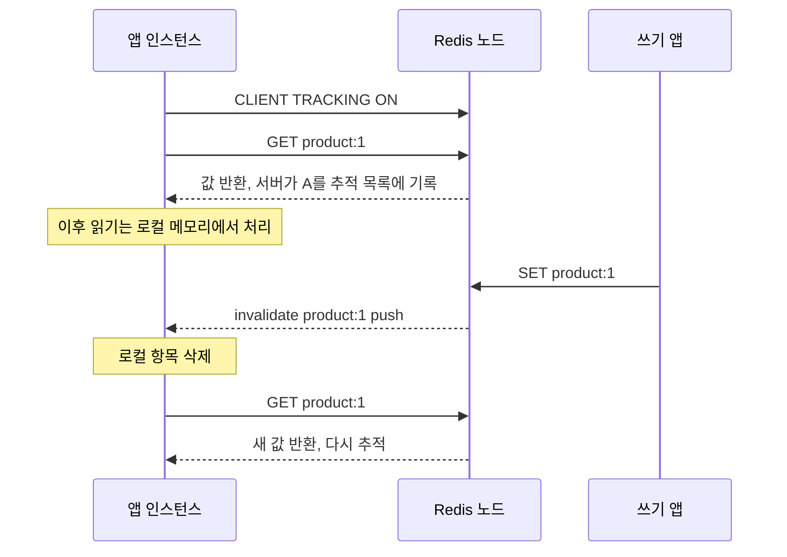
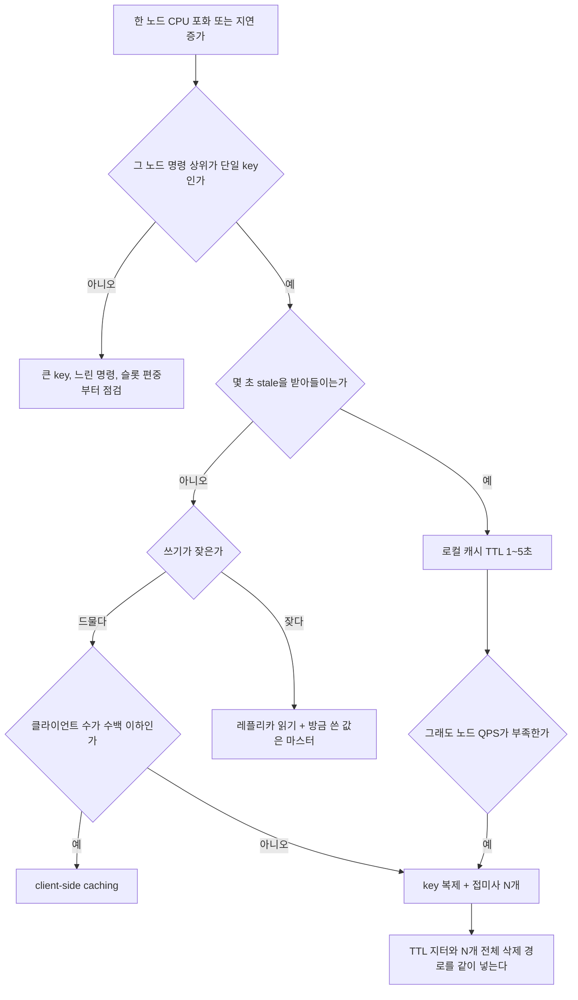

# Hot Key 대응

## 한 노드만 CPU가 100%인 장애

가을 이벤트 오픈 10분 뒤에 Redis 지연이 튀기 시작했다. 클러스터는 마스터 3대였고 메모리는 20%도 안 찼다. 대시보드를 보니 한 노드만 CPU가 포화였고 나머지 둘은 한가했다. 그 노드의 `INFO commandstats`를 찍어 보니 `GET` 호출의 대부분이 key 하나였다. 이벤트 상품의 상세 캐시였다.

캐시는 정상이었다. 히트율은 99%였고 만료도 일어나지 않았다. [Cache Stampede](Cache_Stampede_Pattern.md)와 증상이 비슷해 보여서 처음엔 TTL부터 의심했는데 방향이 틀렸다. Stampede는 만료 순간에 DB로 요청이 몰리는 문제고, 이쪽은 캐시가 멀쩡히 살아 있는데 **Redis 한 노드가 key 하나의 읽기를 혼자 받다가 한계를 넘는** 문제다.

| 구분 | Cache Stampede | Hot Key |
|---|---|---|
| 터지는 곳 | DB | Redis 단일 노드(단일 스레드) |
| 트리거 | TTL 만료 순간 | 단일 key의 QPS 자체 |
| 캐시 히트율 | 만료 순간에만 급락 | 99% 이상 유지 |
| 만료를 늘리면 | 완화된다 | 변화 없다 |
| 지표 모양 | DB 커넥션 풀 고갈 | 노드 간 CPU·명령 수 편차 |

두 문제가 겹치는 지점은 하나다. hot key가 만료되는 순간 Stampede가 같이 터진다. 그래서 아래의 key 복제 방식은 TTL 처리까지 같이 다룬다.

---

## key 하나는 슬롯 하나, 슬롯 하나는 노드 하나

Redis Cluster는 key를 `CRC16(key) mod 16384`로 슬롯에 넣고, 슬롯은 마스터 한 대가 가진다. 노드를 늘려도 `product:1`이라는 key 하나의 읽기는 항상 같은 노드로 간다. 클러스터를 키워서 해결되지 않는 이유다.

로컬에 마스터 3대, 레플리카 3대로 Redis 7.4 클러스터를 띄우고 key 하나(`product:1`)를 6만 번 읽었다. 노드별로 처리한 `GET` 수를 비교한 결과다.

| 대상 | 17001 | 17002 | 17003 |
|---|---|---|---|
| `product:1` 하나 | 60,090 | 69 | 69 |

6만 건이 전부 17001로 갔다. 나머지 69건은 클러스터 토폴로지 조회 같은 내부 명령이다. `redis-benchmark`로 같은 key에 100만 건을 쏘았을 때 17001의 누적 CPU 시간은 17.6초에서 74.0초로 56.5초 늘었고, 다른 두 노드는 각각 0.4초, 0.7초 늘었다. Redis는 명령 실행이 단일 스레드라서 한 노드의 한계는 코어 하나의 한계다. 이 테스트 환경에서는 노드 하나가 초당 1.4~1.5만 건 정도에서 멈췄다. 이 숫자는 장비마다 다르므로 운영 값은 직접 재야 한다.

아래 도식은 key 하나에 몰리는 구조와, 접미사를 붙여 복제본 16개로 쪼갠 뒤의 구조를 나란히 놓은 것이다. 오른쪽 노드별 개수는 실제 `product:1:0`부터 `product:1:15`가 배치된 결과다.



분산 후에도 노드별 부하는 균등하지 않다. 복제본 16개가 3대에 5, 7, 4개로 떨어졌고, 실제 읽기 6만 건은 18,825 / 26,325 / 15,075건으로 나뉘었다. 접미사가 몇 개든 어느 슬롯에 떨어질지는 CRC16이 정하기 때문에 직접 고를 수 없다. 이 문제는 뒤에서 N을 정할 때 다시 나온다.

---

## 탐지

### redis-cli --hotkeys는 LFU일 때만 돈다

`redis-cli --hotkeys`는 keyspace를 SCAN으로 훑으면서 key마다 `OBJECT FREQ`를 읽는다. `maxmemory-policy`가 `allkeys-lfu`나 `volatile-lfu`가 아니면 접근 빈도를 기록하지 않아서 시작도 못 한다.

```text
$ redis-cli -p 16380 --hotkeys      # maxmemory-policy noeviction
Error: ERR An LFU maxmemory policy is not selected, access frequency not tracked.
Please note that when switching between policies at runtime LRU and LFU data
will take some time to adjust.
```

LFU 인스턴스에서는 이렇게 나온다. `item:7`을 2만 번, `item:9`를 3천 번 읽고 나머지는 한 번씩 만든 상태다.

```text
hot key found with counter: 66	keyname: "item:7"
hot key found with counter: 25	keyname: "item:9"
hot key found with counter: 5	keyname: "item:2"
hot key found with counter: 5	keyname: "item:37"
```

counter는 QPS가 아니다. 로그 스케일로 증가하는 8비트 값이라 2만 번과 3천 번이 66과 25로 보이고, 최대 255에서 포화되며 시간이 지나면 감쇠한다. 한 번도 안 읽은 key도 초기값 5를 갖는다. 순위를 보는 용도지 "이 key가 초당 몇 건"을 알려주는 도구가 아니다. 실제로 쓸 때 걸리는 점이 몇 가지 있다.

- 운영 중인 인스턴스가 LRU나 noeviction이면 policy를 바꿔야 한다. `maxmemory`가 걸려 있는 서비스에서는 축출 동작이 바뀌므로 가볍게 바꿀 설정이 아니다.
- SCAN으로 전체를 훑기 때문에 key가 수천만 개면 오래 걸린다. `-i 0.1`로 간격을 두면 서버 부담은 줄지만 더 느려진다.
- 클러스터에서는 노드마다 따로 실행해야 한다. 쏠린 노드를 알고 있다면 그 노드만 돌리면 된다.
- 쓰기만 몰리는 key나 이미 지나간 폭주는 counter에 잘 남지 않는다.

### MONITOR는 켜 두는 도구가 아니다

`MONITOR`는 모든 명령을 실시간으로 문자열로 만들어 연결 하나로 흘려준다. 확실하게 보이지만 서버가 모든 명령마다 직렬화 작업을 더 한다. 같은 인스턴스에 `redis-benchmark`(50 연결)를 두 번씩 돌렸다.

| 조건 | 1회차 | 2회차 |
|---|---|---|
| MONITOR 없음 | 16,030 req/s | 14,692 req/s |
| MONITOR 붙임 | 13,490 req/s | 12,342 req/s |
| MONITOR 끊은 뒤 | 14,799 req/s | |

평균 15.4k에서 12.9k로 내려갔다. 벤치마크 자체가 이 장비의 병목이라 실제 운영의 포화 노드에서는 감소폭이 더 클 수 있다. 이미 CPU가 100%인 노드에 MONITOR를 붙이면 장애를 키운다. 쓴다면 5~10초만 `redis-cli monitor | head -n 20000`처럼 상한을 걸고, 읽는 쪽이 느려서 서버 출력 버퍼가 쌓이지 않게 파일로 바로 흘려야 한다.

### 클라이언트에서 세는 쪽이 가장 싸다

서버에 부담을 주지 않고 가장 정확한 방법은 앱 쪽에서 key별 접근 수를 세는 것이다. 모든 호출을 세면 hot path에 락이 들어가므로 10% 샘플링으로 센다.

```python
import random, threading, time
from collections import Counter

class HotKeyDetector:
    def __init__(self, window_sec=1.0, sample=0.1, threshold_qps=5000):
        self.window, self.sample, self.threshold = window_sec, sample, threshold_qps
        self.counts, self.lock, self.start = Counter(), threading.Lock(), time.monotonic()
        self.hot = {}

    def hit(self, key):
        if random.random() >= self.sample:
            return
        with self.lock:
            self.counts[key] += 1
            now = time.monotonic()
            if now - self.start >= self.window:
                elapsed = now - self.start
                self.hot = {k: int(c / self.sample / elapsed) for k, c in self.counts.items()
                            if c / self.sample / elapsed >= self.threshold}
                self.counts.clear(); self.start = now

    def is_hot(self, key):
        return key in self.hot
```

전체 요청의 40%를 `product:777`에 몰고 나머지를 2,000개 key에 흩뿌려 4초간 돌렸다. 윈도우별로 실제 호출 수와 추정값을 비교한 결과다.

| 윈도우 | 실제 `product:777` 호출 | 감지 추정 |
|---|---|---|
| 1초 | 327,434 | 없음(첫 윈도우가 끝나기 전) |
| 2초 | 195,897 | 327,024 |
| 3초 | 199,197 | 196,237 |

추정은 한 윈도우 늦게 따라오고, 안정된 뒤에는 오차가 2% 안쪽이다. 두 번째 줄의 327,024는 첫 윈도우의 값이 한 윈도우 늦게 나온 것이다. `is_hot`이 true가 되는 순간부터 해당 key를 로컬 캐시나 복제본 경로로 보내는 식으로 동적 전환도 할 수 있다. 서버 쪽 신호는 노드별 `INFO commandstats`의 `cmdstat_get` 증가량과 `instantaneous_ops_per_sec` 편차를 같이 본다. 위 실험의 60,090 대 69 같은 모양이 나오면 key 하나다.

---

## 대응 방식 네 가지

### 로컬 캐시를 Redis 앞에 둔다

앱 프로세스 메모리에 1~5초짜리 캐시를 두는 방식이다. 코드는 짧다.

```python
class LocalCache:
    def __init__(self, ttl):
        self.ttl, self.d = ttl, {}

    def get(self, key, loader):
        now = time.monotonic()
        e = self.d.get(key)
        if e and e[1] > now:
            return e[0]
        v = loader(key)
        self.d[key] = (v, now + self.ttl)
        return v
```

앱 인스턴스 20개를 흉내 내서 5초간 읽었다. Redis에 실제로 간 `GET` 수다.

| 로컬 TTL | 앱 읽기 | Redis GET |
|---|---|---|
| 없음 | 5,453 | 5,453 |
| 1초 | 4,396,089 | 71 |
| 3초 | 5,027,950 | 40 |
| 5초 | 4,941,322 | 20 |

Redis로 가는 요청이 인스턴스당 초당 `1/TTL`건으로 줄어든다. 인스턴스가 60대면 TTL 1초에서 Redis는 이 key에 초당 60건만 받는다. 앱 읽기 수와 무관하다는 점이 핵심이다. 첫 행의 5,453은 로컬 캐시가 없는 파이썬 클라이언트가 이 장비에서 낼 수 있는 한계라서 절대값 비교는 의미가 없고, 둘째 열 대비 셋째 열의 감소만 보면 된다.

비용은 stale이다. 값을 바꾼 직후에 모든 인스턴스가 새 값을 보기까지 걸린 시간을 쟀다. TTL 1초는 1.01초, TTL 3초는 3.01초였다. 로컬 TTL이 stale의 상한이다. 인스턴스마다 로드 시점이 달라서 사용자가 새로고침할 때마다 새 값과 옛 값이 번갈아 보일 수 있다. 가격, 재고 잔량처럼 틀리면 안 되는 값에는 쓰지 못한다. 인기 게시글의 조회수나 상품 상세 정보 같은 읽기 전용에 가까운 데이터에서 제일 먼저 고려할 방식이다. 로컬 캐시 미스가 동시에 몰리는 경우는 인스턴스 안의 single-flight로 막는다([Cache Stampede 문서](Cache_Stampede_Pattern.md)).

### key를 N개로 복제하고 접미사로 흩는다

로컬 캐시로 stale을 못 받아들이는 key에는 같은 값을 `product:1:0`부터 `product:1:{N-1}`까지 N개로 저장하고, 읽을 때 접미사를 랜덤으로 고른다. 아래 코드는 클러스터 로컬 환경에서 N=16으로 돌린 그대로다.

```python
import random
from redis.cluster import RedisCluster, ClusterNode

N = 16
rc = RedisCluster(startup_nodes=[ClusterNode("127.0.0.1", 17001)], decode_responses=True)

def jittered(ttl_ms, jitter=0.3):
    return int(ttl_ms * (1 + random.uniform(0, jitter)))

def put_all(base, value, ttl_ms):
    pipe = rc.pipeline()
    for i in range(N):
        pipe.set(f"{base}:{i}", value, px=jittered(ttl_ms))
    pipe.execute()

def get_copy(base, loader, ttl_ms):
    k = f"{base}:{random.randrange(N)}"
    v = rc.get(k)
    if v is None:
        v = loader()
        rc.set(k, v, px=jittered(ttl_ms))
    return v

def delete_all(base):
    pipe = rc.pipeline()
    for i in range(N):
        pipe.delete(f"{base}:{i}")
    pipe.execute()
```

쓰기가 N배가 된다. 로컬 Redis에서 key 하나 SET은 0.29ms, 같은 값을 16개로 파이프라인 SET하면 2.12ms였다. 쓰기가 드문 key(이벤트 상품 상세, 인기 게시글 본문)에서는 감당할 수 있는 비용이고, 초당 수백 번 갱신되는 key에서는 쓰기 폭증이 새 문제가 된다.

접미사를 쓸 때 함정이 하나 있다. 표기를 `product:1:{0}`처럼 중괄호로 쓰면 Redis Cluster는 중괄호 안만 hash tag로 보고 슬롯을 계산한다. 반대로 멀티키 연산을 위해 `{product:1}:0`처럼 공통 tag를 앞에 두면 N개가 전부 같은 슬롯으로 간다. 실제로 확인했다.

| key 형태 | 16개가 떨어진 노드 |
|---|---|
| `product:1:0` ~ `product:1:15` | 17001, 17002, 17003 세 대에 분산 |
| `product:1:{0}` ~ `product:1:{15}` | 세 대에 분산(숫자만 해시) |
| `{product:1}:0` ~ `{product:1}:15` | 17001 한 대에만 |

`{product:1}:N` 형태는 복제본을 만들어 놓고도 효과가 전혀 없다. 코드 리뷰에서 가장 놓치기 쉬운 형태다. 복제본 key에는 hash tag를 쓰지 않는다.

### Redis 6 client-side caching

Redis 6의 `CLIENT TRACKING`은 서버가 "어느 클라이언트가 어떤 key를 읽었는지" 기억해 두었다가 그 key가 바뀌면 해당 클라이언트에 `invalidate` 푸시를 보내준다. 로컬 캐시를 쓰되 TTL에 의존하지 않고 무효화 신호로 갱신하는 방식이다. RESP3 연결이 필요하다.



stale 구간이 TTL이 아니라 푸시 전달 시간이라서 로컬 TTL 방식보다 훨씬 짧다. 대신 쓰기 한 번에 서버가 읽은 클라이언트 전부에 푸시를 보내야 한다. 클라이언트 수만큼 쓰기 비용이 늘어난다는 뜻이다. 소켓으로 직접 RESP3 연결을 만들고, 추적 클라이언트가 모두 `hot:1`을 읽은 상태에서 쓰기를 200번 한 결과다. 쓰기 직후 각 클라이언트가 푸시를 받고 다시 읽는 흐름을 포함한다.

| 추적 클라이언트 수 | SET p50 | SET p99 | 쓰기 1회당 서버 출력 |
|---|---|---|---|
| 0 | 0.14ms | 0.19ms | 14바이트 |
| 100 | 0.32ms | 12.7ms | 14,559바이트 |
| 500 | 0.50ms | 64.4ms | 72,739바이트 |

출력 바이트에는 푸시와 재조회 응답이 같이 들어 있다. 클라이언트당 약 145바이트다. 읽기 쪽 Redis 부하는 거의 0까지 내려가지만, 쓰기가 잦고 클라이언트가 수천이면 쓰기 쪽 노드가 새 병목이 된다. 몇 가지 더 알아둘 점이 있다.

- 서버가 key별로 클라이언트 목록을 기억하므로 메모리를 쓴다. 상한은 `tracking-table-max-keys`(기본 1,000,000)이고 넘으면 오래된 항목부터 클라이언트에 무효화를 보내 버린다.
- 연결이 끊기면 그동안의 무효화를 받지 못한다. 재연결 후에는 로컬 캐시를 비워야 한다. 이걸 안 하면 stale이 TTL 없이 영원히 남는다.
- 클러스터에서는 노드마다 연결이 따로이므로 추적도 연결 단위로 걸린다. 클라이언트 라이브러리가 이 부분을 지원하는지부터 확인해야 한다.
- key마다 추적하는 기본 모드 대신 `BCAST` 모드로 prefix 단위 무효화를 받을 수 있지만, 그 prefix 아래 다른 key의 변경에도 푸시가 오므로 hot key 하나만 추적하는 용도에는 기본 모드가 맞다.

### 레플리카로 읽기를 나눈다

읽기를 마스터 대신 레플리카로 보내는 방식이다. 클러스터에서 레플리카 연결은 `READONLY` 명령을 먼저 보내야 슬롯 소유자가 아니어도 읽기를 받는다. redis-py는 `load_balancing_strategy`를 지정하면 읽기가 레플리카로 간다(예전 `read_from_replicas` 인자는 deprecated).

```python
from redis.cluster import LoadBalancingStrategy

rc = RedisCluster(startup_nodes=[ClusterNode("127.0.0.1", 17001)],
                  decode_responses=True,
                  load_balancing_strategy=LoadBalancingStrategy.ROUND_ROBIN)
```

`product:1`을 6,000번 읽었더니 마스터(17001)와 그 레플리카(17005)가 3,000건씩 받았다. 마스터 한 대에 레플리카가 하나면 한 노드 부담이 절반이 된다. 레플리카를 늘리면 더 나뉜다. 복제는 비동기라서 쓰기 직후 레플리카를 읽으면 옛 값이 나올 수 있다. 마스터에 쓰고 곧바로 레플리카에서 읽는 일을 3,000번 반복했다.

| 마스터 상태 | 쓰기 직후 레플리카에서 옛 값을 읽은 횟수 |
|---|---|
| 한가함 | 2 / 3,000 (0.1%) |
| 3개 스레드가 같은 노드에 2KB 쓰기를 계속 퍼붓는 중 | 89 / 3,000 (3.0%) |

한가할 때 0.1%가 쓰기가 몰리면 3%로 올라갔다. 쓰기 부하가 높은 시점에 지연이 커진다는 뜻이다. 사용자가 방금 쓴 값을 바로 읽는 경로(내 글 저장 직후 상세 조회)는 마스터로 보내야 한다. [Read Your Writes](../../Architecture/Read_Your_Writes_Consistency.md) 문서에서 다룬 경우가 이것이다. 쓰기 직후만 마스터, 나머지는 레플리카로 보내는 라우팅이 필요하다. 읽기 경로 전체에서 캐시와 복제본이 어떻게 놓이는지는 [읽기 경로](../../Architecture/읽기_경로.md)에 있다.

---

## 네 방식의 비용 비교

| 방식 | 읽기 일관성 | 쓰기 증폭 | Redis 읽기 부하 | 약점 |
|---|---|---|---|---|
| 로컬 캐시(TTL 1~5초) | 최대 TTL만큼 stale(측정 1.01초·3.01초) | 없음 | 인스턴스당 초당 `1/TTL`건 | 인스턴스별로 보이는 값이 다르다 |
| key 복제 + 접미사 | 갱신 도중 N개 중 일부만 새 값인 순간이 있다 | N배 key 쓰기(0.29ms → 2.12ms, N=16) | N개로 분산하되 노드 수가 상한 | 삭제·갱신 누락 시 stale 영구화 |
| client-side caching | 푸시 도착까지만 stale, 연결 단절 시 무제한 | 추적 클라이언트 수만큼 푸시(500개에서 p50 0.50ms) | 거의 0 | 쓰기 많은 key에는 부적합, 라이브러리 지원 필요 |
| 레플리카 읽기 | 복제 지연만큼 stale(0.1% ~ 3.0%) | 없음 | 마스터 + 레플리카 수로 나눔 | 방금 쓴 값 읽기 보장 못함 |

장애 때 가장 먼저 쓴 건 로컬 캐시였다. 배포 한 번으로 끝나고 되돌리기도 쉽기 때문이다. 이 key가 재고처럼 틀리면 안 되는 값이면 로컬 캐시를 못 쓰고, 읽기 경로에서 쓰는 값과 판단에 쓰는 값을 분리하는 편이 낫다. 화면에 보여 주는 재고는 몇 초 늦어도 되고 차감 판단은 원본 저장소에서 원자 연산으로 처리한다. 이 문서는 읽기 쏠림만 다룬다. 쓰기가 한 key에 몰리는 재고 `DECR` 같은 경우는 접근이 다르다.

---

## 접미사 개수 N 정하기

예를 들어 이벤트 상품 `product:777` 상세 캐시가 피크에 초당 24만 건 읽히고, 앱 인스턴스가 60대라고 하자. 운영 Redis 노드 하나가 이 key 하나에 감당하는 안전선을 부하 테스트로 쟀더니 8만 QPS였다고 가정한다(이 숫자는 설명용이다. 직접 측정해서 넣어야 한다). 포화에 여유를 두려고 사용률 50%를 목표로 잡으면 key 복제본 하나당 4만 QPS가 상한이다. 여기까지는 단순한 나눗셈이다.

```text
필요한 복제본 수 = 피크 QPS / (노드 안전선 × 목표 사용률)
                = 240,000 / (80,000 × 0.5) = 6
```

N=6이면 될 것 같지만 틀린다. 복제본이 노드에 균등하게 떨어진다는 보장이 없기 때문이다. 마스터 3대 환경에서 상품 5,000개의 `product:{id}:0 ~ N-1`을 실제 CRC16으로 슬롯에 넣고, 노드 한 대가 가져가는 최대 비율을 쟀다.

| N | 최대 노드 점유 평균 | 최대 노드 점유 최악 | 한 노드가 절반 이상 가진 상품 비율 |
|---|---|---|---|
| 1 | 100% | 100% | 100% |
| 3 | 50.1% | 66.7% | 50.2% |
| 6 | 49.7% | 66.7% | 66.9% |
| 12 | 47.0% | 66.7% | 55.4% |
| 16 | 44.6% | 62.5% | 33.2% |
| 32 | 40.9% | 56.2% | 5.8% |
| 64 | 36.6% | 43.8% | 0.0% |

N=6일 때 가장 쏠린 상품은 한 노드가 6개 중 4개(66.7%)를 가졌다. 24만 QPS의 66.7%는 16만이고 안전선 8만을 두 배 넘는다. 균등하게 나눠도 마스터가 3대이면 노드당 최소 1/3, 즉 8만 QPS가 되어 사용률 100%다. 접미사 분산의 상한은 마스터 수다. N을 아무리 키워도 3대가 나눠 가지는 이상 노드당 8만 아래로 내려가지 않는다.

그래서 이 시나리오의 현실적인 구성은 접미사 하나로 가지 않는다. 로컬 캐시 TTL 1초를 먼저 붙이면 Redis가 받는 읽기가 인스턴스 60대 × 초당 1건 = 60 QPS로 줄어 접미사가 필요 없다. stale 1초를 못 받아들이는 경우에만 접미사를 쓰고, 이때는 용량 계산값의 2~3배인 N=16 정도로 잡아서 최악 점유를 62%까지 낮추는 한편 노드 수 자체를 늘리거나 로컬 캐시를 같이 쓴다. N을 올릴수록 쓰기가 N배 늘고 삭제 누락 위험도 같이 늘어서, 점유율 표에서 필요한 수준이 나오는 가장 작은 값을 고른다.

인기 게시글 시나리오는 다르다. 게시글 본문은 쓰기가 하루에 몇 번뿐이고 읽기만 몰린다. 접미사의 쓰기 증폭이 문제 되지 않으니 N=16~32로 크게 잡고, 쓰기 시 파이프라인 한 번으로 갱신하는 쪽이 로컬 캐시의 인스턴스별 불일치보다 낫다.

---

## 갱신과 삭제에서 stale이 남는 경우

접미사 방식에서 가장 많이 사고가 나는 부분이다. 복제본이 N개면 쓰는 코드도 N개를 모두 건드려야 한다. 일부만 바꾸면 어떻게 되는지 `product:1:0` 하나만 갱신하고 5,000번 읽었다.

```text
one-key update only, 5000 reads: {'price=1000': 4671, 'price=900': 329}
```

가격을 900으로 바꿨는데 4,671건(93.4%)이 옛 가격 1000을 돌려줬다. 새 값을 본 비율은 1/16(6.3%)에 가깝다. TTL이 있으니 결국 만료되지만 TTL이 10분이면 10분간 사용자 대부분이 옛 값을 본다. 에러도 로그도 없어서 알아채기 어렵다. 삭제도 마찬가지다. 복제본 0번만 지우면 2,000번 읽는 동안 127번(약 1/16) 미스가 나고 나머지는 옛 값이 그대로 나갔다.

흔한 원인은 세 가지다.

- 갱신 코드가 여러 곳에 흩어져 있고 한 곳만 `put_all`을 부르지 않는다. 쓰기 경로는 반드시 한 함수로 모은다.
- 파이프라인 중간에 한 노드가 장애 조치 중이라 일부 복제본만 갱신된다. `execute()` 결과의 예외를 확인하고 실패하면 재시도한다.
- N을 배포 중에 바꿨다. 옛 버전은 16개를 쓰고 새 버전은 32개를 읽으면 17번째 이후는 영원히 미스거나 옛 값이다. N을 바꿀 때는 복제본 key 이름에 버전을 넣어(`product:1:v2:{i}`) 읽기와 쓰기를 같이 넘긴다.

삭제는 갱신보다 안전한 쪽이다. 지워진 복제본은 미스가 되어 DB에서 다시 채워지고, 지우지 않은 복제본만 stale로 남는다. 안전하게 가려면 무효화 시 N개를 `DEL`하고, 값을 쓰는 쪽에서는 `put_all`로 N개를 덮어쓴 뒤 필요하면 짧은 지연 후 한 번 더 지운다. 무효화와 읽기가 엇갈리는 경우는 [캐시 무효화](캐시_무효화.md)의 레이스 컨디션 절에 정리해 두었다. 복제본이 N개면 그 엇갈림이 N곳에서 생긴다.

### TTL 지터

N개를 같은 TTL로 한꺼번에 쓰면 N개가 같은 순간에 만료된다. 앞서 말한 Stampede가 N배로 늘어난 모양이다. TTL 3초로 16개를 쓰고 각 복제본이 처음 미스를 내는 시각을 쟀다. 읽기 스레드 4개가 복제본을 랜덤으로 읽으며 미스가 나면 다시 채운다.

| 지터 | 첫 미스 시각 범위 | 100ms 안에 몰린 미스 |
|---|---|---|
| 없음 | 3.00s ~ 3.01s (폭 0.01초) | 16건 전부 |
| 0~30% 가산 | 3.11s ~ 3.80s (폭 0.69초) | 4건 |

지터가 없으면 16개가 10ms 안에 같이 비어서 DB로 16번 조회가 몰렸다. 30% 가산 지터를 주면 미스가 0.69초에 걸쳐 퍼졌다. 이 숫자는 `put_all`의 `jittered()` 함수가 만든 것이다. 한 가지 실수를 이 실험에서 직접 했다. `EX`(초 단위 정수)에 `int(3 * 1.3)`을 넘기면 3으로 잘려서 지터가 0이 된다. 밀리초 단위 `PX`를 써야 한다. 첫 시도에서 복제본 16개의 TTL이 모두 3초로 같게 나와서 알았다.

복제본이 N개이면 만료 사이클마다 DB 조회도 최대 N번이다. 로드하는 쪽에 single-flight나 분산 락을 두면 줄일 수 있지만, N=16이면 사이클당 16번 정도라 보통은 감수한다.

---

## 어떤 방식을 고를 것인가

탐지에서 방식 선택까지 한 줄로 이어 보면 아래 흐름이 된다. 첫 분기가 중요하다. 쏠린 노드의 명령 상위가 key 하나가 아니라면 큰 key 한 개의 `HGETALL`이나 `KEYS` 같은 느린 명령이 원인일 수 있고, 그건 이 문서의 대응이 아니다.



로컬 캐시가 가장 간단하고 효과가 가장 크지만 stale을 받아들여야 한다는 조건이 붙는다. 그 조건을 못 받아들이는 key는 대개 소수라서, 그 key만 접미사로 따로 처리하는 구성이 현실적이다. 탐지기가 `is_hot`으로 표시한 key만 접미사 경로를 타게 하면 평소에는 key 하나로 읽고, hot으로 판정된 순간에만 복제본 경로로 바꿀 수 있다. 이때 평소 key와 복제본 key의 갱신 경로를 둘 다 열어 둬야 전환 중에 옛 값이 남지 않는다.
