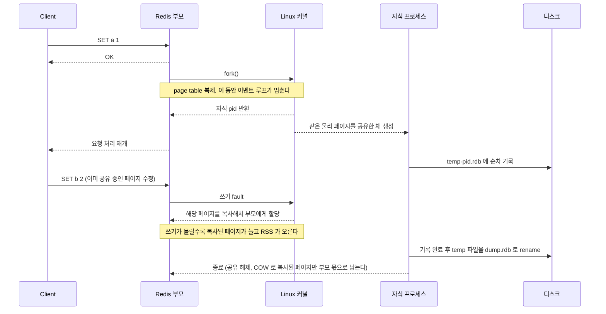
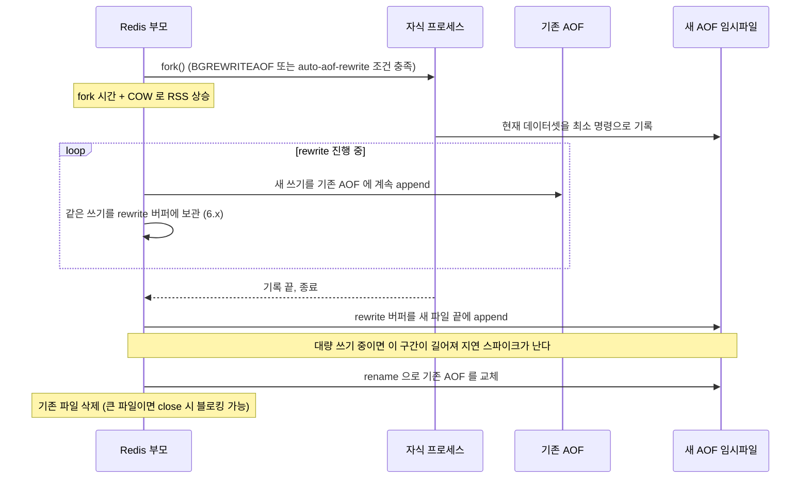
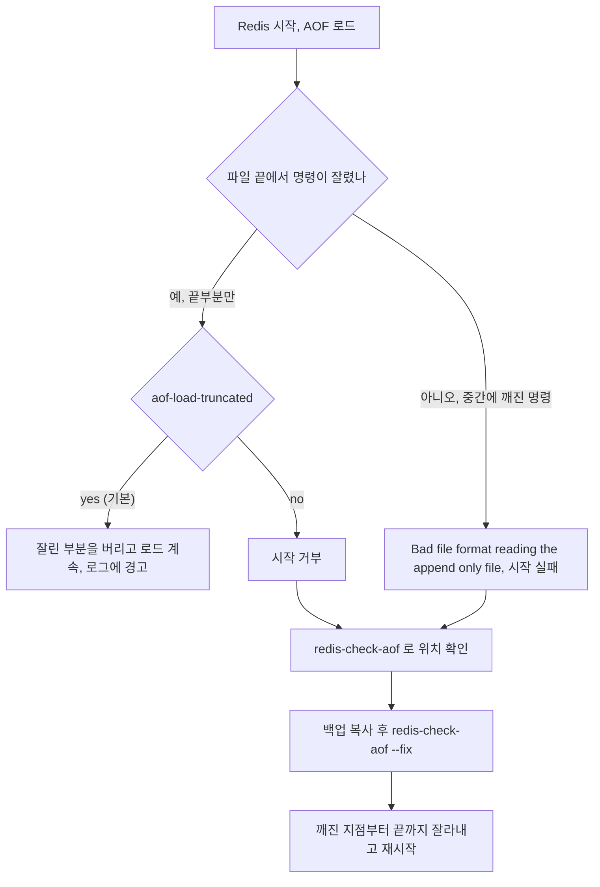
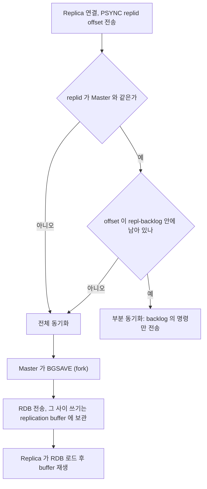
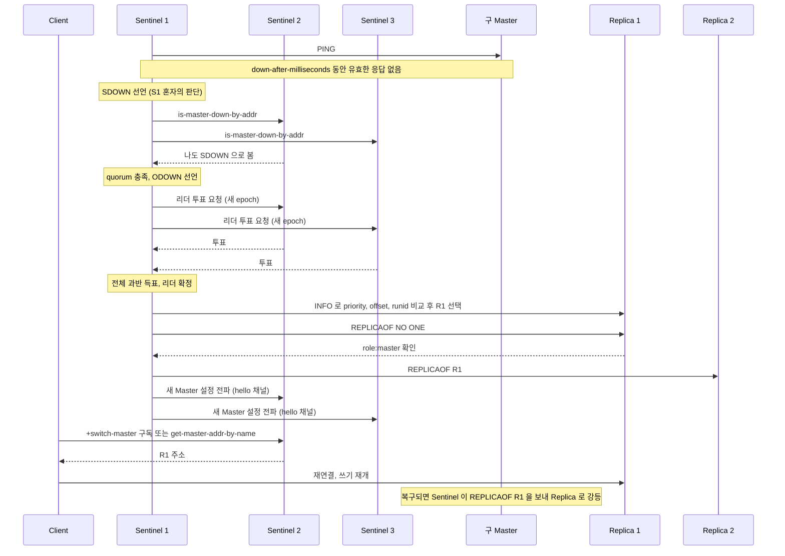
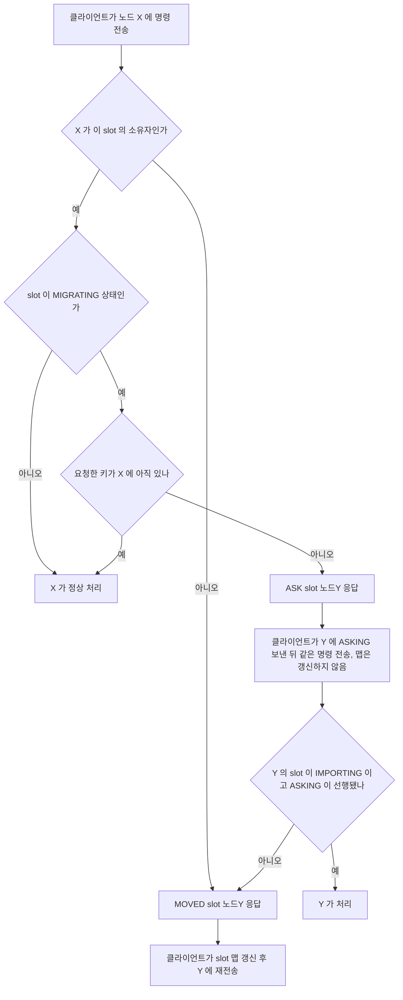
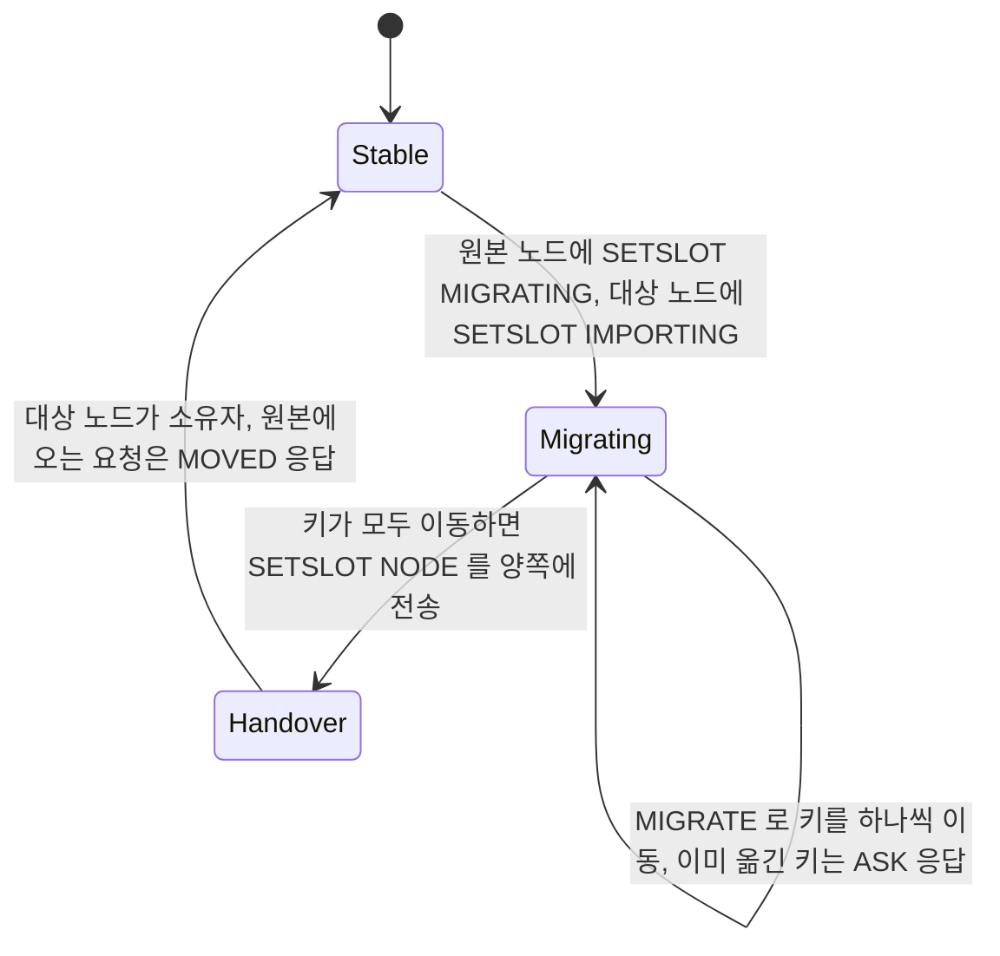
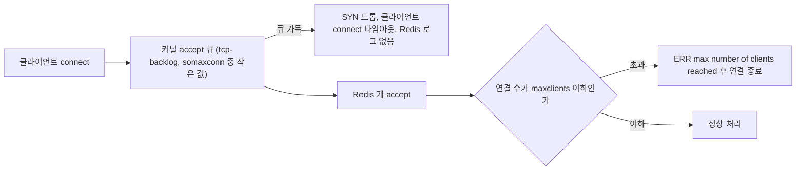

# Redis 운영

Redis 장애는 대부분 세 곳에서 난다. 메모리가 갑자기 두 배로 뛰는 fork 구간, 복제가 끊겼다 다시 붙는 구간, 그리고 클라이언트가 늘면서 연결이 막히는 구간이다. 이 문서는 Redis 6.0.16에서 직접 돌려 본 결과를 기준으로 쓴다. 숫자가 나오는 곳은 그 환경에서 잰 값이다.

---

## fork가 만드는 메모리 곡선

RDB 스냅샷과 AOF rewrite는 둘 다 `fork()`로 자식 프로세스를 만들어 일한다. 부모는 계속 요청을 받는다. 이 구조 때문에 평소 메모리가 70%인 서버가 스냅샷 시각에 OOM으로 죽는 일이 생긴다.

### RDB 스냅샷

`BGSAVE`가 실행되면 부모가 `fork()`를 호출한다. 자식은 부모와 같은 물리 페이지를 공유하고, 어느 쪽이든 페이지를 수정하는 순간 커널이 그 페이지(4KB)를 복사한다. Copy-on-Write다. 아래 시퀀스에서 부모가 멈추는 구간(page table 복제)과 메모리가 늘어나는 구간(페이지 복사)이 서로 다른 지점에서 생긴다는 점을 본다.



실측은 이렇다. 데이터 857MB(키 300만 개, 값 200바이트)를 채우고 `BGSAVE`를 건 상태에서 무작위 키 30만 개에 `SET`을 흘렸다.

| 지표 | 값 | 확인 위치 |
|---|---|---|
| fork 소요 | 12.5ms | `INFO stats`의 `latest_fork_usec` |
| 스냅샷 중 COW로 복사된 메모리 | 약 292MB (데이터의 34%) | `INFO persistence`의 `rdb_last_cow_size` |
| 스냅샷 직후 `used_memory` | 857MB | `INFO memory` |

`used_memory`는 부모 기준이라 그대로다. COW 복사분은 `used_memory`가 아니라 서버 전체 RSS에 얹힌다. 그래서 Redis 메트릭은 멀쩡한데 컨테이너가 OOM kill 당하는 일이 생긴다. 쓰기 10%에 메모리 34%가 복사된 이유는 키가 페이지에 흩어져 있어서 쓰기 한 번이 서로 다른 페이지를 건드리기 때문이다. 쓰기 수가 아니라 건드린 페이지 수가 복사량을 정한다.

fork 시간은 메모리에 비례한다고 보면 된다. 857MB에서 12.5ms였으니 30GB면 수백 ms 단위가 될 수 있다(선형으로 외삽한 값이고, 가상화 환경에서는 더 느려질 수 있다). 이 시간은 요청이 전부 대기한다.

fork 주변에서 확인할 설정 두 가지가 있다.

- `vm.overcommit_memory=1`: 기본값 0이면 여유 메모리가 부족하다고 커널이 판단해 fork를 거부할 수 있다. 로그에 `Can't save in background: fork: Cannot allocate memory`가 찍힌다. 서버 시작 시 Redis가 경고도 남긴다.
- Transparent Huge Pages: 켜져 있으면 COW 단위가 4KB에서 2MB로 커져서 쓰기 한 번에 복사되는 양이 폭증한다. `never`로 둔다.

```conf
# redis.conf
save 900 1
save 300 10
save 60 10000

dbfilename dump.rdb
dir /var/lib/redis

# 스냅샷 실패 시 쓰기를 막는다 (기본 yes). 디스크가 차면 MISCONF 에러가 난다
stop-writes-on-bgsave-error yes
```

`save 300 10`이면 최악의 경우 300초치 쓰기를 잃는다. 스냅샷은 복구 지점이지 내구성 장치가 아니다.

### AOF와 rewrite

AOF는 쓰기 명령을 로그에 순서대로 남기고, 재시작하면 처음부터 재실행해 상태를 복원한다.

```conf
appendonly yes
appendfilename "appendonly.aof"
appendfsync everysec
```

`appendfsync`는 `always`(쓰기마다 fsync, 손실 없음, 처리량 크게 감소), `everysec`(최대 1초 손실, 대부분 이 값), `no`(OS가 알아서, 손실 범위 불명확) 중에서 고른다.

AOF는 계속 커지기 때문에 `BGREWRITEAOF`가 현재 상태를 만드는 최소 명령 집합으로 파일을 다시 쓴다. 이것도 fork다. 다만 RDB와 달리 rewrite 도중에도 부모는 새 쓰기를 기존 AOF에 계속 기록해야 하고, 6.x까지는 같은 쓰기를 메모리 버퍼에도 쌓았다가 마지막에 새 파일 뒤에 붙인다(7.0부터는 새 incr 파일로 분리되어 이 버퍼가 없다).



rewrite 도중 메모리는 세 군데서 늘어난다. COW 복사분, rewrite 버퍼, AOF 버퍼다. `maxmemory`를 서버 메모리에 바짝 붙여 잡은 인스턴스가 AOF rewrite 시각에 죽는 이유다.

```conf
auto-aof-rewrite-percentage 100   # 마지막 rewrite 크기의 2배가 되면
auto-aof-rewrite-min-size 64mb    # 최소 64MB 이상일 때만
aof-use-rdb-preamble yes          # rewrite 결과 앞부분을 RDB 바이너리로 저장
```

### 저장 방식 고르기

캐시 전용이면 영속성을 끈다. 재시작하면 DB에서 다시 채우면 되고, fork 자체가 사라져 위의 문제가 없다. 세션이나 카운터처럼 잃으면 곤란한 데이터라면 AOF `everysec`에 `aof-use-rdb-preamble yes`를 병행한다. 재시작 시 AOF가 있으면 AOF를 우선 쓰며, preamble 덕분에 앞부분은 RDB로 빠르게 읽고 뒷부분만 명령을 재실행한다.

---

## AOF가 깨졌을 때

디스크가 차거나 프로세스가 `kill -9`로 죽으면 AOF 마지막 명령이 중간에 잘릴 수 있다. 두 경우는 동작이 다르다.



실제로 AOF 마지막 명령을 7바이트 잘라 시작해 봤다. 기본값(`aof-load-truncated yes`)이면 이렇게 뜨고 정상 기동한다.

```
# !!! Warning: short read while loading the AOF file !!!
# !!! Truncating the AOF at offset 110 !!!
# AOF loaded anyway because aof-load-truncated is enabled
```

중간이 깨진 경우(잘린 명령 뒤에 다른 명령이 이어 붙은 상태)는 기동 자체가 안 된다.

```
# Bad file format reading the append only file: make a backup of your AOF file, then use ./redis-check-aof --fix <filename>
```

`redis-check-aof`로 어디까지가 정상인지 확인하고 `--fix`로 자른다.

```bash
cp appendonly.aof appendonly.aof.bak
redis-check-aof appendonly.aof
# 0x   a0: Expected \r\n, got: 2a33
# AOF analyzed: size=216, ok_up_to=139, diff=77
# AOF is not valid. Use the --fix option to try fixing it.

redis-check-aof --fix appendonly.aof
# This will shrink the AOF from 216 bytes, with 77 bytes, to 139 bytes
# Continue? [y/N]: Successfully truncated AOF
```

`--fix`는 고치는 것이 아니라 깨진 지점부터 파일 끝까지를 버린다. 위 결과에서 `ok_up_to=139` 뒤의 77바이트가 사라졌다. 깨진 지점이 파일 앞쪽이면 그 뒤의 정상 명령도 같이 날아간다. 그래서 반드시 백업을 먼저 뜨고, 가능하면 Replica나 RDB 스냅샷과 비교해서 어느 쪽을 쓸지 정한다. 7.0 이상은 AOF가 `appendonlydir/` 아래 base, incr 파일과 manifest로 나뉘므로 `--fix` 대상이 manifest나 마지막 incr 파일이 된다. 이 부분은 7.x에서 직접 확인하지 못했으니 버전에 맞는 문서로 대조해야 한다.

---

## 복제

Replica는 Master 장애 시 교체 대상이고 읽기 부하를 나눌 수 있다.

```conf
# replica redis.conf
replicaof 192.168.1.10 6379
replica-read-only yes
repl-backlog-size 1mb
repl-diskless-sync yes
repl-diskless-sync-delay 5
```

### 전체 동기화와 부분 동기화

Replica가 붙으면 Master는 `PSYNC replid offset`을 받는다. 이 요청이 부분 동기화로 끝나는지 전체 동기화로 가는지가 운영 부하를 가른다.



Replica가 잠깐 끊겼다 붙었을 때 `repl-backlog-size`(기본 1MB)가 그동안의 쓰기량보다 작으면 부분 동기화가 안 되고 전체 동기화로 떨어진다. 쓰기가 초당 수 MB인 서비스에서 기본값을 그대로 두면 Replica가 몇 초만 끊겨도 Master가 fork를 다시 한다. 끊김 허용 시간 × 초당 쓰기량보다 크게 잡는다.

전체 동기화 중에는 Master의 replication buffer가 쌓인다. 한도를 넘으면 Master가 연결을 끊고, Replica가 다시 붙어 전체 동기화를 처음부터 반복한다.

```conf
# Master: 256MB를 넘거나, 60초간 64MB를 넘으면 연결 종료
client-output-buffer-limit replica 256mb 64mb 60
```

이 루프에 빠지면 Master는 계속 fork를 하고 레이턴시가 치솟는다. 동기화에 걸리는 시간 동안 쌓일 쓰기량을 계산해 한도를 잡아야 한다. 한도를 키우는 만큼 Master 메모리가 늘어난다는 점도 계산에 넣는다.

### 복제 중 디스크가 찰 때

디스크 기반 동기화에서 Replica는 받은 RDB를 먼저 `temp-<pid>.rdb`로 저장한 뒤 로드한다. 이 디렉터리가 차면 동기화가 실패한다. 64KB tmpfs에 `dir`을 두고 20,000키(약 650KB)를 가진 Master에 붙여 봤다.

```
* MASTER <-> REPLICA sync: receiving 657964 bytes from master to disk
# Write error or short write writing to the DB dump file needed for MASTER <-> REPLICA synchronization: No space left on device
```

```bash
redis-cli -p 7002 info replication | grep master_link_status
# master_link_status:down
```

Replica는 실패 후에도 프로세스가 살아 있고 `master_link_status:down`으로 재시도한다. 재시도할 때마다 Master 쪽에서 전체 동기화가 새로 시작된다. 모니터링이 프로세스 생존만 보면 이 상태를 놓친다. `master_link_status`와 `master_last_io_seconds_ago`를 알림에 걸어야 한다.

Replica 디스크가 데이터셋(RDB 크기)보다 넉넉하지 않으면 두 가지 방법이 있다. 디스크를 늘리거나, 6.0 이상에서 `repl-diskless-load swapdb`로 디스크를 거치지 않고 소켓에서 바로 메모리로 로드한다. 후자는 로드 중 기존 데이터와 새 데이터를 메모리에 동시에 들고 있으므로 메모리가 그만큼 더 필요하다.

반대로 Master 쪽 디스크가 차서 `BGSAVE`가 실패하면 `stop-writes-on-bgsave-error yes`(기본) 때문에 쓰기 명령이 `MISCONF` 에러를 낸다. 읽기만 되는 상태라 장애로 이어지기 쉽다. 디스크 사용량은 `dump.rdb`와 임시 파일이 겹치는 순간(RDB 크기의 2배)을 기준으로 잡는다.

### 연결이 끊긴 Replica가 옛 데이터를 내줄 때

Master와 연결이 끊긴 Replica는 기본적으로 마지막으로 받은 데이터를 그대로 읽어 준다. `replica-serve-stale-data yes`가 기본이기 때문이다. Master를 죽이고 Replica에서 읽어 봤다.

```bash
redis-cli -p 7002 info replication | grep master_link_status
# master_link_status:down

redis-cli -p 7002 get a
# "1"        (replica-serve-stale-data yes, 기본)

redis-cli -p 7002 config set replica-serve-stale-data no
redis-cli -p 7002 get a
# MASTERDOWN Link with MASTER is down and replica-serve-stale-data is set to 'no'.
redis-cli -p 7002 ping
# PONG
```

`no`로 두면 `INFO`, `PING` 같은 일부 명령을 빼고 전부 `MASTERDOWN` 에러가 난다. 선택 기준은 단순하다. 캐시 조회처럼 옛 값이 나와도 되는 읽기면 `yes`가 낫다. 재고나 잔액처럼 옛 값이 곧바로 사고가 되는 읽기면 `no`로 두고 애플리케이션이 Master로 폴백하게 한다. `no`로 두면 Master 장애 중 Replica 읽기가 전부 에러로 바뀌므로, 클라이언트의 `ReadFrom` 설정이 Master 폴백을 지원하는지 먼저 확인한다.

---

## Sentinel이 Master를 바꾸는 과정

Sentinel은 Master 장애를 감지하고 Replica 하나를 승격시킨다. 클라이언트는 Sentinel에게 현재 Master 주소를 물어서 접속한다. Sentinel은 3개 이상 홀수로 둔다. 장애 판정(quorum)과 리더 선출(전체 과반)이 따로 필요하기 때문이다.

```conf
# sentinel.conf
sentinel monitor mymaster 192.168.1.10 6379 2
sentinel down-after-milliseconds mymaster 5000
sentinel failover-timeout mymaster 60000
sentinel parallel-syncs mymaster 1
```

`monitor`의 마지막 숫자 2가 quorum이다. 이 값은 ODOWN 판정에만 쓰인다. failover를 실제로 실행하는 리더는 전체 Sentinel의 과반수 표를 따로 받아야 한다. Sentinel 3대 중 2대가 죽으면 quorum을 1로 낮춰도 failover는 시작되지 않는다.

시퀀스에서 SDOWN(한 Sentinel의 판단)이 ODOWN(합의)으로 바뀌는 지점, 리더 선출, 승격, 클라이언트가 새 주소를 받는 지점을 순서대로 본다.



승격 대상은 `replica-priority`가 **낮은 값**인 것부터 고르고(0이면 승격 대상에서 제외), 같으면 복제 offset이 큰 것, 그래도 같으면 runid가 작은 것을 고른다. 값이 낮을수록 우선이라는 점을 반대로 아는 경우가 많다. 다른 리전의 DR용 Replica를 승격 대상에서 빼려면 0으로 둔다.

감지에서 쓰기 재개까지의 시간은 `down-after-milliseconds`에 투표와 승격, 클라이언트 재연결이 더해진 값이다. 5초로 설정한 환경에서 10초 안팎이 걸리는 경우가 많고, 그 사이 쓰기는 실패한다. 애플리케이션에 재시도가 없으면 에러가 그대로 사용자에게 나간다. `down-after-milliseconds`를 너무 낮추면(1~2초) GC 정지나 일시적인 네트워크 지연에도 failover가 일어나 오히려 장애를 만든다.

### 클라이언트 연결

클라이언트 라이브러리가 Sentinel을 알아야 failover 후 새 Master를 찾는다. Redis 주소를 직접 박아 두면 Sentinel이 있어도 소용이 없다.

```java
@Bean
public RedisConnectionFactory redisConnectionFactory() {
    RedisSentinelConfiguration sentinelConfig = new RedisSentinelConfiguration()
        .master("mymaster")
        .sentinel("192.168.1.20", 26379)
        .sentinel("192.168.1.21", 26379)
        .sentinel("192.168.1.22", 26379);

    JedisPoolConfig poolConfig = new JedisPoolConfig();
    poolConfig.setMaxTotal(100);
    poolConfig.setMaxWait(Duration.ofSeconds(3));

    return new JedisConnectionFactory(sentinelConfig, poolConfig);
}
```

풀에 남은 옛 Master 연결은 failover 직후 에러를 내다가 교체된다. `maxWait`가 길면 그 동안 스레드가 풀에서 대기하며 쌓인다.

### 구 Master가 돌아올 때 사라지는 쓰기

네트워크가 분리된 구 Master는 자기가 죽었다고 모르고 클라이언트 쓰기를 계속 받는다. 복구되면 Replica로 강등되면서 그 구간의 쓰기가 전부 버려진다. 아래 설정은 Replica가 없거나 복제가 뒤처지면 Master가 쓰기를 거부해 이 손실 구간을 줄인다.

```conf
min-replicas-to-write 1
min-replicas-max-lag 10
```

대가로 Replica가 전부 죽으면 Master도 쓰기를 못 한다. 가용성보다 손실 방지를 택하는 설정이다.

---

## Cluster에서 요청이 길을 잃는 경우

Sentinel은 고가용성만 준다. 메모리나 처리량이 한 대 한계를 넘으면 Cluster로 데이터를 나눈다. 키는 `CRC16(key) mod 16384`로 hash slot이 정해지고, 각 Master가 slot 범위를 맡는다.

```
노드 A: slot 0 ~ 5460
노드 B: slot 5461 ~ 10922
노드 C: slot 10923 ~ 16383
```

키 이름의 `{}` 안쪽만 해시에 쓰이는 hash tag로 같은 slot에 묶을 수 있다.

```
user:{1001}:profile  →  CRC16("1001") mod 16384
user:{1001}:session  →  CRC16("1001") mod 16384
```

단일 Redis에서 잘 돌던 `MGET`, `MSET`, Lua 스크립트가 Cluster에서 `CROSSSLOT` 에러를 내는 경우가 흔하다. hash tag 없이 서로 다른 slot의 키를 한 명령에 넣었기 때문이다.

### MOVED와 ASK

두 응답은 비슷해 보이지만 의미가 다르다. `MOVED`는 "이 slot은 영구히 저쪽 노드 것"이라는 뜻이라 클라이언트가 slot 맵을 갱신한다. `ASK`는 "지금 이동 중이니 이번 한 번만 저쪽에 물어봐라"이고 맵을 갱신하면 안 된다.



`ASKING` 없이 이동 대상 노드에 바로 보내면 그 노드는 소유자가 아니므로 다시 `MOVED`로 되돌려 보낸다. 다중 키 명령에서 일부 키는 원래 노드에, 일부는 이미 대상 노드에 있으면 `TRYAGAIN`이 나온다. 이 에러는 클라이언트가 잠깐 기다렸다 재시도해야 한다. 재시도 없이 에러를 올리는 클라이언트는 resharding 중에만 간헐적으로 실패해서 원인을 찾기 어렵다.

```java
@Bean
public RedisConnectionFactory redisConnectionFactory() {
    RedisClusterConfiguration clusterConfig = new RedisClusterConfiguration(
        List.of("192.168.1.10:6379", "192.168.1.11:6379", "192.168.1.12:6379")
    );
    clusterConfig.setMaxRedirects(3);

    ClusterTopologyRefreshOptions refresh = ClusterTopologyRefreshOptions.builder()
        .enableAllAdaptiveRefreshTriggers()
        .enablePeriodicRefresh(Duration.ofSeconds(30))
        .build();

    LettuceClientConfiguration clientConfig = LettuceClientConfiguration.builder()
        .clientOptions(ClusterClientOptions.builder()
            .topologyRefreshOptions(refresh)
            .build())
        .readFrom(ReadFrom.REPLICA_PREFERRED)
        .build();

    return new LettuceConnectionFactory(clusterConfig, clientConfig);
}
```

Lettuce는 기본적으로 토폴로지를 자동 갱신하지 않는다. failover 후에도 옛 노드로 보내다 `MOVED`가 쏟아지는 경우가 있어 adaptive refresh를 켠다.

### Resharding 중 slot 상태

노드를 추가하면 `redis-cli --cluster reshard`가 slot 단위로 키를 옮긴다. slot 하나는 아래 순서로 상태가 바뀐다.



`Migrating` 상태가 길수록 `ASK`가 늘고 요청이 한 번 더 왕복한다. 값이 큰 키가 있으면 `MIGRATE`가 그 키를 옮기는 동안 원본 노드가 블로킹된다. 100MB짜리 해시 하나를 옮기는 동안 그 노드의 모든 요청이 멈춘다. 이동 전에 `redis-cli --bigkeys`로 큰 키를 찾아 먼저 쪼갠다.

```bash
redis-cli --cluster add-node 192.168.1.13:6379 192.168.1.10:6379
redis-cli --cluster reshard 192.168.1.10:6379
redis-cli --cluster check 192.168.1.10:6379
```

reshard 도중 프로세스가 죽으면 slot이 `Migrating`/`Importing` 상태로 남는다. `--cluster check`가 "open slots"로 알려주고, `redis-cli --cluster fix`로 정리한다.

### Split-Brain

파티션이 갈리면 과반수 Master가 있는 쪽만 쓰기를 받는다. Master 3개, Replica 3개 구성에서 [A, B] | [C, A_replica, B_replica, C_replica]로 갈리면 A, B 쪽은 과반이 아니라 쓰기가 막히고, 반대쪽에서 A_replica와 B_replica가 승격된다. 복구되면 구 A, B는 Replica로 강등되고 분리 구간의 쓰기는 버려진다.

```conf
cluster-node-timeout 15000
```

`cluster-node-timeout` 안에 복구되면 failover 없이 정상으로 돌아온다. 소수 파티션이 쓰기를 받는 시간도 이 값만큼은 남는다. 이 구간의 손실을 줄이려면 Sentinel과 같은 `min-replicas-to-write`를 쓴다.

### Hot Slot

특정 slot에 트래픽이 몰리면 그 slot을 가진 노드 하나가 병목이 되어 샤딩 효과가 없어진다. `{popular_product}:*`처럼 hash tag를 고정한 경우가 흔한 원인이다. 키에 접미사를 붙여 여러 slot에 분산하고, 읽을 때 무작위로 고른다.

```
popular_product:detail:1 ... popular_product:detail:10
```

쓰기는 전체 사본을 갱신하거나 이벤트로 전파해야 한다. 자세한 방법은 [Hot Key 대응](Hot_Key_Handling.md)에서 다룬다.

---

## 메모리 한도와 eviction

`maxmemory`에 도달하면 `maxmemory-policy`에 따라 키를 지운다.

```conf
maxmemory 4gb
maxmemory-policy allkeys-lru
```

| 정책 | 동작 |
|---|---|
| `noeviction` | 가득 차면 쓰기 에러 반환. 기본값 |
| `allkeys-lru` | 전체 키 중 오래 안 쓴 것부터 삭제 |
| `volatile-lru` | TTL 있는 키 중에서만 LRU. TTL 없는 키는 안 지운다 |
| `allkeys-lfu` | 사용 빈도가 낮은 것부터 삭제. 접근이 쏠린 패턴에 맞다 |
| `allkeys-random` | 무작위 삭제 |

캐시 전용이면 `allkeys-lru`가 기본 선택이다. 세션이나 분산 락처럼 지워지면 안 되는 키가 섞여 있으면 `volatile-lru`로 TTL 있는 키만 대상으로 하거나 인스턴스를 나눈다. `noeviction` 상태에서 `SET`이나 `LPUSH`는 OOM 에러를 반환하는데, 애플리케이션이 이 에러를 잡지 못하면 서비스가 멈춘다.

`maxmemory`는 데이터 메모리 기준이다. 복제 버퍼, AOF 버퍼, 클라이언트 출력 버퍼, 그리고 위에서 본 fork COW 복사분은 그 바깥에서 늘어난다. 영속성을 켠 인스턴스는 `maxmemory`를 물리 메모리의 50~60%로 잡아 fork 여유를 남긴다. 실제 사용량은 `INFO memory`의 `used_memory_rss`로 본다.

```bash
redis-cli INFO memory | grep -E "used_memory|mem_fragmentation"
redis-cli MEMORY USAGE user:1001:profile
redis-cli MEMORY DOCTOR
```

`mem_fragmentation_ratio`가 1.5를 넘으면 `MEMORY PURGE`(jemalloc에서만 동작)나 `activedefrag yes`를 검토하고, 안 되면 재시작한다.

---

## 연결이 막힐 때

연결 문제는 Redis 설정, OS 설정, 클라이언트 풀 크기가 서로 맞물려 난다. 증상은 두 종류다. Redis가 에러를 돌려주는 경우(`maxclients`)와 Redis가 연결 요청을 아예 못 보는 경우(backlog)다.



### maxclients

기본값은 10000이지만 프로세스의 파일 디스크립터 한도(`ulimit -n`)가 낮으면 Redis가 시작할 때 이 값을 `ulimit - 32`로 낮춘다. 한도를 10으로 두고 연결을 14개 열어 봤다.

```
0~9   : +PONG
10~13 : -ERR max number of clients reached
```

```bash
redis-cli info stats | grep rejected_connections
# rejected_connections:4
redis-cli info clients
```

거절된 연결은 `rejected_connections`에 누적된다. 이 값이 0이 아니면 이미 사용자가 에러를 받았다는 뜻이라, 증가율에 알림을 건다. 원인은 대개 서버 대수 × 풀 크기가 한도를 넘은 경우다. 배포로 서버를 20대에서 40대로 늘렸는데 풀 `maxTotal`이 100이면 최대 연결이 2,000에서 4,000이 된다. 롤링 배포 중에는 옛 인스턴스와 새 인스턴스가 동시에 붙어 순간적으로 더 늘어난다. 한도 계산은 정상 상태가 아니라 배포 중 피크 기준으로 한다.

`CLIENT LIST`로 `idle`이 큰 연결을 찾으면 누수를 잡는 데 도움이 된다. `timeout 300`을 두면 유휴 연결이 정리되지만, 풀이 끊긴 연결을 감지하지 못하는 클라이언트에서는 첫 요청이 실패한다. 풀의 `testOnBorrow`나 idle eviction 주기도 같이 맞춘다.

### tcp-backlog

`tcp-backlog`(기본 511)는 accept를 기다리는 연결 큐 크기다. 커널의 `net.core.somaxconn`이 더 작으면 그 값으로 잘린다. `somaxconn`을 128로 내리고 Redis를 띄워 봤다.

```
# WARNING: The TCP backlog setting of 511 cannot be enforced because /proc/sys/net/core/somaxconn is set to the lower value of 128.
```

```bash
ss -lnt 'sport = :7001'
# LISTEN 0 128 0.0.0.0:7001     (somaxconn 128)
# LISTEN 0 511 0.0.0.0:7001     (somaxconn 4096)
```

Send-Q 열이 실제 적용된 backlog다. 이 큐가 넘치면 Redis에는 아무 흔적이 없고 클라이언트에서만 connect 타임아웃이 난다. 서버 재시작이나 failover 직후 수천 개의 연결이 한꺼번에 붙는 상황에서 생긴다. 커널 쪽에서는 이 카운터로 확인한다.

```bash
netstat -s | grep -i "listen queue"
# N times the listen queue of a socket overflowed
sysctl -w net.core.somaxconn=4096
```

`somaxconn`을 올린 뒤 Redis를 재시작해야 `tcp-backlog`가 새 값으로 listen한다. 값만 올리고 재시작을 빼먹으면 `ss`에서 여전히 옛 값이 보인다.

---

## 지연을 기록해 두기

레이턴시 스파이크는 지나간 뒤에는 증거가 없다. `latency-monitor-threshold`를 켜 두면 지정한 ms 이상 걸린 이벤트를 종류별로 기록한다. 기본값 0은 꺼진 상태다.

```conf
latency-monitor-threshold 100
```

```bash
redis-cli config set latency-monitor-threshold 1
redis-cli debug sleep 0.05
redis-cli latency latest
# 1) "command"
# 2) (integer) 1794571478     발생 시각 (unix time)
# 3) (integer) 50             최근 값 (ms)
# 4) (integer) 50             최대 값 (ms)

redis-cli latency doctor
# 1. command: 1 latency spikes (average 50ms, mean deviation 0ms, period 1.00 sec).
```

기록되는 이벤트 이름이 원인을 가리킨다.

| 이벤트 | 의미 | 이 문서의 어디와 연결되나 |
|---|---|---|
| `fork` | `fork()` 호출 자체의 시간 | RDB, AOF rewrite 시작 시점 |
| `aof-write`, `aof-fsync-always` | AOF 기록, fsync 지연 | 디스크 I/O가 느림 |
| `aof-rewrite-diff-write` | rewrite 버퍼를 새 파일에 붙이는 시간 | AOF rewrite 마무리 구간 |
| `expire-cycle` | 만료 키 정리가 오래 걸림 | 같은 시각에 만료되는 키가 많음 |
| `command` | 느린 명령 | `KEYS`, 큰 키 `DEL`, 큰 컬렉션 연산 |

`LATENCY HISTORY fork`로 시간대별 기록을 뽑아 앱 지연 그래프와 나란히 놓으면 스냅샷 시각과 겹치는지 바로 보인다. `command`로 잡힌 경우 `LATENCY DOCTOR`가 알려 주듯 `slowlog-log-slower-than`을 같이 낮춰 `SLOWLOG GET`으로 어떤 명령인지 확인한다. 임계값을 너무 낮게(1ms) 두면 이벤트가 쌓여 기록 자체가 의미가 없어지므로 운영에서는 50~100ms로 시작한다.
