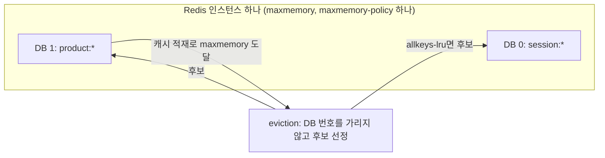
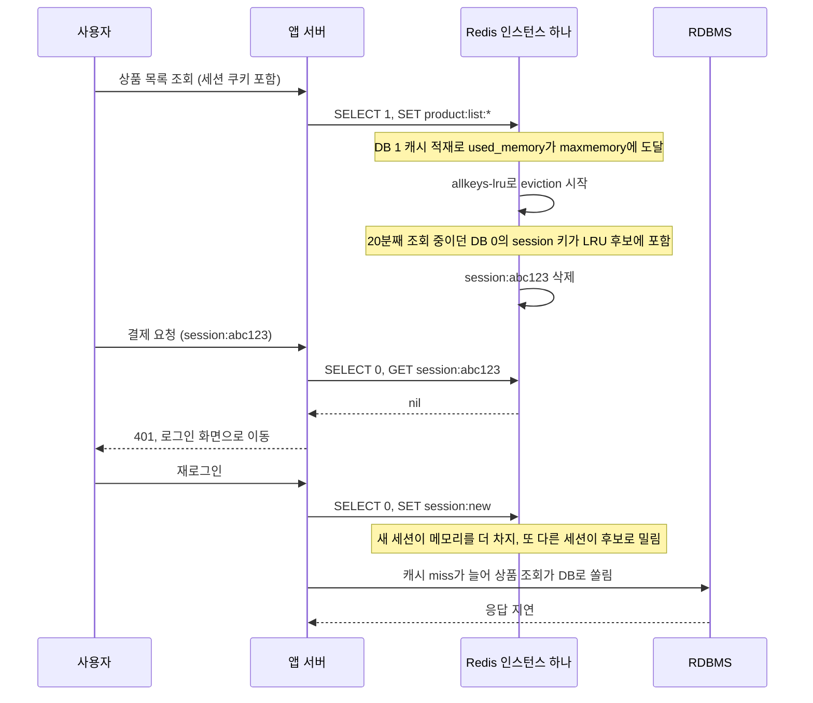
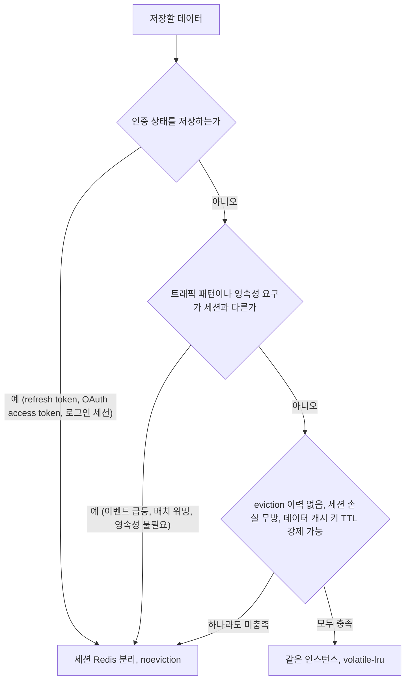
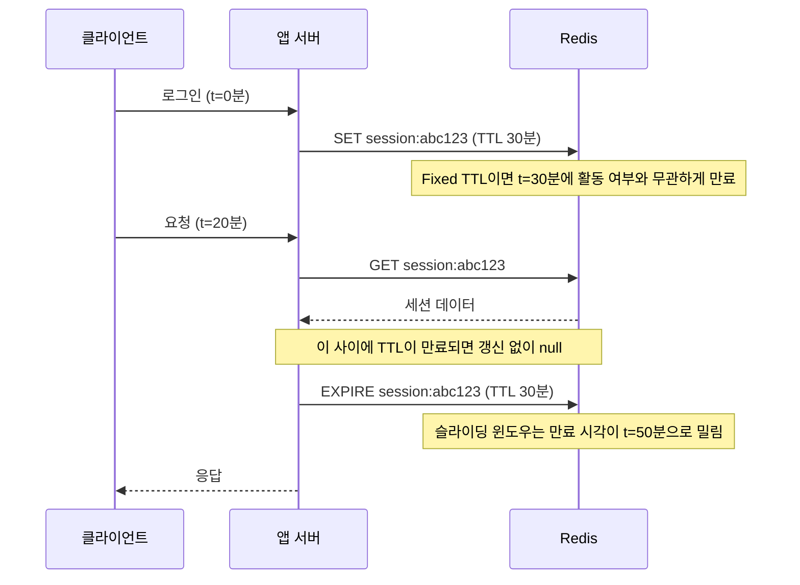
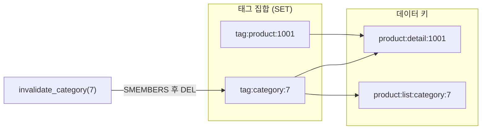

# 세션 캐시와 데이터 캐시 분리 설계

## 같은 Redis에 두면 어떻게 깨지는가

플래시 세일을 상상해 보면 된다. 트래픽이 급증하면서 상품 캐시가 Redis에 쏟아진다. `product:detail:*`, `product:list:category:*`, `product-search:*` 키가 수만 개 생성된다. Redis 메모리가 `maxmemory`에 닿는 순간 eviction이 시작된다.

정책이 `allkeys-lru`면 가장 오랫동안 접근하지 않은 키부터 지운다. 20분째 상품 페이지를 훑고 있던 사용자의 세션 키 `session:abc123`는 LRU 후보로 올라간다. Redis 입장에서는 이 키와 상품 캐시 키의 차이가 없다. 둘 다 메모리 안의 바이트일 뿐이다.

세션이 사라진 사용자는 장바구니에 물건을 가득 담다가 결제 직전에 로그아웃 화면을 보게 된다. 판매 피크 타임에 세션이 날아가는 것은 기술 장애가 아니라 매출 손실이다.

정책을 `volatile-lru`로 바꿔도 문제가 해결되지 않는다. 세션 키에 TTL이 붙어 있으면(슬라이딩 윈도우 구현을 위해 보통 TTL을 쓴다) 세션도 volatile 후보다. LRU에서 세션이 밀리면 마찬가지로 지워진다. 세션에 TTL을 아예 안 붙이면 `volatile-lru`에서 eviction되지는 않지만, 데이터 캐시 키가 모두 지워지고 나면 메모리 압박 시 새 쓰기가 `OOM command not allowed`로 실패한다.

eviction 정책 하나로 "중요한 건 지우지 말고 중요하지 않은 건 지워라"를 표현할 수 없다. 두 워크로드의 요구사항이 근본적으로 충돌한다.

---

## Redis DB 분리가 해결책이 아닌 이유

Redis는 인스턴스 안에 데이터베이스 번호(기본 0~15)를 지원한다. `SELECT 0`에는 세션, `SELECT 1`에는 데이터 캐시를 두는 방식이다. 설정 한 줄로 끝나고 `INFO keyspace`에도 `db0`, `db1`이 따로 찍혀서 분리된 것처럼 보인다. 프로덕션에서 쓰지 않는 이유는 네 가지다.

### maxmemory와 eviction 정책을 같이 쓴다

`maxmemory`와 `maxmemory-policy`는 인스턴스 하나에 하나씩만 있다. DB 별 한도도, DB 별 정책도 없다. DB 1번에 캐시가 쌓여 메모리가 차면 Redis는 DB 번호를 가리지 않고 모든 DB의 키에서 eviction 후보를 뽑는다. 정책이 `allkeys-lru`면 DB 0번의 세션도 후보다.

정책을 하나로 정해야 하는 순간 양쪽 요구가 부딪힌다. 캐시를 위해 `allkeys-lru`로 두면 세션이 날아가고, 세션을 위해 `noeviction`으로 두면 캐시 쓰기가 `OOM command not allowed`로 실패한다. 캐시 쓰기 실패는 DB 조회로 우회되니 곧바로 장애가 되지는 않지만, 그 우회 트래픽이 DB를 압박하고 세션 쓰기까지 같은 에러로 막힌다.

아래 그림은 DB 번호를 나눠도 한도와 정책이 인스턴스 하나에 묶여 있어서 eviction 후보가 DB 경계를 넘는다는 점을 보여준다.



아래 시퀀스는 플래시 세일 중에 `allkeys-lru` 인스턴스에서 벌어지는 일이다. 세션 키가 DB 0에 있어도 eviction 대상에서 빠지지 않는다는 점, 그리고 재로그인이 다시 세션을 쓰면서 악순환이 생기는 점을 보면 된다.



로그아웃당한 사용자가 한꺼번에 재로그인하면 인증 API와 세션 쓰기가 몰리고, 그 쓰기가 다시 eviction을 일으킨다. 이 흐름은 로컬에서 `maxmemory 3mb`로 낮추고 DB 1에 1KB짜리 키를 수천 개 쓰면 DB 0의 세션 수십 개가 사라지는 것으로 재현된다. 재현 과정은 [Redis 논리 DB 번호](../../DataBase/NoSQL/Redis/Redis_Database_Number.md)에 정리해 두었다.

### FLUSHDB와 FLUSHALL의 범위를 사람이 기억해야 한다

`FLUSHDB`는 현재 연결이 선택한 DB만 비운다. 그런데 `redis-cli`를 `-n` 없이 붙이면 0번이고, 0번에는 보통 세션이 있다. 캐시를 비우려고 붙었는데 접속한 곳이 캐시 DB가 아니라 세션 DB였다면 전체 사용자가 로그아웃된다. `FLUSHALL`은 DB 번호와 무관하게 전부 지운다. "내 DB만 비운다"는 감각으로 `FLUSHALL`을 치는 사고는 번호로 용도를 나눈 인스턴스에서 가장 흔하다.

인스턴스가 분리돼 있으면 접속 호스트가 곧 대상이다. 세션 Redis 호스트에 캐시 비우는 명령을 칠 일이 구조적으로 사라진다. 호스트 이름이 틀리는 사고는 여전히 있지만, DB 번호까지 한 단계 더 틀릴 수 있는 지점은 없어진다.

### Redis Cluster는 DB 0만 쓴다

Redis Cluster에서 `SELECT 1`을 보내면 `ERR SELECT is not allowed in cluster mode`가 나온다. 단일 인스턴스에서 DB 번호로 세션과 캐시를 나눠 쓰다가 트래픽이 늘어 Cluster로 옮기려 하면 키 설계부터 다시 해야 한다. 이때 서비스 코드의 `SELECT` 호출, 연결 설정, 키 마이그레이션이 한꺼번에 걸린다. ElastiCache의 클러스터 모드 활성화 구성도 같은 제약이다. 규모가 커질 가능성이 있는 서비스면 처음부터 DB 번호에 의존하지 않는 편이 낫다.

### ACL로 DB 단위 권한을 줄 수 없다

Redis 6의 ACL은 명령, 키 패턴, 채널 단위로 권한을 나눈다. DB 번호는 권한 대상이 아니다. 캐시 서비스 계정에 `~cache:*`만 허용해도 `SELECT 0` 후 `FLUSHDB`를 막을 수 없다. `FLUSHDB`는 키 인자가 없어서 키 패턴 검사를 통과하기 때문이다. "캐시 쪽 계정은 1번만 쓰게 한다"는 정책은 만들 수 없고, 세션 데이터를 보호하려면 결국 `-flushdb -flushall` 같은 명령 차단에 기대야 한다.

### 클라이언트 쪽 부담

Lettuce와 Spring Data Redis는 DB 번호를 설정으로 지정할 수 있다. 다만 `SELECT`는 연결에 붙는 상태라서 풀에서 꺼낸 연결이 어느 DB를 보고 있는지 코드가 보장해야 한다. 재연결 후 `SELECT`가 빠진 연결이 0번에 캐시를 쓰는 사고가 나기도 한다. 로컬 개발에서 한 인스턴스로 여러 서비스를 띄울 때 네임스페이스를 나누는 용도라면 문제없다.

### 분리 방식 비교

세션과 캐시를 나누는 방법은 세 가지로 정리된다. 키 prefix만 나누는 방식은 DB 번호보다 Cluster와 ACL 면에서 낫지만, 메모리와 eviction 정책은 똑같이 공유한다.

| 항목 | DB 번호 분리 | 인스턴스 하나, 키 prefix | 인스턴스 분리 | 별도 클러스터 |
|---|---|---|---|---|
| maxmemory·eviction 격리 | 안 됨 | 안 됨 | 됨 | 됨 |
| 정책을 따로 지정 | 불가 | 불가 | 가능 (`noeviction` / `allkeys-lru`) | 가능 |
| FLUSH 사고 범위 | `FLUSHALL`은 전체, `FLUSHDB`는 접속 DB | `FLUSHALL`은 전체 | 접속한 인스턴스만 | 접속한 클러스터만 |
| ACL 권한 분리 | 불가 | 키 패턴으로 가능 | 인스턴스 단위로 가능 | 가능 |
| Redis Cluster | 불가 | 가능 | 각각 선택 가능 | 가능 |
| 영속성 설정 분리 | 불가 | 불가 | 가능 | 가능 |
| 비용·운영 부담 | 가장 낮음 | 낮음 | 노드 수만큼 증가 | 가장 높음, 샤딩과 failover를 따로 운영 |
| 적합한 규모 | 로컬 개발 | 소규모, 세션 손실이 치명적이지 않은 서비스 | 대부분의 프로덕션 | 세션 또는 캐시 한쪽이 단일 노드 메모리를 넘는 경우 |

세션 데이터는 보통 작고 증가 속도가 느려서 단일 인스턴스(복제본 포함)로 충분하다. 캐시는 용량이 훨씬 커서 먼저 Cluster가 필요해지는 쪽이다. 그래서 실무에서는 세션은 작은 단일 인스턴스에 `noeviction`, 캐시는 Cluster 또는 큰 인스턴스에 `allkeys-lru` 조합이 가장 많다.

---

## 인스턴스 분리 기준

세션이 인증 상태를 저장한다면 분리가 기본값이다. JWT refresh token, OAuth access token, 로그인 세션처럼 사라지면 사용자가 인증 흐름을 다시 거쳐야 하는 데이터는 eviction 가능한 캐시 저장소에 두지 않는다.

아래 흐름도는 이 절의 판단 기준을 순서대로 묶은 것이다. 어느 분기에서든 하나라도 걸리면 분리 쪽으로 간다는 점을 보면 된다.



트래픽 패턴이 다를 때도 분리한다. 세션 접근은 요청마다 일정하게 발생하지만 데이터 캐시는 이벤트에 따라 급등하거나 배치 워밍으로 한꺼번에 적재된다. 같은 인스턴스에 두면 데이터 캐시 부하가 세션 레이턴시에 영향을 준다.

영속성 요구사항이 다를 때도 분리한다. 세션 Redis는 재시작 후 복구를 위해 RDB 스냅샷을 켜는 경우가 있다. 데이터 캐시는 어차피 재적재하면 되니 영속성이 필요 없다. 같은 인스턴스에 영속성을 켜면 데이터 캐시까지 덩달아 디스크에 쓴다.

인스턴스 분리 없이 운영할 수 있는 조건은 좁다. 메모리 여유가 충분해 eviction이 실제로 발생한 적 없고, 세션 데이터 손실이 치명적이지 않고(로그인을 다시 하면 되는 내부 툴), `volatile-lru`에서 데이터 캐시 키에 반드시 TTL을 붙이는 규칙을 코드 리뷰로 강제할 수 있을 때다. 팀이 작고 모든 Redis 사용 코드를 직접 검수할 수 있어야 가능하다.

### 분리 후 eviction 모니터링

분리한 후에도 세션 Redis에서 `evicted_keys`가 올라가면 즉시 확인해야 한다. 데이터 캐시의 eviction은 정상이지만 세션의 eviction은 장애다.

```bash
# 인스턴스별로 따로 본다
redis-cli -h session-redis INFO stats | grep evicted_keys
redis-cli -h cache-redis  INFO stats | grep evicted_keys
```

세션 Redis의 `maxmemory-policy`는 `noeviction`으로 설정한다. 세션이 eviction되는 것보다 쓰기 실패가 낫다. 쓰기 실패는 에러 로그로 즉시 감지할 수 있다. 세션 eviction은 사용자 불만이 쌓인 다음에야 알게 된다.

---

## Sliding Window TTL 구현

Fixed TTL은 세션 생성 시점에 만료 시각이 결정된다. 30분 TTL이면 마지막 활동과 무관하게 생성 후 30분이 지나면 만료된다. 슬라이딩 윈도우는 "마지막 활동"으로부터 TTL이 재설정된다. 요청이 들어올 때마다 만료 시각을 미룬다.

Redis에는 슬라이딩 윈도우 TTL이 내장되어 있지 않다.

아래 시퀀스는 활동 중인 세션이 요청마다 만료 시각을 미루는 흐름이다. GET과 EXPIRE가 두 번의 왕복이라는 점, 그 사이가 비는 구간이라는 점을 보면 된다.



### 기본 구현 (GET + EXPIRE)

```java
@Service
public class SessionCacheService {

    private final RedisTemplate<String, SessionData> redisTemplate;
    private static final Duration SESSION_TTL = Duration.ofMinutes(30);

    public Optional<SessionData> getAndRenew(String token) {
        String key = "session:" + token;
        SessionData session = redisTemplate.opsForValue().get(key);
        if (session != null) {
            redisTemplate.expire(key, SESSION_TTL);
        }
        return Optional.ofNullable(session);
    }

    public void save(String token, SessionData data) {
        redisTemplate.opsForValue().set("session:" + token, data, SESSION_TTL);
    }

    public void delete(String token) {
        redisTemplate.delete("session:" + token);
    }
}
```

`GET`과 `EXPIRE`가 별도 명령이라 원자적이지 않다. GET 후 EXPIRE 사이에 TTL이 만료되면 갱신 없이 null을 반환하게 된다. 30분 TTL 환경에서는 실질적으로 문제가 되지 않는다. TTL이 수 초짜리 단기 토큰이라면 다음 방법을 쓴다.

### Redis 6.2+: GETEX

Redis 6.2부터 `GETEX` 명령이 생겼다. GET과 TTL 갱신을 원자적으로 처리한다.

```java
public Optional<SessionData> getAndRenew(String token) {
    String key = "session:" + token;
    SessionData session = redisTemplate.execute(connection -> {
        byte[] rawKey   = redisTemplate.getStringSerializer().serialize(key);
        byte[] rawValue = connection.stringCommands().getEx(
            rawKey,
            Expiration.from(SESSION_TTL),
            SetOption.UPSERT
        );
        return (SessionData) redisTemplate.getValueSerializer().deserialize(rawValue);
    });
    return Optional.ofNullable(session);
}
```

### Redis 6.2 미만: Lua 스크립트

```java
private static final RedisScript<byte[]> GET_AND_RENEW = RedisScript.of("""
    local val = redis.call('GET', KEYS[1])
    if val then
        redis.call('EXPIRE', KEYS[1], ARGV[1])
    end
    return val
    """, byte[].class);

public Optional<SessionData> getAndRenew(String token) {
    byte[] rawResult = redisTemplate.execute(
        GET_AND_RENEW,
        List.of("session:" + token),
        String.valueOf(SESSION_TTL.getSeconds())
    );
    SessionData session = (SessionData) redisTemplate.getValueSerializer().deserialize(rawResult);
    return Optional.ofNullable(session);
}
```

### Spring Session을 쓰는 경우

Spring Boot 환경이라면 Spring Session Redis가 슬라이딩 윈도우를 자체 처리한다. 매 요청마다 자동으로 TTL을 갱신한다.

```java
@Configuration
@EnableRedisHttpSession(maxInactiveIntervalInSeconds = 1800)
public class SessionConfig {

    // 세션 전용 연결 — 데이터 캐시 RedisTemplate과 분리한다
    @Bean
    public LettuceConnectionFactory sessionRedisConnectionFactory() {
        return new LettuceConnectionFactory(
            new RedisStandaloneConfiguration("session-redis-host", 6379)
        );
    }
}
```

`@EnableRedisHttpSession` 없이 직접 `RedisTemplate`으로 세션을 구현하고 있다면 `expire` 호출을 빠뜨리기 쉽다. 직접 구현 시 슬라이딩 윈도우가 제대로 동작하는지 TTL 만료 시각을 `TTL` 명령으로 확인한다.

```bash
# 요청 전후의 TTL 값이 변하는지 확인한다
redis-cli TTL session:abc123
# 요청 보내고
redis-cli TTL session:abc123
# 값이 늘어나야 정상이다 (예: 1450 → 1800)
```

---

## 데이터 캐시의 태그 기반 무효화

상품 정보를 수정하면 단일 키 하나를 지우는 것으로 끝나지 않는 경우가 많다. `product:detail:{id}` 외에도 그 상품이 포함된 카테고리 목록 캐시, 검색 결과 캐시, 추천 캐시가 모두 무효화 대상이 된다. 변경이 생길 때마다 어떤 키를 지워야 하는지 호출 측이 알아야 한다면 코드가 복잡해진다.

태그 기반 무효화는 캐시를 저장할 때 태그 집합에 키를 등록해두고, 태그 단위로 한 번에 무효화한다.

아래 그림은 태그 집합이 데이터 키를 가리키는 구조다. 상세 캐시는 태그 두 개에 걸려 있어서 카테고리 무효화와 상품 무효화 어느 쪽으로도 지워진다.



```python
import json

class ProductCacheService:
    def __init__(self, redis_client):
        self.redis = redis_client

    def cache_detail(self, product_id: int, category_id: int, data: dict, ttl: int = 600):
        key = f"product:detail:{product_id}"
        tags = [f"product:{product_id}", f"category:{category_id}"]
        self._set_with_tags(key, data, tags, ttl)

    def cache_list(self, category_id: int, data: list, ttl: int = 300):
        key = f"product:list:category:{category_id}"
        tags = [f"category:{category_id}"]
        self._set_with_tags(key, data, tags, ttl)

    def invalidate_product(self, product_id: int):
        self._invalidate_by_tag(f"product:{product_id}")

    def invalidate_category(self, category_id: int):
        self._invalidate_by_tag(f"category:{category_id}")

    def _set_with_tags(self, key: str, value: any, tags: list, ttl: int):
        pipe = self.redis.pipeline()
        pipe.setex(key, ttl, json.dumps(value))
        for tag in tags:
            pipe.sadd(f"tag:{tag}", key)
            # 태그 집합은 등록된 키 중 가장 긴 TTL보다 길게 유지한다
            pipe.expire(f"tag:{tag}", ttl + 60)
        pipe.execute()

    def _invalidate_by_tag(self, tag: str):
        tag_key = f"tag:{tag}"
        keys = self.redis.smembers(tag_key)
        if not keys:
            return
        pipe = self.redis.pipeline()
        for key in keys:
            pipe.delete(key)
        pipe.delete(tag_key)
        pipe.execute()
```

### 태그 집합이 커지는 문제

태그 집합은 관리하지 않으면 불필요한 참조가 쌓인다. 데이터 키는 TTL이 지나 사라졌어도 태그 집합(`SMEMBERS`)에는 계속 남는다. `_invalidate_by_tag`가 이미 없어진 키를 `DEL` 하는 것은 무해하지만, 태그 집합이 수십만 건으로 커지면 `SMEMBERS` 자체가 블로킹이 된다.

재고 수량처럼 분당 수백 번 갱신되는 데이터를 태그로 추적하면 집합이 빠르게 불어난다. 이 경우 태그 대신 버전 키 방식이 낫다.

```python
def get_list_key(self, category_id: int) -> str:
    version = self.redis.get(f"category:{category_id}:ver") or b"1"
    return f"product:list:category:{category_id}:v{version.decode()}"

def cache_list_versioned(self, category_id: int, data: list, ttl: int = 300):
    key = self.get_list_key(category_id)
    self.redis.setex(key, ttl, json.dumps(data))

def invalidate_category_versioned(self, category_id: int):
    # 키를 직접 삭제하지 않고 버전만 올린다
    # 기존 키는 TTL이 만료되면 자연스럽게 사라진다
    self.redis.incr(f"category:{category_id}:ver")
```

버전 키 방식은 `INCR` 하나로 원자적 무효화가 끝난다. 단점은 기존 버전의 캐시 데이터가 TTL 만료 전까지 메모리에 남는다. 갱신 빈도가 높으면 죽은 키가 많아진다.

### Redis Cluster에서의 태그 무효화

Cluster 환경에서는 태그 집합과 데이터 키가 다른 노드에 있을 수 있다. 서로 다른 노드의 키를 한 번의 `pipeline`으로 처리할 수 없다.

해시 태그로 같은 슬롯에 묶는 방법이 있다.

```python
# {product:1001} 부분이 슬롯을 결정한다
# tag_key와 data_key가 같은 슬롯으로 들어간다
tag_key  = f"{{product:{product_id}}}:tags"
data_key = f"{{product:{product_id}}}:detail"
```

이 방식은 product_id마다 슬롯이 고정된다. 특정 상품에 트래픽이 집중되면 그 슬롯을 담당하는 노드 하나가 hot node가 된다. 태그 범위를 카테고리 수준으로 올리면 핫 노드 위험은 줄지만 슬롯 분포가 카테고리 수에 의존하게 된다.

태그 무효화와 Cluster를 같이 쓰면 트레이드오프가 까다롭다. 규모가 크면 태그 집합 대신 무효화 이벤트를 Kafka로 흘리고 각 인스턴스가 자신이 가진 키만 삭제하는 구조를 검토한다.

---

## 요약

| | 세션 캐시 | 데이터 캐시 |
|---|---|---|
| eviction | 허용 불가 | 허용 (캐시의 본질) |
| TTL 방식 | 슬라이딩 윈도우 (접근마다 갱신) | Fixed TTL |
| maxmemory-policy 권장 | `noeviction` | `allkeys-lru` 또는 `allkeys-lfu` |
| 영속성 | 재시작 복구 고려 | 불필요 |
| 무효화 방식 | 명시적 삭제 (로그아웃) | TTL + 태그/버전 무효화 |

세션과 데이터 캐시는 같은 Redis에 두기에는 요구사항이 너무 다르다. 인스턴스 비용이 아깝더라도 eviction으로 세션이 날아가는 사고는 그것보다 비싸다.
