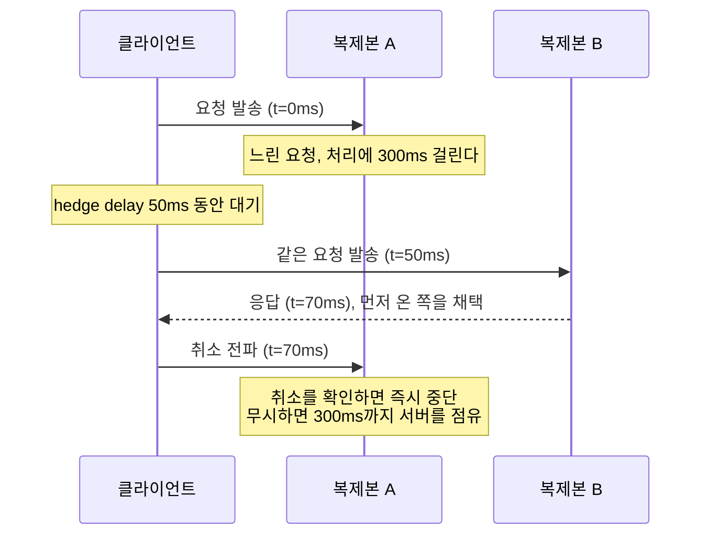
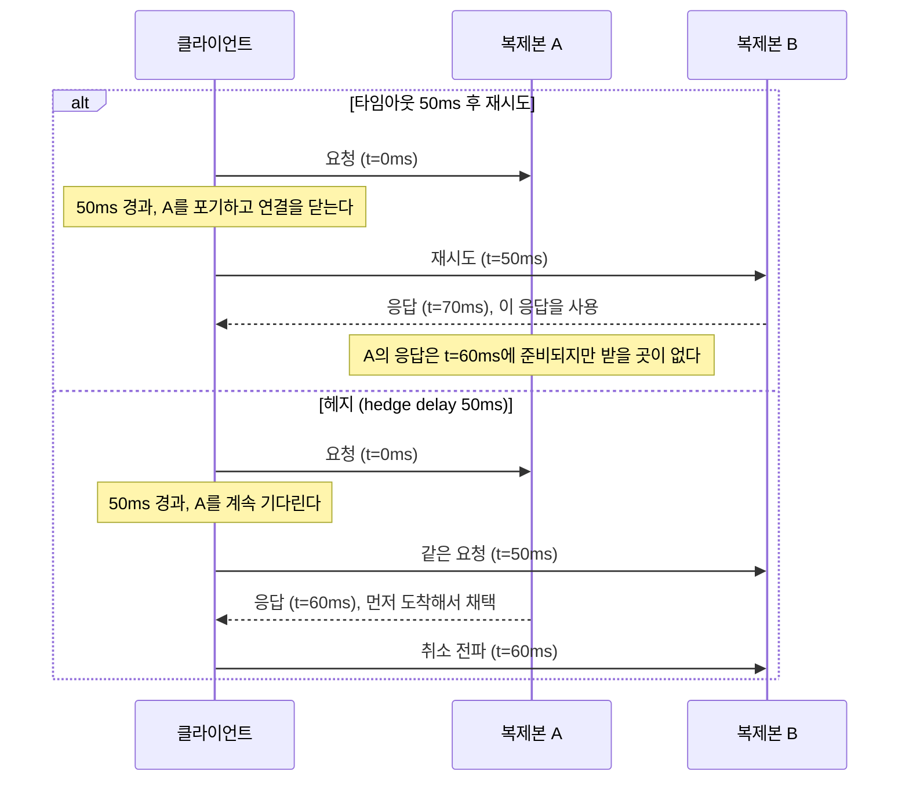
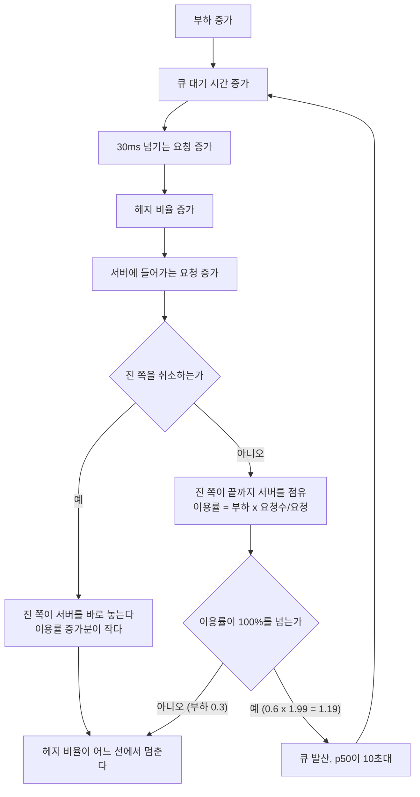
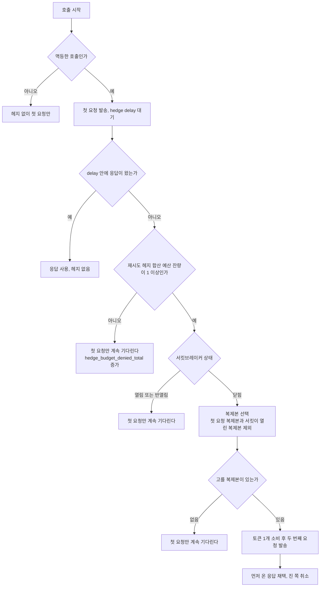
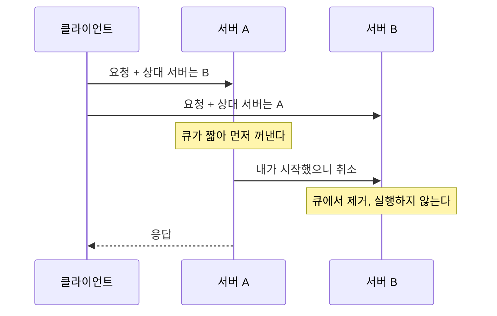

# 헤지 요청 - 꼬리 지연을 줄이고 부하로 값을 치르는 방법

평균 응답 시간이 20ms인 서비스에서 가끔 300ms가 걸리는 요청이 섞여 있다고 하자. 호출 하나만 보면 1%의 일이다. 그런데 화면 하나가 이 서비스를 병렬로 100번 부르면 그 화면이 느려질 확률은 1 - 0.99^100 = 63.4%다. 10번이면 9.6%, 1번이면 1%다. 팬아웃이 커질수록 p99는 "가끔"이 아니라 "거의 매번"이 된다. 구글이 이 현상을 정리한 글이 [The Tail at Scale](https://research.google/pubs/the-tail-at-scale/)이고, 그 글에서 제안하는 방어책 중 가장 단순한 것이 **헤지 요청**이다.

팬아웃별로 다시 계산하면 이렇다. 호출 하나가 느릴 확률을 1%로 두었고, 헤지를 걸면 두 복제본이 동시에 느려야 하니 0.01%가 된다(두 복제본이 독립이라고 가정한 값이다).

| 팬아웃 N | 화면이 p99 꼬리에 걸릴 확률 | 헤지를 건 뒤 |
|---|---|---|
| 1 | 1.0% | 0.01% |
| 10 | 9.6% | 0.1% |
| 100 | 63.4% | 1.0% |

N=100에서 63.4%가 1.0%로 내려간다. 독립 가정이 깨지는 경우(두 복제본이 같은 디스크나 같은 샤드를 보는 경우)에는 이 표보다 훨씬 나쁘고, 그 정도는 뒤의 시뮬레이션에서 `correlated` 줄로 본다. 이 표는 호출 하나가 느릴 확률 1% 기준이고, 바로 아래 구현 예제의 가짜 백엔드는 10%로 잡았다.

헤지 요청은 첫 요청이 일정 시간 안에 응답하지 않으면 **같은 요청을 다른 복제본에 한 번 더 보내고 먼저 오는 응답을 쓰는** 방식이다. 재시도와 비슷해 보이지만 첫 요청을 끊지 않고 계속 기다린다는 점이 다르다. 타임아웃 후 재시도는 실패를 가정하고, 헤지는 "느릴 뿐 아직 살아 있다"를 가정한다.

이 문서는 헤지가 p99를 얼마나 줄이는지와, 그 대가인 추가 부하가 어느 조건에서 효과를 뒤집는지를 직접 돌린 결과로 보인다. 아래 수치는 이 문서의 가짜 백엔드와 시뮬레이터에서 나온 값이고, 실제 서비스의 분포는 다르다. 재시도·서킷브레이커 같은 일반 장애 대응은 [장애 대응 패턴](Fault_Tolerance.md), 과부하를 막는 격벽은 [Rate Limiting · Bulkhead](Rate_Limiting_and_Bulkhead.md)에 있다. 헤지는 같은 요청이 두 번 실행될 수 있으니 [API 멱등성](../API/API_Idempotency.md)이 먼저 갖춰져 있어야 한다.

## 가장 작은 구현

asyncio로 쓴 헤지다. 백엔드는 90%가 20ms, 10%가 300ms에 응답하는 가짜 서비스다.

```python
import asyncio, random, time

async def backend(name: str, rnd: random.Random) -> str:
    await asyncio.sleep(0.3 if rnd.random() < 0.10 else 0.02)
    return name

async def hedged(call, delay: float, replicas: list[str]):
    """첫 요청이 delay 안에 안 끝나면 다음 복제본에 같은 요청을 보내고, 먼저 끝난 쪽을 쓴다."""
    tasks = [asyncio.ensure_future(call(replicas[0]))]
    try:
        for nxt in replicas[1:]:
            done, _ = await asyncio.wait(tasks, timeout=delay, return_when=asyncio.FIRST_COMPLETED)
            if done:
                break
            tasks.append(asyncio.ensure_future(call(nxt)))
        done, _ = await asyncio.wait(tasks, return_when=asyncio.FIRST_COMPLETED)
        return next(iter(done)).result()
    finally:
        for t in tasks:                       # 진 쪽을 반드시 취소한다
            if not t.done():
                t.cancel()
```

2,000번씩 순차 호출한 결과다(Python 3.10).

```text
헤지 없음   p50=  20.2ms  p99= 300.7ms  max= 340.1ms
헤지 50ms   p50=  20.3ms  p99=  77.0ms  max= 301.3ms
```

p99가 300ms에서 77ms로 내려갔고 p50은 그대로다. 느린 요청(300ms)이 걸리면 50ms를 기다린 뒤 두 번째 복제본에 보내고, 거기서 20ms에 응답이 오니 70ms 안팎에서 끝난다. 600번 돌려 지연을 10ms 단위로 묶어 본 분포는 20ms가 538건, 70ms가 52건, 300ms가 10건이었다. 300ms로 남은 것은 첫 요청과 두 번째 요청이 **둘 다** 느린 경우(0.1 × 0.1 = 1%)이고, max가 여전히 301ms인 이유도 이것이다. 헤지는 느릴 확률을 제곱으로 줄일 뿐 0으로 만들지는 않는다.

느린 요청 하나가 겪는 시간 순서를 그리면 이렇다. 첫 요청은 복제본 A에서 300ms가 걸리는 요청이고, 50ms가 지난 시점에 두 번째 요청이 복제본 B로 나간다. 도식에서 볼 부분은 A로 간 첫 요청이 끊기지 않고 70ms에 취소가 올 때까지 살아 있다는 점이다.



타임아웃 후 재시도와의 차이는 A가 60ms에 응답을 줄 수 있는 경우에 드러난다. 재시도는 50ms에 A를 포기하므로 A의 60ms 응답은 받을 곳 없이 버려지고 B의 70ms 응답을 쓴다. 헤지는 A를 계속 기다리기 때문에 60ms에 도착한 A의 응답을 쓴다. 느린 첫 요청이 결과를 내줄 가능성을 버리느냐 남겨 두느냐의 차이다.



A가 정말 죽었거나 오류를 내는 경우에는 헤지만으로 부족하다. 헤지는 A가 느릴 뿐이라는 쪽에 건 것이라 오류 응답이 오면 두 번째 요청이 이미 나갔더라도 그 뒤 처리는 재시도 쪽이 맡아야 한다. 둘은 대체 관계가 아니라 같이 쓰되 추가 요청 예산을 나눠 써야 하는 관계다. 이 부분은 뒤의 예산 절에서 다룬다.

헤지로 나간 추가 요청은 첫 요청이 50ms 안에 끝나지 않은 비율, 즉 약 10%다. 요청당 평균 1.1번 호출하는 셈이다. 이 비용이 바로 다음 절에서 문제가 된다.

## 시뮬레이션: 부하가 오르면 어떻게 달라지나

위 실험은 백엔드가 요청 수에 영향을 받지 않는 이상적인 경우다. 실제 서버는 큐가 있고, 헤지 요청도 그 큐에 줄을 선다. 서버 10대, 서버당 워커 1개와 FIFO 큐, 서비스 시간은 95%가 평균 10ms, 5%가 평균 100ms인 지수분포로 이벤트 시뮬레이션을 짰다. 서비스 시간만 따지면 p50 7.4ms, p95 40ms, p99 161ms다. 부하 ρ는 **헤지를 안 했을 때** 서버 이용률이다.

```python
import heapq, random, itertools
from collections import deque

def sim(rho, hedge_delay=None, cancel=True, correlated=False, n_servers=10, n_req=60000, seed=1):
    rnd = random.Random(seed)
    def svc():
        return rnd.expovariate(1/0.100) if rnd.random() < 0.05 else rnd.expovariate(1/0.010)
    mean_svc = 0.95*0.010 + 0.05*0.100
    lam = rho * n_servers / mean_svc
    ev, seq = [], itertools.count()
    push = lambda t, kind, *a: heapq.heappush(ev, (t, next(seq), kind, a))
    q = [deque() for _ in range(n_servers)]
    cur = [None]*n_servers                  # 서버가 처리 중인 copy
    t = 0.0
    for i in range(n_req):
        t += rnd.expovariate(lam); push(t, 'arr', i)
    lat, copies_sent = {}, 0

    def start_next(s, now):
        while q[s]:
            c = q[s].popleft()
            if c['cancel']: continue
            cur[s] = c; c['srv'] = s
            push(now + c['svc'], 'done', c)
            return
        cur[s] = None

    def enqueue(r, s, now):
        nonlocal copies_sent
        copies_sent += 1
        c = {'req': r, 'cancel': False, 'svc': r['svc0'] if correlated and r['copies'] else svc(), 'srv': None}
        r['copies'].append(c)
        q[s].append(c)
        if cur[s] is None: start_next(s, now)

    while ev:
        now, _, kind, a = heapq.heappop(ev)
        if kind == 'arr':
            r = {'id': a[0], 'arrive': now, 'done': False, 'copies': [], 'svc0': svc(), 'first': rnd.randrange(n_servers)}
            c = {'req': r, 'cancel': False, 'svc': r['svc0'], 'srv': None}   # correlated 면 헤지 copy 도 svc0 를 쓴다
            r['copies'].append(c); copies_sent += 1; q[r['first']].append(c)
            if cur[r['first']] is None: start_next(r['first'], now)
            if hedge_delay is not None: push(now + hedge_delay, 'hedge', r)
        elif kind == 'hedge':
            r = a[0]
            if not r['done']:
                s = rnd.choice([x for x in range(n_servers) if x != r['first']])
                enqueue(r, s, now)
        else:
            c = a[0]
            if c['cancel']: continue
            r = c['req']; s = c['srv']
            cur[s] = None
            if not r['done']:
                r['done'] = True; lat[r['id']] = now - r['arrive']
                if cancel:
                    for o in r['copies']:
                        if o is c or o['cancel']: continue
                        o['cancel'] = True
                        if o['srv'] is not None and cur[o['srv']] is o:      # 처리 중이면 즉시 중단
                            s2 = o['srv']; cur[s2] = None; start_next(s2, now)
            start_next(s, now)
    xs = sorted(lat.values())
    pct = lambda p: xs[int(p*(len(xs)-1))]*1000
    return pct(.5), pct(.99), pct(.999), copies_sent/n_req
```

`cancel`은 먼저 끝난 요청의 복제본을 큐에서 빼거나 처리 중이면 중단시키는지, `correlated`는 느린 이유가 서버가 아니라 **요청 자체**(무거운 쿼리, 큰 페이로드)여서 두 번째 복제본도 같은 시간이 걸리는지를 정한다. 지연은 30ms로 두었다(서비스 시간 p90과 p95 사이). 단위는 ms이고 마지막 열은 요청 하나당 실제로 서버에 들어간 요청 수다.

| 부하 | 조건 | p50 | p99 | p99.9 | 요청수/요청 |
|---|---|---|---|---|---|
| 0.3 | 헤지 없음 | 11.0 | 323.7 | 542.8 | 1.00 |
| 0.3 | 헤지, 취소 O | 9.6 | 52.1 | 94.2 | 1.13 |
| 0.3 | 헤지, 취소 X | 12.9 | 127.7 | 265.4 | 1.26 |
| 0.3 | 헤지, 취소 O, 지연이 요청에 고정 | 13.3 | 218.0 | 427.6 | 1.28 |
| 0.6 | 헤지 없음 | 22.3 | 514.1 | 900.3 | 1.00 |
| 0.6 | 헤지, 취소 O | 13.8 | 63.3 | 105.4 | 1.22 |
| 0.6 | 헤지, 취소 X | 10,850 | 27,749 | 30,548 | 1.99 |
| 0.6 | 헤지, 취소 O, 지연이 요청에 고정 | 33.0 | 311.4 | 542.6 | 1.55 |
| 0.8 | 헤지 없음 | 67.8 | 1,016 | 1,501 | 1.00 |
| 0.8 | 헤지, 취소 O | 18.7 | 76.8 | 134.9 | 1.32 |
| 0.8 | 헤지, 취소 X | 29,450 | 62,469 | 65,877 | 2.00 |
| 0.8 | 헤지, 취소 O, 지연이 요청에 고정 | 338.4 | 865.1 | 1,056 | 1.96 |

헤지 없이도 p99가 서비스 시간 p99(161ms)보다 2~6배 큰 것은 느린 요청이 앞에서 서버를 잡고 있는 동안 뒤의 요청이 같이 기다리는 큐잉 때문이다. 이 뒤에 서는 요청은 서버가 멀쩡해도 느려진다.

표에서 읽어야 할 것은 세 가지다.

**취소 X는 부하를 두 배로 만들고 시스템을 무너뜨린다.** 부하가 오르면 큐 대기만으로 30ms를 넘기는 요청이 늘어 거의 모든 요청이 헤지되고(요청수/요청 1.99), 이긴 쪽이 응답한 뒤에도 진 쪽이 계속 서버를 점유하면 이용률이 0.6 × 2 = 1.2로 100%를 넘는다. 큐가 끝없이 자라서 p50이 10초대로 올라갔다(시뮬레이션이 끝날 때까지 쌓인 대기 시간이라 절댓값에 큰 의미는 없고, 발산했다는 사실이 핵심이다). 부하 0.3에서는 이용률이 0.6 안팎에 머물러 버텼고 취소 O보다 p99가 2.5배 나쁜 수준에서 끝났다. **같은 코드가 평소에는 멀쩡하다가 트래픽이 늘어난 날 갑자기 무너진다.** 로컬 테스트나 한가한 시간대 측정으로는 안 보인다.

이 붕괴는 한 번 시작되면 스스로 커지는 구조다. 부하가 올라 큐 대기가 늘면 헤지 지연(30ms)을 넘기는 요청이 늘고, 헤지가 늘면 서버에 들어가는 요청이 늘어 큐가 더 길어진다. 취소가 되면 진 쪽이 바로 서버를 놓아 이 고리가 중간에서 끊기고, 취소가 안 되면 이용률이 100%를 넘는 지점에서 큐가 발산한다.



표의 취소 X 줄은 이 도식에서 `아니오` 쪽 가지를 따라간 결과다. 부하 0.3은 이용률이 100%를 넘지 않아 H에서 멈췄고, 0.6과 0.8은 J에서 `예`로 빠져 K와 B 사이를 계속 돈다.

**지연이 요청에 고정되어 있으면 헤지는 이득 없이 부하만 낸다.** 요청 자체가 무거운 경우(전체 기간 집계 쿼리, 거대한 응답)는 어느 서버에 보내도 느리다. 부하 0.3에서는 p99가 323에서 218로 줄어 아직 보람이 있지만, 부하 0.8에서는 p50이 67.8에서 338.4로 5배 나빠졌다. 느린 이유가 서버 쪽 일시 현상(GC, 컴팩션, 이웃 부하, 캐시 미스)인지 요청 쪽 고정 비용인지 모르고 헤지를 켜면 이 칸에 떨어진다.

**취소가 있으면 부하 0.8에서도 이득이 유지된다.** p99가 1,016ms에서 76.8ms로 내려가고 요청수는 1.32배다. 헤지의 추가 비용은 "복제본이 아직 처리 중일 때 중단할 수 있느냐"에 달려 있다.

## 헤지 지연은 어떻게 정하나

너무 짧으면 거의 모든 요청이 두 번 나가고, 너무 길면 효과가 없다. 부하 0.6, 취소 O에서 지연만 바꿔 돌렸다(서비스 시간 p95 = 40ms).

| 헤지 지연 | p50 | p99 | p99.9 | 요청수/요청 |
|---|---|---|---|---|
| 없음 | 22.3 | 514.1 | 900.3 | 1.00 |
| 5ms | 8.7 | 41.2 | 77.2 | 1.76 |
| 15ms | 12.7 | 49.8 | 91.0 | 1.44 |
| 30ms | 13.8 | 63.3 | 105.4 | 1.22 |
| 60ms | 15.6 | 96.9 | 161.8 | 1.11 |
| 150ms | 18.7 | 178.6 | 256.1 | 1.05 |

지연을 짧게 줄일수록 p99는 좋아지지만 추가 요청 비율이 올라간다. 위 구간에서는 60ms 근처(요청수 +11%에 p99 514에서 97)가 비용 대비 효율이 좋고, 5ms는 p99는 가장 낮아도 서버 호출이 76% 늘어난다. 서비스에 따라 최적점은 달라서 **"p95 근처"를 출발점으로 두고 추가 요청 비율이 몇 %를 넘지 않게 상한을 걸어 가며 조정**하는 식으로 접근한다. The Tail at Scale도 지연을 해당 요청 종류의 p95 근처로 두라고 제안한다. 정적 값으로 박아 두면 서비스가 느려지는 날 모든 요청이 헤지되므로, 지연은 최근 응답 시간 분포에서 주기적으로 다시 계산한다.

### 슬라이딩 윈도우 p95로 지연을 계산한다

정확한 p95는 윈도우 안의 샘플을 전부 들고 정렬해야 구할 수 있어서 초당 수천 건이 지나가는 경로에는 부담이 된다. 응답 시간을 로그 간격 버킷에 세어 두고 버킷 누적 개수로 분위수를 읽으면 조회 비용이 샘플 수와 무관해진다. HdrHistogram이 같은 원리이고(유효숫자 자릿수를 고정한 버킷), t-digest는 분포 양 끝에 중심점을 촘촘히 두어 꼬리 정밀도를 높인 방식이다. 운영 코드에서는 이런 라이브러리를 쓰고, 아래는 원리만 보이려고 5% 폭 버킷으로 짠 구현이다.

```python
import math, time
from collections import deque


class LatencyWindow:
    def __init__(self, window: float = 60.0, min_samples: int = 50, default: float = 0.05):
        self.window, self.min_samples, self.default = window, min_samples, default
        self.events = deque()                  # (시각, 버킷)
        self.counts = {}
        self.n = 0

    @staticmethod
    def _bucket(x: float) -> int:
        return math.floor(math.log(max(x, 1e-4), 1.05))    # 버킷 폭 5%

    def record(self, latency: float, now: float | None = None):
        now = time.monotonic() if now is None else now
        b = self._bucket(latency)
        self.events.append((now, b))
        self.counts[b] = self.counts.get(b, 0) + 1
        self.n += 1
        self._evict(now)

    def _evict(self, now: float):
        while self.events and self.events[0][0] < now - self.window:
            _, b = self.events.popleft()
            self.counts[b] -= 1
            if self.counts[b] == 0:
                del self.counts[b]
            self.n -= 1

    def quantile(self, q: float, now: float | None = None) -> float:
        now = time.monotonic() if now is None else now
        self._evict(now)
        if self.n < self.min_samples:
            return self.default                # 콜드스타트: 분포를 모르면 고정값
        target, seen = q * self.n, 0
        for b in sorted(self.counts):
            seen += self.counts[b]
            if seen >= target:
                return 1.05 ** (b + 1)         # 버킷 상한을 돌려준다
        return self.default
```

로그정규 분포(중앙값 20ms)에서 뽑은 20,000개 샘플로 정확한 값과 대조했다. p50은 20.05ms 대 20.18ms, p95는 54.01ms 대 56.21ms, p99는 79.42ms 대 83.05ms였다. 버킷 상한을 돌려주기 때문에 항상 최대 5% 높게 나온다. 헤지 지연에서는 이 오차가 문제 되지 않는다. 이 코드의 이벤트 큐는 윈도우 안 샘플 수만큼 메모리를 쓰므로, 요청이 많은 서비스는 초 단위 슬롯을 돌려 쓰는 방식으로 바꾼다.

콜드스타트에서는 샘플이 `min_samples`(50개)가 모일 때까지 `default`를 돌려준다. 이 값은 그 서비스의 평소 p95보다 조금 높게 잡는다. 너무 낮으면 배포 직후 모든 요청이 헤지되고, 윈도우(60초)가 지나 샘플이 비는 새벽 시간대에도 같은 값으로 되돌아간다. 배포 직후에는 헤지를 아예 끄고 샘플이 쌓인 뒤 켜는 쪽이 더 안전한 서비스도 있다.

한 가지 함정이 있다. 느린 모드의 비율이 5%를 넘으면 p95가 느린 쪽 분포 안으로 들어가 지연이 느린 요청 시간 근처까지 올라간다. 앞의 가짜 백엔드(10%가 300ms)에 이 코드를 그대로 붙였더니 지연의 중앙값이 310ms가 되었고 p99는 300ms에서 내려가지 않았다(예산 1%일 때 p99 302.9ms). 느린 비율이 2%인 백엔드에서는 지연 중앙값이 33ms 안팎으로 잡혔고 같은 조건에서 p99가 62.4ms로 내려갔다. 느린 비율이 5%를 넘는 서비스는 분위수를 p90으로 낮추거나 `min(p95, 상한값)`으로 막아야 한다.

## 헤지 예산과 재시도 예산 공유

앞 절의 시뮬레이션이 보여 준 붕괴는 헤지 비율에 상한이 없어서 생긴다. 상한을 호출 단위로 걸 수 있다. 요청 하나가 들어올 때마다 토큰이 `ratio`만큼 쌓이고, 헤지 하나가 토큰 1개를 쓴다. `ratio=0.05`면 요청 20개에 헤지 1개가 평균 상한이다. 토큰은 `max_tokens`까지만 쌓이므로 한가한 시간에 모아 둔 예산을 장애 때 한꺼번에 쓰지 못한다.

재시도와 헤지가 같은 `HedgeBudget` 인스턴스를 쓰게 하면 총 추가 요청량이 `ratio`로 묶인다. 재시도가 예산을 먼저 써 버리면 헤지가 꺼지고, 이 동작이 장애 때 바라는 방향이다. 서버가 오류를 내는 중에 헤지까지 곱해져 나가면 안 되기 때문이다. gRPC의 `retryThrottling`도 토큰 버킷으로 재시도와 헤지를 같이 제한하는 비슷한 구조다.

```python
import asyncio, time


class HedgeBudget:
    def __init__(self, ratio: float = 0.05, max_tokens: float = 10.0):
        self.ratio, self.max_tokens = ratio, max_tokens
        self.tokens = max_tokens

    def on_request(self):
        self.tokens = min(self.max_tokens, self.tokens + self.ratio)

    def can_spend(self) -> bool:
        return self.tokens >= 1.0

    def try_spend(self) -> bool:
        if self.can_spend():
            self.tokens -= 1.0
            return True
        return False


async def hedged_call(call, budget: HedgeBudget, win: LatencyWindow, replicas):
    budget.on_request()
    HEDGE_REQ.labels(SVC).inc()                 # HEDGE_* 카운터 정의는 메트릭 절에 있다
    delay = win.quantile(0.95)
    HEDGE_DELAY.labels(SVC).observe(delay)
    t0 = time.monotonic()
    first = asyncio.ensure_future(call(replicas[0]))
    tasks = [first]
    winner = None
    try:
        done, _ = await asyncio.wait(tasks, timeout=delay)
        if not done:
            if budget.try_spend():
                HEDGE_FIRED.labels(SVC).inc()
                tasks.append(asyncio.ensure_future(call(replicas[1])))
            else:
                HEDGE_DENIED.labels(SVC).inc()
            done, _ = await asyncio.wait(tasks, return_when=asyncio.FIRST_COMPLETED)
        winner = next(iter(done))
        if winner is not first:
            HEDGE_WON.labels(SVC).inc()
        result = winner.result()
    finally:
        for t in tasks:
            if t.done():
                if t is not winner and not t.cancelled():
                    HEDGE_CANCEL.labels(SVC, "completed").inc()    # 취소 전에 진 쪽도 끝나 버렸다
            else:
                t.cancel()
                HEDGE_CANCEL.labels(SVC, "cancelled").inc()
    win.record(time.monotonic() - t0)
    return result


async def retry_call(call, budget: HedgeBudget, replicas, attempts: int = 3):
    budget.on_request()
    last = None
    for i in range(attempts):
        if i > 0 and not budget.try_spend():    # 재시도도 같은 예산에서 뺀다
            break
        try:
            return await call(replicas[i % len(replicas)])
        except ConnectionError as e:
            last = e
    raise last
```

`retry_call`에는 예산 확인이 첫 시도(`i == 0`)에는 걸리지 않는 점이 중요하다. 첫 요청은 항상 나가야 하고, 예산은 추가 요청에만 쓴다. 항상 실패하는 백엔드에 200건을 호출한 결과 서버에 들어간 요청은 211건이었다(예산 없이 3회 재시도하면 600건). 초기 토큰 2개와 200건이 쌓은 토큰 10개가 재시도 11번이 되었다.

헤지 쪽은 느린 비율이 2%인 가짜 백엔드(98%가 20ms, 2%가 300ms)에 3,000건을 동시성 50으로 보낸 결과다. 예산을 줄여도 p99가 올라가지 않는 것은 필요한 헤지가 전체의 1~2%라서 예산이 병목이 아니기 때문이다.

| 예산 ratio | p99 | 헤지 발동 | 예산 부족으로 못 나간 비율 |
|---|---|---|---|
| 0 (초기 토큰 10개만) | 301.5ms | 0.3% | 1.4% |
| 0.01 | 62.4ms | 1.3% | 0.4% |
| 0.05 | 51.3ms | 1.7% | 0.0% |
| 요청당 1.0 (사실상 무제한) | 57.2ms | 2.4% | 0.3% |

`ratio=0`에서도 0.3%(10건)가 나간 것은 초기 토큰 10개 때문이다. 예산이 실제로 발동률을 누르는 경우는 느린 비율이 높을 때다. 느린 비율을 10%로 올리면 사정이 달라진다.

| 예산 ratio | 헤지 발동 | 못 나간 비율 | 지연 중앙값 |
|---|---|---|---|
| 0.01 | 0.6% | 2.4% | 310ms |
| 0.05 | 5.2% | 4.5% | 123ms |
| 사실상 무제한 | 9.1% | 0.4% | 101ms |

예산 5%일 때 발동 비율은 5.2%에서 멈췄고, 막힌 시도가 4.5% 있었다. sleep 기반이라 실행마다 값이 조금씩 다르다. 같은 설정을 여러 번 돌렸을 때 예산이 충분한 줄의 p99는 51ms에서 88ms 사이를 오갔으니, 표의 p99끼리 우열을 가리지 말고 `ratio=0`과의 차이만 읽는다.

## 호출 시점의 발동 판정

헤지 지연이 지나면 바로 두 번째 요청을 보내지 않는다. 호출 단위로 판정할 것이 네 가지 있다. 아래 흐름에서 토큰 소비는 맨 마지막에 둔다. 서킷이 열려 있거나 보낼 복제본이 없는데 토큰만 먼저 깎으면 헛되이 예산이 줄어든다.



복제본 선택은 첫 요청을 보낸 복제본을 빼는 것만으로 끝나지 않는다. 같은 가용 영역이나 같은 샤드에 있는 복제본은 같은 원인으로 같이 느려지기 쉬워서, 가능하면 다른 장애 도메인에서 고른다. 후보가 한 곳뿐이면 헤지가 이득을 내지 못하는 경우(`correlated` 줄)로 가는 것이니 그때는 헤지를 건너뛰는 쪽이 낫다.

서킷이 반열림 상태일 때 헤지를 끄는 이유는 반열림의 시험 호출이 정확히 몇 건인지 서킷이 세고 있기 때문이다. 헤지가 여기에 끼어들면 시험 호출 수가 어긋나서 복구 판단이 흔들린다.

## Tied Requests

The Tail at Scale은 지연 헤지의 변형으로 tied requests를 같이 소개한다. 두 서버 큐에 요청을 같이 넣되 요청에 상대 서버가 누구인지를 붙여 보낸다. 한쪽 서버가 그 요청을 처리하려고 큐에서 꺼내는 순간 상대에게 취소를 보내고, 상대는 큐에서 그 요청을 뺀다. 지연을 기다리지 않으니 첫 요청이 줄이 긴 서버에서 기다리는 시간을 hedge delay만큼 버리지 않는다. 대신 모든 요청이 두 번 큐에 들어가고 서버끼리 취소를 주고받는 경로가 필요하다.



도식의 A가 취소를 보내는 시점과 B가 같은 요청을 꺼내는 시점이 겹치면 양쪽이 모두 실행한다. 그 구간의 길이가 서버 사이 메시지 지연 정도다.

앞의 시뮬레이터에 `tied` 모드를 붙여 돌렸다. 요청이 도착하면 서로 다른 두 서버 큐에 동시에 넣고, 한 복제본이 서비스를 시작하면 `tied`로 준 지연(rtt) 뒤에 상대 복제본이 아직 큐에 있을 때 취소한다. 이미 시작한 복제본은 그대로 돌다가 먼저 끝난 쪽이 이기면 나머지를 중단한다(취소 O). 지연 헤지 줄은 앞 표와 같은 값이다.

| 부하 | 방식 | p50 | p99 | p99.9 | 큐에 도착한 요청수/요청 | 실행 시작 수/요청 |
|---|---|---|---|---|---|---|
| 0.3 | 지연 헤지 30ms | 9.6 | 52.1 | 94.2 | 1.13 | 1.11 |
| 0.3 | tied, rtt 1ms | 5.0 | 77.5 | 293.6 | 2.00 | 1.63 |
| 0.3 | tied, rtt 5ms | 4.7 | 51.5 | 224.2 | 2.00 | 1.76 |
| 0.6 | 지연 헤지 30ms | 13.8 | 63.3 | 105.4 | 1.22 | 1.15 |
| 0.6 | tied, rtt 1ms | 8.3 | 156.8 | 368.7 | 2.00 | 1.28 |
| 0.6 | tied, rtt 5ms | 7.2 | 123.4 | 333.2 | 2.00 | 1.46 |
| 0.8 | 지연 헤지 30ms | 18.7 | 76.8 | 134.9 | 1.32 | 1.17 |
| 0.8 | tied, rtt 1ms | 16.1 | 217.1 | 420.4 | 2.00 | 1.11 |
| 0.8 | tied, rtt 5ms | 13.1 | 193.7 | 392.2 | 2.00 | 1.26 |

p50은 tied가 낮고 부하가 낮을수록 차이가 크다(부하 0.3에서 9.6ms 대 5.0ms, 0.8에서 18.7ms 대 16.1ms). 두 큐 중 먼저 비는 쪽에서 시작하기 때문이다. p99와 p99.9는 지연 헤지가 낫다. tied는 큐 대기 변동은 줄이지만 일단 실행이 시작되면 상대가 취소되어 버려서, 서비스 시간 자체가 긴 요청(이 시뮬레이션에서는 5%가 평균 100ms)은 구제하지 못한다. 지연 헤지는 실행 중인 느린 요청도 30ms 뒤에 다른 복제본으로 되돌려 준다. 이 비교는 이 시뮬레이터의 서비스 시간 분포에서 나온 결과이고, 서비스 시간 변동이 작고 큐 대기가 지배적인 시스템에서는 순위가 달라질 수 있다.

rtt를 1ms에서 5ms로 늘리면 p99가 오히려 좋아지고 실행 시작 수도 늘어난다. 취소가 도착하기 전에 양쪽이 같이 시작하는 경우가 늘면서 사실상 두 복제본이 경쟁하는 헤지가 되기 때문으로 읽힌다. "요청당 2.00"은 큐에 들어간 메시지 수이고, 실제 서버가 처리를 시작한 횟수는 1.11~1.76이다.

| | 지연 헤지 | Tied Requests |
|---|---|---|
| 두 번째 요청 시점 | hedge delay 경과 후 | 처음부터 동시에 |
| 서버 쪽 협조 | 필요 없음. 클라이언트 취소만 있으면 된다 | 서버끼리 취소를 주고받는 경로가 필요하다 |
| 줄여 주는 지연 | 큐 대기와 서비스 시간 둘 다 | 큐 대기 변동 위주 |
| 추가 부하 | 느린 요청 비율만큼 (시뮬레이션 1.1~1.3배) | 큐 진입 2배, 실행 시작 1.1~1.8배 |
| 구현 위치 | 애플리케이션 클라이언트, 사이드카 | RPC 계층과 서버 큐 |

서버 간 취소 채널이 있어야 해서 애플리케이션 클라이언트만으로는 만들기 어렵다. 직접 구현할 수 있는 것은 지연 헤지고, 이 문서의 나머지는 그쪽을 다룬다.

## 타임아웃, 재시도, 헤지, 서킷브레이커

네 가지는 서로 다른 가정 위에 서 있어서 같은 문제에 겹쳐 쓰면 효과가 곱해지거나 서로를 막는다.

| | 가정 | 추가 부하 | 효과 구간 | 위험 |
|---|---|---|---|---|
| 타임아웃 | 정해진 시간이 지나면 응답이 오지 않는다 | 없음. 자원을 일찍 놓는다 | 꼬리의 최댓값을 자른다 | 짧으면 정상 요청을 끊고, 길면 꼬리가 그대로 남는다 |
| 재시도 | 실패는 일시적이고 다시 하면 성공한다 | 실패한 요청 수만큼 | 오류와 타임아웃 | 장애 중 호출량이 증폭된다(재시도 폭풍) |
| 헤지 | 느림은 서버의 일시 현상이고 다른 복제본은 빠르다 | 지연을 넘긴 요청 수만큼 (p95 기준이면 상한 5% 안팎) | 정상 범위를 넘은 p95~p99.9 꼬리 | 취소가 안 되면 이용률 초과, 멱등하지 않으면 중복 실행 |
| 서킷브레이커 | 연속 실패는 대상이 죽었다는 신호다 | 호출을 막아 부하를 줄인다 | 지속적인 장애 구간 | 오탐으로 정상 트래픽을 막고, 복구 판단이 늦으면 회복이 지연된다 |

겹쳐 쓰는 순서는 정해져 있다. 헤지는 정상 범위의 꼬리를, 재시도는 오류를, 서킷브레이커는 지속 장애를, 타임아웃은 그 모두의 끝을 담당한다. 헤지를 쓰는 호출의 전체 타임아웃은 두 번째 요청이 끝날 시간까지 여유 있게 잡아야 한다. 헤지 지연 50ms에 타임아웃 60ms면 두 번째 요청이 응답할 틈이 없다. 서킷이 열리면 헤지를 끄고, 재시도와 헤지는 같은 예산을 나눠 쓴다.

## 이미 헤지가 들어 있는 곳

헤지는 한 곳에서만 걸어야 하는 것이 아니라 이미 어딘가에 걸려 있는 경우가 많다. 모르고 위에 한 겹 더 얹으면 부하가 곱해진다.

Cassandra는 테이블 옵션 `speculative_retry`로 코디네이터가 하는 헤지를 설정한다. 값은 `ALWAYS`, `99p`(99퍼센타일), `50ms`, `NONE` 같은 형태이고 기본값이 `99p`다. 읽기를 받은 복제본이 그 테이블의 읽기 지연 분포에서 계산한 p99보다 오래 응답하지 않으면 코디네이터가 다른 복제본에 읽기를 하나 더 보낸다. 이 절의 동적 지연 계산과 같은 구조이고 지연이 테이블별 분포에서 자동으로 나온다. DataStax 드라이버에는 이와 별도로 클라이언트 쪽 speculative execution 정책이 있어서, 기본값은 꺼져 있지만 켜면 코디네이터의 헤지와 두 겹이 된다.

Elasticsearch는 7.0부터 어댑티브 레플리카 선택(`cluster.routing.use_adaptive_replica_selection`, 기본 켜짐)이 있다. 코디네이팅 노드가 샤드 복제본 중 최근 응답 시간, 서비스 시간, 큐 크기로 점수를 매겨 덜 막히는 쪽을 고른다. 요청을 복제하지 않으므로 헤지가 아니라 처음부터 덜 느린 곳으로 보내는 방식이다. 앞단에서 헤지를 걸면 두 요청이 각각 이 선택을 거친다. 이미 느린 노드를 피한 상태라 헤지 발동률이 줄어드는 것이 정상이다. 발동률이 그대로이거나 오히려 높으면 노드가 아니라 요청 쪽에 느린 원인이 있다는 신호다.

읽기 복제본 DB 호출은 앱이 복제본 풀 두 곳에 헤지를 걸 수 있다. MongoDB는 4.4부터 `nearest` 읽기에 mongos가 헤지 읽기를 건다. 그 밖에 풀 앞단 프록시가 실패 시 다른 복제본으로 재시도하는 경우도 있다. 읽기 복제본에는 복제 지연이 서로 달라서 먼저 온 응답이 더 오래된 데이터일 수 있다. 같은 사용자의 연속 읽기에서 값이 뒤로 가는 일이 생기니, 일관성이 중요한 읽기에는 헤지 대상을 같은 복제 지연 수준의 복제본으로 한정하거나 리더만 쓴다.

gRPC 서비스 설정의 `hedgingPolicy`(`maxAttempts`, `hedgingDelay`, `nonFatalStatusCodes`)와 Envoy의 `hedge_on_per_try_timeout`도 같은 기능이다. 클라이언트 코드에 헤지를 직접 넣었는데 사이드카가 켜져 있으면 두 겹이 된다.

겹칠 때 곱해지는 양은 간단하게 계산된다. 앱 헤지, 드라이버 speculative execution, 코디네이터 `speculative_retry`가 모두 걸려 있고 각각 평소 발동률이 5%라면 평균 1.05 x 1.05 x 1.05 = 1.16배다. 장애 때 세 곳의 발동률이 모두 100%로 올라가면 2 x 2 x 2 = 8배다. 평소 지표에서는 16% 증가로만 보이다가 장애 때 8배가 되는 구조라서, 헤지를 걸기 전에 위아래 계층에 이미 걸린 설정을 먼저 확인한다.

## 조용히 깨지는 지점

- **취소를 구현하지 않았다.** 위 asyncio 코드에서 `finally` 블록의 `t.cancel()`을 빼면 호출자 쪽 태스크는 계속 돈다. 더 큰 문제는 취소가 **서버까지 전달되는지**다. 클라이언트가 연결을 끊어도 서버 핸들러가 끝까지 도는 프레임워크가 있다. gRPC는 컨텍스트 취소가 전파되지만 서버 코드가 그 컨텍스트를 확인해야 한다. 서버가 무시하면 위 표의 "취소 X" 줄과 같은 결과다.
- **멱등하지 않은 호출에 건다.** 결제, 재고 차감, 메시지 발송에 헤지를 걸면 같은 요청이 두 번 실행될 수 있다. 읽기 요청이나 멱등 키가 있는 쓰기에만 건다.
- **헤지 위에 재시도를 쌓는다.** 헤지(최대 2배)가 재시도(최대 3회)와 곱해져 장애 때 서버 호출이 6배까지 늘 수 있다. 장애 중에는 이미 느린 서버에 호출이 몰려 회복을 막는다. 헤지·재시도가 합쳐서 쓸 수 있는 추가 요청의 **총량 상한**을 두고, 서킷브레이커가 열리면 헤지도 끈다.
- **복제본이 같은 것에 의존한다.** 두 복제본이 같은 DB 샤드를 보면 느림의 원인이 공유 자원일 때 둘 다 느려진다. 위 `correlated` 줄과 같은 결과다.
- **효과를 지표로 안 본다.** 헤지 발동률(헤지가 나간 요청 비율)과 헤지 승률(두 번째 요청이 이긴 비율)을 따로 기록한다. 승률이 낮은데 발동률이 높으면 지연이 너무 짧거나 느린 원인이 요청 쪽에 있다는 신호다.

## 메트릭

헤지는 켜 두면 조용히 동작해서 효과가 있는지 없는지 알기 어렵다. 위 `hedged_call`이 올리는 카운터를 정의하면 이렇다(`prometheus_client` 기준, 이 정의로 실제 노출을 확인했다).

```python
from prometheus_client import Counter, Histogram

SVC = "catalog"
HEDGE_REQ = Counter("hedge_requests_total", "헤지 대상 호출 수", ["service"])
HEDGE_FIRED = Counter("hedge_fired_total", "헤지 요청이 실제로 나간 호출 수", ["service"])
HEDGE_WON = Counter("hedge_won_total", "헤지 요청이 먼저 끝난 호출 수", ["service"])
HEDGE_DENIED = Counter("hedge_budget_denied_total", "헤지 시점이 왔으나 예산이 없어 못 보낸 호출 수", ["service"])
HEDGE_CANCEL = Counter("hedge_cancel_total", "진 쪽 취소 결과", ["service", "result"])
HEDGE_DELAY = Histogram("hedge_delay_seconds", "계산된 헤지 지연", ["service"],
                        buckets=(.005, .01, .02, .05, .1, .2, .5))
```

PromQL로 읽는 값은 다섯 가지다.

| 지표 | PromQL |
|---|---|
| 헤지 발동률 | `sum(rate(hedge_fired_total[5m])) / sum(rate(hedge_requests_total[5m]))` |
| 헤지 승률 | `sum(rate(hedge_won_total[5m])) / sum(rate(hedge_fired_total[5m]))` |
| 취소 성공률 | `sum(rate(hedge_cancel_total{result="cancelled"}[5m])) / sum(rate(hedge_cancel_total[5m]))` |
| 예산 거절률 | `sum(rate(hedge_budget_denied_total[5m])) / sum(rate(hedge_requests_total[5m]))` |
| 헤지로 인한 추가 요청 비율 | `sum(rate(<서버가 받은 요청 수>[5m])) / sum(rate(hedge_requests_total[5m])) - 1` |
| 헤지 지연 중앙값 | `histogram_quantile(0.5, sum by (le) (rate(hedge_delay_seconds_bucket[5m])))` |

추가 요청 비율은 클라이언트 카운터가 아니라 **서버가 실제로 받은 요청 수**를 쓴다. 클라이언트의 `hedge_fired_total`은 자기가 한 헤지만 센다. 드라이버나 프록시, 코디네이터가 따로 만든 요청은 서버 쪽에서만 합산되고, 그 합이 호출 수보다 얼마나 큰지가 곱해진 부하를 드러낸다(서버 요청 메트릭 이름은 환경마다 다르다).

읽는 방법은 조합이다. 발동률은 지연 분위수가 정하므로 p95 기준이면 5% 안팎이 상한이다(앞 실험은 2.4%였다). 승률이 낮은데 발동률이 높으면 지연이 너무 짧거나 느린 원인이 요청 쪽에 있다. 느린 원인이 서버의 일시 현상인 앞 실험에서는 승률이 거의 100%였다(예산 5%일 때 발동 51건 중 51건). 승률이 이보다 훨씬 낮다면 두 번째 요청이 대부분 지고 있다는 뜻이라 부하만 늘고 있다. 예산 거절률이 계속 0이 아니면 예산이 실제로 발동률을 누르고 있다는 뜻이라 느린 쪽 비율이 예상보다 높은지 본다. 취소 성공률이 낮으면 진 쪽이 취소 전에 이미 끝났다는 뜻이고 지연이 너무 짧다는 신호다.

취소 성공률은 클라이언트가 `cancel()`을 호출했을 때 그 요청이 아직 안 끝나 있었는지를 센 값이다. 서버가 취소를 받고 실제로 중단했는지는 이 지표로 알 수 없다. 취소 X 줄처럼 서버가 끝까지 도는 경우를 찾으려면 서버 쪽 지표(핸들러가 취소 신호로 중단한 횟수, 클라이언트 연결 종료 후에도 끝까지 실행한 횟수)를 따로 둔다.

## 헤지를 쓰지 않는 편이 나은 경우

- 서버가 이미 포화 상태다. 추가 요청은 큐를 키운다. 부하를 먼저 줄인다.
- 복제본이 하나뿐이다. 같은 서버에 두 번 보내면 큐에서 자기 자신과 경쟁한다.
- 응답이 크거나 비용이 큰 쓰기다. 두 번 처리하는 것 자체가 낭비다.
- p99가 아니라 p50이 문제다. 헤지는 꼬리만 자른다. p50이 느리다면 쿼리, 인덱스, N+1 문제를 먼저 본다.

참고: [The Tail at Scale (Dean, Barroso)](https://research.google/pubs/the-tail-at-scale/).
