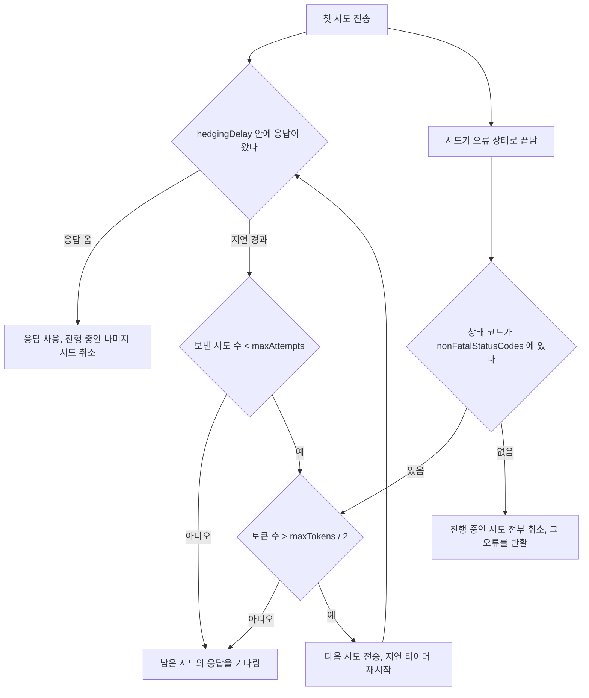
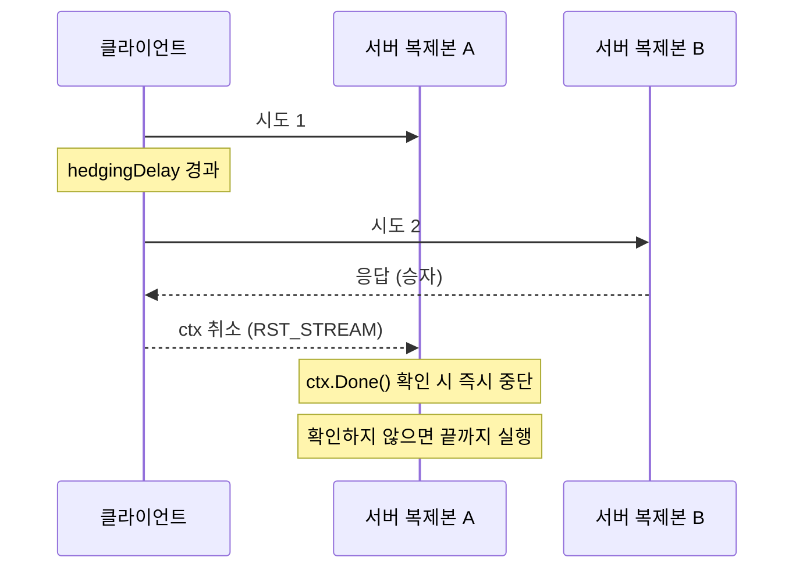
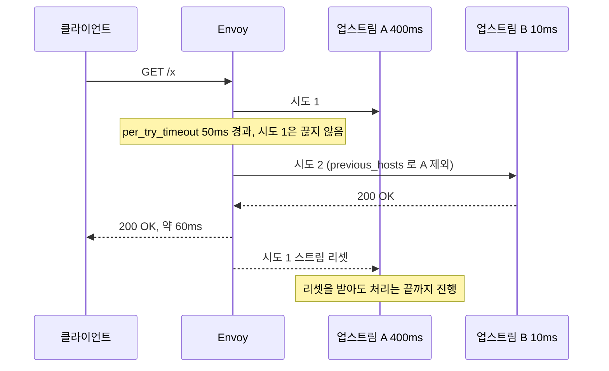
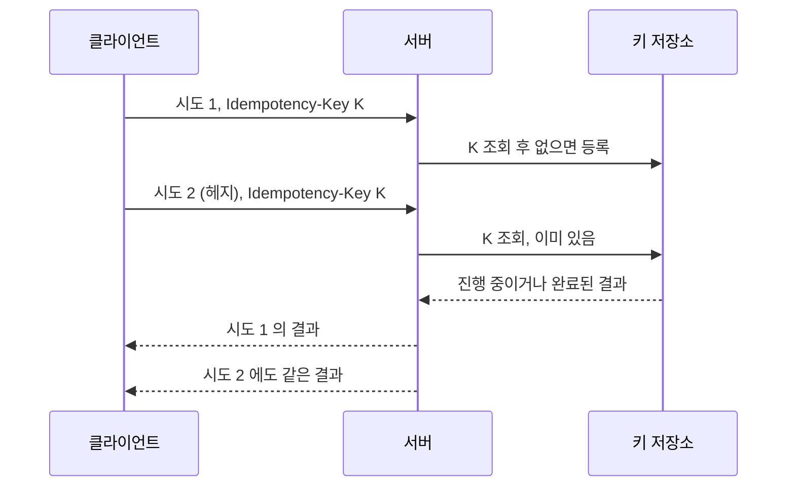
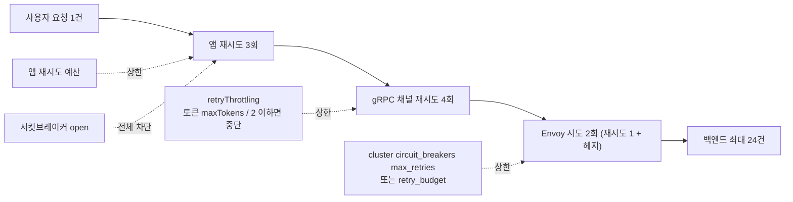

# 헤지 요청을 gRPC와 Envoy 설정으로 켜기

[헤지 요청](Hedged_Requests.md) 문서는 개념과 시뮬레이션을 다룬다. 이 문서는 그 다음 단계, 실제 인프라에서 헤지를 켜는 설정과 그 설정이 어디서 기대와 다르게 움직이는지를 다룬다. 설정 필드 이름은 문서에 다 나와 있어서 찾기 쉽다. 막히는 지점은 "필드를 넣었는데 동작하는가"다.

아래 수치와 동작은 이번에 직접 돌려서 확인한 것이다. 확인한 환경은 이렇다.

| 대상 | 버전 | 용도 |
|---|---|---|
| Go | 1.22.5, grpc-go v1.64.0 과 그 시점의 최신 릴리스(go get 이 받아온 v1.84.0) | 서비스 컨피그, 직접 구현한 헤지 |
| Envoy | 1.31.10 (공식 docker 이미지) | hedge_policy |
| JDK | 17, resilience4j-hedge 2.4.0 | Java 구현 |
| Python | 3, asyncio | Python 구현 |

백엔드는 어디서나 같은 분포로 맞췄다. 90%는 20ms, 10%는 400ms에 응답한다(Envoy 실험만 호스트 하나는 400ms 고정, 하나는 10ms 고정). 헤지 지연은 50ms다. 이 분포는 실제 서비스가 아니라 효과가 눈에 띄도록 만든 것이라 절대값보다 헤지 전후의 차이를 봐야 한다. 직접 확인하지 못한 항목은 본문에서 그때그때 "확인하지 못했다"고 적었다.

## grpc-go는 hedgingPolicy를 받고도 아무것도 하지 않는다

gRPC의 헤지는 클라이언트 쪽 서비스 컨피그(JSON)의 `hedgingPolicy`로 켠다. 정의는 [gRFC A6](https://github.com/grpc/proposal/blob/master/A6-client-retries.md)에 있다. 문서와 예제는 대개 이 JSON을 보여주고 끝난다. Go에서 `WithDefaultServiceConfig` 로 넣으면 이렇게 된다.

```go
const cfg = `{
  "methodConfig": [{
    "name": [{"service": "grpc.health.v1.Health"}],
    "hedgingPolicy": {
      "maxAttempts": 3,
      "hedgingDelay": "0.1s",
      "nonFatalStatusCodes": ["UNAVAILABLE"]
    }
  }],
  "retryThrottling": {"maxTokens": 10, "tokenRatio": 0.1}
}`

conn, err := grpc.Dial(addr,
    grpc.WithTransportCredentials(insecure.NewCredentials()),
    grpc.WithDefaultServiceConfig(cfg))
```

서버 핸들러는 500ms 자고 응답한다. 헤지 지연이 100ms 니까 정상이면 서버에 요청이 3개 들어와야 한다. 결과는 이랬다.

```
checkCtx=true err=<nil> elapsed=502ms server calls=1 finished=1 cancelled=0
```

서버가 받은 호출은 1건이다. 에러도 경고도 없다. `hedgingDelay` 를 `"bogus"`, `maxAttempts` 를 99로 바꿔도 에러 없이 같은 결과가 나왔다. v1.84.0 에서도 같았다. 이 버전 소스에서 `hedgingPolicy` 를 읽는 코드는 찾지 못했고, `stream.go` 에 `TODO(hedging): hedging will have multiple attempts simultaneously.` 주석만 남아 있다. grpc-go 는 이 필드를 파싱하지 않고 무시한다. 같은 JSON 구조의 `retryPolicy` 와 `retryThrottling` 은 동작한다. 그래서 설정을 잘못 쓴 것처럼 보이지 않고 "헤지는 켜져 있는데 효과가 없다"는 상태로 남는다.

grpc-java 같은 다른 언어 구현이 `hedgingPolicy` 를 지원하는지는 이번에 돌려보지 않았다. 확인한 사실은 Go 클라이언트가 무시한다는 것까지다. Go 서비스에서 헤지가 필요하면 아래 "Go 클라이언트에서 직접 구현" 절처럼 호출 쪽에서 직접 만들어야 한다.

### 그래도 retryThrottling 은 알아야 한다

`retryThrottling` 은 Go 에서 실제로 동작한다. 값을 이렇게 읽는다. 채널마다 토큰 통이 하나 있고 `maxTokens` 로 시작한다. 실패한 시도마다 1을 빼고, 성공한 RPC마다 `tokenRatio` 를 더한다. 토큰이 `maxTokens / 2` 이하면 재시도를 보내지 않는다. 이 동작을 `retryPolicy` 와 함께 켜서 서버가 항상 UNAVAILABLE 을 주는 상황으로 RPC 12번을 호출해 봤다.

| 구성 | RPC마다 서버가 받은 호출 | 12번 합계 |
|---|---|---|
| retryPolicy(maxAttempts 4) 만 | 4, 4, 4, 4, 4, 4, 4, 4, 4, 4, 4, 4 | 48 |
| + retryThrottling(maxTokens 10, tokenRatio 0.1) | 4, 1, 1, 1, 1, 1, 1, 1, 1, 1, 1, 1 | 15 |

첫 RPC는 토큰이 10, 9, 8, 7, 6으로 내려가는 동안 재시도를 다 썼고, 두 번째 RPC의 첫 실패로 토큰이 5가 되자 이후로는 재시도가 한 번도 나가지 않았다. 성공이 없으니 토큰이 돌아오지 않는다. 장애가 계속되면 재시도 증폭이 이렇게 첫 RPC 이후로 멈춘다. 반대로 성공이 섞이면 RPC 하나가 성공할 때마다 `tokenRatio` 만큼 쌓이므로, `tokenRatio: 0.1` 이면 성공 10건이 재시도 1건 분량이다. 정상일 때의 재시도율이 10%를 넘으면 통이 못 채워진다.

gRFC A6 은 헤지에도 같은 토큰 통을 쓰도록 정의한다. 토큰이 절반 이하면 추가 헤지를 보내지 않는다는 규칙이다. 이 부분은 Go 가 헤지를 구현하지 않아 직접 확인하지 못했다. 정의에 따른 판정 흐름은 아래와 같다.



이 도식에서 봐야 할 곳은 두 군데다. 지연이 지났어도 토큰이 모자라면 헤지가 나가지 않는다는 것, 그리고 `nonFatalStatusCodes` 에 없는 오류가 한 번이라도 오면 이미 보낸 다른 시도까지 같이 접힌다는 것이다. 헤지의 목적이 "느린 쪽을 피하는 것"인데 오류 코드 하나로 전체가 실패하니, 복제본 하나가 `INTERNAL` 을 내는 상황이면 `nonFatalStatusCodes` 에 그 코드를 넣을지 따로 판단해야 한다. 이 규칙도 정의 기준이고 직접 돌려보지는 못했다. 같은 메서드에 `retryPolicy` 와 `hedgingPolicy` 를 함께 쓸 수 없다는 규칙도 A6 정의에 있다.

## Go 클라이언트에서 직접 구현

grpc-go 에서 헤지를 쓰려면 호출 쪽에서 만든다. `errgroup` 으로 시도 고루틴의 수명을 묶고, `context.WithCancel` 로 먼저 성공한 시도가 나머지를 끊게 했다.

```go
package hedge

import (
	"context"
	"time"

	"golang.org/x/sync/errgroup"
)

type result[T any] struct {
	v   T
	err error
}

func Do[T any](ctx context.Context, delay time.Duration, max int,
	fn func(ctx context.Context, attempt int) (T, error)) (T, error) {

	cctx, cancel := context.WithCancel(ctx)
	defer cancel()

	var g errgroup.Group
	out := make(chan result[T], max)
	launch := func(i int) {
		g.Go(func() error {
			v, err := fn(cctx, i)
			out <- result[T]{v, err}
			return nil
		})
	}

	launch(0)
	started, failed := 1, 0
	var last result[T]
	timer := time.NewTimer(delay)
	defer timer.Stop()

	for {
		select {
		case r := <-out:
			if r.err == nil {
				cancel()
				g.Wait()
				return r.v, nil
			}
			last = r
			failed++
			if failed == started && started == max {
				g.Wait()
				return last.v, last.err
			}
			if started < max {
				launch(started)
				started++
				timer.Reset(delay)
			}
		case <-timer.C:
			if started < max {
				launch(started)
				started++
				timer.Reset(delay)
			}
		case <-ctx.Done():
			g.Wait()
			var zero T
			return zero, ctx.Err()
		}
	}
}
```

`errgroup.WithContext` 를 쓰지 않은 이유가 있다. 그 컨텍스트는 첫 에러가 나면 취소되는데, 헤지에서 필요한 건 첫 성공에서 취소하는 것이다. 시도 하나가 실패해도 다른 시도는 계속 가야 한다. 그래서 `errgroup.Group` 은 고루틴을 기다리는 용도로만 쓰고 취소는 직접 만든 `cancel` 로 한다. 반환 전에 `g.Wait()` 를 거는 것도 의도다. 패자 고루틴이 정리되기 전에 함수가 돌아가면 고루틴이 새고, 서버의 취소 카운트를 읽는 테스트도 흔들린다.

호출은 이렇게 감싼다.

```go
resp, err := hedge.Do(ctx, 50*time.Millisecond, 2,
	func(ctx context.Context, attempt int) (*pb.Reply, error) {
		return client.Get(ctx, req)
	})
```

서버 핸들러는 요청마다 400ms 를 10% 확률로 쓰고 나머지는 20ms 에 응답하게 했다. 동시 16개로 4000번 호출한 결과다. 시간은 ms 다.

| 구성 | p50 | p95 | p99 | 서버가 받은 호출 | 끝까지 실행 | 취소됨 |
|---|---|---|---|---|---|---|
| 헤지 없음 | 21 | 401 | 402 | 4000 | 4000 | 0 |
| 헤지, 서버가 ctx 를 확인 | 21 | 72 | 400 | 4433 | 4000 | 433 |
| 헤지, 서버가 ctx 를 무시 | 21 | 72 | 400 | 4423 | 4423 | 0 |

p95 는 401 에서 72로 내려갔다. p99 가 그대로인 건 정상이다. 시도 하나가 느릴 확률이 10% 이고 두 시도가 동시에 느릴 확률은 1% 라서, p99 가 정확히 그 경계에 걸린다. 헤지를 걸고 p99 가 안 내려갔다고 바로 설정을 의심하기 전에 개별 시도의 느릴 확률부터 계산해 봐야 한다. 호출은 첫 시도가 느린 10% 에 헤지가 나가서 약 10.8% 늘었다.

### 서버가 ctx.Done() 을 보지 않으면 취소는 전파되고 일은 계속된다

위 표의 마지막 두 줄이 이 절의 핵심이다. 두 경우 모두 클라이언트는 승자가 나오면 패자의 컨텍스트를 취소하고, 취소는 gRPC 로 서버에 `RST_STREAM` 으로 전달된다. 차이는 서버 핸들러에서 난다.

```go
// 취소가 일을 멈추게 하는 핸들러
select {
case <-time.After(d):
case <-ctx.Done():
	return nil, ctx.Err()
}

// 취소를 무시하는 핸들러
time.Sleep(d)
```

ctx 를 확인하는 쪽은 433건이 취소됐고 끝까지 실행된 건 4000건으로 헤지 전과 같다. 무시하는 쪽은 4423건이 전부 끝까지 돌았다. 클라이언트가 이미 응답을 받고 떠난 뒤에도 서버는 423건의 일을 더 한 셈이다. 서버 입장에서는 헤지 때문에 부하가 10.6% 늘고 그 일은 아무에게도 쓸모가 없다.

실제 핸들러에서는 `time.Sleep` 대신 DB 쿼리나 다른 서비스 호출이 들어간다. 거기에 `ctx` 를 넘기지 않으면 같은 일이 벌어진다. `db.QueryContext(ctx, ...)`, 다음 gRPC 호출에 받은 `ctx` 전달, 긴 루프 안의 `ctx.Err()` 확인이 필요하다. 헤지를 켜기 전에 서버 쪽의 취소 처리부터 훑는 편이 순서상 맞다. 헤지는 서버가 취소를 존중한다는 가정으로 만든 패턴이라, 가정이 안 맞으면 지연은 줄고 서버 이용률만 오른다.



## Envoy hedge_policy

프록시 계층에서 헤지를 걸면 클라이언트 코드를 건드리지 않아도 되고, 언어에 상관없이 전 서비스에 같은 정책이 적용된다. 반대로 클라이언트의 요청 하나가 Envoy 에서 여러 업스트림 요청이 되므로, 이미 클라이언트 쪽에 재시도가 있다면 호출량이 곱해진다(아래 "세 겹으로 적용하면" 절). Envoy 자체의 설정 구조, 재시도 조건, 타임아웃 계층은 [Envoy](../../DevOps/Load_Balancer/Envoy.md#재시도) 문서에 정리돼 있고, 스레드 모델은 [Envoy 필터 체인과 스레드 모델](../../DevOps/Load_Balancer/Envoy_Filter_Chain_and_Threading.md)에 있다. 여기서는 헤지에 걸린 부분만 본다.

### hedge_on_per_try_timeout 과 per_try_timeout

헤지는 `route.hedge_policy` 로 켜고, 시점은 `retry_policy.per_try_timeout` 이 정한다. 실제로 돌린 설정은 이렇다.

```yaml
routes:
- match: {prefix: "/"}
  route:
    cluster: be
    timeout: 2s
    retry_policy:
      retry_on: "5xx"
      num_retries: 1
      per_try_timeout: 0.05s
      host_selection_retry_max_attempts: 5
      retry_host_predicate:
      - name: envoy.retry_host_predicates.previous_hosts
        typed_config:
          "@type": type.googleapis.com/envoy.extensions.retry.host.previous_hosts.v3.PreviousHostsPredicate
    hedge_policy:
      hedge_on_per_try_timeout: true
      initial_requests: 1
```

`hedge_on_per_try_timeout` 가 꺼져 있으면(기본값) per-try 타임아웃에서 첫 요청을 끊고 재시도한다. 켜면 첫 요청을 끊지 않고 둘째 요청을 추가로 보낸 뒤 먼저 오는 응답을 쓴다. 꺼진 쪽은 이번에 돌리지 않았고 Envoy 문서의 정의를 옮긴 것이다. 켜진 쪽에서 확인한 것은 다음과 같다.

- 응답 지연이 `per_try_timeout` 이상이면 헤지가 나간다. 아래 두 실행 모두 p50 이 56ms 였다. 느린 호스트로 먼저 간 요청이 50ms 를 기다린 뒤 헤지가 빠른 호스트에서 돌아오는 값이어서, 절반 가까운 요청이 이 값 근처에 모인다. 헤지된 요청의 지연은 `per_try_timeout` 보다 짧아지지 않는다.
- 헤지 시도는 별도 hedge 통계가 아니라 재시도 통계로 센다. 이 Envoy 에서 `stats` 전체를 검색해도 이름에 `hedg` 가 들어간 항목은 없었다. 헤지가 나간 횟수는 `cluster.be.upstream_rq_retry` 로 읽고, 승자가 헤지 쪽이었는지는 `upstream_rq_retry_success` 로 읽는다. 헤지 전용 카운터가 있다고 가정하고 대시보드를 만들면 빈 그래프가 된다.
- `upstream_rq_per_try_timeout` 은 `hedge_on_per_try_timeout: true` 일 때 오르지 않았다. 기존 재시도 알람이 이 통계를 보고 있다면 헤지 전환 뒤 값이 0 으로 떨어진다.
- 이 설정에서 헤지는 최대 1개다. `num_retries: 1` 로 두었고, 첫 시도와 헤지가 둘 다 느린 호스트로 간 요청은 느린 응답을 그대로 기다렸다(아래 표 첫 줄의 p95 404ms). 헤지 수가 `num_retries` 에 묶이는지는 이 값만 바꿔 비교하지는 않았다.

`initial_requests` 는 처음에 몇 개를 동시에 보낼지다. 이번 실험은 1로 고정했다. `additional_request_chance` 도 쓰지 않았고, 이 필드가 정확히 어떤 확률로 몇 번째 요청에 적용되는지는 돌려서 확인하지 못했다.



### 같은 호스트로 헤지가 가는 문제

도식의 `previous_hosts` 가 빠지면 어떻게 되는지 같은 환경에서 비교했다. 로드밸런서는 `RANDOM` 으로 두었다. 호스트 A 는 400ms, B 는 10ms 고정이다. 200건을 순서대로 보낸 결과다.

| 구성 | 응답한 호스트 | p50 | p95 | p99 |
|---|---|---|---|---|
| 호스트 predicate 없음 | B 146건, A 54건 | 56ms | 404ms | 445ms |
| `previous_hosts` | B 199건, A 1건 | 56ms | 88ms | 93ms |

predicate 가 없으면 `RANDOM` 이 헤지 요청도 무작위로 고르니, 첫 시도가 A 로 간 요청의 절반이 헤지도 A 로 간다. 전체의 약 25% 가 느린 응답을 받는 계산이고 실제 54건(27%)이었다. `previous_hosts` 를 붙이면 헤지는 첫 시도가 간 호스트를 피해서 다른 호스트를 고른다. 이때 p95 가 404 에서 88로 내려갔다.

predicate 를 붙인 쪽에서도 200건 중 1건은 느린 호스트에서 응답이 왔다. `host_selection_retry_max_attempts: 5` 로 5번까지 다른 호스트를 다시 고르게 했지만 호스트가 둘뿐이라 5번 모두 A 가 걸릴 확률이 약 3% 있다. 헤지 대상이 96건이었으니 기대값은 3건 안팎이고 관측은 1건이었다. 후보를 못 찾으면 마지막에 고른 호스트를 쓴다는 동작으로 보이지만 이 값을 바꿔서 확인하지는 못했다. 호스트가 몇 개 안 되는 cluster 에서는 이 확률이 높아지니 `host_selection_retry_max_attempts` 를 넉넉히 주거나, 호스트 수가 충분한지 먼저 본다.

predicate 를 쓰지 않은 첫 번째 실행은 실험 도중 셸이 죽으면서 이전 스크립트의 클라이언트가 잠시 겹쳐 돌았을 가능성이 있다. 표의 호스트별 응답 건수는 그 실행의 클라이언트가 직접 센 값이라 영향이 적지만, 이 실행의 Envoy 통계 카운터는 믿지 않고 버렸다. 통계 카운터는 predicate 를 붙인 실행(`upstream_rq_retry` 96, `upstream_rq_retry_success` 95, `upstream_rq_retry_limit_exceeded` 1)만 근거로 삼았다. 이 실행은 재측정하지 못했다.

### Envoy 가 취소해도 백엔드는 일을 끝까지 한다

백엔드 두 개를 HTTP/1.1 로 직접 만든 Python 서버로 두고, 요청 처리 시작 건수와 응답 완료 건수를 각각 셌다. 두 값이 같았다(한 시점에 404 대 404, 응답을 쓰다 연결이 끊긴 건 293). Envoy 가 패자 스트림을 리셋해도 백엔드는 이미 시작한 일을 끝까지 한다. 위 Go 절과 같은 문제가 프록시 계층에서도 그대로 나온다. 취소를 받아서 일을 멈추는 건 백엔드 애플리케이션의 몫이고, 프록시 설정으로는 해결되지 않는다.

## 라이브러리 구현 비교

| 언어 | 구현 | 헤지 지연 결정 | 패자 시도 취소 | 이번에 확인한 것 |
|---|---|---|---|---|
| Go | 직접 구현 (errgroup + context) | 호출하는 쪽이 고정값으로 전달 | `cancel()` 로 컨텍스트 취소, 서버가 `ctx.Done()` 를 봐야 효과 | 위의 표 |
| Java | `resilience4j-hedge` 2.4.0 | `Hedge.of(Duration)` 고정값, 또는 평균 기반 | 패자 interrupt 없음 | 아래 |
| Python | `asyncio` 직접 구현 | 호출하는 쪽이 전달 | `task.cancel()` 로 `CancelledError` 전달 | 아래 |

Resilience4j 에는 헤지가 없어서 Java 에서도 직접 만들어야 한다고 알려진 경우가 있는데, 확인해 보니 사실과 달랐다. Maven Central 에 `io.github.resilience4j:resilience4j-hedge` 가 있고 2.0.0 부터 2.4.0 까지 릴리스가 있다. 이 모듈의 공개 API 는 `Hedge.of(Duration)`, `HedgeConfig.custom()`, `submit(Callable, ExecutorService)` 이다. 설정으로는 고정 지연(`preconfiguredDuration`), 평균에 비율을 더하는 방식(`averagePlusPercentageDuration`), 평균에 고정량을 더하는 방식(`averagePlusAmountDuration`)과 동시 헤지 수(`withMaxConcurrency`)를 고를 수 있다.

```java
Hedge hedge = Hedge.of(Duration.ofMillis(50));
String body = hedge.submit(() -> client.call(), executor).get();
```

같은 분포(10% 가 400ms)로 2000번을 돌린 결과는 이랬다.

| 구성 | p50 | p95 | p99 | 호출 | 끝까지 실행 | interrupt 받음 |
|---|---|---|---|---|---|---|
| 헤지 없음 | 20ms | 400ms | 400ms | 2000 | 2000 | 0 |
| `Hedge.of(50ms)` | 20ms | 70ms | 400ms | 2231 | 2231 | 0 |

패자 시도가 interrupt 를 받지 않는다. `Thread.sleep` 중이던 호출이 interrupt 되지 않고 끝까지 실행돼서 호출한 2231건이 전부 완료됐다. 패자 쪽 스레드가 400ms 동안 그대로 점유된다는 뜻이다. 호출하는 쪽 스레드 풀이 작으면 헤지가 풀 고갈로 이어질 수 있다. 패자의 실제 I/O(예: HTTP 클라이언트 요청)를 끊으려면 `Callable` 안에서 직접 요청 취소 핸들을 관리해야 한다. 한 가지 더, 이 프로그램은 `executor.shutdown()` 을 호출해도 종료되지 않아 `System.exit` 로 끝내야 했다. `Hedge` 객체가 내부에 만든 스레드가 남는 것으로 보이는데, 정확한 원인은 확인하지 못했다. 배치 잡이나 테스트에서 JVM 이 안 끝나면 이 점을 의심해 볼 만하다.

Python 은 4000번을 동시 16개로 돌렸다.

| 구성 | p50 | p95 | p99 | 호출 | 끝까지 실행 | 취소됨 |
|---|---|---|---|---|---|---|
| 헤지 없음 | 21ms | 401ms | 401ms | 4000 | 4000 | 0 |
| `asyncio.wait(FIRST_COMPLETED)` 로 직접 구현 | 21ms | 72ms | 82ms | 4419 | 4000 | 419 |

Python 은 `task.cancel()` 로 대기 지점에서 `CancelledError` 가 즉시 올라와서 패자가 일을 멈춘다. Go 의 ctx 확인 있는 경우와 같은 모양이다. 대신 취소가 닿는 건 `await` 지점뿐이라 CPU 를 쓰는 동기 코드는 취소되지 않는다. p99 가 82ms 로 Go 의 400ms 와 다른 것은 두 시도가 동시에 느린 비율(1%)이 p99 경계에 걸려서 난수열에 따라 갈리는 값이다. 언어 간 우열로 읽지 않는다.

## 헤지 요청은 두 번 실행된다고 가정해야 한다

헤지된 두 요청은 서버에 둘 다 도착할 수 있다. 취소가 서버에 닿기 전에 두 번째가 이미 시작된 경우다. 읽기 요청이면 문제가 없고, 결제나 주문 생성 같은 쓰기라면 같은 `Idempotency-Key` 를 두 시도가 공유하고 서버가 중복을 흡수해야 한다. 키 설계 자체는 [API 멱등성](../API/API_Idempotency.md)에서 다룬다. 헤지에서 놓치기 쉬운 부분은 키를 만드는 위치다.

```go
key := uuid.NewString()

resp, err := hedge.Do(ctx, 50*time.Millisecond, 2,
	func(ctx context.Context, attempt int) (*pb.Reply, error) {
		ctx = metadata.AppendToOutgoingContext(ctx, "idempotency-key", key)
		return client.Create(ctx, req)
	})
```

`uuid.NewString()` 이 `fn` 안에 있으면 시도마다 다른 키가 나가서 서버는 두 요청을 별개로 처리한다. 키는 `Do` 호출 바깥에서 한 번 만들어야 한다. Envoy 로 헤지를 걸 때는 클라이언트가 붙인 헤더가 시도마다 그대로 가는 것이 맞아야 하는데, 이번 실험에서 헤더 전달을 확인하지는 않았다. 백엔드에서 헤더를 로그로 찍어 두 시도의 값이 같은지 직접 보고 쓰는 것이 안전하다.

서버는 키별로 한 번만 실행하고 나중 요청은 같은 결과를 받게 했다. 100건의 논리 요청에 헤지 지연 0 으로 두 시도를 거의 동시에 보내는 조건이다. 실험에서는 실행 횟수만 세었고, 아래 코드의 결과 저장(`e.reply`)은 생략한 스케치다.

```go
type entry struct{ once sync.Once /* result, err ... */ }

func (s *server) Create(ctx context.Context, r *pb.Req) (*pb.Reply, error) {
	md, _ := metadata.FromIncomingContext(ctx)
	key := md.Get("idempotency-key")[0]

	s.mu.Lock()
	e, ok := s.seen[key]
	if !ok {
		e = &entry{}
		s.seen[key] = e
	}
	s.mu.Unlock()

	e.once.Do(func() { s.execute(r) })
	return e.reply, nil
}
```

| 서버 | 서버가 받은 호출 | 실제 비즈니스 실행 |
|---|---|---|
| 키 없이 매번 실행 | 198 | 198 |
| 키로 중복 흡수 | 197 | 100 |

호출 수가 200이 아니라 197, 198 인 건 일부 헤지가 서버에 닿기 전에 취소됐기 때문이다. 키 없이는 198번 실행돼서 100건 중 98건이 두 번 처리됐다. 키를 쓰면 100번이다.



이 예제의 `sync.Once` 에는 세 가지 구멍이 있다. 실행 도중 첫 시도의 ctx 가 취소되면 그 안의 일이 중간에 끊긴다. 실행 본체에는 `context.WithoutCancel(ctx)` (Go 1.21 이상) 로 취소가 전파되지 않는 컨텍스트를 줘야 한다. 이 부분은 직접 확인하지 못했다. 둘째, `seen` 맵이 계속 커진다. 실서비스에서는 TTL 이 있는 저장소(Redis, DB 유니크 키)가 필요하다. 셋째, 서버가 여러 대면 `sync.Once` 는 서버 안에서만 유효하다. 헤지된 두 요청이 다른 서버로 갈 수 있으므로 키 저장소는 서버 밖에 있어야 한다.

## 세 겹으로 적용하면 호출량이 곱해진다

설정은 레이어마다 독립적으로 쓰인다. 애플리케이션의 재시도 데코레이터, gRPC 채널의 `retryPolicy`, Envoy 의 retry/hedge 가 각각 켜져 있으면 장애 때 시도 횟수가 곱해진다. 앞에서 측정한 값으로 계산하면 이렇다.

| 계층 | 설정 | 시도 수(최대) | 근거 |
|---|---|---|---|
| 애플리케이션 재시도 | 3회 시도 | 3 | 가정한 값 |
| gRPC 채널 | `retryPolicy.maxAttempts: 4` | 4 | 측정, RPC마다 서버가 받은 호출이 4 |
| Envoy | `num_retries: 1` 에 헤지 | 2 | 측정 설정의 최대 시도 수 |

최악의 경우 사용자 요청 하나가 3 × 4 × 2 = 24 개의 백엔드 호출이 된다. 이 곱은 산술이고, 24 건이 실제로 나가는 시나리오는 이번에 재현하지 않았다. gRPC 와 Envoy 의 시도 수는 위에서 따로 측정한 값이다. 앞의 Envoy 문서에서도 항상 500을 주는 업스트림에 `num_retries: 2` 를 걸면 요청 10건이 30건이 되는 것을 측정했다.



상한을 거는 지점은 계층마다 다르다. gRPC 채널의 상한은 `retryThrottling` 이고, 앞에서 본 것처럼 장애가 이어지면 첫 RPC 이후 재시도가 멈춘다. 이 상한은 채널 안에서만 센다. Envoy 쪽은 cluster 의 `circuit_breakers` 아래 `max_retries` (동시 재시도 수 상한)가 있다. 이번 실험의 Envoy 통계에도 `cluster.be.circuit_breakers.default.rq_retry_open` 이 있어 이 상한이 동작할 지점이 존재하는 것은 확인했지만, 상한을 넘기는 부하로 직접 눌러 보지는 않았다. `max_retries` 를 올리면 상한이 사라지는 문제와 `retry_budget` 의 사용법은 앞의 Envoy 문서에 있다. 애플리케이션 계층의 재시도 예산은 [장애 대응 패턴](Fault_Tolerance.md)의 재시도 절을 참고한다.

실무에서 곱셈을 피하는 방법은 한 계층에만 재시도를 두는 것이다. 헤지를 Envoy 에 걸었다면 애플리케이션과 gRPC 채널의 재시도는 끄거나, 최소한 서로 다른 오류에 반응하도록 나눈다. 예를 들어 Envoy 는 `per_try_timeout` 초과(느림)에만 헤지하고, 앱은 명백한 오류 코드에만 재시도한다. 서킷브레이커는 호출량을 줄이는 쪽이라 바깥 계층에 둔다. 서킷이 열렸는데 안쪽에서 계속 헤지가 나가면 의미가 없다. 헤지와 재시도가 예산을 나눠 쓰는 설계는 [헤지 요청](Hedged_Requests.md)의 "헤지 예산과 재시도 예산 공유" 절에 있다.

## 확인하지 못한 항목

이 문서의 모든 설정을 돌려본 것은 아니다. 직접 확인한 것은 grpc-go 의 `hedgingPolicy` 무시, `retryPolicy` 와 `retryThrottling` 동작, Go/Java/Python 구현의 지연과 호출 수, Envoy 1.31.10 의 `hedge_on_per_try_timeout` 과 `previous_hosts` 효과, 헤지 전용 통계 이름이 없다는 사실, 멱등 키 중복 흡수다. 확인하지 못한 것은 이렇다. grpc-java 같은 다른 언어 구현이 `hedgingPolicy` 를 지원하는지, gRFC A6 의 토큰 통과 `nonFatalStatusCodes` 규칙이 그대로 구현돼 있는지는 돌려보지 못했다. Envoy 쪽은 `additional_request_chance` 의 동작, `hedge_on_per_try_timeout: false` 일 때의 재시도 동작, `host_selection_retry_max_attempts` 를 소진했을 때의 동작, gRPC 트래픽 앞에 두고 헤지를 거는 경우의 상태 코드별 동작을 확인하지 못했다. Envoy 가 헤지 시도마다 클라이언트의 `Idempotency-Key` 헤더를 그대로 전달하는지도 직접 보지 않았다. 세 겹 곱셈의 24건 시나리오와 `max_retries` 상한이 실제로 호출량을 막는 모습도 재현하지 않았다.

Envoy 필드의 정의는 [route_components 문서](https://www.envoyproxy.io/docs/envoy/latest/api-v3/config/route/v3/route_components.proto)의 `HedgePolicy` 항목과 같이 읽어야 한다.
