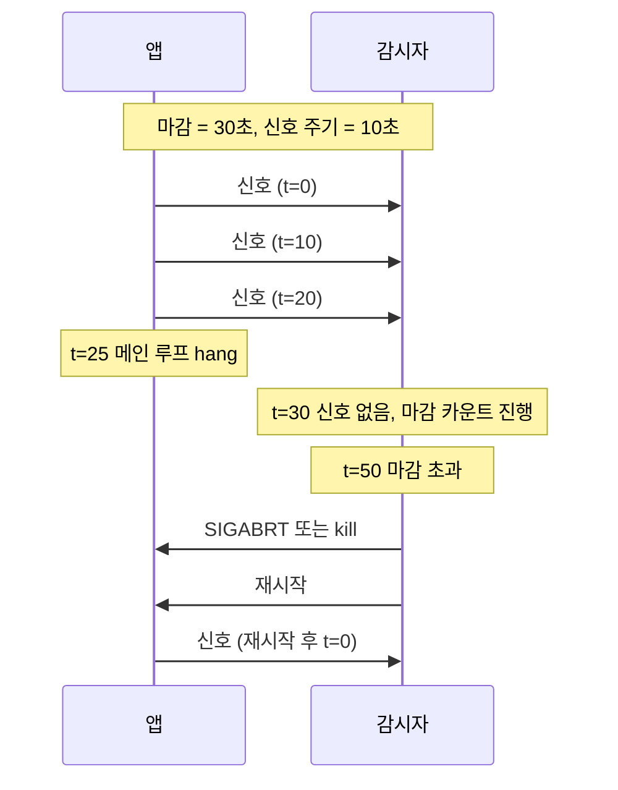
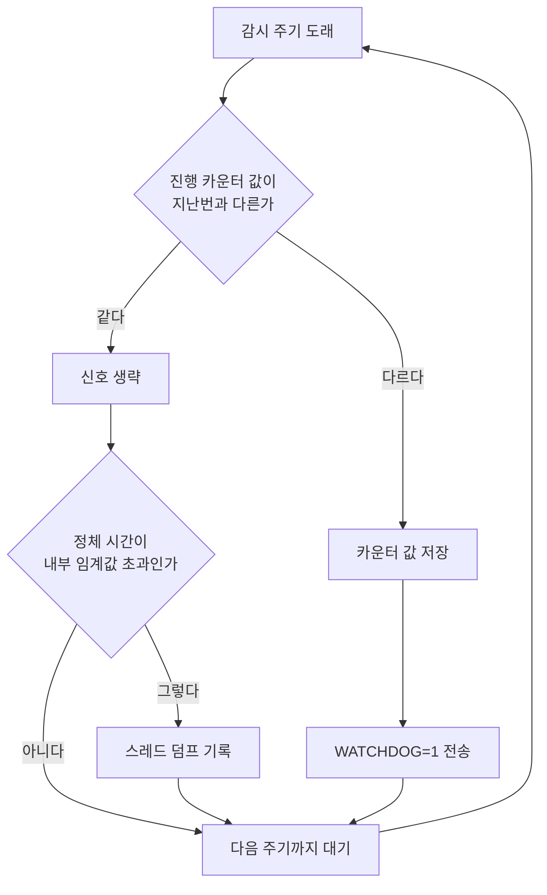
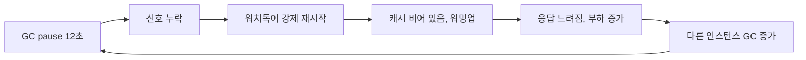
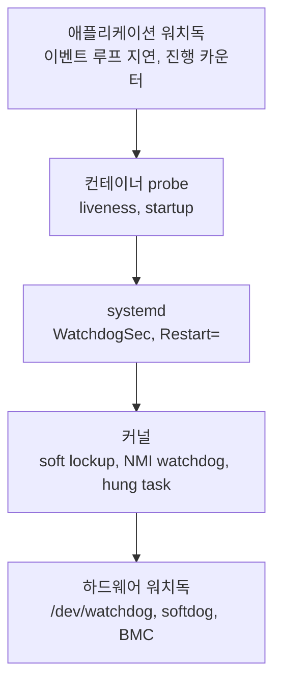
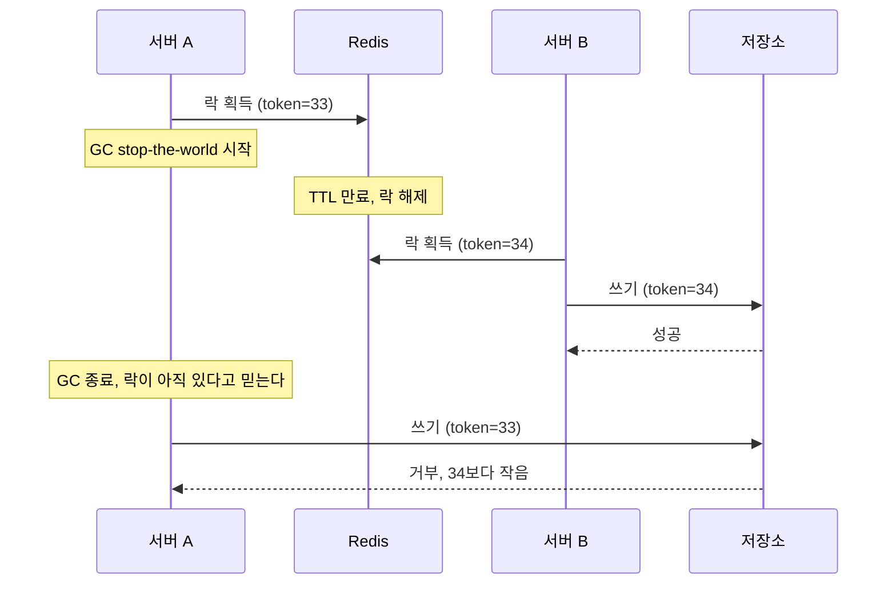

# 워치독 - 진행 신호가 끊기면 감시자가 개입한다

프로세스는 살아 있는데 요청을 하나도 처리하지 못하는 상태가 있다. 데드락, 무한 루프, 커넥션 풀 고갈, 동기 코드가 이벤트 루프를 붙잡은 경우가 여기에 든다. `ps`에는 정상으로 나오고 포트도 열려 있다. 크래시는 OS가 알려주지만 hang은 아무도 알려주지 않는다. 워치독은 이 상태를 잡으려고 만든 장치다.

워치독이라는 이름은 systemd의 `WatchdogSec`, Redisson의 락 갱신 스레드, Prometheus의 `Watchdog` 알림, SSE의 재연결 타이머에 각각 따로 붙어 있다. 겉모습은 다르지만 구조는 같다. 대상이 주기적으로 "나 일하고 있다"는 신호를 보내고, 마감 안에 신호가 없으면 감시자가 개입한다. 이 문서는 그 공통 구조를 기준으로 신호를 어디서 보낼지, 마감을 얼마로 잡을지, 개입한 뒤 무엇이 남는지를 다룬다.

## 헬스체크, 하트비트, 워치독

세 가지를 같은 것으로 쓰는 경우가 많은데 누가 먼저 움직이는지가 다르다.

| 방식 | 먼저 움직이는 쪽 | 판단 근거 | 개입 시점 |
|---|---|---|---|
| 헬스체크 | 감시자가 대상에게 묻는다 | 응답 여부, 응답 내용 | 연속 N번 실패 |
| 하트비트 | 대상이 보낸다 | 신호 도착 여부 | 보통 알림만 보낸다 |
| 워치독 | 대상이 보낸다 | 마감 안에 신호가 왔는가 | 재시작, 리부트, 락 해제 같은 강제 조치 |

헬스체크는 감시자가 요청을 만들어야 하므로, 대상이 요청을 받을 수 있는 상태인지만 확인한다. 워치독은 대상이 스스로 "진행했다"고 선언하는 방식이라 선언하는 위치를 잘 고르면 작업 중간의 정체까지 잡는다. 대신 신호를 보내는 코드가 잘못된 자리에 있으면 대상이 죽어도 신호가 계속 나간다. 이 문서의 대부분은 그 자리 이야기다.



위 도식에서 마지막 신호(t=20)부터 마감(30초)이 지나는 t=50까지는 감시자가 기다린다. hang이 t=25에 시작됐어도 개입은 t=50에 일어난다. 워치독의 감지 지연은 최대 `마감 + 신호 주기` 정도라고 보면 된다.

## 신호를 보내는 위치

워치독에서 가장 자주 틀리는 부분이다. 신호가 "프로세스가 살아 있다"를 뜻하게 짜면 헬스체크보다 나을 게 없다. 신호는 "일이 진행되고 있다"를 뜻해야 한다.

Systemd_Deep_Dive 문서의 예제는 daemon 스레드에서 `WATCHDOG=1`을 무조건 보낸다. 같은 문서가 "별도 스레드에서 ping을 돌리면 메인이 죽어도 ping이 가는 의미 없는 패턴"이라고 설명하는데 예제가 정확히 그 패턴이다. 메인 스레드가 락을 물고 영원히 멈춰도 daemon 스레드는 `time.sleep`과 `sd_notify`만 반복하니 systemd는 평생 정상으로 본다. 두 방식을 같은 hang 상황에 넣고 돌려보면 차이가 바로 보인다.



작업 스레드는 일을 하나 끝낼 때마다 카운터를 올린다. 신호를 보내는 쪽은 카운터가 지난 주기보다 올랐을 때만 신호를 보낸다. 작업이 멈추면 카운터가 멈추고, 신호 스레드가 멀쩡히 돌아도 신호가 나가지 않는다. 다음은 이 구조를 구현한 코드다.

```python
import os
import socket
import sys
import threading
import time


def sd_notify(msg: str) -> bool:
    addr = os.environ.get("NOTIFY_SOCKET")
    if not addr:
        return False
    if addr[0] == "@":
        addr = "\0" + addr[1:]
    with socket.socket(socket.AF_UNIX, socket.SOCK_DGRAM) as s:
        s.connect(addr)
        s.sendall(msg.encode())
    return True


class Progress:
    def __init__(self):
        self._n = 0
        self._lock = threading.Lock()

    def tick(self):
        with self._lock:
            self._n += 1

    def value(self):
        with self._lock:
            return self._n


progress = Progress()


def worker():
    while True:
        handle_one_job()      # 실제 일 하나
        progress.tick()


def main():
    usec = int(os.environ.get("WATCHDOG_USEC", "0"))
    if not usec:
        sys.exit("WATCHDOG_USEC 없음")
    interval = usec / 1_000_000 / 3

    threading.Thread(target=worker, daemon=True).start()
    sd_notify("READY=1")

    last = -1
    while True:
        time.sleep(interval)
        now = progress.value()
        if now != last:
            last = now
            sd_notify("WATCHDOG=1")
```

`handle_one_job`은 각자의 작업 함수로 바꾼다. systemd 대신 가짜 `NOTIFY_SOCKET` 수신기를 만들어 마감 3초로 돌려보면, 정상일 때는 1초마다 `WATCHDOG=1`이 도착하고, 워커가 3초 시점에 같은 락을 두 번 잡아 멈추면 마지막 신호가 3초에 오고 6초에 마감 초과가 판정된다. 같은 코드에서 `if now != last:`를 `if True:`로 바꾸면(기존 예제와 같은 동작) 워커가 멈춘 뒤에도 신호가 계속 도착하고 감시자는 마감 초과를 판정하지 못한다.

카운터 방식에도 구멍이 있다. 작업이 여러 스레드로 나뉘어 있으면 스레드 하나만 살아서 카운터를 올려도 나머지가 전부 죽은 것을 놓친다. 워커 풀이면 워커별 카운터를 따로 두고 전부 올랐는지 보거나, 가장 오래 정체한 워커의 시간을 기준으로 삼는다. 큐가 비어서 할 일이 없는 경우도 정체와 구분해야 한다. 할 일이 없는 워커가 카운터를 안 올려서 재시작이 반복되는 사고가 흔하다. 유휴 상태에서는 "큐를 한 번 확인했다"를 진행으로 센다.

<div class="ygd-wd-signal" id="ygd-wd-signal">
<style>
.ygd-wd-signal{--ygd-fg:rgb(43,39,36);--ygd-muted:rgb(95,90,84);--ygd-line:rgb(184,177,168);--ygd-ok:rgb(27,127,75);--ygd-warn:rgb(180,83,9);--ygd-bad:rgb(192,57,43);--ygd-accent:rgb(61,115,135);--ygd-bg:rgb(253,251,250);--ygd-panel:rgb(243,239,234);--ygd-btnfg:rgb(255,255,255);max-width:760px;margin-left:auto;margin-right:auto;margin-top:1.5em;margin-bottom:1.5em;color:var(--ygd-fg);box-sizing:border-box}
body[data-md-color-scheme="slate"] .ygd-wd-signal{--ygd-fg:rgb(240,237,233);--ygd-muted:rgb(181,174,165);--ygd-line:rgb(107,101,94);--ygd-ok:rgb(95,211,141);--ygd-warn:rgb(240,176,74);--ygd-bad:rgb(255,138,128);--ygd-accent:rgb(127,185,207);--ygd-bg:rgb(31,28,30);--ygd-panel:rgb(43,39,41);--ygd-btnfg:rgb(31,28,30)}
.ygd-wd-signal *{box-sizing:border-box}
.ygd-wd-signal .ygd-wrap{background:var(--ygd-bg);border:1px solid var(--ygd-line);border-radius:8px;padding:12px}
.ygd-wd-signal .ygd-bar{display:flex;flex-wrap:wrap;gap:8px;margin:0 0 10px 0}
.ygd-wd-signal .ygd-btn{font:inherit;font-size:14px;line-height:1.2;min-height:40px;padding:8px 14px;border-radius:6px;border:1px solid var(--ygd-accent);background:transparent;color:var(--ygd-fg);cursor:pointer}
.ygd-wd-signal .ygd-btn[aria-selected="true"],.ygd-wd-signal .ygd-main{background:var(--ygd-accent);color:var(--ygd-btnfg)}
.ygd-wd-signal .ygd-btn:focus-visible{outline:3px solid var(--ygd-accent);outline-offset:2px}
.ygd-wd-signal .ygd-svg{display:block;width:100%;max-width:560px;height:auto;margin:0 auto}
.ygd-wd-signal .ygd-tx{fill:var(--ygd-fg);font-size:11px}
.ygd-wd-signal .ygd-tm{fill:var(--ygd-muted);font-size:11px}
.ygd-wd-signal .ygd-grid{stroke:var(--ygd-line);stroke-width:1;stroke-dasharray:3 3}
.ygd-wd-signal .ygd-dot{fill:var(--ygd-ok);stroke:var(--ygd-ok);stroke-width:2}
.ygd-wd-signal .ygd-hol{fill:none;stroke:var(--ygd-muted);stroke-width:2;stroke-dasharray:3 2}
.ygd-wd-signal .ygd-fok{fill:var(--ygd-ok)}
.ygd-wd-signal .ygd-fwarn{fill:var(--ygd-warn)}
.ygd-wd-signal .ygd-fbad{fill:var(--ygd-bad)}
.ygd-wd-signal .ygd-panel{background:var(--ygd-panel);border-radius:6px;padding:10px 12px;margin-top:10px;min-height:5.6em}
.ygd-wd-signal .ygd-ptitle{font-size:14px;font-weight:700;margin:0 0 4px 0;line-height:1.5}
.ygd-wd-signal .ygd-ptext{font-size:14px;line-height:1.6;margin:0}
.ygd-wd-signal .ygd-note{font-size:14px;line-height:1.6;color:var(--ygd-muted);margin:10px 0 0 0}
.ygd-wd-signal .ygd-sh{fill:var(--ygd-ok);transition:width .3s}
@media (prefers-reduced-motion: reduce){.ygd-wd-signal *{transition:none!important;animation:none!important}}
</style>
<div class="ygd-wrap">
<div class="ygd-bar" role="tablist" aria-label="신호 방식 선택">
<button type="button" class="ygd-btn ygd-tab" role="tab" data-mode="always" aria-selected="false">무조건 신호 (daemon 스레드)</button>
<button type="button" class="ygd-btn ygd-tab" role="tab" data-mode="counter" aria-selected="true">진행 카운터 기반 신호</button>
</div>
<div class="ygd-bar">
<button type="button" class="ygd-btn ygd-main ygd-play">재생</button>
<button type="button" class="ygd-btn ygd-next">다음 단계</button>
<button type="button" class="ygd-btn ygd-reset">처음으로</button>
</div>
<svg class="ygd-svg" viewBox="0 0 360 222" role="img" aria-label="워치독 신호 타임라인. 작업 스레드, 신호 스레드, systemd 세 줄을 0초부터 7초까지 비교한다. 3초에 작업 스레드가 멈추면 무조건 신호 방식은 계속 정상으로 보이고, 진행 카운터 방식은 6초에 마감 초과로 판정된다."></svg>
<div class="ygd-panel" aria-live="polite">
<p class="ygd-ptitle"></p>
<p class="ygd-ptext"></p>
</div>
<p class="ygd-note">비유: 무조건 신호는 근무자가 자는 동안에도 자동으로 눌리는 출석 버튼이고, 진행 카운터 방식은 완성품 계수기가 올라가야만 눌리는 버튼이다. 조건은 본문 실험과 같다: 마감 3초, 신호 주기 1초, 3초 시점에 작업 스레드 정지.</p>
</div>
<script>
(function(){
var root=document.getElementById('ygd-wd-signal');
if(!root)return;
var NS='http://www.w3.org/2000/svg';
var svg=root.querySelector('.ygd-svg');
var playBtn=root.querySelector('.ygd-play');
var nextBtn=root.querySelector('.ygd-next');
var resetBtn=root.querySelector('.ygd-reset');
var tabs=root.querySelectorAll('.ygd-tab');
var ttl=root.querySelector('.ygd-ptitle');
var txt=root.querySelector('.ygd-ptext');
var reduce=window.matchMedia('(prefers-reduced-motion: reduce)').matches;
var mode='counter',cur=0,timer=null,N=7;
if(reduce){playBtn.hidden=true;}
var TXT={
always:[
'앱이 시작되고 작업 스레드가 일을 처리한다. 신호 스레드는 1초마다 깨어나 진행 여부와 상관없이 WATCHDOG=1을 보낸다.',
'신호가 도착한다. 마감은 3초이고 신호 주기는 마감의 1/3인 1초다. 감시 타이머가 초기화된다.',
'정상이다. 신호가 계속 도착하고 감시 타이머는 매번 초기화된다.',
'작업 스레드가 같은 락을 두 번 잡아 멈춘다. 그런데 신호 스레드는 락과 무관하게 sleep과 sd_notify만 반복하므로 이 순간에도 신호가 나간다.',
'작업은 멈춰 있지만 신호가 도착해 systemd는 정상으로 본다.',
'여전히 신호가 도착한다. 마지막 정상 진행이 3초였다는 사실을 감시자는 알 수 없다.',
'카운터 방식이었다면 여기서 마감 초과인데, 이 방식은 신호가 계속 나가므로 판정이 일어나지 않는다.',
'작업은 멈춘 채 영원히 정상으로 보인다. 이 신호는 프로세스가 살아 있다는 뜻일 뿐 일이 진행된다는 뜻이 아니다.'],
counter:[
'작업 스레드가 일 하나를 끝낼 때마다 카운터를 올린다. 신호 스레드는 1초마다 카운터가 지난번과 다른지 확인한다.',
'카운터가 올랐으므로 WATCHDOG=1을 보낸다. 감시 타이머가 초기화된다.',
'카운터가 또 올랐다. 신호가 도착하고 타이머가 초기화된다.',
'이 시점에 작업 스레드가 락에서 멈춘다. 마지막 신호가 3초에 도착한 것으로 기록된다.',
'카운터가 그대로라 신호를 생략한다. 감시자 쪽에서는 마지막 신호 이후 1초가 지났다.',
'여전히 카운터가 그대로여서 신호가 없다. 마지막 신호 이후 2초가 지났다.',
'마지막 신호(3초)로부터 3초가 지나 마감 초과로 판정된다. 감지는 hang 시작 후 3초 뒤에 일어났다.',
'systemd가 서비스를 실패로 판정하고 기본적으로 SIGABRT로 종료시킨다. 이후 Restart= 설정에 따라 재시작된다.']
};
function el(n,a,p,t){var e=document.createElementNS(NS,n);for(var k in a)e.setAttribute(k,a[k]);if(t!==undefined)e.textContent=t;if(p)p.appendChild(e);return e;}
function X(t){return 90+t*36;}
function sent(s){return mode==='always'?true:3>=s;}
function draw(){
svg.textContent='';
var i,L1=56,L2=104,L3=152;
for(i=0;i!==8;i++){
el('text',{x:X(i),y:16,'text-anchor':'middle','class':'ygd-tm'},svg,i+'초');
el('line',{x1:X(i),y1:28,x2:X(i),y2:172,'class':'ygd-grid'},svg);
}
el('text',{x:6,y:L1+4,'class':'ygd-tx'},svg,'작업 스레드');
el('text',{x:6,y:L2+4,'class':'ygd-tx'},svg,'신호 스레드');
el('text',{x:6,y:L3+4,'class':'ygd-tx'},svg,'systemd');
var okEnd=Math.min(cur,3);
if(okEnd>0)el('rect',{x:X(0),y:L1-7,width:X(okEnd)-X(0),height:14,rx:3,'class':'ygd-fok'},svg);
if(cur>3)el('rect',{x:X(3),y:L1-7,width:X(cur)-X(3),height:14,rx:3,'class':'ygd-fbad'},svg);
var last=0;
for(i=1;i!==cur+1;i++){
if(sent(i)){last=i;el('circle',{cx:X(i),cy:L2,r:7,'class':'ygd-dot'},svg);}
else el('circle',{cx:X(i),cy:L2,r:7,'class':'ygd-hol'},svg);
}
if(cur>last){
var end=Math.min(cur,last+3);
el('rect',{x:X(last),y:L3-7,width:X(end)-X(last),height:14,rx:3,'class':(cur-last>2)?'ygd-fbad':'ygd-fwarn'},svg);
}else if(cur>0){
el('circle',{cx:X(cur),cy:L3,r:5,'class':'ygd-fok'},svg);
}
el('circle',{cx:16,cy:192,r:5,'class':'ygd-dot'},svg);
el('text',{x:28,y:196,'class':'ygd-tm'},svg,'신호 도착');
el('circle',{cx:140,cy:192,r:5,'class':'ygd-hol'},svg);
el('text',{x:152,y:196,'class':'ygd-tm'},svg,'신호 없음');
el('rect',{x:10,y:207,width:14,height:10,rx:2,'class':'ygd-fok'},svg);
el('text',{x:30,y:216,'class':'ygd-tm'},svg,'정상');
el('rect',{x:100,y:207,width:14,height:10,rx:2,'class':'ygd-fwarn'},svg);
el('text',{x:120,y:216,'class':'ygd-tm'},svg,'마감 대기');
el('rect',{x:230,y:207,width:14,height:10,rx:2,'class':'ygd-fbad'},svg);
el('text',{x:250,y:216,'class':'ygd-tm'},svg,'멈춤·마감 초과');
}
function show(i){
cur=i;
draw();
ttl.textContent='t='+i+'초';
txt.textContent=TXT[mode][i];
}
function stop(){
if(timer){clearInterval(timer);timer=null;}
playBtn.textContent=(cur===N)?'다시 재생':'재생';
}
playBtn.addEventListener('click',function(){
if(timer){stop();return;}
if(cur===N)show(0);
playBtn.textContent='정지';
timer=setInterval(function(){
if(cur===N){stop();return;}
show(cur+1);
if(cur===N)stop();
},1300);
});
nextBtn.addEventListener('click',function(){
stop();
show(cur===N?0:cur+1);
});
resetBtn.addEventListener('click',function(){stop();show(0);});
Array.prototype.forEach.call(tabs,function(b){
b.addEventListener('click',function(){
mode=b.getAttribute('data-mode');
Array.prototype.forEach.call(tabs,function(o){o.setAttribute('aria-selected',o===b?'true':'false');});
stop();
show(0);
});
});
show(0);
})();
</script>
</div>

## 마감과 신호 주기

주기는 마감의 1/2에서 1/3로 잡는다. 1/2이면 신호 한 번이 유실되거나 늦어도 다음 신호가 마감 안에 들어오지만 두 번 연속 늦으면 걸린다. 1/3이면 두 번까지 버틴다. 위 코드는 `WATCHDOG_USEC`의 1/3을 쓴다. systemd 문서가 `WATCHDOG_USEC` 값을 환경변수로 넘기는 이유가 이것이다. 앱이 마감을 하드코딩하지 않고 받은 값에서 주기를 계산해야 unit 파일만 고쳐도 둘이 어긋나지 않는다.

마감을 짧게 잡으면 hang을 빨리 잡지만 오탐이 늘어난다. 마감을 10초로 둔 서비스에서 이런 일이 있었다. 힙이 커진 JVM이 가끔 12초짜리 full GC를 일으켰고, 그 사이에 신호를 못 보내 워치독이 프로세스를 죽였다. 재시작한 JVM은 워밍업 때문에 곧 다시 느려지고, 부하가 몰린 다른 인스턴스에서도 같은 일이 번지면서 인스턴스가 번갈아 재시작되는 flapping이 생겼다. 워치독이 장애를 고친 게 아니라 만든 사례다.



flapping을 막는 방법은 세 가지다.

1. 마감을 정상 상태의 최악 정체 시간보다 충분히 길게 잡는다. GC 로그에서 최대 pause를 보고, 그 2배 이상으로 시작한다. 마감이 길어 hang 감지가 늦어지는 건 감수한다.
2. 재시작 횟수에 상한을 둔다. systemd는 `StartLimitBurst`와 `StartLimitIntervalSec`으로 구간 안 재시작 횟수를 제한하고, 넘으면 unit을 `failed`로 둔다. 무한 재시작보다 사람이 보는 편이 낫다.
3. 신호 한 번의 누락이 아니라 연속 누락으로 판단한다. 직접 만든 워치독이면 `stalled >= 3` 같은 카운터를 둔다. systemd는 이 기능이 없으니 마감 자체로 조절한다.

## systemd 워치독

unit 파일은 다음과 같다. 이 파일은 `systemd-analyze verify`로 문법 검증을 했다.

```ini
[Unit]
Description=myapp worker
StartLimitIntervalSec=300
StartLimitBurst=3

[Service]
Type=notify
NotifyAccess=main
ExecStart=/usr/bin/python3 /opt/myapp/app.py
WatchdogSec=30s
Restart=on-failure
RestartSec=5s
TimeoutStopSec=20s

[Install]
WantedBy=multi-user.target
```

동작을 한 줄씩 보면 이렇다. `WatchdogSec=30s`가 있으면 systemd가 서비스 프로세스에 `WATCHDOG_USEC=30000000`을 환경변수로 넘긴다. 앱은 이 값을 읽어 10초마다 `WATCHDOG=1`을 `NOTIFY_SOCKET`으로 보낸다. 두 신호 사이가 30초를 넘으면 서비스를 실패로 판정하고 기본적으로 `SIGABRT`로 종료시킨다. 오래된 문서에 SIGTERM이라고 적힌 경우가 있는데, 설치된 systemd 249의 man 페이지는 `SIGABRT`(또는 `WatchdogSignal=`로 지정한 시그널)라고 쓴다. 코어 덤프가 남을 수 있다는 점에서 중요하다. 뒤쪽 사고 사례에서 다시 나온다.

`Restart=` 값에는 함정이 있다. Systemd_Deep_Dive 문서의 예제는 `Restart=on-watchdog`인데 이 값은 워치독 마감 초과일 때만 재시작한다. 앱이 OOM으로 죽거나 비정상 종료해도 재시작하지 않는다. 워치독과 크래시를 모두 복구하려면 `on-failure`를 쓴다. man 페이지도 워치독 사용 시 `on-failure`, `on-watchdog`, `on-abnormal`, `always` 중 하나를 쓰라고 한다.

`StartLimitIntervalSec` 구간 안의 시작 횟수가 `StartLimitBurst`를 넘으면 unit이 `failed`로 멈춘다. 이때 `RestartSec`이 `StartLimitIntervalSec`보다 길면 구간 안에 시작이 두 번 들어가지 못해 한계에 영영 걸리지 않고 계속 재시작된다. 위 예시는 `RestartSec=5s`, `Burst=3`, `Interval=300s`라서 5분 안에 4번째 시작이 필요해지는 순간 멈춘다. 멈춘 unit은 알림이 가야 하므로 node_exporter의 `node_systemd_unit_state{state="failed"}` 같은 지표를 알림 규칙에 연결해 둔다.

`Type=notify`와 관련해서는 흔한 오해가 있다. `Type=notify`가 아니어도 `WatchdogSec`을 쓰면 `NotifyAccess`가 암묵적으로 `main`이 되어 워치독은 동작한다(man 페이지에 있는 내용이다). 차이는 시작 완료 시점이다. 워치독은 "시작이 끝난 시점"부터 활성화되는데, `Type=notify`면 앱이 `READY=1`을 보낸 시점이고 `Type=simple`이면 exec 직후다. 시작에 40초 걸리는 서비스를 `Type=simple` + `WatchdogSec=30s`로 두면 시작 도중에 마감이 지나 죽는다. 시작이 느릴수록 `Type=notify`가 필요하고, `TimeoutStartSec`이 시작 구간을 맡는다.

프로세스를 wrapper 셸 스크립트로 띄우고 그 아래에서 자식이 신호를 보내면 `NotifyAccess=main`에서는 메시지가 거부된다. 셸에서 `exec`로 교체하거나 `NotifyAccess=all`로 바꿔야 한다. Systemd_Deep_Dive 문서의 [Watchdog 절](../../DevOps/Linux/시스템_관리/Systemd_Deep_Dive.md)에서 기본 설정과 `sd_notify` 소켓 사용법을 볼 수 있다.

<div class="ygd-wd-startup" id="ygd-wd-startup">
<style>
.ygd-wd-startup{--ygd-fg:rgb(43,39,36);--ygd-muted:rgb(95,90,84);--ygd-line:rgb(184,177,168);--ygd-ok:rgb(27,127,75);--ygd-warn:rgb(180,83,9);--ygd-bad:rgb(192,57,43);--ygd-accent:rgb(61,115,135);--ygd-bg:rgb(253,251,250);--ygd-panel:rgb(243,239,234);--ygd-btnfg:rgb(255,255,255);max-width:760px;margin-left:auto;margin-right:auto;margin-top:1.5em;margin-bottom:1.5em;color:var(--ygd-fg);box-sizing:border-box}
body[data-md-color-scheme="slate"] .ygd-wd-startup{--ygd-fg:rgb(240,237,233);--ygd-muted:rgb(181,174,165);--ygd-line:rgb(107,101,94);--ygd-ok:rgb(95,211,141);--ygd-warn:rgb(240,176,74);--ygd-bad:rgb(255,138,128);--ygd-accent:rgb(127,185,207);--ygd-bg:rgb(31,28,30);--ygd-panel:rgb(43,39,41);--ygd-btnfg:rgb(31,28,30)}
.ygd-wd-startup *{box-sizing:border-box}
.ygd-wd-startup .ygd-wrap{background:var(--ygd-bg);border:1px solid var(--ygd-line);border-radius:8px;padding:12px}
.ygd-wd-startup .ygd-bar{display:flex;flex-wrap:wrap;gap:8px;margin:0 0 10px 0}
.ygd-wd-startup .ygd-btn{font:inherit;font-size:14px;line-height:1.2;min-height:40px;padding:8px 14px;border-radius:6px;border:1px solid var(--ygd-accent);background:transparent;color:var(--ygd-fg);cursor:pointer}
.ygd-wd-startup .ygd-btn[aria-selected="true"],.ygd-wd-startup .ygd-main{background:var(--ygd-accent);color:var(--ygd-btnfg)}
.ygd-wd-startup .ygd-btn:focus-visible{outline:3px solid var(--ygd-accent);outline-offset:2px}
.ygd-wd-startup .ygd-svg{display:block;width:100%;max-width:560px;height:auto;margin:0 auto}
.ygd-wd-startup .ygd-tx{fill:var(--ygd-fg);font-size:11px}
.ygd-wd-startup .ygd-tm{fill:var(--ygd-muted);font-size:11px}
.ygd-wd-startup .ygd-grid{stroke:var(--ygd-line);stroke-width:1;stroke-dasharray:3 3}
.ygd-wd-startup .ygd-fok{fill:var(--ygd-ok)}
.ygd-wd-startup .ygd-fwarn{fill:var(--ygd-warn)}
.ygd-wd-startup .ygd-fbad{fill:var(--ygd-bad)}
.ygd-wd-startup .ygd-facc{fill:var(--ygd-accent)}
.ygd-wd-startup .ygd-holr{fill:none;stroke:var(--ygd-muted);stroke-width:2;stroke-dasharray:4 3}
.ygd-wd-startup .ygd-panel{background:var(--ygd-panel);border-radius:6px;padding:10px 12px;margin-top:10px;min-height:6.4em}
.ygd-wd-startup .ygd-ptitle{font-size:14px;font-weight:700;margin:0 0 4px 0;line-height:1.5}
.ygd-wd-startup .ygd-ptext{font-size:14px;line-height:1.6;margin:0}
.ygd-wd-startup .ygd-note{font-size:14px;line-height:1.6;color:var(--ygd-muted);margin:10px 0 0 0}
@media (prefers-reduced-motion: reduce){.ygd-wd-startup *{transition:none!important;animation:none!important}}
</style>
<div class="ygd-wrap">
<div class="ygd-bar" role="tablist" aria-label="서비스 Type 선택">
<button type="button" class="ygd-btn ygd-tab" role="tab" data-mode="simple" aria-selected="true">Type=simple</button>
<button type="button" class="ygd-btn ygd-tab" role="tab" data-mode="notify" aria-selected="false">Type=notify</button>
</div>
<div class="ygd-bar">
<button type="button" class="ygd-btn ygd-main ygd-play">재생</button>
<button type="button" class="ygd-btn ygd-next">다음 단계</button>
<button type="button" class="ygd-btn ygd-reset">처음으로</button>
</div>
<svg class="ygd-svg" viewBox="0 0 360 224" role="img" aria-label="시작에 40초가 걸리는 서비스에서 WatchdogSec 30초를 쓸 때의 타임라인. Type=simple은 exec 직후부터 워치독이 켜져 30초에 죽고, Type=notify는 READY=1을 보내는 40초 시점부터 워치독이 켜진다."></svg>
<div class="ygd-panel" aria-live="polite">
<p class="ygd-ptitle"></p>
<p class="ygd-ptext"></p>
</div>
<p class="ygd-note">비유: simple은 출근 즉시 근태를 확인하는 방식이고, notify는 교육을 마친 직원이 투입 선언을 한 뒤부터 근태를 확인하는 방식이다. 조건은 본문 예시와 같다: 시작에 40초, WatchdogSec=30s.</p>
</div>
<script>
(function(){
var root=document.getElementById('ygd-wd-startup');
if(!root)return;
var NS='http://www.w3.org/2000/svg';
var svg=root.querySelector('.ygd-svg');
var playBtn=root.querySelector('.ygd-play');
var nextBtn=root.querySelector('.ygd-next');
var resetBtn=root.querySelector('.ygd-reset');
var tabs=root.querySelectorAll('.ygd-tab');
var ttl=root.querySelector('.ygd-ptitle');
var txt=root.querySelector('.ygd-ptext');
var reduce=window.matchMedia('(prefers-reduced-motion: reduce)').matches;
var mode='simple',cur=0,timer=null,N=5;
if(reduce){playBtn.hidden=true;}
var TXT={
simple:[
'Type=simple이면 exec 직후부터 워치독이 활성화된다. WatchdogSec=30s이므로 30초 안에 첫 신호가 와야 한다. 앱은 40초가 걸리는 초기화를 시작한다.',
'초기화가 진행 중이라 신호가 없다. 감시 타이머는 10초째 흐르고 있다.',
'아직 초기화 중이다. 마감까지 10초 남았다.',
'30초 마감 초과. systemd는 서비스를 실패로 판정하고 종료시킨다. 앱의 시작이 끝나기 전에 죽는다.',
'앱이 초기화를 끝냈을 시점이지만 이미 종료된 뒤다. 재시작되더라도 같은 40초 초기화를 거치므로 같은 방식으로 반복해서 죽을 수 있다.',
'해법은 Type=notify다. 시작이 끝나는 시점(READY=1)부터 워치독이 활성화되고, 시작 구간은 TimeoutStartSec이 맡는다.'],
notify:[
'Type=notify에서는 앱이 READY=1을 보내는 시점부터 워치독이 활성화된다. 그 전에는 마감을 세지 않는다. 앱은 40초 초기화를 시작한다.',
'시작 중이라 워치독 타이머는 아직 꺼져 있다. 시작 구간은 TimeoutStartSec이 맡는다.',
'여전히 시작 중이다. 신호가 없어도 워치독 때문에 죽지 않는다.',
'WatchdogSec=30s가 지났지만 워치독이 아직 활성화 전이라 마감 초과가 아니다.',
'초기화를 마친 앱이 READY=1을 보낸다. 이 시점부터 워치독이 활성화된다.',
'활성화된 뒤에는 앱이 10초마다 WATCHDOG=1을 보낸다. 두 신호 사이가 30초를 넘으면 그때부터 실패로 판정한다.']
};
function el(n,a,p,t){var e=document.createElementNS(NS,n);for(var k in a)e.setAttribute(k,a[k]);if(t!==undefined)e.textContent=t;if(p)p.appendChild(e);return e;}
function X(t){return 90+t*5.2;}
function draw(){
svg.textContent='';
var i,tt=cur*10,L1=56,L2=104,L3=152;
for(i=0;i!==6;i++){
el('text',{x:X(i*10),y:16,'text-anchor':'middle','class':'ygd-tm'},svg,(i*10)+'초');
el('line',{x1:X(i*10),y1:28,x2:X(i*10),y2:172,'class':'ygd-grid'},svg);
}
el('text',{x:6,y:L1+4,'class':'ygd-tx'},svg,'앱 프로세스');
el('text',{x:6,y:L2+4,'class':'ygd-tx'},svg,'신호');
el('text',{x:6,y:L3+4,'class':'ygd-tx'},svg,'워치독 상태');
if(mode==='simple'){
var ae=Math.min(tt,30);
if(ae>0)el('rect',{x:X(0),y:L1-7,width:X(ae)-X(0),height:14,rx:3,'class':'ygd-fwarn'},svg);
if(tt>30)el('rect',{x:X(30),y:L1-2,width:X(tt)-X(30),height:4,rx:2,'class':'ygd-fbad'},svg);
if(tt>0)el('rect',{x:X(0),y:L3-7,width:X(ae)-X(0),height:14,rx:3,'class':(tt>29?'ygd-fbad':'ygd-fwarn')},svg);
}else{
var se=Math.min(tt,40);
if(se>0){
el('rect',{x:X(0),y:L1-7,width:X(se)-X(0),height:14,rx:3,'class':'ygd-fwarn'},svg);
el('rect',{x:X(0)+1,y:L3-7,width:X(se)-X(0)-2,height:14,rx:3,'class':'ygd-holr'},svg);
}
if(tt>40){
el('rect',{x:X(40),y:L1-7,width:X(tt)-X(40),height:14,rx:3,'class':'ygd-fok'},svg);
el('rect',{x:X(40),y:L3-7,width:X(tt)-X(40),height:14,rx:3,'class':'ygd-fok'},svg);
}
if(tt>39)el('circle',{cx:X(40),cy:L2,r:7,'class':'ygd-facc'},svg);
if(tt>49)el('circle',{cx:X(50),cy:L2,r:7,'class':'ygd-fok'},svg);
}
el('rect',{x:10,y:186,width:14,height:10,rx:2,'class':'ygd-fwarn'},svg);
el('text',{x:30,y:195,'class':'ygd-tm'},svg,'시작 중');
el('rect',{x:100,y:186,width:14,height:10,rx:2,'class':'ygd-fok'},svg);
el('text',{x:120,y:195,'class':'ygd-tm'},svg,'정상 동작');
el('rect',{x:210,y:186,width:14,height:10,rx:2,'class':'ygd-fbad'},svg);
el('text',{x:230,y:195,'class':'ygd-tm'},svg,'종료·마감 초과');
el('rect',{x:11,y:206,width:14,height:10,rx:2,'class':'ygd-holr'},svg);
el('text',{x:31,y:215,'class':'ygd-tm'},svg,'워치독 비활성');
el('circle',{cx:145,cy:211,r:5,'class':'ygd-facc'},svg);
el('text',{x:156,y:215,'class':'ygd-tm'},svg,'READY=1');
el('circle',{cx:255,cy:211,r:5,'class':'ygd-fok'},svg);
el('text',{x:266,y:215,'class':'ygd-tm'},svg,'WATCHDOG=1');
}
function show(i){
cur=i;
draw();
ttl.textContent='t='+(i*10)+'초';
txt.textContent=TXT[mode][i];
}
function stop(){
if(timer){clearInterval(timer);timer=null;}
playBtn.textContent=(cur===N)?'다시 재생':'재생';
}
playBtn.addEventListener('click',function(){
if(timer){stop();return;}
if(cur===N)show(0);
playBtn.textContent='정지';
timer=setInterval(function(){
if(cur===N){stop();return;}
show(cur+1);
if(cur===N)stop();
},1600);
});
nextBtn.addEventListener('click',function(){
stop();
show(cur===N?0:cur+1);
});
resetBtn.addEventListener('click',function(){stop();show(0);});
Array.prototype.forEach.call(tabs,function(b){
b.addEventListener('click',function(){
mode=b.getAttribute('data-mode');
Array.prototype.forEach.call(tabs,function(o){o.setAttribute('aria-selected',o===b?'true':'false');});
stop();
show(0);
});
});
show(0);
})();
</script>
</div>

## 하드웨어와 커널 워치독

사용자 공간 프로세스가 아니라 호스트 자체가 얼어붙는 경우는 systemd로 못 잡는다. 이 층은 하드웨어 타이머가 맡는다. 타이머가 0이 되면 CPU와 상관없이 리셋 신호가 나가서 호스트가 리부트된다.



위에서 아래로 갈수록 감시 범위가 넓고 개입이 거칠다. 애플리케이션 층은 스레드 하나를 지목해 덤프를 남길 수 있지만 호스트가 죽으면 같이 죽는다. 하드웨어 층은 호스트가 어떤 상태든 리부트하지만 무엇이 문제였는지 모른다.

| 계층 | 감지 대상 | 개입 방식 | 놓치는 것 |
|---|---|---|---|
| 애플리케이션 | 특정 작업, 이벤트 루프 | 덤프 후 종료 | 호스트 전체 hang |
| 컨테이너 probe | 컨테이너 응답, 파일 갱신 | 컨테이너 재시작 | 노드 문제 |
| systemd | 서비스 신호 | SIGABRT 후 재시작 | 신호를 흉내 내는 스레드 |
| 커널 | CPU가 커널 모드에서 안 돌아온 경우 | 로그, 설정하면 panic | 사용자 공간 hang |
| 하드웨어 | 호스트 전체 | 리부트 | 원인 정보 |

커널 쪽 워치독은 이름이 비슷해서 헷갈린다. `/proc/sys/kernel/watchdog_thresh`(기본 10초)가 기준이고, soft lockup은 한 CPU가 커널 모드에서 이 값의 2배(20초) 동안 스케줄러에 돌아오지 못하면 로그를 남긴다. `kernel.softlockup_panic=1`로 두면 로그 대신 panic을 낸다. NMI watchdog은 인터럽트를 막은 hard lockup을 잡는데, 가상 머신에서는 지원이 없어 `kernel.nmi_watchdog`가 0인 경우가 많다. 이 문서를 쓰며 확인한 호스트도 VM이라 0이었다. `kernel.hung_task_timeout_secs`(기본 120)는 D 상태(uninterruptible sleep)에 빠진 태스크를 보고한다. NFS 서버가 응답하지 않는 상황에서 이 경고가 찍힌다.

`/dev/watchdog`는 사용자 공간에서 열어 일정 주기로 쓰기를 해 타이머를 되돌리는 장치다. 실제 하드웨어가 없으면 `softdog` 모듈이 커널 타이머로 대신하며(`soft_margin` 기본 60초), 이 경우 커널 자체가 멈추면 소용없다. systemd는 `system.conf`의 `RuntimeWatchdogSec=`을 설정하면 PID 1이 이 장치에 신호를 보내서 systemd 자체가 얼면 리부트되게 한다. `watchdog` 패키지의 `watchdog` 데몬이나 `watchdogd`는 메모리, 로드 평균, 특정 프로세스 생존까지 같이 확인하고 신호를 보내는 사용자 공간 데몬이다.

여기에 함정이 있다. `/dev/watchdog`를 여는 순간 타이머가 시작된다. 닫는다고 멈추지 않는다. 멈추려면 닫기 전에 문자 `V`를 써야 한다. 이를 magic close라고 부른다. 프로세스가 `V`를 쓰지 않고 죽거나(크래시, `kill -9`, 단순 `close`), 드라이버가 `nowayout`으로 올라와 있으면 타이머는 계속 돌고 마감에 호스트가 리부트된다. 테스트하려고 스크립트에서 `/dev/watchdog`를 열었다가 Ctrl+C로 끊었더니 60초 뒤에 서버가 재부팅되는 일이 실제로 일어난다. 운영 호스트에서 시험하려면 반드시 콘솔 접근이 되는 상태에서 하고, 종료 경로에서 `V`를 쓰는지부터 확인한다.

## 애플리케이션 레벨 워치독

### Node.js 이벤트 루프

Node는 싱글 스레드라 동기 작업 하나가 전체를 멈춘다. 정규식 백트래킹이나 큰 JSON 파싱이 이벤트 루프를 몇 초 붙잡아도 프로세스는 살아 있고 포트도 열려 있다. 감시는 반드시 다른 스레드나 프로세스에서 해야 한다. 같은 이벤트 루프의 `setInterval`로 지연을 재면 루프가 막혔을 때 그 타이머도 같이 막힌다.

```javascript
const { Worker, isMainThread, workerData } = require('worker_threads');

const LIMIT_MS = 3000;

if (isMainThread) {
  const beat = new BigInt64Array(new SharedArrayBuffer(8));
  Atomics.store(beat, 0, BigInt(Date.now()));
  setInterval(() => Atomics.store(beat, 0, BigInt(Date.now())), 1000);
  new Worker(__filename, { workerData: beat.buffer });

  // 이하는 hang 재현용. 실제 서비스에는 없다.
  setTimeout(() => {
    const end = Date.now() + 10000;
    while (Date.now() < end) {}
  }, 2000);
} else {
  const beat = new BigInt64Array(workerData);
  setInterval(() => {
    const lag = Date.now() - Number(Atomics.load(beat, 0));
    if (lag > LIMIT_MS) {
      require('fs').writeSync(2, `event loop stalled ${lag}ms, abort\n`);
      process.kill(process.pid, 'SIGABRT');
    }
  }, 500);
}
```

메인 스레드는 이벤트 루프 안에서 1초마다 공유 메모리에 현재 시각을 기록한다. 이 기록은 이벤트 루프가 돌아야만 갱신되므로 곧 루프의 진행 신호다. 워커 스레드는 자신의 이벤트 루프에서 마지막 기록 시각과의 차를 보고, 3초를 넘으면 `SIGABRT`로 프로세스를 끝낸다. 실행하면 `event loop stalled 3037ms, abort`가 찍히고 종료 코드는 134로 나온다.

여기서 `console.error` 대신 `fs.writeSync(2, ...)`를 쓴 것은 의도한 것이다. 워커의 `console` 출력은 메인 스레드를 거쳐 나가는데, 메인이 막혀 있으면 출력이 전달되기 전에 프로세스가 죽어서 로그가 한 줄도 남지 않는다. 처음에 `console.error`로 썼을 때 실제로 그랬다. 메인에서 `await`로 쪼개 쓰는 코드가 없어 막힌 지점을 로그에서 찾을 수 없다면 이 문제를 먼저 의심한다.

### Java

JVM은 hang 상황의 스레드 상태가 가장 값진 증거다. 워치독이 종료하기 전에 모든 스레드의 스택을 기록한다.

```java
import java.lang.management.ManagementFactory;
import java.lang.management.ThreadInfo;
import java.util.concurrent.atomic.AtomicLong;

public class Wd {
    static final AtomicLong progress = new AtomicLong();

    static void watch() {
        long last = -1;
        int stalled = 0;
        while (true) {
            sleep(500);
            long now = progress.get();
            stalled = (now == last) ? stalled + 1 : 0;
            last = now;
            if (stalled >= 4) {
                for (ThreadInfo ti : ManagementFactory.getThreadMXBean().dumpAllThreads(true, true)) {
                    System.err.print(ti);
                }
                long[] dead = ManagementFactory.getThreadMXBean().findDeadlockedThreads();
                System.err.println("deadlocked=" + (dead == null ? 0 : dead.length));
                Runtime.getRuntime().halt(70);
            }
        }
    }

    static void sleep(long ms) { try { Thread.sleep(ms); } catch (InterruptedException e) { } }
}
```

작업 스레드가 락을 서로 엇갈려 잡는 상황을 만들어 JDK 17에서 돌리면 `worker-1`이 `worker-2`가 가진 락을 기다리고, 반대도 마찬가지인 상태가 스택에 찍히고 `deadlocked=2`가 나온다. `halt`는 shutdown hook을 건너뛰므로 종료 처리 중에 같은 락을 또 기다려 멈추는 일이 없다. 스레드 덤프를 `ThreadMXBean`으로 얻는 방식은 JVM 안에서만 쓰고, 이미 완전히 얼어서 워치독 스레드조차 못 도는 상태라면 `jcmd <pid> Thread.print`나 `kill -3`처럼 외부에서 요청해야 한다.

### Go

Go는 고루틴 단위로 정체를 본다. 작업 루프가 매 반복마다 `atomic.Int64`를 올리고, 감시 고루틴이 `time.Ticker`로 값을 비교한다. 정체가 확인되면 `runtime/pprof`의 `Lookup("goroutine").WriteTo(os.Stderr, 2)`로 모든 고루틴 스택을 남기고 `os.Exit`한다. Go 런타임은 `GOMAXPROCS`보다 많은 고루틴이 있어도 감시 고루틴이 스케줄되지만, tight loop가 선점되지 않던 Go 1.14 이전에는 감시 고루틴이 굶는 경우가 있었다. 1.14 이후는 비동기 선점이 있어 줄었다.

## 분산 환경의 워치독

### 락 갱신

Redisson의 `RLock`은 TTL을 지정하지 않고 락을 잡으면 워치독이 동작한다. 락 키의 TTL은 `lockWatchdogTimeout`(기본 30초)이고, 락을 가진 JVM의 내부 타이머가 TTL의 1/3인 10초마다 TTL을 다시 30초로 늘린다. JVM이 죽으면 갱신이 멈추고 30초 뒤 락이 풀리므로 영원히 잠기는 일이 없다. 여기까지는 앞에서 본 워치독과 같은 구조이고, "감시자"가 Redis의 TTL 만료다. 설정과 사용법은 [Redisson 분산 락](../../DataBase/NoSQL/Redis/Redisson_Distributed_Lock.md) 문서에 있다.

문제는 신호를 보내는 위치가 앞 절의 안티패턴과 같다는 점이다. 갱신 스레드는 "JVM이 살아 있다"를 알릴 뿐 임계 구역 안의 작업이 진행 중인지는 모른다. 작업 스레드가 락을 쥔 채 무한 대기에 빠져도 갱신은 계속되어 락이 영원히 풀리지 않는다. 반대로 GC stop-the-world로 JVM 전체가 수십 초 멈추면 갱신 스레드도 같이 멈춰 TTL이 만료되고, 다른 서버가 락을 잡는다. 멈췄던 JVM이 깨어나면 자신이 아직 락을 가졌다고 믿고 쓰기를 계속해서 두 프로세스가 동시에 임계 구역에 들어간다.



락 서비스가 TTL을 정확히 지켜도 이 문제는 못 막는다. 락이 없는지를 확인하는 곳이 락 서비스뿐이기 때문이다. 해법은 보호 대상인 저장소가 오래된 쓰기를 거부하게 만드는 fencing token이다. 락을 얻을 때마다 단조 증가하는 번호(Redis `INCR`이나 DB 시퀀스)를 같이 발급하고, 쓰기 요청에 번호를 실어 저장소가 지금까지 본 최댓값보다 작으면 거부한다.

```sql
UPDATE doc SET body = :body, fence = :token
WHERE id = :id AND fence < :token;
```

`rowcount`가 0이면 오래된 토큰이다. 토큰 33으로 시작한 쓰기가 34 이후에 도착해도 거부된다(sqlite로 33, 34, 33 순서로 쓰면 `1 1 0`이 나오고 최종 값은 토큰 34의 것이다). 토큰은 DB 같은 하나의 저장소에서만 판단할 수 있으므로, 락으로 보호하는 대상이 여러 저장소에 걸쳐 있으면 적용하기 어렵다.

<div class="ygd-wd-lock" id="ygd-wd-lock">
<style>
.ygd-wd-lock{--ygd-fg:rgb(43,39,36);--ygd-muted:rgb(95,90,84);--ygd-line:rgb(184,177,168);--ygd-ok:rgb(27,127,75);--ygd-warn:rgb(180,83,9);--ygd-bad:rgb(192,57,43);--ygd-accent:rgb(61,115,135);--ygd-bg:rgb(253,251,250);--ygd-panel:rgb(243,239,234);--ygd-btnfg:rgb(255,255,255);max-width:760px;margin-left:auto;margin-right:auto;margin-top:1.5em;margin-bottom:1.5em;color:var(--ygd-fg);box-sizing:border-box}
body[data-md-color-scheme="slate"] .ygd-wd-lock{--ygd-fg:rgb(240,237,233);--ygd-muted:rgb(181,174,165);--ygd-line:rgb(107,101,94);--ygd-ok:rgb(95,211,141);--ygd-warn:rgb(240,176,74);--ygd-bad:rgb(255,138,128);--ygd-accent:rgb(127,185,207);--ygd-bg:rgb(31,28,30);--ygd-panel:rgb(43,39,41);--ygd-btnfg:rgb(31,28,30)}
.ygd-wd-lock *{box-sizing:border-box}
.ygd-wd-lock .ygd-wrap{background:var(--ygd-bg);border:1px solid var(--ygd-line);border-radius:8px;padding:12px}
.ygd-wd-lock .ygd-bar{display:flex;flex-wrap:wrap;gap:8px;margin:0 0 10px 0}
.ygd-wd-lock .ygd-btn{font:inherit;font-size:14px;line-height:1.2;min-height:40px;padding:8px 14px;border-radius:6px;border:1px solid var(--ygd-accent);background:transparent;color:var(--ygd-fg);cursor:pointer}
.ygd-wd-lock .ygd-btn[aria-selected="true"],.ygd-wd-lock .ygd-main{background:var(--ygd-accent);color:var(--ygd-btnfg)}
.ygd-wd-lock .ygd-btn:focus-visible{outline:3px solid var(--ygd-accent);outline-offset:2px}
.ygd-wd-lock .ygd-svg{display:block;width:100%;max-width:560px;height:auto;margin:0 auto}
.ygd-wd-lock .ygd-tx{fill:var(--ygd-fg);font-size:11px}
.ygd-wd-lock .ygd-tm{fill:var(--ygd-muted);font-size:11px}
.ygd-wd-lock .ygd-grid{stroke:var(--ygd-line);stroke-width:1;stroke-dasharray:3 3}
.ygd-wd-lock .ygd-dot{fill:var(--ygd-ok);stroke:var(--ygd-ok);stroke-width:2}
.ygd-wd-lock .ygd-hol{fill:none;stroke:var(--ygd-muted);stroke-width:2;stroke-dasharray:3 2}
.ygd-wd-lock .ygd-fok{fill:var(--ygd-ok)}
.ygd-wd-lock .ygd-fbad{fill:var(--ygd-bad)}
.ygd-wd-lock .ygd-facc{fill:var(--ygd-accent)}
.ygd-wd-lock .ygd-holr{fill:none;stroke:var(--ygd-muted);stroke-width:2;stroke-dasharray:4 3}
.ygd-wd-lock .ygd-panel{background:var(--ygd-panel);border-radius:6px;padding:10px 12px;margin-top:10px;min-height:7.6em}
.ygd-wd-lock .ygd-ptitle{font-size:14px;font-weight:700;margin:0 0 4px 0;line-height:1.5}
.ygd-wd-lock .ygd-ptext{font-size:14px;line-height:1.6;margin:0}
.ygd-wd-lock .ygd-note{font-size:14px;line-height:1.6;color:var(--ygd-muted);margin:10px 0 0 0}
@media (prefers-reduced-motion: reduce){.ygd-wd-lock *{transition:none!important;animation:none!important}}
</style>
<div class="ygd-wrap">
<div class="ygd-bar" role="tablist" aria-label="장애 시나리오 선택">
<button type="button" class="ygd-btn ygd-tab" role="tab" data-mode="crash" aria-selected="true">JVM 종료</button>
<button type="button" class="ygd-btn ygd-tab" role="tab" data-mode="hang" aria-selected="false">작업 스레드 무한 대기</button>
<button type="button" class="ygd-btn ygd-tab" role="tab" data-mode="gc" aria-selected="false">GC stop-the-world</button>
</div>
<div class="ygd-bar">
<button type="button" class="ygd-btn ygd-main ygd-play">재생</button>
<button type="button" class="ygd-btn ygd-next">다음 단계</button>
<button type="button" class="ygd-btn ygd-reset">처음으로</button>
</div>
<svg class="ygd-svg" viewBox="0 0 360 224" role="img" aria-label="Redisson 락 갱신 워치독의 세 가지 장애 시나리오 타임라인. JVM이 죽으면 TTL이 만료되어 락이 풀리고, 작업 스레드가 무한 대기에 빠지면 갱신이 계속되어 락이 풀리지 않으며, GC로 JVM 전체가 멈추면 TTL이 만료되어 다른 서버가 락을 잡는다."></svg>
<div class="ygd-panel" aria-live="polite">
<p class="ygd-ptitle"></p>
<p class="ygd-ptext"></p>
</div>
<p class="ygd-note">비유: 차가 주차장에 있는 한 요금 시간을 자동으로 연장해 주는 정산기와 같다. 차가 있는지만 보고, 운전자가 일을 하고 있는지는 모른다. 수치는 본문 기준이다: lockWatchdogTimeout 30초, 갱신 주기 10초.</p>
</div>
<script>
(function(){
var root=document.getElementById('ygd-wd-lock');
if(!root)return;
var NS='http://www.w3.org/2000/svg';
var svg=root.querySelector('.ygd-svg');
var playBtn=root.querySelector('.ygd-play');
var nextBtn=root.querySelector('.ygd-next');
var resetBtn=root.querySelector('.ygd-reset');
var tabs=root.querySelectorAll('.ygd-tab');
var ttl=root.querySelector('.ygd-ptitle');
var txt=root.querySelector('.ygd-ptext');
var reduce=window.matchMedia('(prefers-reduced-motion: reduce)').matches;
var mode='crash',cur=0,timer=null,N=6;
if(reduce){playBtn.hidden=true;}
var T0='서버 A가 TTL을 지정하지 않고 락을 잡는다(token=33). Redisson 워치독이 동작해 락 키의 TTL이 lockWatchdogTimeout(기본 30초)이 되고, 갱신 타이머가 시작된다.';
var T1='TTL의 1/3인 10초마다 갱신 타이머가 TTL을 다시 30초로 늘린다. 이 갱신으로 락은 40초까지 유지된다.';
var TXT={
crash:[T0,T1,
'JVM이 죽는다. 갱신 타이머도 함께 사라지므로 이 시점부터 갱신이 일어나지 않는다.',
'갱신이 없어 TTL이 줄어든다. 마지막 갱신 후 20초가 지났고 10초가 남았다.',
'마지막 갱신(10초) 뒤 30초가 지나 TTL이 만료되고 락이 풀린다. 영원히 잠기는 일은 없다.',
'다른 서버가 락을 잡을 수 있다. 이 시나리오에서는 워치독이 의도한 대로 동작했다.',
'락 해제가 이미 끝났으므로 다른 서버가 이어서 작업한다. 이 장애는 TTL 만료가 감시자 역할을 한 경우다.'],
hang:[T0,T1,
'작업 스레드가 락을 쥔 채 무한 대기에 빠진다. 그런데 갱신 스레드는 JVM이 살아 있다는 것만 알 뿐 임계 구역 안의 진행 여부는 모른다.',
'갱신은 계속된다. 락의 TTL은 다시 30초로 늘어난다.',
'갱신이 이어져 락이 풀리지 않는다. 다른 서버는 락을 얻지 못하고 기다린다.',
'여전히 락이 유지된다. 작업은 진행되지 않는다.',
'신호가 작업 진행이 아니라 JVM 생존에 묶여 있어서 락이 영원히 풀리지 않는다. 앞 절에서 본 안티패턴과 같은 구조다.'],
gc:[T0,T1,
'GC stop-the-world로 JVM 전체가 멈춘다. 갱신 스레드도 같이 멈춰서 갱신이 일어나지 않는다.',
'갱신이 없어 TTL이 줄어든다. 서버 A는 멈춰 있어서 이 사실을 알 수 없다.',
'마지막 갱신(10초) 뒤 30초가 지나 TTL이 만료되고 락이 풀린다.',
'서버 B가 락을 잡고(token=34) 쓰기에 성공한다. 이 시점에도 서버 A는 아직 멈춰 있다.',
'서버 A가 깨어나 락이 아직 있다고 믿고 쓰기를 시도한다(token=33). fencing token이 없으면 두 프로세스가 동시에 임계 구역에 들어간다. 있으면 저장소가 33이 34보다 작다고 거부한다.']
};
function el(n,a,p,t){var e=document.createElementNS(NS,n);for(var k in a)e.setAttribute(k,a[k]);if(t!==undefined)e.textContent=t;if(p)p.appendChild(e);return e;}
function X(t){return 90+t*4.3;}
function bar(a,b,y,cls,h){if(b>a)el('rect',{x:X(a),y:y-(h||14)/2,width:X(b)-X(a),height:h||14,rx:3,'class':cls},svg);}
function renewed(s){return mode==='hang'?true:s===10;}
function draw(){
svg.textContent='';
var i,tt=cur*10,L1=56,L2=104,L3=152;
for(i=0;i!==7;i++){
el('text',{x:X(i*10),y:16,'text-anchor':'middle','class':'ygd-tm'},svg,(i*10)+'초');
el('line',{x1:X(i*10),y1:28,x2:X(i*10),y2:172,'class':'ygd-grid'},svg);
}
el('text',{x:6,y:L1+4,'class':'ygd-tx'},svg,'갱신 타이머');
el('text',{x:6,y:L2+4,'class':'ygd-tx'},svg,'Redis 락 키');
el('text',{x:6,y:L3+4,'class':'ygd-tx'},svg,'서버 A 작업');
if(tt===0){
el('circle',{cx:X(0),cy:L2,r:5,'class':'ygd-fok'},svg);
el('circle',{cx:X(0),cy:L3,r:5,'class':'ygd-fok'},svg);
}
for(i=1;i!==cur+1;i++){
el('circle',{cx:X(i*10),cy:L1,r:7,'class':renewed(i*10)?'ygd-dot':'ygd-hol'},svg);
}
var w=Math.min(tt,20);
bar(0,w,L3,'ygd-fok');
if(mode==='crash'){
bar(20,tt,L3,'ygd-fbad',4);
bar(0,Math.min(tt,40),L2,'ygd-fok');
if(tt>40)el('rect',{x:X(40)+1,y:L2-7,width:X(tt)-X(40)-2,height:14,rx:3,'class':'ygd-holr'},svg);
}else if(mode==='hang'){
bar(20,tt,L3,'ygd-fbad');
bar(0,Math.min(tt,20),L2,'ygd-fok');
bar(20,tt,L2,'ygd-fbad');
}else{
bar(20,tt,L3,'ygd-fbad');
bar(0,Math.min(tt,40),L2,'ygd-fok');
if(tt>40)el('rect',{x:X(40)+1,y:L2-7,width:X(Math.min(tt,50))-X(40)-2,height:14,rx:3,'class':'ygd-holr'},svg);
bar(50,tt,L2,'ygd-facc');
}
el('circle',{cx:16,cy:192,r:5,'class':'ygd-dot'},svg);
el('text',{x:28,y:196,'class':'ygd-tm'},svg,'갱신 성공');
el('circle',{cx:130,cy:192,r:5,'class':'ygd-hol'},svg);
el('text',{x:142,y:196,'class':'ygd-tm'},svg,'갱신 없음');
el('rect',{x:240,y:187,width:14,height:10,rx:2,'class':'ygd-fok'},svg);
el('text',{x:260,y:196,'class':'ygd-tm'},svg,'정상 점유');
el('rect',{x:11,y:207,width:14,height:10,rx:2,'class':'ygd-holr'},svg);
el('text',{x:31,y:216,'class':'ygd-tm'},svg,'락 해제');
el('rect',{x:110,y:207,width:14,height:10,rx:2,'class':'ygd-fbad'},svg);
el('text',{x:130,y:216,'class':'ygd-tm'},svg,'멈춤·무한 점유');
el('rect',{x:260,y:207,width:14,height:10,rx:2,'class':'ygd-facc'},svg);
el('text',{x:280,y:216,'class':'ygd-tm'},svg,'서버 B 점유');
}
function show(i){
cur=i;
draw();
ttl.textContent='t='+(i*10)+'초';
txt.textContent=TXT[mode][i];
}
function stop(){
if(timer){clearInterval(timer);timer=null;}
playBtn.textContent=(cur===N)?'다시 재생':'재생';
}
playBtn.addEventListener('click',function(){
if(timer){stop();return;}
if(cur===N)show(0);
playBtn.textContent='정지';
timer=setInterval(function(){
if(cur===N){stop();return;}
show(cur+1);
if(cur===N)stop();
},1800);
});
nextBtn.addEventListener('click',function(){
stop();
show(cur===N?0:cur+1);
});
resetBtn.addEventListener('click',function(){stop();show(0);});
Array.prototype.forEach.call(tabs,function(b){
b.addEventListener('click',function(){
mode=b.getAttribute('data-mode');
Array.prototype.forEach.call(tabs,function(o){o.setAttribute('aria-selected',o===b?'true':'false');});
stop();
show(0);
});
});
show(0);
})();
</script>
</div>

### Kubernetes probe

liveness probe는 kubelet이 컨테이너를 재시작하는 워치독처럼 쓰인다. 형태는 헬스체크다. kubelet이 `periodSeconds`마다 묻고 `failureThreshold`번 연속 실패하면 재시작한다. 워치독으로 만들려면 응답 내용을 "진행했다"에 묶는다. 별도 스레드가 항상 200을 주는 `/healthz`는 의미가 없고, 메인 루프가 마지막으로 진행한 시각을 확인해야 한다.

```yaml
livenessProbe:
  exec:
    command:
      - sh
      - -c
      - test $(( $(date +%s) - $(stat -c %Y /tmp/alive) )) -lt 30
  periodSeconds: 10
  failureThreshold: 3
startupProbe:
  exec:
    command: ["test", "-f", "/tmp/started"]
  periodSeconds: 5
  failureThreshold: 60
```

앱은 작업 루프가 한 바퀴 돌 때마다 `/tmp/alive`를 `touch`한다. 이 판정식은 파일 mtime이 30초 안에 갱신됐는지 보며, 로컬에서 파일을 `touch`한 직후는 통과하고 시간이 지나면 실패하는 것까지 확인했다. `failureThreshold: 3`과 `periodSeconds: 10`이니 정체 30초 이상이 지속되면 재시작한다.

한계는 두 가지다. 재시작 루프가 첫째다. 컨테이너가 시작 직후 일정 시간 걸리는 초기화(캐시 로딩, 마이그레이션)를 하는데 liveness가 이미 실패하면, 시작도 끝내지 못하고 계속 죽는다. `CrashLoopBackOff`로 보이고 대기 시간이 늘어난다. 느린 시작에는 `startupProbe`를 둔다. startupProbe가 성공할 때까지 liveness가 비활성화되고, 위 예제는 `5초 × 60 = 300초`까지 시작을 기다린다. 둘째는 증거 소실이다. kubelet은 `SIGTERM` 후 `terminationGracePeriodSeconds`가 지나면 `SIGKILL`로 끝내니 코어나 힙 덤프를 쓸 시간이 없고 컨테이너 파일시스템은 재시작과 함께 사라진다.

## 감시자를 감시한다

워치독이 보는 대상이 정상이라서 조용한 것과 워치독 자체가 죽어서 조용한 것은 겉으로 같다. 알림이 안 오는 이유를 알림 시스템이 알려줄 수는 없다. 그래서 "항상 신호가 와야 하는" 장치를 두고 그 신호가 끊긴 것을 외부에서 본다. 이를 dead man's switch라고 부른다.

Prometheus의 `Watchdog` 알림이 이 방식이다. 조건을 `vector(1)`로 두어 항상 firing 상태로 만들고, Alertmanager가 이 알림을 외부 heartbeat 서비스(PagerDuty, OpsGenie, Healthchecks.io 같은 곳)로 계속 전달한다. Prometheus나 Alertmanager가 죽거나 설정 오류가 나거나 네트워크가 끊기면 신호가 끊기고, 외부 서비스가 마감 초과를 보고 사람에게 알린다. 알림 규칙은 [Alerting 규칙 설계](../../DevOps/Monitoring/Alerting_규칙_설계.md) 문서의 Dead Man's Switch 절에 있다. 라우팅은 다음 형태로 둔다.

```yaml
route:
  routes:
    - matchers:
        - alertname = "Watchdog"
      receiver: deadmansswitch
      repeat_interval: 1m
```

`repeat_interval`이 외부 서비스의 마감보다 충분히 짧아야 한다. 외부 서비스가 5분 마감인데 `repeat_interval`이 1시간이면 알림 시스템이 멀쩡해도 마감이 계속 넘는다.

같은 구조를 크론이나 배치에 쓴다. 크론은 "실행 안 됨"을 스스로 알리지 못한다. 작업이 성공할 때 외부 URL을 호출하고, 정해진 간격 안에 호출이 없으면 외부가 알려준다.

```bash
0 3 * * * /opt/backup.sh && curl -fsS -m 10 --retry 3 https://hc-ping.com/<uuid> > /dev/null
```

`&&`로 이어서 스크립트가 실패하면 신호도 안 간다. 작업이 아예 안 돌아도, 서버가 꺼져도 같은 방식으로 잡힌다. Healthchecks.io는 URL 뒤에 `/start`, `/fail`을 붙여 시작과 실패를 따로 알릴 수 있어 작업이 시작만 하고 끝나지 않는 hang도 잡는다.

SSE의 재연결 타이머도 같은 모양이다. 서버가 주기적으로 코멘트 라인이나 이벤트를 보내서 중간 프록시의 idle timeout을 넘지 않게 하고, 클라이언트는 일정 시간 아무 데이터도 못 받으면 연결을 끊고 다시 맺는다. 이때 감시자는 클라이언트이고 개입은 재연결이다. 상세는 [HTTP Streaming과 SSE](../../Network/7%20Layer/Application%20Layer/Http/HTTP_Streaming_and_SSE.md)에 있다.

## 개입이 증거를 지운다

워치독이 재시작을 잘할수록 원인은 사라진다. 새벽 3시에 hang이 나고 워치독이 재시작해서 아침에는 정상이면, 출근해서 볼 수 있는 건 "재시작됨"이라는 로그 한 줄뿐이다. 같은 일이 몇 주 뒤에 다시 일어난다. 스레드 덤프, 힙 상태, 열린 소켓 목록 같은 증거는 프로세스가 죽는 순간 함께 없어진다.

시스템 전체에서 개입 직전에 증거를 남기는 방법은 몇 가지가 있다.

| 방법 | 남는 것 | 주의 |
|---|---|---|
| systemd 기본 `SIGABRT` | 코어 덤프 | `LimitCORE`가 0이면 안 남는다. systemd-coredump 설정을 확인 |
| 앱 내부 워치독이 먼저 개입 | 스레드 덤프, 고루틴 덤프 | systemd 마감보다 짧은 내부 임계값을 둔다 |
| `ExecStopPost=` | 로그 수집 스크립트 | 프로세스가 이미 죽은 뒤라 스레드 덤프는 못 얻는다 |
| 컨테이너 재시작 전 | 없음 | 파일시스템이 사라지므로 외부 볼륨이나 stdout으로 보낸다 |

가장 현실적인 건 두 단계 마감이다. 앱 내부 임계값(예를 들어 20초 정체)에서 덤프를 남기고 신호 전송을 중단하며, systemd 마감(예를 들어 `WatchdogSec=60s`)이 그 뒤에 죽인다. 앞에서 본 Python 예제의 정체 분기에서 `faulthandler.dump_traceback(all_threads=True)`를 호출하면 모든 스레드의 스택이 stderr로 나오고, 워커가 `worker` 함수의 락 대기 줄에 멈춰 있는 것이 그대로 보인다. 정체 중에는 주기마다 덤프가 반복되니 첫 번째 정체에서만 한 번 남기도록 플래그를 둔다.

Node와 Java 예제도 같은 원칙이다. 종료하기 전에 `process.report.writeReport()`나 `ThreadMXBean`으로 상태를 남긴다. 단, 덤프를 쓰는 동작 자체가 막힐 수 있다. 디스크가 가득 찼거나 NFS가 hang인 상태에서 덤프를 쓰다 멈추면 워치독이 종료도 못 한다. 덤프 쓰기에도 별도 타임아웃을 두고 그 뒤에는 무조건 종료한다.

마지막으로 재시작 횟수를 지표로 남긴다. 워치독 재시작이 주 1회라면 증상이고, 하루 수십 번이면 마감이 현실과 어긋난 것이다. 앞서 본 flapping 사례도 재시작 횟수 그래프에서 처음 드러났다. 개입하는 장치는 개입한 사실을 반드시 남겨야 한다.

<div class="ygd-wd-evidence" id="ygd-wd-evidence">
<style>
.ygd-wd-evidence{--ygd-fg:rgb(43,39,36);--ygd-muted:rgb(95,90,84);--ygd-line:rgb(184,177,168);--ygd-ok:rgb(27,127,75);--ygd-warn:rgb(180,83,9);--ygd-bad:rgb(192,57,43);--ygd-accent:rgb(61,115,135);--ygd-bg:rgb(253,251,250);--ygd-panel:rgb(243,239,234);--ygd-btnfg:rgb(255,255,255);max-width:760px;margin-left:auto;margin-right:auto;margin-top:1.5em;margin-bottom:1.5em;color:var(--ygd-fg);box-sizing:border-box}
body[data-md-color-scheme="slate"] .ygd-wd-evidence{--ygd-fg:rgb(240,237,233);--ygd-muted:rgb(181,174,165);--ygd-line:rgb(107,101,94);--ygd-ok:rgb(95,211,141);--ygd-warn:rgb(240,176,74);--ygd-bad:rgb(255,138,128);--ygd-accent:rgb(127,185,207);--ygd-bg:rgb(31,28,30);--ygd-panel:rgb(43,39,41);--ygd-btnfg:rgb(31,28,30)}
.ygd-wd-evidence *{box-sizing:border-box}
.ygd-wd-evidence .ygd-wrap{background:var(--ygd-bg);border:1px solid var(--ygd-line);border-radius:8px;padding:12px}
.ygd-wd-evidence .ygd-bar{display:flex;flex-wrap:wrap;gap:8px;margin:0 0 10px 0}
.ygd-wd-evidence .ygd-btn{font:inherit;font-size:14px;line-height:1.2;min-height:40px;padding:8px 14px;border-radius:6px;border:1px solid var(--ygd-accent);background:transparent;color:var(--ygd-fg);cursor:pointer}
.ygd-wd-evidence .ygd-btn[aria-selected="true"],.ygd-wd-evidence .ygd-main{background:var(--ygd-accent);color:var(--ygd-btnfg)}
.ygd-wd-evidence .ygd-btn:focus-visible{outline:3px solid var(--ygd-accent);outline-offset:2px}
.ygd-wd-evidence .ygd-svg{display:block;width:100%;max-width:560px;height:auto;margin:0 auto}
.ygd-wd-evidence .ygd-tx{fill:var(--ygd-fg);font-size:11px}
.ygd-wd-evidence .ygd-tm{fill:var(--ygd-muted);font-size:11px}
.ygd-wd-evidence .ygd-grid{stroke:var(--ygd-line);stroke-width:1;stroke-dasharray:3 3}
.ygd-wd-evidence .ygd-fwarn{fill:var(--ygd-warn)}
.ygd-wd-evidence .ygd-fbad{fill:var(--ygd-bad)}
.ygd-wd-evidence .ygd-facc{fill:var(--ygd-accent)}
.ygd-wd-evidence .ygd-holr{fill:none;stroke:var(--ygd-muted);stroke-width:2;stroke-dasharray:4 3}
.ygd-wd-evidence .ygd-panel{background:var(--ygd-panel);border-radius:6px;padding:10px 12px;margin-top:10px;min-height:7.2em}
.ygd-wd-evidence .ygd-ptitle{font-size:14px;font-weight:700;margin:0 0 4px 0;line-height:1.5}
.ygd-wd-evidence .ygd-ptext{font-size:14px;line-height:1.6;margin:0}
.ygd-wd-evidence .ygd-note{font-size:14px;line-height:1.6;color:var(--ygd-muted);margin:10px 0 0 0}
@media (prefers-reduced-motion: reduce){.ygd-wd-evidence *{transition:none!important;animation:none!important}}
</style>
<div class="ygd-wrap">
<div class="ygd-bar" role="tablist" aria-label="마감 구성 선택">
<button type="button" class="ygd-btn ygd-tab" role="tab" data-mode="single" aria-selected="true">systemd 마감만</button>
<button type="button" class="ygd-btn ygd-tab" role="tab" data-mode="two" aria-selected="false">두 단계 마감</button>
</div>
<div class="ygd-bar">
<button type="button" class="ygd-btn ygd-main ygd-play">재생</button>
<button type="button" class="ygd-btn ygd-next">다음 단계</button>
<button type="button" class="ygd-btn ygd-reset">처음으로</button>
</div>
<svg class="ygd-svg" viewBox="0 0 360 224" role="img" aria-label="hang 발생 후 증거가 남는지 비교하는 타임라인. systemd 마감 60초만 두면 종료 시점까지 아무 증거도 남지 않고, 앱 내부 임계값 20초를 함께 두면 20초에 스레드 덤프가 남은 뒤 60초에 systemd가 종료시킨다."></svg>
<div class="ygd-panel" aria-live="polite">
<p class="ygd-ptitle"></p>
<p class="ygd-ptext"></p>
</div>
<p class="ygd-note">비유: 현장을 정리하기 전에 사진부터 찍어 두는 것과 같다. 시간 기준은 본문 예시다: 앱 내부 임계값 20초 정체, WatchdogSec=60s, 마지막 신호는 0초.</p>
</div>
<script>
(function(){
var root=document.getElementById('ygd-wd-evidence');
if(!root)return;
var NS='http://www.w3.org/2000/svg';
var svg=root.querySelector('.ygd-svg');
var playBtn=root.querySelector('.ygd-play');
var nextBtn=root.querySelector('.ygd-next');
var resetBtn=root.querySelector('.ygd-reset');
var tabs=root.querySelectorAll('.ygd-tab');
var ttl=root.querySelector('.ygd-ptitle');
var txt=root.querySelector('.ygd-ptext');
var reduce=window.matchMedia('(prefers-reduced-motion: reduce)').matches;
var mode='single',cur=0,timer=null,N=6;
if(reduce){playBtn.hidden=true;}
var TXT={
single:[
'작업이 멈춘 직후다. 마지막 신호가 0초에 도착했고 systemd 마감은 WatchdogSec=60s다. 앱 안에는 정체를 기록하는 장치가 없다.',
'신호가 없고 systemd는 마감을 기다린다. 이 동안 어떤 증거도 남지 않는다.',
'20초째 정체다. 스레드 덤프를 남기는 주체가 없다.',
'정체가 이어진다. 외부에서 덤프를 요청할 수는 있지만 사람이 개입해야 하고 자동으로는 일어나지 않는다.',
'마감까지 20초 남았다. 여전히 남은 증거가 없다.',
'마감까지 10초 남았다.',
'마감 초과. systemd가 기본으로 SIGABRT를 보내 종료시킨다. 코어 덤프는 LimitCORE가 0이면 남지 않고, 그러면 아침에 볼 수 있는 것은 재시작됐다는 로그 한 줄뿐이다.'],
two:[
'작업이 멈춘 직후다. 앱 내부 임계값은 20초, systemd 마감은 WatchdogSec=60s인 두 단계 구성이다. 마지막 신호는 0초다.',
'정체 10초째다. 앱 내부 임계값에는 아직 못 미친다.',
'내부 임계값 20초에 도달했다. 앱이 모든 스레드의 스택을 기록하고 신호 전송을 중단한다. 정체 중에는 주기마다 덤프가 반복되므로 첫 정체에서 한 번만 남기도록 플래그를 둔다.',
'스레드 덤프는 이미 남아 있다. systemd는 아직 마감 전이라 프로세스를 죽이지 않는다.',
'덤프를 확보한 채 마감을 기다린다. 락 대기 줄에 멈춘 워커 같은 원인이 이 덤프에서 보인다.',
'마감까지 10초 남았다.',
'마감 초과. systemd가 SIGABRT로 종료시키고 재시작한다. 프로세스는 사라졌지만 20초에 남긴 덤프가 증거로 남는다.']
};
function el(n,a,p,t){var e=document.createElementNS(NS,n);for(var k in a)e.setAttribute(k,a[k]);if(t!==undefined)e.textContent=t;if(p)p.appendChild(e);return e;}
function X(t){return 90+t*4.3;}
function draw(){
svg.textContent='';
var i,tt=cur*10,L1=56,L2=104,L3=152;
for(i=0;i!==7;i++){
el('text',{x:X(i*10),y:16,'text-anchor':'middle','class':'ygd-tm'},svg,(i*10)+'초');
el('line',{x1:X(i*10),y1:28,x2:X(i*10),y2:172,'class':'ygd-grid'},svg);
}
el('text',{x:6,y:L1+4,'class':'ygd-tx'},svg,'앱 내부 감시');
el('text',{x:6,y:L2+4,'class':'ygd-tx'},svg,'systemd 마감');
el('text',{x:6,y:L3+4,'class':'ygd-tx'},svg,'남은 증거');
if(tt===0){
el('circle',{cx:X(0),cy:L2,r:5,'class':'ygd-fwarn'},svg);
}else{
el('rect',{x:X(0),y:L2-7,width:X(tt)-X(0),height:14,rx:3,'class':(tt>59?'ygd-fbad':'ygd-fwarn')},svg);
}
if(mode==='single'){
if(tt>0){
el('rect',{x:X(0)+1,y:L1-7,width:X(tt)-X(0)-2,height:14,rx:3,'class':'ygd-holr'},svg);
el('rect',{x:X(0)+1,y:L3-7,width:X(tt)-X(0)-2,height:14,rx:3,'class':'ygd-holr'},svg);
}
}else{
if(tt>19){
el('circle',{cx:X(20),cy:L1,r:7,'class':'ygd-facc'},svg);
el('circle',{cx:X(20),cy:L3,r:7,'class':'ygd-facc'},svg);
}
if(tt>20)el('rect',{x:X(20),y:L3-7,width:X(tt)-X(20),height:14,rx:3,'class':'ygd-facc'},svg);
}
el('rect',{x:10,y:187,width:14,height:10,rx:2,'class':'ygd-fwarn'},svg);
el('text',{x:30,y:196,'class':'ygd-tm'},svg,'마감 대기');
el('rect',{x:110,y:187,width:14,height:10,rx:2,'class':'ygd-fbad'},svg);
el('text',{x:130,y:196,'class':'ygd-tm'},svg,'마감 초과·종료');
el('rect',{x:241,y:187,width:14,height:10,rx:2,'class':'ygd-holr'},svg);
el('text',{x:261,y:196,'class':'ygd-tm'},svg,'없음');
el('circle',{cx:16,cy:212,r:5,'class':'ygd-facc'},svg);
el('text',{x:28,y:216,'class':'ygd-tm'},svg,'덤프 기록');
el('rect',{x:130,y:207,width:14,height:10,rx:2,'class':'ygd-facc'},svg);
el('text',{x:150,y:216,'class':'ygd-tm'},svg,'확보된 증거');
}
function show(i){
cur=i;
draw();
ttl.textContent='t='+(i*10)+'초';
txt.textContent=TXT[mode][i];
}
function stop(){
if(timer){clearInterval(timer);timer=null;}
playBtn.textContent=(cur===N)?'다시 재생':'재생';
}
playBtn.addEventListener('click',function(){
if(timer){stop();return;}
if(cur===N)show(0);
playBtn.textContent='정지';
timer=setInterval(function(){
if(cur===N){stop();return;}
show(cur+1);
if(cur===N)stop();
},1700);
});
nextBtn.addEventListener('click',function(){
stop();
show(cur===N?0:cur+1);
});
resetBtn.addEventListener('click',function(){stop();show(0);});
Array.prototype.forEach.call(tabs,function(b){
b.addEventListener('click',function(){
mode=b.getAttribute('data-mode');
Array.prototype.forEach.call(tabs,function(o){o.setAttribute('aria-selected',o===b?'true':'false');});
stop();
show(0);
});
});
show(0);
})();
</script>
</div>
