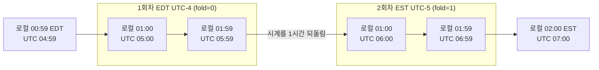
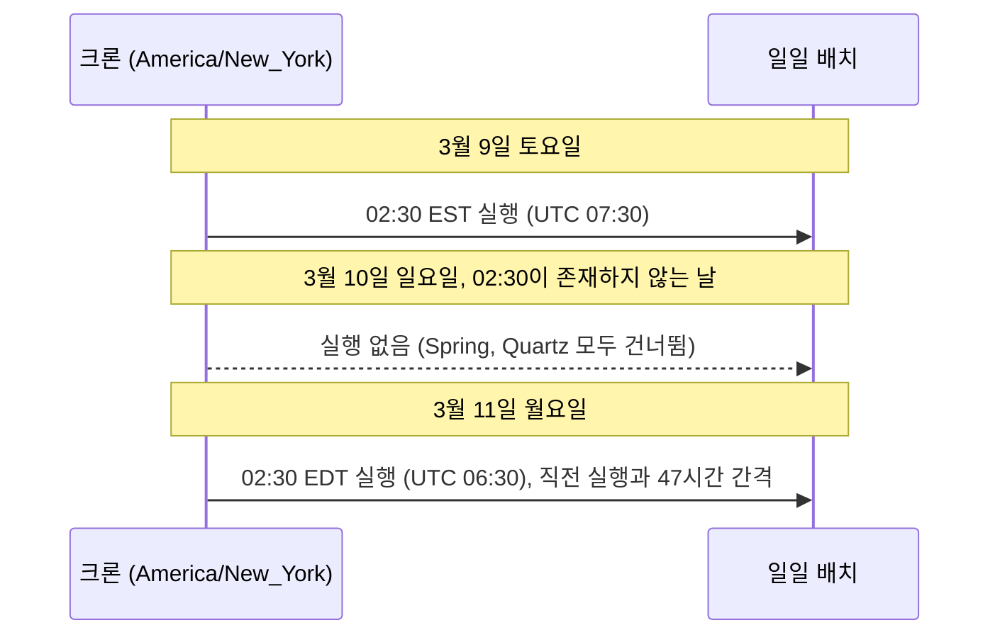
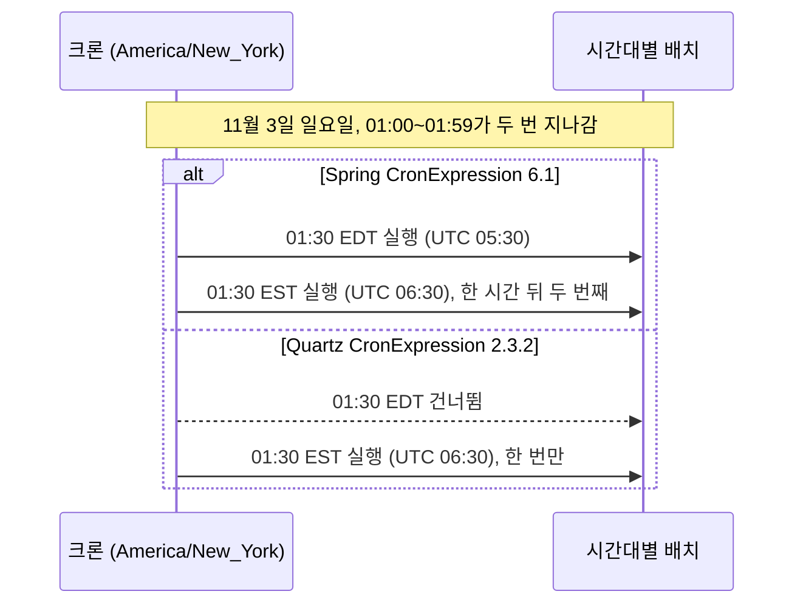
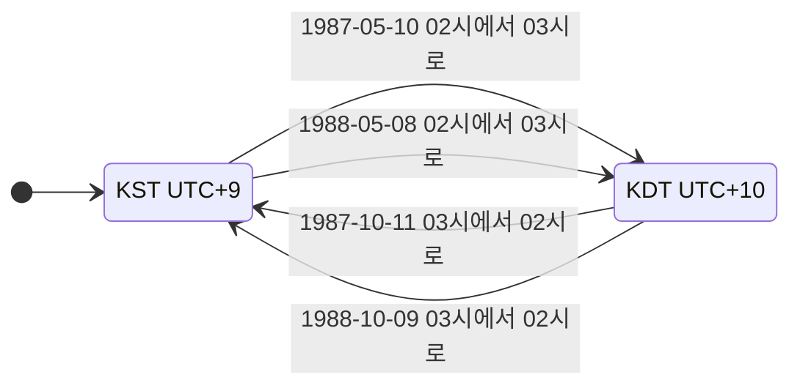
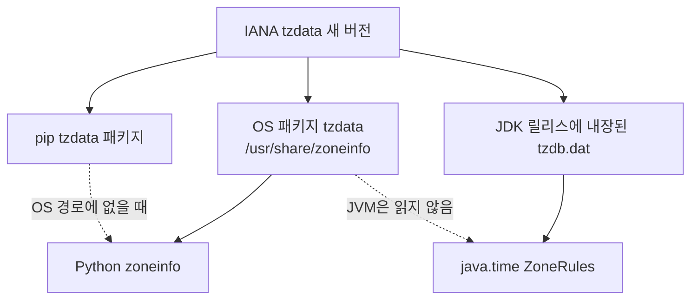
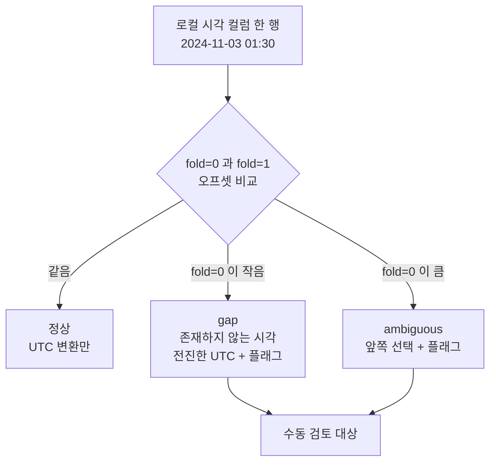

# DST (일광 절약 시간)

한국은 지금 DST를 쓰지 않아서 현재 시각만 다루는 국내 서비스는 이 문제를 만나지 않는다. 미국이나 유럽 사용자가 생기는 날부터 만난다. 이미 운영 중인 서비스에 해외 리전을 붙이면 "하루는 24시간이다", "로컬 시각은 유일하다" 같은 가정이 레거시 코드 곳곳에 박혀 있다는 게 한꺼번에 드러난다. 한국도 1987~88년에는 DST를 썼기 때문에 그 시기 데이터를 옮길 때는 국내 서비스도 같은 문제를 만난다.

## 전환 순간의 벽시계

봄 전환(미국 동부 EST → EDT)은 02:00에 시계를 03:00으로 앞당긴다. 02:00~02:59가 사라진다. 가을 전환(EDT → EST)은 02:00에 시계를 01:00으로 되돌린다. 01:00~01:59가 두 번 지나간다.

UTC는 이 순간에도 끊기지 않고 흐른다. 불연속은 로컬 표기에만 생긴다. Instant를 로컬 시각으로 바꾸는 방향은 결과가 항상 하나지만, 로컬 시각을 Instant로 바꾸는 방향은 결과가 0개이거나 2개다. DST 버그는 거의 전부 이 방향에서 나온다.

봄 전환부터 본다. UTC는 06:59에서 1분 뒤 07:00이 되는데 로컬은 01:59 EST에서 03:00 EDT로 건너뛴다. 붉은 점선 노드가 어떤 UTC에도 대응하지 않는 로컬 구간이다.


2024-03-10 뉴욕에서 로컬 02:30은 어느 Instant도 가리키지 못한다. "그날 02:30에 실행"이라는 요구는 실행할 순간이 없는 요구가 된다.

가을 전환은 반대다. 두 상자(1회차 EDT, 2회차 EST)가 로컬 표기 01:00~01:59를 한 번씩 나눠 갖는다. 시계가 되돌아가는 지점은 `시계를 1시간 되돌림` 화살표다.



로컬 01:30은 UTC 05:30(1회차)도 되고 06:30(2회차)도 된다. 로컬 시각만 저장한 컬럼에서는 서로 다른 두 순간이 같은 값으로 들어가고, 나중에 어느 쪽이었는지 복원할 방법이 없다.

| | 봄 전환 (gap) | 가을 전환 (overlap) |
|---|---|---|
| 로컬 시계 | 01:59:59 EST 다음 초가 03:00:00 EDT | 01:59:59 EDT 다음 초가 01:00:00 EST |
| 로컬 → Instant | 대응 0개 | 대응 2개 |
| 그날 길이 | 23시간 | 25시간 |
| 깨지는 곳 | 입력 검증, 예약 시각, 특정 시각 실행 누락 | 로컬 시각 유니크 키, 중복 실행, 시간순 정렬 |

파이썬은 중복 구간을 `fold` 속성으로 구분한다. `fold=0`이 앞쪽(EDT), `fold=1`이 뒤쪽(EST)이다.

```python
from datetime import datetime
from zoneinfo import ZoneInfo

tz = ZoneInfo('America/New_York')
first_130 = datetime(2024, 11, 3, 1, 30, fold=0, tzinfo=tz)   # EDT, UTC-4
second_130 = datetime(2024, 11, 3, 1, 30, fold=1, tzinfo=tz)  # EST, UTC-5

print(first_130.utcoffset())   # -1 day, 20:00:00 (-04:00)
print(second_130.utcoffset())  # -1 day, 19:00:00 (-05:00)
```

`fold`는 같은 `tzinfo`끼리의 비교와 해시에서 무시된다. 실제로 `first_130 == second_130`이 `True`이고 해시도 같다. 서로 한 시간 떨어진 순간인데 딕셔너리 키나 `set`에서는 한 항목으로 합쳐진다. 구분하려면 UTC로 바꾼 뒤 비교한다.

## gap과 overlap에서 라이브러리가 고르는 값

같은 입력을 라이브러리마다 다르게 해석한다. 2024-03-10 02:30(gap)과 2024-11-03 01:30(overlap)을 `America/New_York`으로 넣어 직접 돌려본 결과다. 확인한 버전은 JDK 17(tzdata 2026b), Luxon 3.7.2, Node 20.20, Python 3.10.12, PostgreSQL 14.24다.

| 환경 | gap, 로컬 02:30 | overlap, 로컬 01:30 |
|---|---|---|
| java.time `ZonedDateTime.of`, `atZone` | 03:30-04:00로 전진 (UTC 07:30) | 01:30-04:00, 앞쪽 (UTC 05:30). `withLaterOffsetAtOverlap()`으로 뒤쪽 |
| Luxon `DateTime.fromObject` | 03:30-04:00로 전진 (UTC 07:30), `isValid`는 `true` | 01:30-05:00, 뒤쪽 (UTC 06:30) |
| JavaScript `new Date(y, m, d, h, mi)` | UTC 07:30 (03:30 EDT) | UTC 05:30, 앞쪽 |
| Python zoneinfo | 벽시계 02:30 유지. `fold=0`이면 오프셋 -05:00 (UTC 07:30), `fold=1`이면 -04:00 (UTC 06:30) | `fold=0` -04:00 (UTC 05:30), `fold=1` -05:00 (UTC 06:30). 기본값 `fold=0` |
| PostgreSQL `timestamptz` | 03:30-04로 전진 | 01:30-05, 뒤쪽 (표준시) |

gap은 기본 동작이 UTC 07:30으로 모인다. 갈리는 쪽은 overlap이다. java.time, 네이티브 `Date`, Python 기본값은 앞쪽(DST 적용)을 고르고, Luxon과 PostgreSQL은 뒤쪽(표준시)을 고른다. 같은 JavaScript 런타임 안에서도 `new Date(...)`와 Luxon의 결과가 1시간 다르다. 프론트가 오프셋 없는 로컬 문자열 `2024-11-03T01:30`을 서버로 보내고, 서버가 그것을 해석하는 순간 어느 쪽이 되는지는 서버 쪽 라이브러리가 정한다. 프론트가 의도한 쪽과 다르면 1시간이 어긋난다.

Python은 gap 값을 정규화하지 않는다. `datetime(2024, 3, 10, 2, 30, tzinfo=tz)`는 02:30 그대로 남고 `isoformat()`이 `02:30:00-05:00`을 내놓는다. 이 문자열을 다른 시스템이 파싱하면 07:30 UTC로 읽히고 뉴욕에서는 03:30 EDT에 해당한다. Instant는 맞지만 로컬 표기는 존재하지 않는 시각이다.

사용자가 입력한 로컬 시각을 받는 지점에서는 조용히 보정하지 말고 gap과 overlap을 구분해서 정책을 정한다. 예약 시각이면 gap은 거부하거나 사용자에게 03:00으로 밀린다고 알리고, overlap은 앞쪽·뒤쪽 중 하나를 고르게 한다. Java는 `ZoneRules.getValidOffsets`로 유효한 오프셋 개수를 직접 센다. 0개면 gap, 2개면 overlap이다.

```java
public static ZonedDateTime resolveStrict(LocalDateTime ldt, ZoneId zone) {
    List<ZoneOffset> offsets = zone.getRules().getValidOffsets(ldt);
    if (offsets.isEmpty()) {
        throw new IllegalArgumentException("존재하지 않는 시각: " + ldt + " " + zone);
    }
    if (offsets.size() == 2) {
        throw new IllegalArgumentException("모호한 시각: " + ldt + " " + zone);
    }
    return ZonedDateTime.ofStrict(ldt, offsets.get(0), zone);
}
```

Python에는 같은 API가 없어서 `fold`를 0과 1로 각각 붙여 오프셋을 비교한다. gap은 시계가 앞으로 가므로 `fold=0`(직전 오프셋)이 `fold=1`보다 작다. overlap은 반대다.

```python
def classify(naive: datetime, tz: ZoneInfo) -> str:
    a = naive.replace(tzinfo=tz, fold=0).utcoffset()
    b = naive.replace(tzinfo=tz, fold=1).utcoffset()
    if a == b:
        return 'normal'
    return 'gap' if a < b else 'ambiguous'
```

Luxon은 두 오프셋이 모두 유효한지 직접 확인한다. 하루 앞뒤의 오프셋을 후보로 잡고, 각 후보로 만든 순간이 입력한 시·분과 같은 벽시계를 보이는지 센다.

```javascript
const { DateTime } = require('luxon');

function classify(obj, zone) {
  const dt = DateTime.fromObject(obj, { zone });
  const wall = Date.UTC(obj.year, obj.month - 1, obj.day, obj.hour, obj.minute ?? 0);
  const candidates = new Set([dt.minus({ days: 1 }).offset, dt.plus({ days: 1 }).offset]);
  const valid = [...candidates].filter((o) => {
    const t = DateTime.fromMillis(wall - o * 60000, { zone });
    return t.hour === obj.hour && t.minute === (obj.minute ?? 0) && t.day === obj.day;
  });
  return valid.length === 0 ? 'gap' : valid.length === 2 ? 'ambiguous' : 'normal';
}
```

세 구현 모두 뉴욕 2024-03-10 02:30은 `gap`, 2024-11-03 01:30은 `ambiguous`, 2024-06-01 01:30은 `normal`로 나오는 것을 확인했다. 서울 1988-05-08 02:30과 1988-10-09 02:30도 같은 방식으로 `gap`, `ambiguous`가 나온다.

## 스케줄러가 전환일에 하는 일

"매일 02:30에 실행"을 `America/New_York` 기준 크론으로 걸면 전환일마다 결과가 갈린다. 스케줄러가 계산하는 다음 실행 시각을 전환일 전후로 직접 뽑아 보았다. Spring 6.1.14 `CronExpression`과 Quartz 2.3.2 `CronExpression`이다.

| 표현식 (존 America/New_York) | 3/10 봄 전환일 | 11/3 가을 전환일 |
|---|---|---|
| `0 30 2 * * *` (Spring), `0 30 2 * * ?` (Quartz) | 실행 안 함. 3/9 다음이 3/11 | 02:30 EST에 한 번. 02:30은 모호하지 않다 |
| `0 30 1 * * *` (Spring) | 01:30 EST에 정상 실행 | 01:30 EDT와 01:30 EST, 한 시간 간격으로 두 번 |
| `0 30 1 * * ?` (Quartz) | 정상 | 01:30 EST에 한 번. EDT 쪽을 건너뜀 |

gap은 두 구현 모두 그날을 건너뛴다. 미스파이어와는 상관이 없다. 스케줄러가 계산한 실행 시각 목록에 그날이 없을 뿐이라 미스파이어 정책을 어떻게 잡아도 결과가 바뀌지 않는다. overlap은 구현이 갈린다. Spring은 두 번 돌리고 Quartz는 뒤쪽 한 번만 돌린다. 스케줄러를 교체하거나 버전을 올릴 때 이 동작이 바뀌는지 확인하지 않으면 배치가 전환일에만 한 번 더 돌거나 빠진다.

02:30 배치가 봄 전환일에 어떻게 지나가는지 보면 이렇다. 3/9 다음 실행이 3/11이라 간격이 47시간이다.



01:30 배치가 가을 전환일에 어떻게 지나가는지는 구현마다 다르다.



대응 방법은 세 가지다.

첫째, 요구사항이 02:30 고정이 아니면 시각을 전환 구간 밖으로 옮긴다. JDK 17(tzdata 2026b)의 모든 존에서 2020~2026년 전환마다 사라지거나 반복된 현지 시각을 모아 보니 21:00~04:00 사이에만 몰려 있었다. 04:00부터 20:59까지는 어느 존에서도 gap이나 overlap에 걸린 적이 없다. 04:00 끝은 동유럽의 가을 전환으로, 04:00에 03:00으로 되돌아가 03:00~03:59가 반복된다. 21:00 쪽은 이스터섬 같은 곳이다. 사용자 존이 흩어져 있는 서비스라면 현지 04:00~20:59에 배치를 잡으면 전환 구간을 피한다.

둘째, 반드시 02:30 현지 시각에 한 번 돌아야 하면 UTC로 고정하거나 현지 존을 명시하되 건너뛰는 날을 보정한다. UTC 고정은 DST와 무관하게 같은 UTC 시각에 돈다. 대신 현지 시각이 겨울에는 02:00, 여름에는 03:00으로 밀린다.

```java
// 뉴욕 현지 02:30 고정. 3월 전환일에는 그날 실행이 빠진다
CronScheduleBuilder.cronSchedule("0 30 2 * * ?")
    .inTimeZone(TimeZone.getTimeZone("America/New_York"));

// UTC 고정. 뉴욕 현지로는 겨울 02:00(EST), 여름 03:00(EDT)
@Scheduled(cron = "0 0 7 * * *", zone = "UTC")
public void dailyBatch() { ... }
```

현지 시각 고정을 택했다면 마지막 성공 날짜를 저장해 두고, 실행 시점에 "마지막 성공 이후 비어 있는 날"이 있으면 채우는 방식으로 건너뜀을 보정한다. 크론이 돌아야 할 날에 돌았는지를 크론 밖에서 한 번 더 본다.

셋째, overlap의 중복 실행은 분산 락으로 막는다. 락 키에는 비즈니스 날짜를 넣고, 로컬 날짜인지 UTC 날짜인지 한 가지로 통일한다. 두 가지를 섞으면 키가 달라져 방어가 뚫린다.

```java
public void runDailyReport(LocalDate businessDate, ZoneId zone) {
    String lockKey = "batch:daily-report:" + businessDate + ":" + zone.getId();
    Boolean acquired = redisTemplate.opsForValue()
        .setIfAbsent(lockKey, "1", Duration.ofHours(25));   // 하루가 25시간인 날이 있다

    if (!Boolean.TRUE.equals(acquired)) {
        log.warn("배치 이미 실행됨: {}", lockKey);
        return;
    }
    // 실제 배치 로직
}
```

`setIfAbsent`는 `null`을 돌려줄 수 있어서 `!acquired`로 쓰면 파이프라인 모드에서 NPE가 난다. `Boolean.TRUE.equals`로 비교한다. 매시간 도는 배치라면 키에 날짜만 넣으면 안 된다. 전환일에 같은 로컬 01시가 두 번 있으므로 키에 UTC 기준 시각을 넣는다.

## 하루가 23시간이거나 25시간인 날

전환일은 하루가 23시간 또는 25시간이다. "1일 더하기"와 "24시간 더하기"가 이날을 걸치면 서로 다른 값이 나온다. 2024-03-09 12:00 뉴욕에서 시작한 결과다.

| 환경 | 1일 더하기 | 24시간 더하기 |
|---|---|---|
| java.time `plusDays` / `plusHours` | 03-10 12:00-04:00 | 03-10 13:00-04:00 |
| Luxon `plus({days: 1})` / `plus({hours: 24})` | 03-10 12:00-04:00 | 03-10 13:00-04:00 |
| Python aware `datetime + timedelta` | 03-10 12:00-04:00 | 12:00-04:00 (같은 tzinfo면 벽시계 연산) |

Python은 같은 `tzinfo`를 가진 aware datetime끼리의 덧셈을 벽시계 연산으로 처리한다. `timedelta(hours=24)`를 더해도 12:00이 나온다. 정확히 24시간 뒤를 원하면 UTC로 바꾼 뒤 더하고 다시 존으로 돌린다.

```python
base = datetime(2024, 3, 9, 12, tzinfo=ZoneInfo('America/New_York'))
exact = (base.astimezone(timezone.utc) + timedelta(hours=24)).astimezone(base.tzinfo)
# 2024-03-10T13:00:00-04:00
```

캐시 TTL을 "오늘 자정까지"로 계산할 때는 현지 자정 Instant와의 차이를 쓴다. 전환일에는 이 값이 23시간 또는 25시간이 되는데 맞는 동작이다.

```java
public Duration ttlUntilMidnight(ZoneId zone, Clock clock) {
    ZonedDateTime now = ZonedDateTime.now(clock.withZone(zone));
    ZonedDateTime midnight = now.toLocalDate().plusDays(1).atStartOfDay(zone);
    return Duration.between(now.toInstant(), midnight.toInstant());
}
```

`atStartOfDay`가 항상 00:00은 아니다. 칠레(`America/Santiago`)는 자정에 전환해서 2024-09-08에 `atStartOfDay(zone)`이 `01:00-03:00`을 돌려준다. 자정을 `LocalTime.MIDNIGHT`로 직접 붙이면 존재하지 않는 시각이 된다.

"내일 오전 9시 알림"처럼 사용자 존 기준 시각을 UTC로 바꿔 큐에 넣는 코드는 전환일을 걸칠 때 오프셋이 달라진다. 오늘 오프셋을 그대로 24시간 더하면 1시간 틀린다. 이 함수는 내일 날짜를 사용자 존으로 구하고 그 존의 9시를 만든다.

```python
from datetime import datetime, time, timedelta, timezone
from zoneinfo import ZoneInfo

def next_nine_am_utc(user_timezone: str, now_utc: datetime) -> datetime:
    tz = ZoneInfo(user_timezone)
    tomorrow = now_utc.astimezone(tz).date() + timedelta(days=1)
    return datetime.combine(tomorrow, time(9, 0), tzinfo=tz).astimezone(timezone.utc)

now = datetime(2024, 3, 9, 15, 0, tzinfo=timezone.utc)
print(next_nine_am_utc('America/New_York', now))   # 2024-03-10 13:00:00+00:00
# 오늘 09:00 EST(14:00Z)에 24시간을 더하면 3/10 14:00Z = 10:00 EDT 로 한 시간 틀린다
```

`date.today()`는 서버 존의 날짜를 돌려준다. 서버가 UTC이고 사용자가 서울이면 서울의 "내일"과 서버의 "내일"이 다른 시간대가 하루 중 9시간이나 된다. 날짜는 반드시 사용자 존으로 구한다.

## pytz 레거시 코드와 zoneinfo

`pytz`는 `tzinfo` 객체를 `datetime` 생성자에 바로 넣으면 안 된다. 그 존의 가장 오래된 규칙(LMT)이 붙는다. 서울은 8:28:00이 나온다.

```python
import pytz
from datetime import datetime

seoul = pytz.timezone('Asia/Seoul')

wrong = datetime(2024, 3, 15, 9, 0, tzinfo=seoul)
print(wrong.utcoffset())    # 8:28:00 (LMT)

correct = seoul.localize(datetime(2024, 3, 15, 9, 0))
print(correct.utcoffset())  # 9:00:00 (KST)
```

`pytz`는 `localize()`를 써야 올바른 오프셋이 붙고, 날짜 연산 뒤에는 `normalize()`를 다시 호출해야 한다. 빠뜨리면 전환일을 넘어도 오프셋이 그대로다. 2024-03-09 02:00 EST에 하루를 더하면 존재하지 않는 03-10 02:00이 -05:00으로 남는다.

```python
import pytz
from datetime import datetime, timedelta

eastern = pytz.timezone('America/New_York')
dt = eastern.localize(datetime(2024, 3, 9, 2, 0))

next_day = dt + timedelta(days=1)
print(next_day.isoformat())                    # 2024-03-10T02:00:00-05:00 (없는 시각)
print(eastern.normalize(next_day).isoformat()) # 2024-03-10T03:00:00-04:00
```

Python 3.9+의 `zoneinfo`는 `tzinfo` 인터페이스 하나로 처리하므로 `localize`/`normalize`가 없다. 신규 코드는 `zoneinfo`를 쓴다. `datetime(..., tzinfo=ZoneInfo(...))`로 만들어도 LMT가 붙지 않는다. 서울 1900년은 `+082752`가 나오지만 이는 그 날짜의 실제 규칙이다.

전환 시각 근처에서 날짜를 계산한다면 정오 기준으로 잡는다. 02:00 기준으로 하루를 더하면 존재하지 않는 시각이 되고, `fold` 기본값이 전환 이전 오프셋을 줘서 오프셋이 갱신되지 않은 것처럼 보인다.

`zoneinfo`는 OS의 tzdata를 읽는다. Alpine 같은 최소 이미지에는 tzdata가 없어서 `ZoneInfoNotFoundError`가 난다. `pip install tzdata`로 데이터 패키지를 설치하면 OS 없이도 동작한다.

## 지역별 전환 규칙

"3월에 시작해서 11월에 끝난다"는 미국 기준 가정이다. 2024년 전환을 JDK의 `ZoneRules`로 뽑으면 지역마다 규칙이 다르다. 시각은 전환 직전 현지 시각 기준이다.

| 존 | 시작 (gap) | 종료 (overlap) | 오프셋 |
|---|---|---|---|
| America/New_York | 3/10 02:00 → 03:00 | 11/3 02:00 → 01:00 | -5 ↔ -4 |
| Europe/London | 3/31 01:00 → 02:00 | 10/27 02:00 → 01:00 | 0 ↔ +1 |
| Europe/Berlin | 3/31 02:00 → 03:00 | 10/27 03:00 → 02:00 | +1 ↔ +2 |
| Australia/Sydney | 10/6 02:00 → 03:00 | 4/7 03:00 → 02:00 | +10 ↔ +11 |
| Pacific/Auckland | 9/29 02:00 → 03:00 | 4/7 03:00 → 02:00 | +12 ↔ +13 |
| America/Santiago | 9/8 00:00 → 01:00 | 4/7 00:00 → 4/6 23:00 | -4 ↔ -3 |
| Australia/Lord_Howe | 10/6 02:00 → 02:30 | 4/7 02:00 → 01:30 | +10:30 ↔ +11 |
| Pacific/Chatham | 9/29 02:45 → 03:45 | 4/7 03:45 → 02:45 | +12:45 ↔ +13:45 |
| Africa/Casablanca | 4/14 02:00 → 03:00 | 3/10 03:00 → 02:00 | +1 ↔ +0 (라마단 중 +0) |

세부에서 코드가 깨지는 지점이 몇 가지 있다.

미국과 유럽은 전환 날짜가 다르다. 미국은 3월 둘째 일요일(2024-03-10), 유럽은 3월 마지막 일요일(2024-03-31)이다. 가을에는 유럽이 10월 27일, 미국이 11월 3일에 끝난다. 도식의 붉은 구간 두 개에서 뉴욕과 런던의 시차가 5시간이 아니라 4시간이다.


런던 기준 오전 9시 회의를 뉴욕 시간으로 환산해서 상수로 박아 둔 코드는 이 4주 동안 1시간 어긋난다. 유럽 존은 UTC 01:00 한 시점에 같이 전환하지만 현지 시각은 런던 01:00, 베를린 02:00으로 서로 다르다.

남반구는 계절이 거꾸로다. 시드니는 1월이 DST(+11)이고 7월이 표준시(+10)다. "6~8월이면 DST"나 "DST 여부로 여름/겨울 판단" 같은 코드는 남반구에서 반대로 동작한다. 오프셋 자체나 `ZoneRules`로 판단한다.

로드하우섬(`Australia/Lord_Howe`)은 DST 폭이 30분이다. 표준 +10:30, DST +11:00이고 gap은 02:00~02:30, overlap은 01:30~02:00이다. 오프셋을 정수 시간으로 다루는 코드(`offsetSeconds / 3600`)가 여기서 깨지고, "DST 때는 1시간 앞당긴다"는 가정으로 만든 보정도 틀린다. 시차 계산은 항상 초나 분 단위 오프셋으로 한다. 칼럼 타입이 `smallint` 시간 오프셋이라면 `+10:30`, `+12:45`(채텀) 같은 값을 담지 못한다.

칠레와 이스터섬, 이집트는 자정 부근에 전환한다. 칠레 gap은 00:00~01:00이라 그날 00:00이라는 로컬 시각이 없다. 앞 절의 `atStartOfDay`가 01:00을 주는 이유다. 일 단위 집계 경계를 `00:00`으로 하드코딩한 코드는 이런 존에서 없는 시각을 만든다.

모로코(`Africa/Casablanca`)는 평소 +1이고 라마단 기간에만 +0으로 내려간다. 2024년에는 3월 10일에 시계를 되돌렸다가 4월 14일에 다시 앞당겼다. "DST 기간은 여름"이라는 가정이 통하지 않고, 라마단 날짜가 해마다 달라 규칙이 아니라 tzdata에 연도별로 들어 있다.

DST를 폐지한 곳도 있다. 브라질(`America/Sao_Paulo`)은 2019년 2월 이후 전환이 없고, 멕시코(`America/Mexico_City`)는 2022년 10월 30일이 마지막 전환이다. 반대로 이집트(`Africa/Cairo`)는 2015~2022년 전환이 없다가 2023-04-28에 다시 시작했다.

## 한국의 DST (1987~88)와 과거 데이터

한국은 1987년과 1988년에 DST를 썼다. tzdata 기준으로 시작은 5월 둘째 일요일 02:00, 종료는 10월 둘째 일요일 03:00이다. 1988년 서울 올림픽(9월)은 DST 기간 중이었다.



도식에서 KDT 구간(5월~10월 약 5개월)이 두 번 있다. 시작하는 날 1987-05-10과 1988-05-08은 02:00~02:59가 없고, 끝나는 날 1987-10-11과 1988-10-09는 02:00~02:59가 두 번 지나간다.

전환일만의 문제가 아니다. KDT 5개월 동안은 모든 로컬 시각의 오프셋이 `+09:00`이 아니라 `+10:00`이다. 같은 로컬 값을 고정 오프셋과 존 규칙으로 UTC에 옮기면 표처럼 갈린다.

| 입력 (로컬, 오프셋 없음) | 고정 `+09:00` | `Asia/Seoul` 규칙 |
|---|---|---|
| 1988-07-01 12:00 | UTC 03:00 | UTC 02:00 |
| 1988-12-01 12:00 | UTC 03:00 | UTC 03:00 |
| 1988-05-08 02:30 | UTC 1988-05-07 17:30 | 존재하지 않음. 03:30+10:00(UTC 17:30)로 전진 |
| 1988-10-09 02:30 | UTC 17:30 | 모호함. +10:00(UTC 16:30) 또는 +09:00(UTC 17:30) |
| 1988-05-08 하루 길이 | 24시간 | 23시간 |

```java
LocalDateTime birth = LocalDateTime.of(1988, 7, 1, 12, 0);
Instant byRule  = birth.atZone(ZoneId.of("Asia/Seoul")).toInstant();   // 1988-07-01T02:00:00Z
Instant byFixed = birth.toInstant(ZoneOffset.ofHours(9));              // 1988-07-01T03:00:00Z
```

그 시기 사람들이 본 시계는 KDT였다. 서버나 사람이 "오후 12시"라고 기록한 값은 UTC+10 기준이다. 로컬 시각만 남은 옛 데이터를 UTC로 옮길 때는 `Asia/Seoul` 규칙으로 변환해야 실제 순간이 복원된다. 고정 `+09:00`을 쓰면 5개월 구간 전체가 1시간 뒤로 밀린다.

프론트와 서버가 다른 방식으로 변환해도 같은 문제가 난다. 서버가 `+09:00` 고정으로 포맷해서 `12:00`을 내려주고, 브라우저가 `Intl`로 `Asia/Seoul`을 적용하면 같은 Instant(1988-07-01T03:00Z)가 `13:00 GMT+10`으로 표시된다(Node에서 `toLocaleString('en-GB', { timeZone: 'Asia/Seoul' })`로 확인). 출생 시각, 가입일시, 계약일시처럼 1987~88년 5~10월 값을 다루는 곳에서 보인다.

날짜만 있는 값(`DATE`)은 전환이 02시에 일어나서 영향이 없다. 시각이 있는 값에서만 문제가 된다.

표준시 자체가 달랐던 시기도 있다. Java `ZoneRules` 기준으로 1954-03-21부터 1961-08-10까지 한국 표준시는 +08:30이었고(DST 기간은 +09:30), 1908년 이전은 LMT +08:27:52다. 1948~51년과 1955~60년에도 DST가 있었다. 1950년대 데이터를 다룬다면 1987~88년만이 아니다. Python `zoneinfo`로 1958-07-01을 만들면 `+0930`이 나온다.

과거 로컬 시각 컬럼을 UTC로 옮기는 작업에서는 고정 오프셋을 쓰지 않고 항상 존 규칙을 쓴다. 한 가지 확인할 것은 데이터를 쌓은 원본 시스템이 DST를 실제로 적용했는지다. 서버 OS가 KST 고정으로 설정돼 있었다면 컬럼 값이 DST를 반영하지 않았을 수 있다. 원본 시스템에서 시각을 아는 사건 몇 건(외부 로그, 방송 시각)을 골라 5~10월 데이터와 1~3월 데이터를 각각 대조하면 어느 쪽인지 정해진다.

## DST를 쓰지 않는 곳, 폐지한 곳, tzdata

### Arizona와 Navajo

미국에서 DST를 안 쓰는 대표 지역은 Arizona다. `America/Phoenix`를 쓰고 연중 UTC-7이다. 예외가 Navajo Nation으로, Arizona 안에 있지만 DST를 적용하고 `America/Denver` 규칙을 따른다. tzdata의 `zone.tab`에도 Phoenix가 `MST - AZ (except Navajo)`로 적혀 있다. Arizona 주소를 보고 무조건 `America/Phoenix`로 처리하면 Navajo 주민은 1시간 오차가 생긴다. 주 단위가 아닌 IANA 존 ID로 판단하고, 주소나 우편번호에서 존을 정해야 하면 GeoIP나 Time Zone API 같은 외부 데이터를 쓴다.

```python
from zoneinfo import ZoneInfo
from datetime import datetime

summer = datetime(2024, 7, 1, 12, 0)
print(summer.replace(tzinfo=ZoneInfo('America/Phoenix')).strftime('%z'))  # -0700, 연중 고정
print(summer.replace(tzinfo=ZoneInfo('America/Denver')).strftime('%z'))   # -0600, MDT
```

### 규칙이 바뀐 지역과 tzdata

멕시코는 2022년 10월 30일 이후 전환이 없어서 `America/Mexico_City` 여름 오프셋이 2022년에는 -05:00, 2023년에는 -06:00이다. tzdata를 갱신하지 않은 서버는 2023년에도 DST를 적용한다. 멕시코시티 기준 배치와 알림이 1시간씩 어긋나는데 원인을 찾기 어렵다.

```python
mx = ZoneInfo('America/Mexico_City')
print(datetime(2022, 7, 1, 12, tzinfo=mx).strftime('%z'))  # -0500
print(datetime(2023, 7, 1, 12, tzinfo=mx).strftime('%z'))  # -0600
```

tzdata는 OS와 런타임에 따로 있다. 새 버전이 나와도 층마다 따로 갱신해야 반영된다. OS tzdata를 갱신해도 JVM은 자체 tzdata를 쓰므로 그대로다. Python `zoneinfo`는 OS 경로를 먼저 보고, 없으면 pip `tzdata` 패키지를 쓴다.



버전 확인 방법도 층마다 다르다.

```bash
# OS (파일 첫 줄에 버전)
head -1 /usr/share/zoneinfo/tzdata.zi

# pip tzdata 패키지
python3 -c "import tzdata; print(tzdata.IANA_VERSION)"
```

```java
// JVM 내장 tzdata 버전
System.out.println(ZoneRulesProvider.getVersions("America/New_York").keySet());  // [2026b]
```

`java -XshowSettings:all`은 기본 존 이름만 보여주고 tzdata 버전은 보여주지 않는다. 갱신 절차와 Docker 이미지, JDK 배포판별 방법은 [tzdata 버전 관리](Tzdata_Management.md)에서 다룬다.

규칙이 바뀐 뒤에는 과거 데이터를 다시 계산하면 안 되는 경우가 생긴다. 2022년 이전에 `America/Mexico_City` 로컬 시각으로 저장한 값은 당시 DST 규칙을 반영한 값이다. 새 tzdata로 재계산하면 같은 로컬 문자열이 다른 UTC가 된다. 과거 값은 저장 당시 규칙 기준이라는 전제로 두고, 미래 약속(예약, 일정)은 로컬 시각과 존 ID를 저장해서 tzdata 갱신이 반영되게 한다.

## Windows 타임존 이름과 IANA ID

Windows는 `Eastern Standard Time` 같은 자체 이름을 쓴다. IANA 존 ID(`America/New_York`)와 다르다. 클라이언트가 Windows에서 시스템 존을 읽어 서버로 보내거나, .NET이나 SQL Server와 섞어 쓸 때 만난다.

| 라이브러리 | `Eastern Standard Time` 입력 시 |
|---|---|
| Python `ZoneInfo`, `pytz` | `ZoneInfoNotFoundError`, `UnknownTimeZoneError` |
| Python `dateutil.tz.gettz` | Linux에서는 `None` |
| Java `ZoneId.of` | `DateTimeException` |
| Java `TimeZone.getTimeZone` | 예외 없이 `GMT` 반환 |
| Luxon | `isValid`가 `false`, 사유 `unsupported zone` |

`TimeZone.getTimeZone`의 조용한 실패가 가장 위험하다. 인식하지 못한 ID를 `GMT`로 바꿔서 이후 계산이 전부 UTC로 흘러간다.

```java
TimeZone tz = TimeZone.getTimeZone("Eastern Standard Time");
System.out.println(tz.getID());         // GMT
System.out.println(tz.getRawOffset());  // 0
```

사용자가 보낸 존 ID는 받는 지점에서 `ZoneId.of`로 검증한다.

```java
try {
    ZoneId zone = ZoneId.of(userProvidedId);
} catch (DateTimeException e) {
    throw new IllegalArgumentException("유효하지 않은 타임존 ID: " + userProvidedId);
}
```

Windows 이름을 IANA로 바꿔야 한다면 CLDR의 `windowsZones.xml`이 매핑 원본이다. 코드에는 쓰는 존만 딕셔너리로 둔다.

```python
WINDOWS_TO_IANA = {
    'Eastern Standard Time': 'America/New_York',
    'Pacific Standard Time': 'America/Los_Angeles',
    'Central Standard Time': 'America/Chicago',
    'Mountain Standard Time': 'America/Denver',
    'Korea Standard Time': 'Asia/Seoul',
    'UTC': 'UTC',
}
```

서버에서 변환하는 것보다 클라이언트가 처음부터 IANA ID를 보내게 계약을 잡는 편이 안전하다. 브라우저와 Node의 `Intl.DateTimeFormat().resolvedOptions().timeZone`은 항상 IANA ID를 돌려준다.

## 레거시 데이터의 DST 버그 진단

### 저장된 값이 UTC인지 로컬인지

전환일 주변의 시간대별 건수를 본다. 같은 로컬 시각 두 건이 있다는 사실만으로는 판단할 수 없다. UTC로 저장해도 같은 초에 들어온 행은 같은 값을 가진다. 로컬 시각으로 저장했을 때 나타나는 신호는 건수와 순서다.

```sql
-- 가을 전환일(2024-11-03 뉴욕) 로컬 새벽의 시간대별 건수
SELECT date_trunc('hour', created_at) AS h, COUNT(*) AS cnt
FROM orders
WHERE created_at >= '2024-11-03 00:00' AND created_at < '2024-11-03 06:00'
GROUP BY 1 ORDER BY 1;
```

로컬 시각으로 저장했다면 두 시간이 한 버킷에 합쳐져서 01시 버킷이 인접 버킷의 대략 2배가 된다. 봄 전환일(2024-03-10)이면 02시 버킷이 통째로 비어 있다. 트래픽이 일정한 테이블에서 이 모양이 보이면 로컬 저장이다. UTC로 저장했다면 이 곡선은 매끄럽고, 이상이 UTC 06:00~07:00 부근에서 따로 나타나지 않는다. 건수가 적은 테이블은 노이즈가 커서 판단이 어렵다.

더 확실한 신호는 시간순 역전이다. 자동 증가 `id` 순서로 봤을 때 `created_at`이 한 시간 가까이 뒤로 가면 시계가 되돌아간 것이다.

```sql
SELECT id, created_at, prev_at
FROM (
  SELECT id, created_at, LAG(created_at) OVER (ORDER BY id) AS prev_at
  FROM events
  WHERE created_at >= '2024-11-03 00:00' AND created_at < '2024-11-04 00:00'
) t
WHERE prev_at - created_at > interval '30 minutes';
```

UTC 저장이라면 이 쿼리는 비어 있다. 서버 간 시계 오차는 밀리초~초 단위라 30분 임계값을 넘지 않는다.

### 존 정보가 없는 타임스탬프의 기준 추정

타임존 없이 저장된 `datetime` 컬럼이 어느 존 기준인지 모를 때는 배포 이력과 코드 히스토리부터 본다. 특정 날짜부터 UTC로 바뀌었다면 그 날짜를 경계로 두 구간으로 나눠야 한다. `git log`와 배포 기록을 맞춰 보면 전환 시점을 대략 찾는다.

다음은 같은 사건을 두 곳에 기록한 컬럼 쌍으로 오프셋 분포를 보는 방법이다. 결제 PG 승인 시각(UTC 확실)과 주문 서버가 남긴 시각(기준 불명)이 대표적이다.

```python
import pandas as pd

df = pd.read_sql("""
    SELECT paid_at_utc, paid_at_unknown
    FROM payments
    WHERE paid_at_utc >= '2024-01-01'
""", conn)

diff_hours = ((df['paid_at_utc'] - df['paid_at_unknown']).dt.total_seconds() / 3600).round()
print(diff_hours.value_counts())
```

서울 로컬(KST)이면 차이가 -9에 몰린다. 뉴욕 로컬이면 +5(겨울)와 +4(여름)의 두 봉우리가 나오고, 봉우리가 갈리는 날짜가 3월 둘째 일요일과 11월 첫째 일요일에 맞아떨어진다. 값이 고정이면 DST가 없는 존이고, 두 값으로 갈리면 DST가 있는 존이다. 두 기록 사이에 지연이 있으면 반올림해도 노이즈가 남으므로 지연이 1분 이내인 쌍만 쓴다.

### 마이그레이션에서 gap과 overlap 행 처리

로컬 시각 컬럼을 UTC로 옮길 때 각 행이 정상인지 gap인지 모호한지를 분류하고 결과를 함께 남긴다. 전환 날짜 목록을 SQL로 하드코딩하면 연도마다 다시 뽑아야 하고 존이 늘 때마다 빠진다. 변환 스크립트에서 행마다 분류하는 편이 안전하다.



```python
from datetime import datetime, timezone
from zoneinfo import ZoneInfo

def convert_legacy(naive_dt: datetime, tz_name: str):
    tz = ZoneInfo(tz_name)
    a = naive_dt.replace(tzinfo=tz, fold=0)
    b = naive_dt.replace(tzinfo=tz, fold=1)
    if a.utcoffset() == b.utcoffset():
        status = None
    elif a.utcoffset() < b.utcoffset():
        status = 'gap'
    else:
        status = 'ambiguous'
    return a.astimezone(timezone.utc), status

convert_legacy(datetime(2024, 11, 3, 1, 30), 'America/New_York')
# (2024-11-03 05:30 UTC, 'ambiguous')  앞쪽(EDT)을 고른 값
convert_legacy(datetime(2024, 3, 10, 2, 30), 'America/New_York')
# (2024-03-10 07:30 UTC, 'gap')        03:30 EDT로 전진한 값
convert_legacy(datetime(1988, 7, 1, 12), 'Asia/Seoul')
# (1988-07-01 02:00 UTC, None)         KDT(+10) 규칙이 적용된 값
```

분류 결과는 컬럼으로 남겨서 나중에 검토할 수 있게 한다.

```sql
ALTER TABLE orders ADD COLUMN dst_status VARCHAR(10);   -- NULL, 'gap', 'ambiguous'
```

비즈니스에서 어느 쪽이 맞는지 기준이 없으면 `fold=0`(앞쪽)을 기본으로 고르고 플래그를 남긴다. 수백만 건을 한 번에 옮길 때 예외 케이스를 처음부터 분리해 두지 않으면 나중에 찾아내기가 매우 어렵다. 한국 데이터면 1987~88년 5~10월 전체가 `+09:00`이 아니라 `+10:00` 대상이라는 점도 변환 스크립트의 테스트 케이스로 넣는다.
