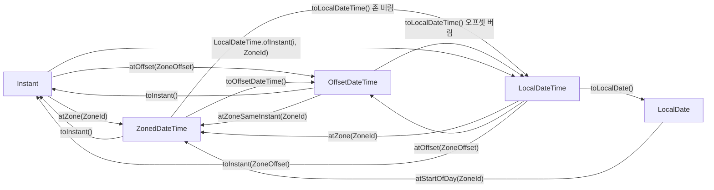
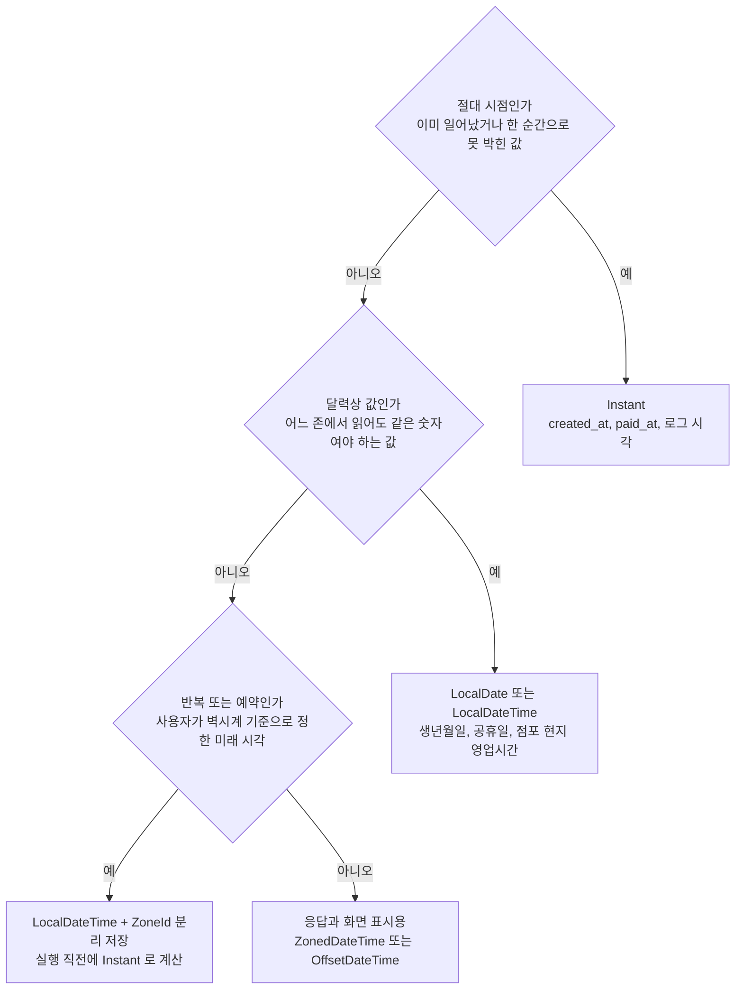
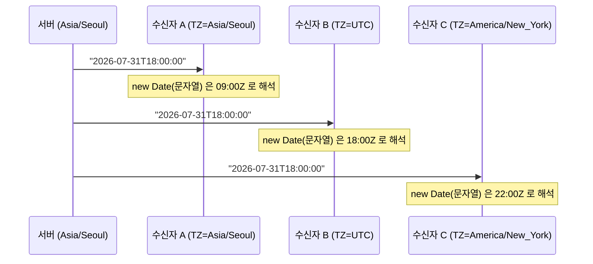
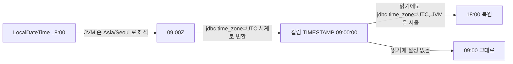

# Instant vs LocalDateTime

`Instant`와 `LocalDateTime`을 "타임존이 있느냐 없느냐"로 구분하는 설명이 많다. 틀린 말은 아닌데, 실무에서 사고가 나는 지점은 그 구분이 아니라 **타입이 바뀌는 경계**다. JSON으로 내보낼 때, DB 드라이버를 지날 때, 다른 언어의 `Date`로 받을 때 존 정보가 조용히 사라지거나 다른 존으로 채워진다.

이 문서의 수치와 출력은 전부 직접 돌려서 확인한 값이다. 환경은 OpenJDK 17.0.20, Jackson 2.17.2, Hibernate 6.5.3.Final, MyBatis 3.5.14, H2 2.2.224, Node 20.20.2이고, JVM 존은 `-Duser.timezone`, Node 존은 `TZ` 환경변수로 바꿔가며 돌렸다. MySQL과 PostgreSQL 드라이버는 돌려보지 않았다. DB 관련 결과는 H2 기준이라는 점을 감안하고 읽어야 한다.

## 두 타입의 차이

`Instant`는 타임라인 위의 한 점이다. 1970-01-01T00:00:00Z에서 경과한 시간이고, 지구 어디서 읽어도 같은 물리적 순간을 가리킨다. `Instant`에는 시, 일, 월이라는 개념이 없다. `Instant.get(ChronoField.HOUR_OF_DAY)`를 호출하면 `UnsupportedTemporalTypeException: Unsupported field: HourOfDay`가 난다. 시각을 읽으려면 존을 붙여야 한다.

`LocalDateTime`은 달력과 시계를 읽은 값이다. `2026-07-31T18:00`이 서울의 저녁 6시인지 런던의 저녁 6시인지 값 안에는 답이 없다. "Local"이라는 이름 때문에 "서버 로컬 존 기준"으로 읽기 쉬운데, 그런 정보는 값에 들어 있지 않다. 서버 존으로 해석하는 것은 값을 받은 쪽의 코드가 알아서 하는 일이고, 그게 사고의 원인이 된다.

## 다섯 타입과 변환 관계

실무에서 쓰는 `java.time` 타입은 다섯 개다. 변환에는 방향이 있고, 방향에 따라 **필요한 정보가 다르다**. 정보를 버리는 방향은 인자 없이 되고, 정보를 채워야 하는 방향은 `ZoneId`나 `ZoneOffset`을 받는다.



그림에서 `LocalDateTime`으로 들어가는 간선은 전부 정보를 버리고, 나오는 간선은 전부 `ZoneId`나 `ZoneOffset`을 요구한다. 컴파일러가 이 비대칭을 강제하는 곳이 하나 있다. `LocalDateTime.toInstant()`를 인자 없이 호출하면 컴파일이 안 된다(`required: ZoneOffset`). 반대로 `ZoneId`를 받는 `atZone`은 컴파일러가 막아주지 않으니, 어느 존을 넣었는지는 호출하는 사람이 책임져야 한다.

```java
Instant i = Instant.parse("2026-07-31T09:00:00Z");
i.atZone(ZoneId.of("Asia/Seoul"));       // 2026-07-31T18:00+09:00[Asia/Seoul]
i.atOffset(ZoneOffset.ofHours(9));        // 2026-07-31T18:00+09:00
LocalDateTime.ofInstant(i, ZoneOffset.UTC);              // 2026-07-31T09:00
LocalDateTime.ofInstant(i, ZoneId.of("Asia/Seoul"));     // 2026-07-31T18:00

LocalDateTime l = LocalDateTime.of(2026, 7, 31, 18, 0);
l.toInstant(ZoneOffset.ofHours(9));       // 2026-07-31T09:00:00Z
LocalDate.of(2026, 7, 31).atStartOfDay(ZoneId.of("Asia/Seoul")).toInstant();
// 2026-07-30T15:00:00Z  (UTC로 보면 날짜가 하루 앞선다)
```

마지막 줄이 `LocalDate`를 `Instant`로 바꿀 때 흔히 놓치는 부분이다. 서울의 7월 31일 0시는 UTC로 7월 30일 15시다. 날짜만 가진 값을 어느 존의 0시로 볼지 정하지 않고 변환하면 하루가 밀린다.

### 타입별로 들어 있는 정보

타입마다 담고 있는 정보를 비교하면 어느 타입으로 무엇을 할 수 있는지 정해진다.

| 타입 | 타임라인 위 한 점 | 오프셋 | 존 규칙(DST, 규칙 변경) | 담는 값 |
|---|---|---|---|---|
| `Instant` | 확정 | 없음(UTC 고정) | 없음 | epoch 초 + 나노 |
| `ZonedDateTime` | 확정 | 있음 | 있음 | 날짜 + 시각 + 존 ID |
| `OffsetDateTime` | 확정 | 있음 | 없음 | 날짜 + 시각 + 오프셋 |
| `LocalDateTime` | 불가 | 없음 | 없음 | 날짜 + 시각 |
| `LocalDate` | 불가 | 없음 | 없음 | 날짜 |

세 번째와 네 번째 열이 `OffsetDateTime`과 `ZonedDateTime`을 가른다. 오프셋 `+04:00`은 어느 지역인지 모르고, 하루를 더했을 때 다음 날 오프셋이 같은지도 모른다. 뉴욕에서 DST가 시작되는 2026-03-08 전날 정오에 하루를 더해보면 차이가 나온다.

```java
ZonedDateTime ny = ZonedDateTime.of(2026, 3, 7, 12, 0, 0, 0, ZoneId.of("America/New_York"));
ny.plusDays(1);
// 2026-03-08T12:00-04:00[America/New_York]   오프셋이 -05:00 에서 -04:00 으로 바뀜

ny.toOffsetDateTime().plusDays(1);
// 2026-03-08T12:00-05:00                     오프셋 고정, 뉴욕 시계로는 13:00
```

`OffsetDateTime`은 "정오에 하루 더하기"를 24시간 더하기로 처리한다. 사용자에게 "내일 같은 시각"을 보여줘야 하는 알림 계산에 `OffsetDateTime`을 쓰면 DST 전환일에 한 시간이 틀어진다.

`LocalDateTime`을 존에 붙일 때는 존재하지 않는 시각과 두 번 존재하는 시각이 있다. 같은 뉴욕에서 확인한 결과다.

```java
LocalDateTime.of(2026, 3, 8, 2, 30).atZone(ZoneId.of("America/New_York"));
// 2026-03-08T03:30-04:00[America/New_York]   02:30 은 없는 시각이라 03:30 으로 밀림

LocalDateTime.of(2026, 11, 1, 1, 30).atZone(ZoneId.of("America/New_York"));
// 2026-11-01T01:30-04:00[America/New_York]   두 번 나오는 01:30 중 앞쪽을 고름
// .withLaterOffsetAtOverlap() 을 붙여야 -05:00 쪽이 나온다
```

예외 없이 조용히 보정된다는 점이 문제다. 사용자가 입력한 시각이 없는 시각이어도 에러가 안 나고 한 시간 밀린 값이 저장된다. DST 자체는 [DST](DST.md)에서 따로 다룬다.

## 저장할 타입을 고르는 순서

타입 선택은 값의 성격을 세 번 물어보면 대부분 끝난다. 이미 일어난 일의 시각이면 `Instant`고, 존과 상관없이 의미가 있는 달력 값이면 `Local*`이고, 사람이 정한 미래의 벽시계 시각이면 로컬 값과 존 ID를 같이 저장한다.



세 번째 갈래가 예약 도메인에서 헷갈리는 부분이다. 사용자가 "2026-08-01 오전 10시"에 예약을 잡았을 때 서울이면 UTC 01:00, 뉴욕이면 UTC 14:00이다. 접수 시점에 `Instant`로 바꿔 저장하면 간단하지만, 그 뒤에 해당 지역의 존 규칙이 바뀌면(tzdata 갱신) 저장된 `Instant`는 사용자가 의도한 벽시계 시각과 어긋난다. `LocalDateTime`과 `ZoneId`를 따로 두면 실행 직전에 `atZone`으로 최신 규칙을 적용할 수 있다. tzdata 갱신과 관련된 내용은 [tzdata 버전 관리](Tzdata_Management.md)에 정리해 두었다.

반대로 `created_at`처럼 이미 일어난 일의 시각은 나중에 규칙이 바뀌어도 그 순간 자체는 변하지 않으므로 `Instant`가 맞다. 이 갈래의 값을 `LocalDateTime`으로 저장했다가 서버 존을 바꾸거나 서버를 다른 리전으로 옮기면, 컬럼만 봐서는 어느 존 기준인지 복원할 수 없다. UTC 저장 원칙은 [UTC 저장](UTC_Storage.md)에 있다.

## 존 정보 없이 나가는 JSON

### 수신자가 서버 존으로 해석한다

서울 서버가 `Instant`를 `LocalDateTime`으로 바꿔서 응답에 넣었다고 하자. 나가는 문자열은 `"2026-07-31T18:00:00"`이다. 이 문자열을 받은 쪽이 어느 존에서 돌고 있느냐에 따라 같은 문자열이 다른 시점이 된다.



서버가 의도한 시점은 09:00Z였다. 수신자 A만 맞고, B는 9시간 뒤, C는 13시간 뒤 시점을 얻는다. Node 20에서 `TZ`만 바꿔서 같은 코드를 돌린 결과다.

| TZ | `new Date("2026-07-31T18:00:00").toISOString()` | `getTime()` |
|---|---|---|
| Asia/Seoul | 2026-07-31T09:00:00.000Z | 1785488400000 |
| UTC | 2026-07-31T18:00:00.000Z | 1785520800000 |
| America/New_York | 2026-07-31T22:00:00.000Z | 1785535200000 |

서버와 클라이언트가 같은 존에 있는 개발 환경에서는 절대 드러나지 않는다. 개발자 노트북과 스테이징 서버가 둘 다 KST이기 때문이다. 해외 사용자가 생기거나, 서버가 UTC 컨테이너로 옮겨 가는 날 한꺼번에 터진다.

JVM끼리도 같다. 수신 측 자바 코드가 `LocalDateTime.parse(s).atZone(ZoneId.systemDefault())`로 읽으면 컨테이너 존에 따라 결과가 바뀐다.

### Jackson의 직렬화 기본값

`jackson-datatype-jsr310` 모듈을 등록하지 않으면 `Instant`를 직렬화하는 순간 `InvalidDefinitionException: Java 8 date/time type java.time.Instant not supported by default`가 난다. 모듈만 등록하고 나머지는 기본값으로 둔 `ObjectMapper`에서 같은 시점을 다섯 타입으로 직렬화한 결과는 다음과 같다.

| 타입 | `WRITE_DATES_AS_TIMESTAMPS` 켜짐(기본) | 꺼짐 |
|---|---|---|
| `Instant` | `1785488400.000000000` | `"2026-07-31T09:00:00Z"` |
| `LocalDateTime` | `[2026,7,31,18,0]` | `"2026-07-31T18:00:00"` |
| `OffsetDateTime` | `1785488400.000000000` | `"2026-07-31T18:00:00+09:00"` |
| `ZonedDateTime` | `1785488400.000000000` | `"2026-07-31T18:00:00+09:00"` |
| `LocalDate` | `[2026,7,31]` | `"2026-07-31"` |

기본값에서 `Instant`는 소수점이 붙은 **초 단위** 숫자이고, `LocalDateTime`은 숫자 배열이다. 그리고 `OffsetDateTime`과 `ZonedDateTime`은 오프셋을 버리고 `Instant`와 똑같은 숫자로 나간다. 오프셋이 필요하면 `WRITE_DATES_AS_TIMESTAMPS`를 꺼야 한다.

```java
ObjectMapper mapper = new ObjectMapper()
    .registerModule(new JavaTimeModule())
    .disable(SerializationFeature.WRITE_DATES_AS_TIMESTAMPS);
```

초 단위라는 점은 JavaScript 쪽에서 문제가 된다. `new Date(1785488400.0)`은 `1970-01-21T15:58:08.400Z`가 된다. 반대 방향도 나쁘기는 마찬가지다. 클라이언트가 `Date.now()`로 얻은 밀리초 값 `1785488400000`을 `Instant` 필드로 보내면 Jackson은 이를 초로 읽어 `+58549-11-16T00:00:00Z`를 만든다. 예외가 나지 않아서 DB에 그 값이 들어가고 나서야 발견되는 경우가 있다.

### Jackson의 역직렬화 함정

역직렬화에서는 **입력 문자열에 존 정보가 있어도 버려지는 경우**와 **있어도 에러가 나는 경우**가 타입마다 다르다. `WRITE_DATES_AS_TIMESTAMPS`를 끈 매퍼로 읽은 결과다.

| 대상 타입 | 입력 | 결과 |
|---|---|---|
| `LocalDateTime` | `"2026-07-31T18:00:00"` | `2026-07-31T18:00` |
| `LocalDateTime` | `"2026-07-31T09:00:00Z"` | `2026-07-31T09:00` (Z가 조용히 사라짐) |
| `LocalDateTime` | `"2026-07-31T18:00:00+09:00"` | `InvalidFormatException` (unparsed text found at index 19) |
| `Instant` | `"2026-07-31T18:00:00"` | `InvalidFormatException` |
| `Instant` | `"2026-07-31T18:00:00+09:00"` | `2026-07-31T09:00:00Z` |
| `OffsetDateTime` | `"2026-07-31T18:00:00+09:00"` | `2026-07-31T09:00Z` |
| `ZonedDateTime` | `"2026-07-31T18:00:00+09:00[Asia/Seoul]"` | `2026-07-31T09:00Z` |
| `OffsetDateTime` | `"2026-07-31T18:00:00"` | `InvalidFormatException` |

두 줄이 특히 위험하다. 하나는 `LocalDateTime`에 Z 붙은 UTC 문자열을 넣으면 에러 없이 `09:00`이 되는 경우다. 서울 서버가 이 값을 서울 시각으로 쓰면 9시간이 밀린다. 다른 하나는 `OffsetDateTime`과 `ZonedDateTime`이 **기본 설정에서 오프셋을 UTC로 정규화**한다는 점이다. `+09:00`으로 받아 `+09:00`으로 돌려줄 것을 기대하면 `Z`로 돌아온다. 순간 자체는 같지만 "사용자가 서울에서 입력했다"는 정보는 사라진다. `DeserializationFeature.ADJUST_DATES_TO_CONTEXT_TIME_ZONE`을 끄면 `+09:00`이 그대로 남는다.

사용자 오프셋을 기억해야 하는 API라면 이 옵션을 끄거나, 오프셋을 별도 필드로 받아야 한다. 순간만 필요하면 `Instant`로 받는 쪽이 낫고, 요청 스펙에 "존 없는 문자열은 거부한다"가 자동으로 걸린다.

```java
public void schedule(@RequestBody ScheduleRequest req) {
    Instant at = req.getScheduledAt();   // "2026-07-31T18:00:00+09:00" 또는 "...Z" 만 통과
    service.schedule(at);
}
```

## Node의 Date는 Instant인데 로컬 getter를 가진다

JavaScript `Date`는 내부에 UTC 기준 밀리초 하나만 갖는다. 이 점에서 Java `Instant`에 대응한다. 그런데 `getHours()`, `getDate()` 같은 getter가 **실행 환경의 존**으로 계산한 값을 돌려주기 때문에 `LocalDateTime`처럼 쓰는 코드가 쉽게 만들어진다. 같은 `Date` 객체가 존에 따라 다른 숫자를 내놓는다.

```javascript
const ref = new Date("2026-07-31T09:00:00Z");
ref.getTime();      // 1785488400000  어느 존에서도 같다
ref.getHours();     // TZ=Asia/Seoul: 18, TZ=UTC: 9, TZ=America/New_York: 5
ref.getUTCHours();  // 항상 9
```

`Date`는 `Instant`의 성질(밀리초)과 `LocalDateTime`의 성질(로컬 getter)을 같이 보여주는 타입이라서 "이건 시점이다"라고 생각하고 쓰다가 `getDate()`로 날짜를 뽑는 순간 실행 환경에 종속된다. 날짜 문자열을 파싱할 때 더 심해진다. ES 명세상 날짜만 있는 문자열은 UTC로, 날짜와 시각이 같이 있되 오프셋이 없는 문자열은 로컬로 해석한다. 세 존에서 실제로 돌려본 결과다.

| 코드 | Asia/Seoul | UTC | America/New_York |
|---|---|---|---|
| `new Date("2026-07-31").toISOString()` | 2026-07-31T00:00:00.000Z | 2026-07-31T00:00:00.000Z | 2026-07-31T00:00:00.000Z |
| `new Date("2026-07-31").getDate()` | 31 | 31 | **30** |
| `new Date("2026-07-31T00:00:00").toISOString()` | 2026-07-30T15:00:00.000Z | 2026-07-31T00:00:00.000Z | 2026-07-31T04:00:00.000Z |

생년월일 `"2026-07-31"`을 `Date`로 파싱해서 `getDate()`로 화면에 그리면 뉴욕에서는 30일이 나온다. 날짜 문자열은 `Date`로 바꾸지 않고 문자열로 다루거나, `LocalDate`에 해당하는 타입을 써야 한다. `JSON.stringify`는 `Date`를 항상 `toISOString()` 형태로 내보내므로(`"2026-07-31T09:00:00.000Z"`) 내보내는 쪽은 안전하고, 문제는 늘 읽는 쪽이다.

Node 20.20.2에서 `typeof Temporal`은 `undefined`다. 이 버전에서는 폴리필이 있어야 쓸 수 있다. `@js-temporal/polyfill` 0.5.1과 `luxon` 3.7.2로 확인한 대응 관계는 다음과 같다.

```javascript
import { Temporal } from '@js-temporal/polyfill';
import { DateTime } from 'luxon';

// Instant
const instant = Temporal.Instant.fromEpochMilliseconds(Date.UTC(2026, 6, 31, 9, 0, 0));
instant.toString();                                   // 2026-07-31T09:00:00Z

// LocalDateTime: 존 없는 값
const plain = Temporal.PlainDateTime.from('2026-07-31T18:00:00');
plain.toString();                                     // 2026-07-31T18:00:00

// ZonedDateTime
const zoned = plain.toZonedDateTime('Asia/Seoul');
zoned.toString();                                     // 2026-07-31T18:00:00+09:00[Asia/Seoul]
instant.toZonedDateTimeISO('Asia/Seoul').toString();  // 2026-07-31T18:00:00+09:00[Asia/Seoul]

// luxon: Java ZonedDateTime 과 비슷하게 존을 내부에 가진다
DateTime.fromISO('2026-07-31T09:00:00Z').setZone('Asia/Seoul').toISO();
// 2026-07-31T18:00:00.000+09:00
```

luxon에서 존을 명시하지 않고 `DateTime.fromISO('2026-07-31T18:00:00')`를 호출하면 **시스템 존**으로 해석한다. `TZ=Asia/Seoul`에서 `toUTC().toISO()`는 `09:00:00.000Z`, `TZ=UTC`에서는 `18:00:00.000Z`가 나왔다. `Date`와 똑같은 함정이므로, 존 없는 문자열은 `{ zone: 'Asia/Seoul' }`처럼 명시하고 읽어야 한다.

## JPA와 Hibernate 매핑

Hibernate 6.5.3으로 같은 값(`LocalDateTime` 2026-07-31T18:00, `Instant` 2026-07-31T09:00Z, `OffsetDateTime` `+09:00`, `ZonedDateTime` `Asia/Seoul`)을 H2에 저장해 컬럼 타입과 실제 저장값을 확인했다. 서울 JVM에서 쓰고 UTC, 뉴욕 JVM에서 다시 읽는 방식이다.

| 자바 타입 | 생성된 H2 컬럼 타입 | 저장된 값(서울 JVM) |
|---|---|---|
| `LocalDateTime` | `TIMESTAMP` | `2026-07-31 18:00:00` |
| `Instant` | `TIMESTAMP WITH TIME ZONE` | `2026-07-31 09:00:00+00` |
| `OffsetDateTime` | `TIMESTAMP WITH TIME ZONE` | `2026-07-31 18:00:00+09` |
| `ZonedDateTime` | `TIMESTAMP WITH TIME ZONE` | `2026-07-31 18:00:00+09` |
| `LocalDate` | `DATE` | `2026-07-31` |

`hibernate.jdbc.time_zone`을 건드리지 않은 이 기본 상태에서는 UTC JVM, 뉴욕 JVM에서 읽어도 다섯 타입 모두 원래 값 그대로 나왔다. 단, 이는 `Instant`가 **존이 있는 컬럼**에 매핑된 경우다. 오프셋 정보가 없는 컬럼에 `Instant`를 매핑하면 상황이 달라진다.

### Instant를 존 없는 컬럼에 넣으면

MySQL `DATETIME`처럼 존이 없는 컬럼에 `Instant`를 쓰는 상황을 H2의 `TIMESTAMP`로 재현했다(`@JdbcTypeCode(SqlTypes.TIMESTAMP)`). 서울 JVM에서 `2026-07-31T09:00:00Z`를 쓴 결과다.

| 쓰기 JVM | `jdbc.time_zone` | 저장된 값 | 읽기 JVM | 읽은 `Instant` |
|---|---|---|---|---|
| Asia/Seoul | 없음 | `2026-07-31 18:00:00` | Asia/Seoul | 09:00Z (맞음) |
| Asia/Seoul | 없음 | `2026-07-31 18:00:00` | UTC | **18:00Z** |
| Asia/Seoul | 없음 | `2026-07-31 18:00:00` | America/New_York | **22:00Z** |
| Asia/Seoul | UTC | `2026-07-31 09:00:00` | Asia/Seoul, UTC 모두 | 09:00Z (맞음) |
| Asia/Seoul | UTC | `2026-07-31 09:00:00` | Asia/Seoul, 설정 없음 | **00:00Z** |

`jdbc.time_zone` 없이 쓰면 저장값이 쓴 JVM의 로컬 시각이 되고, 다른 존의 JVM이 읽으면 시점이 틀어진다. 서버를 UTC 컨테이너로 옮기고 나서 기존 데이터가 9시간 앞서 보이는 사고가 이 구조다. 설정을 UTC로 고정하면 고쳐지지만, 마지막 줄처럼 **설정을 빼먹은 JVM이 하나라도 있으면** 9시간 어긋난 값을 읽는다. 배치 서버나 어드민처럼 설정 파일이 따로 노는 프로젝트에서 한 번씩 걸린다.

```yaml
spring:
  jpa:
    properties:
      hibernate:
        jdbc:
          time_zone: UTC
```

### LocalDateTime 컬럼에 같은 설정을 걸면

같은 설정이 `LocalDateTime` 컬럼에는 반대로 작용한다. 서울 JVM에서 `LocalDateTime.of(2026,7,31,18,0)`을 `jdbc.time_zone=UTC`로 저장하면 컬럼에는 `2026-07-31 09:00:00`이 들어갔다.

| 쓰기 | 읽기 | 읽은 `LocalDateTime` |
|---|---|---|
| 서울 JVM, 설정 없음 | 어느 JVM이든 설정 없음 | 18:00 |
| 서울 JVM, `jdbc.time_zone=UTC` | 서울 JVM, 설정 없음 | **09:00** |
| 서울 JVM, `jdbc.time_zone=UTC` | 서울 JVM, `jdbc.time_zone=UTC` | 18:00 |
| 서울 JVM, `jdbc.time_zone=UTC` | UTC JVM, `jdbc.time_zone=UTC` | **09:00** |
| 서울 JVM, `jdbc.time_zone=America/New_York` | 서울 JVM, 설정 없음 | **05:00** |

Hibernate가 `LocalDateTime`을 "JVM 존의 로컬 시각"으로 보고 `jdbc.time_zone`의 시각으로 변환해 저장하기 때문이다.



그림은 쓰기 설정과 읽기 설정이 같을 때만 값이 돌아온다는 것을 보여준다. 설정이 일관되면 서울 JVM에서는 왕복이 되지만, UTC JVM에서 읽으면 값이 달라진다. 그러니까 `LocalDateTime` 컬럼에 `jdbc.time_zone`을 거는 순간 이 값은 더 이상 "존 없는 달력 값"이 아니다. "JVM 존으로 쓴 값을 UTC로 바꿔 저장한 값"이고, 그 사실이 컬럼 어디에도 적혀 있지 않다.

판단은 단순하다. 순간을 나타내는 컬럼은 `Instant`로 바꾸고 `jdbc.time_zone=UTC`를 건다. 달력 값을 나타내는 컬럼(생일, 영업시간)이 같은 애플리케이션에 있으면, 그 컬럼은 `LocalDate`나 `LocalTime`으로 바꿔서 변환 대상에서 빼야 한다. 이 설정은 전역이라 `LocalDateTime` 컬럼 하나가 껴 있으면 같이 변환된다.

### @CreationTimestamp와 LocalDateTime

```java
@CreationTimestamp
@Column(name = "created_at")
private LocalDateTime createdAt;
```

서울 JVM에서 이 필드는 서울 현재 시각으로 채워졌다(UTC 11:32에 저장했을 때 컬럼 값이 `20:32`). `Instant` 필드에 같은 어노테이션을 쓰면 `11:32+00`으로 저장돼 JVM 존과 무관했다. JVM 존을 바꾸는 날 이전 데이터는 KST, 이후 데이터는 UTC가 되고, 컬럼만 봐서는 경계를 알 수 없다. `jdbc.time_zone=UTC`를 걸면 `LocalDateTime`도 UTC 시각(11:32)으로 저장되지만, 위에서 본 대로 이 설정과 읽는 쪽 설정이 어긋나면 값이 달라진다.

## MyBatis 기본 핸들러

MyBatis 3.5.14에는 `java.time` 타입용 핸들러가 기본 등록돼 있어서 별도 설정 없이 매핑된다. H2에서 `TIMESTAMP`(존 없음) 컬럼과 `TIMESTAMP WITH TIME ZONE` 컬럼에 같은 값을 저장하고 JVM 존을 바꿔 읽었다. 서울 JVM에서 쓴 결과의 저장 값과 읽은 값이다.

| 자바 타입 | 컬럼 타입 | 저장된 값(서울 JVM) | 서울 JVM에서 읽기 | UTC JVM에서 읽기 | 뉴욕 JVM에서 읽기 |
|---|---|---|---|---|---|
| `LocalDateTime` | `TIMESTAMP` | `18:00:00` | 18:00 | 18:00 | 18:00 |
| `Instant` | `TIMESTAMP` | `18:00:00` | 09:00Z | **18:00Z** | **22:00Z** |
| `Instant` | `TIMESTAMP WITH TIME ZONE` | `18:00:00+09` | 09:00Z | 09:00Z | 09:00Z |
| `OffsetDateTime` | `TIMESTAMP` | `18:00:00` | 18:00+09:00 | 18:00Z | 18:00-04:00 |
| `OffsetDateTime` | `TIMESTAMP WITH TIME ZONE` | `18:00:00+09` | 18:00+09:00 | 18:00+09:00 | 18:00+09:00 |
| `ZonedDateTime` | `TIMESTAMP WITH TIME ZONE` | `18:00:00+09` | 18:00+09:00 | 18:00+09:00 | 18:00+09:00 |

`LocalDateTime`은 JVM 존과 무관하게 숫자가 그대로 왕복한다. `Instant`를 존 없는 컬럼에 쓰면 Hibernate에서 본 것과 똑같이 JVM 로컬 시각으로 저장되고 다른 존에서 읽으면 틀어진다. 결과는 같지만 MyBatis에는 Hibernate의 `jdbc.time_zone` 같은 일괄 보정 설정이 없다. 보정하려면 UTC 기준으로 값을 주고받는 `TypeHandler`를 직접 만들어 등록해야 한다.

`ZonedDateTime`은 Hibernate와 MyBatis 모두 존 ID를 돌려주지 않았다. 서울 JVM에서 `2026-07-31T18:00+09:00[Asia/Seoul]`을 저장하고 읽으면 `2026-07-31T18:00+09:00`으로 나온다. 오프셋만 컬럼에 남기 때문에, DST 규칙이 필요한 값이라면 존 ID를 별도 컬럼에 저장해야 한다.

`OffsetDateTime`을 존 없는 컬럼에 넣으면 에러 없이 오프셋이 사라진다. 읽을 때는 읽는 JVM의 오프셋이 붙는다(서울 `+09:00`, UTC `Z`, 뉴욕 `-04:00`). PostgreSQL 드라이버에서 같은 조합이 어떻게 동작하는지는 이번에 확인하지 않았다. H2에서는 에러가 아니라 조용한 오프셋 손실이었다.

## 응답으로 내보낼 때

DB에서 `Instant`로 꺼낸 값을 응답 DTO에서 `LocalDateTime`으로 바꾸는 코드는 흔하다.

```java
.createdAt(LocalDateTime.ofInstant(order.getCreatedAt(), ZoneId.of("Asia/Seoul")))
// "2026-07-31T18:00:00"  존이 어디에도 없다
```

앞의 시퀀스 다이어그램이 이 코드의 결과다. 사용자 존을 알고 있다면 `ZonedDateTime`으로 오프셋을 포함해 내보낸다.

```java
public OrderResponse build(Order order, ZoneId userZone) {
    ZonedDateTime local = order.getCreatedAt().atZone(userZone);
    return OrderResponse.builder()
        .createdAt(local.format(DateTimeFormatter.ISO_OFFSET_DATE_TIME))   // "2026-07-31T18:00:00+09:00"
        .build();
}
```

사용자 존을 모르면 `Instant` 그대로 `"2026-07-31T09:00:00Z"`로 내보내고 화면 변환은 클라이언트에 맡기는 쪽이 낫다. 서버가 추측한 존으로 만든 문자열은 클라이언트가 다시 서버로 돌려보낼 때 또 한 번 틀어진다.
