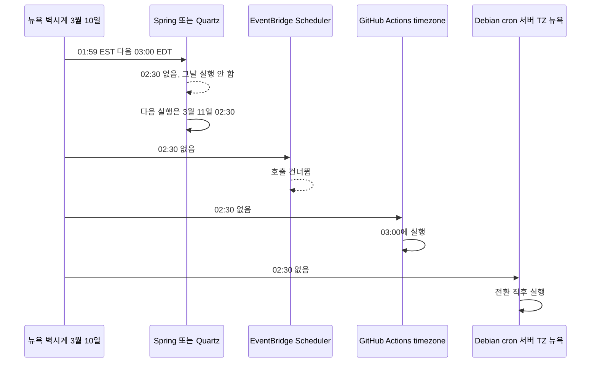
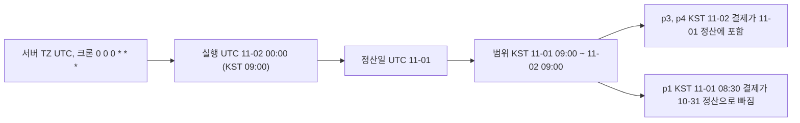
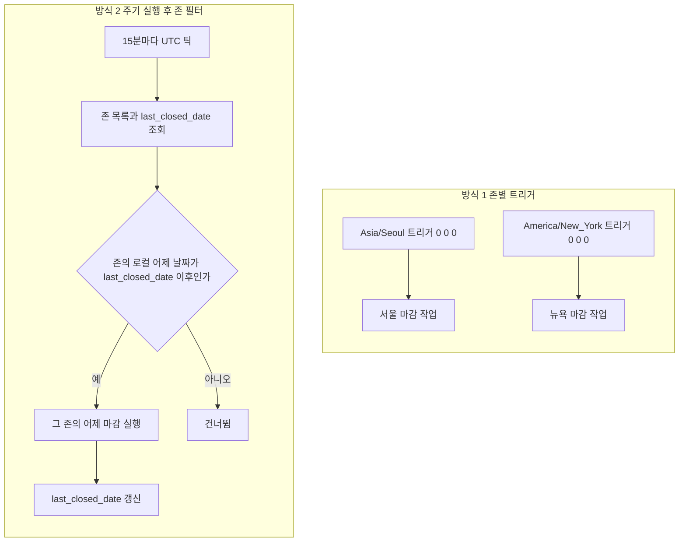
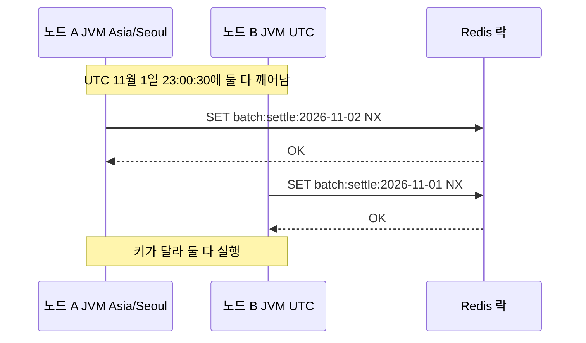

# 스케줄러와 타임존

cron 식에는 존이 없다. `0 0 * * *`는 어느 시계의 자정인지 말하지 않고, 해석은 전부 스케줄러가 한다. 같은 식을 건 서버 두 대가 9시간 차이로 도는 사고는 대부분 여기서 시작한다. DST 자체는 [DST](DST.md), 프로세스 존 설정은 [타임존 처리](Timezone_Handling.md)에 있다. 이 문서는 스케줄러가 존을 어떻게 고르는지, 전환일과 사용자 존이 섞일 때 무엇이 깨지는지, 락이 존과 만나는 지점을 다룬다.

## 스케줄러별로 cron이 해석되는 존

| 스케줄러 | 존 지정 방법 | 지정하지 않으면 | 확인한 내용 |
|---|---|---|---|
| Linux cron (Debian cron 3.0pl1) | 없음 | 서버 TZ | 이 서버의 `/usr/sbin/cron` 바이너리에서 `CRON_TZ` 문자열이 나오지 않았고 `man crontab`에도 없다 |
| Kubernetes CronJob | `spec.timeZone` (1.27 stable) | kube-controller-manager의 로컬 존 | `spec.schedule` 안의 `CRON_TZ`, `TZ`는 검증 오류로 거부된다 (공식 문서) |
| Spring `@Scheduled` | `zone` 속성 | JVM 기본 존 | 아래 실행 결과 |
| Quartz | `CronScheduleBuilder.inTimeZone` | JVM 기본 존 | 아래 실행 결과 |
| EventBridge Scheduler | `ScheduleExpressionTimezone` | UTC | 공식 문서 |
| GitHub Actions | `schedule` 항목의 `timezone` 키 | UTC | 현재 공식 문서에 IANA 존 키가 있다 |

GitHub Actions를 UTC 고정으로 알고 있는 경우가 많은데 현재 문서에는 `timezone` 키가 있다. 오래된 워크플로가 `cron: '0 15 * * *'`에 "한국 자정"이라고 주석을 단 것을 존 키로 바꿀 수 있다.

CronJob은 컨트롤 플레인이 시각을 계산하므로 앱 이미지의 존은 영향이 없다. 누락된 스케줄이 100개를 넘으면 Job을 만들지 않고 에러만 남긴다.

```yaml
apiVersion: batch/v1
kind: CronJob
metadata:
  name: daily-settlement
spec:
  schedule: "0 0 * * *"
  timeZone: "Asia/Seoul"
  concurrencyPolicy: Forbid
  startingDeadlineSeconds: 300
```

```yaml
on:
  schedule:
    - cron: "30 5 * * 1-5"
      timezone: "America/New_York"
```

```bash
aws scheduler create-schedule --name daily-settlement \
  --schedule-expression "cron(0 0 * * ? *)" \
  --schedule-expression-timezone "Asia/Seoul" \
  --flexible-time-window '{"Mode":"OFF"}' \
  --target '{"RoleArn":"...","Arn":"..."}'
```

```java
@Scheduled(cron = "0 0 0 * * *", zone = "Asia/Seoul")
public void settle() { ... }

Trigger t = TriggerBuilder.newTrigger()
    .withSchedule(CronScheduleBuilder.cronSchedule("0 0 0 * * ?")
        .inTimeZone(TimeZone.getTimeZone("Asia/Seoul")))
    .build();
```

Spring 6.1.14와 Quartz 2.3.2에서 JVM 존만 바꿔 `0 0 0 * * *`의 다음 실행을 뽑았다. 기준 시각은 2026-11-02T12:00Z다.

```text
-Duser.timezone=UTC          spring default 2026-11-03T00:00:00Z   quartz default 2026-11-03T00:00:00Z
-Duser.timezone=Asia/Seoul   spring default 2026-11-02T15:00:00Z   quartz default 2026-11-02T15:00:00Z
(zone=Asia/Seoul 명시)        spring Seoul   2026-11-02T15:00:00Z

zone 오타 "Asia/Seul"
  Spring : IllegalArgumentException: Invalid time zone specification 'Asia/Seul'
  Quartz : 예외 없음, 트리거 존이 GMT로 설정되어 2026-11-03T00:00:00Z에 발사
```

Quartz는 오타를 조용히 GMT로 바꾼다. `inTimeZone`에 넘기기 전에 `ZoneId.of(id)`로 한 번 거르는 편이 낫다. 존을 명시하지 않은 서비스는 배포 환경의 `TZ`가 바뀌면 실행 시각이 같이 움직인다.

## 전환일에 02:30 작업이 하는 일

뉴욕 존의 `02:30` 일일 작업이 2024-03-10(봄 전환)에 어떻게 되는지는 스케줄러마다 다르다. Spring·Quartz는 [DST](DST.md)의 실행 결과와 같고, 나머지는 공식 문서와 man 페이지 기준이다. 02:30이 존재하지 않는 날 각 스케줄러가 어떻게 하는지 본다.



같은 `02:30`이 건너뜀(Spring, Quartz, EventBridge), 당겨서 실행(GitHub Actions, Debian cron)으로 갈린다. 스케줄러를 바꾸면서 존만 옮기면 전환일 하루가 조용히 달라진다.

가을 전환일에는 02:30이 모호하지 않아서 문제가 되는 쪽은 01:30이다. 같은 존의 `01:30` 일일 작업은 이렇게 된다.

| 스케줄러 | 11월 3일 01:30 |
|---|---|
| Spring `CronExpression` | EDT, EST 한 시간 간격으로 두 번 |
| Quartz | EST 쪽 한 번 |
| EventBridge Scheduler | 전환 전 쪽 한 번 (문서) |
| Debian cron, 시간이 `*`인 잡 | 새 시각 기준으로 바로 돌아서 반복 구간에 다시 실행. 시각이 고정된 잡은 재실행하지 않는다 (man cron) |

Debian cron은 시계가 3시간 미만 움직일 때만 이 규칙을 쓴다. 이 환경에서 데몬을 돌려 확인하지는 못했고 man 페이지 내용이다.

## UTC 자정 정산이 하루 어긋난 사례

서버 TZ가 UTC인 인스턴스에서 `0 0 0 * * *`로 "어제 정산"을 돌렸다. 한국 사용자가 보는 정산 날짜가 계속 맞지 않았다. UTC 자정은 한국 09:00이라 정산 범위가 한국 시간 09:00~09:00이 된다. 결제 5건으로 재현했다.

| 결제 | KST 시각 | UTC 날짜 | KST 날짜 | UTC 11-01 정산 |
|---|---|---|---|---|
| p1 10,000 | 11-01 08:30 | 10-31 | 11-01 | 제외 |
| p2 20,000 | 11-01 23:50 | 11-01 | 11-01 | 포함 |
| p3 30,000 | 11-02 00:10 | 11-01 | 11-02 | 포함 |
| p4 40,000 | 11-02 08:59 | 11-01 | 11-02 | 포함 |
| p5 50,000 | 11-02 09:05 | 11-02 | 11-02 | 제외 |

UTC 배치의 11-01 합계는 90,000이고 한국 사용자 기준 11-01 실제 합계는 30,000이다. p1은 전날로 빠지고 p3, p4는 다음 날 몫이 앞날에 들어갔다.



문제는 실행 시각이 아니라 날짜를 자르는 기준이다. 정산일은 존에 속한 값이고, 범위는 그 존의 하루 시작에서 다음 날 하루 시작까지로 계산한다.

```java
LocalDate day = LocalDate.of(2026, 11, 1);
ZoneId zone = ZoneId.of("Asia/Seoul");
Instant from = day.atStartOfDay(zone).toInstant();            // 2026-10-31T15:00:00Z
Instant to   = day.plusDays(1).atStartOfDay(zone).toInstant(); // 2026-11-01T15:00:00Z
// WHERE paid_at >= :from AND paid_at < :to
```

`from + 24시간`으로 끝을 계산하면 안 된다. DST 존은 하루가 23시간이거나 25시간이다.

## 사용자 존별 마감 설계

존이 여러 개면 방법이 둘이다. 존마다 트리거를 따로 두는 방식(존별 큐)과 짧은 주기로 돌면서 마감 시각이 지난 존만 처리하는 방식이다.



방식 1은 구조가 단순하다. 존이 늘 때마다 트리거를 등록해야 하고, 로컬 자정이 존재하지 않는 날을 못 넘는다. 2026년 이 JDK의 tzdata에서 `America/Havana`는 3월 8일 00:00이 없고(`atStartOfDay`가 01:00을 돌려준다), `Africa/Cairo`는 4월 24일이 같은 식이다. Spring과 Quartz 모두 `0 0 0 * * *`를 Havana 존으로 걸면 3월 7일 다음 실행이 3월 9일이다. 11월 1일은 자정이 두 번 있는데 두 구현 모두 EST쪽 한 번만 돈다.

방식 2는 "지금이 몇 시냐"가 아니라 "마감해야 할 날이 남았느냐"를 본다. 정각 틱에서 로컬 시가 0인지 비교하는 방식(A)과 `last_closed_date` 방식(B)을 2026년 전체로 시뮬레이션했다.

| 존 | A 누락 | A 중복 | B 누락 | B 중복 |
|---|---|---|---|---|
| Asia/Seoul, Kolkata, Kathmandu | 0 | 0 | 0 | 0 |
| America/New_York, Lord_Howe, Auckland | 0 | 0 | 0 | 0 |
| America/Havana | 1 | 1 | 0 | 0 |
| Africa/Cairo | 1 | 0 | 0 | 0 |

A는 자정이 사라진 날 누락하고, 자정이 두 번인 날 두 번 마감한다. 틱에서 `LocalTime.MIDNIGHT`와 동등 비교하는 변형은 더 나쁘다. 정각 틱 7일 동안 Asia/Seoul은 7번 맞고 Asia/Kolkata(+05:30)와 Asia/Kathmandu(+05:45)는 0번이다.

```java
@Scheduled(cron = "0 */15 * * * *", zone = "UTC")
public void tick() {
    Instant now = clock.instant();
    for (ZoneSetting z : zoneRepo.findAll()) {
        LocalDate target = now.atZone(z.zoneId()).toLocalDate().minusDays(1);
        for (LocalDate d = z.lastClosed().plusDays(1); !d.isAfter(target); d = d.plusDays(1)) {
            closeDay(z, d);
        }
    }
}
```

반복문이 있어서 서버가 이틀 죽어 있다 살아나도 빠진 날을 순서대로 채운다. 이 틱은 `zone = "UTC"`를 명시한다. 틱 자체의 존은 아무 값이어도 되지만 고정해야 서버 TZ 변경에 안 흔들린다.

## 분산 락과 타임존이 만나는 지점

노드가 여러 대면 같은 틱이 동시에 뜨고, 락으로 한 노드만 일하게 한다. 락은 존과 세 군데서 만난다.

첫째는 락 키의 날짜다. 키를 `LocalDate.now()`로 만들면 노드의 JVM 존에 따라 키가 달라진다. UTC 11-01 23:00:30에 JVM 존이 UTC인 노드는 `batch:settle:2026-11-01`, Asia/Seoul인 노드는 `batch:settle:2026-11-02`를 만든다.



키는 `batch:settle:{존ID}:{마감 대상 날짜}`로 만들고 날짜는 위 `target`처럼 존에서 계산한 값을 쓴다. 노드 시계에서 `now()`를 꺼내 쓰지 않는다.

둘째는 락 만료 시각의 저장 방식이다. JDBC 락 테이블의 `lock_until`을 존 없는 `TIMESTAMP`에 `Timestamp`로 쓰면 JVM 기본 존으로 변환되어 저장된다. H2에서 JVM 존이 다른 두 프로세스로 확인했다. 락은 UTC 13:30까지이고 읽는 시각은 13:10이다.

```text
KST 노드가 쓰고 UTC 노드가 읽음
  저장된 문자열 2026-11-02 22:30:00
  TIMESTAMP          -> 22:30Z  락 유효 (남은 PT9H20M)
  TIMESTAMP WITH TZ  -> 13:30Z  락 유효 (남은 PT20M)

UTC 노드가 쓰고 KST 노드가 읽음
  저장된 문자열 2026-11-02 13:30:00
  TIMESTAMP          -> 04:30Z  락 만료로 판정
  TIMESTAMP WITH TZ  -> 13:30Z  락 유효 (남은 PT20M)
```

앞쪽은 락이 9시간 넘게 남은 것처럼 보여 작업이 멈추고, 뒤쪽은 락이 살아 있는데 만료로 보여 다른 노드가 들어온다. `TIMESTAMP WITH TIME ZONE`이나 epoch 컬럼을 쓰거나 DB 시계를 쓴다. ShedLock 문서도 `usingDbTime()`을 권장하고 그 경우 DB 서버 시계의 UTC를 쓴다고 적고 있다.

셋째는 시간 단위 작업의 락 키다. 가을 전환일 뉴욕의 05:30Z와 06:30Z는 둘 다 로컬 01:30이다.

```text
2024-11-03T05:30:00Z local=01:30 -04:00  localHourKey=2024-11-03T01  utcHourKey=2024-11-03T05
2024-11-03T06:30:00Z local=01:30 -05:00  localHourKey=2024-11-03T01  utcHourKey=2024-11-03T06
```

현지 시 키는 두 번째 실행을 막고 UTC 시 키는 둘 다 통과시킨다. 로컬 01시에 한 번만 돌아야 하는 작업이면 현지 시 키, 한 시간마다 돌아야 하는 작업이면 UTC 시 키를 쓴다.

락은 동시 실행만 막는다. TTL이 지난 뒤나 노드 재시작 후의 재실행은 막지 못하므로 날짜 단위 작업의 중복 방어는 `(zone_id, business_date)` 유니크 키로 한 번 더 건다. 마감 INSERT가 유니크 위반으로 실패하면 이미 끝난 날이라는 뜻이다.
