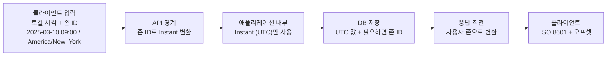
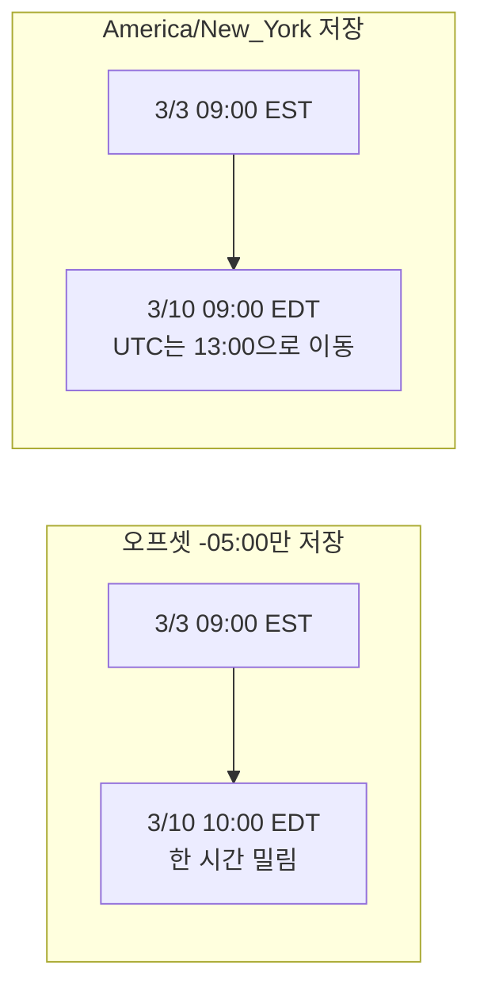
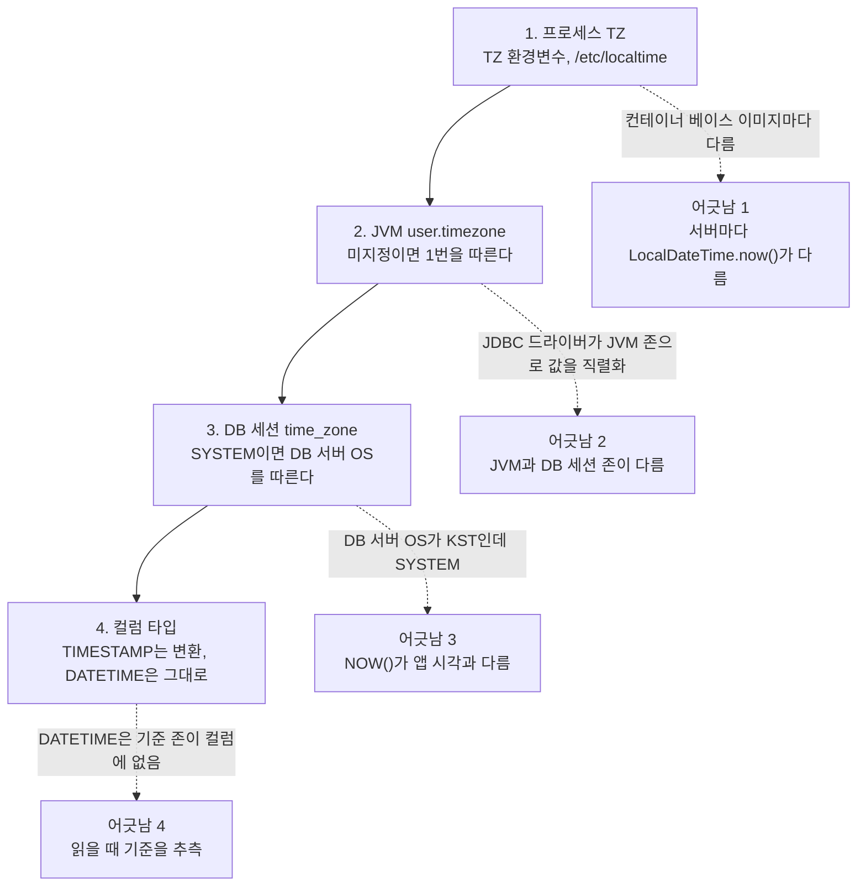
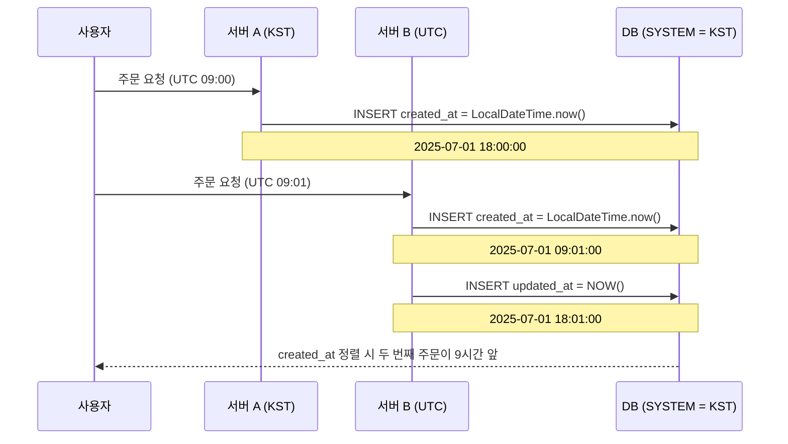
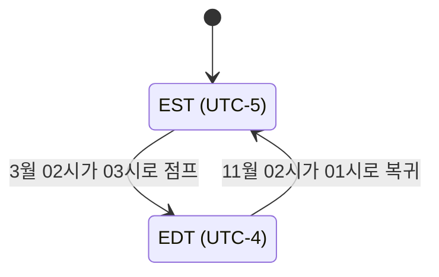

# 타임존 처리

시간 버그는 대부분 어느 층에서 타임존을 정했는지 아무도 모르는 상태에서 나온다. 로컬은 KST, 운영 서버는 UTC, DB 세션은 SYSTEM이라 서버 OS를 따라간다. 세 곳이 각자 다른 기준으로 해석하면 9시간 어긋난 데이터가 조용히 쌓인다.

## 시간이 흐르는 경로

규칙은 하나다. 경계(입력과 출력)에서만 지역 시각을 만지고, 안쪽은 전부 `Instant`(UTC)로 다룬다.



가운데 칸(내부, DB)에는 `LocalDateTime`이나 `ZonedDateTime`이 들어가지 않는다. 변환은 양쪽 끝에서 두 번만 일어난다. 여러 레이어가 각자 변환하면 이중 변환이 생기고, 어느 층이 틀렸는지 찾는 데 하루가 간다.

DB에 UTC만 저장하는 이유는 확장이다. KST로 저장된 `created_at`은 미국 리전이 붙는 순간 컬럼만 봐서는 기준을 알 수 없다. 수백만 건 중 어느 시점부터 UTC인지 가려내는 일은 마이그레이션 프로젝트가 된다.

## 무엇을 저장하는가

UTC `Instant`만 저장해도 되는 데이터와 그것만으로는 모자란 데이터가 있다.

| 데이터 | 저장 대상 | 이유 |
|---|---|---|
| 주문 시각, 로그인 시각, 결제 시각 | `Instant` (UTC) | 이미 일어난 사건이다. 한 시점으로 고정된다 |
| 회의, 예약, 알림 같은 미래 일정 | 로컬 일시 + 존 ID | 사용자가 "그 지역 벽시계로 9시"를 원했다 |
| 반복 일정의 기준 시각 | 로컬 일시 + 존 ID | 반복할 때마다 그 날의 오프셋으로 다시 계산해야 한다 |

### 오프셋만 저장했을 때

뉴욕 사용자가 매주 월요일 오전 9시 회의를 만들었다. 서버가 첫 회의를 `2025-03-03T09:00-05:00`으로 저장하고, 다음 주부터는 이 값에 7일씩 더해 만들었다. 미국 동부는 2025-03-09에 DST로 넘어간다.

```java
ZoneId ny = ZoneId.of("America/New_York");
ZonedDateTime first = ZonedDateTime.of(2025, 3, 3, 9, 0, 0, 0, ny);
OffsetDateTime stored = first.toOffsetDateTime();   // 2025-03-03T09:00-05:00

for (int w = 0; w < 3; w++) {
    OffsetDateTime byOffset = stored.plusWeeks(w);
    ZonedDateTime byZone = first.plusWeeks(w);
    System.out.println("w" + w + " 오프셋: " + byOffset.atZoneSameInstant(ny).toLocalDateTime()
        + " | 존 ID: " + byZone.toLocalDateTime());
}
```

JDK 17 실행 결과다.

```
w0 오프셋: 2025-03-03T09:00 | 존 ID: 2025-03-03T09:00
w1 오프셋: 2025-03-10T10:00 | 존 ID: 2025-03-10T09:00
w2 오프셋: 2025-03-17T10:00 | 존 ID: 2025-03-17T09:00
```

오프셋만 들고 있으면 `-05:00`이 고정이라 DST가 시작된 3월 10일부터 사용자 화면에 10시로 찍힌다. UTC 14:00은 계속 정확하지만 사용자가 원한 것은 "뉴욕 9시"였다. UTC `Instant`에 14일을 더해도 결과는 똑같이 10시다.



오른쪽 칸에서는 UTC가 14:00에서 13:00으로 움직인다. 벽시계를 지키려면 UTC 값이 움직여야 하고, 그 계산은 존 ID가 있어야 가능하다. 미래 일정은 `local_datetime`, `zone_id` 두 컬럼에 저장하고 UTC 값은 조회용 파생 컬럼으로 둔다. tzdata 규칙이 바뀌면 파생 값을 다시 계산해야 하므로 원본은 로컬 일시와 존 ID다.

## 타임존이 정해지는 4개 층

같은 `2025-07-01 09:00:00`도 어느 층이 어떤 존으로 해석하느냐에 따라 다른 순간이 된다.



점선이 어긋나는 지점이다. 1, 2는 JVM 옵션과 환경변수로, 3은 커넥션 풀 초기화 SQL로, 4는 컬럼 타입 선택으로 막는다. JVM만 UTC로 고정하고 DB 세션이 `SYSTEM`이면 `NOW()`로 들어간 값과 앱이 넣은 값이 한 테이블에서 섞인다.

## DB 컬럼 타입

### MySQL TIMESTAMP와 DATETIME

| | TIMESTAMP | DATETIME |
|---|---|---|
| 저장 범위 | 1970-01-01 ~ 2038-01-19 | 1000-01-01 ~ 9999-12-31 |
| 타임존 변환 | 저장 시 UTC로, 조회 시 세션 존으로 | 입력값 그대로 |
| 저장 용량 | 4바이트 | 5바이트 (소수초 제외, 8.0 기준) |

`TIMESTAMP`는 세션 타임존이 바뀌면 같은 row가 다르게 보인다.

```sql
SET time_zone = '+09:00';
INSERT INTO orders (created_at) VALUES ('2024-03-15 18:00:00');  -- UTC 09:00으로 저장

SET time_zone = '+00:00';
SELECT created_at FROM orders;   -- 2024-03-15 09:00:00
```

앱과 DB의 세션 존이 다르면 쓸 때와 읽을 때 서로 다른 기준으로 변환된다. `-Duser.timezone`과 DB 세션 존을 같은 값으로 고정해야 한다. 신규 테이블은 `DATETIME`에 앱이 UTC 값을 넣는 쪽이 세션 설정에 덜 의존하고, 2038년 제한이 없어 만료일 같은 먼 미래 날짜에도 맞다.

### PostgreSQL TIMESTAMPTZ

`TIMESTAMPTZ`는 이름과 달리 존 정보를 저장하지 않는다. 입력을 UTC로 바꿔 저장하고 조회할 때 세션의 `TimeZone`으로 변환한다. `TIMESTAMP WITHOUT TIME ZONE`은 숫자를 그대로 저장하므로 기준 존은 앱이 알아야 한다. 시간 컬럼은 `TIMESTAMPTZ`가 낫고 JDBC 드라이버가 `Instant`로 매핑해 준다. 미래 일정의 존 ID는 별도 컬럼이다.

## API 경계

### 형식

응답의 날짜·시간은 ISO 8601(`2024-03-15T09:30:00Z`, `2024-03-15T18:30:00+09:00`)로 낸다. 오프셋 없는 `2024-03-15 09:30:00`과 단독 유닉스 타임스탬프는 쓰지 않는다. 유닉스 시간은 초인지 밀리초인지 호출자마다 다르게 읽는다.

Jackson에서 `WRITE_DATES_AS_TIMESTAMPS`를 끄지 않으면 `Instant`가 숫자나 배열로 나가고, 프론트엔드 파싱 오류 리포트가 오기 전까지 모르는 경우가 많다.

```java
objectMapper.configure(SerializationFeature.WRITE_DATES_AS_TIMESTAMPS, false);
objectMapper.registerModule(new JavaTimeModule());
```

### 응답 시점 변환과 날짜 경계

```java
ZoneId zone = requireRegionZone(request.getHeader("X-Timezone"));
String createdAt = order.getCreatedAt()            // Instant
        .atZone(zone)
        .format(DateTimeFormatter.ISO_OFFSET_DATE_TIME);
```

"오늘 주문"의 오늘이 누구 기준인지는 서버가 정하지 않는다. UTC의 오늘은 한국 사용자에게 어제일 수 있다. 사용자 존으로 하루의 시작과 끝을 구하고 쿼리에는 `Instant`로 넘긴다.

```java
ZoneId userZone = ZoneId.of("America/Los_Angeles");
LocalDate today = LocalDate.now(userZone);
Instant start = today.atStartOfDay(userZone).toInstant();
Instant end = today.plusDays(1).atStartOfDay(userZone).toInstant();
orderRepository.findByCreatedAtBetween(start, end);
```

종료 시각을 `23:59:59`로 잡지 않고 다음 날 시작으로 잡은 것은 DST 전환일 때문이다. 그날은 23시간이거나 25시간이다.

### 존 ID만 받는 검증

`ZoneId.of()`에 헤더 값을 그대로 넘기면 잘못된 값에서 예외가 터진다. 더 곤란한 것은 예외 없이 다른 뜻으로 해석되는 값이다. EST, CST, IST 같은 약어가 그렇다.

중국 파트너사가 `2025-07-01 09:00 CST`를 보낸 적이 있다. China Standard Time(UTC+8)을 뜻했는데 우리 파서는 `DateTimeFormatter`의 `z` 패턴으로 읽었다. JDK 17에서 로케일만 바꿔 읽은 결과다.

| 입력 | 로케일 | 해석된 존 | UTC로 환산 |
|---|---|---|---|
| `09:00 CST` | en_US, ko_KR, zh_CN | America/Chicago | 14:00Z |
| `09:00 CST` | en_IN | Asia/Shanghai | 01:00Z |
| `09:00 IST` | 전부 | Africa/Abidjan | 09:00Z |
| `09:00 EST` (7월) | en_US | America/New_York (EDT 적용) | 13:00Z |

중국 CST를 시카고로 읽으면 13시간 어긋난다. 같은 문자열이 로케일에 따라 결과가 달라서 개발 PC에서 맞던 파싱이 운영에서 틀어진다. `IST`는 UTC+0 지역으로 파싱됐고 예외도 없었다. `EST`는 7월 값이 `EDT`로 해석돼 한 시간 어긋난다.

그래서 API 경계에서는 `지역/도시` 형식의 존 ID만 받는다. 약어, `+09:00` 오프셋, `Etc/GMT+9` 같은 고정 오프셋 존은 거절한다. `Etc/GMT+9`는 이름과 달리 UTC-9다(`-09:00` 실행 확인).

```java
static final Set<String> ZONE_IDS = ZoneId.getAvailableZoneIds();

static ZoneId requireRegionZone(String raw) {
    if (raw == null || raw.isBlank()) {
        throw new IllegalArgumentException("timezone이 비어 있다");
    }
    String id = raw.trim();
    boolean region = id.contains("/") && !id.startsWith("Etc/");
    if (!region && !id.equals("UTC")) {
        throw new IllegalArgumentException("약어·오프셋은 받지 않는다: " + id);
    }
    if (!ZONE_IDS.contains(id)) {
        throw new IllegalArgumentException("tzdata에 없는 존 ID: " + id);
    }
    return ZoneId.of(id);
}
```

실행해 보면 `Asia/Seoul`, `America/New_York`(공백 제거), `UTC`는 통과한다. `CST`, `IST`, `KST`, `+09:00`, `GMT+9`, `Etc/GMT+9`, `EST5EDT`는 약어·오프셋 오류로, `Asia/Seul`은 tzdata에 없다는 오류로, 빈 값과 null도 거절된다. `US/Eastern` 같은 하위 호환 별칭은 통과하므로 막으려면 허용 목록을 따로 둔다. 실패는 400으로 돌려준다. 기본값 UTC로 조용히 대체하면 화면이 어긋난 채 에러가 남지 않는다.

## 프로세스 타임존

### JVM

JVM 기본 존은 OS를 따른다. 같은 코드를 `TZ=Asia/Seoul`과 `-Duser.timezone=UTC`로 돌리면 `LocalDateTime.now()`가 `2026-11-02T20:02`와 `2026-11-02T11:02`로 9시간 벌어진다.

```bash
java -Duser.timezone=UTC -jar app.jar
TZ=UTC java -jar app.jar
```

```
spring.datasource.url=jdbc:mysql://host:3306/db?serverTimezone=UTC
```

### Node.js

Node는 `TZ` 환경변수로 정한다. `new Date()`의 값은 UTC 기반이지만 `toString()`과 `toLocaleString()`은 로컬 존으로 출력되므로 `TZ`를 안 정한 서버의 로그는 OS 존으로 찍힌다. 변환은 `date-fns-tz`나 `luxon`을 쓴다. `Temporal`은 Node 18·20·22·24에서 플래그 없이는 전역에 없다(실측). `moment-timezone`은 새 프로젝트에 쓰지 않는다.

```typescript
import { formatInTimeZone } from 'date-fns-tz';
formatInTimeZone(new Date('2024-03-15T09:30:00Z'), 'Asia/Seoul', "yyyy-MM-dd'T'HH:mm:ssxxx");
// "2024-03-15T18:30:00+09:00"
```

## 다중 서버 불일치 트러블슈팅

서버 A는 KST, 서버 B는 UTC, DB 서버 OS는 KST에 세션 존이 `SYSTEM`이다. 사용자가 UTC 09:00(KST 18:00)에 주문 두 건을 연달아 넣으면 서로 다른 시각이 기록된다.



같은 DATETIME 컬럼에 18:00과 09:01이 들어갔다. 정렬하면 나중 주문이 먼저 나오고, 서버 B가 쓴 row는 `created_at`(09:01)과 `updated_at`(18:01)이 9시간 벌어진다. 같은 Instant에서 `LocalDateTime`이 KST로 18:00, UTC로 09:00이 되는 부분은 직접 실행해 확인했다.

### 서버 타임존 진단

```bash
date; timedatectl      # OS 존
ps aux | grep java     # -Duser.timezone 유무
printenv TZ
```

원인은 대개 AMI를 만든 리전이 다르거나 컨테이너 베이스 이미지가 다른 경우다. 인프라에서 강제로 맞춘다.

```bash
sudo timedatectl set-timezone UTC
```

```dockerfile
RUN ln -snf /usr/share/zoneinfo/UTC /etc/localtime && echo UTC > /etc/timezone
ENV TZ=UTC
```

```yaml
env:
  - name: TZ
    value: "UTC"
  - name: JAVA_TOOL_OPTIONS
    value: "-Duser.timezone=UTC"
```

쿠버네티스에서 `JAVA_OPTS`는 이미지의 실행 스크립트가 읽어 줄 때만 적용된다. 스크립트가 없는 이미지에서는 `JAVA_TOOL_OPTIONS`가 JVM에 직접 읽힌다.

### 배치가 서버마다 다른 시각에 실행될 때

Quartz 크론 `0 0 2 * * ?`는 JVM 기본 존의 2시다. 서버 A(UTC)는 UTC 02:00, 서버 B(KST)는 UTC 17:00에 돈다. 트리거에 존을 명시한다.

```java
CronScheduleBuilder.cronSchedule("0 0 2 * * ?")
    .inTimeZone(TimeZone.getTimeZone("UTC"));
```

### DB 세션 존 강제

```sql
SELECT @@session.time_zone, @@global.time_zone;
```

`SYSTEM`이면 DB 서버 OS 존이다. 마스터와 레플리카의 글로벌 존이 다르면 `TIMESTAMP` 조회값이 서버마다 달라진다. HikariCP 초기화 SQL로 커넥션마다 세션 존을 고정하는 것이 가장 확실하다.

```yaml
spring:
  datasource:
    hikari:
      connection-init-sql: "SET time_zone='+00:00'"
```

## DST 전환일에 깨지는 것

한국은 DST가 없어 국내 서비스는 이 버그를 겪지 않는다. 미국·유럽 사용자가 있으면 전환일을 테스트에 넣는다.



봄 전환에서는 02시대가 사라지고, 가을 전환에서는 01시대가 두 번 지나간다.

- 봄: `America/New_York` 기준 "매일 02:00 배치"는 그날 존재하지 않는 시각이다. 스케줄러에 따라 건너뛰거나 에러를 내거나 한 시간 늦게 돈다. UTC로 스케줄하면 이 문제가 없다.
- 가을: 로컬 시각만 저장하면 `2024-11-03T01:30:00`이 두 건 생기고 선후를 알 수 없다. UTC로 저장하면 두 건의 값이 다르다. 로컬 시각을 존으로 해석하다가 모호한 경우 `ZonedDateTime.ofLocal(...)`은 이른 쪽 오프셋을 고르므로, 늦은 쪽이 필요하면 `withLaterOffsetAtOverlap()`을 호출한다.

`ZoneOffset.of("+04:00")`는 어느 지역인지 모르므로 DST를 적용할 수 없고, `ZoneId.of("America/New_York")`는 날짜에 따라 `-05:00`과 `-04:00`을 계산한다.

## 사용자 타임존 전달

사용자 프로파일에 `timezone VARCHAR(64)`로 `Asia/Seoul` 같은 IANA ID를 저장하고, 인증 필터에서 `RequestContext`에 올려 응답 직렬화에서 쓴다. 가입 때 선택시키거나 브라우저의 `Intl.DateTimeFormat().resolvedOptions().timeZone` 값을 받고, 어느 쪽이든 `requireRegionZone`을 거친다.

모바일과 SPA가 `X-Timezone: America/Chicago` 헤더로 보내면 서버가 존 상태를 들고 있을 필요가 없다. 대신 기기 설정이 바뀌면 같은 사용자의 응답 시각이 바뀐다. 헤더가 없을 때는 400을 돌려주거나 프로파일 값으로 대체하고, 어느 쪽인지 API 명세에 적는다.
