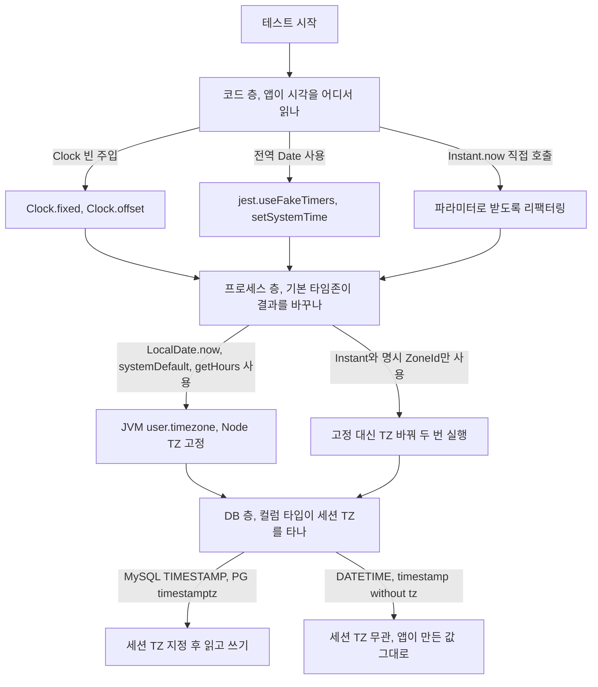
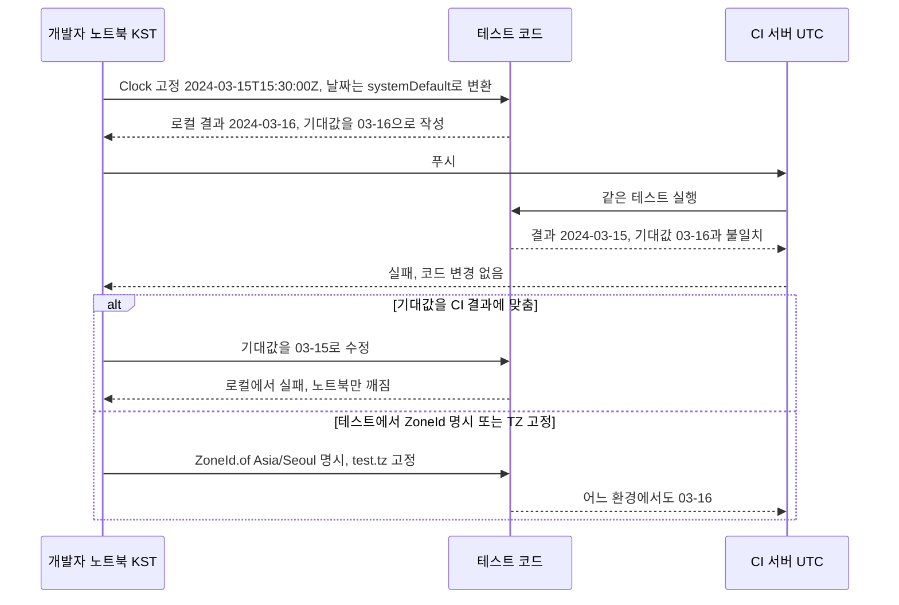

# 타임존 테스트

타임존 버그는 자정, 월말, DST 전환일 같은 경계에서만 터진다. 그 시각을 재현하려면 시계를 고정해야 하는데, 시계는 한 군데에만 있지 않다. 코드가 읽는 현재 시각, 프로세스의 기본 타임존, DB 세션의 타임존이 따로 있고, 하나만 고정하면 나머지가 결과를 바꾼다. 이 문서는 세 층을 각각 고정하는 방법과, 고정하지 않았을 때 어디서 깨지는지를 다룬다.

## 시각을 고정하는 세 층

테스트가 결과를 흔드는 변수를 층별로 나누면 아래 순서로 판단한다. 위에서 아래로 내려가며 해당하는 층만 고정하면 된다.



## 코드 층 - Clock 주입

`Instant.now()`를 서비스 안에서 직접 부르면 테스트가 시각을 바꿀 방법이 없다. `Clock`을 생성자로 받고 `Instant.now(clock)`으로 읽는다. 프로덕션은 `Clock.systemUTC()`, 테스트는 `Clock.fixed()`다.

```java
@Service
public class OrderService {
    private final Clock clock;
    private final OrderRepository orderRepository;

    public OrderService(Clock clock, OrderRepository orderRepository) {
        this.clock = clock;
        this.orderRepository = orderRepository;
    }

    public Order createOrder(Long userId) {
        return orderRepository.save(new Order(userId, Instant.now(clock)));
    }
}

@Configuration
public class ClockConfig {
    @Bean
    public Clock clock() {
        return Clock.systemUTC();
    }
}
```

단위 테스트는 Spring 없이 고정 Clock을 직접 넣는다. 시간 경과가 필요한 로직은 `Clock.offset()`으로 원본을 건드리지 않고 이동한 Clock을 만든다.

```java
@Test
void 30일_후_쿠폰이_만료된다() {
    Clock issued = Clock.fixed(Instant.parse("2024-01-01T00:00:00Z"), ZoneOffset.UTC);
    Coupon coupon = couponService.issue(userId, issued);

    assertThat(coupon.isExpired(Clock.offset(issued, Duration.ofDays(29)))).isFalse();
    assertThat(coupon.isExpired(Clock.offset(issued, Duration.ofDays(30)))).isTrue();
}
```

통합 테스트는 `@TestConfiguration`에 `@Primary` Clock을 둔다. `@Primary`가 없으면 `NoUniqueBeanDefinitionException`이 난다. 테스트마다 시각이 달라야 하면 `@MockBean Clock`에서 `instant()`와 `getZone()`을 둘 다 스텁한다. `getZone()`을 빼먹으면 null이 나와 `LocalDate.now(clock)` 계열에서 NPE가 난다. `@MockBean`은 Context 캐시를 분리시키므로 클래스가 많으면 테스트 시간이 늘어난다.

```java
@SpringBootTest
class OrderServiceMockClockTest {
    @MockBean Clock clock;
    @Autowired OrderService orderService;

    @Test
    void 특정_시각_기준_주문_처리() {
        Instant target = Instant.parse("2024-12-31T14:59:59Z");
        when(clock.instant()).thenReturn(target);
        when(clock.getZone()).thenReturn(ZoneOffset.UTC);

        assertThat(orderService.createOrder(1L).getCreatedAt()).isEqualTo(target);
    }
}
```

Clock을 주입해도 하위 헬퍼가 `Instant.now()`를 직접 부르면 고정 시각과 실제 시각이 섞인다. 시각이 필요한 곳은 호출 스택 맨 위에서 한 번 읽고 `Instant` 파라미터로 내려보낸다.

```java
public void process() {
    Instant now = clock.instant();
    helper.doSomething(now);   // 헬퍼 안에서 Instant.now() 금지
}
```

Node에서는 `jest.useFakeTimers()`와 `jest.setSystemTime()`이 같은 역할이다. `afterEach`에서 `jest.useRealTimers()`로 복원한다.

```typescript
afterEach(() => jest.useRealTimers());

it('주문 생성 시각이 UTC ISO 형식으로 저장된다', () => {
    jest.useFakeTimers();
    jest.setSystemTime(new Date('2024-03-15T09:00:00Z'));

    expect(service.createOrder(1).createdAt).toBe('2024-03-15T09:00:00.000Z');
});
```

## 프로세스 층 - 기본 타임존 고정

Clock을 고정해도 `LocalDate.now(clock)`의 zone이 `systemDefault()`이면 결과가 JVM 타임존에 따라 달라진다. 같은 `2024-03-15T15:30:00Z`를 `LocalDate.ofInstant(i, ZoneId.systemDefault())`로 바꾸면 `TZ=UTC`에서 3월 15일, `TZ=Asia/Seoul`에서 3월 16일, `TZ=America/New_York`에서 3월 15일이 나온다. `-Duser.timezone`을 주면 `TZ` 환경변수보다 우선한다.

```groovy
// build.gradle
tasks.withType(Test).configureEach {
    systemProperty 'user.timezone', System.getProperty('test.tz', 'UTC')
}
// 실행: ./gradlew test -Dtest.tz=Asia/Seoul
```

Jest는 테스트 파일 안에서 `process.env.TZ`를 바꿔도 적용되지 않는다. Node 20에서 일반 스크립트는 실행 중에 바꿔도 반영되지만, Jest 샌드박스 안에서는 `TZ=UTC`로 띄운 뒤 파일 안에서 `Asia/Seoul`로 바꿔도 `getDate()`가 UTC 기준으로 나왔다. 테스트는 통과하는데 검증 대상이 UTC로 돌고 있는 상태가 된다. 실행 환경변수나 `globalSetup`으로 준다.

```javascript
// jest.global-setup.js  (jest.config.js 의 globalSetup 에 등록)
module.exports = async () => {
    process.env.TZ = process.env.TEST_TZ || 'UTC';
};
```

```json
{ "scripts": { "test:kst": "TZ=Asia/Seoul jest", "test:utc": "TZ=UTC jest" } }
```

## DB 층 - 세션 타임존

컬럼 타입에 따라 세션 TZ를 타는지가 갈린다. 타는 컬럼은 세션 TZ를 바꿔서 같은 값을 읽고 써야 검증이 된다.

| 컬럼 타입 | 세션 TZ 영향 | 테스트에서 볼 것 |
|---|---|---|
| MySQL `TIMESTAMP` | 저장 때 UTC로 변환, 읽을 때 세션 TZ로 변환 | 세션 TZ를 바꿔 읽어도 `Instant`가 같은가 |
| MySQL `DATETIME` | 없음. 넣은 문자열 그대로 | 앱이 UTC로 변환해서 넣었는가 |
| PostgreSQL `timestamptz` | 출력 표현만 세션 TZ를 따름 | JDBC가 `Instant`로 읽을 때 값이 같은가 |
| PostgreSQL `timestamp` | 없음 | `LocalDateTime`이 어느 TZ 기준 값인지 |

```java
// Hibernate가 JDBC로 보내는 시각의 기준을 고정
// spring.jpa.properties.hibernate.jdbc.time_zone: UTC
@Test
@Transactional
void 세션_TZ가_달라도_같은_Instant를_읽는다() {
    Instant saved = Instant.parse("2024-03-15T14:59:59Z");
    Long id = orderRepository.save(new Order(1L, saved)).getId();
    em.flush(); em.clear();

    jdbcTemplate.execute("SET time_zone = '+09:00'");   // PostgreSQL은 SET TIME ZONE 'Asia/Seoul'
    assertThat(orderRepository.findById(id).orElseThrow().getCreatedAt()).isEqualTo(saved);
}
```

`SET`은 해당 커넥션에만 걸린다. `@Transactional` 테스트처럼 커넥션이 같아야 하고, 풀에서 다른 커넥션이 나오면 세션 TZ가 그대로다.

## 로컬에서만 통과하거나 CI에서만 실패하는 흐름

개발자 노트북은 KST, CI는 UTC인 환경에서 시각 고정이 한 층만 되어 있으면 이 순서로 흘러간다. 기대값을 어느 쪽 결과에 맞추든 다른 쪽이 깨진다는 점을 보면 된다.



반대 방향도 있다. 로컬에서 Jest 파일 안에 `process.env.TZ`를 넣어 KST 검증을 하는 것처럼 보였는데, 실제로는 노트북 TZ 덕에 통과하고 CI(UTC)에서만 날짜가 하루 어긋나는 경우다. 두 방향 모두 CI 잡을 `TZ=UTC`와 `TZ=Asia/Seoul` 두 번 돌리면 드러난다.

## 테스트 매트릭스

전 조합을 다 돌릴 수는 없다. 아래는 조합별로 무엇이 깨지는지 정리한 것이다. 세 층이 모두 같은 TZ인 조합이 가장 위험하다.

| 서버 TZ | DB 세션 TZ | 사용자 TZ | DST 전환일 | 깨지는 것 |
|---|---|---|---|---|
| UTC | UTC | KST | 해당 없음 | 기준선. KST 자정이 UTC 15:00이라 일별 쿼리 범위만 확인 |
| KST | UTC | KST | 해당 없음 | `LocalDateTime.now()`로 넣은 DATETIME을 UTC 환경(CI, 다른 서비스)이 읽으면 9시간 어긋남 |
| UTC | KST | KST | 해당 없음 | MySQL TIMESTAMP를 드라이버와 세션이 다른 TZ로 해석하면 ±9시간. DATETIME은 영향 없음 |
| KST | KST | KST | 해당 없음 | 세 층이 같아 변환 누락이 전부 가려짐. 로컬 전부 통과하는 가장 위험한 조합 |
| UTC | UTC | America/New_York | 봄 | 하루가 23시간. `plus(24h)`와 `plusDays(1)` 결과가 다름. 02:30 로컬 예약이 03:30으로 이동 |
| UTC | UTC | America/New_York | 가을 | 하루가 25시간. 01:30이 두 번. 로컬 시각 키가 중복되고 일별 버킷이 25시간 |
| America/New_York | UTC | KST | 전환일 | 서버 로컬 시각 기준 스케줄이 건너뛰거나 중복 실행될 수 있음 |
| KST | UTC | America/New_York | 해당 없음 | `systemDefault()`를 쓰는 곳이 있으면 사용자 날짜가 서버 날짜로 집계됨 |

## 경계값 목록

경계값은 UTC 기준 `Instant`로 적고, 판정할 `ZoneId`를 항상 같이 적는다.

| 경계 | 입력 | 기대값 | 깨지는 곳 |
|---|---|---|---|
| 자정 직전/직후 (KST) | `2024-03-15T14:59:59.999Z` / `15:00:00Z` | 15일 / 16일 | 상한을 포함하는 `BETWEEN` |
| 월말 (KST) | `2024-01-31T14:59:59Z` / `15:00:00Z` | 1월 31일 / 2월 1일 | UTC로 끊은 월 집계 |
| 윤년 2/29 | `2024-02-29`, `2023-02-28 + 1일` | 2월 29일, 3월 1일 | `plusYears(1)`은 2025-02-28, 1/31 `plusMonths(1)`은 2/29 |
| 연말 ISO week-year | `2024-12-30`, `2021-01-01` | 2025-W01, 2020-W53 | 포맷 패턴 `YYYY`가 2025를 냄. 달력 연도는 `yyyy` |
| gap (봄) | `2024-03-10T02:30` NY | `03:30-04:00` | 로컬 시각으로 만든 예약 |
| overlap (가을) | `2024-11-03T01:30` NY | 기본 `-04:00`, `withLaterOffsetAtOverlap()`은 `-05:00` | 로컬 시각 키, 정렬 |
| 하루 길이 | NY 3/10, 11/3 일 시작~다음 날 시작 | 23시간, 25시간 | 24시간 가정 |
| 자정이 없는 날 | `America/Sao_Paulo` 2018-11-04 `atStartOfDay` | `01:00-02:00` | "하루의 시작은 00:00" 가정 |

날짜 범위 쿼리는 상한을 포함하지 않아야 한다. Spring Data의 `findByCreatedAtBetween`은 양끝을 포함해서, 다음 날 자정에 생성된 주문이 오늘 목록에 들어온다.

```java
@Test
void 자정_경계_주문은_다음_날로_분류된다() {
    ZoneId seoul = ZoneId.of("Asia/Seoul");
    Order late = createOrderAt(Instant.parse("2024-03-15T14:59:59Z"));
    Order next = createOrderAt(Instant.parse("2024-03-15T15:00:00Z"));

    LocalDate day = LocalDate.of(2024, 3, 15);
    Instant from = day.atStartOfDay(seoul).toInstant();
    Instant to = day.plusDays(1).atStartOfDay(seoul).toInstant();

    List<Order> orders = orderRepository
        .findByCreatedAtGreaterThanEqualAndCreatedAtLessThan(from, to);

    assertThat(orders).contains(late).doesNotContain(next);
}
```

DST gap과 overlap은 UTC로 저장하면 순서가 보장되고, 로컬 시각으로 저장하면 두 건이 구분되지 않는다.

```java
@Test
void 가을_전환_중복_시각이_UTC로_구분된다() {
    ZoneId ny = ZoneId.of("America/New_York");
    Instant first = Instant.parse("2024-11-03T05:30:00Z");    // 01:30 EDT
    Instant second = Instant.parse("2024-11-03T06:30:00Z");   // 01:30 EST

    assertThat(first.atZone(ny).toLocalDateTime())
        .isEqualTo(second.atZone(ny).toLocalDateTime());
    assertThat(first).isBefore(second);
}

@Test
void 봄_전환_존재하지_않는_시각은_예외없이_밀린다() {
    ZonedDateTime z = ZonedDateTime.of(LocalDateTime.of(2024, 3, 10, 2, 30),
                                       ZoneId.of("America/New_York"));
    assertThat(z.getHour()).isEqualTo(3);
    assertThat(z.getOffset()).isEqualTo(ZoneOffset.of("-04:00"));
}
```

Node는 같은 경계를 `it.each`로 돌린다. TZ는 위에서 말한 대로 실행 환경에서 고정해 둔다.

```typescript
const boundaries = [
    { desc: 'KST 자정 직전', utc: '2024-03-15T14:59:59.999Z', expected: '2024-03-15' },
    { desc: 'KST 자정',      utc: '2024-03-15T15:00:00.000Z', expected: '2024-03-16' },
    { desc: 'KST 1월 말',    utc: '2024-01-31T14:59:59.999Z', expected: '2024-01-31' },
    { desc: 'KST 2월 초',    utc: '2024-01-31T15:00:00.000Z', expected: '2024-02-01' },
    { desc: 'KST 연말',      utc: '2024-12-31T14:59:59.999Z', expected: '2024-12-31' },
    { desc: 'KST 연초',      utc: '2024-12-31T15:00:00.000Z', expected: '2025-01-01' },
    { desc: '윤년 2월 말',   utc: '2024-02-29T14:59:59.999Z', expected: '2024-02-29' },
];

it.each(boundaries)('$desc에 KST 날짜를 반환한다', ({ utc, expected }) => {
    jest.useFakeTimers();
    jest.setSystemTime(new Date(utc));
    expect(dateService.getTodayInKST()).toBe(expected);
});
```

## 오프셋만 받는 API

사용자 타임존을 `+09:00`으로만 받으면 DST 전환일 테스트를 쓸 수 없다. `America/New_York`은 여름 `-04:00`, 겨울 `-05:00`이라 오프셋 하나로는 전환일 이후 시각을 되돌릴 수 없다. DST 지역 사용자가 있으면 타임존 ID를 받고, 테스트 케이스도 오프셋이 아니라 ID로 쓴다.
