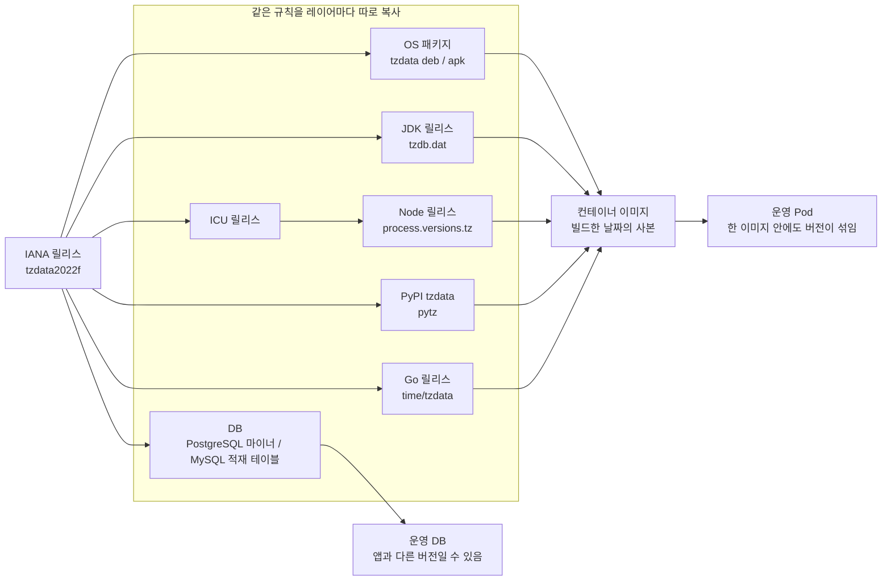
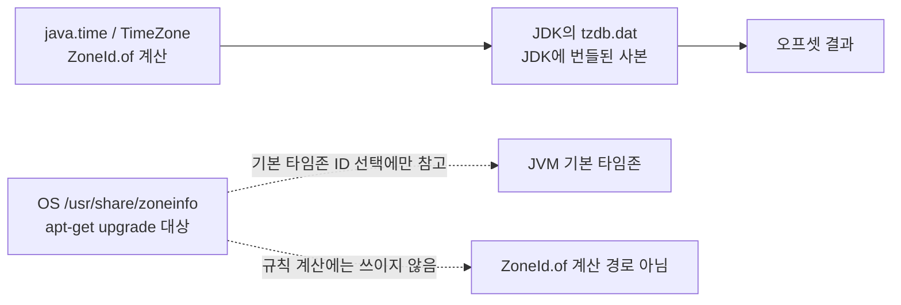
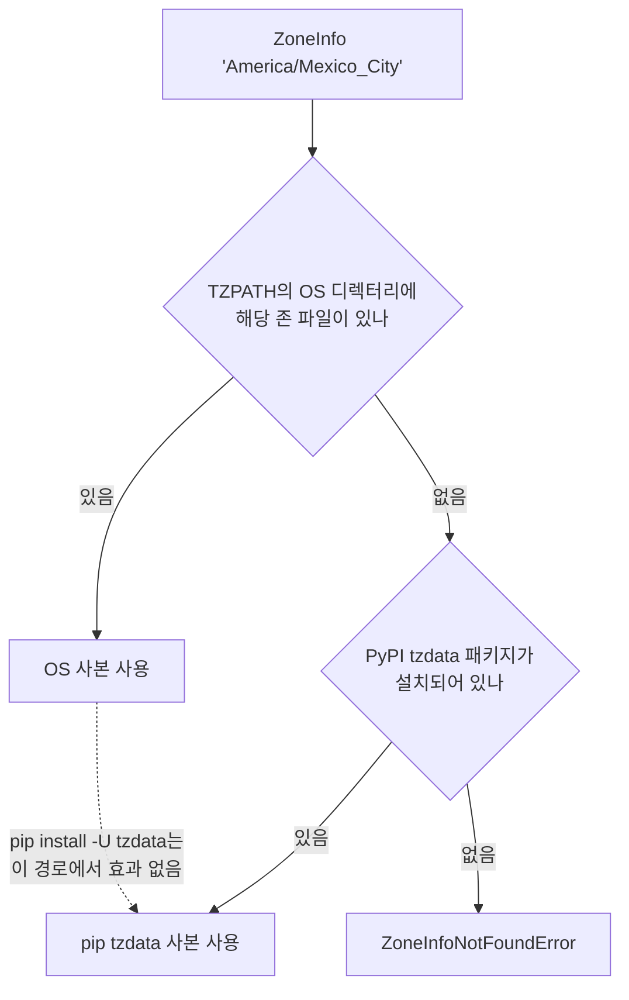
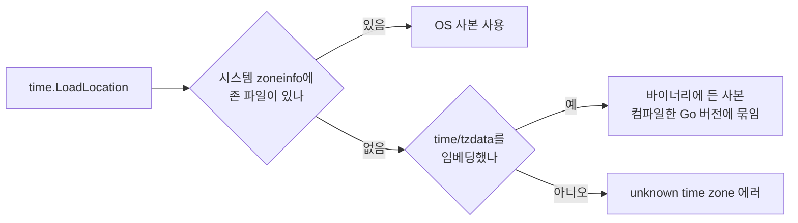
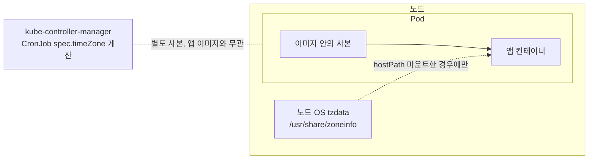
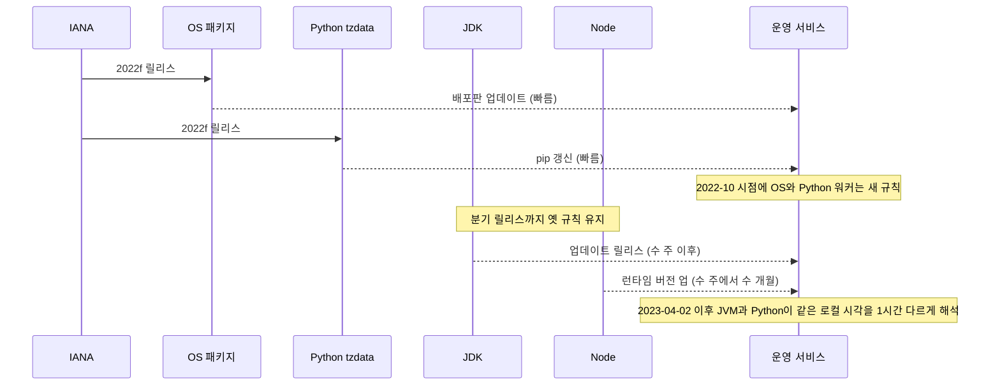
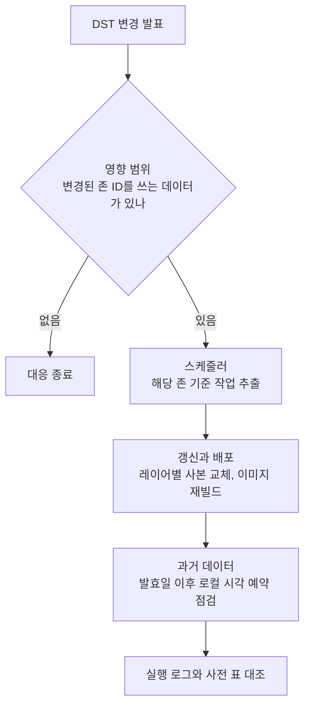
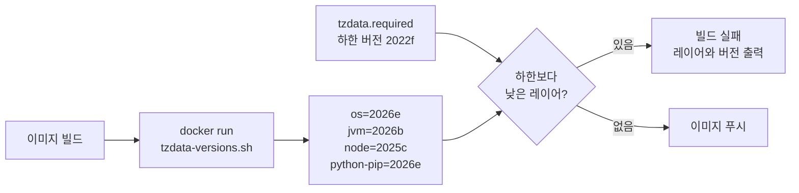

# tzdata 버전 관리

tzdata는 IANA가 관리하는 타임존 데이터베이스다. 지역별 UTC 오프셋, DST 전환 규칙, 과거 변경 이력이 들어 있다. 정부가 DST를 없애거나 표준시를 바꾸면 IANA가 새 버전(`2022f`, `2024a` 같은 이름)을 내고, 이 규칙을 복사해 가진 쪽이 각자 갱신해야 새 규칙으로 계산한다.

문제는 복사본이 한 군데가 아니라는 점이다. OS, JDK, Node.js의 ICU, Python의 `tzdata` 패키지, Go 바이너리, DB가 각자 사본을 들고 있고 갱신 주기도 다르다. 타임존 ID를 `America/Mexico_City`로 정확히 써도 어느 사본을 읽느냐에 따라 오프셋이 달라진다. 에러는 나지 않고 값만 한 시간 틀린다. 이 문서는 사본이 어디에 있는지, 버전을 어떻게 읽는지, 어긋났을 때 어떻게 막는지를 다룬다. DST 규칙 자체는 [DST](DST.md), 저장 방식은 [UTC 저장](UTC_Storage.md)에서 다룬다.

## 규칙이 운영에 닿기까지

IANA 릴리스 하나가 운영 서버에 도달하는 길은 하나가 아니다. 각 레이어가 자기 릴리스 주기에 맞춰 사본을 만들고, 그 사본들이 컨테이너 이미지 안에서 다시 만난다.



도식에서 볼 부분은 가운데 상자 안이다. IANA에서 갈라진 화살표가 레이어마다 다른 속도로 이미지에 모이고, 이미지가 빌드된 날짜에 각 사본이 어느 버전이었는지가 그대로 굳는다. 같은 이미지 안의 OS, JVM, Node가 서로 다른 버전을 들고 있는 경우가 흔하다. DB는 이미지 경로를 아예 타지 않는다.

이 서버에서 직접 찍어본 값이다. 한 대의 같은 호스트인데 레이어마다 다르다.

| 레이어 | 읽은 방법 | 값 |
|---|---|---|
| OS (Ubuntu 22.04) | `tzdata.zi` 첫 줄 | 2026e |
| Python `tzdata` 패키지 | `tzdata.IANA_VERSION` | 2026e |
| JDK 17 | `ZoneRulesProvider` | 2026b |
| Node 20 | `process.versions.tz` | 2025c |

OS에서 `apt-get upgrade`를 해도 JDK와 Node 값은 움직이지 않는다. 이 표가 이 문서가 다루는 문제의 전부다.

## 레이어별 확인과 갱신

| 레이어 | 버전 확인 | 갱신 | 갱신 단위 |
|---|---|---|---|
| OS (Debian·Ubuntu) | `head -1 /usr/share/zoneinfo/tzdata.zi` | `apt-get install --only-upgrade tzdata` | 패키지 하나 |
| OS (Alpine) | 같은 파일, 또는 `apk info tzdata` | `apk add --upgrade tzdata` | 패키지 하나 |
| JDK | `ZoneRulesProvider.getVersions("UTC").lastKey()` | JDK 업데이트 릴리스로 교체 (JDK 8은 TZUpdater 가능) | JDK 전체 |
| Node.js | `process.versions.tz` | Node 버전 올리기 | 런타임 전체 |
| Python `tzdata` | `tzdata.IANA_VERSION` | `pip install -U tzdata` | 패키지 하나 |
| Python `pytz` | `pytz.OLSON_VERSION` | `pip install -U pytz` | 패키지 하나 |
| Go (`time/tzdata`) | 바이너리에서 읽는 API 없음 | Go 버전 올리고 재빌드 | 바이너리 재빌드 |
| PostgreSQL | 프로브 쿼리 (아래 DB 절) | 마이너 버전 업그레이드 | DB 서버 |
| MySQL | 프로브 쿼리 | `mysql_tzinfo_to_sql`로 재적재 후 재시작 | 테이블 |

갱신 단위가 큰 레이어일수록 늦어진다. tzdata 하나 때문에 JDK나 Node를 통째로 올리는 일은 부담이라 미뤄지고, 그 사이 OS와 pip 쪽만 새 버전이 되어 어긋난다. 위 표에서 "패키지 하나"인 레이어는 금방 올라가고 "런타임 전체"인 레이어가 뒤처진다.

## OS tzdata

### Debian·Ubuntu

버전은 `/usr/share/zoneinfo/tzdata.zi`의 첫 줄에 `# version 2026e` 형태로 있다. 예전 자료에 `+VERSION` 파일이 나오는데 Ubuntu 22.04에는 없다. `dpkg -l tzdata`의 패키지 버전은 `2026e-0ubuntu0.22.04.1`처럼 배포판 접미사가 붙으니 IANA 버전을 비교할 때는 `tzdata.zi` 쪽이 낫다.

```bash
head -1 /usr/share/zoneinfo/tzdata.zi
# version 2026e
```

`TZ` 환경변수나 `/etc/localtime`은 기본 타임존을 고를 뿐이고, 규칙 파일은 `/usr/share/zoneinfo/` 아래에 있다. Docker 빌드에서 tzdata 설치가 지역 선택 프롬프트를 띄워 멈추는 일이 있으므로 `DEBIAN_FRONTEND=noninteractive`를 붙인다.

```dockerfile
RUN DEBIAN_FRONTEND=noninteractive apt-get update \
    && apt-get install -y tzdata \
    && rm -rf /var/lib/apt/lists/*
```

### Alpine

Alpine 기본 이미지에는 tzdata가 없다. OS tzdata를 읽는 런타임(Python `zoneinfo`, 임베딩하지 않은 Go)은 Alpine에서 `ZoneInfoNotFoundError`나 `unknown time zone`을 낸다. `apk add --no-cache tzdata`로 설치한다. 버전 확인은 Debian 계열과 같은 `tzdata.zi`를 쓴다.

## JVM

JDK는 규칙을 `$JAVA_HOME/lib/tzdb.dat`에서 읽는다. `java.time`과 `java.util.TimeZone` 모두 이 파일을 쓴다. OS의 `/usr/share/zoneinfo/`는 기본 타임존 ID를 정할 때만 참고한다. 그래서 OS tzdata를 최신으로 올려도 JVM의 `ZoneId.of("America/Mexico_City")` 계산은 JDK에 들어 있던 사본 그대로다.

도식에서 OS 사본으로 가는 화살표가 계산이 아니라 기본 타임존 ID 선택에서 끝나는 점을 보면 된다.



예전 자료에 JDK 9 이후로는 tzdata 버전을 알 방법이 없다고 나오는데 틀렸다. `ZoneRulesProvider`가 버전을 키로 돌려준다.

```java
import java.time.zone.ZoneRulesProvider;

public class TzProbe {
    public static void main(String[] args) {
        System.out.println(ZoneRulesProvider.getVersions("UTC").lastKey());
    }
}
```

이 서버(JDK 17.0.20)에서는 `2026b`가 나왔다. 키 하나짜리 맵이라 `lastKey()`가 곧 번들된 버전이다. JRE만 있는 이미지에는 `javac`와 소스 런처가 없으니 빌드 단계에서 클래스로 컴파일해 이미지에 넣어 둔다. 파이프라인 절에서 다시 쓴다.

`-Djava.util.TimeZone.useSystemTz=true`로 JVM이 OS 사본을 따라가게 만든다는 설명이 돌아다니는데, 이 옵션이 규칙 파일 위치를 바꿔 준다고 확인되는 근거를 찾지 못했다. 이 옵션에 기대지 말고 JDK를 올린다.

### 갱신 방법

배포판마다 다르다.

- Oracle JDK 8 계열은 `java -jar tzupdater.jar -u`로 `tzdb.dat`를 제자리에서 갱신한다. 새 JDK는 업데이트 릴리스에 새 사본이 실려 나오므로 TZUpdater 대상이 아니다.
- Corretto와 Temurin은 별도 tzdata 패키지가 없다. JDK 패키지를 올리면 사본도 같이 올라온다.
- `tzdb.dat`를 손으로 바꿔치기하는 방법은 파일을 만드는 도구와 절차를 직접 관리해야 해서 권하지 않는다. 릴리스 자동화에 엮지 않으면 한 번 하고 잊힌다.

JDK 업데이트 릴리스는 분기 단위로 나오고, IANA 릴리스에서 JDK 반영까지는 시차가 있다. 급한 DST 변경이 터졌을 때 JDK가 가장 늦게 따라오는 경우가 많다. 이 시차를 줄일 수 없으니 새 JDK가 나올 때까지 영향 타임존을 쓰는 기능만 임시로 막거나 우회하는 쪽을 미리 정해 둬야 한다.

## Python

`zoneinfo`(3.9+)는 `TZPATH`에 잡힌 OS 디렉터리를 먼저 보고, 없으면 PyPI의 `tzdata` 패키지로 내려간다. OS 사본이 있으면 pip 사본은 읽지 않는다. 그러니 이미지에 OS tzdata가 있는데 `pip install -U tzdata`만 하면 아무 효과가 없다. 어느 쪽을 읽는지는 확인해 봐야 한다.

아래 도식은 `zoneinfo`가 사본을 고르는 순서다. 첫 분기에서 OS 사본이 잡히면 pip 사본은 아예 읽히지 않는다.



```python
from zoneinfo import TZPATH
import tzdata
print(TZPATH)               # ('/usr/share/zoneinfo', ...) 가 있으면 OS 우선
print(tzdata.IANA_VERSION)  # pip 사본의 IANA 버전
```

`tzdata` 패키지의 PyPI 버전은 `2024.1`(= 2024a), `2024.2`(= 2024b) 식으로 올라간다. IANA 버전은 `tzdata.IANA_VERSION`으로 직접 읽는 편이 변환 실수가 없다. `pytz`는 별도로 사본을 번들하고 `pytz.OLSON_VERSION`이 IANA 버전(`2026e`), `pytz.__version__`이 PyPI 버전(`2026.5`)이라 두 값을 헷갈리기 쉽다.

`requirements.txt`에 `tzdata`를 고정하지 않으면 이미지를 빌드한 날짜에 따라 버전이 달라진다. 고정하면 Dependabot이 새 버전 PR을 올려 주도록 맞춰 두는 것까지 한 세트다.

```yaml
# .github/dependabot.yml
version: 2
updates:
  - package-ecosystem: pip
    directory: /
    schedule:
      interval: weekly
    allow:
      - dependency-name: tzdata
```

## Node.js와 Go

### Node.js

Node는 ICU에 든 사본을 쓰고 `Intl.DateTimeFormat`, `Date#toLocaleString`의 타임존 계산이 여기서 나온다. 예전 자료에는 버전을 직접 확인하기 어렵다고 나오지만 `process.versions.tz`가 있다.

```bash
node -p "process.versions.tz + ' icu=' + process.versions.icu"
# 2025c icu=78.2
```

tzdata만 따로 올리는 공식 경로는 없고 Node 버전을 올려야 한다. 위 표에서 Node가 OS보다 몇 개월 뒤처진 이유다. 서버 쪽에서 타임존 계산을 많이 하는 서비스라면 `luxon`이나 `date-fns-tz`도 결국 `Intl`에 기대므로 라이브러리를 바꿔도 사본은 그대로다.

### Go

Go는 시스템 zoneinfo를 먼저 찾고, 없으면 `time/tzdata`로 임베딩한 사본을 쓴다. `import _ "time/tzdata"`를 넣으면 바이너리에 약 450KB가 늘어나는 대신 scratch 이미지에서도 `time.LoadLocation`이 동작한다.

도식은 `time.LoadLocation`이 사본을 찾는 순서다. 임베딩은 마지막 대비책이라 시스템 사본이 있으면 그쪽이 이긴다.



```go
import (
    "time"
    _ "time/tzdata"
)

loc, err := time.LoadLocation("America/Mexico_City")
```

임베딩된 사본은 컴파일에 쓴 Go 버전에 묶인다. 바이너리에서 버전을 읽는 API가 없어서, 확인은 프로브 값(아래 DB 절의 방법과 같은 방식)을 테스트 코드에 넣어 두는 쪽이 실용적이다. Alpine이나 scratch에서 임베딩을 빼고 OS 사본만 쓰면 이미지에서 tzdata가 빠졌을 때 시작 시점이 아니라 처음 `LoadLocation`을 부르는 요청에서 터진다.

## DB 내장 사본

DB도 사본을 따로 가진다. 앱 서버가 전부 새 버전이어도 `AT TIME ZONE`이나 `CONVERT_TZ`를 쓰는 쿼리는 DB의 사본으로 계산한다.

PostgreSQL은 소스에 타임존 데이터를 포함하고 마이너 릴리스마다 갱신한다. 배포판 패키지는 시스템 tzdata를 쓰도록 빌드하는 경우도 있어서, 어느 쪽인지는 설치 방식에 따라 다르다. 버전 문자열을 주는 함수가 없으니 규칙이 바뀐 날짜로 프로브를 던진다.

```sql
-- 2022f 이후 사본이면 06:00, 그 전이면 07:00
SELECT TIMESTAMPTZ '2023-07-01 12:00:00+00' AT TIME ZONE 'America/Mexico_City';
```

MySQL은 `mysql.time_zone*` 테이블이 비어 있으면 `CONVERT_TZ(..., 'Asia/Seoul', ...)`가 에러 없이 `NULL`을 돌려준다. 채우는 건 `mysql_tzinfo_to_sql /usr/share/zoneinfo | mysql -u root mysql`이고, 서버가 읽은 값을 캐시하므로 재적재 뒤 서버를 재시작해야 반영된다. 그래서 OS를 올렸는데 MySQL 쿼리 결과만 그대로인 상황이 생긴다. 이 문서의 프로브 쿼리 두 개는 이 환경에서 서버가 없어 실행해 보지 못했고, 클라이언트 쪽 세 런타임(Python, Java, Node)만 직접 돌렸다.

## 컨테이너 이미지에 넣는 방법

### 버전 고정은 양날이다

`apt-get install -y tzdata=2024a-0ubuntu0.22.04.1`처럼 고정하면 같은 Dockerfile이 다른 결과를 내지 않는다. 대신 저장소에서 이전 버전이 내려가면 빌드가 "version not found"로 깨진다. 몇 달 만에 건드린 서비스에서 이걸 만나면 원인이 tzdata인 줄 모르고 한참 헤맨다.

DST 변경 대응에서 필요한 건 정확한 버전 고정이 아니라 **이 버전보다 낮으면 안 된다**는 하한이다. 그래서 설치는 최신을 받게 두고, 이미지가 하한을 만족하는지를 파이프라인에서 검사하는 쪽이 낫다. 아래 파이프라인 절에서 다룬다.

### 멀티스테이지와 scratch

```dockerfile
FROM golang:1.22-alpine AS builder
RUN apk add --no-cache tzdata
WORKDIR /app
COPY . .
RUN CGO_ENABLED=0 go build -o server .

FROM scratch
COPY --from=builder /usr/share/zoneinfo /usr/share/zoneinfo
COPY --from=builder /etc/ssl/certs/ca-certificates.crt /etc/ssl/certs/
COPY --from=builder /app/server /server
ENV TZ=UTC
ENTRYPOINT ["/server"]
```

`time/tzdata`를 임베딩하면 `/usr/share/zoneinfo` 복사는 필요 없다. 둘 다 있으면 OS 사본이 우선이다.

### JVM 이미지

```dockerfile
FROM eclipse-temurin:21-jre-jammy
RUN DEBIAN_FRONTEND=noninteractive apt-get update \
    && apt-get install -y tzdata \
    && rm -rf /var/lib/apt/lists/*
ENV TZ=UTC
ENTRYPOINT ["java", "-Duser.timezone=UTC", "-jar", "/app/app.jar"]
```

이 이미지에서 `apt-get install tzdata`를 해도 JVM의 규칙은 안 바뀐다. OS 사본은 Python이나 쉘 도구용이고, JVM은 베이스 이미지 태그(`21-jre-jammy`)가 가리키는 JDK 빌드가 결정한다. 오래된 태그를 계속 쓰면서 OS만 갱신해 놓고 안심하는 구성이 가장 흔한 함정이다.

## Kubernetes에서 어디를 봐야 하나

컨테이너는 호스트 노드의 `/usr/share/zoneinfo`를 쓰지 않는다. 이미지 안의 사본을 쓴다. 노드 OS의 tzdata 버전이 Pod의 계산에 영향을 주는 경우는 `/etc/localtime`이나 `/usr/share/zoneinfo`를 hostPath로 마운트했을 때뿐이다. 노드마다 tzdata가 달라서 Pod 결과가 달라진다는 설명을 보면 먼저 hostPath 마운트가 있는지부터 확인한다.

도식에서 Pod의 앱이 읽는 사본이 어느 경로로만 이어지는지, 그리고 노드 OS의 사본이 닿는 유일한 점선이 무엇인지 보면 된다.



실제로 봐야 할 건 같은 Deployment 안에서 Pod마다 이미지가 다른 상태다. 롤아웃이 끝나지 않았거나 `latest` 태그를 노드가 캐시해서 서로 다른 이미지를 쓰고 있는 경우가 있다.

```bash
kubectl get pods -l app=my-service \
  -o jsonpath='{range .items[*]}{.metadata.name}{"\t"}{.status.containerStatuses[0].imageID}{"\n"}{end}'
```

`imageID`의 다이제스트가 섞여 있으면 tzdata도 섞여 있다고 봐야 한다. 앱이 기동할 때 `tzdata-versions.sh`와 같은 값을 로그나 메트릭으로 남겨 두면 `kubectl exec` 없이 Pod별 버전을 비교할 수 있다.

CronJob의 `spec.timeZone`은 컨트롤 플레인이 계산한다. 이 계산에 쓰이는 사본은 앱 이미지가 아니라 kube-controller-manager 쪽에 있으므로, 매니지드 클러스터에서는 사용자가 직접 올릴 수 없고 클러스터 버전 업그레이드를 기다려야 한다. DST가 바뀐 타임존으로 CronJob 시각을 걸어 뒀다면 이 부분을 따로 봐야 한다.

## 정부가 DST를 바꿨을 때

### 멕시코

2022년 10월 말 멕시코가 DST를 폐지하는 법이 공포됐고 IANA가 곧바로 `2022f`를 냈다. 가을 시계 되돌림 직전이라 이미 정해 둔 `2022-10-30`은 그대로였고, 실제로 달라진 건 이듬해 `2023-04-02`에 봄 시계가 앞당겨지지 않는 부분이다. 새 사본에서는 멕시코시티가 계속 UTC-6이고, 옛 사본에서는 4월부터 UTC-5로 바뀐다.

규칙이 반영되지 않은 레이어는 같은 입력으로 다른 값을 낸다. 이 서버에서 `tzdata` 패키지 2022.1(= 2022a)과 2022.6(= 2022f)을 각각 설치해 Python으로 돌린 결과다.

| 입력 | 2022a (옛 사본) | 2022f (새 사본) |
|---|---|---|
| 2023-07-01 12:00 UTC를 멕시코시티로 | 07:00-05:00 | 06:00-06:00 |
| 2023-07-01 09:00 멕시코시티를 UTC로 | 14:00 | 15:00 |
| 2022-07-01 12:00 UTC를 멕시코시티로 | 07:00-05:00 | 07:00-05:00 |

마지막 줄이 중요하다. 발효일 이전 날짜는 새 사본에서도 옛 규칙 그대로 계산한다. 사본이 갱신되어도 과거 데이터의 의미는 안 바뀐다.

### 서버 간 시각이 갈라지는 순서

두 번째 줄이 실제 장애의 모양이다. 멕시코시티 09:00에 맞춘 작업을 JVM 서비스는 옛 사본으로, Python 워커는 새 사본으로 계산하면 같은 작업이 UTC 14:00과 15:00에 각각 잡힌다. 한쪽만 틀린 게 아니라 양쪽이 서로 다른 시각을 정답으로 믿고 있어서 로그를 봐도 이상이 없다.



이 순서에서 시차가 생기는 구간은 IANA 릴리스에서 JDK와 Node 반영까지다. 카자흐스탄은 2024년 3월 1일부터 서부 지역 표준시를 UTC+6에서 UTC+5로 맞췄고, tzdata는 발효 약 한 달 전에 나왔다. 이처럼 발효까지 한 달 남짓인 변경은 JDK 분기 릴리스를 기다리다가 발효일을 넘기기 쉽다.

로컬 시각과 존 ID로 저장한 값(예약 시각, 영업시간, 반복 일정)이 이 영향을 받는다. UTC 한 시점으로 저장한 값은 사본이 어긋나도 값 자체는 변하지 않는다. 표시할 때만 어긋난다.

## 대응 절차

변경이 발표되면 이 순서로 본다. 앞 단계에서 영향이 없다고 판단되면 뒤는 생략한다.

도식은 아래 다섯 절의 순서와 생략 지점을 보여준다. 영향 범위에서 대상이 0이면 나머지는 하지 않는다.



### 영향 범위

변경된 타임존 ID를 릴리스 노트에서 확인하고, 그 ID를 쓰는 사용자·예약·배치가 얼마나 되는지 센다. 멕시코 사례에서 `America/Cancun`은 2015년부터 UTC-5 고정이라 이번 변경과 무관하다. ID가 비슷하다고 같이 묶으면 안 된다.

```sql
SELECT user_timezone, COUNT(*)
FROM users
WHERE user_timezone IN ('America/Mexico_City', 'America/Monterrey')
GROUP BY user_timezone;
```

### 스케줄러

해당 존 기준으로 걸린 작업은 사본이 바뀌면 실행 시각이 움직인다. Quartz라면 `QRTZ_CRON_TRIGGERS.TIME_ZONE_ID`로 대상을 뽑는다.

```sql
SELECT TRIGGER_NAME, TIME_ZONE_ID
FROM QRTZ_CRON_TRIGGERS
WHERE TIME_ZONE_ID = 'America/Mexico_City';
```

발효일 전후 2~3일치 실행 시각을 미리 표로 만들어 두고, 갱신 뒤에 실제 실행 로그와 대조한다.

### 갱신과 배포

레이어별 갱신 방법은 위 표에 있다. 이미지는 베이스를 다시 받아야 한다.

```bash
docker build --no-cache --pull -t myapp:tzdata-20261102 .
./tzdata-gate.sh myapp:tzdata-20261102 2022f
kubectl set image deploy/my-service app=myapp:tzdata-20261102
kubectl rollout status deploy/my-service
```

`--pull`을 빼면 로컬에 캐시된 옛 베이스가 쓰이고, 캐시를 안 끄면 `apt-get`이 있는 레이어가 재사용되어 tzdata가 그대로다.

### 과거 데이터

갱신 후에도 발효일 이전의 오프셋은 변하지 않는다. 문제는 존 ID와 로컬 시각으로만 저장한 데이터다. 발효일 이후의 로컬 시각은 새 규칙 기준으로 다시 해석되므로 UTC로 저장하지 않은 미래 예약이 한 시간 밀린다. 멕시코 사례에서 영향 구간은 `2023-04-02` 이후다.

```sql
SELECT COUNT(*)
FROM reservations
WHERE tz_id = 'America/Mexico_City'
  AND local_start >= '2023-04-02';
```

미래 예약을 로컬 시각 그대로 둘지 UTC 시점을 유지할지는 서비스 규칙에 따라 다르다. 예약 상대는 "그 날 9시"를 기대하므로 대부분 로컬 시각을 유지하고 UTC를 다시 계산하는 쪽이다. 이미 발송된 알림이나 정산 같은 과거 이벤트는 건드리지 않는다.

## 배포 파이프라인에서 검사

사람이 레이어별 버전을 외워 두는 방식은 오래가지 않는다. 이미지를 만들 때마다 레이어별 버전을 뽑고 하한보다 낮으면 실패시킨다. 구성은 세 가지다.



하한 버전은 저장소에 파일로 두고, DST 변경으로 새 릴리스가 중요해졌을 때만 올린다. 하한을 항상 최신으로 두면 Node처럼 갱신이 늦는 레이어 때문에 평소에도 빌드가 막힌다.

### 이미지 안에서 버전 수집

레이어마다 확인 방법이 다르므로 스크립트 하나로 묶어 이미지에 넣어 둔다. 이 스크립트는 이 서버에서 실제로 돌려 `os=2026e`, `python-pip=2026e`, `node=2025c`, `jvm=2026b`가 나오는 것을 확인했다.

```sh
#!/bin/sh
os=$(awk 'NR==1{print $3}' /usr/share/zoneinfo/tzdata.zi 2>/dev/null)
echo "os=${os:-none}"

if command -v python3 >/dev/null 2>&1; then
  python3 -c "import tzdata; print('python-pip=' + tzdata.IANA_VERSION)" 2>/dev/null || echo "python-pip=none"
fi

if command -v node >/dev/null 2>&1; then
  echo "node=$(node -p 'process.versions.tz')"
fi

if command -v java >/dev/null 2>&1 && [ -f /opt/tzprobe/TzProbe.class ]; then
  echo "jvm=$(java -cp /opt/tzprobe TzProbe)"
fi
```

JVM 쪽은 앞에서 만든 `TzProbe`를 빌드 단계에서 컴파일해 `/opt/tzprobe`에 복사해 둔다. 이미지에 없는 런타임은 줄이 안 나오므로 해당 레이어는 검사에서 빠진다.

```dockerfile
FROM eclipse-temurin:21-jdk-jammy AS probe
COPY TzProbe.java /tmp/
RUN javac -d /opt/tzprobe /tmp/TzProbe.java

FROM eclipse-temurin:21-jre-jammy
COPY --from=probe /opt/tzprobe /opt/tzprobe
COPY tzdata-versions.sh /opt/tzdata-versions.sh
```

### 하한 검사

IANA 버전은 `연도 + 소문자 한 글자`라 문자열 정렬이 곧 시간순이다. `2022f`는 `2023a`보다 앞이다.

```sh
#!/bin/sh
# 사용: tzdata-gate.sh <이미지> <하한 버전>
set -eu
image=$1
required=$2
fail=0

versions=$(docker run --rm --entrypoint sh "$image" /opt/tzdata-versions.sh)
echo "$versions"

for line in $versions; do
  layer=${line%%=*}
  ver=${line#*=}
  [ "$ver" = "none" ] && continue
  lowest=$(printf '%s\n%s\n' "$ver" "$required" | sort | head -1)
  if [ "$lowest" = "$ver" ] && [ "$ver" != "$required" ]; then
    echo "FAIL $layer=$ver (하한 $required)" >&2
    fail=1
  fi
done
exit $fail
```

하한을 `2026e`로 두고 이 서버에서 같은 비교를 돌리면 `node=2025c`와 `jvm=2026b`가 걸리고 종료 코드가 1이다. `2025a`로 두면 통과한다. CI에서는 이 스크립트를 이미지 푸시 직전에 한 번 부른다.

```yaml
- name: tzdata 하한 검사
  run: ./tzdata-gate.sh "$IMAGE" "$(cat tzdata.required)"
```

변경이 없어도 매주 이미지를 다시 빌드해 두면 베이스 이미지에 새 사본이 올라온 만큼 자동으로 따라간다. 애플리케이션 코드가 안 바뀐 빌드라도 전주 이미지와 `tzdata-versions.sh` 출력을 비교해서 달라졌으면 알림을 남긴다. 장애가 났을 때 "그 주에 tzdata가 바뀌었나"를 바로 확인할 수 있다.

```yaml
on:
  schedule:
    - cron: '0 2 * * 1'
  push:
    branches: [main]
```

검사는 이미지 안의 사본만 본다. DB 서버와 컨트롤 플레인의 사본은 이미지 밖이라 이 게이트가 보지 못한다. 앞에서 적은 프로브 쿼리를 배포 후 스모크 테스트에 넣어 두는 것으로 메운다. 프로브 값을 고르는 방법은 [타임존 테스트](Timezone_Testing.md)에서 다룬다.
