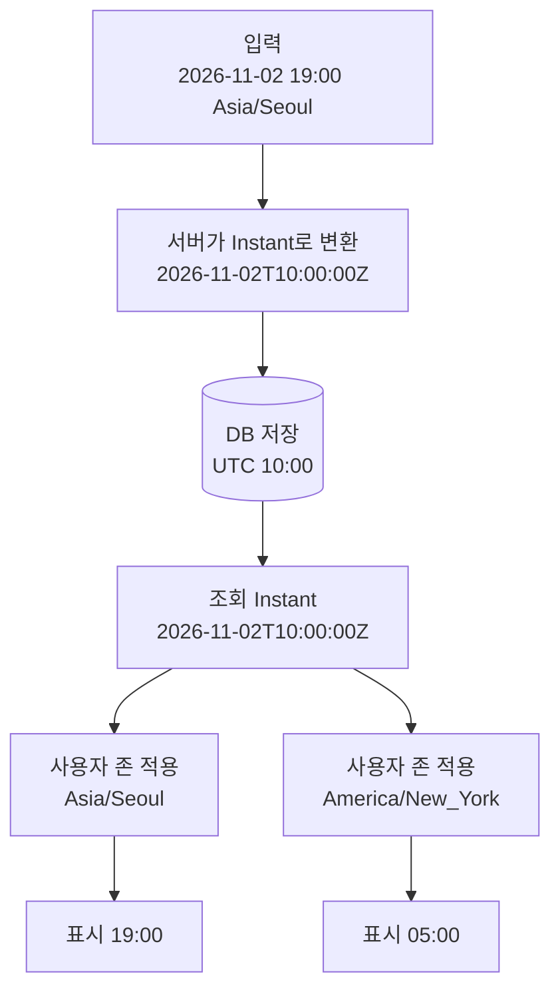
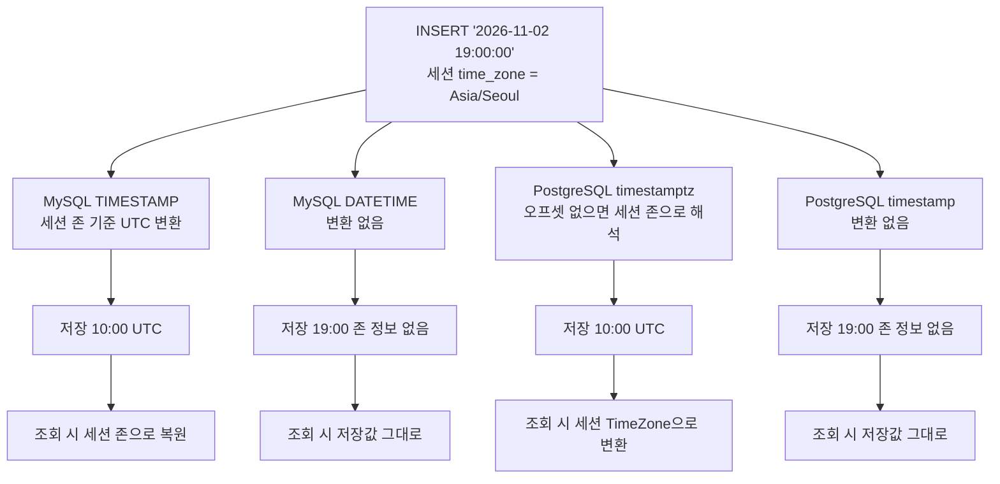
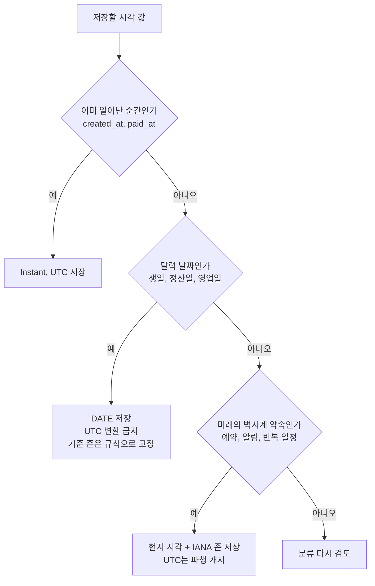
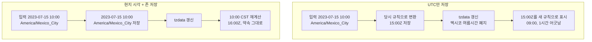
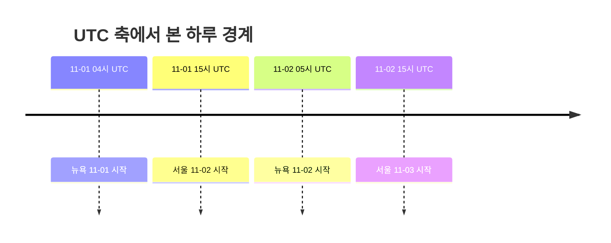

# UTC 저장

## 기본 원칙과 적용 범위

실제로 일어난 순간은 UTC로 저장하고, 사용자에게 보여줄 때만 변환한다. 주문 생성, 결제 완료, 로그인 같은 기록용 시각이 여기에 해당한다. 모든 시각 컬럼에 이 원칙을 밀어 넣으면 틀리는 경우가 있다. 생일과 정산일은 순간이 아니라 달력 날짜이고, 미래 예약은 tzdata가 바뀌면 순간이 달라진다. 이 둘은 뒤에서 따로 다룬다.

KST로 그대로 저장한 서비스는 국내에서만 돌 때 문제가 드러나지 않는다. 서버를 다른 리전으로 옮기거나 DB 기본 존이 바뀌는 순간 기존 데이터가 어느 존인지 알 방법이 없다. 컬럼 타입에 존 정보가 없기 때문이다. 그때부터는 배포 로그를 뒤져 언제부터 UTC였는지 추적해야 한다.

### 입력, 저장, 조회

저장값은 하나이고 표시값은 사용자 존마다 갈린다. 아래 도식은 같은 순간이 어디서 변환되는지 보여준다.



변환은 입력 경계와 응답 직전, 두 곳에서만 일어나야 한다. 서비스 로직 중간에서 `atZone`을 호출하기 시작하면 내부 계산이 사용자 존에 의존한다.

## DB가 입력을 저장하는 방식

MySQL `TIMESTAMP`는 세션 `time_zone` 기준으로 UTC 변환해서 저장하고, 조회 때 세션 존으로 되돌린다. 세션 존이 바뀌면 같은 행이 다른 값으로 나온다. `DATETIME`은 변환 없이 넣은 값 그대로 저장한다. PostgreSQL `timestamptz`는 리터럴에 오프셋이 있으면 그걸 쓰고, 없으면 세션 `TimeZone`으로 해석해서 UTC로 저장한다. `timestamp`(without time zone)는 리터럴에 오프셋이 붙어 있어도 무시하고 시각 부분만 저장한다.



존 정보가 없는 쪽(`DATETIME`, `timestamp`)은 애플리케이션이 UTC로 바꿔서 넣고 UTC라고 약속해야 한다. 변환하는 쪽(`TIMESTAMP`, `timestamptz`)은 세션 존이 입력과 조회 양쪽에 끼어들어서 세션 존을 UTC로 고정해야 예측이 된다.

### MySQL 설정

```sql
SELECT @@global.time_zone, @@session.time_zone;
```

```ini
# my.cnf
[mysqld]
default-time-zone = '+00:00'
```

```
jdbc:mysql://host/db?serverTimezone=UTC
```

`serverTimezone`을 빠뜨리면 JVM 존과 MySQL 서버 존이 다를 때 저장값이 틀어진다. 로컬은 KST, 운영은 UTC인 구성에서 로컬에서는 정상이다가 운영에서 9시간 차이가 나는 식으로 드러난다. 레거시 코드를 당장 못 고치면 Hikari에서 세션 존을 강제한다.

```yaml
spring:
  datasource:
    hikari:
      connection-init-sql: SET time_zone = '+00:00'
```

### PostgreSQL 설정

```sql
SHOW timezone;
SET TIME ZONE 'UTC';
```

```ini
# postgresql.conf
timezone = 'UTC'
```

```yaml
spring:
  datasource:
    url: jdbc:postgresql://host/db
    hikari:
      connection-init-sql: SET TIME ZONE 'UTC'
```

## Java 타입과 JPA 매핑

`LocalDateTime`은 존 정보가 없어서 `2026-07-31T10:00:00`이 UTC인지 KST인지 코드만으로 알 수 없다. 단순 저장·조회만 할 때는 문제가 안 보이다가 존이 섞이면 터진다. 기록용 시각은 `Instant`, 사용자 입력과 표시는 `ZonedDateTime`, 달력 날짜는 `LocalDate`를 쓴다. `LocalDateTime`은 존이 애플리케이션 전체에서 고정이고 바뀔 일이 없을 때로 한정한다.

```java
@Entity
public class Order {

    @Id
    @GeneratedValue(strategy = GenerationType.IDENTITY)
    private Long id;

    @Column(name = "created_at", nullable = false, updatable = false)
    private Instant createdAt;

    @PrePersist
    private void prePersist() {
        createdAt = Instant.now();
    }
}
```

`Instant`는 Hibernate 5.x부터 컨버터 없이 매핑된다. `hibernate.jdbc.time_zone`이 없으면 JVM 존 기준으로 동작하는 버전이 있어서 명시한다. JVM 존도 UTC로 맞춘다. `TimeZone.setDefault()`는 호출 전에 존을 읽어간 코드가 있을 수 있어서 JVM 옵션이 안전하다.

```bash
-Duser.timezone=UTC
```

```yaml
spring:
  jpa:
    properties:
      hibernate:
        jdbc:
          time_zone: UTC
```

## UTC로 저장하면 안 되는 값

시각처럼 생긴 컬럼이라고 전부 Instant가 아니다. 컬럼을 만들기 전에 이 값이 어떤 종류인지 먼저 정한다.



생일을 UTC `DATETIME`으로 저장하면 1990-05-10 00:00 KST가 1990-05-09 15:00 UTC가 되고, 어떤 존에서 읽느냐에 따라 생일이 하루 어긋난다. 생일은 `DATE`로 저장하고 변환하지 않는다.

정산일과 영업일은 기준 존이 비즈니스 규칙이다. 결제 시각(`paid_at`)은 UTC로 남기고, 그 결제가 어느 정산일에 속하는지는 `Asia/Seoul` 같은 정산 기준 존으로 계산한 `DATE`를 별도 컬럼에 둔다. 사용자 존으로 정산일을 계산하면 같은 결제가 사용자에 따라 다른 날 정산에 들어간다. 기준 존이 바뀔 가능성이 있으면 존 식별자도 컬럼으로 같이 남긴다.

### 미래 일정을 UTC로만 저장하면 어긋난다

미래 예약은 사용자가 약속한 것이 벽시계 시각이다. 2023-07-15 10:00 멕시코시티 예약을 2022년 10월 이전에 받아 UTC로 변환하면 당시 규칙(여름시간, UTC-5)으로 15:00Z가 저장된다. 그 후 멕시코가 여름시간을 폐지했고, tzdata를 갱신한 서버가 15:00Z를 읽으면 09:00으로 나온다. 약속은 10:00이었는데 1시간 일찍 보인다. 15:00Z를 기준으로 발송하는 알림도 실제 약속보다 한 시간 일찍 나간다.



UTC만 저장한 쪽은 변환 시점의 규칙이 데이터에 박혀서 되돌릴 수 없다. 현지 시각과 존을 저장한 쪽은 규칙이 읽는 시점에 적용된다. 미래 일정은 기록용 시각과 컬럼을 분리한다.

```sql
CREATE TABLE reservations (
    id               BIGINT       NOT NULL AUTO_INCREMENT,
    user_id          BIGINT       NOT NULL,
    created_at       DATETIME(6)  NOT NULL,  -- 기록용, UTC
    scheduled_local  DATETIME     NOT NULL,  -- 일정용, 현지 벽시계 2023-07-15 10:00:00
    scheduled_zone   VARCHAR(50)  NOT NULL,  -- IANA 'America/Mexico_City'
    scheduled_at_utc DATETIME     NOT NULL,  -- 파생값, 조회·정렬·인덱스용
    PRIMARY KEY (id),
    KEY idx_scheduled_at_utc (scheduled_at_utc)
);
```

정답은 `scheduled_local`과 `scheduled_zone`이고 `scheduled_at_utc`는 인덱스를 태우려고 둔 캐시다. 알림 발송 쿼리가 UTC 범위 조건으로 돌 수 있게 하려는 것이다. tzdata를 올린 뒤에는 아직 지나지 않은 일정만 다시 계산한다.

```java
ZoneId zone = ZoneId.of(r.getScheduledZone());
Instant resolved = r.getScheduledLocal().atZone(zone).toInstant();
if (!resolved.equals(r.getScheduledAtUtc())) {
    r.changeScheduledAtUtc(resolved);
}
```

`atZone`은 존재하지 않는 시각과 두 번 있는 시각을 조용히 처리한다. 뉴욕 2026-03-08 02:30은 존재하지 않아서 03:30-04:00으로 밀리고, 2026-11-01 01:30은 두 번 있는데 기본값은 이른 오프셋(-04:00)이다. 늦은 쪽을 원하면 `withLaterOffsetAtOverlap()`을 쓴다. 입력 검증 단계에서 이런 시각은 거절하거나 사용자에게 되묻는 편이 낫다. tzdata 갱신 절차는 [tzdata 버전 관리](Tzdata_Management.md)에 따로 정리했다.

## 사용자 존 기준 오늘의 경계

"오늘 주문 건수"를 `DATE(created_at)`로 세면 UTC 날짜 기준이 된다. 서울 사용자의 오늘은 UTC로 전날 15:00부터다. 사용자 존에서 자정 두 개를 구해 UTC 범위로 바꾸고, 반열린 구간으로 조회한다.



서울의 11-02는 11-01 15:00Z부터 11-02 15:00Z까지 24시간이다. 뉴욕의 11-01은 04:00Z부터 11-02 05:00Z까지 25시간이다. 2026-11-01에 여름시간이 끝나기 때문이다. 3월 전환일은 반대로 23시간이다. 시작 시각에 24시간을 더하면 이런 날 하루가 어긋난다.

```java
ZoneId zone = ZoneId.of(user.getTimezone());
LocalDate today = LocalDate.now(zone);
Instant from = today.atStartOfDay(zone).toInstant();
Instant to = today.plusDays(1).atStartOfDay(zone).toInstant();
// WHERE created_at >= :from AND created_at < :to
```

`atTime(0, 0)` 대신 `atStartOfDay`를 쓴다. 일부 존은 자정이 존재하지 않는 날이 있고, `atStartOfDay`는 그날의 첫 유효 시각을 돌려준다. `BETWEEN`은 상한이 닫힌 구간이라 다음날 00:00:00 정각 행이 두 날에 걸쳐 잡힌다.

## 사용자 존과 locale 저장

UTC 저장만으로는 표시할 수 없다. 어느 존으로 변환하고 어떤 형식으로 출력할지는 사용자 설정에서 가져온다. 존과 언어는 독립이다. 재외 한국인은 `America/Los_Angeles` 존에서 한국어 UI를 쓴다.

```sql
CREATE TABLE users (
    id         BIGINT       NOT NULL AUTO_INCREMENT,
    email      VARCHAR(255) NOT NULL,
    timezone   VARCHAR(50)  NOT NULL DEFAULT 'UTC',  -- IANA 식별자
    locale     VARCHAR(10)  NOT NULL DEFAULT 'en',   -- BCP 47
    created_at DATETIME(6)  NOT NULL,
    PRIMARY KEY (id)
);
```

`timezone`에는 `Asia/Seoul` 같은 IANA 식별자를 저장한다. `+09:00` 오프셋은 여름시간 적용 여부를 담지 못한다. 초기값은 브라우저의 `Intl.DateTimeFormat().resolvedOptions().timeZone`을 가입 요청에 실어 보내서 채운다. IP로 추론하는 방식은 VPN과 해외 법인 직원 때문에 틀리는 경우가 많아서 기본값으로만 쓰고 설정 화면에서 바꿀 수 있게 한다.

```java
public OrderResponse toResponse(Order order, User user) {
    ZoneId zoneId = ZoneId.of(user.getTimezone());
    Locale locale = Locale.forLanguageTag(user.getLocale());

    DateTimeFormatter formatter = DateTimeFormatter
        .ofLocalizedDateTime(FormatStyle.MEDIUM)
        .withLocale(locale)
        .withZone(zoneId);

    return OrderResponse.builder()
        .createdAt(formatter.format(order.getCreatedAt()))
        .build();
}
```

요청 헤더(`X-User-Timezone`)로 존을 받는 경우 `ZoneId.of()`가 잘못된 문자열에 `ZoneRulesException`을 던지므로 사용자 입력으로 보고 예외 처리한다.

## 캐시 직렬화

Redis에 시각을 JSON으로 넣을 때 역직렬화가 컨텍스트 존으로 변환하는 설정이 켜져 있으면, UTC로 저장한 값이 꺼낼 때 KST로 나온다.

```java
ObjectMapper mapper = new ObjectMapper();
mapper.registerModule(new JavaTimeModule());
mapper.configure(SerializationFeature.WRITE_DATES_AS_TIMESTAMPS, false);
mapper.configure(DeserializationFeature.ADJUST_DATES_TO_CONTEXT_TIME_ZONE, false);
```

## 흔한 실수

### 환경별 존 불일치

로컬 맥북은 KST, CI와 운영은 UTC일 때 특정 환경에서만 9시간이 어긋난다. DB, JVM, 셸의 존을 각각 확인한다.

```sql
-- MySQL
SELECT @@global.time_zone, @@session.time_zone, NOW(), UTC_TIMESTAMP();
-- PostgreSQL
SELECT NOW(), NOW() AT TIME ZONE 'UTC';
```

```bash
java -XshowSettings:all -version 2>&1 | grep timezone
echo $TZ
```

JDBC URL, JVM 옵션, DB 서버 존 세 곳 중 하나라도 다르면 변환이 겹치거나 빠진다.

### TIMESTAMP 2038년 한계

MySQL `TIMESTAMP`는 2038-01-19 03:14:07 UTC까지만 저장한다. 만료일이나 장기 예약처럼 먼 미래를 다루는 컬럼은 `DATETIME`을 쓴다.

### NOW()와 UTC_TIMESTAMP()

MySQL `NOW()`는 세션 존 기준이라 `DATETIME DEFAULT NOW()`는 서버 설정에 따라 값이 달라진다. UTC로 고정하려면 `DEFAULT (UTC_TIMESTAMP())`를 쓰거나 애플리케이션이 값을 넣는다. PostgreSQL `NOW()`는 트랜잭션 시작 시각을 `timestamptz`로 돌려주고, 저장되면 내부적으로 UTC다.
