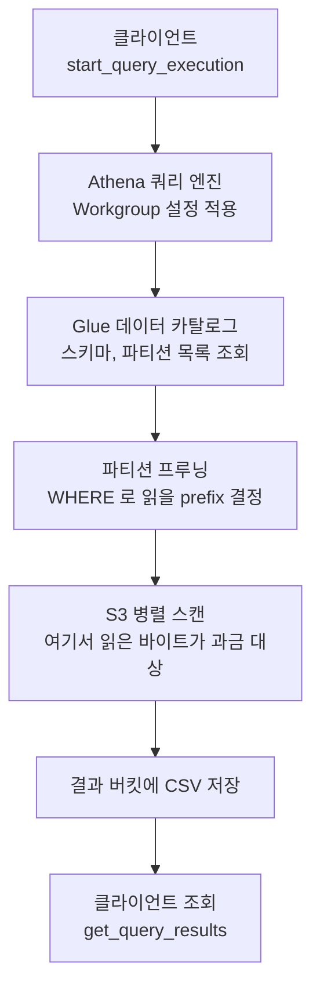
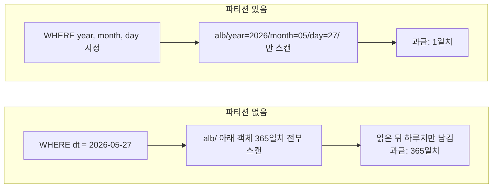
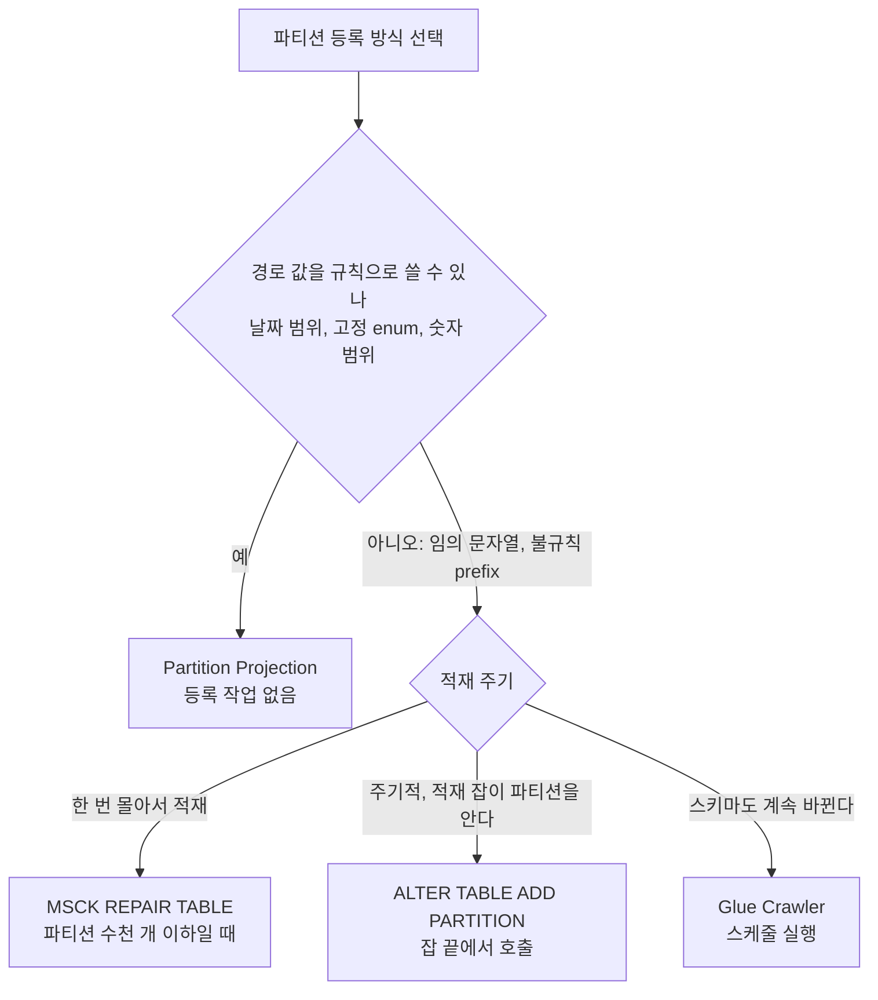
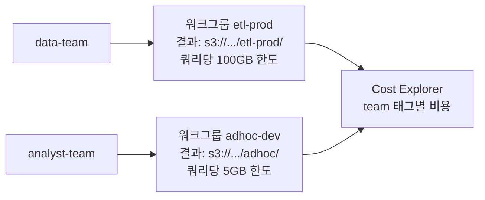
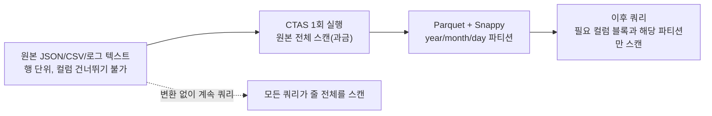
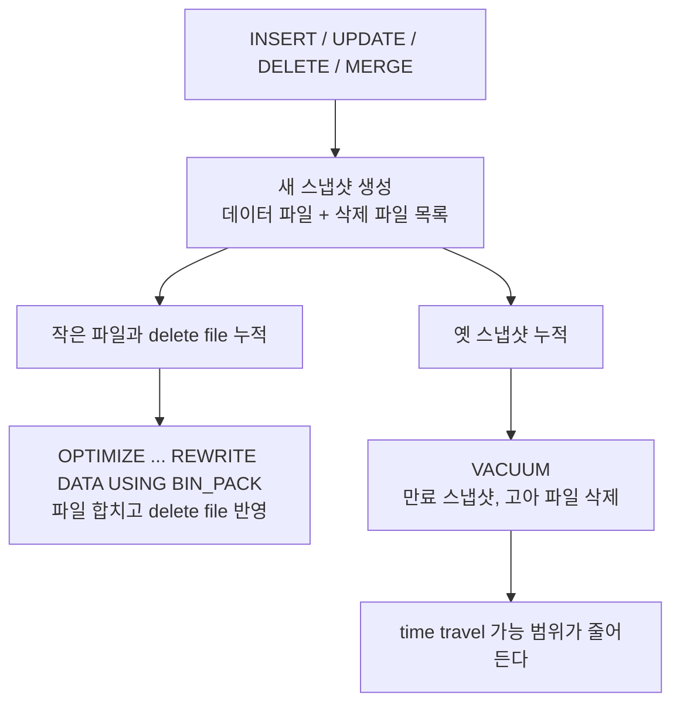
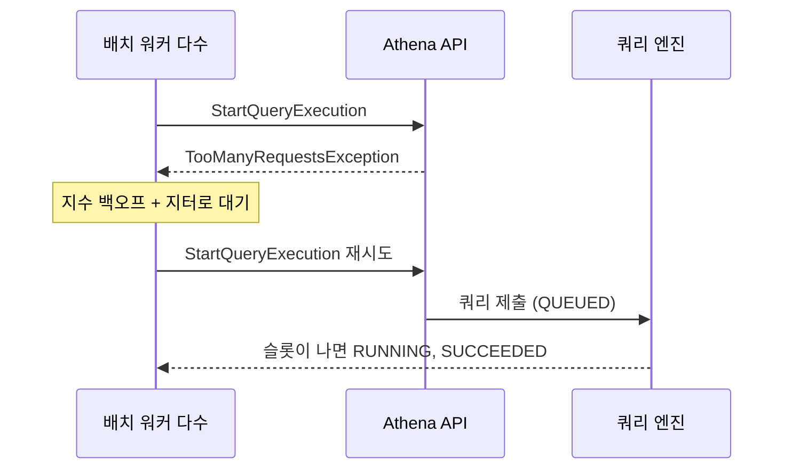
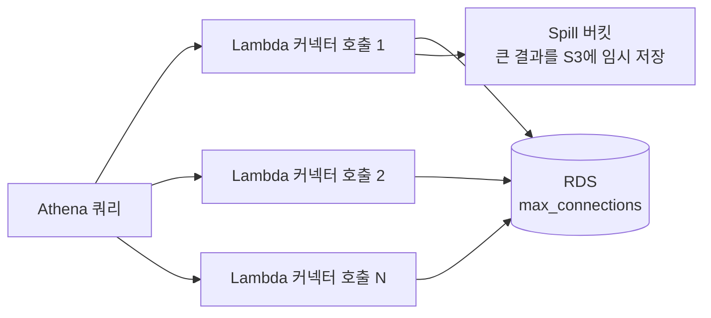

# AWS Athena (S3 서버리스 SQL)

## 개요

Athena는 S3에 있는 파일을 SQL로 조회하는 서비스다. 데이터를 어디 적재하거나 서버를 띄우지 않고, S3 경로만 지정하면 그 안의 CSV·JSON·Parquet 파일을 테이블처럼 쿼리한다. 엔진은 Presto/Trino 기반이고, 쿼리를 던지면 AWS가 내부에서 워커를 띄워 처리한 뒤 결과만 돌려준다. 클러스터를 미리 잡아둘 필요가 없어서 서버리스라고 부른다.

처음 쓰는 사람이 가장 헷갈리는 지점이 여기다. Athena는 데이터를 저장하지 않는다. 데이터는 전부 S3에 있고, Athena는 "이 S3 경로에 이런 스키마의 파일이 있다"는 정의만 들고 쿼리할 때마다 S3를 읽는다. 테이블을 만들어도 데이터가 복사되는 게 아니라 메타데이터만 등록된다. 그래서 테이블을 DROP해도 S3 파일은 그대로 남는다.

쓰는 상황은 정해져 있다. 로그가 S3에 쌓이는데 이걸 가끔 들여다보고 싶을 때다. ALB 액세스 로그, CloudTrail, VPC 플로우 로그, CloudFront 로그 전부 S3에 떨어지고, 평소엔 아무도 안 보다가 장애 분석이나 보안 감사 때 한 번 뒤진다. 이런 데이터를 위해 Redshift 클러스터를 띄워두는 건 낭비다. Athena는 쿼리한 만큼만 돈을 내니까 가끔 보는 데이터에 맞다.

### Redshift Spectrum과 뭐가 다른가

S3를 직접 SQL로 읽는다는 점에서 Redshift Spectrum과 거의 같다. 실제로 엔진 계보도 비슷하고 Glue 카탈로그도 공유한다. 차이는 앞단에 클러스터가 있느냐다.

Spectrum은 Redshift 클러스터가 있어야 동작한다. 클러스터 안의 로컬 데이터와 S3의 외부 테이블을 한 쿼리에서 조인하는 게 강점이다. Athena는 클러스터가 아예 없다. 쿼리를 날릴 때만 컴퓨팅이 생긴다.

판단은 단순하다. 이미 Redshift를 운영 중이고 웨어하우스 데이터랑 S3 로그를 섞어 보고 싶으면 Spectrum, S3 데이터만 가끔 조회하면 Athena다. Redshift가 없는데 Spectrum 쓰겠다고 클러스터부터 띄우는 건 본말이 전도된 거다.

### 쿼리 한 번이 지나가는 경로

쿼리를 던지면 Athena가 Glue 카탈로그에서 테이블 정의와 파티션 목록을 읽고, WHERE 조건으로 읽을 S3 prefix를 좁힌 뒤 워커들이 파일을 병렬로 읽는다. 결과는 클라이언트로 바로 오지 않고 결과 버킷에 CSV로 떨어지며, 클라이언트는 그 파일을 읽어 간다. 과금은 S3를 읽는 단계에서 확정된다.



그림에서 비용이 생기는 곳은 S3 병렬 스캔 한 군데다. 카탈로그 조회와 결과 저장, 결과 반환은 스캔 과금에 포함되지 않는다(결과 파일의 S3 저장 비용은 별도). 쿼리를 빠르게 만드는 작업 대부분이 "프루닝 단계에서 prefix를 얼마나 좁히느냐"와 "스캔 단계에서 파일당 몇 바이트를 읽느냐" 둘로 귀결되는 이유다.

## Glue 데이터 카탈로그

Athena가 테이블을 인식하려면 스키마 정의가 어딘가 있어야 한다. 그 저장소가 Glue 데이터 카탈로그다. "이 S3 경로에 이런 컬럼 구조의 파일이 있다"는 메타데이터를 Glue 카탈로그가 들고 있고, Athena는 쿼리할 때 이걸 참조한다.

카탈로그는 데이터베이스와 테이블로 구성된다. 여기서 데이터베이스는 실제 DB가 아니라 테이블을 묶는 네임스페이스일 뿐이다. 테이블도 데이터를 담지 않고, 컬럼명·타입·S3 위치·파일 포맷 같은 정의만 담는다.

### 스키마 온 리드

일반 RDBMS는 데이터를 넣을 때 스키마에 맞는지 검사한다(schema on write). 타입이 안 맞으면 INSERT가 거부된다. Athena는 반대다. 데이터를 읽는 순간에 스키마를 입힌다(schema on read). S3 파일은 그냥 텍스트 덩어리고, 쿼리 시점에 "1번째 필드는 string, 2번째는 int"라고 해석한다.

이 차이가 실무에서 어떻게 드러나냐면, 스키마를 잘못 정의해도 테이블 생성은 성공한다. 에러는 쿼리할 때 터진다. 컬럼 순서가 어긋나거나 타입이 안 맞으면 엉뚱한 값이 나오거나 NULL이 잔뜩 찍힌다. 데이터가 잘못된 게 아니라 해석을 잘못한 거라, 테이블 정의를 고치면 같은 파일이 멀쩡하게 읽힌다.

### 크롤러로 자동 생성 vs 직접 DDL

Glue 크롤러는 S3를 훑어서 스키마를 추측하고 테이블을 자동으로 만들어준다. 편하지만 추측이라 자주 틀린다. 숫자처럼 보이는 문자열을 bigint로 잡거나, JSON 중첩 구조를 이상하게 펼치는 경우가 있다. 로그처럼 포맷이 고정된 데이터는 크롤러 대신 CREATE TABLE을 직접 쓰는 게 정확하다. AWS가 ALB·CloudTrail 같은 주요 로그의 DDL을 문서로 제공하니 그대로 가져다 쓰면 된다.

크롤러가 쓸모 있는 경우는 컬럼이 계속 바뀌거나 파티션이 수시로 추가되는 데이터다. 정형 로그는 한 번 DDL 짜두면 끝이라 크롤러를 돌릴 이유가 없다. 크롤러도 실행 시간만큼 과금된다는 점도 고려해야 한다.

## 파티셔닝 — 스캔량을 줄이는 핵심

Athena는 스캔한 데이터양으로 과금한다. 1TB 스캔할 때마다 약 $5다(리전마다 차이 있음). 그래서 쿼리 성능보다 스캔량 줄이기가 먼저다. 스캔량을 줄이는 1순위 수단이 파티셔닝이다.

### 파티션이 없으면 전부 읽는다

파티션이 없는 테이블에 WHERE 조건을 걸어도 Athena는 S3 경로의 모든 파일을 읽고 나서 거른다. 하루치만 보고 싶어서 `WHERE dt = '2026-05-27'`을 걸어도, 1년치 로그가 한 경로에 있으면 1년치를 다 스캔한 다음 하루치만 남긴다. 비용은 365배로 나가는데 결과는 똑같다.

파티션은 S3 경로를 디렉터리로 쪼개서 WHERE 조건이 특정 경로만 읽게 만드는 장치다. 로그를 이렇게 쌓아둔다고 하자.

```
s3://my-logs/alb/year=2026/month=05/day=27/...
s3://my-logs/alb/year=2026/month=05/day=26/...
```

`year=2026/month=05/day=27` 형태가 파티션이다. `WHERE year='2026' AND month='05' AND day='27'`을 걸면 Athena가 그 디렉터리만 읽는다. 나머지 날짜는 아예 건드리지 않는다. 이게 파티션 프루닝(partition pruning)이다.

파티션 유무에 따라 읽는 범위가 어떻게 갈리는지 나란히 놓으면 이렇다. 왼쪽은 WHERE가 파일을 다 읽은 뒤에 적용되고, 오른쪽은 읽기 전에 prefix 단계에서 걸러진다.



### 연/월/일로 자르는 이유

로그 분석은 거의 항상 기간 조건이 붙는다. "어제 5xx 에러", "지난주 특정 IP 접근" 같은 식이다. 그래서 시간 기준으로 파티션을 자르면 대부분의 쿼리가 좁은 범위만 읽는다.

연/월/일을 따로 두는 이유는 조회 범위를 골라 읽기 쉽기 때문이다. `year`·`month`·`day`를 분리하면 하루치(`day='27'`), 한 달치(`month='05'`), 일 년치(`year='2026'`)를 골라 읽을 수 있다. 반대로 `dt='2026-05-27'` 하나로 합치면 하루 단위는 깔끔한데 "5월 전체"를 보려면 `dt LIKE '2026-05-%'`처럼 패턴을 써야 하고, 이러면 파티션 프루닝이 안 먹는 경우가 생긴다. 트래픽이 큰 서비스는 시(hour)까지 쪼개기도 한다.

주의할 점은 파티션을 너무 잘게 쪼개면 역효과가 난다는 거다. 분 단위로 파티션을 만들면 디렉터리가 수만 개로 늘어나고, 각 디렉터리에 작은 파일이 흩어진다. Athena가 파티션 목록을 읽는 것 자체가 느려지고, 작은 파일이 많으면 파일 여닫는 오버헤드가 스캔 시간을 잡아먹는다. 일 단위가 무난하고, 정말 양이 많을 때만 시 단위로 내린다.

### 파티션을 카탈로그에 등록하는 방법

파티션 디렉터리를 S3에 만들어두는 것만으로는 Athena가 인식하지 못한다. 카탈로그에 "이런 파티션이 있다"고 등록해야 한다. 방법이 세 가지다.

`MSCK REPAIR TABLE`은 S3를 통째로 스캔해서 모든 파티션을 한 번에 등록한다. 처음 테이블 만들 때 편하지만, 파티션이 수천 개로 늘어나면 이 명령 자체가 느려지고 타임아웃이 난다. 새 파티션이 매일 생기는 로그에 매번 MSCK를 돌리는 건 비효율이다.

`ALTER TABLE ADD PARTITION`은 파티션을 하나씩 명시적으로 등록한다. 매일 자정에 어제 날짜 파티션만 추가하는 식으로 배치를 돌리면 MSCK보다 빠르다. 다만 누가 챙겨서 돌려야 한다.

파티션 프로젝션(partition projection)은 이 등록 자체를 없앤다. 테이블 속성에 "year는 2020부터 2030까지, month는 01~12, day는 01~31"이라고 규칙만 적어두면, Athena가 쿼리 시점에 파티션 경로를 계산해서 바로 읽는다. 카탈로그에 파티션을 등록하지 않으니 MSCK도 ALTER도 필요 없다. 날짜 기반 로그는 이 방식이 제일 손이 안 간다.

```sql
CREATE EXTERNAL TABLE alb_logs (
    -- 컬럼 정의 생략
)
PARTITIONED BY (year string, month string, day string)
-- SERDE, LOCATION 등 생략
TBLPROPERTIES (
    'projection.enabled' = 'true',
    'projection.year.type' = 'integer',
    'projection.year.range' = '2020,2030',
    'projection.month.type' = 'integer',
    'projection.month.range' = '01,12',
    'projection.month.digits' = '2',
    'projection.day.type' = 'integer',
    'projection.day.range' = '01,31',
    'projection.day.digits' = '2',
    'storage.location.template' =
        's3://my-logs/alb/year=${year}/month=${month}/day=${day}'
);
```

어느 방식을 쓸지는 경로 규칙이 일정한지, 파티션이 몇 개인지, 새 파티션이 얼마나 자주 생기는지로 갈린다.



날짜 로그는 대부분 맨 위 분기에서 끝난다. Projection이 안 되는 경우는 `customer_id=` 같이 값 집합이 열려 있는 파티션 키다. 이때는 적재 잡이 파일을 쓰고 나서 `ALTER TABLE ADD PARTITION`을 직접 부르는 방식이 제일 예측 가능하다. Crawler는 파티션 등록용으로 쓰면 실행 시간만큼 과금되고 스케줄 사이에 공백이 생겨서 마지막 선택지로 둔다.

프로젝션의 함정은 범위를 넘어서면 결과가 빈다는 거다. range를 `2020,2026`으로 잡아두면 2027년 로그를 쿼리해도 빈 결과가 나온다. 에러가 아니라 빈 결과라 모르고 지나치기 쉽다. 범위는 넉넉하게 잡아두는 게 안전하다.

## 과금 — SELECT * 가 비용을 터뜨린다

다시 강조하면 Athena는 스캔한 바이트로 과금한다. 쿼리가 빠르든 느리든, 결과가 1행이든 100만 행이든, 읽은 데이터양만 본다. 이 모델을 모르고 쓰면 청구서가 예상의 수십 배로 나온다.

세부 규칙은 요금 페이지에 있다. 스캔 바이트는 메가바이트 단위로 올림하고 쿼리당 최소 10MB가 붙는다. 실패한 쿼리와 DDL은 과금하지 않고, 취소된 쿼리는 취소 시점까지 스캔한 만큼 과금한다([Athena 요금](https://aws.amazon.com/athena/pricing/)). 취소해도 이미 읽은 분은 돈이 나간다는 점이 뒤에 나오는 스캔 한도와 연결된다.

### SELECT * 의 두 가지 비용

`SELECT *`이 위험한 이유는 두 갈래다.

첫째, 컬럼을 다 읽는다. Parquet 같은 컬럼 포맷은 필요한 컬럼만 골라 읽을 수 있는데, `SELECT *`은 모든 컬럼을 읽으라는 뜻이라 이 이점을 통째로 버린다. 컬럼 30개짜리 테이블에서 2개만 필요한데 `SELECT *`을 쓰면 15배를 더 스캔한다.

둘째, WHERE에 파티션 조건이 없으면 전체 기간을 읽는다. `SELECT * FROM alb_logs LIMIT 10`을 무심코 날리면, LIMIT 10이라 결과는 10행이지만 스캔은 테이블 전체다. LIMIT은 결과 행만 자르지 스캔량을 줄이지 않는다. 데이터를 처음 구경하려고 `SELECT * LIMIT 10` 한 번 돌렸다가 수 TB를 스캔하는 일이 흔하다.

데이터 미리보기는 Athena 콘솔의 테이블 메뉴에서 제공하는 미리보기를 쓰거나, 파티션 조건을 반드시 붙여서 하루치만 본다. 정 전체 구조만 보고 싶으면 컬럼을 명시하고 좁은 파티션을 건다.

### 비용을 줄이는 실제 수단

- 필요한 컬럼만 SELECT한다. `SELECT *` 대신 `SELECT client_ip, elb_status_code`처럼 적는다.
- WHERE에 파티션 컬럼 조건을 항상 넣는다. 기간을 안 거는 로그 쿼리는 없다고 보면 된다.
- 텍스트 포맷을 Parquet/ORC로 바꾼다(아래에서 다룬다).
- 워크그룹에 쿼리당 스캔 한도(per-query data usage control)를 건다. 실수로 큰 쿼리가 나가도 한도를 넘으면 자동으로 취소된다. 입문자가 있는 팀은 이걸 반드시 걸어둔다. 설정 방법은 바로 아래 Workgroup 절에 있다.

스캔량은 쿼리 실행 후 콘솔에 "Data scanned"로 찍힌다. 새 쿼리를 운영에 넣기 전에 이 값을 보고 비용을 가늠하는 습관을 들이면 사고가 안 난다.

## Workgroup — 설정 강제와 비용 분리

Workgroup은 쿼리를 묶는 단위다. 계정을 처음 쓰면 `primary` 하나만 있고, 모든 쿼리가 거기로 들어간다. 팀이 둘만 돼도 이 상태는 곤란해진다. 결과가 한 버킷에 섞이고, 누가 스캔을 많이 했는지 가를 수가 없고, 한도를 걸 곳이 없다.

워크그룹 하나가 들고 있는 설정은 이렇다.

| 설정 | 하는 일 |
|---|---|
| 쿼리 결과 위치, 암호화 | 결과 CSV가 떨어질 S3 경로와 SSE 방식 |
| Override client-side settings | 켜면 클라이언트가 `OutputLocation`을 따로 줘도 워크그룹 값이 이긴다 |
| 쿼리당 스캔 한도 | 쿼리 하나가 읽을 수 있는 최대 바이트. 넘으면 취소 |
| 워크그룹 단위 한도 | 시간당·일당 총 스캔량 임계치. 넘으면 SNS 알림 |
| 엔진 버전 | Iceberg DML 같은 기능은 engine version 3에서만 된다 |
| CloudWatch 메트릭 | 스캔 바이트, 실행 시간을 워크그룹별로 게시 |
| 태그 | 비용 배분 태그 |



팀·환경마다 워크그룹을 따로 만들고 각각에 한도를 다르게 거는 구성이다. 배치 ETL은 한도를 넉넉하게, 사람이 콘솔에서 두드리는 adhoc은 빡빡하게 잡는다.

### 쿼리당 한도가 동작하는 방식

한도를 넘기면 Athena가 그 쿼리를 취소한다. 취소는 한도를 넘는 순간 일어나므로 그때까지 읽은 바이트는 과금된다. 즉 한도 100GB를 걸어두면 최악의 경우 쿼리 하나에 100GB 분량(약 $0.5)이 나가고 끝난다. 한도가 없을 때 수 TB를 읽는 것과 비교하면 사고 규모가 고정된다. 한도의 최소값은 10MB(10,000,000바이트)다. API 모델에 그렇게 정의돼 있고 그보다 작은 값은 요청 단계에서 거부된다.

워크그룹 단위 한도는 성격이 다르다. 이쪽은 시간당·일당 합계가 임계치를 넘으면 SNS로 알림을 보내는 장치이고, 쿼리를 막지 않는다. 막고 싶으면 SNS에 Lambda를 물려 워크그룹을 비활성화하거나 IAM을 조이는 처리를 직접 짜야 한다([한도 설정 문서](https://docs.aws.amazon.com/athena/latest/ug/workgroups-control-limits.html)).

한도에 걸려 취소된 쿼리는 `get_query_execution`의 `StateChangeReason`에 사유가 남는다. 배치 잡이 이 상태를 일반 실패와 똑같이 재시도하면 같은 쿼리가 같은 지점에서 또 취소되고 매번 한도만큼 과금된다. 취소 사유를 보고 재시도하지 않게 분기해야 한다.

### 생성 코드

```python
import boto3

athena = boto3.client("athena", region_name="ap-northeast-2")

athena.create_work_group(
    Name="etl-prod",
    Configuration={
        "ResultConfiguration": {"OutputLocation": "s3://my-athena-results/etl-prod/"},
        "EnforceWorkGroupConfiguration": True,
        "BytesScannedCutoffPerQuery": 100 * 1024**3,
        "PublishCloudWatchMetricsEnabled": True,
        "EngineVersion": {"SelectedEngineVersion": "Athena engine version 3"},
    },
    Tags=[{"Key": "team", "Value": "data"}, {"Key": "env", "Value": "prod"}],
)
```

`EnforceWorkGroupConfiguration`을 빼먹으면 클라이언트 설정이 이기기 때문에 누군가 `OutputLocation`을 자기 버킷으로 줄 수 있다. 결과 위치를 통제하려는 목적이면 이 값이 핵심이다.

태그를 달았다고 Cost Explorer에서 바로 팀별로 갈리지는 않는다. Billing 콘솔에서 해당 태그 키(`team`)를 비용 배분 태그로 활성화해야 하고, 기본적으로 활성화한 시점 이후의 비용부터 태그별로 잡힌다. 처음부터 태그를 정해서 달고 활성화까지 같이 해두는 게 낫다. 권한도 워크그룹 ARN 단위로 줄 수 있어서, adhoc 팀 IAM에는 `adhoc-dev` 워크그룹에 대한 `athena:StartQueryExecution`만 열어두면 etl-prod로는 쿼리를 못 던진다.

## 파일 포맷 — Parquet/ORC로 변환

같은 데이터라도 어떤 포맷으로 저장하느냐에 따라 스캔량이 10배 넘게 차이 난다. 비용이 스캔량에 직결되니 포맷 선택이 곧 비용 선택이다.

### 텍스트 포맷의 한계

CSV·JSON·로그 텍스트는 행 기반이다. 한 줄에 모든 컬럼이 붙어 있어서, 컬럼 하나만 필요해도 줄 전체를 읽어야 한다. 압축도 잘 안 된다. ALB 로그 원본이 gzip이어도 텍스트 구조라 컬럼 단위로 건너뛰지 못한다.

Parquet과 ORC는 컬럼 기반 포맷이다. 컬럼별로 데이터를 모아 저장하니 필요한 컬럼만 읽고, 같은 타입 값이 모여 있어 압축률도 높다. Redshift가 컬럼 저장으로 빠른 것과 같은 원리다. Athena에서 `SELECT client_ip`를 돌리면 Parquet은 client_ip 컬럼 블록만 읽지만, CSV는 전체 줄을 다 읽는다.

### 비용 차이의 실제 규모

수치는 데이터 특성마다 다르지만, 텍스트를 Parquet으로 바꾸면 스캔량이 대략 한 자릿수 배에서 많게는 수십 배까지 줄어든다. 이유가 두 겹이다. 첫째, 압축으로 파일 크기 자체가 작아진다. 둘째, 쿼리에서 일부 컬럼만 읽으니 그중에서도 일부만 스캔한다.

여기에 Parquet 내부의 통계 정보가 더해진다. Parquet은 블록마다 컬럼의 min/max 값을 들고 있어서, WHERE 조건에 안 맞는 블록은 건너뛴다(predicate pushdown). 정렬해서 저장하면 이 건너뛰기가 잘 먹어서 스캔량이 더 줄어든다.

ORC와 Parquet은 둘 다 컬럼 포맷이고 성능은 엇비슷하다. AWS 생태계와 도구 호환성을 보면 Parquet이 무난하다. 둘 중 뭘 쓸지 한참 고민할 필요는 없다.

### CTAS로 변환하기

텍스트 테이블을 Parquet으로 바꾸는 가장 간단한 방법이 CTAS(CREATE TABLE AS SELECT)다. 원본 텍스트 테이블을 읽어서 Parquet으로 새 테이블을 만든다.

변환 비용은 원본을 한 번 읽는 값으로 끝나고, 그 뒤의 쿼리는 전부 오른쪽 경로로 간다. 같은 `SELECT client_ip, elb_status_code`가 포맷에 따라 읽는 범위를 비교해 놓은 도식이다.



| 저장 형태 | 컬럼 2개만 SELECT 할 때 읽는 것 | 파티션 프루닝 | 압축 |
|---|---|---|---|
| CSV/JSON 텍스트 | 파일 전체 (줄 단위라 컬럼 건너뛰기 불가) | 경로를 나눴으면 가능 | gzip 등 파일 단위. 읽으려면 풀어야 한다 |
| Parquet + Snappy | 해당 컬럼의 블록만 | 가능 | 컬럼별 인코딩 + Snappy |

AWS는 압축·파티셔닝·컬럼 포맷 변환으로 쿼리당 비용을 최대 90%까지 줄일 수 있다고 안내한다([Athena 요금](https://aws.amazon.com/athena/pricing/)). 90%는 상한이라 보는 게 맞다. 컬럼이 적고 이미 잘 압축된 데이터는 절감폭이 작다. 내 데이터에서 얼마나 줄었는지는 직접 잰다. 같은 쿼리를 원본 테이블과 CTAS 결과 테이블에 한 번씩 돌려 콘솔의 Data scanned를 비교하면 된다.

```sql
CREATE TABLE alb_logs_parquet
WITH (
    format = 'PARQUET',
    parquet_compression = 'SNAPPY',
    partitioned_by = ARRAY['year', 'month', 'day'],
    external_location = 's3://my-logs/alb-parquet/'
) AS
SELECT
    client_ip,
    elb_status_code,
    target_status_code,
    request_url,
    request_processing_time,
    year, month, day
FROM alb_logs
WHERE year = '2026' AND month = '05';
```

CTAS를 돌리는 그 순간엔 원본을 스캔하니 비용이 든다. 하지만 한 번 변환해두면 이후 모든 쿼리가 Parquet을 읽어 싸진다. 매일 쌓이는 로그는 어제치를 변환하는 CTAS나 INSERT INTO를 배치로 돌린다. 자주 조회하는 로그일수록 변환 투자 회수가 빠르다.

한 가지 주의는 CTAS의 파티션 개수 제한이다. 한 번에 만들 수 있는 파티션 수에 상한이 있어서, 몇 년치를 한 방에 변환하려 하면 실패한다. 기간을 나눠서 여러 번 돌리거나 INSERT INTO로 이어붙인다.

## 실무 예제 1 — CloudTrail 로그 분석

CloudTrail은 누가 어떤 API를 호출했는지 기록한다. 보안 사고나 "이 리소스 누가 지웠어" 같은 추적에 쓴다. S3에 JSON으로 쌓이는데 양이 많아서 파티션과 포맷 관리가 중요하다.

테이블은 AWS가 제공하는 DDL을 쓴다. CloudTrail 전용 SerDe로 JSON을 파싱한다.

```sql
CREATE EXTERNAL TABLE cloudtrail_logs (
    eventversion STRING,
    useridentity STRUCT<
        type: STRING,
        principalid: STRING,
        arn: STRING,
        accountid: STRING,
        username: STRING>,
    eventtime STRING,
    eventsource STRING,
    eventname STRING,
    awsregion STRING,
    sourceipaddress STRING,
    useragent STRING,
    errorcode STRING,
    errormessage STRING,
    requestparameters STRING,
    responseelements STRING
)
ROW FORMAT SERDE 'org.apache.hive.hcatalog.data.JsonSerDe'
STORED AS INPUTFORMAT 'com.amazon.emr.cloudtrail.CloudTrailInputFormat'
OUTPUTFORMAT 'org.apache.hadoop.hive.ql.io.HiveIgnoreKeyTextOutputFormat'
LOCATION 's3://my-cloudtrail/AWSLogs/123456789012/CloudTrail/'
```

누가 특정 리소스를 삭제했는지 찾는 쿼리는 이렇게 짠다.

```sql
SELECT eventtime, useridentity.arn, eventname, sourceipaddress
FROM cloudtrail_logs
WHERE eventname LIKE 'Delete%'
  AND eventtime > '2026-05-20T00:00:00Z'
ORDER BY eventtime DESC;
```

루트 계정으로 로그인한 흔적을 찾는 것도 보안 점검의 단골이다.

```sql
SELECT eventtime, sourceipaddress, useragent
FROM cloudtrail_logs
WHERE useridentity.type = 'Root'
  AND eventname = 'ConsoleLogin';
```

CloudTrail은 양이 빠르게 불어난다. 위 예제는 파티션 없는 단순 형태라, 운영에서는 파티션 프로젝션을 붙이고 `eventtime` 대신 파티션 컬럼으로 기간을 좁혀야 한다. 안 그러면 삭제 이벤트 하나 찾자고 수년치를 스캔한다.

## 실무 예제 2 — ALB 액세스 로그 분석

ALB 액세스 로그는 어떤 요청이 어디로 가서 몇 번 응답코드를 받았는지 기록한다. 5xx 급증, 특정 엔드포인트 지연, 의심스러운 IP 추적에 쓴다. 포맷이 공백 구분 텍스트라 정규식 SerDe로 파싱한다.

테이블 DDL은 AWS 문서의 것을 쓴다. 컬럼이 30개 넘게 길어서 핵심만 추리면 이런 구조다.

```sql
CREATE EXTERNAL TABLE alb_logs (
    type string,
    time string,
    elb string,
    client_ip string,
    client_port int,
    target_ip string,
    request_processing_time double,
    target_processing_time double,
    response_processing_time double,
    elb_status_code int,
    target_status_code string,
    received_bytes bigint,
    sent_bytes bigint,
    request_verb string,
    request_url string,
    user_agent string
    -- 실제로는 AWS 문서의 전체 컬럼/정규식을 그대로 써야 한다
)
PARTITIONED BY (year string, month string, day string)
ROW FORMAT SERDE 'org.apache.hadoop.hive.serde2.RegexSerDe'
WITH SERDEPROPERTIES (
    'input.regex' = '...AWS 문서 제공 정규식...'
)
LOCATION 's3://my-logs/alb/'
TBLPROPERTIES ('projection.enabled' = 'true' /* 위 프로젝션 설정 */);
```

5xx 에러가 어느 엔드포인트에서 나는지 보는 쿼리다. 파티션으로 하루만 자른다.

```sql
SELECT request_url, elb_status_code, count(*) AS cnt
FROM alb_logs
WHERE year = '2026' AND month = '05' AND day = '27'
  AND elb_status_code >= 500
GROUP BY request_url, elb_status_code
ORDER BY cnt DESC
LIMIT 50;
```

타겟 응답이 느린 요청을 찾을 때는 `target_processing_time`을 본다. 백엔드 지연과 ALB 지연을 구분할 수 있다.

```sql
SELECT request_url,
       avg(target_processing_time) AS avg_target,
       max(target_processing_time) AS max_target,
       count(*) AS cnt
FROM alb_logs
WHERE year = '2026' AND month = '05' AND day = '27'
GROUP BY request_url
HAVING avg(target_processing_time) > 1.0
ORDER BY avg_target DESC;
```

`target_processing_time`이 -1로 찍히면 ALB가 타겟에 연결조차 못 했다는 신호다(예: 503). 이 값을 조건에 넣어 거르면 진짜 백엔드 지연만 골라 본다.

## Iceberg 테이블 — UPDATE, DELETE, MERGE가 필요할 때

일반 Hive 방식 테이블(지금까지 만든 `CREATE EXTERNAL TABLE`)은 UPDATE와 DELETE가 안 된다. 이유는 테이블의 실체가 "S3 prefix 아래 파일 묶음"이기 때문이다. S3 객체는 수정이 안 되고 통째로 덮어쓰거나 지우는 것만 되는데, Hive 테이블에는 "이 파일의 몇 번째 행을 지웠다"를 적어둘 메타데이터가 없다. 행 하나를 바꾸려면 그 파일을 다시 써야 하고, 그 사이 다른 쿼리가 같은 prefix를 읽고 있으면 반쯤 바뀐 상태가 보인다. Hive 테이블에서 되는 쓰기는 `INSERT INTO`로 파일을 추가하는 것뿐이다.

Iceberg는 파일 목록과 행 단위 삭제 정보를 메타데이터 파일(스냅샷)로 따로 관리한다. 쓰기가 일어날 때마다 새 스냅샷이 생기고, 읽는 쿼리는 시작 시점의 스냅샷 하나만 본다. 그래서 UPDATE·DELETE·MERGE가 되고 읽는 쪽과 충돌하지 않는다. 대신 스냅샷과 작은 파일이 계속 쌓이므로 정리 작업이 따라붙는다.



### 테이블 생성과 쓰기

`TBLPROPERTIES`에 `table_type`을 주는 것이 핵심이고, `LOCATION`은 버킷 루트가 아니라 폴더여야 한다. 파티션은 컬럼 값 대신 변환 함수를 쓸 수 있다.

```sql
CREATE TABLE orders_ice (
    order_id bigint,
    status string,
    amount decimal(12, 2),
    created_at timestamp
)
PARTITIONED BY (day(created_at))
LOCATION 's3://my-lake/iceberg/orders_ice/'
TBLPROPERTIES ('table_type' = 'ICEBERG');
```

`day(created_at)`로 파티션을 잡으면 `WHERE created_at >= ...` 조건이 그대로 프루닝에 쓰인다. Hive 방식처럼 `year`, `month`, `day` 컬럼을 따로 만들어 쿼리마다 세 개를 다 적을 필요가 없다. Athena가 만드는 Iceberg 테이블은 v2 포맷이다([Iceberg 테이블 생성](https://docs.aws.amazon.com/athena/latest/ug/querying-iceberg-creating-tables.html)).

행 단위 변경은 일반 SQL이다. CDC로 들어온 변경분을 스테이징 테이블에 모았다가 MERGE로 반영하는 패턴이 가장 흔하다.

```sql
UPDATE orders_ice SET status = 'CANCELLED' WHERE order_id = 1001;

DELETE FROM orders_ice WHERE created_at < TIMESTAMP '2025-01-01 00:00:00';

MERGE INTO orders_ice t
USING orders_stage s ON t.order_id = s.order_id
WHEN MATCHED AND s.op = 'D' THEN DELETE
WHEN MATCHED THEN UPDATE SET status = s.status, amount = s.amount
WHEN NOT MATCHED THEN INSERT (order_id, status, amount, created_at)
    VALUES (s.order_id, s.status, s.amount, s.created_at);
```

MERGE의 `ON` 조건에 매칭되는 소스 행이 타겟 행 하나에 여러 개 걸리면 쿼리가 실패한다. 스테이징 테이블에 같은 키의 변경이 여러 건 쌓여 있으면 `ROW_NUMBER()`로 키별 최신 한 건만 남기고 MERGE를 돌려야 한다.

DML을 건 만큼 스냅샷이 하나씩 늘고, UPDATE·DELETE는 데이터 파일을 다시 쓰지 않고 삭제 정보를 담은 작은 파일을 따로 남긴다. 쿼리는 읽을 때 이 삭제 파일을 데이터 파일에 겹쳐 적용하므로, 삭제 파일이 쌓일수록 같은 쿼리가 점점 느려진다.

### OPTIMIZE로 파일 합치기

```sql
OPTIMIZE orders_ice REWRITE DATA USING BIN_PACK
WHERE created_at >= TIMESTAMP '2026-10-01 00:00:00';
```

`BIN_PACK`은 작은 데이터 파일을 목표 크기로 묶고 삭제 파일을 데이터에 반영해서 다시 쓴다. 스트리밍이나 분 단위 배치로 INSERT 하는 테이블은 하루에 파일이 수천 개씩 생기기 때문에, 최근 며칠 구간만 `WHERE`로 잡아 정기적으로 돌린다. 전체 테이블을 매번 다시 쓰면 그 자체가 스캔 과금이다([Optimize Iceberg tables](https://docs.aws.amazon.com/athena/latest/ug/querying-iceberg-data-optimization.html)).

### VACUUM과 스냅샷 보존

OPTIMIZE는 새 파일을 쓰고 옛 파일은 이전 스냅샷이 아직 참조하므로 지우지 않는다. 그래서 OPTIMIZE를 돌릴수록 S3 용량은 오히려 늘어난다. 이걸 지우는 것이 VACUUM이다.

```sql
ALTER TABLE orders_ice SET TBLPROPERTIES (
    'vacuum_max_snapshot_age_seconds' = '259200',
    'vacuum_min_snapshots_to_keep' = '5'
);

VACUUM orders_ice;
```

기본값은 스냅샷 보존 5일(432,000초), 최소 유지 스냅샷 1개다([VACUUM](https://docs.aws.amazon.com/athena/latest/ug/vacuum-statement.html)). 위 예는 3일, 최소 5개로 줄였다. 두 가지를 조심한다.

VACUUM은 만료된 스냅샷을 지우므로 그 시점으로의 time travel이 영구히 불가능해진다. 감사 용도로 "한 달 전 상태를 재현"해야 하는 테이블이면 보존 기간을 그 이상으로 잡는다.

쿼리를 실행하는 역할에 `s3:DeleteObject`가 없으면 VACUUM은 에러 없이 성공으로 끝나는데 파일은 하나도 안 지워진다. 스토리지가 줄지 않을 때 가장 먼저 의심할 곳이다. 문서도 이 동작을 명시한다.

### time travel

```sql
SELECT * FROM orders_ice
FOR TIMESTAMP AS OF (current_timestamp - interval '1' day)
WHERE order_id = 1001;

SELECT * FROM orders_ice FOR VERSION AS OF 949530903748831860;
```

잘못된 MERGE를 돌렸을 때 직전 스냅샷의 데이터를 읽어 `INSERT`로 되돌리는 용도로 쓴다. 보존 기간이 지난 시점을 지정하면 읽을 스냅샷이 없어서 실패한다. Iceberg DML과 VACUUM은 Athena engine version 3 전용이라 워크그룹 엔진 버전이 낮으면 해당 구문이 거부된다.

## 쿼리 결과 재사용과 결과 버킷 정리

같은 쿼리를 대시보드나 배치가 반복해서 던지면 매번 같은 양을 스캔한다. 결과 재사용을 켜면 지정한 시간 안에 같은 쿼리가 있었을 때 실행 자체를 건너뛰고 이전 결과를 돌려준다. 스캔 비용도 없다.

```python
athena.start_query_execution(
    QueryString=sql,
    WorkGroup="adhoc-dev",
    ResultReuseConfiguration={
        "ResultReuseByAgeConfiguration": {"Enabled": True, "MaxAgeInMinutes": 60}
    },
)
```

재사용 조건은 쿼리 문자열, 데이터베이스와 카탈로그 이름, 결과 설정이 같고 호출자가 테이블과 이전 결과 파일에 접근 권한이 있는 경우다. 같은 워크그룹 안에서만 재사용되고, 최대 보존은 7일(10,080분)이다. 지정하지 않으면 60분이 기본이다. 비결정 함수(`rand()` 등)가 들어간 쿼리와 페더레이션 카탈로그를 참조하는 쿼리는 재사용되지 않는다([쿼리 결과 재사용](https://docs.aws.amazon.com/athena/latest/ug/reusing-query-results.html)).

원본 데이터가 바뀌었는지는 확인하지 않는다. 유효 시간 안에서는 낡은 결과가 그대로 나가므로, 실시간성이 필요한 쿼리에는 쓰지 않거나 시간을 짧게 잡는다. 적재가 끝나기 전에 돌린 쿼리가 재사용 대상으로 남아 적재 후에도 이전 결과가 나가는 사고가 이 경로로 난다.

### 결과 파일이 계속 쌓이는 문제

재사용을 쓰지 않는 쿼리는 실행할 때마다 결과 버킷에 `<query-id>.csv`와 `.csv.metadata`가 생긴다. 대시보드가 5분마다 쿼리를 돌리면 하루 288개씩 쌓이고, 아무도 지우지 않는다. 결과 버킷에 수명 주기 규칙을 건다.

```python
import boto3

s3 = boto3.client("s3")
s3.put_bucket_lifecycle_configuration(
    Bucket="my-athena-results",
    LifecycleConfiguration={
        "Rules": [{
            "ID": "expire-athena-results",
            "Filter": {"Prefix": ""},
            "Status": "Enabled",
            "Expiration": {"Days": 7},
            "AbortIncompleteMultipartUpload": {"DaysAfterInitiation": 1},
        }]
    },
)
```

결과 버킷에 데이터를 같이 두면 안 된다. 결과 위치 아래에 `external_location`을 두거나 기본 위치로 만든 CTAS 테이블이 있으면 이 규칙이 7일 뒤에 테이블 데이터를 지운다. 결과 전용 버킷을 따로 두고 데이터 버킷과 섞지 않는 것이 사고를 막는 가장 쉬운 방법이다.

## 서비스 쿼터와 동시 실행

동시에 돌릴 수 있는 쿼리 수에는 상한이 있다. DDL과 DML이 따로 집계되고, DML 한도는 리전마다 다르다. 실제 값은 Service Quotas 콘솔에서 본다. 문서에서 눈여겨볼 부분은 한도가 "실행 중 + 대기 중" 합계라는 점이다. 한도가 25인 계정에서 실행 중과 대기 중 쿼리가 26개가 되면 26번째 `StartQueryExecution`이 `TooManyRequestsException`으로 실패한다. 대기 중인 쿼리도 슬롯을 차지한다([Service Quotas](https://docs.aws.amazon.com/athena/latest/ug/service-limits.html)).



대기열에 들어가는 것과 API 호출이 거부되는 것은 다른 현상이다. 한도 안에서는 쿼리가 `QUEUED` 상태로 기다렸다가 자리가 나면 실행된다. 한도를 넘는 순간부터는 큐에 들어가지도 못하고 호출이 거부된다. 그러니 워커가 30개씩 한꺼번에 제출하는 구조는 한도에 맞춰 클라이언트 쪽에서 동시 제출 수를 제한하는 것이 안정적이다(세마포어나 작업 큐 동시성 설정).

호출 자체가 빈번해도 API 스로틀링에 걸린다. 폴링 간격을 1초로 고정한 `get_query_execution`을 워커 수십 개가 돌리면 쿼리는 몇 개 안 되는데 API 호출이 몰려 `ThrottlingException`이 난다. 폴링 간격을 점점 늘리고(뒤에 나오는 코드는 1초에서 시작해 10초 상한), boto3 재시도 설정도 같이 올린다.

```python
from botocore.config import Config

athena = boto3.client(
    "athena",
    config=Config(retries={"mode": "adaptive", "max_attempts": 10}),
)
```

boto3는 `TooManyRequestsException`을 재시도 대상으로 이미 알고 있다. 다만 기본 재시도 횟수로는 배치가 몰리는 시간대에 부족하므로 `max_attempts`를 올리고 `adaptive` 모드로 클라이언트 쪽 호출 속도를 자동 조절하게 한다. 한도 자체가 모자라면 Service Quotas에서 증설을 요청하거나, 예측 가능한 대량 부하는 뒤에 나오는 Capacity Reservation으로 옮긴다.

## Federated Query — RDS, DynamoDB를 SQL로 조회

Athena는 S3 밖의 데이터도 조회한다. 데이터 소스 커넥터가 Lambda 함수로 배포되고, Athena가 쿼리를 쪼개서 그 Lambda를 호출하는 구조다. 커넥터를 등록하면 데이터 소스 이름이 카탈로그처럼 쓰인다.

```sql
SELECT o.order_id, o.status, a.elb_status_code
FROM "lambda:rds_orders".public.orders o
JOIN alb_logs a ON a.request_url = concat('/orders/', cast(o.order_id AS varchar))
WHERE a.year = '2026' AND a.month = '10' AND a.day = '17'
  AND o.status = 'FAILED';
```



RDS를 조회할 때 가장 크게 겪는 문제는 운영 DB에 가해지는 부하다. 커넥터 Lambda는 쿼리를 여러 split으로 나눠 동시에 호출하고, 호출마다 DB 커넥션을 연다. S3 스캔은 병렬도를 올려도 S3가 감당하지만 RDS는 `max_connections`가 있다. 분석가가 `SELECT *`로 큰 테이블을 한 번 던지면 서비스가 쓰는 커넥션 풀까지 고갈되어 API가 타임아웃 나는 사고가 이 구조에서 날 수 있다.

대응은 이렇다. 연결 대상은 운영 primary가 아니라 리드 레플리카로 잡는다. 커넥터 Lambda에 reserved concurrency를 걸어 동시 커넥션 수를 DB가 받아줄 수 있는 수로 제한한다. WHERE 조건은 커넥터가 가능한 범위에서 DB로 내려보내지만 모든 함수·조건이 내려가는 것은 아니다. 조건이 안 내려가면 테이블 전체를 가져온 뒤 Athena에서 거르니, 인덱스가 있는 컬럼에 단순 비교를 쓰는 편이 안전하다. 반복해서 쓰는 RDS 데이터는 쿼리마다 조인하지 말고 주기적으로 S3(Parquet)로 덤프해 두는 쪽이 낫다. 앞에서 봤듯 페더레이션 카탈로그를 참조하는 쿼리는 결과 재사용도 안 된다.

Lambda에는 실행 시간 상한(최대 15분)이 있으므로, RDS 쪽에서 오래 걸리는 단일 쿼리는 커넥터에서 타임아웃이 난다.

## 보안 — IAM, S3 정책, Lake Formation, KMS

Athena는 쿼리를 던진 주체의 권한으로 S3와 Glue를 읽는다. 쿼리 하나가 동작하려면 호출자에게 네 군데 권한이 필요하다.

| 대상 | 필요한 권한 |
|---|---|
| Athena | `athena:StartQueryExecution`, `GetQueryExecution`, `GetQueryResults` (워크그룹 ARN 지정 가능) |
| Glue 카탈로그 | `glue:GetDatabase`, `GetTable`, `GetPartitions` |
| 데이터 버킷 | `s3:GetObject`, `s3:ListBucket` |
| 결과 버킷 | `s3:PutObject`, `s3:GetObject`, `s3:GetBucketLocation` |

버킷 정책으로 허용해 둔 상태에서도 호출자 IAM에 같은 권한이 없으면 막힌다. 같은 계정이면 둘 중 한쪽만 허용해도 되지만 명시적 Deny가 한쪽에 있으면 그게 이긴다. 크로스 계정 데이터면 버킷 정책에 상대 계정 역할을 허용하고, 호출자 쪽 IAM에도 같은 허용을 둔다.

### Lake Formation과 충돌

데이터 위치를 Lake Formation에 등록하면 접근 제어가 Lake Formation 권한으로 넘어간다. 이때 IAM과 S3 버킷 정책에서 S3 읽기를 다 열어줬는데도 `Insufficient Lake Formation permission(s)` 같은 거부가 나오는 일이 흔하다. S3 권한을 아무리 고쳐도 해결되지 않는다. Lake Formation 콘솔이나 `grant-permissions`로 해당 주체에 데이터베이스·테이블 `SELECT`를 주고, 저장 위치가 등록돼 있는지 확인한다. 기존 IAM 기반 권한으로 운영하던 Glue 테이블에 Lake Formation을 새로 켜면 하루아침에 쿼리가 전부 거부되는 경우가 있어서, 하이브리드 접근 모드로 점진 전환하거나 켜기 전에 사용 주체별 grant를 먼저 만든다.

### SSE-KMS 버킷을 읽을 때

버킷이 SSE-KMS로 암호화돼 있으면 S3 권한과 별개로 KMS 키 권한이 필요하다. 호출자는 `kms:Decrypt`가 있어야 데이터를 읽을 수 있고, 결과를 암호화하는 설정이면 `kms:GenerateDataKey`도 필요하다([암호화 설정](https://docs.aws.amazon.com/athena/latest/ug/encryption.html)). 빠뜨렸을 때 증상이 헷갈린다. S3 정책은 문제없어 보이는데 쿼리는 Access Denied나 KMS 쪽 AccessDenied 문구로 실패한다. 테이블 정의, 파티션, S3 버킷 정책을 한참 보다가 마지막에 키 정책을 보게 되는 순서가 보통이다.

KMS 문제인지 가르는 방법은 같은 주체로 `aws s3 cp`를 그 객체에 해보는 것이다. S3 단독으로도 같은 에러가 나면 Athena 문제가 아니다. 크로스 계정이면 키 정책에 상대 계정을 허용하고 상대 쪽 IAM에도 `kms:Decrypt`를 줘야 한다. 한쪽만으로는 안 된다.

## boto3로 쿼리 실행

콘솔 밖에서 Athena를 쓰는 코드는 대개 같은 모양이다. `start_query_execution`으로 ID를 받고, `get_query_execution`을 폴링하다가 `SUCCEEDED`가 되면 `get_query_results`를 페이징으로 읽는다. 결과 첫 행은 컬럼 헤더이므로 첫 페이지에서 한 행을 떼어낸다.

```python
import random
import time

import boto3
from botocore.exceptions import ClientError

RETRYABLE = {"TooManyRequestsException", "ThrottlingException"}


def start_query(athena, sql, workgroup, database, max_attempts=6):
    for attempt in range(max_attempts):
        try:
            res = athena.start_query_execution(
                QueryString=sql,
                WorkGroup=workgroup,
                QueryExecutionContext={"Database": database},
                ResultReuseConfiguration={
                    "ResultReuseByAgeConfiguration": {"Enabled": True, "MaxAgeInMinutes": 60}
                },
            )
            return res["QueryExecutionId"]
        except ClientError as e:
            code = e.response["Error"]["Code"]
            if code not in RETRYABLE or attempt == max_attempts - 1:
                raise
            time.sleep(min(30, 2 ** attempt) * random.uniform(0.5, 1.0))


def wait(athena, query_id, timeout=600):
    waited, delay = 0, 1
    while waited < timeout:
        status = athena.get_query_execution(QueryExecutionId=query_id)["QueryExecution"]["Status"]
        state = status["State"]
        if state == "SUCCEEDED":
            return
        if state in ("FAILED", "CANCELLED"):
            raise RuntimeError(f"{state}: {status.get('StateChangeReason', '')}")
        time.sleep(delay)
        waited += delay
        delay = min(delay * 2, 10)
    raise TimeoutError(query_id)


def fetch_rows(athena, query_id):
    rows = []
    pages = athena.get_paginator("get_query_results").paginate(QueryExecutionId=query_id)
    for i, page in enumerate(pages):
        data = page["ResultSet"]["Rows"]
        if i == 0:
            data = data[1:]
        rows.extend([c.get("VarCharValue") for c in r["Data"]] for r in data)
    return rows


def run(athena, sql, workgroup, database):
    qid = start_query(athena, sql, workgroup, database)
    wait(athena, qid)
    return fetch_rows(athena, qid)
```

AWS 계정 없이 `botocore.stub.Stubber`로 이 함수들을 돌려 확인했다. `TooManyRequestsException`이 두 번 나온 뒤 성공하는 경우 백오프가 두 번 걸리고, 2페이지로 나뉜 결과에서 헤더가 첫 페이지에서만 빠지고, `InvalidRequestException` 같은 재시도 대상이 아닌 에러는 즉시 올라오는 것까지 확인했다.

몇 가지 주의할 점이 있다. `VarCharValue`는 값이 NULL이면 키 자체가 없어서 `c.get(...)`으로 읽어야 한다. 직접 `c["VarCharValue"]`로 접근하면 NULL이 있는 컬럼에서 `KeyError`가 난다. 모든 값이 문자열로 오므로 숫자 변환은 호출하는 쪽 책임이다. 결과가 수십만 행 이상이면 `get_query_results` 페이징은 느리니, 결과 버킷의 CSV를 S3에서 직접 받는 쪽이 낫다(`QueryExecution.ResultConfiguration.OutputLocation`). `FAILED`와 `CANCELLED`는 `StateChangeReason`을 같이 남겨야 원인을 추적할 수 있다. 스캔 한도 초과 같은 취소는 재시도해도 같은 결과이므로 호출 쪽에서 구분한다.

## Spark 노트북과 Capacity Reservation은 언제 필요한가

기본 Athena SQL이 모자라서 옮기는 경우는 많지 않다. 판단은 표 하나로 정리된다.

| 상황 | 선택 |
|---|---|
| SQL로 안 풀리는 변환(UDF, DataFrame 연산, 라이브러리 사용)을 인터랙티브하게 하고 싶다 | Athena for Apache Spark 노트북 |
| 쿼리 수와 시간대가 예측되고, 동시 실행 한도나 대기 시간 때문에 배치가 밀린다 | Capacity Reservation |
| 가끔 보는 로그 조회, 하루 몇 번의 집계 | 기본 SQL (스캔 과금) |

Capacity Reservation은 DPU를 미리 잡아 두는 방식이다. 최소 4 DPU이고 4 DPU 단위로 늘리며, 예약한 시간만큼 DPU 요금을 내는 대신 스캔 바이트 과금이 없다([Athena 요금](https://aws.amazon.com/athena/pricing/)). 워크그룹을 예약에 할당해서 쓴다. 스캔 과금이 큰 대형 배치를 하루 몇 시간 돌리는 계정이면 계산해 볼 만하다. 대신 쿼리가 없는 시간에도 잡아 둔 동안은 비용이 나가므로 밤에만 도는 배치는 작업 전후로 예약을 만들고 지우는 스크립트가 필요하다. 이미 파티션과 Parquet으로 스캔량을 충분히 줄였다면 스캔 과금이 작아서 예약이 오히려 비싸다. 스캔 최적화를 먼저 하고, 그 뒤에도 동시성이나 대기 시간이 문제일 때 검토한다.

## 운영에서 자주 겪는 문제

쿼리 결과가 S3에 쌓인다. Athena는 모든 쿼리 결과를 지정한 S3 버킷에 CSV로 저장한다. 이걸 방치하면 결과 파일이 무한정 쌓여서 S3 비용이 슬금슬금 오른다. 결과 버킷에 수명 주기 정책을 걸어 일정 기간 지난 파일을 지운다.

작은 파일이 많으면 느리다. 로그가 1분마다 작은 파일로 떨어지면 하루에 수천 개가 쌓인다. Athena가 파일을 하나씩 여닫는 오버헤드가 스캔 시간을 잡아먹는다. CTAS로 변환할 때 적당한 크기(수백 MB 단위)로 묶이게 만들면 쿼리가 빨라진다. 반대로 한 파일이 너무 크면 병렬 처리가 안 되니 극단도 피한다.

타입 불일치는 쿼리 시점에 터진다. 스키마 온 리드라 CREATE는 성공하고 쿼리할 때 에러가 나거나 NULL이 나온다. 컬럼이 통째로 NULL이면 데이터가 빈 게 아니라 SerDe·컬럼 순서·타입 정의를 의심해야 한다.

파티션 조건을 빼먹으면 비용이 조용히 샌다. 에러가 안 나고 결과도 맞게 나오니 알아채기 어렵다. 콘솔의 "Data scanned" 값과 워크그룹의 스캔 한도, 이 두 가지로 방어선을 친다. 한 번 청구서로 데이지 않으려면 워크그룹 한도를 먼저 걸어두는 게 순서다.
