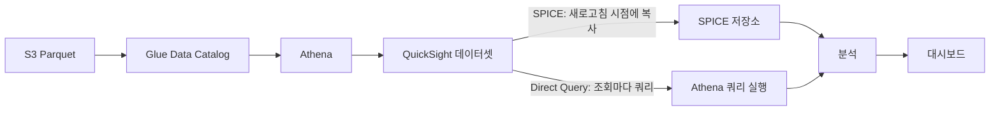
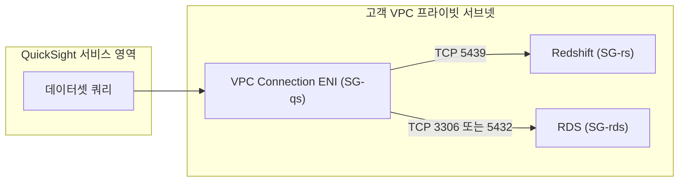
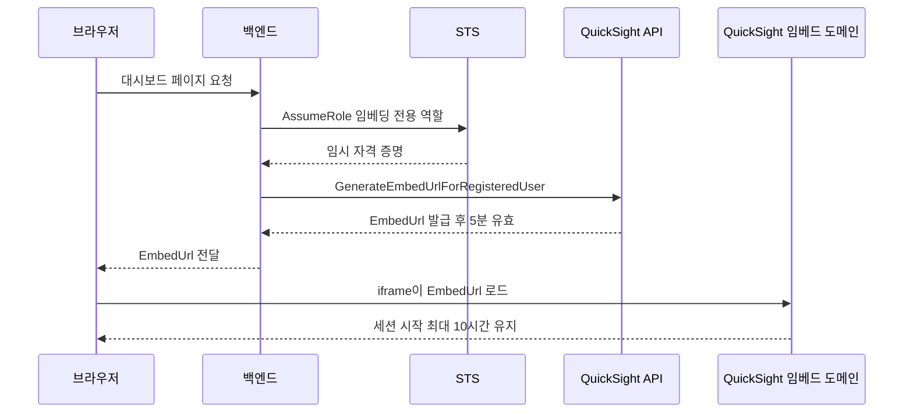

# Amazon QuickSight

QuickSight는 AWS의 BI 서비스다. Redshift, Athena, RDS, S3 같은 AWS 데이터 소스에 연결해 대시보드를 만들고, 팀 내부에 공유하거나 웹 애플리케이션 안에 심어서 쓴다. 최근 콘솔과 문서에서는 Amazon Quick이라는 이름이 같이 보이는데, 이 문서에서 다루는 BI 기능은 같은 서비스다.

Tableau나 Looker보다 기능은 단순하다. 대신 AWS 데이터 소스와 붙이기 쉽고, 사용자 수와 세션 수로 요금이 정해져서 내부 BI 도구로 두기에는 부담이 적다. 쓰다 보면 문제는 대부분 화면이 아니라 데이터 쪽에서 난다. 새로고침이 실패하거나, 권한이 없어서 쿼리가 막히거나, 임베딩한 iframe이 빈 화면으로 뜬다. 뒤쪽 운영 절에 이런 증상의 확인 순서를 따로 정리했다.

## 데이터가 대시보드까지 가는 경로

S3에 Parquet으로 쌓은 데이터를 Glue Data Catalog에 테이블로 등록하고, Athena로 조회하고, QuickSight 데이터셋으로 묶는 구성이 가장 흔하다. 이 흐름에서 갈림길은 데이터셋을 만드는 시점에 한 번 정해진다. SPICE로 복사해 오느냐, 조회할 때마다 원본에 쿼리하느냐다.



SPICE 경로는 Athena가 새로고침 때만 호출된다. 대시보드를 100명이 열어도 Athena 쿼리는 늘지 않는다. Direct Query 경로는 대시보드를 열 때마다, 필터를 바꿀 때마다 비주얼 개수만큼 쿼리가 나간다. 이 차이가 속도, 데이터 신선도, 비용 세 가지를 모두 갈라놓는다.

SPICE(Super-fast Parallel In-memory Calculation Engine)는 마지막 새로고침 시점의 스냅샷을 보여준다. 실시간 데이터가 필요하면 Direct Query를 써야 하고, 그 대가로 느린 쿼리와 스캔 비용을 받아들여야 한다.

### Athena

QuickSight에서 Athena 데이터 소스를 만들 때 Workgroup을 지정한다. 팀별로 Workgroup을 나눠서 쿼리 결과 위치와 비용을 따로 보고 있다면 여기서도 맞춰야 한다.

QuickSight가 Athena를 쓰려면 QuickSight 서비스 역할에 Athena 실행 권한과 S3 접근 권한이 둘 다 있어야 한다. 쿼리 대상 데이터 버킷과 Athena 쿼리 결과 버킷을 모두 QuickSight 설정의 Security & Permissions에서 허용 목록에 넣어야 한다. 결과 버킷만 빠뜨려도 데이터 소스 검증 단계에서 오류가 난다.

### S3

S3 파일을 직접 데이터 소스로 쓰려면 매니페스트 파일이 필요하다. 대상 파일 경로를 JSON으로 적어두면 QuickSight가 그 파일들을 읽는다.

```json
{
  "fileLocations": [
    {
      "URIPrefixes": ["s3://my-bucket/data/2024/"]
    }
  ],
  "globalUploadSettings": {
    "format": "CSV",
    "delimiter": ",",
    "containsHeader": "true"
  }
}
```

파티션이 나뉜 데이터는 Athena를 중간에 두는 편이 낫다. S3 직접 연결은 파티션 프루닝이 없어서 매니페스트에 걸린 파일을 전부 읽어 SPICE로 가져온다. 파일 수가 늘수록 적재 시간이 같이 늘어난다.

### Redshift와 RDS

Redshift와 RDS가 프라이빗 서브넷에 있으면 QuickSight가 VPC 안으로 들어올 길이 필요하다. QuickSight 설정에서 VPC Connection을 만들면 지정한 서브넷에 ENI가 생기고, 쿼리는 그 ENI를 통해 DB로 나간다. VPC Connection을 만들 때 QuickSight가 ENI를 만들 수 있는 IAM 역할을 같이 지정한다.



그림에서 볼 것은 보안 그룹이 세 개라는 점이다. ENI에 붙은 SG-qs는 DB 포트로 나가는 아웃바운드가 열려 있어야 하고, SG-rs와 SG-rds는 인바운드 소스로 IP가 아니라 SG-qs를 참조하게 만든다. ENI의 IP는 서브넷에서 할당되는 값이라 IP로 허용해 두면 바뀔 때 끊긴다. 보안 그룹은 상태 기반이라 응답 방향 규칙은 따로 필요 없다.

Redshift Serverless도 같은 방식이다. 엔드포인트, 포트, 데이터베이스명, 계정을 입력한다. Redshift는 SPICE 없이 Direct Query로도 응답이 빠른 편이라 Direct Query로 두는 경우가 많다.

RDS를 분석 용도로 직접 연결하는 건 피하는 쪽이 낫다. 대시보드를 열 때마다 운영 DB에 집계 쿼리가 나가서 서비스 트래픽과 자원을 나눠 쓰게 된다. DMS나 ETL로 Redshift나 S3로 옮긴 뒤 거기서 연결하는 구조가 안전하다. 읽기 전용 복제본을 쓰더라도 복제 지연과 쿼리 부하는 따로 봐야 한다.

## SPICE

SPICE는 QuickSight 자체 인메모리 저장소다. 데이터 소스에서 데이터를 복사해와 내부에 저장하고, 대시보드는 이 복사본으로 렌더링한다.

### 용량

SPICE 용량은 계정 단위로 합산된다. AWS 요금 페이지(2026-10 확인)에는 Author 한 명당 10 GB가 기본 포함되고, 그보다 필요하면 GB당 월 $0.38로 추가 구매한다고 적혀 있다. Standard 에디션도 사용자당 10 GB를 포함한다. 두 에디션의 포함량은 같다. Reader는 SPICE 용량을 가져오지 않는다. Reader가 아무리 많아도 계정 총량은 Author 수에 비례해서 늘 뿐이다. 요금은 리전과 시점에 따라 달라지니 도입 전에 요금 페이지에서 다시 확인한다.

데이터셋이 차지하는 용량은 데이터셋 상세 화면에서 본다. 원본 CSV가 1 GB여도 SPICE에서는 훨씬 작은 경우가 많다. 반대로 긴 텍스트 컬럼이 많으면 압축이 잘 안 먹는다.

### 새로고침

스케줄 옵션은 에디션과 새로고침 방식에 따라 다르다.

| 새로고침 방식 | Standard | Enterprise |
|---|---|---|
| 전체 새로고침 스케줄 | 일, 주, 월 | 시간, 일, 주, 월 |
| 증분 새로고침 | 지원 안 함 | 15분, 30분, 시간, 일, 주, 월 |

Standard에서 1시간 주기가 된다고 알기 쉬운데 아니다. 전체 새로고침 스케줄의 시간 단위는 Enterprise 전용이고, 15분과 30분 주기는 증분 새로고침에서만 고를 수 있다. 시간 단위나 분 단위 스케줄을 쓰면 같은 데이터셋에 다른 스케줄을 함께 둘 수 없다. 콘솔에서 데이터셋당 스케줄은 5개까지 만들 수 있고, 실행은 예약 시각 기준 10분 안에 시작한다.

전체 새로고침은 데이터를 전부 다시 가져와 덮어쓴다. 행 수가 수억 건이 넘으면 한 번에 시간이 꽤 걸린다. 증분 새로고침은 Athena, Redshift, PostgreSQL, Snowflake 같은 SQL 소스에서 날짜 컬럼 기준 lookback window 안의 데이터만 지우고 다시 가져온다. 창 크기는 시간, 일, 주 단위로 정한다. 소스에서 과거 레코드가 수정되는 경우가 있다면 창을 충분히 넓혀야 누락이 없다. 창 밖의 수정과 삭제는 SPICE에 반영되지 않으니, 주기적으로 전체 새로고침을 한 번씩 돌려서 어긋난 부분을 맞춘다.

### SPICE와 Direct Query 선택

접속 빈도가 낮거나 실시간성이 중요하지 않으면 SPICE가 Athena 스캔 비용 면에서 유리하다. 데이터가 항상 최신이어야 하고 쿼리가 가벼우면 Direct Query가 낫다.

두 방식은 계산 필드 동작도 갈린다. Direct Query에서는 계산 필드의 많은 부분이 소스 엔진의 SQL로 변환되어 실행되고, SPICE에서는 QuickSight 엔진이 직접 계산한다. 정수 나눗셈, 문자열 비교의 대소문자, NULL 처리, 날짜 함수의 경계 같은 곳에서 결과가 달라질 수 있다. 한 데이터셋을 Direct Query에서 SPICE로 바꿀 때는 같은 비주얼의 합계와 건수를 양쪽에서 대조해야 한다. 소스에 따라 지원하지 않는 함수도 있어서, 한쪽에서 저장되던 계산 필드가 다른 쪽에서 오류로 바뀌는 경우도 있다.

## 임베디드 대시보드

QuickSight 대시보드를 자사 웹 애플리케이션 안에 심는 기능이다. 고객에게 분석 화면을 제공하거나, 내부 어드민에 대시보드를 붙일 때 쓴다. 두 방식이 있다.

등록 사용자 임베딩은 QuickSight에 사용자 계정이 있는 경우다. `GenerateEmbedUrlForRegisteredUser`로 임시 URL을 받아 iframe에 넣는다. 익명 사용자 임베딩은 QuickSight 계정 없이 대시보드를 보여주는 방식으로 `GenerateEmbedUrlForAnonymousUser`를 쓴다. 두 방식 모두 문서상 Enterprise 에디션 기능이다.

익명 임베딩은 세션 용량 요금제나 세션 팩이 계정에 있어야 한다. 없으면 URL을 만들 때 `UnsupportedPricingPlanException`이 난다. 개발 계정에서 테스트하다 처음 만나는 오류다.

### 발급 흐름

핵심은 URL을 브라우저가 아니라 백엔드가 매번 발급한다는 점이다. 임베딩 URL은 발급 후 5분 안에 열어야 하고, 한 번 연 뒤 만들어진 세션은 최대 10시간 유지된다. 이미 연 URL을 저장해 두었다가 다시 쓰면 실패하는 경우가 많다. 페이지를 새로고침할 때마다 백엔드에 URL을 새로 요청하도록 짜야 한다.



그림에서 5분은 URL을 열기까지의 제한이고, 10시간은 연 뒤 세션의 상한이다. `SessionLifetimeInMinutes`는 15에서 600 사이 값이고 기본이 600이다. 세션이 끝나면 iframe이 오류 화면으로 바뀌므로, 오래 열어두는 화면은 SDK 이벤트를 받아서 URL을 다시 발급해야 한다.

### 서버 코드

```python
import boto3

sts = boto3.client('sts')
assumed = sts.assume_role(
    RoleArn='arn:aws:iam::123456789012:role/QuickSightEmbedRole',
    RoleSessionName='embed-user-1234',
)
cred = assumed['Credentials']

client = boto3.client(
    'quicksight',
    region_name='ap-northeast-2',
    aws_access_key_id=cred['AccessKeyId'],
    aws_secret_access_key=cred['SecretAccessKey'],
    aws_session_token=cred['SessionToken'],
)

response = client.generate_embed_url_for_registered_user(
    AwsAccountId='123456789012',
    SessionLifetimeInMinutes=60,
    UserArn='arn:aws:quicksight:ap-northeast-2:123456789012:user/default/user@example.com',
    ExperienceConfiguration={
        'Dashboard': {
            'InitialDashboardId': 'dashboard-id-here',
            'FeatureConfigurations': {
                'StatePersistence': {'Enabled': True}
            }
        }
    },
    AllowedDomains=['https://myapp.example.com']
)

embed_url = response['EmbedUrl']
```

역할에는 `quicksight:GenerateEmbedUrlForRegisteredUser` 권한이 있어야 한다. `RoleSessionName`을 사용자마다 다르게 주면 CloudTrail에서 누가 URL을 만들었는지 추적할 수 있다. 익명 임베딩이면 `generate_embed_url_for_anonymous_user`를 쓰고 `Namespace`와 `AuthorizedResourceArns`를 같이 넘긴다. 익명 임베딩은 URL을 발급해 세션이 열릴 때마다 용량 요금이 쌓인다. 공개 페이지에 붙이면 봇이나 크롤러가 페이지를 열 때마다 URL이 발급되므로, 인증이 있는 페이지 뒤에 두거나 발급 API에 호출 제한을 걸어야 한다.

### 클라이언트와 파라미터

```html
<script src="https://unpkg.com/amazon-quicksight-embedding-sdk@2.7.0/dist/quicksight-embedding-js-sdk.min.js"></script>
<div id="dashboardContainer"></div>

<script>
  const { createEmbeddingContext } = QuickSightEmbedding;

  async function embed(url) {
    const embeddingContext = await createEmbeddingContext();
    const dashboard = await embeddingContext.embedDashboard(
      {
        url,
        container: '#dashboardContainer',
        height: '700px',
        width: '100%',
      },
      {
        parameters: [
          { Name: 'region', Values: ['Seoul'] },
        ],
        locale: 'ko-KR',
        toolbarOptions: { export: false },
        onMessage: (event) => {
          if (event.eventName === 'ERROR_OCCURRED') {
            console.error(event.message);
          }
        },
      }
    );
    return dashboard;
  }
</script>
```

SDK 버전은 `2.7.0`처럼 고정한다. `unpkg`에서 버전을 빼고 최신을 받으면 어느 날 옵션 이름이나 이벤트 형태가 바뀌어도 배포 없이 임베딩이 깨진다.

대시보드 파라미터는 두 단계로 넘긴다. 처음 로드할 때는 `embedDashboard`의 두 번째 인자인 `contentOptions.parameters`에 `Name`과 `Values` 배열로 넣는다. 로드 후에 바꾸려면 반환된 객체의 `setParameters`를 쓴다. 대시보드에 같은 이름의 파라미터가 정의되어 있어야 하고, 이름 대소문자가 다르면 조용히 무시된다.

### AllowedDomains

`AllowedDomains`는 두 군데에서 정해진다. 하나는 Manage QuickSight의 Domains and Embedding에 등록하는 정적 목록이고, 다른 하나는 URL 발급 호출의 `AllowedDomains` 인자다. 문서상 두 방식은 대안 관계고, 런타임 인자를 주면 그 값이 정적 목록을 덮어쓴다. 런타임 인자는 최대 3개까지 받는다. 정적 목록은 100개까지 등록하고 HTTPS여야 한다. 그래서 정적 목록에 `https://myapp.example.com`을 넣어 놓고 코드에서 `AllowedDomains=['https://staging.example.com']`만 넘기면, 운영 도메인에서 iframe이 열리지 않는다.

## 접근 제어

### 사용자와 그룹

QuickSight는 IAM과 별개의 사용자 체계를 가진다. 초대받은 사용자만 대시보드에 접근한다. 역할은 Admin, Author, Reader다. Admin은 설정과 사용자 관리를 하고, Author는 데이터셋과 분석, 대시보드를 만든다. Reader는 공유받은 대시보드를 본다. 현재 요금 체계에는 AI 기능이 붙은 Author Pro, Reader Pro 등급도 있다.

그룹을 만들어 그룹 단위로 대시보드 권한을 주는 편이 사용자가 늘 때 관리하기 쉽다. Enterprise에서는 Active Directory나 SAML IdP 그룹을 QuickSight 그룹에 매핑할 수 있다.

### 행 수준 보안

같은 대시보드를 보더라도 사용자마다 데이터 범위를 다르게 하고 싶을 때 쓴다. 부서별 데이터만 보이게 하거나 영업 담당자별로 지역을 제한한다.

RLS는 데이터셋 단위로 설정한다. 사용자나 그룹과 필터 값을 적은 규칙 테이블을 별도 데이터셋으로 만들고, 대상 데이터셋에서 그 규칙 데이터셋을 참조한다.

```
UserName    | region
------------|--------
alice       | Seoul
bob         | Busan
carol       | Seoul
```

규칙 테이블에 없는 사용자는 아무 행도 보지 못한다. 관리자 계정은 규칙 테이블에 따로 모든 값을 넣거나 RLS 적용 예외로 둬야 한다. RLS는 Enterprise 에디션 기능이다.

## Standard와 Enterprise

Standard 에디션은 현재 요금 페이지에서 `CreateAccountSubscription` API로 가입하는 형태의 소규모용으로 표시된다. 새로 도입한다면 사실상 Enterprise를 기준으로 계획한다.

| 항목 | Standard | Enterprise |
|---|---|---|
| 전체 새로고침 최소 단위 | 일 | 시간 |
| 증분 새로고침 | 지원 안 함 | 지원 (15분 단위까지) |
| AD / SAML SSO | 지원 안 함 | 지원 |
| 행 수준 보안 | 지원 안 함 | 지원 |
| 임베딩 (등록, 익명) | 지원 안 함 | 지원 |
| SPICE 기본 포함량 | 사용자당 10 GB | Author당 10 GB |

ML Insights, Q, 저장 시 암호화 같은 항목은 표에서 뺐다. 에디션 구분과 제품 구성이 바뀌고 있어 현재 기준으로 확인하지 못했다. 필요하면 공식 문서의 에디션 비교 페이지를 직접 확인한다.

## 비용

요금 페이지(2026-10 확인, 미국 기준 표기)에서 읽은 값이다. 서울 리전은 다를 수 있고, 계약 조건에 따라 달라질 수 있으니 도입 전에 다시 확인한다.

| 항목 | 표기 요금 |
|---|---|
| Author | 월 $24 |
| Author Pro | 월 $40 |
| Reader | 월 $3 |
| Reader Pro | 월 $20 |
| 추가 SPICE | GB당 월 $0.38 |
| 용량 기반 세션 (임베딩) | 월 500세션 $250, 초과 세션당 $0.50 |
| Standard Author | 연 약정 월 $9, 월 단위 $12 |

Pro 사용자나 Q 기능을 켠 계정에는 계정당 월 $250 인프라 요금이 붙는다고 표기되어 있다. 예전 자료에 나오는 Reader 세션당 $0.30에 월 $5 상한 같은 값은 현재 페이지에서 확인하지 못했으므로 쓰지 않는다. 임베딩 쪽 세션 과금은 위 표의 용량 기반 요금을 기준으로 본다.

비용이 예상보다 크게 나오는 경로는 두 가지다. 첫째는 Direct Query로 Athena를 쓰는 경우다. 파티션이 없는 200 GB 테이블 위에 비주얼 10개짜리 대시보드를 올리고 Direct Query로 두면, 한 번 열 때마다 스캔량이 2 TB 가까이 나갈 수 있다(가정 계산이다). 필터를 바꿀 때마다 다시 쿼리가 나가므로 하루 사용자 수에 곱하면 Athena 요금이 QuickSight 요금을 넘는다. 이 구조면 SPICE로 바꾸고 새로고침 시간만 Athena를 쓰게 한다. 둘째는 SPICE 용량이다. 데이터셋 복제본이 쌓이면 계정 총량이 조용히 차오른다. 분석마다 데이터셋을 복사해 쓰지 않는 규칙을 둔다.

비용 추이는 Cost Explorer와 Budgets로 본다. QuickSight 자체 비용을 시간 단위로 보고 싶으면 CUR을 S3로 받아 Athena로 조회하고, 그 결과를 QuickSight 대시보드로 올리는 구성이 흔하다. 자세한 내용은 [Cost Explorer](../Cost/Cost_Explorer.md)와 [Budgets](../Cost/Budgets.md)의 CUR 설명에 있다.

## 운영 중 겪는 문제

### SPICE 새로고침 실패

원인은 세 가지로 갈린다. 먼저 실패 상세 메시지를 읽는다.

용량 초과는 계정 총 SPICE가 부족한 경우다. 용량을 추가로 구매하거나, 불필요한 데이터셋을 지우거나, 컬럼을 줄인다.

소스 쿼리 타임아웃은 Athena나 Redshift에서 데이터셋 쿼리가 너무 오래 걸릴 때다. 데이터셋 SQL에 무거운 조인이 들어 있거나 파티션 조건이 없을 때 자주 난다. 소스 엔진에서 같은 쿼리를 직접 실행해 시간을 재고, 증분 새로고침으로 바꿔 한 번에 가져오는 양을 줄인다.

스키마 변경은 소스 테이블에서 컬럼을 지우거나 이름을 바꿨을 때다. QuickSight는 데이터베이스 스키마 변경을 자동으로 감지하지 못해서 적재가 실패한다. 데이터셋을 열어 편집 화면에서 저장하면 스키마가 갱신된다. 그 컬럼을 쓰던 계산 필드와 비주얼에 빨간 표시가 뜨면 하나씩 고쳐야 한다.

### Athena 권한 오류

데이터 소스 연결은 되는데 데이터셋 만들 때 오류가 나는 경우가 있다. 확인 순서는 이렇다.

1. QuickSight 설정의 Security & Permissions에서 쿼리 대상 S3 버킷과 Athena 결과 버킷이 모두 허용되어 있는지 본다.
2. Workgroup의 결과 위치가 허용된 버킷인지 본다. Workgroup에서 결과 위치를 강제하면 데이터 소스에서 고른 버킷은 무시된다.
3. Lake Formation을 쓰면 QuickSight가 쓰는 IAM 역할에 대상 데이터베이스와 테이블의 SELECT 권한을 Lake Formation에서 따로 부여해야 한다. IAM 정책이 있어도 Lake Formation 권한이 없으면 쿼리가 거부된다.
4. 대상 S3 버킷이 KMS로 암호화되어 있으면 키 정책도 본다.

### RLS가 아무 행도 안 보여줌

규칙 테이블에 사용자가 있는데도 빈 대시보드가 뜨면 컬럼 타입부터 본다. 규칙 테이블의 필터 컬럼은 문자열로 맞춘다. 대상 데이터셋의 같은 이름 컬럼이 숫자형이거나 날짜형이면 값 비교가 맞지 않아 전부 걸러진다. 규칙 테이블의 컬럼 이름은 대상 데이터셋의 컬럼 이름과 정확히 같아야 한다. 대소문자와 공백도 맞춰야 한다. 사용자 이름은 QuickSight에 등록된 이름과 규칙 테이블의 `UserName`이 일치하는지 본다. 이메일로 초대한 사용자와 IAM 연동 사용자는 이름 형식이 다르다.

### iframe이 빈 화면으로 뜸

브라우저 콘솔의 오류 메시지가 가장 빠른 단서다. 순서는 이렇다.

1. 개발자 도구 콘솔에서 `frame-ancestors` 관련 CSP 오류를 찾는다. 있으면 도메인 허용 문제다.
2. 임베딩 페이지의 origin을 정확히 본다. 스킴(https), 서브도메인, 포트가 모두 허용 목록과 같아야 한다. `www`가 붙은 도메인과 아닌 도메인은 다른 도메인이다. `Include subdomains` 체크 여부도 본다.
3. 발급 호출에 `AllowedDomains`를 넘기고 있는지 본다. 넘기고 있으면 정적 목록이 아니라 그 값만 유효하다.
4. URL이 발급 후 5분을 넘겼거나 이미 한 번 열었는지 본다. 같은 URL로 새로고침하면 실패하므로, 새로고침 때 새 URL을 받도록 한다.
5. 대시보드가 사용자나 그룹에게 공유되어 있는지 본다. 익명 임베딩이면 `AuthorizedResourceArns`에 대시보드 ARN이 있는지 본다.
6. 익명 임베딩이면 `UnsupportedPricingPlanException`처럼 세션 용량 요금제 문제가 아닌지 서버 로그를 본다.

도메인 문제와 URL 만료는 화면 증상이 같아서 헷갈린다. 도메인은 콘솔 오류로, 만료는 URL을 새로 발급해 같은 환경에서 열어보면 구분된다.

## 관련 문서

- [Athena](Athena.md): 쿼리 스캔량과 Workgroup 설정
- [Redshift](Redshift.md): Direct Query 대상으로 쓸 때의 구성
- [Glue](Glue.md): Data Catalog와 스키마 변경 관리
- [Cost Explorer](../Cost/Cost_Explorer.md): CUR 기반 비용 분석
- [Budgets](../Cost/Budgets.md): CUR, Athena, QuickSight로 비용 대시보드를 만드는 구성
