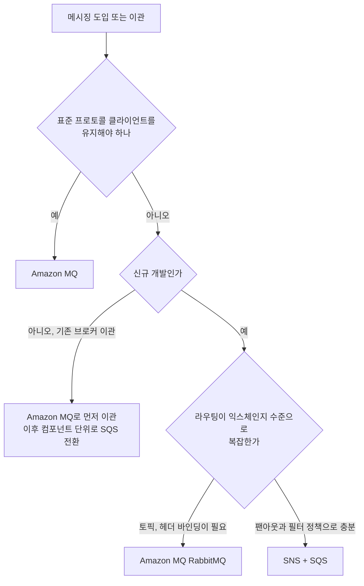
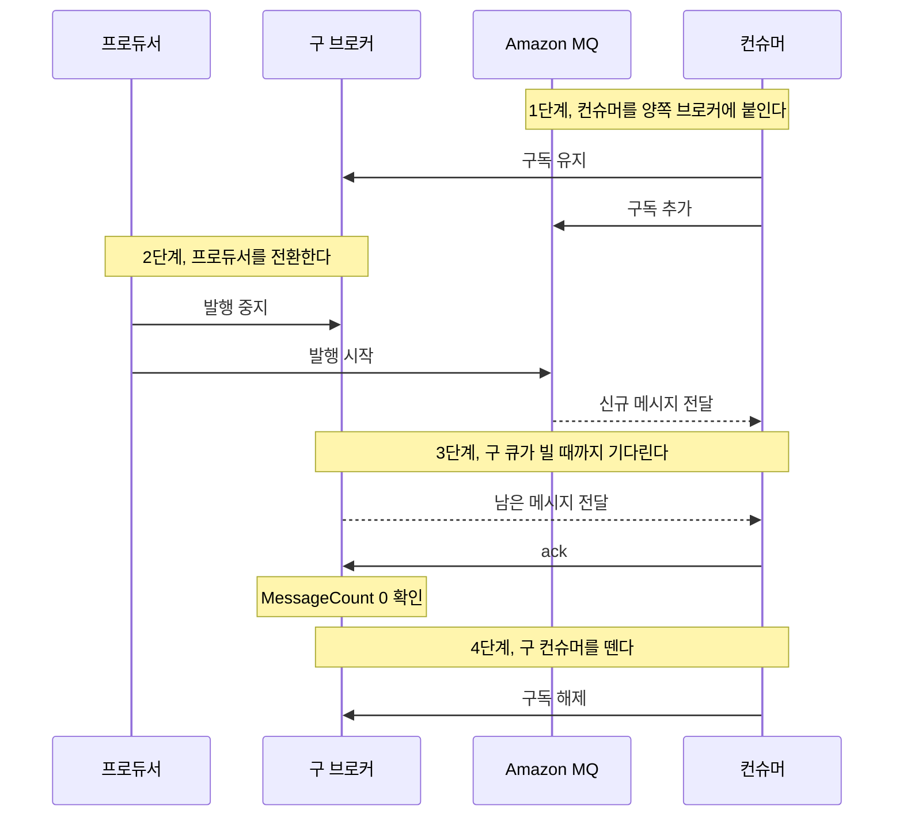
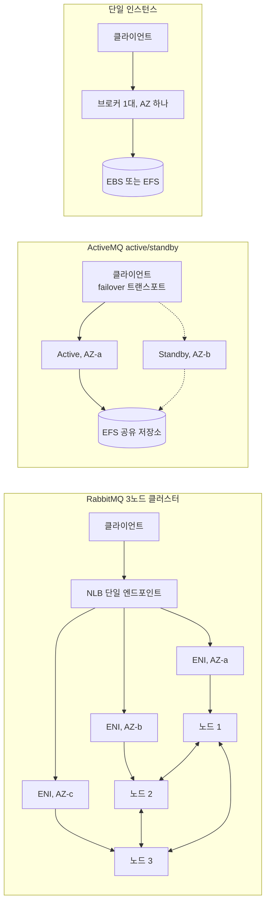
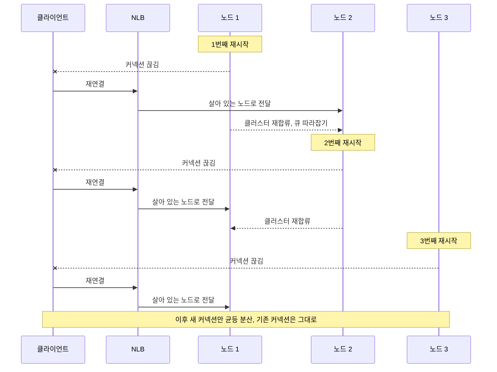
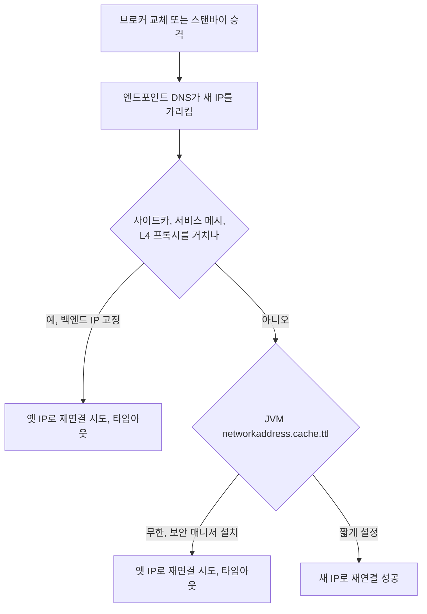
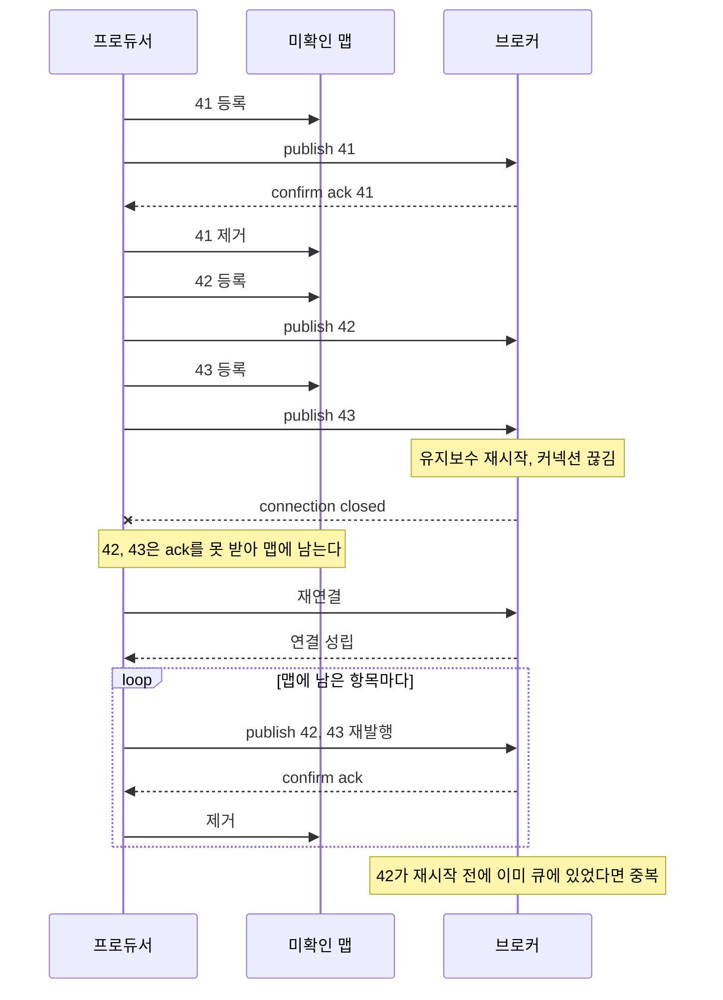
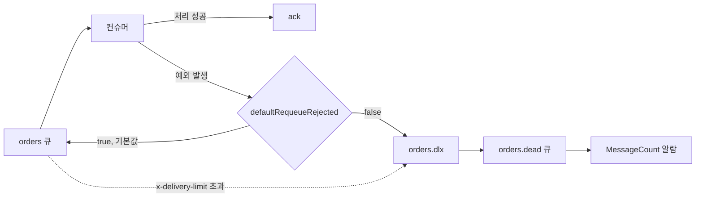
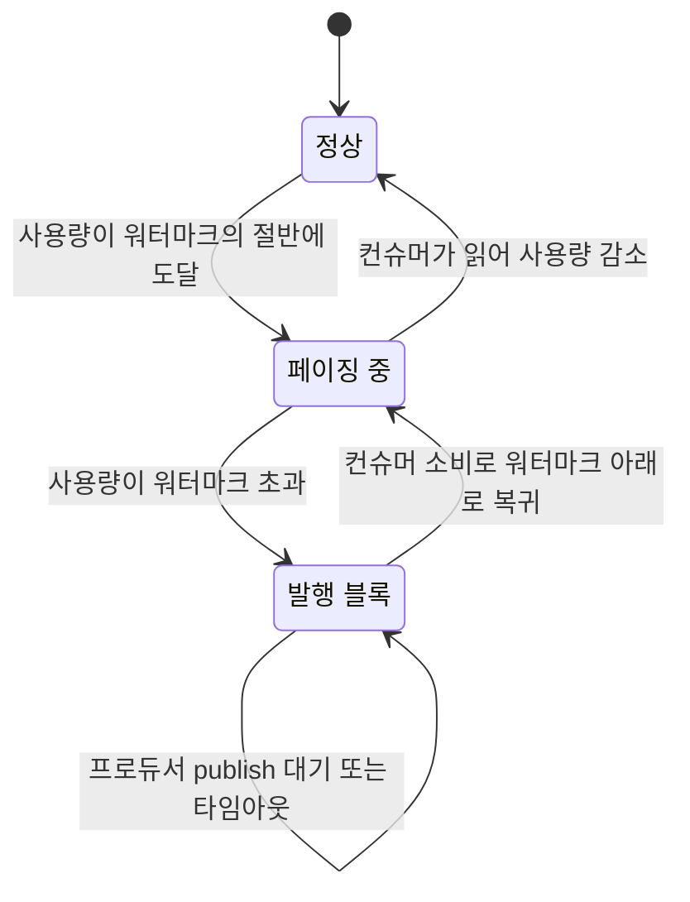

# Amazon MQ 운영 노트

Amazon MQ는 RabbitMQ와 ActiveMQ를 관리형으로 돌려주는 서비스다. 브로커 소프트웨어 자체는 오픈소스 그대로고, AWS가 EC2 인스턴스 프로비저닝, 패치, 백업, 장애 조치를 대신 해준다. SQS/SNS처럼 AWS 자체 프로토콜을 쓰는 게 아니라 AMQP 0-9-1, MQTT, STOMP, OpenWire, JMS 같은 표준 프로토콜을 그대로 지원한다. 이게 Amazon MQ를 쓰는 거의 유일한 이유다.

기존에 자체 호스팅 RabbitMQ나 ActiveMQ를 돌리던 애플리케이션이 있고, 코드에 AMQP나 JMS 클라이언트가 이미 박혀 있다면 Amazon MQ로 넘어가는 게 맞다. 반대로 신규 프로젝트를 처음부터 짜는 거라면 대부분 SQS/SNS가 낫다.

ActiveMQ 쪽 세부 운영과 보안 설정은 별도 문서로 뺐다. 이 문서는 RabbitMQ 중심이고, 두 브로커에 공통인 판단과 사고 사례를 다룬다.

- [Amazon MQ 보안](Amazon_MQ_Security.md)
- [Amazon MQ ActiveMQ 운영](Amazon_MQ_ActiveMQ.md)

## SQS/SNS와 Amazon MQ 중 뭘 쓸까

이 판단을 잘못하면 나중에 고생한다. 기준은 하나다. 표준 메시징 프로토콜을 유지해야 하느냐.

기존 애플리케이션이 RabbitMQ의 AMQP나 IBM MQ, ActiveMQ의 JMS 위에서 돌고 있고, 이걸 최소한의 코드 수정으로 클라우드에 올려야 한다면 Amazon MQ다. 스프링 애플리케이션에서 `spring-boot-starter-amqp`로 짠 코드, JMS `MessageListener`로 짠 코드를 그대로 살릴 수 있다. 프로토콜 레벨에서 호환되니 커넥션 문자열만 바꾸면 대부분 돌아간다.

반대로 다음 경우엔 SQS/SNS가 낫다.

- 애플리케이션을 새로 짜거나 어차피 메시징 레이어를 다시 쓸 거다
- 브로커 인스턴스를 직접 관리하고 싶지 않다 (SQS는 완전 서버리스라 인스턴스 개념 자체가 없다)
- 트래픽이 크게 출렁여서 자동으로 늘어나고 줄어드는 처리량이 필요하다
- 초당 수만 건 이상을 안정적으로 흘려야 한다

Amazon MQ는 결국 EC2 인스턴스 위에서 도는 브로커라 처리량에 상한이 있다. 인스턴스 타입에 묶여 있고, 그 이상 필요하면 스케일 업하거나 클러스터를 늘려야 한다. SQS는 사실상 무한히 늘어난다. 대신 SQS는 AMQP도 JMS도 아니고, 메시지 라우팅이 RabbitMQ의 익스체인지처럼 정교하지 않다. 라우팅 키 기반 토픽 익스체인지, 헤더 익스체인지 같은 걸 쓰고 있었다면 SQS로 그대로 옮기기 어렵다.

아래 흐름도는 세 가지 질문으로 갈린다. 표준 프로토콜을 유지해야 하는지, 신규 개발인지, 라우팅이 익스체인지 수준으로 복잡한지다. 위에서부터 내려오면서 첫 번째 질문에서 "예"가 나오면 나머지는 볼 필요가 없다.



실무에서 자주 겪는 상황은 이렇다. 온프레미스나 자체 EC2에서 RabbitMQ를 돌리던 팀이 운영 부담을 줄이려고 클라우드로 넘어온다. 이때 "이왕 옮기는 김에 SQS로 다 바꾸자"는 얘기가 나오는데, 익스체인지/큐 바인딩 구조가 복잡할수록 재작성 비용이 크다. 일단 Amazon MQ로 최소 변경 마이그레이션을 하고, 나중에 컴포넌트 단위로 천천히 SQS로 넘기는 게 현실적이다.

## 자체 호스팅 RabbitMQ에서 넘어올 때 겪는 문제

커넥션 문자열만 바꾸면 끝날 것 같지만 실제로는 걸리는 게 몇 개 있다.

### 버전 차이

Amazon MQ가 지원하는 RabbitMQ 버전은 제한적이다. 자체 호스팅으로 최신 버전을 쓰고 있었다면, Amazon MQ가 그 버전을 아직 지원하지 않는 경우가 있다. 마이그레이션 전에 대상 버전을 먼저 확인해야 한다. 버전이 다르면 플러그인 호환성이나 정책 동작이 미묘하게 달라질 수 있다. 특히 큐 복제 방식이 버전에 따라 갈리는데, 이 부분은 뒤의 "클래식 미러링과 쿼럼 큐"에서 따로 다룬다.

그리고 Amazon MQ의 RabbitMQ는 관리형이라 임의 플러그인을 켤 수 없다. `rabbitmq_delayed_message_exchange` 같은 커뮤니티 플러그인에 의존하고 있었다면 그대로 못 옮긴다. 지연 메시지가 필요하면 애플리케이션 레벨에서 TTL + Dead Letter Exchange 조합으로 다시 구현하거나, 아예 다른 방식을 찾아야 한다.

### 관리 API 접근 제한

자체 호스팅에서는 `rabbitmqctl`로 노드에 직접 붙어서 큐를 만들고, 정책을 걸고, 유저를 관리했다. Amazon MQ에서는 브로커 호스트에 SSH로 못 들어간다. 관리 UI(RabbitMQ Management Console)와 HTTP API는 열려 있지만, `rabbitmqctl` 같은 노드 직접 조작은 안 된다. 배포 스크립트나 운영 자동화가 `rabbitmqctl`에 의존하고 있었다면 전부 HTTP 관리 API 호출로 다시 짜야 한다.

### 사용자/권한 관리 방식

자체 호스팅에서 rabbitmq 내부 유저를 CLI로 관리했다면, Amazon MQ에서는 브로커 생성 시 지정한 관리자 계정으로 시작하고, 추가 유저는 관리 콘솔이나 API로 만든다. LDAP 연동도 지원하지만 설정 방식이 다르다. 인증 방식과 네트워크 격리 같은 보안 쪽 내용은 [Amazon MQ 보안](Amazon_MQ_Security.md)에 정리했다.

### 마이그레이션 순서

메시지를 무손실로 옮기려면 보통 이렇게 한다. 새 Amazon MQ 브로커를 띄우고, 컨슈머를 먼저 양쪽 브로커에 모두 붙인다. 그다음 프로듀서를 새 브로커로 전환한다. 기존 브로커의 큐가 다 비워지면 기존 브로커의 컨슈머를 뗀다. 이렇게 하면 인플라이트 메시지를 잃지 않는다. 프로듀서와 컨슈머를 동시에 전환하면 전환 시점에 어느 한쪽 브로커에 남은 메시지가 처리되지 않고 붕 뜬다.

순서가 핵심이라 시퀀스로 그렸다. 프로듀서 전환 전에 새 브로커 쪽 컨슈머가 이미 떠 있어야 하고, 구 컨슈머는 구 큐가 0이 된 걸 확인한 뒤에야 뗀다는 점을 보면 된다.



3단계에서 `MessageCount`가 0이 된 직후에 바로 떼면 안 된다. 컨슈머가 이미 받아 두고 ack하지 않은 메시지가 남아 있을 수 있어서, 뒤에서 말하는 prefetch 때문에 `MessageUnacknowledgedCount`까지 0인지 같이 봐야 한다. 이걸 놓치고 구 컨슈머를 먼저 내리면 처리 중이던 메시지가 구 큐로 되돌아가고, 읽는 쪽이 없는 채로 남는다.

## 배포 방식: 단일 인스턴스 vs 클러스터

배포 모드 선택은 가용성과 비용을 직접 결정한다. 세 가지 구성이 네트워크와 저장소 면에서 어떻게 다른지부터 보자. RabbitMQ 클러스터는 AZ 3개에 노드와 ENI가 하나씩 있고 NLB 엔드포인트 하나로 들어간다. ActiveMQ active/standby는 AZ 2개에 브로커가 있고 저장소를 공유한다. 단일 인스턴스는 AZ 하나에 브로커 하나다.



### 단일 인스턴스 (single-instance)

브로커 하나만 뜬다. 인스턴스가 죽으면 AWS가 같은 AZ 안에서 새 인스턴스를 다시 띄우는데, 이 과정에서 몇 분간 브로커가 통째로 내려간다. 개발/스테이징 환경이나, 짧은 다운타임을 감내할 수 있는 워크로드에만 쓴다. 프로덕션에서 단일 인스턴스로 돌리다가 인스턴스 교체 중에 서비스가 멈춰서 장애가 나는 경우를 봤다.

### RabbitMQ 클러스터 배포 (cluster deployment)

RabbitMQ는 3개 노드로 구성된 클러스터로 배포한다. 3개 노드가 서로 다른 AZ에 분산되고, 큐가 복제된다. 노드 하나가 죽어도 나머지 둘이 살아 있어서 브로커가 계속 돈다. 프로덕션 RabbitMQ는 사실상 이 모드가 기본이다.

주의할 점은 클러스터라고 해서 처리량이 3배가 되는 게 아니라는 거다. 큐가 복제되기 때문에 쓰기는 오히려 노드 간 복제 오버헤드가 붙는다. 클러스터는 처리량이 아니라 가용성을 위한 거다. 처리량을 늘리려면 인스턴스 타입을 키우거나 큐를 여러 브로커에 나눠야 한다.

클라이언트가 보는 건 NLB 엔드포인트 하나다. 어느 노드로 붙을지는 NLB가 정하니 클라이언트가 노드를 고를 수 없다. 이 점이 뒤에서 말하는 재시작 후 커넥션 쏠림의 원인이 된다.

### 클래식 미러링과 쿼럼 큐

"큐가 복제된다"는 말이 RabbitMQ 버전에 따라 완전히 다른 메커니즘을 가리킨다. 마이그레이션 때 제일 많이 헷갈리는 부분이라 따로 정리한다.

클래식 미러링은 큐마다 리더(master) 하나와 미러 여러 개를 두는 방식이다. 정책의 `ha-mode`로 어느 큐를 몇 개 노드에 복제할지 정한다. 리더 노드가 죽으면 동기화된 미러 중 하나가 승격된다. 문제는 새 미러가 붙을 때다. `ha-sync-mode`가 automatic이면 동기화가 끝날 때까지 그 큐가 멈춘다. 메시지가 수십만 건 쌓인 큐에서 노드 재시작 직후 이 동기화가 걸리면 큐 하나가 한동안 읽기도 쓰기도 안 된다.

쿼럼 큐는 Raft 합의로 복제하는 큐 타입이다. 큐를 선언할 때 `x-queue-type: quorum`을 줘야 하고, 선언한 뒤에는 타입을 바꿀 수 없다. 클래식 큐를 쿼럼으로 바꾸려면 새 큐를 만들어 위의 마이그레이션 순서대로 옮겨야 한다. 3노드에서 과반수인 2대가 살아 있어야 쓰기가 되니, 1대는 잃어도 되지만 2대가 동시에 빠지면 쿼럼 큐는 멈춘다. 모든 메시지를 디스크에 쓰기 때문에 지연이 클래식 큐보다 느린 경우가 있다. exclusive 큐나 non-durable 큐는 쿼럼으로 선언이 안 된다. RPC 응답용으로 임시 exclusive 큐를 쓰던 코드는 그 큐만 클래식으로 남겨야 한다.

| 항목 | 클래식 미러링 | 쿼럼 큐 |
|---|---|---|
| 복제 방식 | 리더 + 미러, 정책으로 지정 | Raft, 큐 선언 시 지정 |
| 노드 재시작 후 | 미러 재동기화 중 큐 정지 가능 | 팔로워가 로그로 따라잡음 |
| 두 노드 동시 손실 | 남은 미러로 계속 동작할 수 있음 | 과반수가 없어 정지 |
| exclusive, non-durable | 가능 | 불가 |
| 업스트림 상태 | 3.9 이후 deprecated, 4.0에서 제거 | 3.8에서 도입, 4.x 기본 방향 |

버전별로 정리하면 이렇다. 3.8 이전 계열에서는 쿼럼 큐가 없고 미러링이 전부다. 3.8 이후 3.x에서는 둘 다 쓸 수 있고, 미러링은 deprecated 경고가 붙는다. 4.0 이후에는 미러링 자체가 없어서 복제가 필요한 큐는 전부 쿼럼 큐여야 하고, 클래식 큐는 복제 없이 한 노드에만 존재한다. Amazon MQ가 어느 버전을 어떤 시점까지 지원하는지는 바뀌므로 브로커를 만들기 전에 지원 버전 표를 확인한다. 클러스터에서 복제 없는 클래식 큐를 만들어 두면 그 큐가 올라간 노드가 재시작되는 동안 큐 자체가 사라진 것처럼 동작한다. 정책 목록(`/api/policies`)에서 ha 정책이 실제로 걸려 있는지 먼저 본다.

### ActiveMQ의 active/standby

ActiveMQ는 RabbitMQ와 구조가 다르다. active/standby 방식으로, 두 브로커가 뜨지만 한 번에 하나만 활성 상태다. 액티브 브로커가 죽으면 스탠바이가 승격되면서 페일오버가 일어난다. 이 페일오버에도 수십 초에서 분 단위의 시간이 걸린다. 그동안 커넥션은 끊긴다. ActiveMQ 클라이언트에 페일오버 트랜스포트(`failover:(...)`)를 설정해두면 자동으로 재연결을 시도한다.

두 브로커는 같은 저장소를 본다. active/standby에서는 AZ를 가로질러 공유되는 EFS를 쓰고, EBS는 단일 인스턴스에서 처리량을 우선할 때 고르는 선택지다. 저장소 종류에 따른 차이와 KahaDB 설정은 [Amazon MQ ActiveMQ 운영](Amazon_MQ_ActiveMQ.md)에서 다룬다.

## 브로커 재시작과 커넥션 끊김

이게 실무에서 제일 자주 데는 부분이다. Amazon MQ는 관리형이라 AWS가 유지보수 윈도우에 브로커를 패치하고 재시작한다. 클러스터 배포라도 노드를 하나씩 롤링으로 재시작하는데, 이때 그 노드에 붙어 있던 커넥션은 끊긴다.

핵심은 이거다. 관리형이라도 커넥션 끊김은 반드시 일어난다. 애플리케이션이 커넥션이 끊겨도 스스로 다시 붙을 수 있어야 한다. 이걸 준비 안 하면 유지보수 윈도우마다 메시지 처리가 멈춘다.

유지보수 윈도우는 브로커 생성 시 지정할 수 있다. 트래픽이 적은 시간대로 잡아둔다. 하지만 지정한다고 커넥션이 안 끊기는 게 아니라, 언제 끊길지를 정하는 것뿐이다.

### 버전 업그레이드와 롤링 재시작

패치나 버전 업그레이드가 걸리면 클러스터 노드가 한 대씩 내려갔다 올라온다. 한 대가 올라와서 클러스터에 다시 합류한 뒤에 다음 대가 내려가는 식이다. 어느 노드가 먼저인지는 사용자가 정할 수 없다.

롤링 중에 일어나는 일을 시간 순으로 보면 이렇다. 노드 1이 내려가면 거기 붙어 있던 커넥션이 끊기고 클라이언트가 재연결한다. NLB가 살아 있는 노드 2, 3으로 보내므로 이 재연결은 보통 성공한다. 노드 1이 돌아오면 쿼럼 큐는 팔로워로 복귀해 로그를 따라잡는다. 클래식 미러링이라면 앞에서 말한 재동기화가 걸릴 수 있다. 그다음 노드 2가 내려간다. 이 시점에 노드 1이 아직 따라잡는 중이면 쿼럼 큐는 순간적으로 과반수가 위태로워진다. 그래서 롤링 중에는 쓰기 지연이 늘어나는 일이 흔하다.

더 자주 터지는 건 커넥션 쏠림이다. 롤링이 끝나면 모든 커넥션이 마지막까지 살아 있던 노드에 몰려 있다. 끊긴 커넥션은 재연결 때 NLB가 그 순간 살아 있는 노드로만 보냈기 때문이다. 이후 새 커넥션은 균등하게 분산되지만, 이미 붙은 건 옮겨가지 않는다. CloudWatch에서 노드별 CPU가 한쪽으로 치우쳐 있으면 이걸 의심한다. 급하면 애플리케이션을 롤링 재시작해서 커넥션을 다시 분산시킨다.

아래 시퀀스는 3노드가 차례로 내려갔다 올라오는 동안 클라이언트 커넥션이 어떻게 이동하는지를 보여준다. 마지막 단계에서 모든 커넥션이 노드 3에 모여 있다는 점을 보면 된다.



버전 업그레이드에는 방향성이 있다. 올리는 건 되지만 내리는 건 안 된다. 마이너 버전 자동 업그레이드를 켜 두면 유지보수 윈도우에 AWS가 알아서 올리고, 이때 플러그인 동작이나 기본 정책이 바뀔 수 있다. 메이저 업그레이드는 직접 시작해야 한다. 프로덕션에서는 자동 업그레이드를 끄고 스테이징 브로커에서 먼저 올려 본 뒤 직접 적용하는 편이 안전하다. 업그레이드 후 1~2분 안에 끝나지 않는 큐 재동기화, 정책이 사라지거나 바뀐 것, deprecated된 기능 경고를 확인한다.

### 스프링 AMQP에서 재연결

스프링의 `CachingConnectionFactory`는 기본적으로 커넥션이 끊기면 다음 요청 때 다시 연결을 시도한다. 하지만 컨슈머 쪽은 조금 더 신경 써야 한다. `SimpleMessageListenerContainer`나 `DirectMessageListenerContainer`에 복구 인터벌을 명시적으로 설정해두는 게 좋다.

```java
@Configuration
public class RabbitConfig {

    @Bean
    public CachingConnectionFactory connectionFactory() {
        CachingConnectionFactory factory = new CachingConnectionFactory();
        factory.setUri("amqps://b-xxxx.mq.ap-northeast-2.amazonaws.com:5671");
        factory.setUsername("admin");
        factory.setPassword("...");
        // 커넥션 캐싱 모드. CONNECTION 모드면 여러 커넥션을 캐싱한다
        factory.setCacheMode(CachingConnectionFactory.CacheMode.CHANNEL);
        return factory;
    }

    @Bean
    public SimpleRabbitListenerContainerFactory rabbitListenerContainerFactory(
            CachingConnectionFactory connectionFactory) {
        SimpleRabbitListenerContainerFactory factory =
                new SimpleRabbitListenerContainerFactory();
        factory.setConnectionFactory(connectionFactory);
        // 커넥션이 끊겼을 때 재시도 간격. 기본 5초
        factory.setRecoveryInterval(5000L);
        // 큐가 아직 없어도 컨테이너를 죽이지 않고 계속 재시도하게 함
        factory.setMissingQueuesFatal(false);
        return factory;
    }
}
```

여기서 `amqps`와 포트 `5671`을 쓴 것에 주의한다. Amazon MQ의 RabbitMQ는 TLS를 강제한다. 평문 AMQP(`amqp`, 포트 5672)로는 못 붙는다. 자체 호스팅에서 평문으로 쓰다가 넘어오면 이 부분에서 커넥션이 안 되는데, 로그만 봐서는 원인을 찾기 어렵다.

### 커넥션 끊김을 애플리케이션이 어떻게 감지하나

RabbitMQ Java 클라이언트에는 자동 복구 기능이 있다. `ConnectionFactory.setAutomaticRecoveryEnabled(true)`를 켜두면 (최신 클라이언트는 기본 활성), 클라이언트가 커넥션이 끊긴 걸 감지하고 백그라운드에서 다시 붙는다. 채널, 컨슈머, 큐 선언까지 자동으로 복구한다.

하지만 자동 복구가 진행되는 동안 발행한 메시지는 유실될 수 있다. 커넥션이 복구되기 전에 `basicPublish`를 호출하면 예외가 난다. 그래서 프로듀서 쪽은 발행 실패를 잡아서 재시도하는 로직이 따로 있어야 한다.

### 장애 조치 후 옛 IP로 붙는 문제

브로커가 교체되거나 스탠바이가 승격되면 엔드포인트 DNS가 가리키는 IP가 바뀐다. 클라이언트가 이 변화를 못 따라가는 경우가 두 가지 있다.

하나는 JVM의 DNS 캐시다. `InetAddress`는 해석 결과를 캐시한다. 보안 매니저가 없으면 기본 30초 정도지만, 보안 매니저가 설치돼 있으면 `networkaddress.cache.ttl` 기본값이 무한이다. 일부 컨테이너 이미지나 앱 서버 설정에서 이 조건이 걸려 있으면, 브로커가 새 IP로 올라와도 클라이언트는 옛 IP로만 재연결을 시도하고 타임아웃이 난다. 재시작해서 JVM이 새로 뜨면 멀쩡히 붙으니 원인을 찾기 어렵다. 해결은 JVM 보안 속성으로 TTL을 짧게 주는 것이다.

```java
// 앱 시작 최초에, 첫 DNS 조회보다 먼저 실행한다
java.security.Security.setProperty("networkaddress.cache.ttl", "10");
java.security.Security.setProperty("networkaddress.cache.negative.ttl", "5");
```

다른 하나는 커넥션 풀이나 프록시다. 사이드카, 서비스 메시, 사내 L4 프록시가 DNS 결과를 별도로 캐시하거나 백엔드 IP를 고정해 두면 JVM 설정을 고쳐도 소용없다. 이쪽은 프록시 설정에서 DNS 재조회 간격을 확인한다.

아래 흐름도는 브로커가 새 IP로 올라온 뒤 클라이언트가 어디서 막히는지를 갈래별로 보여준다. DNS 캐시와 프록시 캐시는 서로 독립이라 한쪽만 고쳐서는 해결되지 않는다.



ActiveMQ active/standby는 엔드포인트가 두 개 나오므로 `failover:(ssl://브로커-1:61617,ssl://브로커-2:61617)`처럼 둘 다 적어 두면 한쪽 IP가 죽어도 다른 쪽으로 넘어간다. 엔드포인트 하나만 적어 두면 DNS 갱신을 기다려야 한다.

## 프로듀서 재연결과 발행 확인

컨슈머는 자동 복구로 어느 정도 커버되지만, 프로듀서는 메시지 유실 위험이 있어서 더 조심해야 한다.

발행할 때 두 가지를 챙긴다. 첫째, Publisher Confirms를 켠다. 브로커가 메시지를 받았다고 확인(ack)을 보내줄 때까지 발행 성공으로 치지 않는다. 둘째, 발행이 실패하거나 nack가 오면 재시도한다.

```java
@Component
public class ReliableProducer {

    private final RabbitTemplate rabbitTemplate;

    public ReliableProducer(RabbitTemplate rabbitTemplate) {
        this.rabbitTemplate = rabbitTemplate;
        // Publisher Confirm 콜백. 브로커가 메시지를 받았는지 확인한다
        this.rabbitTemplate.setConfirmCallback((correlation, ack, cause) -> {
            if (!ack) {
                // nack가 왔다. 재발행 대상으로 넘긴다
                log.warn("메시지 발행 실패, cause={}", cause);
                requeueForRetry(correlation);
            }
        });
        // 라우팅 실패(어떤 큐에도 안 들어감) 시 콜백
        this.rabbitTemplate.setReturnsCallback(returned -> {
            log.warn("라우팅 실패: {}", returned.getMessage());
        });
    }

    public void send(String exchange, String routingKey, Object payload) {
        int attempt = 0;
        while (attempt < 3) {
            try {
                rabbitTemplate.convertAndSend(exchange, routingKey, payload);
                return;
            } catch (AmqpException e) {
                // 커넥션이 복구되는 중이면 여기로 떨어진다
                attempt++;
                log.warn("발행 재시도 {}/3", attempt);
                sleep(1000L * attempt);
            }
        }
        // 3번 실패하면 별도 저장소에 넣어두고 나중에 재처리
        deadLetterStore.save(exchange, routingKey, payload);
    }
}
```

`application.yml`에 Publisher Confirm을 켜는 설정도 필요하다.

```yaml
spring:
  rabbitmq:
    publisher-confirm-type: correlated
    publisher-returns: true
    template:
      mandatory: true   # 라우팅 실패 시 메시지를 버리지 않고 returns 콜백으로 돌려받음
```

`mandatory: true`를 빼먹으면 라우팅되지 못한 메시지가 조용히 사라진다. 익스체인지에는 도달했지만 바인딩된 큐가 없으면 브로커가 그냥 버린다. 이 설정이 있어야 returns 콜백으로 돌아온다.

주의할 건, Publisher Confirm은 성능을 깎는다. 매 발행마다 브로커 ack를 기다리므로 처리량이 떨어진다. 대량 발행이라면 비동기 confirm이나 배치 confirm을 쓰는 게 낫다. 모든 메시지에 동기 confirm을 걸면 초당 처리량이 크게 줄어드는 걸 실측으로 확인한 적이 있다.

### 브로커 재시작 중 confirm을 못 받은 메시지

위 코드에는 구멍이 하나 있다. 커넥션이 끊기는 순간 이미 브로커로 보낸 메시지는 ack도 nack도 오지 않는다. confirm 콜백이 아예 안 불리니 `!ack` 분기는 이 메시지를 못 본다. 브로커가 받아서 디스크에 썼는데 ack만 못 돌려줬을 수도 있고, 아예 못 받았을 수도 있다. 프로듀서는 둘을 구분할 수 없다.

흐름을 보면 이렇다. 메시지 41과 42가 ack 없이 날아간 상태에서 커넥션이 끊기고, 재연결 뒤에 둘 다 다시 보낸다. 41이 이미 큐에 있었다면 중복이 생긴다.



그래서 프로듀서는 발행 시점에 메시지를 미확인 맵에 넣고 confirm ack가 오면 지운다. 일정 시간이 지나도 남아 있는 건 재발행한다. 재발행하면 중복이 생길 수 있으니 같은 `messageId`를 유지해서 컨슈머가 걸러낼 수 있게 한다.

```java
@Component
public class ConfirmTrackingProducer {

    private record Pending(String exchange, String routingKey, Object payload, long sentAt) {}

    private final RabbitTemplate template;
    private final Map<String, Pending> pending = new ConcurrentHashMap<>();

    public ConfirmTrackingProducer(RabbitTemplate template) {
        this.template = template;
        template.setConfirmCallback((corr, ack, cause) -> {
            if (corr != null && ack) {
                pending.remove(corr.getId());
            }
            // nack는 맵에 남겨 두면 아래 스케줄러가 다시 보낸다
        });
    }

    public void send(String exchange, String routingKey, Object payload) {
        String id = UUID.randomUUID().toString();
        pending.put(id, new Pending(exchange, routingKey, payload, System.currentTimeMillis()));
        publish(id, exchange, routingKey, payload);
    }

    private void publish(String id, String exchange, String routingKey, Object payload) {
        try {
            template.convertAndSend(exchange, routingKey, payload, m -> {
                m.getMessageProperties().setMessageId(id);
                return m;
            }, new CorrelationData(id));
        } catch (AmqpException e) {
            // 연결이 복구되는 중이다. 맵에 남아 있으니 다음 주기에 다시 보낸다
        }
    }

    @Scheduled(fixedDelay = 10_000)
    void republishStale() {
        long now = System.currentTimeMillis();
        pending.forEach((id, p) -> {
            if (now - p.sentAt() > 15_000) {
                pending.put(id, new Pending(p.exchange(), p.routingKey(), p.payload(), now));
                publish(id, p.exchange(), p.routingKey(), p.payload());
            }
        });
    }
}
```

맵이 메모리에만 있으므로 프로듀서 프로세스가 같이 죽으면 미확인 메시지는 사라진다. 유실이 허용되지 않는 데이터는 DB 아웃박스 테이블에 먼저 쓰고, 그 행을 읽어 발행한 뒤 confirm에서 지우는 구조로 간다. 컨슈머 쪽에서는 `messageId`를 키로 처리 이력을 남기고(DB 유니크 키나 Redis `SET NX`), 이미 처리한 ID면 ack만 하고 넘긴다. at-least-once에서 중복은 없애는 게 아니라 받아내는 것이다.

## poison message와 DLX 설계

컨슈머가 처리하다 예외를 던지는 메시지가 있다. 스키마가 안 맞거나 참조하는 데이터가 없는 경우다. 스프링 AMQP의 기본값은 예외가 나면 메시지를 다시 큐 맨 앞에 넣는다(`defaultRequeueRejected`가 true). 똑같은 메시지가 같은 예외를 내며 초당 수백 번 돌게 되고, 컨슈머 CPU가 이 하나에 묶이고 로그는 스택 트레이스로 가득 찬다. 큐 길이는 그대로인데 처리량만 0인 상태라 알람에 안 걸리는 경우도 있다.

해결은 재큐잉을 끄고 실패한 메시지를 DLX(Dead Letter Exchange)로 보내는 것이다.

```yaml
spring:
  rabbitmq:
    listener:
      simple:
        default-requeue-rejected: false
        prefetch: 20
```

큐 선언에 DLX를 건다. 쿼럼 큐라면 `x-delivery-limit`으로 재전달 횟수 상한을 줄 수 있다.

```java
@Bean
Queue ordersQueue() {
    return QueueBuilder.durable("orders")
            .quorum()
            .deadLetterExchange("orders.dlx")
            .deadLetterRoutingKey("orders.dead")
            .withArgument("x-delivery-limit", 5)
            .build();
}

@Bean
FanoutExchange ordersDlx() {
    return new FanoutExchange("orders.dlx");
}

@Bean
Queue ordersDeadQueue() {
    return QueueBuilder.durable("orders.dead").quorum().build();
}

@Bean
Binding ordersDeadBinding() {
    return BindingBuilder.bind(ordersDeadQueue()).to(ordersDlx());
}
```

아래 흐름도는 `defaultRequeueRejected` 설정에 따라 실패한 메시지가 어디로 가는지를 비교한다. 위쪽 갈래는 같은 메시지가 큐로 되돌아와 무한히 도는 경로고, 아래쪽 갈래는 DLX를 거쳐 DLQ에서 멈추는 경로다.



설계할 때 걸리는 지점이 몇 개 있다.

- DLX 없이 `x-delivery-limit`만 걸면 한도를 넘긴 메시지가 그냥 버려진다. 한도를 거는 순간 DLX도 반드시 같이 건다.
- DLQ를 아무도 안 보면 poison message가 쌓이기만 한다. DLQ에도 `MessageCount` 알람을 건다. 0보다 크면 사람이 봐야 하는 큐다.
- DLX에서 원래 큐로 다시 흘려보내는 재처리 루프를 만들면, 계속 실패하는 메시지가 영원히 돈다. 재시도 큐에 TTL을 걸어 지연을 주되 횟수는 `x-death` 헤더의 count로 세서 상한을 둔다.
- 예외를 구분한다. 역직렬화 실패처럼 다시 해도 소용없는 건 바로 DLQ로 보내고(`AmqpRejectAndDontRequeueException`), 외부 API 타임아웃처럼 일시적인 건 지연 재시도를 거친다.

## ENI 기반 프라이빗 접속

Amazon MQ 브로커를 만들면 지정한 VPC의 서브넷에 ENI(Elastic Network Interface)가 생긴다. 브로커는 이 ENI를 통해 프라이빗 IP로 접근한다. 퍼블릭 접근을 끄면(권장) 브로커는 VPC 내부에서만 접근 가능하다.

여기서 몇 가지 실수가 나온다.

보안 그룹을 잘못 잡으면 애플리케이션이 브로커에 못 붙는다. 브로커 ENI에 붙은 보안 그룹의 인바운드에 RabbitMQ면 5671(AMQPS)과 443(관리 콘솔/API), ActiveMQ면 프로토콜에 맞는 포트를 열어야 한다. 애플리케이션이 도는 서브넷/보안 그룹에서 오는 트래픽을 허용해야 한다. 이걸 안 열어두고 커넥션 타임아웃만 계속 나서 원인 찾느라 시간을 버리는 경우가 흔하다.

클러스터 배포는 AZ마다 ENI가 생긴다. 그래서 지정하는 서브넷도 여러 AZ에 걸쳐 있어야 한다. 단일 AZ 서브넷만 지정하면 클러스터 배포를 못 만든다.

온프레미스에서 접근해야 하면 VPN이나 Direct Connect로 VPC에 붙은 다음, 프라이빗 IP로 접근한다. 브로커 엔드포인트는 DNS 이름으로 나오는데, 이 DNS가 프라이빗 IP로 해석되려면 VPC의 DNS를 탈 수 있어야 한다. 온프레미스에서 이 DNS를 못 풀어서 접속이 안 되는 경우가 있다.

## CloudWatch로 큐 적체 모니터링

브로커가 살아 있어도 큐에 메시지가 쌓이면 문제다. 컨슈머가 발행 속도를 못 따라가고 있다는 신호다. Amazon MQ는 CloudWatch로 메트릭을 보낸다.

RabbitMQ에서 봐야 할 주요 메트릭.

- `MessageCount`: 큐에 쌓인 메시지 수. 이게 계속 늘면 컨슈머가 밀리고 있는 거다
- `MessageReadyCount`: 컨슈머에게 전달될 준비가 된 메시지 수
- `MessageUnacknowledgedCount`: 컨슈머가 받았지만 아직 ack하지 않은 메시지 수. 이게 높으면 컨슈머가 처리 중에 멈춰 있거나 처리가 느린 거다
- `ConsumerCount`: 큐에 붙은 컨슈머 수. 0으로 떨어지면 컨슈머가 다 죽었다는 뜻이라 즉시 알람을 걸어야 한다
- `SystemCpuUtilization`, `RabbitMQMemUsed`, `RabbitMQMemLimit`: 브로커 인스턴스 자원. 메모리가 임계치에 가까우면 RabbitMQ가 발행을 막는다(memory alarm)

가장 중요한 알람은 두 개다. `MessageCount`가 일정 임계치를 넘으면(적체 발생), `ConsumerCount`가 0이면(컨슈머 다운). 이 둘만 잡아도 큐 관련 장애의 대부분을 조기에 잡는다.

### prefetch가 MessageUnacknowledgedCount에 주는 영향

`MessageUnacknowledgedCount`를 "처리 중이거나 멈춘 메시지"로만 읽으면 오해한다. 브로커는 컨슈머에게 prefetch 개수만큼을 미리 밀어 넣고, 컨슈머가 ack하기 전까지 그 메시지들을 unacked로 센다. 컨슈머가 멀쩡히 돌아도 이 값은 대략 `컨슈머 수 × prefetch`까지 올라간다.

스프링 AMQP의 기본 prefetch는 250이다. 파드 10개가 각각 동시성 5로 컨슈머를 띄우면 컨슈머 50개이고, 정상 상태에서도 unacked가 최대 12,500까지 간다. 여기에 "unacked 10,000 초과 알람"을 걸어 두면 컨슈머가 전부 건강한데 새벽마다 울린다. 알람 임계치는 현재 컨슈머 수와 prefetch로 계산한 상한을 기준으로 잡고, 그 상한에 계속 붙어 있는 시간이 길어질 때만 울리게 한다.

prefetch는 반대 방향으로도 문제를 만든다. 처리 시간이 메시지마다 크게 다르면 prefetch가 큰 컨슈머 하나가 느린 메시지에 걸린 사이 뒤에 받아 둔 249건이 같이 대기한다. 다른 컨슈머는 놀고 있는데 그 메시지들은 움직이지 않는다. 처리 시간이 긴 작업은 prefetch를 1~10 정도로 낮춰야 부하가 고르게 퍼진다. 처리가 짧고 균일하면 높여서 네트워크 왕복을 줄인다. 값을 바꿀 때는 `MessageUnacknowledgedCount`와 큐 처리량을 같이 본다.

### 메모리 워터마크와 발행 블록

RabbitMQ 메모리 알람은 특히 주의한다. 메시지가 쌓여서 브로커 메모리가 워터마크를 넘으면 RabbitMQ가 프로듀서의 발행을 블록한다. 이때 프로듀서 쪽에서 `basicPublish`가 멈추거나 타임아웃이 나기 시작하는데, 브로커가 죽은 게 아니라 일부러 막고 있는 상태라 원인을 찾기 헷갈린다. `RabbitMQMemUsed`가 급증하는 그래프를 같이 봐야 이게 메모리 백프레셔라는 걸 안다.

상태 전이로 보면 단계가 나뉜다. 업스트림 RabbitMQ 기본값 기준으로 메모리 사용량이 워터마크(기본 총 메모리의 40%)의 절반에 닿으면 큐가 메시지를 디스크로 페이징하기 시작하고, 워터마크를 넘으면 발행 중인 커넥션을 블록한다. 컨슈머가 메시지를 읽어 메모리가 내려가면 블록이 풀린다. Amazon MQ에서는 이 값이 인스턴스 메모리에 따라 정해지고 사용자가 정책으로 바꾸는 항목이 아니므로, 사이즈를 올리는 게 유일한 여유 확보 수단이다.



블록 상태에서도 컨슈머는 계속 읽는다. 컨슈머가 죽은 게 아닌 한 시간이 지나면 풀린다. 문제는 컨슈머가 이미 죽어 있어서 메시지가 쌓인 경우이고, 이때는 컨슈머를 먼저 살려야 한다. 프로듀서를 재시작해 봐야 블록은 안 풀린다. 클라이언트가 블록 상태를 알 수 있게 `connection.blocked` 알림 리스너를 등록해 두면 발행 타임아웃이 났을 때 원인이 메모리 알람인지 바로 구분된다.

```
CloudWatch 알람 예시
- MessageCount > 10000 (5분 지속)           → 적체 경고
- ConsumerCount < 1                          → 컨슈머 다운, 즉시 호출
- RabbitMQMemUsed / RabbitMQMemLimit > 0.8   → 메모리 백프레셔 임박
- SystemCpuUtilization > 80% (5분)           → 사이징 부족 신호
```

## 인스턴스 사이징 실수

브로커 인스턴스 타입을 잘못 잡으면 두 방향으로 문제가 난다.

### 너무 작게 잡은 경우

`mq.t3.micro` 같은 버스터블 인스턴스로 프로덕션을 돌리는 실수를 많이 본다. t3 계열은 CPU 크레딧으로 도는데, 평소엔 괜찮다가 트래픽이 몰리면 크레딧이 바닥나고 CPU가 스로틀된다. 이 순간 브로커 응답이 느려지고 큐가 밀린다. t3는 개발/테스트용이다. 프로덕션은 `mq.m5` 같은 고정 성능 인스턴스를 쓴다.

메모리도 중요하다. RabbitMQ는 메시지를 메모리에 들고 있다가 워터마크를 넘으면 디스크로 페이징하거나 발행을 막는다. 작은 인스턴스는 메모리가 적어서, 컨슈머가 잠깐 밀리기만 해도 금방 메모리 알람에 걸린다. 순간 트래픽 스파이크에 큐가 얼마나 쌓일 수 있는지를 계산해서 메모리를 잡아야 한다.

### 너무 크게 잡은 경우

반대로 트래픽 대비 지나치게 큰 인스턴스를 잡아두면 돈만 나간다. Amazon MQ는 인스턴스가 떠 있는 시간만큼 계속 과금된다. SQS처럼 요청 건당 과금이 아니라, 브로커가 24시간 떠 있으면 트래픽이 0이어도 인스턴스 요금이 그대로 나간다. 클러스터 배포면 노드 3개분 요금이다. 트래픽이 적은데 클러스터 m5.large를 3개 띄워두고 매달 요금 보고 놀라는 경우가 있다.

### 사이징의 현실적인 접근

처음부터 완벽한 사이즈를 못 맞춘다. 트래픽 예측이 어긋나기 때문이다. 그래서 이렇게 한다. 우선 예상 피크 트래픽에 여유를 조금 두고 시작한 다음, CloudWatch로 CPU, 메모리, 큐 길이를 한동안 관찰한다. CPU가 늘 낮고 큐가 안 쌓이면 한 단계 낮춘다. 반대로 피크 시간에 CPU가 80%를 치거나 메모리 알람이 뜨면 올린다.

인스턴스 타입 변경은 브로커 재시작을 동반한다. 즉 커넥션이 끊긴다. 그래서 사이즈 조정도 유지보수 윈도우나 트래픽 적은 시간에 하고, 애플리케이션 재연결 로직이 제대로 도는지 먼저 확인한 다음 진행한다. 앞에서 재연결을 강조한 이유가 여기서도 나온다. 재연결이 안 되면 사이즈 하나 바꾸는 것도 장애가 된다.

## 브로커 사양 한도와 초과 증상

인스턴스 타입마다 동시 커넥션 수, 채널 수, 큐 개수에 상한이 있다. 정확한 숫자는 타입과 시점에 따라 바뀌므로 Amazon MQ 할당량 문서의 RabbitMQ 표를 보고 확인한다. 숫자보다 중요한 건 한도에 닿았을 때 어떻게 보이느냐다. 에러가 브로커 로그가 아니라 클라이언트 쪽 엉뚱한 곳에서 나기 때문이다.

커넥션 한도를 넘으면 새 커넥션이 거부되거나 맺자마자 닫힌다. 스프링에서는 `AmqpConnectException`이나 `ShutdownSignalException`으로 나오고, 기존에 붙어 있던 커넥션은 멀쩡하다. 그래서 일부 파드만 계속 재시작을 반복하고 나머지는 정상이라는 이상한 모양이 된다. 파드를 늘리는 배포(스케일 아웃)나 롤링 업데이트 중 새 파드와 옛 파드가 잠깐 동시에 떠 있는 순간에 한도를 넘는 경우가 많다. 계산할 때 `파드 수 × 커넥션 수`뿐 아니라 롤링 중의 최대 파드 수를 쓴다.

채널 한도는 더 숨어 있다. 스프링 `CachingConnectionFactory`의 CHANNEL 모드는 커넥션 하나에 채널을 여러 개 만든다. 리스너 컨테이너의 동시성이 8이면 컨슈머 채널이 8개이고, 발행용 채널은 따로 쓴다. 채널을 열고 닫지 않는 코드(`connection.createChannel()`을 요청마다 호출하고 close를 빼먹는 경우)가 있으면 채널 수가 선형으로 늘다가 한도에서 채널 오픈이 실패한다. `RabbitMQ Management`의 Channels 탭에서 채널 수가 시간이 지나며 계속 오르기만 하면 누수다.

큐 개수 한도는 RPC 패턴에서 터진다. 요청마다 응답용 임시 큐를 만드는 코드는 평소엔 자동 삭제되지만, 클라이언트가 비정상 종료하거나 커넥션 장애가 겹치면 큐가 남아 쌓인다. 큐 수가 늘면 한도에 닿기 전에 브로커의 메모리와 CPU부터 눌린다. 응답 큐는 `amq.rabbitmq.reply-to` 다이렉트 리플라이를 쓰거나, 앱 인스턴스당 응답 큐 하나를 공유한다.

## 실패 사례

### t3.micro 크레딧 소진

스테이징에서 쓰던 `mq.t3.micro` 브로커를 그대로 소규모 프로덕션에 전환한 적이 있다. 평소 트래픽에서는 CPU 사용률이 한 자릿수라 아무 문제가 없었다. 어느 날 정산 배치가 평소보다 많은 메시지를 한꺼번에 발행했고, 크레딧이 줄어들다 바닥나면서 CPU가 베이스라인으로 스로틀됐다. 증상은 CPU 100%가 아니라 지연이었다. 발행 confirm이 느려지고, 프로듀서 타임아웃이 나고, 재시도가 붙어 트래픽이 더 늘었다.

헷갈린 이유는 `SystemCpuUtilization` 그래프가 스로틀 이후에도 높지 않게 보였다는 점이다. 크레딧이 소진되면 사용 가능한 CPU 자체가 줄어들어서 사용률 퍼센트만 봐서는 포화를 알기 어렵다. `CpuCreditBalance`가 노출되는 인스턴스면 이 값이 0에 붙는지를 먼저 본다. 해결은 `mq.m5`로 올리는 것이었고, 타입 변경 때 재시작이 따라와서 마침 배치가 없는 시간대에 했다.

### 메모리 알람 오인

적체가 심해지면서 프로듀서 타임아웃이 나기 시작했을 때, 처음엔 네트워크나 NLB 문제로 보고 보안 그룹과 헬스체크부터 뒤졌다. 브로커 CPU는 낮고 컨슈머는 살아 있었으니 브로커가 멀쩡해 보였기 때문이다. 한참 뒤에야 `RabbitMQMemUsed`가 `RabbitMQMemLimit`에 붙어 있는 걸 발견했다. 메모리 알람이 걸려 발행을 블록한 상태였고, 브로커는 아무 문제 없이 일부러 막고 있었다.

원인은 컨슈머 하나가 느린 외부 API 호출에 걸려 처리량이 줄었고, 큐에 쌓인 메시지가 메모리를 채운 것이었다. 알람이 늦었던 이유도 있다. `RabbitMQMemUsed` 절대값으로 임계치를 잡아 두었는데, 그 값이 한도에 거의 붙어 있어서 알람이 발행 블록과 거의 동시에 울렸다. 절대값 알람은 인스턴스 타입을 바꾸면 의미가 달라지기도 한다. 이후엔 `RabbitMQMemUsed / RabbitMQMemLimit` 비율로 알람을 걸고, 프로듀서에 `connection.blocked` 리스너를 달아 로그에 남긴다.

## 정리하며 챙길 것

Amazon MQ는 표준 프로토콜을 유지해야 할 때 고르는 서비스고, 신규 프로젝트는 SQS/SNS부터 본다. 관리형이어도 유지보수 재시작은 피할 수 없어서, 프로듀서는 confirm을 못 받은 메시지를 재발행하고 컨슈머는 중복을 받아낼 수 있게 짜야 한다. 이게 안 되어 있으면 인스턴스 타입 하나 바꾸는 작업도 장애가 된다.

운영에서 사고가 난 곳은 대체로 정해져 있었다. 알람은 `MessageCount`, `ConsumerCount`, 메모리 비율 세 가지를 먼저 걸고, unacked 임계치는 컨슈머 수와 prefetch를 곱한 값 위에서 잡는다. 실패하는 메시지는 DLX로 빼서 DLQ를 누군가 보게 만든다. 클러스터는 가용성을 얻는 대신 처리량은 얻지 못하고, 복제가 필요한 큐는 버전에 맞춰 쿼럼 큐로 선언한다. 장애 조치 뒤에 옛 IP로 붙는 문제는 JVM의 DNS TTL에서 시작하는 경우가 많다.

보안 설정은 [Amazon MQ 보안](Amazon_MQ_Security.md), ActiveMQ 고유의 페일오버와 저장소는 [Amazon MQ ActiveMQ 운영](Amazon_MQ_ActiveMQ.md)을 본다.
