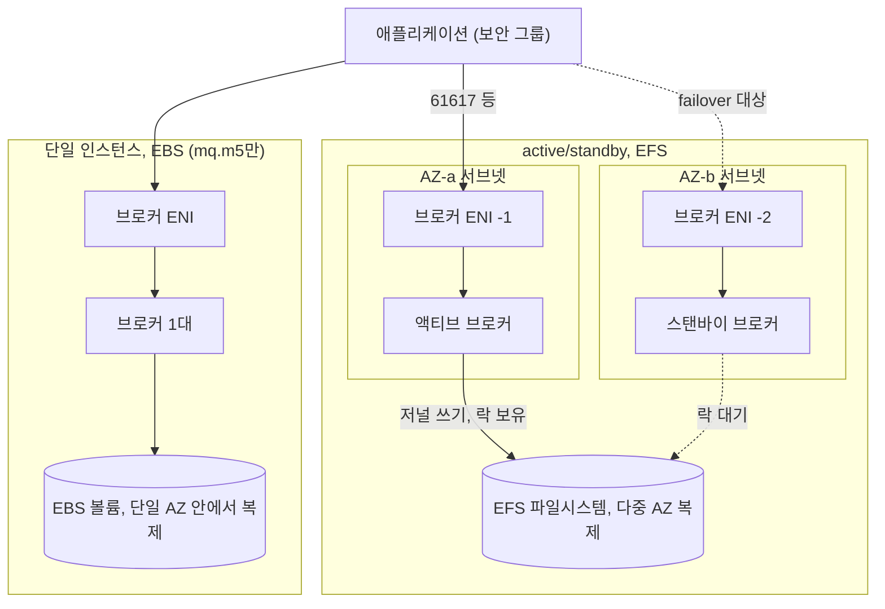
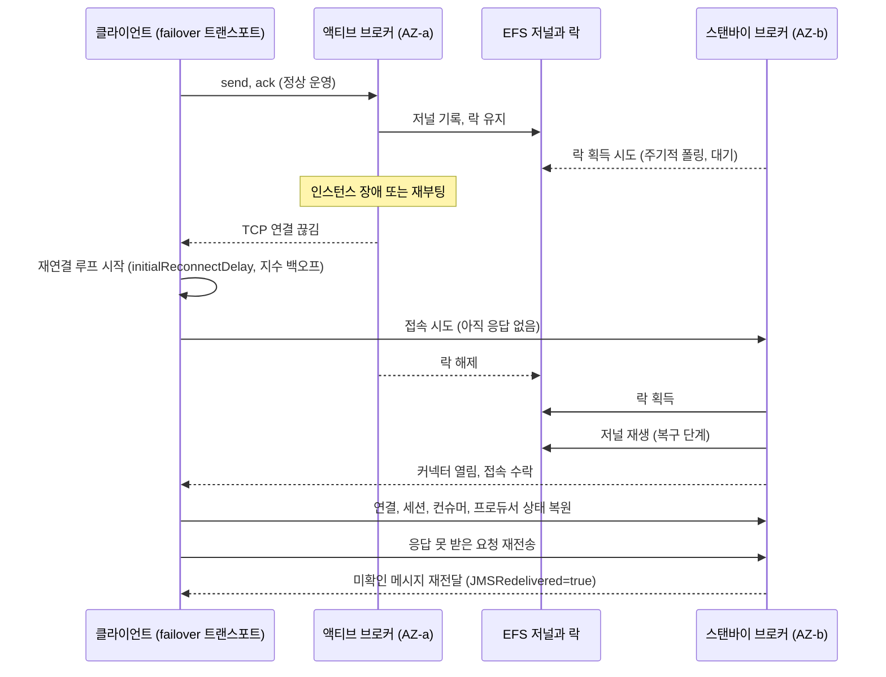
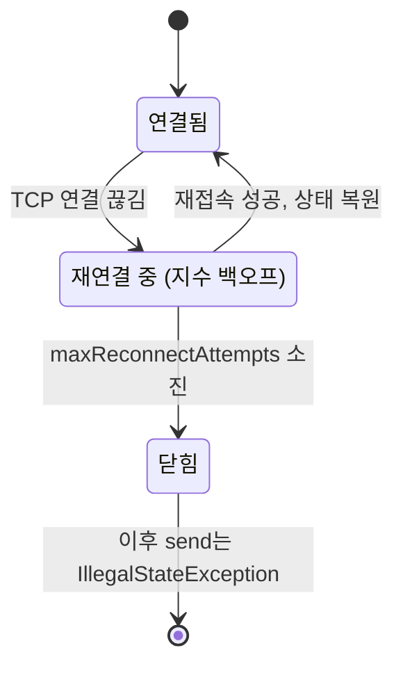
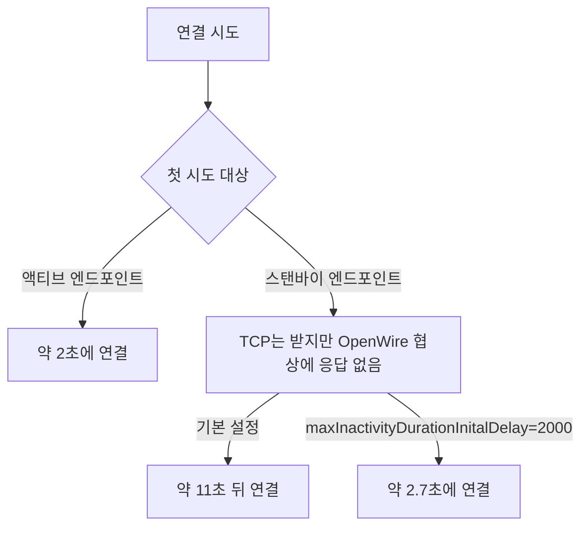
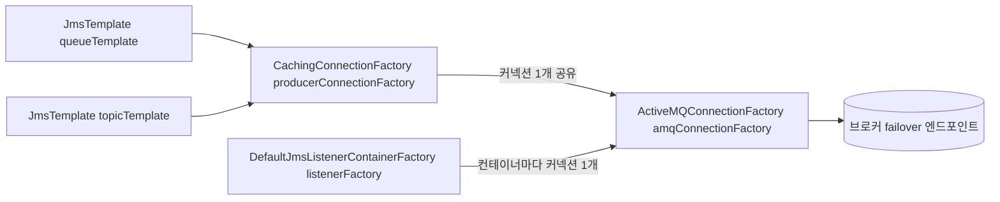
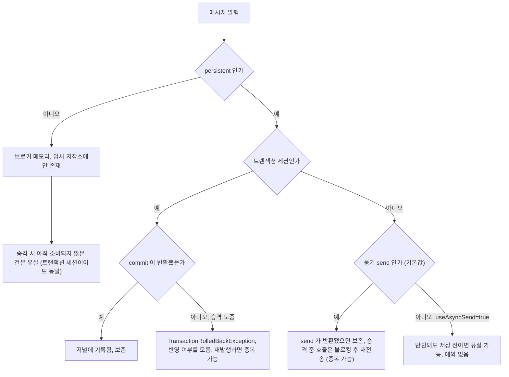
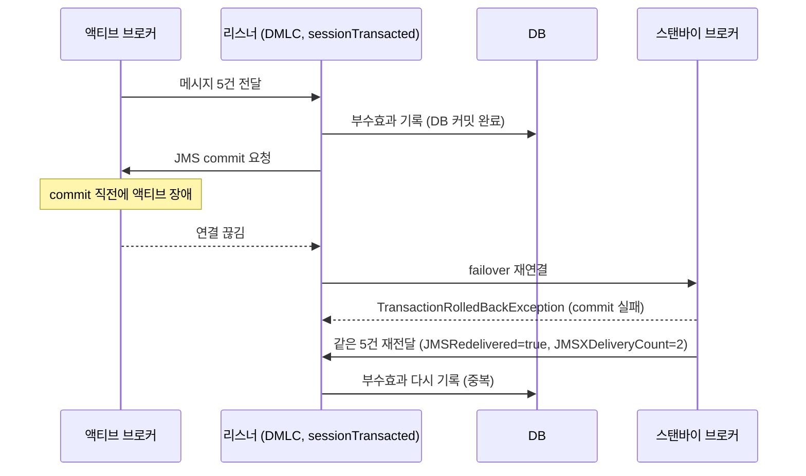
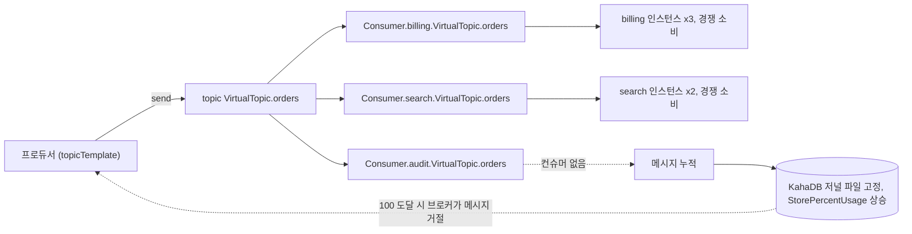
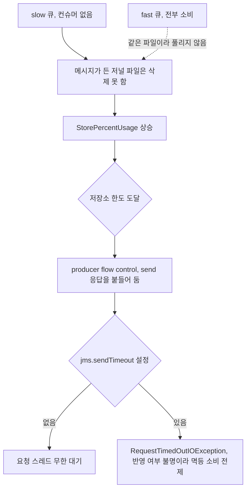

# Amazon MQ for ActiveMQ 운영 노트

[Amazon MQ 운영 노트](Amazon_MQ.md)는 RabbitMQ 중심이고 ActiveMQ는 "active/standby 페일오버에 수십 초에서 분 단위가 걸린다"는 한 단락이 전부다. 실제로 ActiveMQ 브로커를 프로덕션에 올리면 문제가 나는 곳은 그 한 단락 바깥이다. 스토리지 종류를 한 번 잘못 고르면 생성 후에 못 바꾸고, 클라이언트 URL 옵션 하나가 승격 이후 영구 장애로 이어지고, non-persistent 메시지는 승격 때 조용히 사라진다.

이 문서는 Spring JMS(`JmsTemplate`, `DefaultMessageListenerContainer`)로 붙는 Java 클라이언트 기준으로 쓴다. 동작 설명 중 "로컬 재현"이라고 적은 것은 ActiveMQ 5.18.6 브로커 두 대를 같은 KahaDB 디렉터리로 묶어(shared file lock, 마스터/슬레이브) 직접 돌려본 결과다. Amazon MQ는 저장소와 락 구현이 다르므로 거기서 나온 시간 값은 참고하지 말고 동작 순서와 예외 종류만 본다. AWS 문서에서 가져온 수치는 출처 링크를 달았다.

## Classic 엔진과 지원 버전

Amazon MQ가 제공하는 엔진은 ActiveMQ와 RabbitMQ 둘이고, ActiveMQ는 Apache ActiveMQ Classic 5.x 계열이다. Artemis는 선택지에 없다. Artemis를 쓰던 시스템이 넘어오는 경우 Artemis의 core 프로토콜이나 address 모델에 의존한 코드는 옮길 수 없고, OpenWire·AMQP·STOMP·MQTT로만 붙던 클라이언트는 Classic에서도 대부분 돌아간다.

지원 버전은 [버전 관리 문서](https://docs.aws.amazon.com/amazon-mq/latest/developer-guide/activemq-version-management.html) 기준으로 5.19와 5.18이 현재 지원 대상이고, 5.17은 2025-06-16, 5.16은 2024-11-15, 5.15는 2024-09-16에 지원이 끝났다. 지원이 끝난 버전은 종료일 뒤 45일 안에 점검 창에서 자동으로 다음 버전으로 올라간다. 점검 창에 엔진이 올라가면 그 시간에 페일오버가 한 번 일어난다는 뜻이다. 어떤 버전과 인스턴스 조합이 되는지는 날짜가 지나면 바뀌므로 CLI로 직접 본다.

```bash
aws mq describe-broker-instance-options --engine-type ACTIVEMQ --host-instance-type mq.m5.large
```

응답의 `StorageType`, `SupportedDeploymentModes`, `SupportedEngineVersions`가 아래 저장소 선택과 직결된다. 클라이언트 라이브러리는 Spring Boot 3 계열이면 `activemq-client-jakarta`(5.18.0부터 존재)를 쓴다. 패키지 이름은 `org.apache.activemq` 그대로고 JMS 쪽 패키지만 `jakarta.jms`다. Boot 2 계열은 기존 `activemq-client`와 `javax.jms`다.

## 저장소 선택이 처리량과 승격 시간에 주는 영향

ActiveMQ 브로커 저장소는 EFS와 EBS 중 하나다. [저장소 문서](https://docs.aws.amazon.com/amazon-mq/latest/developer-guide/broker-storage.html)에 못 박혀 있는 제약이 세 개 있다. EBS는 `mq.m5` 계열에서만 쓸 수 있다. 저장소 종류는 브로커를 만든 뒤에 바꿀 수 없다(인스턴스 타입은 바꿀 수 있다). EBS는 단일 AZ 안에서만 복제되고 active/standby 배치를 지원하지 않는다. 마지막 제약 때문에 "고가용성이 필요하면 EFS"가 사실상 고정이고, 선택 여지는 단일 인스턴스에서만 생긴다.

아래 도식은 두 구성이 저장소를 어떻게 붙이는지 보여준다. active/standby는 AZ마다 브로커와 ENI가 하나씩 있고 둘이 같은 EFS를 바라본다. 락을 쥔 쪽만 서비스한다.



| 항목 | EFS | EBS |
|---|---|---|
| 복제 범위 | 여러 AZ | 단일 AZ 안 |
| 배포 모드 | 단일 인스턴스, active/standby | 단일 인스턴스만 |
| 인스턴스 계열 | 전부 | mq.m5만 |
| 1KB 메시지 초당 enqueue 근사치 | 80 | 500 |
| 저장소 용량 상한 | micro 20GB, m5 200GB | 같음 |
| 같이 봐야 할 메트릭 | StorePercentUsage | StorePercentUsage, BurstBalance |

초당 80과 500은 AWS 문서의 근사치다(in-memory, 곧 non-persistent는 5,000). 그대로 믿고 사이징하지 말고 자기 메시지 크기로 한 번 잰다. EFS에서 느린 이유는 persistent 메시지의 동기 send가 저널에 쓰고 동기화한 다음에야 반환되기 때문이다. 건당 지연이 곧 단일 프로듀서의 처리량 상한이다. 로컬 디스크에서 1KB persistent 동기 send 300건이 3.0초, 같은 300건을 트랜잭션 한 번으로 묶어 commit한 게 0.2초였다. 저장소가 EFS면 격차가 이보다 크면 컸지 작지는 않다. 대량 발행 배치는 트랜잭션 세션으로 묶어서 보내거나 프로듀서 수를 늘려 병렬로 쓴다. 트랜잭션으로 묶으면 저널 동기화가 commit 단위로 일어난다.

승격 시간에도 저장소가 끼어든다. 스탠바이가 락을 얻은 뒤 곧바로 커넥터를 열지 못하고 KahaDB 저널을 재생하는 단계를 거친다. 정상 종료 뒤에는 인덱스가 살아 있어 일부 파일만 재생하고, 비정상 종료 뒤에는 더 많은 파일을 처음부터 훑는다. CloudWatch의 `JournalFilesForFastRecovery`(정상 종료 뒤 재생할 파일 수)와 `JournalFilesForFullRecovery`(비정상 종료 뒤 재생할 파일 수)가 이 길이를 가늠하는 지표다. 소비되지 못한 메시지가 쌓여 저널 파일이 많은 브로커일수록 승격이 느려지니, 승격이 느려졌다면 승격 자체보다 적체를 먼저 의심한다. 적체는 뒤의 KahaDB 절에서 다룬다.

## 커넥터 포트와 보안 그룹

Amazon MQ는 평문 포트를 열지 않는다. 프로토콜마다 TLS 포트가 하나씩이다([엔드포인트 예시](https://docs.aws.amazon.com/amazon-mq/latest/developer-guide/amazon-mq-basic-elements.html)).

| 프로토콜 | 스킴 | 포트 |
|---|---|---|
| OpenWire | `ssl://` | 61617 |
| AMQP | `amqp+ssl://` | 5671 |
| STOMP | `stomp+ssl://` | 61614 |
| MQTT | `mqtt+ssl://` | 8883 |
| WebSocket | `wss://` | 61619 |
| 웹 콘솔, Jolokia | `https://` | 8162 |

보안 그룹은 브로커 ENI에 붙는다. 인바운드에 앱이 쓰는 프로토콜 포트만 열고, 소스는 CIDR보다 앱 쪽 보안 그룹 ID로 건다. 파드 IP 대역이 바뀌어도 규칙이 따라간다. 운영자가 콘솔과 Jolokia에 붙는 8162는 앱 보안 그룹에 열지 말고 운영 접근용 그룹에만 연다. 브로커 하나에 붙일 수 있는 보안 그룹은 5개다.

active/standby는 ENI가 두 개고 엔드포인트도 프로토콜마다 `-1`, `-2` 두 개다. 문서 설명대로 한 번에 하나만 활성이다. 웹 콘솔 URL도 두 개인데 한쪽만 열린다. 장애 대응 중에 콘솔이 안 열려서 브로커가 죽었다고 오해하는 일이 있는데, 열리지 않는 쪽이 스탠바이일 뿐이다. 두 엔드포인트를 모두 클라이언트에 넣는 것이 AWS가 말하는 연결 방식이다(failover transport).

쓰는 프로토콜 포트만 연다. 쓰지도 않는 AMQP·STOMP·MQTT 포트까지 열어 두면 스캔 대상만 늘어난다. 연결 한도도 프로토콜별로 따로 센다. [한도 문서](https://docs.aws.amazon.com/amazon-mq/latest/developer-guide/amazon-mq-limits.html)에서 ActiveMQ 브로커의 와이어 레벨 연결은 micro 인스턴스가 프로토콜당 300, large 이상이 프로토콜당 2,000이다. 뒤의 커넥션 고갈 사고가 이 숫자에서 터졌다.

## 승격 중에 클라이언트가 겪는 일

active/standby는 두 브로커가 공유 저장소 위의 락 하나를 두고 경쟁하는 구조다. 락을 쥔 브로커만 트랜스포트 커넥터를 열고 메시지를 받는다. 락을 놓은 쪽(죽거나 재부팅되는 쪽)이 생기면 스탠바이가 락을 얻어 서비스를 이어받는다. 아래 시퀀스는 액티브 장애부터 클라이언트가 복구되는 순서다. 가운데 구간에서 클라이언트 쪽 failover transport가 무엇을 하는지 보면 된다.



[아키텍처 문서](https://docs.aws.amazon.com/amazon-mq/latest/developer-guide/amazon-mq-broker-architecture.html)는 사용자가 재부팅한 경우 페일오버가 몇 초라고 적는다. 인스턴스 장애나 AZ 장애에서 걸리는 시간은 문서에 숫자가 없다. 기존 문서의 "수십 초에서 분"이라는 표현도 숫자 근거가 없는 감각이다. 직접 재야 하는 값이고, 방법은 단순하다. 브로커 로그(CloudWatch Logs의 general 로그)에서 액티브가 내려간 시각과 스탠바이가 접속을 받기 시작한 시각을 뺀다. 로컬 재현에서 `kill -9`로 액티브를 죽인 뒤 스탠바이가 서비스를 시작하기까지 5초 남짓이었고, 이 시간은 스탠바이가 락을 폴링하는 주기에 좌우된다. Amazon MQ에서는 EFS 락 해제와 저널 재생 시간이 얹힌다.

승격이 일어나는 경우가 장애만이 아니라는 점은 운영 계획에서 자주 빠진다. 점검 창(엔진 패치, 인스턴스 교체), 사용자가 건 재부팅, 그리고 브로커 설정 XML 변경이 그렇다. [설정 문서](https://docs.aws.amazon.com/amazon-mq/latest/developer-guide/amazon-mq-broker-configuration-parameters.html)대로 설정 변경은 다음 점검 창이나 재부팅 때 반영된다. 설정 한 줄 고치고 "즉시 적용"을 누르면 서비스 중인 브로커에서 페일오버가 일어난다. 승격 한 번이 non-persistent 유실과 중복 소비를 한꺼번에 만들 수 있으니 설정 반영 시각은 점검 창에 맞춰 둔다.

## failover URL 옵션과 설정 실수

클라이언트가 두 엔드포인트를 모두 아는 방법은 `failover:` 트랜스포트다. 5.18.6 클라이언트에서 `FailoverTransport`의 기본값을 직접 찍어 본 결과는 이렇다.

| 옵션 | 기본값 | 의미 |
|---|---|---|
| randomize | true | 연결 시도 순서를 섞는다 |
| initialReconnectDelay | 10 (ms) | 첫 재연결 대기 |
| maxReconnectDelay | 30000 (ms) | 백오프 상한 |
| useExponentialBackOff | true | 실패마다 대기를 늘린다 |
| maxReconnectAttempts | -1 | 무제한 재시도 |
| startupMaxReconnectAttempts | -1 | 최초 연결 때의 재시도 횟수 |
| timeout | -1 | 연결이 끊긴 동안 send가 기다리는 시간. -1은 무한 |
| priorityBackup | false | 우선 URI로 돌아가려고 재연결을 시도한다 |

`jms.`로 시작하는 옵션은 failover 옵션이 아니라 연결 팩토리 설정으로 전달된다. `failover:(...)?jms.prefetchPolicy.queuePrefetch=1&jms.sendTimeout=2000`처럼 같은 쿼리 스트링에 섞어 써도 실제로 `ActiveMQConnection`에 반영되는 것을 확인했다.

### maxReconnectAttempts를 유한하게 준 경우

가장 큰 사고 유형이다. "무한 재시도는 불안하니 횟수를 제한하자"며 `maxReconnectAttempts=2` 같은 값을 넣는다. 로컬 재현에서 브로커 하나를 죽이고 재연결 횟수를 소진시키자 `ExceptionListener`에 `JMSException: Connection refused`가 한 번 올라왔고, 그 뒤로 같은 세션의 모든 send가 `IllegalStateException: The Session is closed`로 실패했다. 브로커를 다시 띄우고 8초를 기다려도 회복되지 않았다. 재시도를 포기한 연결은 영구히 닫히기 때문이다.

Amazon MQ에서도 승격이 끝나기 전에 횟수를 다 쓰면 같은 일이 벌어진다. 대기가 `initialReconnectDelay` 기본값 10ms에서 두 배씩 늘어나므로 "2번"은 1초도 안 걸려 소진된다. 이 재현은 Spring 없이 순수 JMS 연결로 했고, Spring 컨테이너가 닫힌 연결을 새로 만드는 복구 동작은 따로 확인하지 못했다. 연결 객체를 직접 쥐고 있는 코드는 재시작이 필요하다고 보는 게 안전하다. `maxReconnectAttempts`는 기본값 -1을 그대로 두는 게 맞다. 장애가 길어질 때 막고 싶은 것은 재연결 자체가 아니라 요청 스레드가 무한정 매달리는 상황이고, 그건 send 쪽 타임아웃으로 푼다.

아래 상태도에서 `닫힘`에서 나가는 화살표가 없다는 점을 보면 된다. 횟수를 소진하는 쪽으로 한 번 빠지면 연결 객체는 돌아오지 못한다.



다만 `jms.sendTimeout`도 주의점이 있다. 타임아웃으로 예외를 받은 send가 이미 브로커에 도달했을 수 있어서, 앱이 재시도하면 중복이 생긴다. 로컬에서 `timeout=3000`(failover 옵션)을 줘도 승격 중인 send가 5초 뒤에야 반환되는 경우가 있었다. 이 옵션은 연결이 끊긴 채 대기하는 구간에만 적용되고, 이미 요청이 나간 뒤 응답을 기다리는 구간에는 적용되지 않는 것으로 보인다. 어느 쪽이든 소비 쪽을 멱등하게 만들어 두는 것이 전제다.

### randomize 기본값과 스탠바이로 먼저 붙는 경우

`randomize=true`면 매 연결 시도가 -1, -2 중 아무거나 먼저 고른다. 스탠바이 엔드포인트는 서비스를 안 하는 쪽이라, 절반의 확률로 첫 시도가 버려진다. 로컬 재현에서 스탠바이를 URL 맨 앞에 두면 연결에 약 11초가 걸렸고(스탠바이 포트는 TCP는 받지만 OpenWire 협상에 응답하지 않았다), 액티브를 앞에 두면 2초였다. `tcp://` 주소에 `wireFormat.maxInactivityDurationInitalDelay=2000`을 붙이면 같은 스탠바이 우선 순서에서 2.7초로 줄었다("Initial"이 아니라 "Inital"인 철자가 ActiveMQ의 실제 옵션 이름이다). `connectionTimeout`, `soTimeout`은 이 지연에 영향이 없었다. Amazon MQ의 스탠바이 엔드포인트가 로컬과 똑같이 응답을 안 주는지는 직접 확인하지 못했으니, 이 옵션은 그대로 믿지 말고 자기 환경에서 연결 시간을 재보고 넣는다. `randomize=false`로 순서를 고정해도 승격으로 액티브가 -2가 되면 -1(스탠바이)부터 시도하는 구조는 같다. 순서를 맞추는 것보다 스탠바이 쪽 시도가 빨리 포기되게 만드는 쪽이 낫다.

첫 시도가 어느 엔드포인트로 가는지에 따라 연결 시간이 갈리는 모습이다. 아래 시간은 모두 앞의 로컬 재현 값이다.



### priorityBackup

`priorityBackup=true`는 "우선 URI가 살아나면 그쪽으로 돌아간다"는 옵션이라, 서로 다른 리전의 브로커처럼 우열이 있는 후보 사이에서 의미가 있다. active/standby 한 쌍의 -1, -2는 우열이 없다. 승격 후 액티브가 -2인데 -1이 우선 URI로 지정돼 있으면 -1을 계속 찔러 보며 연결 실패 로그만 쌓는다. 옵션을 쓰고 싶다면 리전별 브로커 쌍 사이에서만 쓴다.

권장하는 URL 골격은 이렇다. 실제 엔드포인트 문자열은 `aws mq describe-broker`의 `BrokerInstances[].Endpoints`에서 `ssl://`로 시작하는 두 개를 가져온다.

```text
failover:(ssl://b-1234a5b6-78cd-901e-2fgh-3i45j6k178l9-1.mq.ap-northeast-2.amazonaws.com:61617?wireFormat.maxInactivityDurationInitalDelay=2000,ssl://b-1234a5b6-78cd-901e-2fgh-3i45j6k178l9-2.mq.ap-northeast-2.amazonaws.com:61617?wireFormat.maxInactivityDurationInitalDelay=2000)?randomize=false&initialReconnectDelay=200&maxReconnectDelay=15000&jms.sendTimeout=5000
```

## Spring JMS 구성

프로듀서와 컨슈머의 커넥션을 분리하는 구성이다. 프로듀서(`JmsTemplate`)는 `CachingConnectionFactory`로 감싸 커넥션 하나를 공유한다. 컨슈머(`DefaultMessageListenerContainer`)는 감싸지 않은 원본 팩토리를 준다. Spring이 DMLC 쪽 Javadoc에서 `CachingConnectionFactory`와의 조합을 권하지 않는 이유가 있고, 컨테이너가 자체 캐싱(`cacheLevel`)을 가진다. 아래는 Spring Boot 3(jakarta) 기준이고 Boot 2는 `jakarta.jms`를 `javax.jms`로 바꾸면 된다. 이 구성을 Spring 5.3과 ActiveMQ 5.18.6(javax)으로 컴파일해서 확인했다.

```yaml
mq:
  url: "failover:(ssl://b-1234a5b6-...-1.mq.ap-northeast-2.amazonaws.com:61617?wireFormat.maxInactivityDurationInitalDelay=2000,ssl://b-1234a5b6-...-2.mq.ap-northeast-2.amazonaws.com:61617?wireFormat.maxInactivityDurationInitalDelay=2000)?randomize=false&initialReconnectDelay=200&maxReconnectDelay=15000&jms.sendTimeout=5000"
  user: ${MQ_USER}
  password: ${MQ_PASSWORD}
```

```java
@Configuration
@EnableJms
public class JmsConfig {

    @Bean
    ActiveMQConnectionFactory amqConnectionFactory(@Value("${mq.url}") String url,
                                                   @Value("${mq.user}") String user,
                                                   @Value("${mq.password}") String password) {
        ActiveMQConnectionFactory factory = new ActiveMQConnectionFactory(url);
        factory.setUserName(user);
        factory.setPassword(password);

        RedeliveryPolicy redelivery = new RedeliveryPolicy();
        redelivery.setMaximumRedeliveries(3);
        redelivery.setInitialRedeliveryDelay(1000);
        factory.setRedeliveryPolicy(redelivery);
        return factory;
    }

    @Bean
    CachingConnectionFactory producerConnectionFactory(ActiveMQConnectionFactory amq) {
        CachingConnectionFactory caching = new CachingConnectionFactory(amq);
        caching.setSessionCacheSize(20);
        return caching;
    }

    @Bean
    JmsTemplate queueTemplate(CachingConnectionFactory producerConnectionFactory) {
        JmsTemplate template = new JmsTemplate(producerConnectionFactory);
        template.setExplicitQosEnabled(true);
        template.setDeliveryPersistent(true);
        return template;
    }

    @Bean
    JmsTemplate topicTemplate(CachingConnectionFactory producerConnectionFactory) {
        JmsTemplate template = new JmsTemplate(producerConnectionFactory);
        template.setPubSubDomain(true);
        template.setExplicitQosEnabled(true);
        template.setDeliveryPersistent(true);
        return template;
    }

    @Bean
    DefaultJmsListenerContainerFactory listenerFactory(ActiveMQConnectionFactory amq) {
        DefaultJmsListenerContainerFactory factory = new DefaultJmsListenerContainerFactory();
        factory.setConnectionFactory(amq);
        factory.setSessionTransacted(true);
        factory.setConcurrency("3-10");
        factory.setCacheLevelName("CACHE_CONSUMER");
        factory.setBackOff(new FixedBackOff(5000L, FixedBackOff.UNLIMITED_ATTEMPTS));
        return factory;
    }
}
```

위 빈들이 커넥션을 만드는 경로다. 프로듀서 쪽 두 템플릿은 캐싱 팩토리 하나를 공유하고, 컨슈머 쪽 컨테이너는 원본 팩토리에서 따로 커넥션을 받는다.



세 군데는 주석 없이 넘어가면 나중에 같은 실수를 한다.

`setExplicitQosEnabled(true)`는 빠지면 안 된다. `JmsTemplate`의 `deliveryMode`는 `explicitQosEnabled`가 켜져 있을 때만 쓰인다. 로컬에서 `setDeliveryMode(NON_PERSISTENT)`만 걸고 보내면 받은 메시지의 `JMSDeliveryMode`가 PERSISTENT였고, `setExplicitQosEnabled(true)`를 켠 뒤에야 NON_PERSISTENT로 나갔다. 반대 방향 실수도 같은 뿌리다. non-persistent로 보내려고 설정했는데 실제로는 persistent로 나가는 쪽은 성능만 손해지만, TTL을 걸었는데(`setTimeToLive`도 같은 조건) 무시되면 메시지가 만료되지 않고 쌓인다. 쌓인 결과는 뒤의 KahaDB 절에서 다룬다.

`topicTemplate`을 따로 만든 것은 Virtual Topic 때문이다. `JmsTemplate`은 기본이 `pubSubDomain=false`라 목적지 이름이 `VirtualTopic.orders`여도 큐로 해석한다. 로컬 재현에서 기본 템플릿으로 `VirtualTopic.orders`에 보냈더니 `Consumer.billing.VirtualTopic.orders` 큐에는 아무것도 도착하지 않았고, `setPubSubDomain(true)` 템플릿으로 보냈을 때만 도착했다. 예외도 로그도 없고 메시지는 `VirtualTopic.orders`라는 이름의 일반 큐에 조용히 쌓인다.

`RedeliveryPolicy`는 롤백된 메시지를 브로커 왕복 없이 클라이언트가 지연을 두고 다시 전달하는 설정이다. 최대 횟수를 넘기면 포이즌 ack로 보내서 브로커가 `ActiveMQ.DLQ`로 옮긴다. DLQ를 안 보고 있으면 이 메시지는 영영 못 찾는다.

## 승격 중 non-persistent 메시지가 사라지는 조건

AWS 저장소 문서도 in-memory(non-persistent) 메시지는 인스턴스 교체나 브로커 재시작 때 사라진다고 적는다. 어떤 메시지가 어디에 있는지 구분하면 조건이 명확해진다. persistent 메시지는 KahaDB 저널에 쓰이고, non-persistent 메시지는 브로커 메모리에만 있다. 메모리가 차면 임시 저장소(temp store)로 넘기지만, 임시 저장소는 재시작하면 비워지는 곳이다. 승격은 액티브 프로세스가 없어지는 것이므로 메모리에만 있던 것은 전부 사라진다.

로컬 재현으로 이 차이를 확인했다. 같은 큐에 persistent 100건과 non-persistent 100건을 보낸 뒤 컨슈머 없이 액티브를 `kill -9`로 죽였고, 스탠바이 승격 뒤 컨슈머로 읽었을 때 persistent 100건, non-persistent 0건이었다. 아래 flowchart는 발행 시점의 조건별로 승격 때 어떻게 되는지를 나눈 것이다. 위쪽 non-persistent 경로는 세션이 트랜잭션이든 아니든 결론이 같다는 점이 핵심이다.



표로 다시 정리하면 이렇다. 운영에서 문제를 만든 칸은 3번과 5번이다.

| 번호 | 발행 방식 | 승격 시 결과 |
|---|---|---|
| 1 | persistent, 동기 send, 반환됨 | 보존 |
| 2 | persistent, 승격 중에 send 호출 | 블로킹 후 재전송. 이미 저장됐다면 중복 가능 |
| 3 | persistent, `useAsyncSend=true` | 반환 후 저장 전이면 유실. 앱은 모름 |
| 4 | persistent, 트랜잭션 commit 반환됨 | 보존 |
| 5 | non-persistent (큐), 소비 전 | 유실. 트랜잭션 세션이어도 같음 |
| 6 | persistent, non-durable 토픽 구독자 | 연결이 끊긴 동안 발행된 건은 못 받음 |

3번의 근거는 ActiveMQ 기본 동작이다. persistent 메시지를 트랜잭션 밖에서 보내면 기본이 동기라 브로커의 응답이 올 때까지 반환하지 않는다. 연결 팩토리 기본값은 `useAsyncSend=false`, `alwaysSyncSend=false`로 로컬에서 확인했다. 처리량을 올리려고 `jms.useAsyncSend=true`를 넣으면 반환 시점이 브로커가 저장하기 전으로 당겨진다. 이 상태에서 승격이 일어나면 응답을 기다리지 않은 요청은 failover transport가 재전송하지 않는다. 이 부분은 ActiveMQ 클라이언트의 요청 추적 동작에서 오는 추론이고 Amazon MQ에서 직접 재현해 본 것은 아니다. persistent인데 비동기로 보내는 설정은 유실을 감수한다고 합의한 경로에만 쓴다.

6번은 persistent 표기에 속는 경우다. 토픽의 non-durable 구독은 브로커 메모리 안에서만 존재한다. 승격 중에 구독 자체가 사라지고 클라이언트가 재연결해서 구독을 복원하기까지 사이에 발행된 메시지는 persistent여도 이 구독자에게는 전달되지 않는다. 이벤트를 놓치면 안 되는 소비자는 durable 구독이나 Virtual Topic의 소비자 큐를 써야 한다.

non-persistent가 어울리는 데이터는 있다. 위치 갱신처럼 다음 값이 곧 덮어쓰는 것이나 시세 같은 것이다. 다만 어울리는지는 데이터 성격으로 판단하고, "빨라서"로 정하지 않는다. 점검 창과 승격은 언제든 오므로 유실을 허용하는 데이터만 non-persistent로 보낸다.

## 승격 뒤 같은 메시지를 두 번 처리한 사고

스탠바이가 올라온 뒤 같은 주문 이벤트로 결제 시도가 두 번 기록된 적이 있다. 컨슈머 코드는 `@JmsListener` 메서드 안에서 DB에 쓰고 반환하는 평범한 구조였고, 컨테이너는 `sessionTransacted=true`였다. 문제는 DB 커밋과 JMS 커밋이 서로 다른 트랜잭션이라는 점이다. DMLC는 리스너 메서드가 반환한 뒤에 JMS 세션을 commit한다. 그 사이에 브로커가 죽으면 DB에는 반영됐고 브로커는 ack를 받은 적이 없다.

로컬에서 같은 순간을 만들었다. 트랜잭션 세션에서 5건을 받고 처리(부수효과 기록)를 끝낸 뒤 `commit()` 직전에 액티브를 죽였다.

```text
processed(side effect done) = [job0, job1, job2, job3, job4]
commit failed: TransactionRolledBackException / rolling back transaction (TX:ID:...) post failover recovery. 5 previously delivered message(s) not replayed to consumer
redelivered job0 JMSRedelivered=true JMSXDeliveryCount=2
redelivered job1 JMSRedelivered=true JMSXDeliveryCount=2
...
side effect rows = 10 distinct = 5
```

commit이 `TransactionRolledBackException`으로 실패하고, 5건이 모두 `JMSRedelivered=true`, `JMSXDeliveryCount=2`로 다시 들어왔다. 부수효과는 10번 일어났고 서로 다른 건은 5건이다. 리스너 메서드는 예외 없이 정상 반환했으므로 앱 코드 쪽에는 실패 흔적이 남지 않는다. 컨테이너 로그에 commit 실패가 찍히지만 알람을 거는 곳이 없으면 중복 처리가 조용히 지나간다.

DB 커밋과 JMS commit 사이의 틈에서 중복이 생기는 순서다. 리스너가 정상 반환했는데도 부수효과가 두 번 기록되는 지점을 보면 된다.



JMS는 at-least-once 계약이다. 승격 후 재전달 자체를 막을 방법은 없고, 소비 쪽에서 같은 이벤트를 두 번 받아도 한 번만 반영되게 만들어야 한다. 이벤트에 프로듀서가 부여한 업무 키(`eventId`)를 속성으로 달아 두고, 소비자는 DB에 유니크 키로 처리 이력을 남긴다. `JMSMessageID`를 키로 쓰면 안 된다. 프로듀서가 응답을 못 받아 앱 레벨에서 다시 보내면 새 메시지 ID가 붙기 때문에, 중복이 이 키로 걸러지지 않는다.

```sql
CREATE TABLE processed_event (
  consumer   VARCHAR(64)  NOT NULL,
  event_id   VARCHAR(128) NOT NULL,
  created_at DATETIME     NOT NULL DEFAULT CURRENT_TIMESTAMP,
  PRIMARY KEY (consumer, event_id)
);
```

```java
@Component
class OrderPublisher {
    private final JmsTemplate topicTemplate;
    OrderPublisher(JmsTemplate topicTemplate) { this.topicTemplate = topicTemplate; }

    void publish(String eventId, String json) {
        topicTemplate.send("VirtualTopic.orders", session -> {
            TextMessage message = session.createTextMessage(json);
            message.setStringProperty("eventId", eventId);
            return message;
        });
    }
}

@Component
class BillingListener {
    private final JdbcTemplate jdbc;
    BillingListener(JdbcTemplate jdbc) { this.jdbc = jdbc; }

    @JmsListener(destination = "Consumer.billing.VirtualTopic.orders", containerFactory = "listenerFactory")
    @Transactional
    public void onMessage(TextMessage message) throws JMSException {
        String eventId = message.getStringProperty("eventId");
        int inserted = jdbc.update(
            "INSERT IGNORE INTO processed_event (consumer, event_id) VALUES (?, ?)", "billing", eventId);
        if (inserted == 0) {
            return;
        }
        // 결제 처리
    }
}
```

이력 삽입과 업무 처리를 같은 DB 트랜잭션 안에 넣어야 한다. 이력만 먼저 커밋되고 업무 처리가 실패하면 그 이벤트는 영영 처리되지 않는다. 이력 테이블은 무한히 커지므로 보관 기간을 정해 지운다. 재전달된 메시지만 걸러 비용을 줄이고 싶으면 `message.getJMSRedelivered()`가 true일 때만 이력 조회를 한 번 더 하는 식으로 갈라도 되는데, 프로듀서 재발행에 의한 중복은 이 플래그가 false이므로 잡히지 않는다. 비용이 크게 문제가 아니면 모든 메시지에 이력 삽입을 거는 쪽이 단순하다.

## 세션 캐시와 커넥션 고갈

연결 한도에 닿은 사고도 구성 실수에서 시작했다. 증상은 새 파드가 브로커에 붙지 못하는 것이었다. CloudWatch의 `CurrentConnectionsCount`가 올라가 있었다. 원인은 커넥션이 어디서 생기는지 몰랐던 것이다. 로컬에서 연결 팩토리 생성 횟수를 세어 봤다.

| 사용 방식 | 결과 |
|---|---|
| `JmsTemplate(원본 팩토리)`로 20번 send | 커넥션 20개 생성 |
| `JmsTemplate(CachingConnectionFactory)`로 20번 send | 커넥션 1개 |
| DMLC 3개, 컨테이너당 concurrentConsumers 5 | 커넥션 3개 |

첫 줄이 가장 위험하다. `JmsTemplate`에 캐싱 없는 원본 팩토리를 주면 send 한 번마다 커넥션, 세션, 프로듀서를 새로 만들고 닫는다. Spring Boot가 자동 구성하는 팩토리는 캐싱으로 감싸 주지만, 직접 `@Bean ActiveMQConnectionFactory`를 정의하는 순간 그 자동 구성이 빠진다. 위의 `JmsConfig`가 `CachingConnectionFactory`를 직접 만드는 이유다.

여기에 failover가 증폭기로 얹혔다. 브로커가 없는 상태에서 로컬로 확인해 보니 `createConnection()`은 1초 안에 반환했지만 이어지는 `start()`는 6초가 지나도 돌아오지 않았다. 승격 중에 요청 스레드가 전부 `start()`에서 브로커의 응답을 기다리며 연결 객체를 하나씩 쥐고 있다가, 스탠바이가 문을 여는 순간 한꺼번에 접속한다. 순식간에 연결이 한도를 넘고, 한도를 넘긴 연결은 거절되고, 거절된 클라이언트가 다시 붙으려고 하면서 복구가 늦어진다.

고친 뒤에도 한 번 더 겪었다. 이번에는 캐시가 문제였다. 큐마다 컨테이너 팩토리를 만들면서 각각 `new CachingConnectionFactory(amq)`를 붙인 구성이었다. `CachingConnectionFactory`는 인스턴스 하나가 커넥션 하나다. 팩토리가 큐마다 있으면 커넥션이 큐 수만큼 생기고, DMLC는 컨테이너마다 공유 커넥션을 하나씩 가지므로 컨테이너 수가 곧 커넥션 수다. 계산해 보면 이렇다.

```text
리스너 컨테이너 30개 x 파드 20개 = 600 커넥션 (프로듀서 쪽 제외)
롤링 배포 중 새 파드와 옛 파드가 공존하면 최대 1,200
```

micro 인스턴스의 프로토콜당 한도 300을 처음부터 넘고, large 이상의 2,000도 롤링 배포 중에는 여유가 크지 않다. DMLC에 `CachingConnectionFactory`를 끼운 구성도 Spring Javadoc이 권하지 않는다. 동적 스케일링(`concurrency="3-10"`처럼 범위를 준 경우)과 같이 쓰지 말라고 적혀 있고, 리스너 컨테이너가 자기 생명주기 안에서 캐싱을 처리하게 두는 편이 낫다는 설명도 붙어 있다. 컨슈머 쪽은 원본 팩토리를 쓰고, 컨테이너 수를 줄이려면 큐 하나당 컨테이너 하나가 아니라 `concurrency` 범위를 조정한다. 컨테이너를 늘리면 커넥션이 늘고, 컨테이너 안 컨슈머를 늘리면 늘지 않는다.

## Virtual Topic과 컨슈머 패턴

토픽을 여러 서비스가 구독하는 구조에서 durable 구독은 이름 하나에 컨슈머가 하나만 붙는다. 같은 구독을 여러 인스턴스가 나눠 처리하려면 Virtual Topic을 쓴다. 규칙은 이름이다. 프로듀서는 `VirtualTopic.orders` 토픽에 발행하고, 구독 서비스는 `Consumer.<서비스명>.VirtualTopic.orders`라는 큐를 읽는다. 브로커가 토픽 메시지를 서비스별 큐로 복사하므로 서비스 안의 여러 인스턴스는 같은 큐의 경쟁 컨슈머가 된다. 큐는 persistent라 승격을 거쳐도 남는다. 다만 앞서 말한 대로 프로듀서는 토픽 도메인으로 보내야 한다.

구조와 문제가 생기는 방향을 같이 그리면 이렇다. 가운데 `audit` 소비자 큐에 컨슈머가 없는 상황을 보면 된다.



토픽 하나에 소비자 큐가 여러 개 붙는 구조라 가장 느린 큐 하나가 전체 발행을 막는다. 새 서비스가 구독을 추가하고 배포를 미루거나, 죽은 서비스의 소비자 큐가 정리되지 않고 남아 있으면 큐는 계속 받는다. 큐 이름 하나가 곧 구독이라서 코드를 지워도 구독은 지워지지 않는다. 서비스를 폐기할 때 소비자 큐를 같이 지우는 절차가 없으면 몇 달 뒤에 저장소가 찬다.

큐가 소비를 못 따라가는 것을 일찍 보려면 CloudWatch 큐 지표(`QueueSize`, `ConsumerCount`, `ExpiredCount`)를 소비자 큐 단위로 본다. 다만 [CloudWatch가 보는 목적지는 1,000개까지](https://docs.aws.amazon.com/amazon-mq/latest/developer-guide/amazon-mq-limits.html)다. 큐가 그보다 많은 브로커는 목록 앞쪽 일부만 지표에 나오므로 지표가 없다는 이유로 정상이라고 판단하면 안 된다.

## KahaDB 적체와 producer flow control

적체가 저장소를 먹는 방식이 직관과 다르다. KahaDB는 저널을 일정 크기(기본 32MB)의 데이터 파일로 나눠 쓰고, 파일 안의 메시지가 하나라도 소비되지 않았으면 그 파일을 지우지 못한다. 소비자 큐 하나가 정체되면 그 큐에 걸린 메시지가 들어 있는 파일들이 고정된다. 다른 큐가 아무리 빨리 소비해도 파일이 풀리지 않는다. 그래서 `StorePercentUsage`(저장소 한도 대비 사용 비율, [문서](https://docs.aws.amazon.com/amazon-mq/latest/developer-guide/activemq-logging-monitoring.html)에 따르면 100에 닿으면 브로커가 메시지를 거절한다)가 오르는데 정작 전체 `TotalMessageCount`는 크지 않은 모양이 나온다.

로컬로 이 연쇄를 재현했다. 저장소 한도를 3MB로 낮춘 브로커에 Virtual Topic을 만들고, `fast` 큐에는 리스너를 붙이고 `slow` 큐는 컨슈머 없이 만들어 두었다. 10KB 메시지를 계속 발행하자 약 140건에서 프로듀서가 멈췄다. 그때 `fast` 큐는 받은 것을 전부 소비한 상태였고 보낼 수 있는 메시지가 없어서 놀고 있었다. 프로듀서만 멈춘 것이다. 프로듀서를 막는 주체는 producer flow control이다. 사용량 한도(메모리, 저장소, 임시 저장소)에 닿으면 브로커가 프로듀서의 send를 응답하지 않고 붙들어 둔다.

기본값으로 두면 이 대기에는 끝이 없다. 같은 재현에서 `jms.sendTimeout=2000`을 주자 프로듀서가 2초 뒤에 `RequestTimedOutIOException`(`JMSException`으로 감싸짐)을 받고 예외로 빠졌다. 요청 스레드가 무한정 붙들리는 것보다 예외를 받는 편이 낫다. 다만 예외로 끝난 send가 브로커에 반영됐을 가능성이 남으니 앞에서 말한 멱등 소비가 전제다. 프로듀서와 컨슈머가 같은 커넥션을 쓰면 프로듀서가 막힌 동안 컨슈머의 ack 처리까지 막힐 수 있어서, 위 구성처럼 커넥션을 분리해 둔다.

로컬 재현의 연쇄를 한 줄로 이으면 아래와 같다. `fast` 큐가 다 소비해도 `slow` 큐 때문에 저널 파일이 풀리지 않고, 끝에서 `sendTimeout` 유무로 프로듀서의 운명이 갈린다.



방어는 두 겹이다. 첫째, 메시지에 TTL을 준다. `JmsTemplate`이라면 `explicitQosEnabled`를 켜고 `setTimeToLive`를 건다. 처리 시한이 있는 이벤트는 만료시켜야 저장소가 풀린다. 둘째, 소비자 큐별로 DLQ를 나눈다. 기본 DLQ(`ActiveMQ.DLQ`) 하나에 모든 서비스의 실패 메시지가 섞이면 어느 서비스가 쌓는지 보이지 않는다. 큐별 DLQ는 브로커 설정 XML의 `policyEntry`로 거는데, 반영하려면 점검 창이나 재부팅(곧 페일오버)이 필요하다.

```xml
<destinationPolicy>
  <policyMap>
    <policyEntries>
      <policyEntry queue="Consumer.>">
        <deadLetterStrategy>
          <individualDeadLetterStrategy queuePrefix="DLQ." useQueueForQueueMessages="true"/>
        </deadLetterStrategy>
      </policyEntry>
    </policyEntries>
  </policyMap>
</destinationPolicy>
```

Amazon MQ는 설정을 업로드할 때 스키마로 허용되지 않는 요소와 속성을 자동으로 제거한다고 문서에 적혀 있다. 저장소와 네트워크 트랜스포트처럼 Amazon MQ가 직접 관리하는 요소가 그 대상이다. 업로드한 뒤 설정 리비전을 다시 내려받아 자기가 넣은 속성이 남아 있는지 비교한다. 제거돼도 에러로 알려 주지 않는다.

적체 알람은 `StorePercentUsage`에 건다. 한도가 인스턴스에 따라 20GB(micro)와 200GB(m5)로 갈리므로 50% 근처에서 알람이 울리게 두고, 울리면 가장 먼저 `QueueSize`가 큰 소비자 큐를 찾는다. 임시 저장소는 `TempPercentUsage`가 별도로 있는데 이쪽은 non-persistent 메시지가 밀릴 때의 지표다. persistent 적체 때는 안 오르니 이것만 보고 안심하면 안 된다.

## Network of Brokers는 어디까지 되나

Amazon MQ는 ActiveMQ의 network of brokers를 지원한다([문서](https://docs.aws.amazon.com/amazon-mq/latest/developer-guide/network-of-brokers.html)). 단일 인스턴스와 active/standby 브로커를 섞어 여러 대를 `networkConnector`로 잇고, 한 브로커에서 다른 브로커로 메시지를 필요한 만큼만(on-demand) 전달한다. duplex 연결로 양방향 전달도 된다. 리전을 넘는 연결도 문서에 구성 예시가 있다. 온프레미스 브로커와 Amazon MQ 사이를 duplex로 이어 부분 마이그레이션하는 용도가 문서에 명시된 대표 사례다.

관리형에서 막히거나 달라지는 부분은 다음과 같다.

| 항목 | 관리형에서 |
|---|---|
| 상대 브로커 지정 | `static:(ssl://...:61617)` 형태의 고정 주소. 문서 예시는 전부 `static:` |
| 인증 | 브로커 A에 B와 같은 이름, 같은 비밀번호의 사용자를 따로 만든다. `networkConnector`에는 `userName`만 쓰고 `password`는 쓰지 않는다. 비밀번호를 쓰면 설정 XML이 콘솔에 그대로 보인다 |
| 클라이언트 재분배 | `transportConnector`의 `updateClusterClients`, `rebalanceClusterClients`, `updateClusterClientsOnRemove` 속성 지원 |
| 저장소, 트랜스포트 포트와 프로토콜 | Amazon MQ가 관리한다. 설정 XML로 바꾸는 대상이 아니다 |
| 점검 창 | 브로커별로 따로. 요일을 어긋나게 잡아 동시에 승격되지 않게 한다 |

멀티캐스트 디스커버리는 문서에 없고 예시도 모두 고정 주소다. 구조적으로 VPC에서 멀티캐스트가 되지 않으니 동적 탐색을 전제로 한 구성은 옮겨 오기 어렵다고 보는 게 맞다.

네트워크로 이은다고 해서 처리량이 선형으로 늘어나지 않는다. 메시지는 컨슈머가 있는 브로커 쪽으로 전달될 때만 건너가고, 각 브로커는 자기 KahaDB를 따로 가진다. 한 브로커의 `StorePercentUsage`가 차는 문제는 이웃 브로커가 해결해 주지 않는다. 메시지가 브로커 사이를 건너가면 순서 보장이 약해지고, 건너가던 중 한쪽이 승격되면 중복이 생길 수도 있다. 이 부분은 문서에 보장 수준이 적혀 있지 않아 확인하지 못했다. 단일 브로커가 한계에 닿아서가 아니라 리전 분리나 마이그레이션처럼 구조적인 이유가 있을 때 쓰고, 처리량이 이유라면 먼저 인스턴스 크기를 올리고 Virtual Topic으로 소비를 나눈다.
