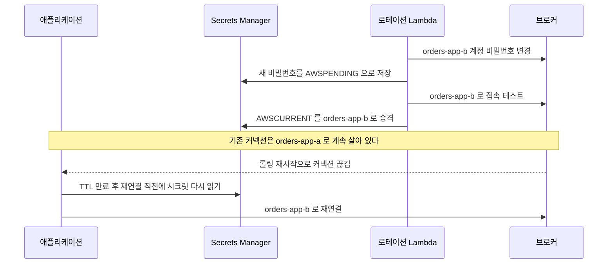
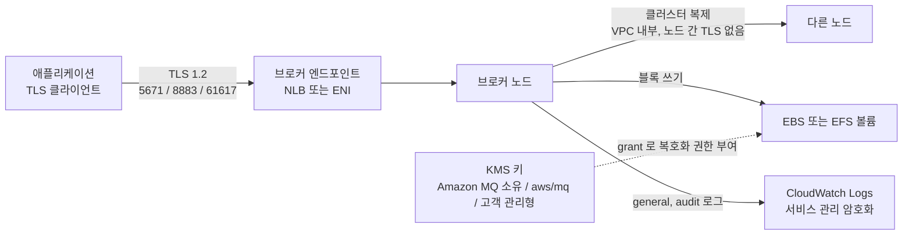
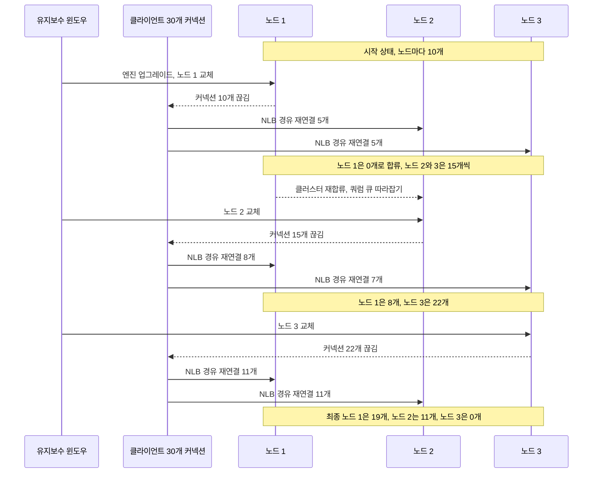
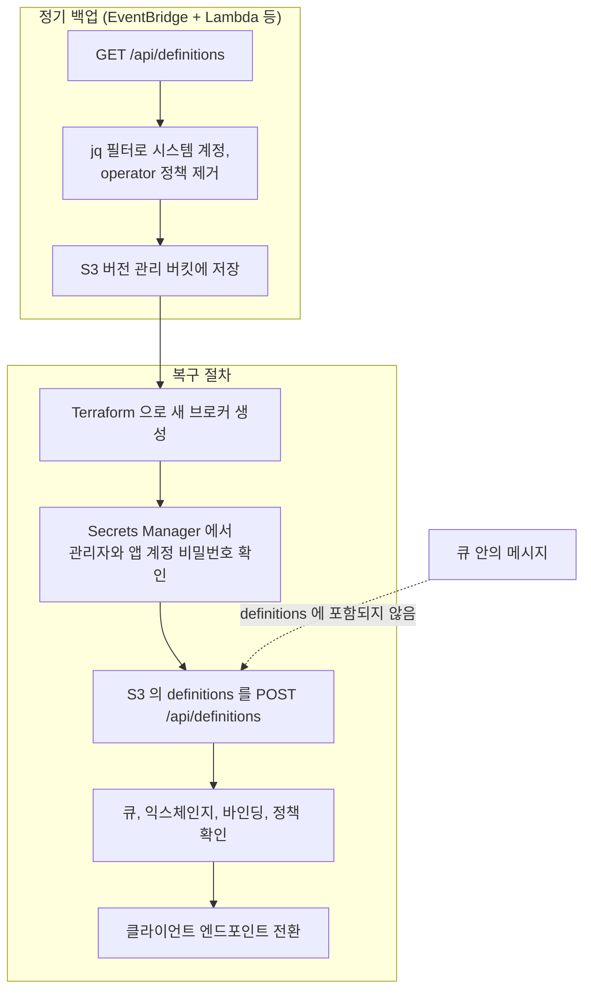

# Amazon MQ 보안과 유지보수 운영

[Amazon MQ 운영 노트](Amazon_MQ.md)는 ENI와 보안 그룹까지만 다룬다. 네트워크를 닫은 뒤에도 해결할 일이 남아 있다. 브로커 계정과 비밀번호를 어디에 두는지, 전송과 저장 구간이 어떻게 암호화되는지, 로그가 어디로 가는지, 유지보수 윈도우에 브로커가 어떻게 바뀌는지, 사고가 나면 무엇을 되살릴 수 있는지, 코드로 관리할 때 어떤 변경이 재시작이나 재생성을 부르는지가 그렇다. 이 문서가 그 부분을 맡는다. ActiveMQ 고유의 승격과 저장소 얘기는 [ActiveMQ 운영 노트](Amazon_MQ_Active_MQ_Operations.md)에 있고, 여기서는 두 엔진을 나란히 놓고 차이만 짚는다.

브로커 동작에 관한 서술은 AWS 문서에 적힌 내용을 기준으로 했다. 문서가 말하지 않아 추정한 부분은 추정이라고 적었다. 문서 안의 jq 필터는 로컬에서 실행해 확인했고, Terraform과 Java 코드는 이 환경에 도구와 라이브러리가 없어 실행하지 못했다. 복사해서 쓰기 전에 `terraform plan`과 컴파일을 먼저 돌려야 한다.

## 계정과 비밀번호

### 관리자 계정과 앱 계정을 나누는 이유

RabbitMQ 브로커는 생성할 때 사용자 하나를 받는다. 이 계정이 관리자다. Terraform의 `aws_mq_broker`도 RabbitMQ에서는 `user` 블록을 하나만 허용하고, 나머지 계정은 생성 뒤에 관리 콘솔이나 Management API로 만들어야 한다. 이 제약 때문에 "생성 시 받은 계정을 앱도 같이 쓰는" 구성이 기본값처럼 퍼진다. 그렇게 두면 앱 설정이 새는 순간 관리 콘솔에 로그인할 수 있는 사람이 생기고, 큐와 정책을 지울 수 있는 계정이 코드 저장소와 파드 환경변수에 들어간다.

앱 계정은 vhost 단위로 나누고 태그를 주지 않는다. 태그가 없는 사용자는 관리 콘솔과 HTTP API를 쓰지 못한다. 권한은 정규식으로 건다.

```bash
# 관리자 계정은 Secrets Manager 에서 꺼내 쓰고, 앱 계정은 vhost 하나에만 권한을 준다
curl -sS --fail -K <(printf 'user = "%s:%s"\n' "$MQ_ADMIN" "$MQ_ADMIN_PASSWORD") \
  -X PUT -H 'content-type: application/json' \
  -d "{\"password\":\"${APP_PASSWORD}\",\"tags\":\"\"}" \
  "https://${MQ_HOST}/api/users/orders-app"

curl -sS --fail -K <(printf 'user = "%s:%s"\n' "$MQ_ADMIN" "$MQ_ADMIN_PASSWORD") \
  -X PUT -H 'content-type: application/json' \
  -d '{"configure":"","write":"^orders\\..*","read":"^orders\\..*"}' \
  "https://${MQ_HOST}/api/permissions/orders/orders-app"
```

`-u user:password`로 쓰면 프로세스 목록에 비밀번호가 보인다. 위처럼 `-K`에 프로세스 치환(`<(...)`)으로 설정을 넘기면 명령행 인자에 비밀번호가 남지 않는다. `configure`를 빈 문자열로 두면 앱이 큐를 선언하지 못한다. 큐 선언을 앱이 해야 하는 서비스는 `^orders\\..*`를 `configure`에도 준다. 선언 권한을 아예 막아 두고 큐와 익스체인지는 Terraform이나 definitions import로 만드는 쪽이 사고가 적다.

ActiveMQ는 사용자를 여러 명 받고, 권한은 `activemq.xml`의 authorization 설정에서 그룹 단위로 건다. 웹 콘솔 접근은 사용자 속성의 `console_access`가 정한다. 앱 계정은 `console_access = false`로 두고 읽기와 쓰기만 준다.

```xml
<authorizationPlugin>
  <map>
    <authorizationMap>
      <authorizationEntries>
        <authorizationEntry queue="orders.>" read="orders-app" write="orders-app" admin="orders-admin"/>
        <authorizationEntry topic="ActiveMQ.Advisory.>" read="orders-app,orders-admin"
                            write="orders-app,orders-admin" admin="orders-app,orders-admin"/>
      </authorizationEntries>
    </authorizationMap>
  </map>
</authorizationPlugin>
```

Advisory 토픽 항목을 빼먹으면 JMS 클라이언트가 접속 직후 권한 오류를 내는 경우가 있다. 클라이언트 라이브러리가 `ActiveMQ.Advisory.*` 토픽을 구독하기 때문이다. 그룹 이름은 이 설정과 사용자 속성의 `groups`가 일치해야 하고, 설정 리비전을 만든 뒤에는 브로커 재시작이나 적용 시점이 따로 온다는 점을 기억해야 한다.

### Secrets Manager에 두고 읽기

Amazon MQ는 Secrets Manager와 직접 연동하지 않는다. 브로커 쪽에 "이 시크릿을 비밀번호로 쓰라"는 옵션이 없고, 로테이션도 AWS가 대신 돌려 주지 않는다. 시크릿에 비밀번호를 넣는 것도, 브로커의 비밀번호를 바꾸는 것도, 둘을 맞추는 것도 직접 해야 한다. 이 사실을 모르고 시크릿 로테이션을 켰다가 시크릿 값만 바뀌고 브로커는 옛 비밀번호 그대로인 상태가 만들어지는 경우가 있다.

비밀번호는 길이와 문자에 제약이 있고 쉼표를 넣으면 거절된다. 생성할 때 영문과 숫자만으로 만들면 제약에 걸릴 일이 없다. Terraform의 `random_password`에서 `special = false`를 주는 이유다. 시크릿은 JSON으로 만들어 사용자 이름과 호스트도 같이 넣어 둔다.

```json
{"username": "orders-app", "password": "k3Xq...", "host": "b-1234a5b6-78cd-901e-2fgh-3i45j6k178l9.mq.ap-northeast-2.amazonaws.com"}
```

읽는 쪽에서 신경 쓸 것은 읽는 시점이다. 기동 시점에 한 번 읽어서 `ConnectionFactory`에 박아 두면 로테이션 이후 재연결에서 옛 비밀번호로 계속 붙으려 한다. RabbitMQ Java 클라이언트는 새 커넥션을 열 때마다 `CredentialsProvider`에게 사용자 이름과 비밀번호를 묻는다. 여기에 시크릿 조회를 넣으면 재연결이 곧 재조회가 된다.

```java
import com.fasterxml.jackson.databind.JsonNode;
import com.fasterxml.jackson.databind.ObjectMapper;
import com.rabbitmq.client.impl.CredentialsProvider;
import software.amazon.awssdk.services.secretsmanager.SecretsManagerClient;

import java.time.Duration;
import java.time.Instant;

public class SecretCredentialsProvider implements CredentialsProvider {

    private static final Duration TTL = Duration.ofMinutes(5);

    private record Snapshot(String username, String password, Instant loadedAt) {}

    private final SecretsManagerClient client;
    private final String secretId;
    private final ObjectMapper mapper = new ObjectMapper();
    private volatile Snapshot snapshot;

    public SecretCredentialsProvider(SecretsManagerClient client, String secretId) {
        this.client = client;
        this.secretId = secretId;
    }

    @Override
    public String getUsername() {
        return current().username();
    }

    @Override
    public String getPassword() {
        return current().password();
    }

    public void invalidate() {
        snapshot = null;
    }

    private Snapshot current() {
        Snapshot s = snapshot;
        if (s == null || s.loadedAt().plus(TTL).isBefore(Instant.now())) {
            s = load();
            snapshot = s;
        }
        return s;
    }

    private Snapshot load() {
        String json = client.getSecretValue(r -> r.secretId(secretId)).secretString();
        try {
            JsonNode node = mapper.readTree(json);
            return new Snapshot(node.get("username").asText(), node.get("password").asText(), Instant.now());
        } catch (Exception e) {
            throw new IllegalStateException("시크릿 파싱 실패: " + secretId, e);
        }
    }
}
```

연결 팩토리에 붙이는 부분에서 하나 걸리는 게 있다. RabbitMQ Java 클라이언트의 인자 없는 `useSslProtocol()`은 javadoc 기준으로 모든 인증서를 신뢰하는 트러스트 매니저를 쓴다. 편해서 예제마다 이걸 쓰는데, Amazon MQ 문서는 인증서 검증을 끄지 말라고 적어 둔다. JVM 기본 `SSLContext`를 넘기고 호스트 이름 검증을 켠다.

```java
@Bean
CachingConnectionFactory connectionFactory(SecretCredentialsProvider provider,
                                           @Value("${mq.host}") String host) throws Exception {
    com.rabbitmq.client.ConnectionFactory rabbit = new com.rabbitmq.client.ConnectionFactory();
    rabbit.setHost(host);
    rabbit.setPort(5671);
    rabbit.setCredentialsProvider(provider);
    rabbit.useSslProtocol(javax.net.ssl.SSLContext.getDefault());
    rabbit.enableHostnameVerification();
    return new CachingConnectionFactory(rabbit);
}
```

`getUsername()`과 `getPassword()`는 따로 호출되기 때문에, 두 호출 사이에 TTL이 넘어가 시크릿이 다른 계정으로 바뀌면 사용자 이름은 옛것, 비밀번호는 새것이 된다. 연결 시도 하나가 실패하고 Spring AMQP의 재시도가 다음 시도에서 바로잡으므로 두고 쓰는 경우가 많다. 문제가 되면 한 번 읽은 `Snapshot`을 커넥션 단위로 고정하는 구조로 바꿔야 한다.

### 로테이션하면 클라이언트가 끊기는 이유

로테이션 직후에 장애가 나는 경우는 대개 두 가지다.

첫째는 ActiveMQ다. 사용자 변경은 `update-user`를 호출해도 바로 반영되지 않고 브로커 재시작 때 적용된다. 비밀번호를 바꾸는 작업이 곧 재시작이고, active/standby에서는 승격 구간만큼 커넥션이 끊긴다. 로테이션을 자주 돌릴수록 승격이 자주 일어난다. 사용자 변경을 모아서 유지보수 윈도우와 같이 처리하는 편이 낫다.

둘째는 RabbitMQ다. Management API로 비밀번호를 바꿔도 이미 열려 있는 커넥션은 그대로 살아 있다. 인증은 커넥션을 열 때만 일어나기 때문이다. 문제는 한참 뒤에 터진다. 유지보수 윈도우의 롤링 재시작이든 네트워크 순단이든 커넥션이 한 번 끊기는 순간, 기동 때 읽어 둔 옛 비밀번호로 재연결을 시도하고 `ACCESS_REFUSED`가 난다. Spring AMQP는 이 실패를 계속 재시도하므로 로그만 쌓이고 메시지 처리는 멈춘다. 로테이션한 날이 아니라 며칠 뒤 새벽에 장애가 나서 원인을 찾기 어렵다.

해법은 계정을 두 개 번갈아 쓰는 방식이다. 로테이션 Lambda가 비활성 쪽 계정의 비밀번호를 새로 만들고, 그 계정으로 접속 테스트를 한 뒤, 시크릿의 현재 값을 그쪽으로 넘긴다. 옛 계정은 다음 로테이션까지 그대로 둔다. 옛 비밀번호를 쥔 클라이언트의 재연결이 한 주기 동안은 계속 성공한다.



이 시퀀스에서 볼 곳은 로테이션 시점이 아니라 맨 아래 두 줄이다. 재연결 직전에 시크릿을 다시 읽는 코드가 없으면 `orders-app-a`가 폐기되는 다음 주기에 같은 장애가 반복된다. 위의 `SecretCredentialsProvider`가 그 역할이다. 로테이션 Lambda는 Secrets Manager의 `createSecret`, `setSecret`, `testSecret`, `finishSecret` 네 단계로 나뉘고, `setSecret`에서 위 curl과 같은 Management API 호출을 하면 된다.

### LDAP와 HTTP 인증 백엔드

계정을 브로커 안에 두지 않고 외부 디렉터리에 맡길 수 있다. 두 엔진의 설정 방식과 제약이 다르다.

| 항목 | RabbitMQ | ActiveMQ |
|---|---|---|
| 설정 위치 | 브로커 설정 파일의 `auth_ldap.*`, `auth_backends` | 브로커 생성 또는 수정 시 LDAP 서버 메타데이터와 로그인 설정 |
| 서비스 계정 | `auth_ldap.dn_lookup_bind.*` 등 RabbitMQ 플러그인 설정 | 필수. 최초 bind에 쓰는 서비스 계정 DN과 비밀번호 |
| 비밀번호와 인증서 | 평문 키 대신 `aws.arns.*` 키로 Secrets Manager 등의 ARN을 넘김. `aws.arns.assume_role_arn`이 같이 필요 | 서비스 계정 비밀번호를 Amazon MQ가 암호화해 보관 |
| 전송 | LDAPS 필수. `use_ssl` 또는 `use_starttls`를 명시적으로 켜야 함 | LDAPS 636 고정. 서버 주소에 프로토콜과 포트를 쓰지 않음 |
| 서버 위치 | 문서는 LDAP 서버가 인터넷에서 접근 가능해야 한다고 적음 | FQDN이 공개적으로 해석돼야 한다고 적음. 인바운드는 브로커 VPC에서 오는 트래픽만 허용하라고 안내 |
| 권한 모델 | LDAP 플러그인의 `tag_queries`, 리소스 쿼리 설정 | `cachedLDAPAuthorizationMap`으로 큐와 토픽별 read, write, admin 그룹 |
| 로컬 계정 | `monitoring-AWS-OWNED-DO-NOT-DELETE`가 내부 인증으로 남음 | 해당 없음 |
| 기존 브로커에 켤 때 | IAM 권한 `mq:UpdateBrokerAccessConfiguration` 필요 | 브로커 수정에서 LDAP 선택 |

RabbitMQ 쪽에서 제일 먼저 걸리는 것은 ARN 강제다. `auth_ldap.dn_lookup_bind.password`처럼 비밀번호를 직접 쓰는 키는 쓸 수 없고 `aws.arns.auth_ldap.dn_lookup_bind.password`로 시크릿 ARN을 넘겨야 한다. 이때 브로커가 그 시크릿을 읽을 수 있도록 `aws.arns.assume_role_arn`에 역할을 지정한다. 온프레미스 LDAP를 VPN 뒤에 두고 있었다면 "인터넷에서 접근 가능해야 한다"는 문서 문구와 부딪힌다. 이 경우 LDAP 앞단을 인터넷에 노출된 프록시로 두거나, Amazon MQ 대신 다른 인증 방식을 고르는 판단이 필요하다. 접근 제어를 문서에 적힌 대로 인바운드 규칙으로 좁힐 수 있는지가 첫 확인 대상이다.

ActiveMQ는 LDAP 사용자 항목에 `uid` 속성이 있어야 하고, 그룹은 `groupOfNames` 클래스여야 한다. ActiveMQ 소스에 속성 이름이 고정돼 있기 때문이다. Active Directory를 쓰면 이 속성을 채우는 작업이 따로 필요하다. 웹 콘솔에 들어가야 하는 사용자는 `amazonmq-console-admins` 그룹에 넣는다. 인증은 대소문자를 구분하지 않는데 권한 판정은 사용자 이름의 대소문자를 구분한다. `Alice`로 로그인해 `alice` 항목의 권한을 기대하면 권한이 없다는 오류가 난다. 서버 인증서가 사설 CA에서 나온 경우 Amazon MQ가 받지 않는다. 사내 CA로 서명한 LDAP 서버는 그대로 못 붙는다.

HTTP 인증 플러그인은 RabbitMQ 4 이상에서만 쓸 수 있다. 3.13 브로커에서 LDAP 대신 HTTP 인증 서버로 갈아타려는 계획이라면 엔진 메이저 업그레이드가 먼저다.

## 암호화

### 전송 구간

Amazon MQ는 평문 포트를 열지 않는다. 클라이언트가 쓰는 포트는 프로토콜마다 TLS 포트 하나씩이다. RabbitMQ는 AMQP 5671, 관리 콘솔과 API는 443이고, ActiveMQ는 OpenWire 61617, AMQP 5671, MQTT 8883, STOMP 61614, WebSocket 61619, 웹 콘솔 8162다. TLS 1.2가 최소선이고, 문서는 RabbitMQ 브로커에서 TLS 1.3을 쓸 수 없다고 적는다.

RabbitMQ에서 먼저 걸리는 것은 암호 스위트다. 지원 목록이 `TLS_ECDHE_RSA_WITH_AES_256_GCM_SHA384`와 `TLS_ECDHE_RSA_WITH_AES_128_GCM_SHA256` 두 개뿐이다. ECDHE와 GCM을 못 하는 오래된 JVM이나 임베디드 클라이언트는 핸드셰이크 단계에서 끊기고, 애플리케이션 로그에는 인증 실패가 아니라 SSL 예외만 보인다. 자격증명을 의심하기 전에 클라이언트의 지원 스위트부터 비교해야 한다. ActiveMQ는 목록이 길어서 이 문제가 덜하다.

인증서는 SAN으로 검증한다. 문서는 브로커 엔드포인트 FQDN을 기준으로 `subjectAltName`의 `dNSName`과 맞춰 보라고 하고, CN은 쓰지 말라고 한다. 브로커 인증서가 주기적으로 교체되므로 인증서나 주체 값을 고정(pinning)하면 교체 뒤에 접속이 끊긴다. 사내 보안 정책이 고정을 요구하는 환경에서는 이 충돌을 먼저 협의해야 한다. 엔드포인트 앞에 자체 DNS 별칭을 두는 구성도 위험하다. 클라이언트가 별칭을 검증 이름으로 쓰면 SAN과 안 맞아서, 별칭 쪽에서 검증 호스트 이름을 원래 FQDN으로 따로 지정해야 한다.

클러스터 내부 통신은 사정이 다르다. 문서는 RabbitMQ 클러스터의 노드 간 복제에 노드 간 암호화를 지원하지 않는다고 적는다. 복제 트래픽은 브로커의 VPC 안으로만 다니고, AWS 데이터센터 사이 네트워크는 물리 계층에서 투명하게 암호화된다는 설명이다. 노드 간 구간까지 TLS여야 하는 컴플라이언스 요건이 있으면 RabbitMQ 클러스터는 맞지 않을 수 있다.

### 저장 데이터와 KMS 키

저장 데이터는 항상 암호화된다. 끌 수 있는 옵션은 없고, 어떤 키를 쓰느냐만 정한다. 브로커를 만들 때 세 가지 중에서 고른다.

| 선택지 | 키 소유 | 비고 |
|---|---|---|
| Amazon MQ 소유 키 (기본) | Amazon MQ. 내 계정에 보이지 않음 | 키를 내가 끌 방법이 없어 키 사고도 없음 |
| AWS 관리형 키 `aws/mq` | 내 계정 안에 생성되지만 AWS가 관리 | 키 정책을 수정할 수 없음 |
| 고객 관리형 키 | 내가 만들고 관리 | 키 정책, 로테이션, 비활성화를 직접 결정. 대칭 키만 지원 |

고객 관리형 키는 감사 요건 때문에 고른다. 키 사용 내역을 CloudTrail로 추적하고 키 정책으로 접근 주체를 제한하려는 경우다. 대가는 키가 브로커 가용성에 직접 걸린다는 점이다. 문서의 경고를 그대로 옮기면, EBS에 메시지를 두는 RabbitMQ 브로커와 ActiveMQ 브로커에서 KMS 키를 비활성화하거나 삭제 예약하거나 EBS용 grant를 취소하면 Amazon MQ가 브로커를 유지보수할 수 없고 브로커가 degraded 상태로 바뀔 수 있다. 키를 다시 활성화하거나 삭제 예약을 취소하면 유지보수가 다시 된다. grant 취소는 되돌릴 수 없고, 접근 권한을 거두는 방법은 브로커 삭제뿐이라고 문서가 적는다.

문서는 이 효과가 바로 나타나지 않는다고도 적는다. EFS를 쓰는 ActiveMQ는 권한 회수가 반영되기까지 몇 시간이 걸릴 수 있고, 키 비활성화와 grant 취소도 몇 시간의 시차가 있다고 한다. 이 시차 때문에 사고가 이런 모양으로 나타난다. 보안팀이 사용하지 않는 키로 보고 금요일에 비활성화한다. 브로커는 주말 내내 멀쩡하다. 월요일 새벽 유지보수 윈도우에 노드가 교체되면서 볼륨을 새로 붙이지 못해 브로커가 정상으로 돌아오지 못한다. 마지막 단계는 문서가 직접 말하는 내용이 아니라 EBS가 볼륨을 붙일 때 키를 필요로 한다는 일반 동작에서 내린 추정이다. 어느 쪽이든 키를 끄기 전에 CloudTrail에서 `CreateGrant` 이벤트로 그 키를 쓰는 브로커가 있는지 확인해야 한다. 문서에 따르면 RabbitMQ 단일 인스턴스는 `CreateGrant`가 2번, 클러스터는 5번 기록되고 그 중 일부는 EBS가 만든 grant다. 키를 계정 공용으로 쓰다가 용도를 모르고 끄는 일이 이렇게 일어난다.

암호화 옵션은 생성 때만 정한다. `UpdateBroker`에 암호화 옵션 필드가 없어서 기존 브로커의 키를 바꿀 방법이 없고, Terraform에서 `encryption_options`를 바꾸면 브로커가 재생성되는 쪽으로 plan이 나온다. 키 정책은 신중하게 정하고, 고객 관리형으로 갈지는 처음에 결정해야 한다.

CloudWatch Logs로 가는 로그는 별개다. 이 경로의 암호화 키는 Amazon MQ 쪽에서 고를 수 없고 CloudWatch Logs 서비스가 관리한다.

아래 도식은 클라이언트에서 저장소까지 암호화가 걸리는 계층과, 그 계층 밖에 남는 구간을 같이 보여 준다.



점선이 키와 볼륨의 관계다. 키는 데이터가 지나가는 경로에 있지 않고 볼륨을 붙이고 읽을 때만 개입한다. 그래서 키 문제는 평소 트래픽에서 보이지 않고 노드 교체나 재시작에서 드러난다.

## 로그를 CloudWatch Logs로 보내기

### 엔진별 차이

두 엔진이 내보내는 로그가 다르다.

ActiveMQ는 `general`과 `audit`를 켤 수 있다. `general`은 INFO 수준의 `activemq.log`이고 DEBUG는 지원하지 않는다. `audit`는 JMX나 웹 콘솔로 한 관리 작업을 `audit.log`로 남긴다. 로그 그룹 이름은 `/aws/amazonmq/broker/<브로커 ID>/general`, `/audit` 형식이고, active/standby면 로그 스트림이 `-1`, `-2` 두 개 생긴다. 문서에 눈에 띄는 주의가 하나 있다. 로그를 켠 상태에서 웹 콘솔로 메시지를 발행하면 메시지 본문이 CloudWatch 로그에 그대로 찍힌다. 운영 콘솔로 테스트 메시지를 보내다가 개인정보가 로그에 남은 경우를 조심해야 한다.

RabbitMQ는 `general`만 지원한다. Terraform 문서도 `audit`을 ActiveMQ 전용으로 표시한다. RabbitMQ 로그 전송은 리소스 정책이 아니라 서비스 연결 역할을 쓴다. 계정에 이 역할이 없으면 첫 브로커를 만들 때 Amazon MQ가 만들어 주고, 이후 브로커가 같은 역할을 공유한다. 서비스 연결 역할을 만들 권한이 막힌 SCP나 권한 경계 환경이면 첫 RabbitMQ 브로커 생성에서 걸린다.

RabbitMQ 로그 레벨은 문서에서 조절 방법을 확인하지 못했다. 내가 읽은 설정 가능 값 목록(`consumer_timeout`, `heartbeat`, `management.restrictions.operator_policy_changes.disabled` 같은 항목)에 로그 레벨 키가 없었고, 수정 가능한 값 외의 항목은 Amazon MQ가 관리한다고 보는 게 맞다. 로그 레벨을 올려 디버깅하는 방식은 기대하지 않는 편이 안전하다. 문서에는 JSON 구조화 로깅을 지원하지 않는다는 문장도 있다. 로그를 파싱하는 쪽은 평문 형식을 가정해야 한다. 상세 디버깅이 필요한 사건은 CloudWatch 메트릭, Management API의 큐 상태, 클라이언트 쪽 로그로 푸는 일이 많다.

### 리소스 정책이 없어서 생성이 실패하는 경우

ActiveMQ 로그는 두 군데 권한이 필요하다. 브로커를 만들거나 재시작하는 주체에게 `logs:CreateLogGroup` 권한이 있어야 로그 그룹이 만들어지고, 로그 그룹에는 `mq.amazonaws.com`이 `logs:CreateLogStream`과 `logs:PutLogEvents`를 할 수 있게 하는 리소스 기반 정책이 있어야 한다. 문서는 이 정책을 AWS CLI로 설정하라고 안내한다. 정책이 없으면 브로커가 로그를 내보내지 못한다.

이 실패가 눈에 띄는 건 IaC를 쓸 때다. 리소스 정책과 브로커를 같은 모듈에 넣으면 Terraform은 둘 사이에 참조가 없다고 보고 병렬로 만든다. 브로커 생성이 먼저 진행되면 정책이 없는 시점에 로그 설정이 평가되어 생성이 실패한다. 처음 만들 때는 실패하고 다시 apply하면 되는 것처럼 보여서 원인을 놓치기 쉽다. `depends_on`으로 순서를 고정한다.

```hcl
data "aws_caller_identity" "current" {}

data "aws_iam_policy_document" "mq_logs" {
  statement {
    effect = "Allow"

    principals {
      type        = "Service"
      identifiers = ["mq.amazonaws.com"]
    }

    actions   = ["logs:CreateLogStream", "logs:PutLogEvents"]
    resources = ["arn:aws:logs:*:*:log-group:/aws/amazonmq/*"]

    condition {
      test     = "StringEquals"
      variable = "aws:SourceAccount"
      values   = [data.aws_caller_identity.current.account_id]
    }
  }
}

resource "aws_cloudwatch_log_resource_policy" "mq" {
  policy_name     = "AmazonMQ-logs"
  policy_document = data.aws_iam_policy_document.mq_logs.json
}
```

`aws:SourceAccount` 조건은 문서가 권하는 confused deputy 방지 설정이다. 브로커 ARN까지 좁히려면 `aws:SourceArn`을 쓰는데, 브로커 ARN은 생성 뒤에야 알 수 있어서 계정 전체를 허용하는 `ArnLike` 형태로 두는 경우가 많다.

리소스 정책은 `/aws/amazonmq/*` 접두사를 쓰므로 계정당 리전당 한 번만 만든다. 한도에도 걸린다. CloudWatch Logs의 리소스 정책은 리전당 개수 상한이 있고(공식 한도 10개), Route 53이나 OpenSearch 같은 다른 서비스의 로그 정책도 같은 한도를 쓴다. 브로커용 정책을 브로커마다 하나씩 만들면 몇 번째 브로커에서 정책 생성이 한도 초과로 실패한다. 계정 공용 정책 하나로 두는 이유다.

로그 그룹은 Amazon MQ가 만들기 때문에 보존 기간이 "만료 없음"으로 시작한다. Terraform으로 로그 그룹을 미리 만들 수 없는 이유는 브로커 ID가 생성 뒤에야 나오기 때문이다. 브로커가 만들어진 다음 `aws logs put-retention-policy`로 보존 기간을 따로 걸어야 한다. 안 걸어 두면 `audit` 로그가 몇 년치 쌓인다.

## 유지보수 윈도우와 버전 업그레이드

### 윈도우 중에 일어나는 일

유지보수는 주 1회, 지정한 요일과 시각에 시작한다. 윈도우 길이는 작업에 따라 최대 2시간이다. 시각은 기본 UTC이고 `TimeZone`을 주면 `Asia/Seoul` 같은 지역 이름이나 오프셋을 쓸 수 있다. 콘솔 입력은 UTC+0 기준이라 한국 시각으로 새벽 3시를 의도하고 `03:00`을 넣으면 낮 12시에 윈도우가 열린다. 윈도우는 다음 윈도우가 오기 전까지 네 번만 바꿀 수 있고, 윈도우가 끝나면 횟수가 초기화된다.

윈도우에는 하드웨어, OS, 엔진 소프트웨어 작업이 모두 들어간다. 직전에 인스턴스 타입이나 설정 리비전을 바꿨다면 그 변경도 윈도우에 적용된다. 문서는 유지보수 중 Amazon MQ가 기존 브로커 인스턴스를 종료하고 새 인스턴스를 띄울 수 있다고 적는다. 재시작이 아니라 교체이므로 노드의 사설 IP가 바뀔 수 있다. 엔드포인트 DNS 이름만 쓰는 클라이언트는 영향이 적고, IP를 보안 그룹이나 방화벽에 박아 둔 구성은 깨진다. [운영 노트](Amazon_MQ.md)에 옛 IP로 붙는 문제를 적어 두었다.

가용성은 배포 방식에 달렸다. 단일 인스턴스 브로커는 재부팅하는 동안 내려가고, RabbitMQ 클러스터는 한 번에 한 노드만 내리며 항상 두 노드 이상을 살려 둔다. ActiveMQ active/standby도 한 인스턴스씩 처리해서 하나는 항상 남는다. 그래도 내려가는 노드에 붙은 커넥션은 끊기고, ActiveMQ는 활성 인스턴스가 교체될 때 스탠바이로 페일오버된다.

### 클러스터 롤링 업그레이드 중 커넥션 이동

3노드 클러스터에서 엔진 업그레이드가 걸리면 노드 1, 2, 3 순서로 하나씩 교체된다. 어느 노드가 먼저인지는 정할 수 없다. 클라이언트는 NLB 엔드포인트 하나로 붙기 때문에 끊긴 커넥션은 그 순간 살아 있는 노드들로 NLB가 나눠 보낸다. 교체가 끝나고 돌아온 노드는 새 커넥션만 받는다.

30개 커넥션이 노드마다 10개씩 붙어 있고 NLB가 살아 있는 노드에 균등하게 분배한다고 가정하면 이동은 이렇게 진행된다. 아래 숫자는 설명용 가정이고 실제 분배는 이 값과 다르다.



교체된 직후의 노드는 항상 커넥션이 0개이고, 마지막에 교체된 노드는 끝까지 0개로 남는다. 커넥션은 끊길 때만 이동하기 때문에, 윈도우가 끝난 뒤에는 세 노드의 부하가 균형 상태가 아니다. 노드별 CPU와 `ConnectionCount`를 같이 보면 한 노드가 비어 있는 모양이 보인다. 한 노드에 쏠린 커넥션을 풀려면 애플리케이션을 롤링 재시작하는 수밖에 없다. 노드마다 같은 수의 소비자가 붙어야 하는 워크로드(큐 하나를 여러 소비자가 나눠 읽는 경우)는 윈도우 직후에 소비 속도가 평소와 다르게 나오는 것도 이 때문이다.

쿼럼 큐와 클래식 미러링이 롤링 중에 어떻게 달라지는지는 [운영 노트](Amazon_MQ.md)의 롤링 재시작 절에 있다. 한 가지만 덧붙이면, 노드 1이 돌아오자마자 노드 2를 내리는 구간에는 쿼럼 큐가 2/3 과반수를 간신히 유지한다. 이 구간에 노드 1이 로그를 덜 따라잡은 상태면 쓰기 지연이 길어진다. 윈도우를 트래픽이 가장 낮은 시간에 두는 이유가 이것이다.

### 자동 마이너 업그레이드와 직접 해야 하는 업그레이드

버전 번호는 `X.Y.Z`에서 X가 달라지면 메이저, Y나 Z만 달라지면 마이너로 센다. 3.13에서 4.2로 가면 메이저 업그레이드고, 3.11에서 3.12로 가면 마이너다.

문서가 정리한 동작은 이렇다. 패치 버전은 윈도우에 Amazon MQ가 최신으로 올린다. `autoMinorVersionUpgrade`가 켜져 있으면 새 패치 버전이 나올 때 윈도우나 수동 재부팅 시점에 자동으로 적용된다. 현재 마이너 버전이 지원 종료에 이르면 다음 마이너로 올려진다. 메이저 버전은 자동으로 올라가지 않고 내가 직접 `update-broker --engine-version`을 호출해야 한다. 엔진 버전은 다음 지원 버전으로 한 단계씩 올리는 방식이고, 내리는 것은 안 된다. 최신 엔진 계열에서 이 플래그를 끌 수 있는지는 API 레퍼런스의 `autoMinorVersionUpgrade` 설명을 확인해야 한다. 플래그를 끄고 패치를 고정해 두려는 계획이 계열에 따라 막히는 경우가 있다.

수동 업그레이드는 적용 시점을 두 가지 중에 고른다. "다음 재부팅 뒤"를 고르면 다음 윈도우에 적용되고, "즉시"를 고르면 그 자리에서 재부팅해서 올린다. 즉시를 고르면 단일 인스턴스는 그 시간 동안 내려가고, 클러스터는 한 노드씩 내려간다. CLI에서는 `update-broker` 뒤에 `reboot-broker`를 호출해야 즉시 적용이다. 호출하지 않으면 다음 윈도우에 적용된다.

RabbitMQ 메이저 업그레이드는 엔진 버전만의 문제가 아니다. 문서에 RabbitMQ 4 계열은 `mq.m7g` 인스턴스에서만 지원한다고 적혀 있고, 3.13은 `mq.t3`, `mq.m5`, `mq.m7g`에서 지원한다. `mq.m5`로 돌던 3.13 브로커는 4.x로 가려면 인스턴스 타입 변경이 따라붙는다. 4.0에서 클래식 미러링이 사라진다는 점도 겹친다. 업그레이드 전에 `/api/policies`에서 `ha-mode`를 쓰는 정책을 정리하고 쿼럼 큐로 옮겨 둬야 한다. 같은 설정을 올려 본 스테이징 브로커가 하나는 있어야 윈도우에 맞춰 다시 해야 하는 일을 줄일 수 있다.

## 백업과 복구

### ActiveMQ는 스토리지 복제로 충분한가

인스턴스나 AZ 장애에는 충분하다. EFS에 메시지를 두는 ActiveMQ는 여러 AZ에 복제되어 스탠바이가 같은 데이터를 이어받는다. 이 복제는 장애 대응이지 백업이 아니다. 누가 큐를 purge했거나, 소비자 버그로 메시지가 잘못 처리되어 ack됐거나, 브로커를 삭제한 경우에는 복제본도 같이 바뀐다. 내가 확인한 범위에서는 ActiveMQ 브로커의 데이터를 특정 시점으로 되돌리는 스냅샷 API가 없다. 브로커를 삭제하면 데이터도 같이 사라진다. 설정 리비전과 사용자 정의는 남아 있지만 메시지는 남지 않는다.

리전 장애 대비는 복제 쪽에서 해결한다. active/standby 브로커는 교차 리전 데이터 복제(CRDR)를 지원한다. Terraform에서는 `data_replication_mode = "CRDR"`로 지정하고, 복제에 쓰는 사용자에 `replication_user = true`를 준다. 복제본 브로커는 다른 리전에 만들고, 장애 시 복제본을 승격한다. 승격은 `aws mq promote`에 `SWITCHOVER`나 `FAILOVER` 모드를 줘서 한다. 지원 엔진 버전과 인스턴스 타입 조건이 붙기 때문에 사용하려는 브로커가 조건에 드는지 먼저 문서에서 확인해야 한다. 복제는 비동기이므로 `FAILOVER`로 승격하면 마지막 복제 이후의 메시지는 유실될 수 있다고 전제하고 설계한다. 클라이언트는 어느 리전 엔드포인트로 붙을지를 직접 전환해야 하므로 Route 53 같은 쪽에서 엔드포인트를 바꾸는 절차까지 훈련해 두어야 한다.

### RabbitMQ는 정의만 내보낼 수 있다

RabbitMQ는 메시지를 백업하는 수단이 없다. 내보낼 수 있는 것은 definitions다. vhost, 사용자와 권한, 큐, 익스체인지, 바인딩, 정책 같은 토폴로지다. 큐 안에 쌓인 메시지는 이 JSON에 없다. 그래서 RabbitMQ 브로커를 지우고 definitions로 되살리면 구조는 똑같이 돌아오고 큐는 비어 있다.

그래서 definitions 백업의 의미는 "재해 뒤에 새 브로커를 빨리 구성하는 것"이다. 메시지 보존이 필요하면 쿼럼 큐로 노드 장애에 대비하고, 리전 단위 보존은 별도 설계가 필요하다. RabbitMQ에는 교차 리전 복제 옵션이 없으므로, 두 번째 리전에 브로커를 하나 더 두고 federation으로 익스체인지나 큐를 연결하는 방식을 쓴다. 문서에 federation 메트릭이 있어서 플러그인이 지원되는 것은 확인했다. 연결이 끊기면 조용히 멈추기 때문에 `FederationLinksCount` 알람을 같이 건다. 앱이 두 리전에 이중 발행하는 설계도 있다.

내보낸 JSON을 그대로 새 브로커에 넣으면 문제가 몇 개 생긴다. 기본 설정에서는 operator 정책(`default_operator_policy_AWS_managed`)을 Management API로 바꿀 수 없어서 `operator_policies`가 들어 있는 import가 일부 거절된다. 이 문장은 설정 문서의 기본값 `management.restrictions.operator_policy_changes.disabled=true`에서 도출했고 import 응답을 직접 받아 본 것은 아니다. 관리자 계정과 `monitoring-AWS-OWNED-DO-NOT-DELETE` 계정은 새 브로커가 이미 갖고 있으니 import 대상에서 빼야 한다. 관리자 비밀번호 해시가 덮어쓰이면 Secrets Manager의 값과 어긋난다. `global_parameters`의 `cluster_name`도 옛 브로커 이름을 가리키므로 뺀다. 다음 jq 필터는 이 네 가지를 빼고, 시스템 계정의 권한 항목도 같이 제거한다. 합성한 definitions JSON으로 실행해 키가 빠지는 것을 확인했다.

```bash
# filter.jq
def system_user: . == "admin" or startswith("monitoring-AWS-OWNED");
del(.operator_policies, .global_parameters)
| .users              |= map(select(.name | system_user | not))
| .permissions        |= map(select(.user | system_user | not))
| .topic_permissions  |= map(select(.user | system_user | not))
```

`"admin"`은 브로커 생성 때 정한 관리자 이름으로 바꿔야 한다. 3.13에서 4.x로 옮기는 경우에는 `.policies |= map(select(.definition | has("ha-mode") | not))`를 필터에 덧붙여 미러링 정책을 뺀다.

내보내기와 가져오기는 Management API 한 쌍이다.

```bash
MQ_HOST=b-1234a5b6-78cd-901e-2fgh-3i45j6k178l9.mq.ap-northeast-2.amazonaws.com
AUTH_CFG() { printf 'user = "%s:%s"\n' "$MQ_ADMIN" "$MQ_ADMIN_PASSWORD"; }

# 내보내기. 전체 vhost 를 한 파일로 받는다
curl -sS --fail -K <(AUTH_CFG) \
  "https://${MQ_HOST}/api/definitions" -o "defs-$(date +%F).json"

# 새 브로커에 넣기 전에 필터링
jq -f filter.jq "defs-$(date +%F).json" > defs.import.json

# 가져오기. 성공하면 204 가 돌아온다
curl -sS --fail -K <(AUTH_CFG) -X POST \
  -H 'content-type: application/json' \
  --data-binary @defs.import.json \
  "https://${NEW_MQ_HOST}/api/definitions"
```

vhost 하나만 다루려면 `/api/definitions/{vhost}`를 쓰고, 슬래시 vhost는 `%2F`로 인코딩한다. 같은 이름의 큐가 이미 있는데 인자가 다르면 import가 그 항목에서 실패한다. 복구 훈련을 빈 브로커가 아니라 운영과 같은 상태의 스테이징에서 해 봐야 이런 충돌이 드러난다.

도식은 백업 쪽과 복구 쪽을 하나로 합쳐 놓았다. 복구 쪽에서 메시지는 복원되지 않고 사용자 비밀번호는 별도 경로로 들어온다는 점을 보면 된다.



## Terraform과 CloudFormation으로 관리할 때

`aws_mq_broker`에서 제일 먼저 정해야 하는 값은 `apply_immediately`다. 기본값은 `false`이고, 이때 브로커 변경은 다음 유지보수 윈도우에 적용된다. `true`로 두면 apply가 끝나기 전에 브로커가 재시작된다. 엔진 버전 올리기나 인스턴스 타입 변경은 `false`에서 apply가 성공으로 끝나도 브로커는 그대로이고, 다음 plan이 같은 diff를 다시 보여 줄 수 있다. 이 상태를 "apply했는데 안 바뀐다"로 오해하는 경우가 흔하다. 대기 중인 변경은 `describe-broker` 응답의 `pending*` 필드에 보인다.

```hcl
resource "random_password" "mq_admin" {
  length  = 32
  special = false
}

resource "aws_secretsmanager_secret" "mq_admin" {
  name = "prod/mq/orders/admin"
}

resource "aws_secretsmanager_secret_version" "mq_admin" {
  secret_id = aws_secretsmanager_secret.mq_admin.id
  secret_string = jsonencode({
    username = "mq_admin"
    password = random_password.mq_admin.result
  })
}

resource "aws_mq_broker" "orders" {
  broker_name                = "orders-rmq"
  engine_type                = "RabbitMQ"
  engine_version             = "3.13"
  host_instance_type         = "mq.m5.large"
  deployment_mode            = "CLUSTER_MULTI_AZ"
  subnet_ids                 = var.private_subnet_ids
  security_groups            = [aws_security_group.mq.id]
  publicly_accessible        = false
  auto_minor_version_upgrade = true
  apply_immediately          = false

  encryption_options {
    kms_key_id        = aws_kms_key.mq.arn
    use_aws_owned_key = false
  }

  logs {
    general = true
  }

  maintenance_window_start_time {
    day_of_week = "SUNDAY"
    time_of_day = "18:00"
    time_zone   = "UTC"
  }

  user {
    username = "mq_admin"
    password = random_password.mq_admin.result
  }

  lifecycle {
    prevent_destroy = true
    ignore_changes  = [user]
  }

  depends_on = [aws_cloudwatch_log_resource_policy.mq]
}
```

일요일 18:00 UTC는 한국 시각 월요일 03:00이다. `ignore_changes = [user]`는 장식이 아니다. Terraform 문서는 RabbitMQ 브로커의 `user` 블록을 바꾸면 브로커 전체가 재생성된다고 적는다. 비밀번호를 Terraform 변수로 관리하다가 로테이션하려고 값을 바꾸면 plan이 브로커 교체로 나온다. 큐의 메시지가 같이 사라진다. 처음 한 번만 `user`를 지정하고 이후 비밀번호 변경은 Management API와 Secrets Manager로 처리한다. Terraform state에는 `random_password` 값이 평문으로 들어가므로 state 저장소를 암호화하고 접근을 제한해야 한다.

변경 항목별로 apply가 브로커에 어떤 영향을 주는지는 아래처럼 나뉜다. 재생성 항목은 내가 provider 스키마를 읽고 추린 것이라서 실제 plan에서 `# forces replacement` 표시를 확인하는 것이 유일한 확인 수단이다.

| 변경 항목 | apply 시 일어나는 일 |
|---|---|
| `broker_name`, `engine_type`, `deployment_mode`, `storage_type`, `subnet_ids`, `publicly_accessible`, `encryption_options` | 재생성. 메시지와 엔드포인트가 사라진다 |
| RabbitMQ `user` 블록 | 문서상 재생성 |
| `engine_version`, `host_instance_type` | 재부팅. `apply_immediately`가 `true`면 바로, `false`면 다음 윈도우 |
| `security_groups`, `logs`, 설정 리비전 | 재부팅이 따를 수 있다. 문서로 확인하지 못했으니 스테이징에서 먼저 apply해 본다 |
| ActiveMQ `user` | 변경이 재시작 때 반영된다 |
| `maintenance_window_start_time` | 재부팅 없이 반영 |
| `auto_minor_version_upgrade` | 설정값만 바뀜. 업그레이드 자체는 윈도우에 발생 |

가장 안전한 습관은 `lifecycle.prevent_destroy`와 함께, 브로커가 들어 있는 plan의 `-/+` 표시를 사람이 승인하게 두는 것이다. 자동 apply 파이프라인에 브로커를 넣을 때는 plan에서 `aws_mq_broker`가 replace로 나오면 실패시키는 규칙이 필요하다.

CloudFormation은 같은 리소스를 `AWS::AmazonMQ::Broker`로 정의한다. 속성마다 리소스 레퍼런스에 "Update requires" 항목이 있고 교체가 일어나는 속성이 정해져 있다. 스택 업데이트를 돌리기 전에 변경 세트(change set)에서 `Replacement`가 `True`인지 확인한다.

```yaml
Resources:
  OrdersBroker:
    Type: AWS::AmazonMQ::Broker
    DeletionPolicy: Retain
    UpdateReplacePolicy: Retain
    Properties:
      BrokerName: orders-rmq
      EngineType: RABBITMQ
      EngineVersion: "3.13"
      HostInstanceType: mq.m5.large
      DeploymentMode: CLUSTER_MULTI_AZ
      PubliclyAccessible: false
      AutoMinorVersionUpgrade: true
      SubnetIds: !Ref PrivateSubnetIds
      SecurityGroups: [!Ref MqSecurityGroup]
      EncryptionOptions:
        KmsKeyId: !GetAtt MqKey.Arn
        UseAwsOwnedKey: false
      Logs:
        General: true
      MaintenanceWindowStartTime:
        DayOfWeek: SUNDAY
        TimeOfDay: "18:00"
        TimeZone: UTC
      Users:
        - Username: mq_admin
          Password: "{{resolve:secretsmanager:prod/mq/orders/admin:SecretString:password}}"
```

`DeletionPolicy`와 `UpdateReplacePolicy`를 `Retain`으로 둬야 스택 삭제나 교체 때 옛 브로커가 남는다. Amazon MQ에는 이 정책에 쓸 스냅샷 옵션이 없으므로 선택지는 `Retain`과 `Delete`뿐이다. CloudFormation에서는 `{{resolve:secretsmanager:...}}` 동적 참조로 비밀번호를 템플릿 밖에 둘 수 있다. 시크릿 값이 바뀌면 다음 스택 업데이트에서 `Users`가 바뀐 것으로 보여 교체나 재시작 대상이 될 수 있어서, 로테이션하는 시크릿을 브로커 관리자 계정에 직접 연결하지 않는 편이 낫다. 로그 리소스 정책은 CloudFormation에도 `AWS::Logs::ResourcePolicy`가 있고 브로커에 `DependsOn`을 걸어야 Terraform에서 겪은 순서 문제를 피한다.
