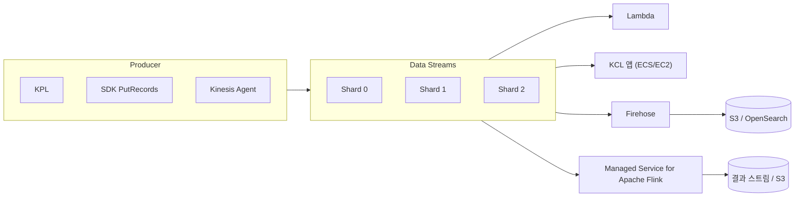
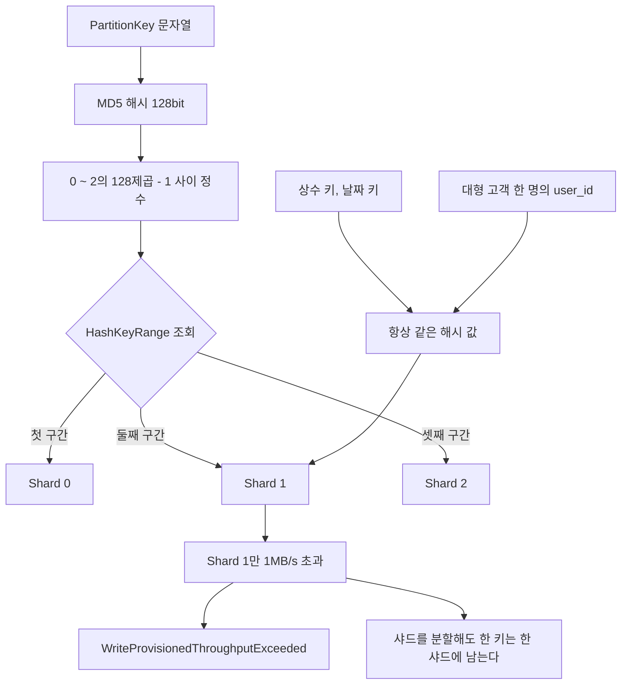
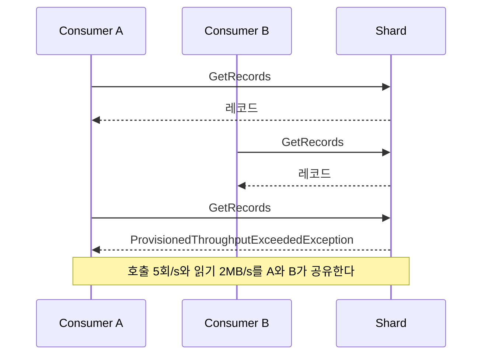
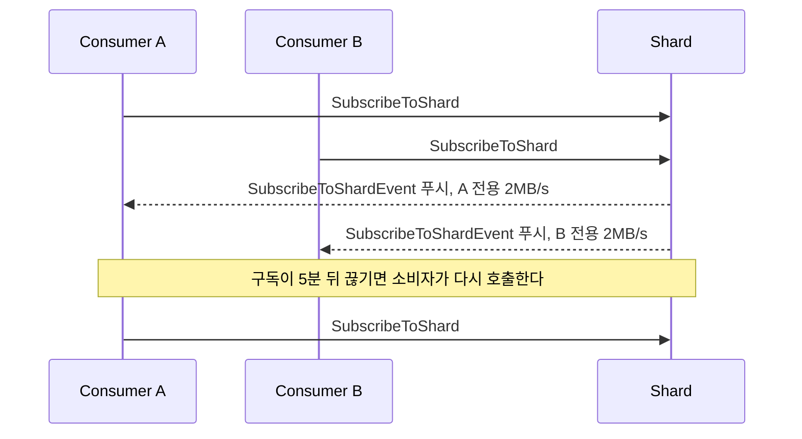

# Amazon Kinesis

Kinesis Data Streams는 레코드를 샤드에 순서대로 쌓아 두고, 소비자마다 자기 위치에서 읽게 하는 스트림 저장소다. 큐와 달리 읽어도 지워지지 않고 보존기간 안이면 되감아 다시 읽는다. 이 성질 때문에 재처리와 다중 소비가 되고, 핫 샤드·소비 지연·조용한 유실도 생긴다.

## Kinesis 계열 서비스 구분

| 서비스 | 하는 일 | 직접 코드를 쓰는 곳 |
|---|---|---|
| Data Streams | 샤드 단위로 레코드를 저장하고 여러 소비자가 읽는다 | Producer, Consumer 양쪽 |
| Amazon Data Firehose | 받은 데이터를 버퍼에 모았다가 S3·Redshift·OpenSearch 등으로 전달한다 | 변환 Lambda 정도 |
| Managed Service for Apache Flink | 스트림을 윈도우 집계·조인·이상 탐지로 처리한다 | Flink 애플리케이션 |
| Video Streams | 카메라 영상 조각을 수집한다 | 이 문서에서 다루지 않는다 |

Firehose는 Amazon Data Firehose로, Kinesis Data Analytics는 Managed Service for Apache Flink로 이름이 바뀌었다. 옛 이름도 같이 검색한다.

## 전체 데이터 흐름

Producer가 쓴 레코드는 파티션 키로 샤드가 정해지고, 소비자는 같은 스트림을 각자 읽는다. Firehose와 Flink도 Lambda·KCL과 같은 소비자 자리에 있다.



## 샤드 한도와 용량 계산

쓰기는 바이트와 레코드 수 중 먼저 닿는 쪽에서 막힌다.

| 방향 | 한도 |
|---|---|
| 쓰기 | 1MB/s, 1,000 records/s |
| 읽기 (Standard) | 2MB/s, GetRecords 5회/s. 소비자 전체가 나눠 쓴다 |
| 읽기 (Enhanced Fan-Out) | 등록한 소비자마다 2MB/s |

필요한 샤드 수는 세 값 중 가장 큰 값이다.

```
쓰기 바이트  = ceil(MB/s ÷ 1)
쓰기 건수    = ceil(records/s ÷ 1000)
읽기 (Standard) = ceil(소비자 수 × MB/s ÷ 2)
```

| 상황 | 계산 | 필요 샤드 |
|---|---|---|
| 1KB 로그 5,000건/s (5MB/s) | 바이트 5, 건수 5 | 5 |
| 200B 센서 12,000건/s (2.4MB/s) | 바이트 3, 건수 12 | 12 |
| 1.5MB/s 쓰기, 소비자 4개 | 쓰기 2, 읽기 ceil(4 × 1.5 ÷ 2) = 3 | 3 |

두 번째는 대역폭이 남는데 건수 한도 때문에 12개가 필요하다. KPL 집계로 레코드를 묶으면 건수가 줄어든다. 세 번째는 소비자 4개가 모두 읽어서 읽기 쪽이 샤드 수를 정한다. Enhanced Fan-Out으로 가면 이 항이 사라진다.

샤드는 `UpdateShardCount`(균등 분할, 한 번에 2배·절반까지)나 `SplitShard`/`MergeShards`(특정 샤드)로 조정한다. 분할하면 부모 샤드는 보존기간이 끝날 때까지 남고, 소비자는 부모를 다 읽은 뒤 자식을 읽어야 순서가 유지된다. KCL과 Lambda는 이를 처리하지만 직접 만든 GetRecords 루프는 모른다.

## Partition Key와 핫 샤드

파티션 키는 MD5로 128비트 해시가 되고, 그 값이 속한 HashKeyRange의 샤드로 간다. 같은 키는 항상 같은 샤드로 가므로 순서가 보장되고, 같은 이유로 한 키가 트래픽을 독점하면 그 샤드만 막힌다. 아래쪽 두 경로가 핫 샤드가 생기는 길이다.



핫 샤드는 스트림 단위 지표에 잘 안 보인다. 전체 IncomingBytes는 총 용량 아래인데 한 샤드만 스로틀되는 일이 흔하다. 샤드 수준 지표(`EnableEnhancedMonitoring`, 추가 과금)를 켜고 ShardId별로 본다. 키 하나가 원인이면 `user_id` 뒤에 0~9 접미사를 붙여 열 개 키로 쪼개되, 접미사가 다른 키 사이의 순서는 포기한다. 순서가 필요 없으면 `ExplicitHashKey`로 샤드를 직접 고른다.

## Producer

`PutRecords`는 일부 레코드만 실패해도 HTTP 200을 돌려준다. `FailedRecordCount`를 안 보면 스로틀된 레코드를 그대로 잃는다. `Records[i].ErrorCode`가 있는 것만 골라 다시 보낸다. 재전송분은 성공분보다 뒤에 쌓이므로 엄격한 순서가 필요하면 `PutRecord`의 `SequenceNumberForOrdering`을 쓴다.

```javascript
import { KinesisClient, PutRecordsCommand } from '@aws-sdk/client-kinesis';

const client = new KinesisClient({});

async function putAll(streamName, events, maxAttempts = 3) {
  let pending = events.map(e => ({
    Data: Buffer.from(JSON.stringify(e)),
    PartitionKey: e.userId,
  }));

  for (let attempt = 1; pending.length > 0; attempt++) {
    const res = await client.send(
      new PutRecordsCommand({ StreamName: streamName, Records: pending }) // 최대 500건, 5MB
    );
    if (!res.FailedRecordCount) return;

    pending = pending.filter((_, i) => res.Records[i].ErrorCode);
    if (attempt >= maxAttempts) {
      throw new Error(`${pending.length}건 전송 실패: ${res.Records.find(r => r.ErrorCode).ErrorCode}`);
    }
    await new Promise(r => setTimeout(r, 100 * 2 ** attempt));
  }
}
```

KPL은 집계와 재시도를 해 주지만, 집계된 레코드를 Lambda나 SDK로 읽으면 여러 이벤트가 붙은 바이너리가 나온다. 소비 쪽에 deaggregation 라이브러리(KCL은 내장)가 필요하다. Kinesis Agent의 `RANDOM` 파티션 키는 분산은 되지만 순서를 포기한 설정이다.

## Consumer와 Enhanced Fan-Out

Standard 소비자는 `GetRecords`로 직접 가져온다. 샤드당 5회/s와 2MB/s를 소비자끼리 나누므로 소비자가 5개면 소비자당 평균 1초에 1번 호출하고, 지연이 1초 아래로 내려가지 않는다. Firehose와 Lambda도 Standard 소비자라 한도를 같이 쓴다.



Enhanced Fan-Out은 소비자를 등록하고 `SubscribeToShard`로 구독한다. 서버가 HTTP/2로 레코드를 밀어 주고 소비자마다 샤드당 2MB/s가 따로 잡힌다. 구독은 5분마다 끊기는데 KCL과 Lambda가 재구독한다. 소비자-샤드-시간과 GB 단위로 과금되고, 스트림당 등록 소비자는 기본 20개까지다.



Lambda의 함정은 poison pill이다. 레코드 하나가 계속 예외를 내면 이벤트 소스 매핑이 기본값(재시도 무제한)으로 그 샤드를 멈춰 세운다. 에러 없이 `IteratorAgeMilliseconds`만 오르다가 보존기간에 닿으면 처리 못 한 데이터가 삭제된다. 재시도 횟수, 배치 분할, 실패 목적지를 반드시 건다.

```bash
aws lambda create-event-source-mapping \
  --function-name event-processor \
  --event-source-arn arn:aws:kinesis:ap-northeast-2:111122223333:stream/user-events \
  --starting-position LATEST \
  --batch-size 100 --maximum-batching-window-in-seconds 5 \
  --parallelization-factor 2 \
  --bisect-batch-on-function-error \
  --maximum-retry-attempts 5 --maximum-record-age-in-seconds 3600 \
  --function-response-types ReportBatchItemFailures \
  --destination-config '{"OnFailure":{"Destination":"arn:aws:sqs:ap-northeast-2:111122223333:kinesis-dlq"}}'
```

```javascript
exports.handler = async (event) => {
  for (const record of event.Records) {
    try {
      const json = JSON.parse(Buffer.from(record.kinesis.data, 'base64').toString());
      await processEvent(json);
    } catch (err) {
      // 첫 실패 지점부터 다시 시작한다. 이후 레코드도 함께 재시도된다
      return { batchItemFailures: [{ itemIdentifier: record.kinesis.sequenceNumber }] };
    }
  }
  return { batchItemFailures: [] };
};
```

KCL은 샤드별 lease를 DynamoDB 테이블에 기록하고 워커가 나눠 가진다. 샤드 하나는 한 워커만 읽으므로 워커를 샤드 수보다 늘리면 놀기만 한다. lease 테이블 쓰기 용량이 모자라면 lease를 잃어 중복 처리가 생긴다. `GetShardIterator` 루프를 직접 짜면 체크포인트와 리샤딩이 빠지니 운영에 쓰지 않는다.

## 용량 모드와 보존기간

| 항목 | Provisioned | On-Demand |
|---|---|---|
| 용량 | 샤드 수를 직접 정한다 | 자동 확장. 직전 30일 최대 처리량의 2배까지 |
| 과금 | 샤드 시간 + PUT 페이로드 단위(25KB) | 스트림 시간 + 쓰기 GB + 읽기 GB |
| 막히는 경우 | 샤드 한도 초과 | 직전 최대치의 2배를 넘는 급증 |

온디맨드는 새 스트림에서 4MB/s로 시작하고 모드 전환 횟수에 제한이 있다. 손익 분기는 평균 대비 피크 비율이 정한다. 프로비저닝은 피크에 맞춰 샤드를 잡고 온디맨드는 쓴 GB만 낸다. 표는 us-east-1 공개 요금([요금 페이지](https://aws.amazon.com/kinesis/data-streams/pricing/)), 1KB 레코드, 한 달 720시간, 소비자 1개 기준이다. 리전별 요금으로 다시 계산해야 한다.

| 피크 / 평균 MB/s | 비율 | Provisioned (월) | On-Demand (월) |
|---|---|---|---|
| 5 / 5 | 1배 | 약 $240 | 약 $1,548 |
| 10 / 0.5 | 20배 | 약 $127 | 약 $181 |
| 20 / 0.5 | 40배 | 약 $235 | 약 $181 |
| 40 / 1 | 40배 | 약 $469 | 약 $333 |

사용량이 일정하면 프로비저닝이 훨씬 싸고, 피크가 평균의 수십 배로 튀는 스트림에서 온디맨드가 이긴다. PUT 단위는 건당 25KB 올림이라 레코드가 작을수록 프로비저닝의 GB당 요금이 오르지만, 1KB에서도 온디맨드 쓰기 요금보다 낮다. 소비자가 늘면 온디맨드는 읽기 GB가 늘어 격차가 벌어진다.

보존기간은 24시간이 기본이고 `IncreaseStreamRetentionPeriod`로 최대 365일까지 늘린다. 24시간을 넘으면 샤드 시간 단위 추가 요금이, 7일을 넘는 구간은 저장 GB와 조회 GB 요금이 붙는다. 줄이면 새 기간보다 오래된 데이터를 바로 읽을 수 없으니 `IteratorAge`부터 확인한다.

## Firehose

Firehose는 코드 없이 S3에 쌓을 때 쓴다. 버퍼가 크기(1~128MB)나 시간(0~900초) 중 먼저 닿는 쪽에서 비워지므로 버퍼를 작게 잡으면 작은 파일이 쌓여 Athena가 느려진다. Parquet 변환에는 Glue 스키마가 필요하다. Direct PUT 레코드는 5KB 단위로 올림 과금된다([요금 페이지](https://aws.amazon.com/firehose/pricing/)).

순서나 재처리가 필요하면 Firehose만 쓰지 않는다. 원본은 Data Streams에 두고 Firehose를 그 스트림의 소비자 하나로 붙인다. S3 전달이 계속 실패하면 재시도 한도(문서상 24시간) 뒤에 데이터가 버려지므로, 버킷 삭제나 KMS 권한 회수는 `DeliveryToS3.Success` 알람으로 잡는다.

```javascript
exports.handler = async (event) => {
  const records = event.records.map(record => {
    try {
      const json = JSON.parse(Buffer.from(record.data, 'base64').toString());
      if (json.email) json.email = json.email.replace(/(.{3}).*(@.*)/, '$1***$2');
      delete json.phone;
      return {
        recordId: record.recordId,
        result: 'Ok',
        data: Buffer.from(JSON.stringify(json) + '\n').toString('base64'),
      };
    } catch (e) {
      return { recordId: record.recordId, result: 'ProcessingFailed', data: record.data };
    }
  });
  return { records };
};
```

끝에 `\n`이 없으면 JSON이 한 줄로 이어 붙어 Athena가 못 읽는다. `ProcessingFailed` 레코드는 S3 대상의 `ErrorOutputPrefix` 경로로 가니 이 접두어를 지정해 둔다.

## Managed Service for Apache Flink

Flink는 샤드마다 워터마크가 따로 진행된다. 데이터가 안 들어오는 샤드 하나가 전체 워터마크를 붙잡으면 윈도우가 닫히지 않고, 에러 없이 집계만 멈춘다. `table.exec.source.idle-timeout`으로 idle 소스를 뺀다.

예전 Kinesis Data Analytics for SQL 애플리케이션은 지원 종료가 공지된 서비스라 새로 만들지 않는다. 같은 1분 집계는 Flink SQL로 쓴다.

```sql
CREATE TABLE page_views (
  page_url STRING,
  event_time TIMESTAMP(3),
  WATERMARK FOR event_time AS event_time - INTERVAL '5' SECOND
) WITH (
  'connector' = 'kinesis',
  'stream' = 'user-events',
  'aws.region' = 'ap-northeast-2',
  'scan.stream.initpos' = 'LATEST',
  'format' = 'json',
  'json.timestamp-format.standard' = 'ISO-8601'
);

SELECT page_url, COUNT(*) AS view_count,
       TUMBLE_START(event_time, INTERVAL '1' MINUTE) AS window_start
FROM page_views
GROUP BY page_url, TUMBLE(event_time, INTERVAL '1' MINUTE);
```

## 서비스 선택 기준

같은 이벤트를 여러 시스템이 읽고 되감을 일이 있으면 Data Streams나 MSK, 한 번 처리하고 끝나는 작업 큐면 SQS가 맞다.

| 서비스 | 보존기간 | 순서 보장 | 재처리 | 비용 단위 |
|---|---|---|---|---|
| Data Streams | 24시간~365일 | 샤드 안, 파티션 키 단위 | 가능. 보존기간 안에서 시간·시퀀스 지정 | 샤드 시간 또는 GB, PUT 단위 |
| Firehose | 저장 안 함. 버퍼 후 전달 | 보장 없음 | 불가. S3 백업본에서 다시 | GB (Direct PUT은 5KB 올림) |
| Managed Service for Apache Flink | 소스 보존기간에 의존, 상태는 스냅샷 | 소스 파티션 단위, 이벤트 시간은 워터마크 | 스냅샷 복원 후 소스에서 재읽기 | KPU 시간 |
| MSK | 설정값, tiered storage로 사실상 무제한 | 파티션 단위 | 가능. 오프셋 지정 | 브로커 시간 + 스토리지 GB |
| SQS | 60초~14일 (기본 4일) | Standard 보장 없음, FIFO는 MessageGroupId 단위 | 불가. 삭제되면 끝, DLQ redrive만 | 요청 수 |

SQS는 소비자가 지우면 끝이라 여러 시스템이 읽으려면 SNS 팬아웃이 필요하다. 구성은 [SQS](SQS.md)와 [SNS_SQS_Lambda_통합_메시지_파이프라인](SNS_SQS_Lambda_통합_메시지_파이프라인.md)에 있다. Kafka 생태계가 필요하면 [MSK](MSK.md)로 간다. 샤드 조정이 부담이고 트래픽이 들쭉날쭉하면 Data Streams 온디맨드가 낫다.

## 모니터링

| 지표 | 보는 이유 |
|---|---|
| `GetRecords.IteratorAgeMilliseconds` | 소비 지연. 보존기간에 닿으면 데이터가 삭제된다 |
| `WriteProvisionedThroughputExceeded` | 샤드 쓰기 한도 초과. 스트림 단위로는 핫 샤드가 가려진다 |
| `ReadProvisionedThroughputExceeded` | 소비자가 읽기 한도를 나눠 쓰다 막힘. Enhanced Fan-Out 전환 신호 |
| 샤드 수준 `IncomingBytes` | 핫 샤드 식별. 추가 과금되는 enhanced monitoring 필요 |

`IteratorAgeMilliseconds` 알람 임계값은 보존기간의 절반 아래로 잡는다. 1분 같은 값은 배포 때마다 울려 무뎌지고, 보존기간 근처에서 울리면 복구할 시간이 없다.

## 참고

- [Kinesis Data Streams 개발자 문서](https://docs.aws.amazon.com/streams/latest/dev/)
- [Amazon Data Firehose 개발자 문서](https://docs.aws.amazon.com/firehose/latest/dev/)
- [Kinesis Data Streams 요금](https://aws.amazon.com/kinesis/data-streams/pricing/)
