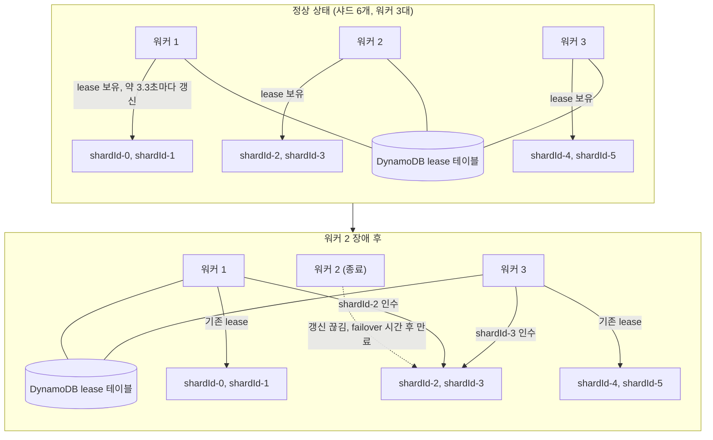
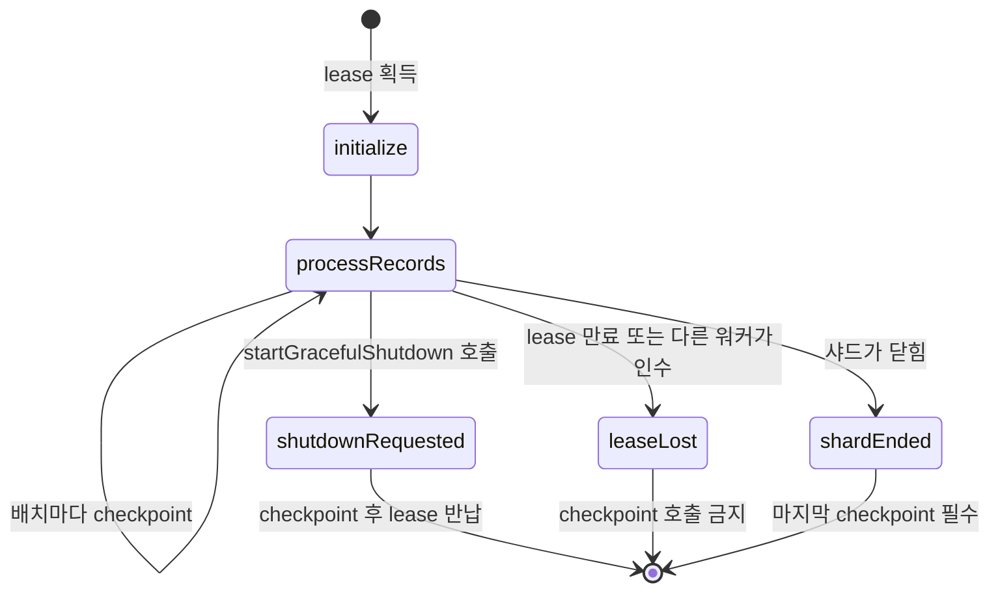
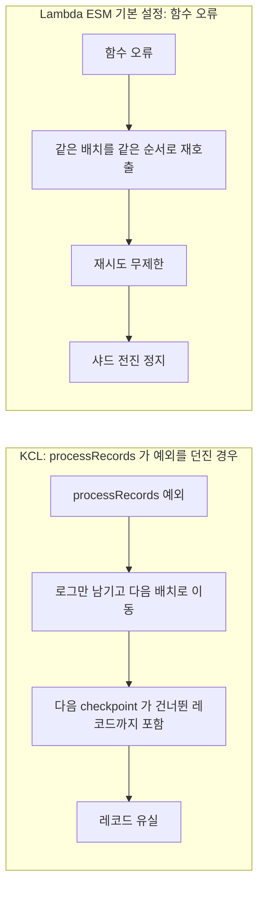
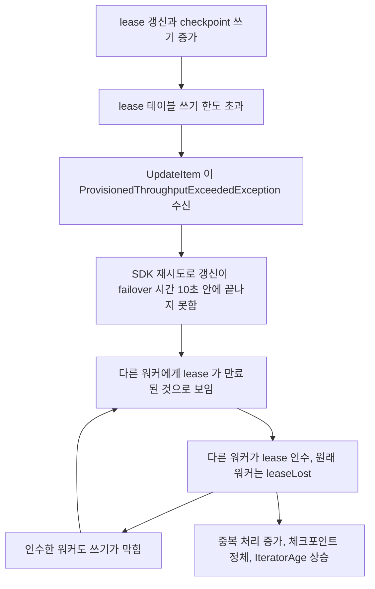
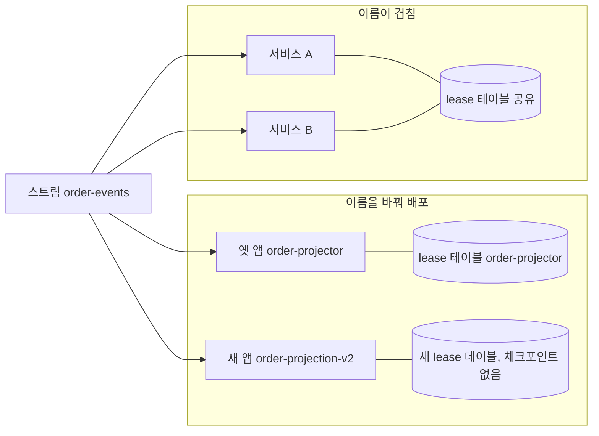
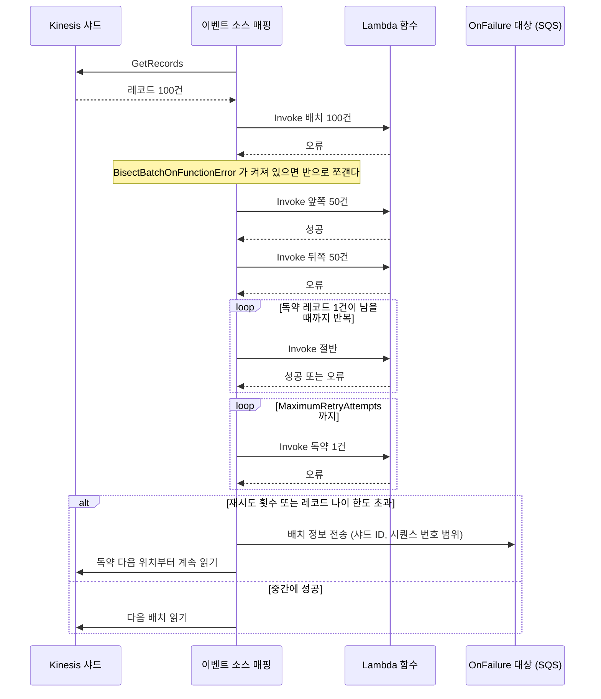
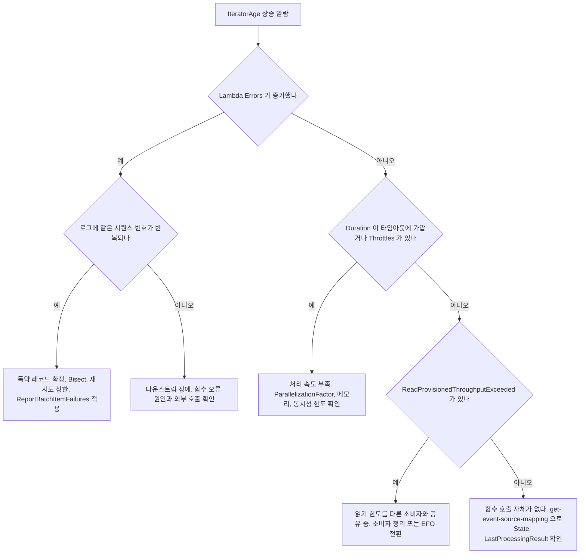
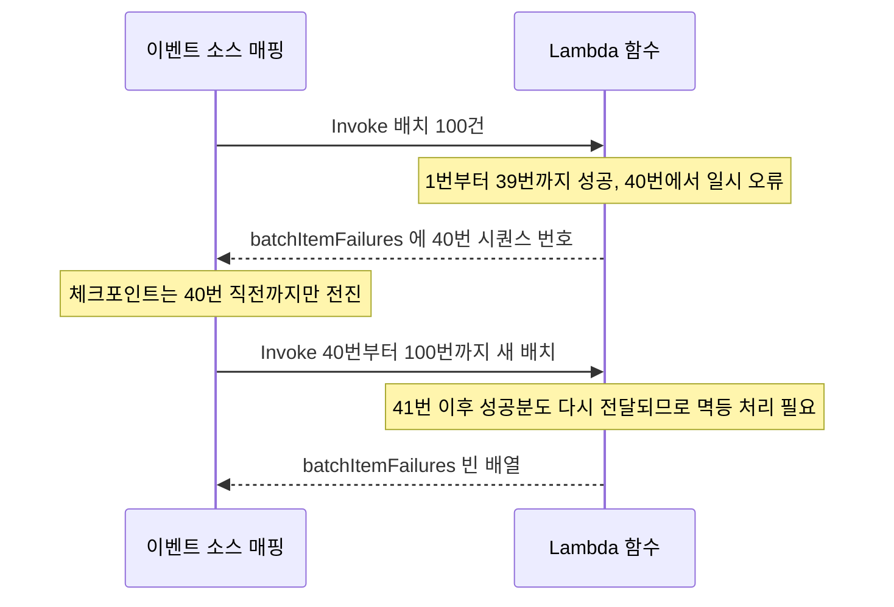
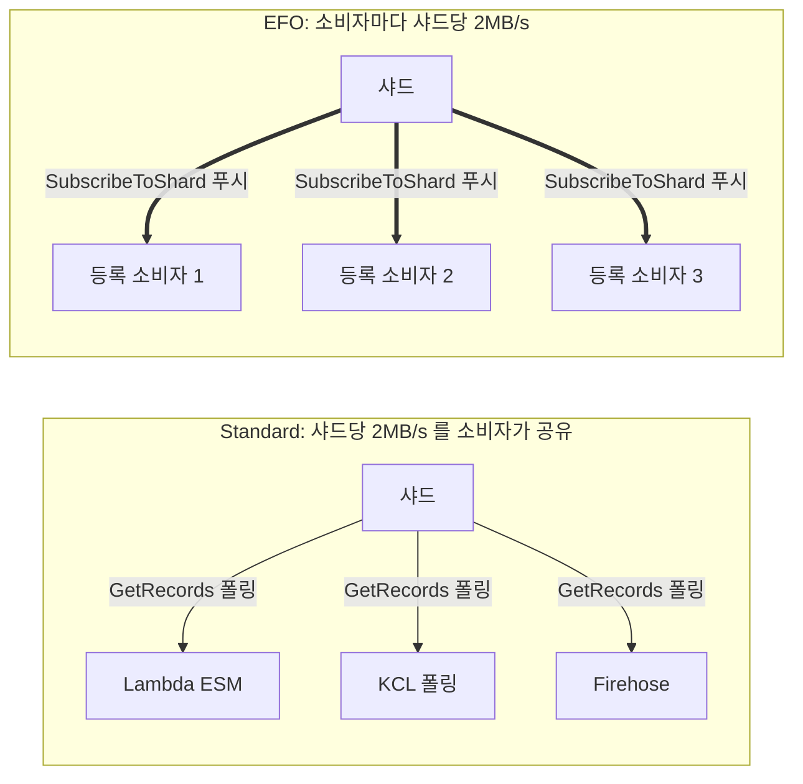
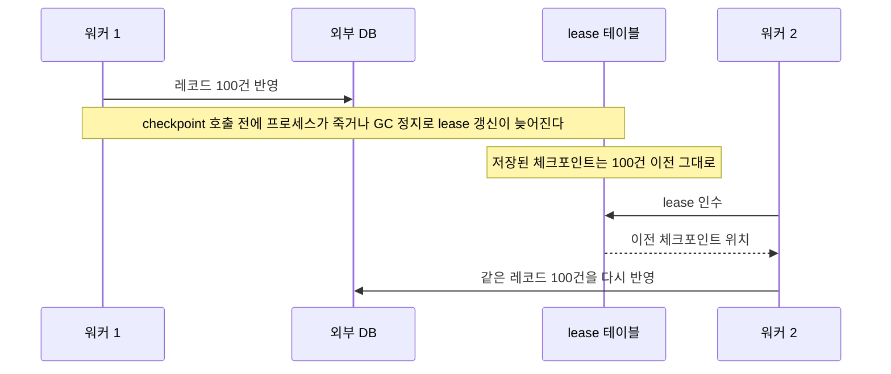

# Kinesis Consumer 구현과 장애 대응

Kinesis에 레코드를 쌓는 쪽은 한 번 잘 만들어 두면 손댈 일이 적다. 장애는 읽는 쪽에서 난다. 레코드 하나가 샤드 전체를 막고, 배포 한 번에 소비 위치가 사라지고, lease 테이블 쓰기 한도 때문에 워커가 서로 lease를 뺏는다. 이 문서는 소비자를 KCL 2.x로 만들 때와 Lambda 이벤트 소스 매핑으로 만들 때 각각 어디서 깨지는지, 어떻게 발견하고 어떻게 막는지를 다룬다. 샤드 수 산정과 리샤딩은 [Kinesis Data Streams 샤드 용량 설계와 리샤딩 운영](Kinesis_Data_Streams_Capacity_And_Resharding.md), 서비스 전체 구조는 [Amazon Kinesis](Kinesis.md)에 있다.

문서에 나오는 KCL 기본값은 `amazon-kinesis-client` 2.6.0을 받아서 클래스를 직접 열어 확인한 값이다. Java 예제는 같은 버전으로 컴파일했고, Node.js 핸들러는 AWS SDK 호출을 스텁으로 바꿔 정상·독약·중복·부수효과 실패 네 경우를 돌려 봤다. 실제 스트림에 붙여서 본 것은 아니라서, AWS 서비스 쪽 동작(Lambda 재시도 규칙, 메트릭 발행 조건)은 출처에 단 문서 기준이다.

## KCL 2.x가 샤드를 나눠 읽는 방식

KCL 애플리케이션은 `Scheduler` 하나가 중심이다. `Scheduler`는 스트림의 샤드 목록을 주기적으로 동기화하고, 샤드마다 DynamoDB lease 테이블에 행을 만들고, 자기 몫의 lease를 가진 샤드마다 `ShardRecordProcessor` 인스턴스를 띄운다. 레코드 처리 코드는 이 프로세서 안에만 들어간다.

| 구성요소 | 역할 | 깨졌을 때 증상 |
|---|---|---|
| `Scheduler` | 샤드 동기화, lease 획득·갱신, 프로세서 생성 | 프로세스가 떠 있어도 샤드를 안 읽는다 |
| lease 테이블 (DynamoDB) | 샤드당 한 행. 소유 워커, 갱신 카운터, 체크포인트 저장 | lease 이동이 반복되고 중복 처리가 늘어난다 |
| `ShardRecordProcessor` | 샤드 하나의 레코드를 받아 처리하고 `checkpoint()` 호출 | checkpoint를 안 부르면 재시작할 때마다 처음부터 읽는다 |
| 체크포인트 | 이 샤드는 여기까지 처리했다는 시퀀스 번호 | 값이 틀리면 유실 또는 중복 |

lease 테이블 이름은 애플리케이션 이름과 같다. 이 사실이 뒤에서 나오는 사고의 원인이다.

아래 도식은 샤드 6개를 워커 3대가 나눠 갖는 정상 상태와, 워커 2가 죽은 뒤 lease가 넘어가는 모습이다. 워커는 서로 직접 통신하지 않고 lease 테이블만 본다.



도식에서 볼 부분은 점선이다. 워커 2는 lease를 반납하지 않고 그냥 사라졌고, 다른 워커는 그 lease의 갱신 카운터가 `failoverTimeMillis` 동안 변하지 않는 것을 관찰한 뒤에야 가져간다. 2.6.0 기본값으로 failover 시간은 10초, 갱신 주기는 `failover / 3 - epsilon`으로 약 3.3초, lease를 가져가는 쪽의 확인 주기는 `(failover + epsilon) * 2`로 약 20초다. 갑자기 죽은 워커의 샤드는 대략 10초에서 30초 사이에 다른 워커로 넘어간다고 계산된다. 이 시간 동안 해당 샤드는 읽히지 않으므로 IteratorAge가 그만큼 오른다. 배포 때 종료 신호를 받아 `scheduler.startGracefulShutdown()`을 부르면 프로세서의 `shutdownRequested`가 호출되고 lease를 반납해서 이 대기가 줄어든다.

### 프로세서와 Scheduler 구성

아래 코드는 폴링 방식(Standard)으로 읽는 최소 구성이다. 처리한 뒤 `checkpoint()`를 호출하고, 샤드가 끝나면(`shardEnded`) 반드시 한 번 더 checkpoint를 호출한다.

프로세서 하나가 거치는 콜백 순서는 아래 상태도와 같다. 종료 콜백이 세 가지로 갈리고 각각 checkpoint를 불러도 되는지가 다르다는 점을 본다.



```java
public class OrderConsumer {

    public static void main(String[] args) throws Exception {
        String streamName = "order-events";
        String appName = "order-projector";
        Region region = Region.AP_NORTHEAST_2;

        KinesisAsyncClient kinesis = KinesisAsyncClient.builder().region(region).build();
        DynamoDbAsyncClient dynamo = DynamoDbAsyncClient.builder().region(region).build();
        CloudWatchAsyncClient cloudWatch = CloudWatchAsyncClient.builder().region(region).build();
        String workerId = InetAddress.getLocalHost().getHostName() + ":" + UUID.randomUUID();

        ConfigsBuilder cb = new ConfigsBuilder(
                streamName, appName, kinesis, dynamo, cloudWatch, workerId,
                OrderProcessor::new);

        Scheduler scheduler = new Scheduler(
                cb.checkpointConfig(),
                cb.coordinatorConfig(),
                cb.leaseManagementConfig().failoverTimeMillis(10_000L),
                cb.lifecycleConfig(),
                cb.metricsConfig(),
                cb.processorConfig(),
                cb.retrievalConfig()
                        .initialPositionInStreamExtended(
                                InitialPositionInStreamExtended.newInitialPosition(InitialPositionInStream.TRIM_HORIZON))
                        .retrievalSpecificConfig(new PollingConfig(streamName, kinesis)));

        Runtime.getRuntime().addShutdownHook(new Thread(scheduler::startGracefulShutdown));
        scheduler.run();
    }

    static class OrderProcessor implements ShardRecordProcessor {
        private String shardId;

        @Override
        public void initialize(InitializationInput input) {
            this.shardId = input.shardId();
        }

        @Override
        public void processRecords(ProcessRecordsInput input) {
            try {
                for (KinesisClientRecord r : input.records()) {
                    String body = StandardCharsets.UTF_8.decode(r.data()).toString();
                    String dedupeKey = shardId + ":" + r.sequenceNumber() + ":" + r.subSequenceNumber();
                    handleWithRetry(dedupeKey, body);
                }
                input.checkpointer().checkpoint();
            } catch (ShutdownException | InvalidStateException e) {
                throw new IllegalStateException("checkpoint 실패, lease 를 잃었을 수 있다", e);
            }
        }

        @Override
        public void leaseLost(LeaseLostInput input) {
            // lease 를 잃은 뒤에는 checkpoint 를 호출하면 안 된다
        }

        @Override
        public void shardEnded(ShardEndedInput input) {
            try {
                input.checkpointer().checkpoint();
            } catch (ShutdownException | InvalidStateException e) {
                throw new IllegalStateException("SHARD_END checkpoint 실패", e);
            }
        }

        @Override
        public void shutdownRequested(ShutdownRequestedInput input) {
            try {
                input.checkpointer().checkpoint();
            } catch (ShutdownException | InvalidStateException e) {
                // 종료 중에 lease 가 이미 넘어갔을 수 있다
            }
        }

        private void handleWithRetry(String dedupeKey, String body) {
            for (int attempt = 1; ; attempt++) {
                try {
                    handle(dedupeKey, body);
                    return;
                } catch (RuntimeException e) {
                    if (attempt == 5) {
                        sendToDeadLetter(dedupeKey, body, e);
                        return;
                    }
                    try {
                        Thread.sleep(200L << attempt);
                    } catch (InterruptedException ie) {
                        Thread.currentThread().interrupt();
                        throw e;
                    }
                }
            }
        }

        private void sendToDeadLetter(String dedupeKey, String body, RuntimeException cause) {
            // SQS 등 별도 큐로 본문과 실패 사유를 보낸다
        }

        private void handle(String dedupeKey, String body) {
            // INSERT ... ON CONFLICT (dedupe_key) DO NOTHING 같은 멱등 쓰기
        }
    }
}
```

`processRecords`가 예외를 던지면 KCL은 그 배치를 다시 주지 않는다. 2.6.0의 `ProcessTask`를 열어 보면 예외를 잡아서 `Application processRecords() threw an exception` 과 `Skipping over the following data records` 를 로그에 남기고 다음 배치로 넘어간다. Lambda의 재시도 무제한과 정반대로 조용히 유실하는 쪽이다. 다음 배치 처리 뒤의 `checkpoint()`가 건너뛴 레코드까지 포함한 위치를 기록하므로 그 레코드는 돌아오지 않는다. 그래서 위 코드처럼 재시도는 프로세서 안에서 횟수를 정해 직접 돌리고, 끝내 실패한 레코드는 별도 큐로 보낸 뒤 넘어간다. KCL에는 Lambda의 Bisect나 OnFailure 같은 장치가 없다.

같은 예외가 KCL에서는 조용한 유실로, Lambda 기본 설정에서는 샤드 정지로 이어진다. 두 흐름이 반대 방향으로 실패한다는 점이 도식의 요지다.



기본 `ConfigsBuilder`는 `retrievalSpecificConfig`를 지정하지 않으면 Enhanced Fan-Out으로 동작한다. 2.6.0의 `RetrievalConfig`가 값이 null이면 `FanOutConfig`를 만들어 넣는 것을 바이트코드에서 확인했다. 소비자 이름을 따로 주지 않으면 애플리케이션 이름으로 소비자가 등록된다. 위 코드에서 `PollingConfig`를 명시한 이유다. 이걸 모르고 KCL 앱을 두세 개 띄우면 등록 소비자 한도(스트림당 20개)와 소비자-샤드 시간당 과금을 의도하지 않고 쓰게 된다.

### 워커 수가 샤드 수를 넘으면

샤드 하나의 lease는 한 시점에 워커 한 대만 가진다. 샤드가 4개인데 워커가 6대면 두 대는 lease를 못 잡고 `Scheduler`만 돌면서 lease 테이블을 스캔한다. CPU 사용률 알람으로 오토스케일링을 걸어 둔 환경에서 이런 일이 생긴다. 읽기 처리량은 늘지 않고 인스턴스 비용만 오른다. 병렬도의 상한은 샤드 수이므로, 처리가 밀려서 워커를 늘리고 싶으면 먼저 `GetRecords.IteratorAgeMilliseconds`가 샤드 전체에서 오르는지 일부 샤드만 오르는지를 보고, 일부라면 핫 샤드를 먼저 의심한다.

반대 방향도 있다. 워커를 한 대 추가했을 때 기존 워커에서 한 번에 가져오는 lease가 `maxLeasesToStealAtOneTime`(기본 1)개이고 확인 주기가 약 20초라서, 샤드 64개를 3대에서 4대로 재분배하려면 16개를 옮겨야 하고 계산상 5분 넘게 걸린다. 급하게 워커를 늘려도 효과가 몇 분 뒤에 나온다.

### lease 테이블 쓰기가 모자랄 때

lease 갱신은 워커가 가진 lease마다 DynamoDB `UpdateItem` 하나씩이다. 갱신 주기가 약 3.3초이므로 전체 샤드 수가 N이면 갱신만으로 초당 `N / 3.3`번 쓴다. 여기에 `checkpoint()` 호출이 쓰기 한 번이다. 프로세서가 배치마다 checkpoint를 하면 샤드당 폴링 주기(기본 1.5초 안팎)마다 쓰기가 하나 더 붙는다.

| 샤드 수 | 갱신 쓰기/초 | 배치마다 checkpoint 시 합계 (대략) |
|---|---|---|
| 10 | 3 | 10 안팎 |
| 33 | 10 | 30 이상 |
| 100 | 30 | 90 이상 |

테이블을 `PROVISIONED` 쓰기 10으로 만들었다면 샤드 33개 근처에서 이미 한도에 닿는다. 한도를 넘으면 `UpdateItem`이 `ProvisionedThroughputExceededException`을 받고, SDK 재시도가 도는 동안 갱신이 failover 시간(10초) 안에 끝나지 못하는 경우가 생긴다. 갱신이 늦은 워커의 lease는 다른 워커에게 만료된 것으로 보이고, 다른 워커가 가져간다. 원래 워커는 다음 갱신에서 lease를 잃었음을 알고 `leaseLost`를 받는다. 이동한 쪽도 쓰기가 막혀 같은 일을 겪으면 lease가 워커 사이를 돌아다닌다. 처리는 하는데 중복이 늘고, 체크포인트가 전진하지 못해 IteratorAge는 오른다. 앱 로그에서 `leaseLost`와 DynamoDB 스로틀 예외가 같이 보이면 이 경우다.

이 연쇄는 한 번 시작되면 스스로 되먹임된다. 도식에서 `G`에서 `E`로 돌아가는 화살표가 lease가 워커 사이를 계속 도는 고리다.



2.6.0 기본 `LeaseManagementConfig`는 `billingMode`가 `PAY_PER_REQUEST`이고 `initialLeaseTableReadCapacity`와 `WriteCapacity`는 10이다. 10은 `PROVISIONED`로 만들 때만 쓰인다. 더 오래된 버전은 provisioned 10/10으로 테이블을 만드는 경우가 있으니 버전을 올리기 전 테이블이 어떤 설정인지 직접 열어 본다. 테이블은 처음 한 번만 만들어지고 이후 설정은 바꾸지 않으므로, 코드의 `billingMode`를 고쳐도 이미 있는 테이블에는 적용되지 않는다. 콘솔이나 CLI로 온디맨드로 전환한다.

```bash
aws dynamodb describe-table --table-name order-projector \
  --query 'Table.{billing:BillingModeSummary.BillingMode,wcu:ProvisionedThroughput.WriteCapacityUnits}'

aws dynamodb update-table --table-name order-projector --billing-mode PAY_PER_REQUEST
```

체크포인트 빈도도 같이 줄인다. 배치마다 부르지 말고 일정 시간(예: 5~10초) 또는 일정 건수마다 부르면 쓰기가 크게 준다. 대신 크래시 시 다시 처리하는 구간이 길어지므로 뒤에서 다루는 멱등 처리가 전제다.

### 애플리케이션 이름을 바꾸면

lease 테이블, CloudWatch 지표 네임스페이스, EFO 소비자 이름이 전부 애플리케이션 이름에서 나온다. 리팩터링하면서 `order-projector`를 `order-projection-v2`로 바꾸고 배포하면 KCL은 새 이름의 테이블이 없으므로 새로 만든다. 새 테이블에는 체크포인트가 없으니 `initialPositionInStreamExtended`에 지정한 위치에서 시작한다. 기본값은 `LATEST`다.

| 설정된 시작 위치 | 이름을 바꾸고 배포한 결과 |
|---|---|
| `LATEST` (기본) | 배포 시점 이후 데이터만 읽는다. 옛 앱이 처리하던 중간 구간이 통째로 빠진다 |
| `TRIM_HORIZON` | 보존기간 안의 가장 오래된 데이터부터 다시 읽는다. 하루치 중복 처리가 한꺼번에 몰린다 |
| `AT_TIMESTAMP` | 지정한 시각부터 읽는다. 전환 시각을 알면 중복과 유실 폭이 가장 좁다 |

기존 앱이 계속 도는 채로 새 이름 앱을 올리면 두 앱이 같은 레코드를 각자 처리한다. 옛 앱이 죽은 뒤 새 앱이 `LATEST`로 뜨면 그 사이 구간은 읽히지 않고, 스트림에는 남아 있는데 아무도 읽지 않으니 조용하다. 에러도 IteratorAge도 오르지 않는다.

반대 사고도 있다. 서로 다른 두 서비스가 복사한 설정 파일 때문에 같은 애플리케이션 이름을 쓰면, 두 서비스가 같은 lease 테이블을 공유해 샤드를 반씩 나눠 가진다. 각 서비스가 레코드의 절반만 받는다. 둘 다 정상 동작하는 것처럼 보이고 지표도 평온해서 오래 간다.

아래 도식은 두 사고를 나란히 놓은 것이다. 이름을 바꾸면 lease 테이블이 둘로 갈라지고, 이름이 겹치면 테이블 하나를 두 서비스가 공유한다.



이름을 바꿔야 한다면 전환 시각을 기록해 두고 `AT_TIMESTAMP`로 시작하게 하며, 쓰기는 멱등으로 만들어 둔다.

```java
InitialPositionInStreamExtended cutover = InitialPositionInStreamExtended
        .newInitialPositionAtTimestamp(Date.from(Instant.parse("2026-10-22T03:00:00Z")));
```

전환 시각은 옛 앱의 마지막 체크포인트보다 조금 앞으로 잡는다. 약간의 중복이 유실보다 낫다. 옛 lease 테이블에서 체크포인트 값을 새 테이블로 복사하는 방법도 있을 텐데, 테이블 스키마와 시작 시점의 동기화 규칙을 맞춰야 해서 이 문서에서는 시험해 보지 않았다.

## Lambda 이벤트 소스 매핑

Lambda는 KCL의 `Scheduler`와 lease 테이블 역할을 이벤트 소스 매핑(ESM)이 대신한다. ESM이 샤드를 폴링해서 배치를 만들고 함수를 동기 호출하며, 체크포인트를 서비스 내부에서 관리한다. 함수가 성공을 반환해야 그 배치의 마지막 위치로 전진한다. 같은 샤드의 배치는 한 번에 하나만 처리되므로(ParallelizationFactor가 1일 때) 샤드 내 순서가 지켜진다.

| 설정 | 기본값 | 범위 | 의미 |
|---|---|---|---|
| `BatchSize` | 100 | 1 ~ 10,000 | 한 번 호출에 넘기는 최대 레코드 수. 페이로드 6MB를 넘으면 그 전에 잘린다 |
| `MaximumBatchingWindowInSeconds` | 0 | 0 ~ 300 | 배치가 안 차도 이 시간까지 모은 뒤 호출 |
| `ParallelizationFactor` | 1 | 1 ~ 10 | 샤드 하나를 몇 개의 배치로 동시에 처리할지 |
| `BisectBatchOnFunctionError` | false | | 실패 시 배치를 반으로 쪼개서 재시도 |
| `MaximumRetryAttempts` | -1 (무제한) | -1 ~ 10,000 | 실패한 배치 재시도 횟수 |
| `MaximumRecordAgeInSeconds` | -1 (무제한) | -1, 60 ~ 604,800 | 이보다 오래된 레코드는 처리하지 않고 버림 |
| `DestinationConfig.OnFailure` | 없음 | SQS, SNS, S3 | 버려진 배치의 정보를 보낼 곳 |
| `FunctionResponseTypes` | 없음 | `ReportBatchItemFailures` | 배치 일부만 실패했다고 응답하는 기능 |

값은 문서 기준이고 서비스 쪽에서 바뀔 수 있으니 [Lambda의 Kinesis 문서](https://docs.aws.amazon.com/lambda/latest/dg/with-kinesis.html)를 같이 확인한다. 기본값에서 위험한 두 줄은 재시도 무제한과 레코드 나이 무제한이다. 실패한 배치를 보존기간이 끝날 때까지 계속 재시도한다.

아래 시퀀스는 배치 100건 중 한 건이 독약일 때 ESM이 보이는 동작이다. 실패한 배치를 반으로 쪼개 성공하는 쪽은 통과시키고, 마지막에 레코드 하나가 남으면 재시도 상한까지 돌린 뒤 OnFailure 대상으로 정보를 보내고 샤드를 넘어간다.



OnFailure 대상으로 가는 것은 레코드 본문이 아니라 배치를 가리키는 메타데이터(샤드 ID, 시작·끝 시퀀스 번호, 도착 시각, 스트림 ARN 등)다. 문서에 Kinesis 소스의 경우 그렇게 나와 있다. SQS 메시지를 열어 보고 "데이터가 없다"고 당황하기 쉽다. 본문이 필요하면 `GetShardIterator`에 `AT_SEQUENCE_NUMBER`로 시작 시퀀스 번호를 넣어 스트림에서 다시 읽는다. 보존기간이 지나면 읽을 수 없으므로 DLQ 알람은 보존기간보다 훨씬 짧은 주기로 걸어야 한다.

### 배치 크기와 창

`BatchSize` 100, `MaximumBatchingWindowInSeconds` 0이 기본이라 레코드가 들어오는 대로 작은 배치가 계속 호출된다. 호출 수가 요금과 동시성에 그대로 영향을 주는 경우에는 창을 5~10초로 둔다. 대신 처리 지연의 하한이 창만큼 늘어난다. 함수 타임아웃과 배치 크기도 같이 봐야 한다. 레코드당 처리 시간이 200ms이고 배치가 1,000건이면 한 호출이 200초 걸린다. 타임아웃(최대 15분) 안에 끝나더라도, 999번째에서 실패하면 앞의 998건이 재처리 대상이 된다. 부분 실패 응답을 쓰더라도 재처리 단위는 실패한 지점부터다.

### ParallelizationFactor

처리가 밀릴 때 샤드를 늘리지 않고 올릴 수 있는 값이다. 샤드 하나에서 최대 10개 배치가 동시에 돌고, 같은 파티션 키의 레코드는 순서를 유지한 채 같은 동시 배치에 들어간다. 샤드 16개에 10을 주면 최대 160개 동시 실행이 가능하다. 계정 동시성 한도와 함수 예약 동시성을 먼저 확인한다. 다른 함수의 동시성을 잡아먹어 스로틀을 일으킨 경우가 흔하다.

한계도 있다. 키 분포가 한쪽으로 몰려 있으면(한 고객 ID가 트래픽의 대부분) 그 키의 레코드는 한 배치로 직렬 처리되므로 값을 올려도 소용이 없다. 키를 가로지르는 순서가 필요한 로직도 깨진다. 계정 단위로 합계를 내는 집계 함수에 `ParallelizationFactor`를 올리고 키를 계정 ID로 잡지 않았다면 순서가 섞인다. 독약 레코드도 해결하지 못한다. 그 레코드와 같은 파티션 키를 가진 뒤쪽 레코드는 순서 보장 때문에 같이 막힌다.

## 독약 레코드 하나가 샤드를 막을 때

기본 설정의 ESM에서 함수가 어떤 레코드를 처리하다 예외를 던지면, 같은 배치를 같은 순서로 다시 호출한다. JSON이 깨진 레코드처럼 몇 번을 다시 해도 실패하는 레코드는 재시도 무제한이라 영원히 같은 자리를 돈다. 해당 샤드는 한 칸도 전진하지 못하고, 뒤에 쌓이는 레코드는 읽히지 않는다. 다른 샤드는 정상이라 전체 처리량 그래프에는 티가 덜 난다. 샤드가 여러 개면 에러율이 낮아 보이기까지 한다. 이 상태는 보존기간(기본 24시간)이 지나 그 레코드와 뒤의 정상 레코드들이 스트림에서 만료될 때까지 이어진다. 만료되면 처리하지 못한 레코드는 영구 유실이다.

### IteratorAge로 발견하는 순서

가장 먼저 오르는 지표는 에러율이 아니라 IteratorAge다. 한 샤드가 막히면 그 샤드에서 읽는 마지막 레코드의 나이가 시간과 같은 속도로 늘어난다. 스트림 수준 `GetRecords.IteratorAgeMilliseconds`의 `Maximum` 통계가 샤드 중 가장 막힌 것을 보여 주고, Lambda 쪽에는 `IteratorAge`가 있다. 알람이 울린 뒤 어디를 보는지는 아래 순서도로 정리된다.



CloudWatch 알람은 두 개로 나눈다. 아래는 스트림 수준 지표로 거는 CLI 예다. 임계값은 소비 지연을 얼마나 허용하는지에 따라 정하는 값이고, 아래 숫자는 보존기간 24시간 스트림 기준의 예시다.

```bash
# 경고: 1분 넘게 뒤처진 상태가 5분 이어지면
aws cloudwatch put-metric-alarm \
  --alarm-name order-events-iterator-age-warn \
  --namespace AWS/Kinesis \
  --metric-name GetRecords.IteratorAgeMilliseconds \
  --dimensions Name=StreamName,Value=order-events \
  --statistic Maximum --period 60 --evaluation-periods 5 \
  --threshold 60000 --comparison-operator GreaterThanThreshold \
  --treat-missing-data breaching \
  --alarm-actions arn:aws:sns:ap-northeast-2:111122223333:oncall-warn

# 위험: 보존기간(24시간)의 절반 = 43,200,000ms. 이 이후에는 복구 여유가 절반 이하다
aws cloudwatch put-metric-alarm \
  --alarm-name order-events-iterator-age-critical \
  --namespace AWS/Kinesis \
  --metric-name GetRecords.IteratorAgeMilliseconds \
  --dimensions Name=StreamName,Value=order-events \
  --statistic Maximum --period 300 --evaluation-periods 1 \
  --threshold 43200000 --comparison-operator GreaterThanThreshold \
  --treat-missing-data breaching \
  --alarm-actions arn:aws:sns:ap-northeast-2:111122223333:oncall-page
```

알람 설정에서 놓치기 쉬운 지점이 세 가지 있다.

- `--treat-missing-data breaching`을 준 이유는, 이 지표가 `GetRecords` 호출이 있을 때만 발행되기 때문이다. 소비자가 아예 죽어서 읽기 호출이 없으면 지표가 비고, 기본값(`missing`)이면 알람이 `INSUFFICIENT_DATA`로 가고 울리지 않는다. 소비자가 완전히 멈춘 상황이 오히려 알람을 침묵시킨다.
- 이 지표는 스트림에 `GetRecords`를 호출하는 모든 소비자를 합친 값이다. 소비자가 여러 개일 때 어느 소비자가 뒤처졌는지 알 수 없다. Lambda는 함수별 `IteratorAge`, KCL은 애플리케이션 이름 네임스페이스의 지표를 같이 걸어 구분한다.
- EFO 소비자는 `GetRecords`를 부르지 않고 `SubscribeToShard`를 쓰므로 이 지표에 잡히지 않는다. 문서상 EFO 소비자의 지연은 `SubscribeToShardEvent.MillisBehindLatest`로 본다. EFO를 쓰는 소비자만 있는 스트림에서 위 알람은 영원히 조용하다.

### 부분 배치 실패 응답

ESM에 `FunctionResponseTypes`로 `ReportBatchItemFailures`를 켜면 함수가 실패한 레코드의 시퀀스 번호를 응답으로 돌려줄 수 있다. 함수가 예외를 던지는 대신 `{ batchItemFailures: [{ itemIdentifier: "<sequenceNumber>" }] }`를 반환하면, ESM은 실패 항목 중 가장 앞선 시퀀스 번호부터 다시 호출한다. 응답에 항목이 여러 개여도 체크포인트는 가장 낮은 번호 기준이다. 빈 배열이나 `null`이 성공이다. 형식이 틀리거나 `itemIdentifier`가 비어 있으면 배치 전체 실패로 취급된다.

중요한 점은 실패 지점 이후의 레코드도 같이 다시 전달된다는 것이다. 100건 중 40번이 실패하면 41~100번 중 이미 성공한 것까지 포함해서 40번부터 새 배치가 된다. 그래서 이 방식은 멱등 처리가 전제다.

다음 시퀀스는 40번째 레코드가 일시 오류로 실패했을 때 재호출 배치가 어디서 시작하는지 보여 준다. 두 번째 호출에 이미 성공한 41번 이후 레코드가 다시 들어 있다는 점을 본다.



아래 핸들러는 오류를 두 종류로 나눈다. 같은 입력이면 영원히 실패하는 영구 오류(JSON 파싱 실패, 필수 필드 없음)는 자체 SQS에 레코드 본문째 넣고 건너뛴다. 외부 API 장애 같은 일시 오류는 해당 레코드를 실패로 보고하고 거기서 멈춘다. 뒤의 레코드는 어차피 다시 전달되기 때문에 더 처리하지 않는 편이 순서도 지키고 중복도 줄인다.

```javascript
const { DynamoDBClient, PutItemCommand, UpdateItemCommand, DeleteItemCommand } = require('@aws-sdk/client-dynamodb');
const { SQSClient, SendMessageCommand } = require('@aws-sdk/client-sqs');

const ddb = new DynamoDBClient({});
const sqs = new SQSClient({});
const DEDUPE_TABLE = process.env.DEDUPE_TABLE;
const POISON_QUEUE_URL = process.env.POISON_QUEUE_URL;

class PermanentError extends Error {}

function decode(record) {
  const text = Buffer.from(record.kinesis.data, 'base64').toString('utf8');
  let body;
  try {
    body = JSON.parse(text);
  } catch (e) {
    throw new PermanentError(`JSON 파싱 실패: ${e.message}`);
  }
  if (!body.orderId) throw new PermanentError('orderId 없음');
  return body;
}

async function claim(key) {
  const now = Date.now();
  try {
    await ddb.send(new PutItemCommand({
      TableName: DEDUPE_TABLE,
      Item: {
        pk: { S: key },
        st: { S: 'IN_PROGRESS' },
        lockUntil: { N: String(now + 60_000) },
        expireAt: { N: String(Math.floor(now / 1000) + 7 * 86400) },
      },
      ConditionExpression: 'attribute_not_exists(pk) OR (#s = :ip AND lockUntil < :now)',
      ExpressionAttributeNames: { '#s': 'st' },
      ExpressionAttributeValues: { ':ip': { S: 'IN_PROGRESS' }, ':now': { N: String(now) } },
    }));
    return true;
  } catch (e) {
    if (e.name === 'ConditionalCheckFailedException') return false;
    throw e;
  }
}

const markDone = (key) => ddb.send(new UpdateItemCommand({
  TableName: DEDUPE_TABLE,
  Key: { pk: { S: key } },
  UpdateExpression: 'SET #s = :done',
  ExpressionAttributeNames: { '#s': 'st' },
  ExpressionAttributeValues: { ':done': { S: 'DONE' } },
}));

const release = (key) => ddb.send(new DeleteItemCommand({
  TableName: DEDUPE_TABLE,
  Key: { pk: { S: key } },
}));

async function applyOrder(order) {
  // 실제 부수효과. 외부 API 호출이나 DB 쓰기
}

exports.handler = async (event) => {
  for (const record of event.Records) {
    let order;
    try {
      order = decode(record);
    } catch (e) {
      if (!(e instanceof PermanentError)) throw e;
      await sqs.send(new SendMessageCommand({
        QueueUrl: POISON_QUEUE_URL,
        MessageBody: JSON.stringify({
          reason: e.message,
          eventID: record.eventID,
          data: record.kinesis.data,
        }),
      }));
      continue;
    }

    const key = order.eventId ?? record.eventID;
    if (!(await claim(key))) continue;

    try {
      await applyOrder(order);
      await markDone(key);
    } catch (e) {
      await release(key).catch(() => {});
      return { batchItemFailures: [{ itemIdentifier: record.kinesis.sequenceNumber }] };
    }
  }
  return { batchItemFailures: [] };
};
```

이 핸들러에 세 건짜리 배치를 넣어 본 결과는 다음과 같다. 정상, 깨진 JSON, 정상 순서면 깨진 JSON은 SQS로 빠지고 응답은 빈 배열이다. 같은 이벤트 ID가 다시 오면 `claim`이 `false`를 반환해서 건너뛴다. 두 번째 레코드의 `applyOrder`가 예외를 던지면 응답이 그 레코드의 시퀀스 번호 하나이고, 세 번째는 처리하지 않으며, 그 키는 `release`로 지워져 재시도에서 다시 잡을 수 있다.

ESM 쪽은 아래처럼 건다. 재시도 상한과 레코드 나이 상한을 함께 주지 않으면 부분 실패 응답만으로는 일시 장애가 오래 가는 경우를 막지 못한다.

```bash
aws lambda update-event-source-mapping \
  --uuid 14e0db71-xxxx-xxxx-xxxx-example \
  --function-response-types ReportBatchItemFailures \
  --bisect-batch-on-function-error \
  --maximum-retry-attempts 5 \
  --maximum-record-age-in-seconds 3600 \
  --destination-config '{"OnFailure":{"Destination":"arn:aws:sqs:ap-northeast-2:111122223333:order-events-failed-batches"}}'
```

`MaximumRecordAgeInSeconds`를 3600으로 두면 한 시간 넘게 지난 레코드는 처리 시도 없이 버려진다. 다운스트림이 두 시간 장애 난 뒤 복구돼도 그 시간대 레코드는 이미 OnFailure 대상으로 갔다. 결제나 정산처럼 유실이 곤란한 스트림은 이 값을 보존기간에 가깝게 잡고 OnFailure 처리 절차(SQS에서 시퀀스 번호를 읽어 스트림에서 다시 가져오는 도구)를 먼저 만들어 둔다.

## Standard와 Enhanced Fan-Out 고르기

Standard 소비자는 샤드당 2MB/s 읽기와 초당 5회 `GetRecords`를 같은 스트림의 소비자끼리 나눠 쓴다. Lambda ESM과 KCL 폴링, Firehose가 모두 이 한도를 공유한다. 소비자가 2개일 때는 문제가 드러나지 않다가, 세 번째를 붙이는 날 `ReadProvisionedThroughputExceeded`가 뜨고 모든 소비자의 IteratorAge가 같이 오른다. 새 소비자가 기존 소비자를 느리게 만드는 일이 생기는 것이 Standard의 특징이다.

Enhanced Fan-Out(EFO)은 소비자를 스트림에 등록하고 `SubscribeToShard`로 구독한다. 소비자마다 샤드당 2MB/s가 독립이다. Lambda ESM은 이벤트 소스 ARN에 스트림이 아니라 등록한 소비자 ARN을 주면 EFO로 읽고, KCL은 앞서 본 대로 `FanOutConfig`가 그 역할이다. EFO는 읽는 방식이고 Lambda나 KCL과 겹치는 선택지가 아니다. 아래 표는 세 가지를 같은 기준으로 놓은 것이다.

먼저 읽기 대역폭이 어떻게 나뉘는지를 도식으로 본다. Standard는 한 샤드의 한도를 소비자들이 나눠 쓰고, EFO는 소비자마다 따로 받는다.



| 기준 | Lambda ESM (Standard) | KCL (Standard 폴링) | EFO (Lambda·KCL의 읽기 방식) |
|---|---|---|---|
| 지연 | 샤드당 1초 간격 폴링 + 배치 창 | 폴링 간격 기본 1.5초 (`idleTimeBetweenReadsInMillis`, 2.6.0) | 푸시. 문서에는 평균 70ms 수준으로 적혀 있다 |
| 운영 부담 | 낮다. ESM 설정과 알람 | 높다. 앱 배포, lease 테이블, 워커 스케일링, 체크포인트 코드 | 소비자 등록과 20개 한도 관리. 재구독은 라이브러리가 한다 |
| 비용 | 함수 호출·실행 시간 | 인스턴스 + DynamoDB lease 테이블 + CloudWatch 지표 | 소비자-샤드-시간 + 읽은 GB. Standard 읽기에는 없는 항목 |
| 순서 보장 | 샤드 내 순서. 병렬 계수가 1보다 크면 파티션 키 단위 | 샤드 내 순서 | 읽는 방식과 무관. 순서는 위 두 열이 결정 |
| 병렬도 상한 | 샤드 수 × 병렬 계수(최대 10) | 샤드 수 | 소비자마다 독립된 읽기 대역폭 |
| 실패 처리 | 재시도, Bisect, OnFailure 내장 | 직접 구현 | 해당 없음 |
| 소비자 간 간섭 | 있다 (한도 공유) | 있다 (한도 공유) | 없다 |

선택 기준은 소비자 수가 먼저다. 읽는 소비자가 3개 이상이거나 앞으로 늘어날 것이면 EFO를 쓰고, 1~2개이고 지연이 수 초 단위여도 되면 Standard로 충분하다. 샤드당 읽기 대역폭 2MB/s를 소비자 수로 나눠 보면 기준이 보인다. 쓰기가 샤드당 1MB/s에 가깝게 차 있는 스트림에서 소비자가 3개면 각자 평균 0.67MB/s밖에 못 읽는데 실제 데이터는 1MB/s로 들어와서 모두가 뒤처진다. 쓰기가 0.2MB/s 수준이면 소비자 5개도 문제가 없다. 호출 횟수 쪽 한도(초당 5회)는 폴링 간격이 1초 이상이면 소비자 5개까지는 걸리지 않는다.

비용은 소비자 수 × 샤드 수 × 시간으로 늘어난다. 샤드 64개에 EFO 소비자 3개를 한 달 내내 두면 `3 × 64 × 730 = 140,160` 소비자-샤드-시간이다. 샤드가 많은 스트림일수록 소비자 하나 추가의 비용이 커진다. 단가는 [Kinesis Data Streams 요금](https://aws.amazon.com/kinesis/data-streams/pricing/)에서 리전별로 확인하고 위 시간 수에 곱한다. 읽은 데이터 GB 요금이 별도로 붙는다. 이 때문에 샤드 수가 많고 소비자가 하나뿐인 스트림은 EFO가 필요 없다.

등록 소비자는 스트림당 기본 20개가 한도다. 개발 환경에서 KCL 앱을 이름만 바꿔 여러 번 띄우면서 `FanOutConfig`가 만든 소비자가 정리되지 않고 남는 경우가 있다. `list-stream-consumers`로 주기적으로 정리 대상을 확인한다.

```bash
aws kinesis list-stream-consumers \
  --stream-arn arn:aws:kinesis:ap-northeast-2:111122223333:stream/order-events \
  --query 'Consumers[].{name:ConsumerName,status:ConsumerStatus,created:ConsumerCreationTimestamp}'
```

## 중복 처리와 멱등성

Kinesis 소비는 at-least-once다. 처리는 했는데 처리했다는 기록(체크포인트)을 남기기 전에 끊기면 다시 처리된다. 다음 도식은 KCL에서 체크포인트 직전에 워커가 멈췄을 때 중복이 생기는 순서다.



도식에서 볼 부분은 DB 반영과 체크포인트 사이의 틈이다. 이 틈은 줄일 수는 있어도 없앨 수는 없다. 체크포인트를 레코드마다 하면 틈은 좁아지지만 lease 테이블 쓰기가 앞에서 본 것처럼 늘어난다.

중복이 생기는 경로는 소비자 쪽만이 아니다.

| 경로 | 중복의 모양 | 시퀀스 번호로 거를 수 있나 |
|---|---|---|
| 소비자 크래시, 재시작 | 같은 레코드를 다시 받는다 | 가능. 시퀀스 번호가 같다 |
| lease 이동, 리샤딩 | 체크포인트 이후 구간을 다른 워커가 다시 읽는다 | 가능 |
| Lambda 재시도, 부분 실패 응답 | 성공한 레코드가 다시 온다 | 가능 |
| Producer의 `PutRecords` 재시도 | 같은 이벤트가 스트림에 두 번 쓰인다. 시퀀스 번호가 서로 다르다 | 불가능 |

마지막 줄이 함정이다. Producer가 타임아웃을 받고 재전송하면 서버에는 이미 쓰였을 수 있고, 두 레코드는 다른 샤드 위치에 다른 시퀀스 번호로 들어 있다. 소비자가 `shardId + sequenceNumber`만 멱등 키로 쓰면 이 중복은 통과한다. Producer가 이벤트를 만들 때 페이로드에 직접 이벤트 ID(UUID 또는 업무 키)를 넣고, 소비자는 그걸 키로 쓴다. 앞의 핸들러에서 `order.eventId ?? record.eventID`로 둔 순서의 이유다. 이벤트 ID가 없는 이전 형식 레코드만 `eventID`(Lambda가 주는 `샤드ID:시퀀스번호`)를 쓴다. KCL의 Java 예제에서 `subSequenceNumber`까지 키에 넣은 이유는, KPL로 묶인(aggregated) 레코드 하나가 여러 사용자 레코드로 풀릴 때 같은 시퀀스 번호를 공유하기 때문이다.

멱등 키를 저장하는 방식에도 순서 문제가 있다. 부수효과를 하기 전에 키를 먼저 저장하고(`INSERT`), 그 뒤 부수효과가 실패하면 키만 남는다. 재시도에서 "이미 처리됨"으로 판단해 건너뛰어서 그 레코드는 영원히 처리되지 않는다. 앞의 `claim`이 `IN_PROGRESS`와 잠금 만료 시각을 쓰고, 실패하면 `release`로 지우는 구조가 이 때문이다. 이 구조도 완벽하지는 않다. `applyOrder`가 성공하고 `markDone` 전에 함수가 죽으면 키는 `IN_PROGRESS`로 남고, 잠금 시간(60초)이 지난 뒤 재시도에서 부수효과가 한 번 더 실행된다.

가장 안전한 방법은 부수효과 대상이 RDB일 때 키 저장과 결과 쓰기를 같은 트랜잭션에 넣는 것이다. `processed_events(event_id PRIMARY KEY)`에 `INSERT`하고 같은 트랜잭션에서 비즈니스 테이블을 갱신한다. 트랜잭션이 실패하면 키도 같이 롤백되니 "키만 남는" 상태가 없다. 대상이 외부 API라면 그 API가 멱등 키 헤더(`Idempotency-Key`)를 받는지 보고, 받으면 이벤트 ID를 그대로 넘긴다. 둘 다 안 되면 위처럼 상태를 가진 키로 중복 확률을 줄이는 수준에서 멈추고, 그 한계를 문서화해 둔다.

멱등 키 테이블은 TTL을 둔다. 앞의 코드에서 `expireAt`을 7일로 둔 이유는 중복이 올 수 있는 기간이 대체로 스트림 보존기간 안쪽이기 때문이다. 보존기간을 7일로 늘린 스트림에서 키 TTL이 24시간이면 이틀 전 레코드를 재처리할 때 키가 이미 지워져 있다. 키 TTL은 스트림 보존기간 이상으로 둔다.

## 출처

- [Using Lambda with Kinesis](https://docs.aws.amazon.com/lambda/latest/dg/with-kinesis.html): 이벤트 소스 매핑 설정 항목, 기본값과 범위, 재시도와 OnFailure 대상
- [Reporting batch item failures](https://docs.aws.amazon.com/lambda/latest/dg/services-kinesis-batchfailurereporting.html): `ReportBatchItemFailures` 응답 형식과 재시도 시작 위치
- [Developing consumers using KCL](https://docs.aws.amazon.com/streams/latest/dev/shared-throughput-kcl-consumers.html): lease 테이블, 체크포인트, 워커 동작
- [Developing custom consumers with dedicated throughput (Enhanced Fan-Out)](https://docs.aws.amazon.com/streams/latest/dev/enhanced-consumers.html): 소비자 등록, `SubscribeToShard`, 소비자당 처리량
- [Handling duplicate records](https://docs.aws.amazon.com/streams/latest/dev/kinesis-record-processor-duplicates.html): 생산자 재시도와 소비자 재시작이 만드는 중복
- [Monitoring with CloudWatch](https://docs.aws.amazon.com/streams/latest/dev/monitoring-with-cloudwatch.html): `GetRecords.IteratorAgeMilliseconds`, `SubscribeToShardEvent.MillisBehindLatest`
- [Kinesis Data Streams Quotas and Limits](https://docs.aws.amazon.com/streams/latest/dev/service-sizes-and-limits.html): 샤드당 읽기 한도, 등록 소비자 수
- [Kinesis Data Streams 요금](https://aws.amazon.com/kinesis/data-streams/pricing/): 소비자-샤드-시간 단가
- [amazon-kinesis-client](https://github.com/awslabs/amazon-kinesis-client): KCL 2.x 소스. 이 문서의 기본값은 2.6.0 기준
